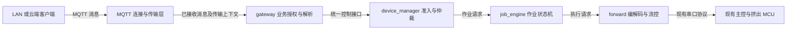
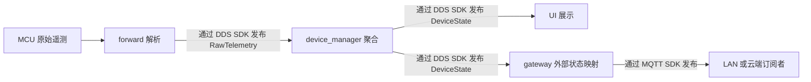

# 通信工程师职责与接口边界

> **2026-10-29 用户明确的代码归属：** Fast DDS和D-Bus是当前`soc-ap`仓内的独立代码模块，分别由ENG-DDS、ENG-DBUS长期维护。SDK源码/API/构建/配置/生成/测试与上游源码版本、许可证、补丁一起交付；共用构建由INTEGRATOR单点维护。[模块维护规范](../../docs/planning/communication_modules_ownership_20261029.md)为本轮具体落地约束。

> **2026-10-29 当前阶段口径：** 用户已确认VMware→SoC两阶段尽量1:1孪生。阶段一就运行已接受的真实模块/进程/管理/IPC和可见浏览器界面，阶段二复用源码、契约、界面并作平台适配及实板复验。历史“先同进程/CLI、首轮不等UI或总线”仅适用原MS/CR最小查询，不作为本轮出口。新职责/依赖/独立验收按[两阶段执行总表](../../docs/planning/vmware_soc_twin_task_execution_20261029.md)；最多两张实现票并行、唯一控制路径、真实HIL及独立检查要求保留。

用户已要求为 DDS、D-Bus、MQTT 增设专职工程师。当前保留 **ENG-DDS、ENG-DBUS、ENG-MQTT** 三个工程角色，分别维护可复用库上的通信底座与统一 SDK。公共通信契约由 ARCH 维护，业务行为仍由原模块 Owner 实现。

工程师是角色的一类，三项岗位不表示已经运行三个 Agent。岗位分类见 [[AI_SoC_协作方案/02_模块与Agent职责]]；实际任务由 COORD 登记执行者、检查者与交接入口，按本轮所需能力启动。下文 DDS/DBUS/MQTT、FWD/NET/STATE/JOB 是对应 ENG-* 岗位的阅读简称。

## 1. 三个角色的范围

| 角色 | 主要工作 | 建议独占目录 | 交付物 |
| --- | --- | --- | --- |
| ENG-DDS | Fast DDS 适配、participant／publisher／subscriber、发现、序列化、QoS、UDP／SHM 配置、生命周期和资源监测 | `middleware/dds/`、`config/dds/`、`tests/dds/` | 统一 pub/sub SDK、可复现绑定生成、配置片段、跨进程和压力测试证据 |
| ENG-DBUS | D-Bus 调用／导出封装、异步方法、属性和信号、名称拥有权、服务消失和重启、超时错误、系统总线权限 | `middleware/dbus/`、`config/dbus/`、`tests/dbus/` | 客户端／服务端 SDK、契约生成绑定、权限配置源、调用与恢复测试 |
| ENG-MQTT | MQTT 客户端／Broker 适配、TLS、传输身份、订阅、QoS、keepalive、会话、断网重连、LWT、retain 和队列上限 | `middleware/mqtt/`、`services/mqtt_agent/`、`config/mqtt/`、`tests/mqtt/` | 连接 SDK 或通用传输服务、Broker 配置源、状态接口、断网和重复消息测试 |

DDS/D-Bus本轮路径已映射至当前soc-ap仓：middleware/dds与middleware/dbus及各自config/tests/third_party维护区。目录入口已建立，SDK实现仍待TWIN-05/06；不从零重写上游Fast DDS/D-Bus。MQTT按后续批准范围映射。具体库版本、语言接口、进程部署和 ABI 在通信契约任务中验证并冻结。

## 2. 传输、契约和业务分别归谁

| 对象 | Owner | 其他角色的参与方式 |
| --- | --- | --- |
| 命令／状态的业务语义与验收 | STATE／JOB／相关业务模块 | 提交字段、单位、错误、状态与时序需求 |
| Topic／IDL、D-Bus XML、MQTT envelope、跨总线路由、错误映射 | ARCH | 通信与业务 Owner 一起评审；ARCH 维护权威 schema |
| 通信 SDK、协议生命周期和配置实现 | 对应 DDS／DBUS／MQTT 工程师 | 按已冻结契约实现，提出能力／预算问题 |
| 生成的序列化／stub 绑定 | 对应通信工程师负责生成流程 | 按 schema 版本和生成器版本生成，禁止手工改生成文件 |
| 业务服务内的 SDK 调用和 handler | 该服务 Owner | 通信工程师提供示例／评审，不同时编辑业务目录 |
| MQTT 传输认证和 Broker Topic ACL | MQTT | NET 提供业务身份映射；INTEGRATOR 装配批准的配置 |
| 用户／设备的业务权限与外部命令映射 | NET | STATE 校验执行条件，JOB／FWD 执行所属动作 |
| 设置落盘、服务管理、OTA 编排 | 对应业务服务／INTEGRATOR | DBUS 提供调用框架，不复制这些业务 |
| Marlin 运行通信与 MCU 升级模式的适配 | FWD | 业务请求通过批准接口进入；其他协议角色不打开 UART |

**通信角色负责“怎么送”，业务角色负责“送什么、允许做什么、如何执行”。** 语义和实现共同决定 QoS、超时和缓冲，不能各自独立承诺端到端效果。

## 3. 推荐的通信分面

- **DDS**：SoC 服务间的遥测、作业状态、设备状态和事件发布订阅；每个 Topic 登记唯一权威发布者或明确的多发布者仲裁规则。
- **D-Bus**：配置读取／持久化请求、系统能力、服务与升级等方法／属性／信号接口；业务动作由被调用服务实现。
- **MQTT**：设备对 LAN／云的消息传递；只读状态可与操作命令采用不同策略。是否启用云端仍由产品范围决定。
- **forward 的串口协议**：对接真实 MCU，独占物理 UART，保留现有 MCU 的运动规划与协议。
- **HTTP／文件通道**：由 NET 负责完整文件上传、校验与可用态；DDS／MQTT 消息携带文件 ID、哈希和状态，不默认承载整个切片包。

这是本项目的通道划分，不是协议标准对业务用途的硬性限制。DDS 或 D-Bus 是否承载某个即时控制请求，要在 ARCH 的唯一控制路由中明确，避免同一动作从两条通道绕开准入或重复执行。

## 4. 两个端到端示例

### 外部打印请求

MQTT 工程师维护第一段通信能力；NET 实现外部消息到业务 API 的映射；STATE 和 JOB 决定是否启动及如何调度。具体同进程 SDK 或独立 mqtt_agent 的连接方式由 ICD 冻结，以上不强制进程数量。

### 温度遥测和状态传播

DDS 工程师维护传输和订阅机制；FWD 和 STATE 分别拥有原始及聚合内容；MQTT 工程师不另建一套整机状态。

## 5. 公共看板增加通信契约登记

每个 Topic、方法或信号登记一行，字段至少包括：

`contract_id、协议、名称、schema 版本、内容 Owner、发布者／服务端、订阅者／调用者、参数单位、权限、QoS、超时／过期、队列上限、幂等／恢复、变更任务、验收证据`。

同一 Topic 只有一个权威内容 Owner；SDK Owner 与内容 Owner 分开填写。通信 Engineer 提出配置修改，通过 ARCH 和受影响业务 Owner 评审后，由 COORD 更新对应任务版本。MQTT 与 DDS 的 Topic 即使名称相似，也必须有显式映射，避免桥接回环。

## 6. 必须验证的边界

- DDS 的匹配、兼容性、晚加入订阅、服务重启、慢消费者和历史缓存；QoS 不匹配时能定位原因，资源开销有上限。相关机制以选用版本为准。[Fast DDS QoS 文档](https://fast-dds.docs.eprosima.com/en/stable/fastdds/dds_layer/core/policy/standardQosPolicies.html)
- D-Bus 的方法返回／错误、属性／信号、名称消失、权限拒绝和总线重启；超时后不默认重试非幂等业务动作。[D-Bus 规范](https://dbus.freedesktop.org/doc/dbus-specification.html)
- MQTT 的 QoS、保留消息、会话与重连行为；QoS 1 可产生重复投递，操作命令必须遵守业务去重与过期契约。MQTT QoS 2 也不保证跨网关、串口和物理动作恰好执行一次。[MQTT 5.0 标准](https://docs.oasis-open.org/mqtt/mqtt/v5.0/os/mqtt-v5.0-os.html)
- **本项目默认操作命令不使用 retained 消息**；若有例外，需单独 ADR 和验收，防止订阅恢复时执行旧命令。会话恢复不等于允许重放过期控制请求。
- 统一 `command_id`、超时和结果查询；区分传输送达、业务接受和物理执行结果。重复开始、断网恢复、服务重启都不能绕过 STATE／JOB 的裁决。
- UI、网关和 MCU 控制通信联合满载时验证 CPU、内存和延迟；不把 SHM 或“可靠 QoS”直接宣传为零拷贝或硬实时。

## 7. 实施顺序

1. 先按当前小卡完成 SoC→MC：MS-18 交主机工程，MS-20/11 交候选并验收，不以三总线 SDK 为前置。从控经 MS-19 独立预期、MS-14～16 实现与 MS-21/17 候选/验收补齐；MS-22 另验团队交接。
2. 后续业务实际需要 DDS/D-Bus/MQTT 时，ARCH 接受相应消息/方法契约；承担三个通信岗位的实际执行者与业务 Owner 评审。
3. 底座在自己的目录实现/验证；业务 Owner 接调用点。目标 ABI 与资源验证只挡对应目标集成，不倒过来挡纯主机查询。
4. NET 负责 MQTT 业务映射与授权；STATE/JOB 负责实际动作，保持唯一控制路径和状态归属。
5. QA 分别验收底座和业务端到端路径，消息收到不代表动作执行。运行 Marlin 与 Bootloader 模式分别确认。

不要求所有模块同时等待全部协议完成；任务卡登记自己实际需要的通信依赖。首个客户端可先走模拟接口，但不能把模拟通过当作三种协议已验收。

## MC/TH 事实与接口消费条件

业务契约增加设备来源（MC/TH）、字段单位/有效性/采样新鲜度、错误与恢复条件、查询标识的实际支持范围、发送/接受/规划/执行位点、配置生效/保存/读回、运行/升级独占。缺字段明确 Unknown，不由 DDS/D-Bus/MQTT 底座补造遥测或完成事件。

首轮查询采用最小主机工程，FWD 向测试客户端提供已接受的查询结果；STATE 接入时由 ARCH 明确进程布局和 FWD→STATE 的方法/回调/消息契约，未选择 IPC 时保持待接受。三总线不成为第一次查询硬前置。

ARCH 拥有 Topic/schema/XML/错误映射，ENG-MQTT 拥有连接/会话/传输 ACL，ENG-NET 映射身份与业务授权，STATE/JOB 执行动作并发布权威状态；QoS/重连不证明物理动作恰好执行一次。跨目录功能引用用 PM:/SOC: 限定 ID。
