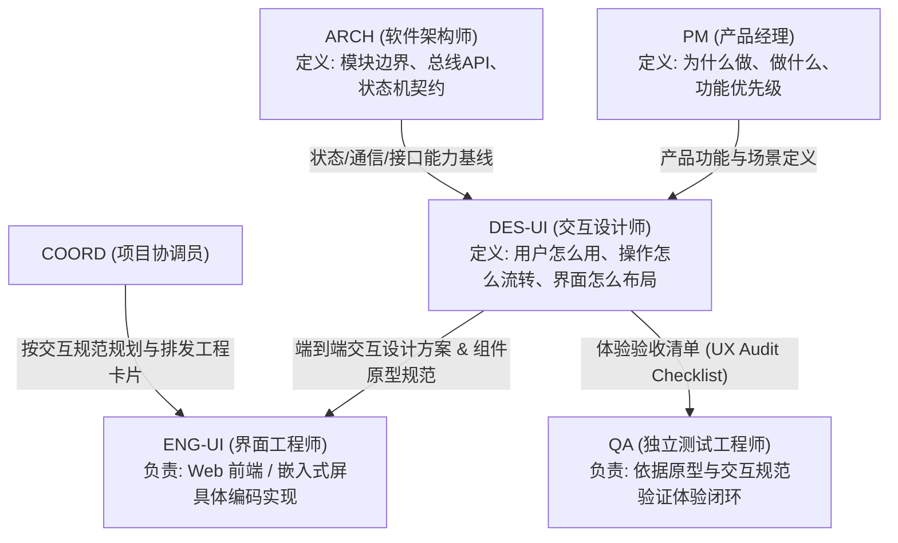

# UI/UX 交互设计师职责与交付规范

> **定位说明：** 
> 用户在首版打印闭环与 VMware 孪生运行过程中明确指出：“端到端的体验没有规划好，缺少一个 UI 交互设计师角色负责交互的设计”。
> 设立 **`DES-UI`（UI/UX 交互设计师）** 角色，归属于“需求、设计与体验协调”序列。DES-UI 站在最终用户视角，负责将 PM 的功能需求与 ARCH 的底层技术契约转化为直观、流畅、高可用且符合工业级 3D 打印机人机交互（HMI）标准的端到端用户体验与界面流转规范。

---

## 1. 角色范围与核心产物

| 属性 | 定义 |
| --- | --- |
| **角色 ID** | `DES-UI` |
| **角色全称** | UI/UX 交互设计师 / 人机交互体验专家 |
| **角色归属** | 需求、设计与体验协调组（与 PM、ARCH 紧密协同） |
| **独占设计目录** | `project-control/docs/design/ui_ux/`、`project-control/docs/design/checklists/` |
| **核心交付物** | 1. **端到端用户旅程图 (User Journey Map)**：涵盖开机、自检、校准、加载、打印、监控、故障、完成全生命周期。 2. **界面信息架构图 (Information Architecture, IA)**：清晰定义导航拓扑、页面层级、状态看板与各模块信息密度。 3. **交互规范与高保真线框图 (Interaction Spec & Wireframes)**：定义组件布局、操作手势、触控盲操区域、状态流转（正常/警告/错误/弹窗/加载）。 4. **体验验收清单 (UX Audit Checklist)**：供独立 QA 与产品验收人进行易用性核对。 |

---

## 2. 职责边界与协作关系矩阵

### 2.1 详细协作边界

| 协作对象 | 输入物（DES-UI 接收） | 输出物（DES-UI 交付） | 边界原则 |
| --- | --- | --- | --- |
| **PM** | 用户故事、首版范围决策（如 U-D01~U-D04）、功能清单与商业痛点 | 交互原型框架、操作流程图、功能可达性反馈与体验优先级建议 | DES-UI 不自行削减或增加产品功能范围；若发现体验断层，向 PM 提出体验补齐提案。 |
| **ARCH** | 硬件拓扑、双 MCU 通信时延、D-Bus/REST 接口能力、HMS 错误码模型、选项 A 安全锁死基线 | 交互时序需求、界面状态机模型、用户操作异常保护诉求 | DES-UI 不虚构硬件无法支持的物理能力（如不能在纯空跑选项 A 下设计真实的硬件点火加热按钮），交互设计必须严格锚定底层技术基线。 |
| **ENG-UI** | 技术可行性反馈、前端框架/CSS/DOM 性能瓶颈 | 高保真布局规范、Design Tokens（颜色、字体、圆角、阴影）、交互响应时序、组件空状态与极值状态规范 | DES-UI 交付清晰的设计图纸与规则，由 ENG-UI 实施落地；DES-UI 严禁直接越界编写生产 C/C++ 或核心前端代码。 |
| **QA** | 交互测试中的体验缺陷与可用性断点 | 体验验收矩阵（操作层级是否超过 3 级、急停是否全局一键可达、断料报警是否阻断误触等） | QA 依据 DES-UI 的规范进行独立体验验收（UX Review）。 |

---

## 3. 排除职责与硬性红线 (Hard Boundaries)

1. **严禁脱离底层真实技术基线**：
   - 交互设计必须基于真实硬件和通信能力（如 Option A 纯逻辑空跑 0% 强电锁死、双 MCU 串口带宽、CoreXY 运动包络）。严禁设计“虚假”或不符合安全规范的危险操作。
2. **严禁直接编写底层业务代码**：
   - DES-UI 产出设计文档、Markdown 拓扑、HTML/CSS 交互原型或 SVG/图片原型资产，不直接修改 `services/` 下的微服务源码或中间件。
3. **严禁绕过 PM 随意篡改产品范围**：
   - 若发现端到端操作存在缺失（例如缺少 G-code 上传入口），DES-UI 编制交互补齐设计提案，提交 PM 与 ARCH 确认后，由 COORD 建卡推进。
4. **统一设计标准与触控规范**：
   - 交互设计必须满足工业级 3D 打印机触控与桌面 Web 双模兼容：
     - 最小触控热区 $\ge 48 \times 48\text{ px}$；
     - 核心功能在 2 次点击（Two-Click Access）以内直达；
     - 全局紧急急停（E-STOP）永远处于视窗最顶层且 1 击触发。

---

## 4. 交互设计交付物标准模板与检查项

每次向工程团队交付交互设计前，必须完成以下 6 项自检：
1. **[ ] 全流程闭环性**：是否有始有终？是否覆盖了从文件载入到打印完成的全部关键路径？
2. **[ ] 状态完备性**：每个组件是否定义了 5 大状态（Default、Hover/Active、Loading、Disabled、Error）？
3. **[ ] 异常阻断与恢复**：当底层抛出 HMS 错误（如 0x3001 断料）时，界面是否立刻弹出明确阻断引导，并告知用户如何排查与恢复？
4. **[ ] 国际化与主题**：设计是否预留了中英文文案长度容错？是否适配深色（Dark）与浅色（Light）模式？
5. **[ ] 移动与桌面适配**：在桌面宽屏与移动触控屏（7寸/10寸屏幕）下是否有清晰的响应式网格断点？
6. **[ ] 性能与实时性要求**：对 10Hz/1Hz 的遥测高频刷新，是否设计了防抖或平滑插值过渡，避免前端卡顿？

## 5. 用户操作闭环约束（2026-11-02）

本节适用于后续交互设计、实现和复验；DES-UI定义交互预期，ARCH及相关Owner确认触发与完成契约，ENG-UI实现，独立QA按[交付门禁](delivery_and_coord_gate.md#41-正常流程优先与正负成对验收2026-11-02)验收。保留旧版设计和报告，不改写历史签署。

1. **有反馈且等待有界**：所有用户操作明确呈现执行中、成功或失败；按操作选择按钮状态、局部提示、Toast或弹窗。期限由契约确定，超时给原因、重试或下一步，禁止无限Loading或无反馈点击。
2. **正常可达与真实性同时验证**：缺硬件时显示未连接/未就绪；健康硬件连接后，负责服务必须实际触发探测并在期限内更新页面。短暂UNKNOWN是过渡状态，正常前提成立而超时未就绪判失败。只能根据满足有效性/新鲜度要求的后台结果显示就绪，不能因收到任意数据全绿。
3. **导航和持久化按语义验证**：向导完成须按设计进入工作台并保存适用完成标志；配置保存须确认后台保存结果并验证刷新/重启后的读回；Jog、暂停等操作按其契约呈现执行结果，不强制无关跳转或保存瞬态状态。受测设计须明确持久化位置及页面刷新、服务重启后的预期，前端本地标志不能冒充设备实际状态。
4. **防重复及恢复闭环**：请求在途时阻止重复副作用，失败后保留可用的恢复入口；重连重新校验状态，运动与作业不因页面刷新、按钮解锁或重连自行重复执行。
5. **从真实入口测用户旅程**：关键路径用实际浏览器操作，断言按钮状态、版本/温度刷新、跳转和适用持久化，保留截图/录像及对应后台证据。真实HIL中不得替换API或伪造设备数据。正例和对应故障/恢复用例分别判定；文案或DOM存在不等于流程完成。
