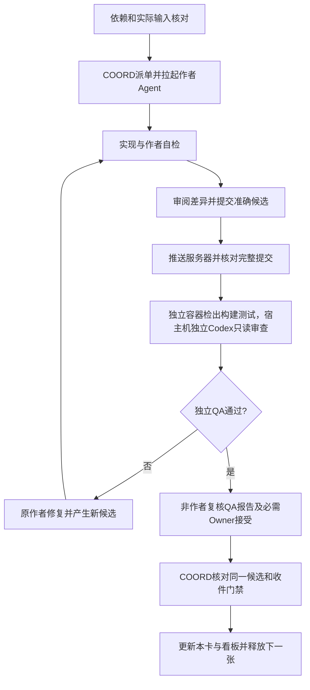

# COORD 连续调度、服务器基线和交付验收门禁

本规则约束今后的派单、复验和收件。[总控执行清单](../../docs/planning/coord_autorun_tasklist_20261029.md)是COORD的运行入口；任务卡仍为状态原件。本文建立要求，不表示自动运行器、可信服务器验收服务或沙箱已经部署。现有COORD保持唯一协调权，本助手不接管其他在途Agent。

## 1. COORD负责完整闭环

COORD读取实际卡片和证据，选择依赖满足的能力任务，落实真实作者、独立Reviewer、白名单、工作区、资源和租约，通过实际工具拉起对应Agent。角色名称、计划别名、模型名称、提示词或报告标题都不能证明已经启动会话。不得在同一个写作会话换多个角色标题凑签署。

一张卡的执行循环是：



“自闭环”指这套交付循环完整，作者不能自批。最多两张实现卡并行，物理台架/UART/探针各只有一个实际操作者。COORD等待实际工具反馈后继续，不把发出任务等同于完成。一个非作者可兼任多个评审岗位，但实际身份、各岗位判断和准确版本分别登记。

当前会话内的连续工具循环与常驻服务分开：会话结束不能声称仍在自动调度。没有持久化运行器时，保存队列游标、候选、实际Agent ID和等待事件，下一会话恢复。AUTO-02部署验收后，才可声称其已验证的常驻/重启能力。

## 2. 服务器候选是QA唯一受测源码基线

1. 作者先自检；INTEGRATOR核对差异、保留用户已有改动，再在有效授权内提交和推送。不得替别人提交未审阅改动、强推或自动合并冲突。已有发布授权可复用，不为每张普通任务重复索要授权。
2. 每次候选锁定任务/revision/run、仓库URL、远端ref和完整commit；代码、契约、配置、依赖锁、测试预期和工具分别绑定。使用现有五仓体系：总仓、project-control、soc-ap、mcu-p3、test_harness；未涉及仓库也登记所消费的准确版本，不凭历史workspace.json推定已经同步。
   各仓按各自登记的开发分支核验，不要求所有仓库对齐 `origin/main`。`mcu-p3` 当前指定远端分支为 `origin/feat/soc-debug`（本地 `feat/soc-debug`）；锁定和从服务器获取该分支的准确候选，分支不同于 `main` 本身不是拒绝理由。其他仓按各自任务/ref核验；服务器锁、检出记录和受审候选仍须一致。TWIN-06 run_02 报告中要求 MCU 对齐 `origin/main` 的判断不适用于该分支安排，历史报告原文保留；其中 project-control 候选与锁不一致等其他发现仍须独立处理，不因此改写审查结论或任务状态。
3. 使用候选分支/ref或等价的可定位候选；确认推送成功，并通过实际服务器查询及从服务器fetch后的完整commit对账。推送命令exit0、作者本机HEAD、旧bundle或refs名称本身都不能替代远端核实。
4. QA只消费服务器上的锁定提交。禁止把未提交diff、作者目录、作者构建输出或未发布测试工具复制/挂载到QA后继续宣称服务器基线验收。测试工具/黄金预期也从服务器独立版本获取，QA不得照实现输出倒推预期。
5. QA输出报告产生在候选之后。报告/日志发布为单独证据提交，明确它审阅的是先前源码候选C；收件状态提交D引用C及报告。只改报告/状态不无限递归生成“新源码候选”；业务、契约或配置变化则新建候选并复验。
6. 服务器不可达、候选未推送、锁定commit缺失或前后漂移时，该候选不能进入正式QA或被下游接受。作者可继续授权内自检和无关调查，不能使用本机文件冒充远端验收。

服务器与恢复事实见[WORKSPACE.md](../../../WORKSPACE.md)和[恢复说明](../../docs/guides/workspace_restore.md)。不在规则里放令牌/私钥。QA凭据只授予必要的读取范围，服务器验收凭据与作者/COORD写权限分离。

## 3. 独立Codex与独立沙箱必须同时成立

| 层面 | 必须满足 | 不足以证明独立的做法 |
| --- | --- | --- |
| 会话 | 与作者不同的真实Codex会话；保存实际ID、启动/运行原始记录与报告哈希的映射 | 单会话换角色、自填别名、只写请求模型 |
| 文件 | 从服务器新clone/fetch、检出锁定commit；独立Git元数据、对象库、工作目录和输出目录 | 同一开发目录、共享worktree对象库、--shared/--reference借用作者仓库 |
| 环境 | 新建VM、容器或等效受控沙箱；记录实际隔离机制、ID、镜像digest/VM快照、账户、挂载、网络和资源限制 | 仅创建/tmp目录、仅换cwd、仅建Git worktree |
| 构建 | 在沙箱内重建，记录编译器、sysroot、依赖锁和全部命令/输出；缓存须有独立受控来源 | 拷贝作者可执行文件或借用作者可写缓存后宣称复现 |
| 权限 | 沙箱不能读写作者工作树，源码按任务隔离；证据写独立位置，作者不能代写QA原始结论 | 将开发工作区或宿主Docker socket挂入QA、授予宽泛privileged权限 |
| 真实HIL | 在上述隔离下只授予已批准的物理设备/窗口，记录设备/固件身份和真实双向Hex | 以PTY/Mock代替MC/TH，把软件沙箱成功提升为物理成功 |

### 3.1 容器沙箱与外部独立审查席位分工规程（方案 1 - 规范标准做法）

1. **构建与测试隔离**：被审阅源码的检出、构建与自动化测试套件必须在独立的 Docker 容器沙箱内执行，并留存实际运行时 `docker inspect` 物证（Container ID、Image Digest、状态与只读/读写挂载卷信息）、执行日志与校验结果于 `server_qa.json` 与 `runtime.log`。`qa_runner.py` 能否完成该流程需以实际验收为准；严禁在宿主机直接跑测试充当沙箱证据。
2. **审查席位独立性**：Codex Reviewer（`platform: codex`，`model: gpt-6-luna`）作为独立的第三方审查席位，在宿主机上启动专属会话（具有唯一的 Session UUID、真实 Token 消耗与执行审计记录），对容器沙箱产出的锁定候选 Commit、`server_qa.json`、容器 Inspect 物证及交付文件进行只读审计与签署签发，规避 Docker 容器内部嵌套 Bubblewrap/User Namespaces 的系统级冲突。
3. **真实绑定与可核验性**：任务卡与审查报告中必须真实绑定：
   - 候选服务器 Commit SHA
   - Docker 容器 ID 与 Image Digest（来源于 `server_qa.json` 中的 `container_inspect`）
   - Codex Reviewer 独立会话标识及可用的运行记录；可记录 token 用量，禁止记录 API token、登录凭据或认证缓存
   - 审查报告自身的 SHA256 校验和

首次AUTO-01可由INTEGRATOR用现有可信Git、VM/容器工具手工准备隔离环境，供独立Codex审查从服务器检出的运行器候选；不得以尚未验收的自制启动器自证隔离。后续才复用已接受的运行器。QA报告也由另一未参与写作的会话复核，并绑定报告原始哈希；不要求无限递归审查行政收件回执。

宿主机 Codex 只读审阅容器受控导出的源码快照与证据，或独立取得并核对为同一服务器提交的只读快照；必须核对提交、快照与证据哈希，不得使用作者可写工作树充当验收基线。无法验证源码和容器测试候选一致时阻断收件。会话的独立性不由宿主机位置或角色名称单独证明；正式报告仍需非作者复核。此条对当前及新任务生效，历史签署和历史任务卡保留原样；旧卡中“Codex在沙箱内运行”的表述按本条新规则执行，实际变更和运行另留记录，不虚构容器或会话证据。

## 4. 每次验收必查的内容门禁

| 门禁 | ARCH/作者必须交付 | 独立QA和COORD怎样判断 |
| --- | --- | --- |
| 事实与来源 | 芯片/板型、接口地址、源码路径、BSP/驱动/传感器能力的来源、准确版本和事实类别 | 区分用户确认、源码观察、实测、提案、未知；登记冲突及处理。芯片/路径不一致不能一边留冲突一边签全通过 |
| 协议兼容 | 字段单位/符号/范围/哨兵/flags/命令变化、新旧版本、所有生产者消费者、对应修改票与复验、混版本检测或拒绝策略 | 数学上能编码不等于硬件可测。0.01°C→0.1°C属于破坏性语义变化，不能同码同布局静默解释；改设计不能冒充固件已修复 |
| 结论层级 | 每项声明对应证据及适用版本：设计、源码、构建、VM真实服务、真实MCU、SoC实板 | 禁止用文档通过覆盖代码/硬件通过。“100%原样迁移”等目标不能当事实保证；预算说明来源/批准者/测量点/负载/样本/分位数及待验证项 |
| 架构完整性 | 完整模块状态清单、首切片、发布者/消费者及数据流方向、唯一准入、队列/消息上限、慢消费者、时间/代次、ready/健康分离、停止/重启退避和日志预算 | 不只查架构图存在；逐个对照任务验收条目。远期模块可未实现，但必须明确状态，不能空进程充数 |
| 依赖与验收范围 | 每项准确前置产物、必需Owner逐项接受、未执行/不适用及依据 | 卡面Done与图检查exit0都不是输入可消费证明；待补证的字段不进入下游契约冻结/实现 |
| 通信闭环与硬件真实性 | 凡发指令必等 ACK、超时必带 Sequence ID 报错、禁止本地定时器假跑进度、物理热插拔拔线 CPU $\le 2\%$ 且 3s 内降级 OFFLINE | 检查代码中是否存在 `no_reply=TRUE` 或忽略返回值的行为；验证打印进度是否纯由 ACK 推进；在台架上实际拔出 `/dev/ttyUSB`，实测 CPU 占用与界面 503 拦截。 |

上述核对写入[交付内容审计表](templates/交付内容审计表.md)，绑定准确候选并由独立QA审阅。技术事实不能只靠关键词扫描自动判定；可信runner的真实记录、独立专业判断和机械检查共同构成放行条件。

### 4.1 正常流程优先与正负成对验收（2026-11-02）

1. **先冻结正常预期，再执行验收**：ARCH、QA及相关Owner按准确需求/ICD列全功能和用户入口，明确前置条件、触发归属、操作步骤、成功条件、完成期限和证据。先核实硬件健康、连接与版本条件，执行正常用户流程；安全前检始终先行。正常流程发现缺陷先记录Issue，阻塞依赖它的用例，继续独立可测项；不能修改预期使失败变通过。完成正常流程核查和必要修复回归后，再进行完整故障注入与恢复验收。
2. **正负用例必须配对**：涉及功能实现、硬件连通性或状态机的验收，须同时覆盖正常成功路径和相关拒绝/故障路径，并以同一功能ID关联。无硬件时正确显示“未连接/未就绪”仅证明相应负例；真实硬件正常连接时，还须在契约期限内完成主动探测、响应关联、后台状态更新和页面呈现。正常条件已成立而超时仍为UNKNOWN、数据不更新或操作无响应，应判失败并登记Issue，不能作为防御逻辑通过抵消正例缺失。
3. **覆盖完整性是收件条件**：按冻结清单逐例记录通过、失败、阻塞、未执行或不适用；不适用须有理由和Owner接受依据。任一范围内必测正例、异常或恢复用例缺失、未执行或缺有效证据时，不得对该功能签发APPROVED；任一整体验收必测项未满足时，不得签发整体验收APPROVED或推进该验收卡Done。不能只统计已执行用例的通过率，也不能在失败后临时删减范围。

### 4.2 软件与真实HIL双门禁及批准范围（2026-11-02）

| 门禁 | 必需检查与证据 | 可接受的结论范围 |
| --- | --- | --- |
| 软件门禁 | 按任务适用范围在独立服务器候选沙箱中构建，执行静态/内存检查、单元及集成测试；不适用项说明理由；独立Codex审阅按§3.1分工执行 | 仅覆盖已实际验证的软件范围；模拟设备、Mock API或离线页面结果不能提升为真实HIL通过 |
| 真实HIL门禁 | 批准范围涉及硬件通信、外设动作或依赖硬件的用户交互时，独立QA须从服务器锁定候选重新构建部署，在排他台架时段接入真实MC/TH；通过真实用户入口执行正常、故障及恢复用例，绑定设备/固件身份、请求与响应原始帧、时间戳及实际效果 | 仅覆盖准确候选、实际设备、功能及场景；Web功能须以实际浏览器自动化（如Playwright/Puppeteer）操作与断言，保留截图/录像和关联后台证据；自动化受阻时记录缺口，人工补测须事前明确接受依据和覆盖范围 |

1. 单模块软件任务可在预先确定的软件范围内接受；独立组合/HIL任务消费其准确产物后另行验证，不把最终HIL设为上游模块开工前置。文档审查、纯界面或纯网络功能按实际链路验收，不能为了形式强加不相关的MCU操作。
2. QA报告必须列明批准范围、证据层级、候选、必测清单与逐项结果，以及HIL是否必需、是否执行。软件或文档APPROVED不自动代表功能/整机HIL通过；缺台架、设备、候选或隔离证据时，按§5.3记录阻塞及解除条件，禁止完整批准。COORD在收件和释放下游前核实这些边界。
3. 命令已发送、ACK已接收、硬件已执行完成分别判定；打印推进、坐标和完成状态须具有相应硬件执行依据。仅有页面截图、报告签署、版本查询或一帧ACK，不能覆盖未执行的运动、作业等功能测试。INTEGRATOR日志供参考，独立QA须保存自己的运行证据。

### 4.3 触发归属与交互闭环（2026-11-02）

跨服务功能在ICD/任务中明确`trigger_owner`（负责触发的角色及服务）、触发事件、调用链、期限、重试/取消和完成信号；只定义存储/显示而缺少实际触发链路的功能不得接受。ARCH与相关Owner确定具体协议和时序，本规则不新增命令码或产品指标。交互功能还须按[UI交互约束](07_UI交互设计师职责与交付规范.md#5-用户操作闭环约束2026-11-02)核实反馈、失败后的下一步，以及按语义适用的导航和持久化。

正常流程验证、Issue查重/派单/回归/关闭及新增记录字段按[E2E与Issue流转规则](e2e_issue_verification_flow.md)执行。上述补充适用于新建、未完成任务及后续复验；既有Done和历史报告保留原范围，不批量重写。发现旧结论超出证据时，由COORD按§6另建复核记录并追加限制/撤回依据。这些是人工收件约束，不表示现有检查工具已实现自动拦截。

## 5. 收件与继续规则

COORD在每次Ready、Review/Verify收件以及向下游释放输入前执行相应门禁，不等待用户转贴汇报给本助手。结构检查与完成条件分别运行：

```bash
PYTHONDONTWRITEBYTECODE=1 python3 project-control/tools/check_task_graph.py --workspace .
PYTHONDONTWRITEBYTECODE=1 python3 project-control/tools/check_task_graph.py --workspace . --check-ready TWIN-02
PYTHONDONTWRITEBYTECODE=1 python3 project-control/tools/check_task_graph.py --workspace . --check-done TWIN-01
PYTHONDONTWRITEBYTECODE=1 python3 project-control/tools/coord_queue.py --workspace .
```

示例任务ID须替换成实际本票；未满足时非零退出是正常拦截，不修改脚本/预期促通过。`--check-done`补查必需评审覆盖、revision、报告哈希、会话来源证据和服务器沙箱证据引用；它只验证本地记录的结构/摘要，不证明记录真实性、不直接查询CI或服务器、不启动Agent/沙箱，也不修改状态。AUTO-01/02必须对接可信runner的实际服务端job/提交/沙箱与会话结果，不能用作者或COORD手写的JSON充当可信服务端判定。

只有同一准确候选得到全部必需接受、QA报告非作者复核及实际收件后，COORD才更新Done、投影看板、释放资源并选下一张。普通成功不请求用户再做技术审核；提交/推送按已有授权执行。资源占用、外部资料、未授权硬件/权限或产品范围决策确需用户参与时，仅提出具体缺项及影响，不把一般技术选型推给非技术用户。

### 5.1 返工次数、同因复发和升级

QA拒绝后，COORD保留原报告与候选，由原作者针对阻断项修复，产生新候选并只重验受影响范围及必要回归。

1. **一次返工如何计数：**一次有证据的返工，是一次 `REJECTED` 报告之后，作者提交了可追溯修复（变更文件/差异、对应阻断项、修复说明及新候选 SHA），再由独立 QA 对该候选出具新报告。单纯重跑命令、改 run 名、重发同一候选或无差异改写报告不算一次修复，也不清零次数。每票/每个已接受范围维护累计返工数，并记入执行记录。
2. **最多两次：**每项交付最多进行两次有证据的返工。第二次返工后仍被拒，COORD立即暂停该票的普通“作者修复→再审”循环，保存检查点并升级，不得以开新 run、拆审查报告或换 Reviewer 绕过上限。其他无依赖的任务可继续。
3. **同一阻断项复发时提前暂停：**若新 QA 报告再次指出同一根因/同一验收条件未闭环，COORD先暂停下一轮代码返工，组织 ARCH 与 QA 对照原报告、修复差异、测试预期和实际候选，写出双方认可的可执行验收判据；必要时拆分任务或修订验收范围。未完成这次对齐前，不让作者盲目重试。若同因复发发生在第二次返工，立即按第 2 条升级。
4. **区分新根因：**独立的新阻断项不自动证明旧阻断项已修复；仍须检查旧项回归。新项不能让同一根因的返工计数重置。只有 COORD 记录范围/验收基线确有正式变更及原因，才可为改变后的新范围建立新的计数；保持旧计数与历史报告可追溯。
5. **升级后怎么继续：**COORD 汇总失败报告、候选 SHA、每轮差异/测试、重复根因和待决判据，交 ARCH、QA 及相关 Owner 形成定向处理方案。方案接受前暂停该票反复提交；方案明确后，可按修订后的任务范围继续，并由新的独立 QA 验收。权限或必要外部输入缺失时保持阻塞并说明解除条件。

返工次数上限是停止无效循环的调度门禁，不是降低验收标准或强制批准的理由。超限后不能静默放宽安全/验收要求，也不能把普通改动无限送审。SoC/BSP未知只阻断对应迁移项，目标无关VM工作可继续。

### 5.2 验收判据冻结与复验清单

为避免“修了一个例子、漏掉同一规则的其他失败形态”，每项开发任务开始独立 QA 前，COORD 要把任务卡的验收条款转成编号清单；每个拒绝项也建立唯一编号，并关联条款、候选版本、文件/函数/证据、复现方法和预期结果。QA 不得仅写“未达到最佳实践”作为阻断；新增阻断必须说明违反哪项已接受条款，或指出新增风险及证据，并交 COORD 判断是否需要正式修订范围/任务版本。

作者提交修复时，随候选交付逐项整改表：`finding_id → 根因 → 修复位置/差异 → 新增或修改的测试 → 复现命令/实际结果 → 候选 commit`。没有对应项、没有实际可核验结果或仍使用旧候选时，COORD 不启动下一轮 QA，退回补齐交付材料。

独立 QA 逐项审查整改表，并执行或核对任务所要求环境里的针对性负例及必要回归。对“字段/证据必须存在且绑定准确值”这类门禁，至少检验：正确有效值可通过；字段缺失、空值、错误值、格式错误和内容/摘要不匹配均被拒绝。按被审代码实际接受的输入形态补充测试，不能仅测试一个错误值或只检查测试名称存在。验证修复的同时，检查原阻断项未复发及相邻门禁未被绕过；报告明确列出“通过、未覆盖、未执行”。

### 5.3 QA 结果分流，避免环境问题伪装成代码退修

QA 报告区分源码/任务不符合（`REJECTED`）与审查环境或来源证据无法完成核验（`BLOCKED/INCONCLUSIVE`，按项目报告 schema 可用状态记录）。后者不得反复退回作者改无关代码，也不得算作代码整改轮次；COORD 转为解决服务器只读访问、会话来源、沙箱或证据传递问题。两类问题同时存在时，分别列明：可修源码项可以授权并行处理，环境阻塞解除前不得签发通过。

每轮复验开始前，Reviewer 对照任务/QA 规则版本和此前全部未关闭发现，确认受审候选、任务 revision、实际会话及必要服务端证据齐备。任一身份或候选绑定缺失，报告应停止于无法核验；不得用一个新的代码拒绝结论掩盖环境证据缺口。AUTO-02 run_08/run_09 暴露的例子——报告文件须存在、SHA 必须从磁盘字节重算、`report_review.report_sha256` 和 `entry.report_sha256` 均不得缺失/为空且必须与实际字节 SHA 相等——作为本票专项负例，直至其新候选对所有这些情况有实际测试并经有效独立 QA 验证。

## 6. 已有成果及本次疑点怎样处理

旧正确Done和历史签署保留原范围，不批量改写。发现原接受可能不足时登记疑点、准确候选及影响范围，由实际COORD安排新独立复核，按证据追加裁决和必要状态调整；本助手和检查脚本不代写正式撤回。

当前TWIN-01的会话来源、必需Owner接受、QA报告复核、芯片/路径、温度单位兼容、迁移声明及数值预算须列入新run复核。没有解除对应疑点前，不将这些字段当作TWIN-02冻结输入。保护现有报告和在途工作；无关准备可继续，不冻结全项目。

向用户的汇报固定为：已交付及证据、实际验证层级、未完成及影响、正在运行的真实Agent/任务、下一项自动动作、确需用户处理的一件事（无则写无）。不得用“100%闭环”替代这些信息。
