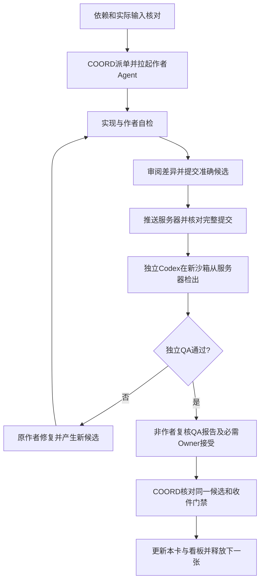

# COORD 连续调度、服务器基线和交付验收门禁

本规则约束今后的派单、复验和收件。[总控执行清单](../../docs/planning/coord_autorun_tasklist_20261029.md)是COORD的运行入口；任务卡仍为状态原件。本文建立要求，不表示自动运行器、可信服务器验收服务或沙箱已经部署。现有COORD保持唯一协调权，本助手不接管其他在途Agent。

## 1. COORD负责完整闭环

COORD读取实际卡片和证据，选择依赖满足的能力任务，落实真实作者、独立Reviewer、白名单、工作区、资源和租约，通过实际工具拉起对应Agent。角色名称、计划别名、模型名称、提示词或报告标题都不能证明已经启动会话。不得在同一个写作会话换多个角色标题凑签署。

一张卡的执行循环是：



“自闭环”指这套交付循环完整，作者不能自批。最多两张实现卡并行，物理台架/UART/探针各只有一个实际操作者。COORD等待实际工具反馈后继续，不把发出任务等同于完成。一个非作者可兼任多个评审岗位，但实际身份、各岗位判断和准确版本分别登记。

当前会话内的连续工具循环与常驻服务分开：会话结束不能声称仍在自动调度。没有持久化运行器时，保存队列游标、候选、实际Agent ID和等待事件，下一会话恢复。AUTO-02部署验收后，才可声称其已验证的常驻/重启能力。

## 2. 服务器候选是QA唯一受测源码基线

1. 作者先自检；INTEGRATOR核对差异、保留用户已有改动，再在有效授权内提交和推送。不得替别人提交未审阅改动、强推或自动合并冲突。已有发布授权可复用，不为每张普通任务重复索要授权。
2. 每次候选锁定任务/revision/run、仓库URL、远端ref和完整commit；代码、契约、配置、依赖锁、测试预期和工具分别绑定。使用现有五仓体系：总仓、project-control、soc-ap、mcu-p3、test_harness；未涉及仓库也登记所消费的准确版本，不凭历史workspace.json推定已经同步。
3. 使用候选分支/ref或等价的可定位候选；确认推送成功，并通过实际服务器查询及从服务器fetch后的完整commit对账。推送命令exit0、作者本机HEAD、旧bundle或refs名称本身都不能替代远端核实。
4. QA只消费服务器上的锁定提交。禁止把未提交diff、作者目录、作者构建输出或未发布测试工具复制/挂载到QA后继续宣称服务器基线验收。测试工具/黄金预期也从服务器独立版本获取，QA不得照实现输出倒推预期。
5. QA输出报告产生在候选之后。报告/日志发布为单独证据提交，明确它审阅的是先前源码候选C；收件状态提交D引用C及报告。只改报告/状态不无限递归生成“新源码候选”；业务、契约或配置变化则新建候选并复验。
6. 服务器不可达、候选未推送、锁定commit缺失或前后漂移时，该候选不能进入正式QA或被下游接受。作者可继续授权内自检和无关调查，不能使用本机文件冒充远端验收。

服务器与恢复事实见[WORKSPACE.md](../../../WORKSPACE.md)和[恢复说明](../../docs/guides/workspace_restore.md)。不在规则里放令牌/私钥。QA凭据只授予必要的读取范围，服务器验收凭据与作者/COORD写权限分离。

## 3. 独立Codex与独立沙箱必须同时成立

| 层面 | 必须满足 | 不足以证明独立的做法 |
| --- | --- | --- |
| 会话 | 与作者不同的真实Codex会话；保存实际ID、启动/运行原始记录与报告哈希的映射 | 单会话换角色、自填别名、只写请求模型 |
| 文件 | 从服务器新clone/fetch、检出锁定commit；独立Git元数据、对象库、工作目录和输出目录 | 同一开发目录、共享worktree对象库、--shared/--reference借用作者仓库 |
| 环境 | 新建VM、容器或等效受控沙箱；记录实际隔离机制、ID、镜像digest/VM快照、账户、挂载、网络和资源限制 | 仅创建/tmp目录、仅换cwd、仅建Git worktree |
| 构建 | 在沙箱内重建，记录编译器、sysroot、依赖锁和全部命令/输出；缓存须有独立受控来源 | 拷贝作者可执行文件或借用作者可写缓存后宣称复现 |
| 权限 | 沙箱不能读写作者工作树，源码按任务隔离；证据写独立位置，作者不能代写QA原始结论 | 将开发工作区或宿主Docker socket挂入QA、授予宽泛privileged权限 |
| 真实HIL | 在上述隔离下只授予已批准的物理设备/窗口，记录设备/固件身份和真实双向Hex | 以PTY/Mock代替MC/TH，把软件沙箱成功提升为物理成功 |

### 3.1 容器沙箱与外部独立审查席位分工规程（方案 1 - 规范标准做法）

1. **构建与测试隔离绝对性**：被审阅源码的构建、检出与自动化测试套件必须且只能在独立的 Docker/VM 容器沙箱内执行（由 `qa_runner.py` 调度管理），并留存全量运行时 `docker inspect` 物证（Container ID、Image Digest、状态与只读/读写挂载卷信息）、执行日志与校验结果于 `server_qa.json` 与 `runtime.log`。严禁在宿主机直接跑测试充当沙箱证据。
2. **审查席位独立性**：Codex Reviewer（`platform: codex`，`model: gpt-6-luna`）作为独立的第三方审查席位，在宿主机上启动专属会话（具有唯一的 Session UUID、真实 Token 消耗与执行审计记录），对容器沙箱产出的锁定候选 Commit、`server_qa.json`、容器 Inspect 物证及交付文件进行只读审计与签署签发，规避 Docker 容器内部嵌套 Bubblewrap/User Namespaces 的系统级冲突。
3. **真实绑定与可核验性**：任务卡与审查报告中必须真实绑定：
   - 候选服务器 Commit SHA
   - Docker 容器 ID 与 Image Digest（来源于 `server_qa.json` 中的 `container_inspect`）
   - Codex Reviewer 独立会话 UUID 与 Token 凭证
   - 审查报告自身的 SHA256 校验和

首次AUTO-01可由INTEGRATOR用现有可信Git、VM/容器工具手工准备隔离环境，供独立Codex审查从服务器检出的运行器候选；不得以尚未验收的自制启动器自证隔离。后续才复用已接受的运行器。QA报告也由另一未参与写作的会话复核，并绑定报告原始哈希；不要求无限递归审查行政收件回执。

## 4. 每次验收必查的内容门禁

| 门禁 | ARCH/作者必须交付 | 独立QA和COORD怎样判断 |
| --- | --- | --- |
| 事实与来源 | 芯片/板型、接口地址、源码路径、BSP/驱动/传感器能力的来源、准确版本和事实类别 | 区分用户确认、源码观察、实测、提案、未知；登记冲突及处理。芯片/路径不一致不能一边留冲突一边签全通过 |
| 协议兼容 | 字段单位/符号/范围/哨兵/flags/命令变化、新旧版本、所有生产者消费者、对应修改票与复验、混版本检测或拒绝策略 | 数学上能编码不等于硬件可测。0.01°C→0.1°C属于破坏性语义变化，不能同码同布局静默解释；改设计不能冒充固件已修复 |
| 结论层级 | 每项声明对应证据及适用版本：设计、源码、构建、VM真实服务、真实MCU、SoC实板 | 禁止用文档通过覆盖代码/硬件通过。“100%原样迁移”等目标不能当事实保证；预算说明来源/批准者/测量点/负载/样本/分位数及待验证项 |
| 架构完整性 | 完整模块状态清单、首切片、发布者/消费者及数据流方向、唯一准入、队列/消息上限、慢消费者、时间/代次、ready/健康分离、停止/重启退避和日志预算 | 不只查架构图存在；逐个对照任务验收条目。远期模块可未实现，但必须明确状态，不能空进程充数 |
| 依赖与验收范围 | 每项准确前置产物、必需Owner逐项接受、未执行/不适用及依据 | 卡面Done与图检查exit0都不是输入可消费证明；待补证的字段不进入下游契约冻结/实现 |

上述核对写入[交付内容审计表](templates/交付内容审计表.md)，绑定准确候选并由独立QA审阅。技术事实不能只靠关键词扫描自动判定；可信runner的真实记录、独立专业判断和机械检查共同构成放行条件。

## 5. 收件与继续规则

COORD在每次Ready、Review/Verify收件以及向下游释放输入前执行相应门禁，不等待用户转贴汇报给本助手。结构检查与完成条件分别运行：

```bash
PYTHONDONTWRITEBYTECODE=1 python3 project-control/tools/check_task_graph.py --workspace .
PYTHONDONTWRITEBYTECODE=1 python3 project-control/tools/check_task_graph.py --workspace . --check-ready TWIN-02
PYTHONDONTWRITEBYTECODE=1 python3 project-control/tools/check_task_graph.py --workspace . --check-done TWIN-01
PYTHONDONTWRITEBYTECODE=1 python3 project-control/tools/coord_queue.py --workspace .
```

示例任务ID须替换成实际本票；未满足时非零退出是正常拦截，不修改脚本/预期促通过。`--check-done`补查必需评审覆盖、revision、报告哈希、会话来源证据和服务器沙箱证据引用；它只验证本地记录的结构/摘要，不证明记录真实性、不直接查询CI或服务器、不启动Agent/沙箱，也不修改状态。AUTO-01/02必须对接可信runner的实际服务端job/提交/沙箱与会话结果，不能用作者或COORD手写的JSON充当可信服务端判定。

只有同一准确候选得到全部必需接受、QA报告非作者复核及实际收件后，COORD才更新Done、投影看板、释放资源并选下一张。普通成功不请求用户再做技术审核；提交/推送按已有授权执行。资源占用、外部资料、未授权硬件/权限或产品范围决策确需用户参与时，仅提出具体缺项及影响，不把一般技术选型推给非技术用户。

QA拒绝→保存原报告→原作者定向修复→新候选/新run→重新验证受影响范围。连续两次有证据纠正仍失败，或实际权限/必需外部输入不具备，COORD保存检查点并升级；不无限重试、不跳过失败。SoC/BSP未知只阻断对应迁移项，目标无关VM工作可继续。

## 6. 已有成果及本次疑点怎样处理

旧正确Done和历史签署保留原范围，不批量改写。发现原接受可能不足时登记疑点、准确候选及影响范围，由实际COORD安排新独立复核，按证据追加裁决和必要状态调整；本助手和检查脚本不代写正式撤回。

当前TWIN-01的会话来源、必需Owner接受、QA报告复核、芯片/路径、温度单位兼容、迁移声明及数值预算须列入新run复核。没有解除对应疑点前，不将这些字段当作TWIN-02冻结输入。保护现有报告和在途工作；无关准备可继续，不冻结全项目。

向用户的汇报固定为：已交付及证据、实际验证层级、未完成及影响、正在运行的真实Agent/任务、下一项自动动作、确需用户处理的一件事（无则写无）。不得用“100%闭环”替代这些信息。
