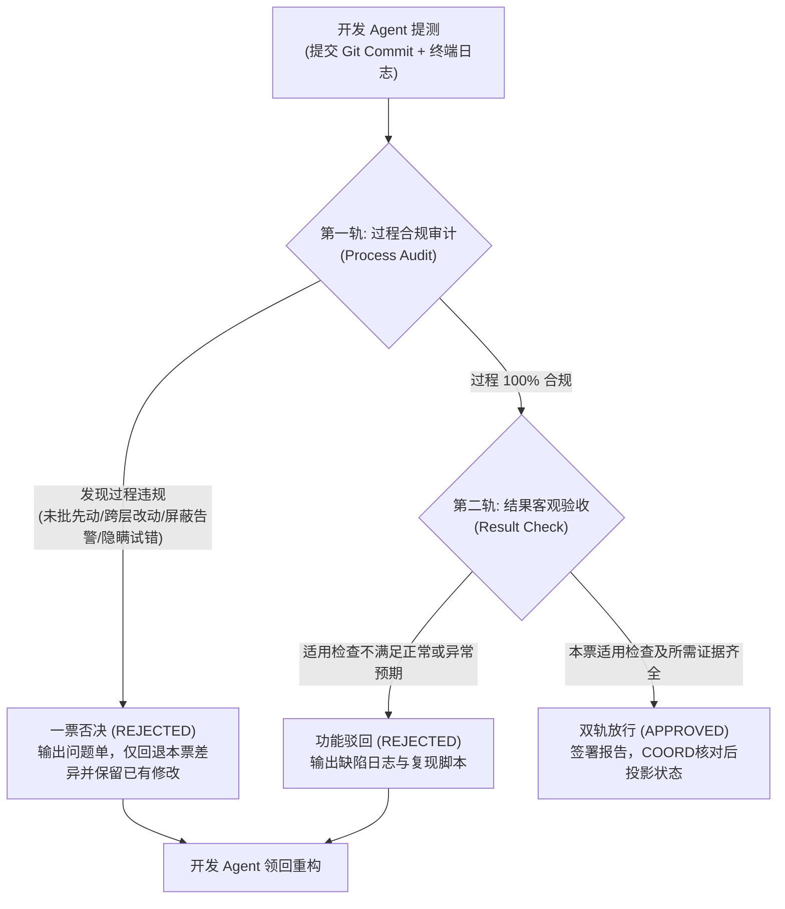

# 独立 QA 审查清单与过程审计指引 (QA Audit Checklist & Guide)

> **切换补丁待接受：** 本文的 `streamlined-v1` 是候选策略定义，尚未正式发布。本次变更须先按 legacy 门禁接受，由 COORD 登记准确生效版本后启用；此前保持停机，旧任务按原门禁处理。切换与逐卡迁移见 `project-control/docs/planning/qa_streamline_cutover_20261103.md`。

## 当前审查平台

2026-10-27起，新建/修订审查采用[独立QA报告模板](templates/QA审查报告模板.md)，任务与执行分别使用[任务卡模板](templates/任务卡模板.md)及[实际运行记录](../../docs/guides/templates/task_run_record.md)。历史报告/签署不回写。以下过程与结果检查按任务范围适用，文档任务不要求固件构建，负例按其冻结预期判断。

所有后续独立 QA 审查和验收统一由独立 Codex 会话执行；QA 作者用例/预期/工具的非作者 ARCH 检查也使用独立 Codex；streamlined-v1 不默认二次复核独立报告，legacy 保留原报告复核。按 [Codex QA 规则](codex_qa_review.md) 选定冷审模型并登记实际模型、会话、所审候选与报告哈希；获批准的模型例外也须记录实际模型和批准依据。原作者与实际检查者分开，保留原岗位。AGY 内部自检不能替代 Codex 独立签署，历史签署保留原记录。

> **设计基准**：本指引旨在落实多 Agent 体系下的**司法独立原则**与**双轨审查机制（Dual-Track Audit）**。QA 绝不仅仅是跑测试用例的“测试员”，更是维护项目架构纪律与工程底线的**“过程审计官”**。
> 本指引直接挂钩 [[AI_SoC_协作方案/human_input|human_input.md]] 与 [[AI_SoC_协作方案/single_ticket_atomic_microstep_design_20261013_113636|单票原子微步设计规范]]。

---

## 1. 独立 QA 架构原则

### 1.1 独立性三要素
1.  **会话独立（Context Separation）**：
    *   QA Agent 运行于完全独立的对话会话与上下文中，**严禁与开发 Agent（ENG-MC / ENG-TH / ENG-SOC）共享交互历史**。
    *   杜绝开发 Agent 的上下文偏差、既得利益与自我辩护对审计产生心理暗示。
2.  **权限隔离（Zero-Write Privilege on Codebase）**：
    *   QA Agent 对被测系统的业务源码拥有**绝对只读（Read-Only）权限**。
    *   **铁律**：严禁 QA Agent 自己动手修改业务代码以促成测试通过！发现问题必须形成审计缺陷单打回开发重做。
    *   QA Agent 拥有测试脚本、审计工具的执行权限，以及QA 报告的签署与结果事件提交权限；正式看板状态由唯一 COORD 根据已签署证据投影。
3.  **双轨审查机制（Dual-Track Model）与一票否决权**：
    *   审查分为**第一轨：过程审计（Process Audit）** 与 **第二轨：结果验收（Result Check）**。
    *   **过程审计拥有一票否决权（Veto Power）**：若过程审计不合规，即便功能测试全绿，QA 必须直接下达 `[REJECTED]` 驳回指令，拒绝验收！

---

## 2. 审查与验收工作流 (Audit & Verification Workflow)



---

## 3. 第一轨：过程合规审计清单 (Process Audit Checklist)

在启动任何编译和测试脚本前，QA Agent 必须首先以审查者身份审查开发 Agent 的**操作轨迹、Git Diff 与提交记录**：

| 审计项编号 | 审计维度 | 核心核查点 | 违规判定判据 (一票否决红线) | 证据来源 |
| :--- | :--- | :--- | :--- | :--- |
| **PA-1** | **计划准入<br/>(Plan-Before)** | 开发前是否在对话或工单中提交了完整的 Markdown Checklist？ | • 未出计划直接动代码；<br/>• 计划中未明确物理验证命令与通过判据。 | 任务日志 / 对话历史 |
| **PA-2** | **原子颗粒度<br/>(Atomic Scope)** | 本次提交是否严格限定在单票作用域（单文件或单一接口层）？ | • 同时修改 `.h` 头文件与 `.c/.cpp` 业务逻辑；<br/>• 同时修改底层驱动与上层协议状态机；<br/>• 变更超过 3 个源码文件且未拆解。 | `git diff --stat` |
| **PA-3** | **代码卫生<br/>(Hygiene & Bypass)** | 是否存在任何绕过类型检查或逃避编译器的行径？ | • 滥用 `(void*)` 暴力强转；<br/>• 强行 `const_cast` 或移除 `const` 限定；<br/>• 添加 `#pragma GCC diagnostic ignored`；<br/>• 通信结构体缺少 `__attribute__((packed))`。 | `git diff` 源码检索 |
| **PA-4** | **构建配置篡改<br/>(Toolchain Integrity)** | 是否私自弱化了编译器的告警与安全检查开关？ | • 修改 CMakeLists.txt/Makefile 删除了 `-Wall`、`-Wextra` 或 `-Werror`；<br/>• 增加了任何 `-Wno-*` 告警屏蔽选项。 | 构建配置 Git Diff |
| **PA-5** | **熔断与试错合规<br/>(Fail-Safe Limit)** | 开发过程中若出现编译报错，是否遵守三步汇报与重试上限？ | • 未按“原文日志 $\to$ 物理根因 $\to$ 修复方案”三步记录；<br/>• 单步失败后盲目试错超过 2 次，未按本票快照/diff 回退本票差异（须保留原有修改）。 | 终端操作轨迹 |
| **PA-6** | **客观证据凭证<br/>(Objective Proof)** | 是否保存本票实际命令/cwd/退出码、原始输出、用例观察与适用告警记录？ | • 用主观推断或预期值代替实际记录；<br/>• 缺少可复核的执行证据，或实际结果不符合事先接受的判据。负例可预期非零/无响应；Exit0和零告警仅用于明确要求它们的构建/正常用例。 | 独立预期、实际运行记录与原始日志 |
| **PA-7** | **环境真实与防瞒报<br/>(Zero-Deception / HW-G5)** | 提测与验证是否使用了真实受测标的？是否存在使用伪终端/软件Mock代替真实物理硬件欺骗闭环的行为？ | • 在 HIL 硬件验收中使用伪终端（PTY）或 Loopback 伪造物理单片机响应；<br/>• 正常物理查询有效关联响应帧数 = 0 却宣称通过；<br/>• 将“过滤噪声未崩溃”偷换为“接口通信通过”。 | 提测脚本 / 进程调用 / 串口对账日志 |

---

## 4. 第二轨：结果客观验收清单 (Result Verification Checklist)

过程审计全部适用项通过、不适用项有理由和接受依据后，QA进入本票规定环境执行检查。构建、静态分析、主机测试、HIL按范围选用；不能以不适用冒充PASS或删除必需检查。

### 4.1 RV-1: 独立清洁构建复现 (Clean Rebuild & Hash Check)
*   **操作**：QA 独立拉取开发分支，仅清理本任务隔离构建目录中的产物（核对目录后再用 `ninja clean` / `make clean`），执行全量构建。
*   **判据**：
    *   构建进程返回值必须为 `Exit Code 0`；
    *   构建输出流中 Warning 计数器必须严格等于 `0`；
    *   生成的固件二进制文件（如 `firmware.bin`）哈希值记录归档。

### 4.2 RV-2: 静态代码分析与内存安全 (Static Analysis)
*   **操作**：QA 独立运行静态代码分析工具（如 `cppcheck` 或 `clang-tidy`）。
*   **执行命令示例**：
    ```bash
    cppcheck --enable=all --inconclusive --error-exitcode=1 \
             --suppress=missingIncludeSystem -I include/ src/
    ```
*   **判据**：退出码为 0，零致命告警，无潜在内存越界、未初始化指针与悬空引用。

### 4.3 RV-3: 物理硬件在环与通信协议验收 (HIL / Blackbox Testing - HW-G5 强约束)
*   **操作**：QA 必须连接真实物理硬件串口（如 VMware `/dev/ttyUSB0` 直通端点）发送探测包，捕获物理双向原始字节流。**严禁使用 PTY 或 Mock 替身！**
*   **核查点与硬性通过判据**：
    1.  **物理原始对账证据**：必须保存带毫秒时戳的物理 TX 原始 Hex 与物理 RX 原始 Hex。
    2.  **物理有效响应绝对性**：在测试窗口内，正常查询来自目标物理硬件的有效关联响应必须 $\ge 1$，并满足CRC、src/dst/flags/cmd/seq/精确载荷等正式契约；零响应直接REJECTED。失联/坏包等负例按其预期无响应/错误及恢复条件判断，不能据负例通过签正常闭环通过。
    3.  **禁止偷换通过标的**：对端物理硬件返回的无关外设旧数据（如迪文屏 DGUS 5A A5 温度帧）被 AP 解析器丢弃并计数为 `err_sof`，仅代表 AP 防御性正常，**绝不等于通信闭环成功**；若未收到协议合法帧，严禁签署通过。
    4.  **握手与版本查询**：先确认固件侧已支持的协议接口，核验返回报文格式、字段对齐与版本号字符串。
    5.  **心跳与持续通信**：默认连续50次正常查询、物理丢包率0%；按任务接受的场景/次数/门限检查，变更须有准确依据，不能事后按结果调整。
    6.  **响应时延**：按已接受门限核对RTT，并记录样本数、失败/超时、min/p50/p95/max和单调时钟测量点；示例100ms不是对所有任务自动生效的门限。

### 4.4 RV-4: 异常注入与鲁棒性验证 (Fault Injection & Boundary)
*   **操作**：QA 故意注入破坏性数据流，测试系统自愈能力：
    1.  **畸形报文注入**：发送不完整帧、非法校验和（CRC 错误）、超长 Gcode 字符串；
    2.  **断链重连测试**：在数据传输过程中重置串口或拔插链路，验证上位机与下位机状态机是否能优雅超时并自动恢复，**绝对禁止发生 HardFault 挂起或内存崩溃**。

---

## 5. QA 审计与验收报告模板 (Audit Report Template)

报告原件统一使用[独立QA与QA作者产物复核报告模板](templates/QA审查报告模板.md)，复制到本票新run。模板的decision为null、检查项为未执行，不预填PASS/APPROVED，不把示例回包当成实测。

提交时必须绑定实际会话、任务revision、准确候选、独立预期、逐例正常/异常观察、真实命令/cwd/退出码、原始输出和哈希、必跑组/非零case、未执行与不适用项。报告完成后计算自身SHA256并登记到卡片或交接清单。文档接受、实施授权、单板交付、组合验收和物理部署分别表述。

报告决定仅APPROVED/REJECTED，待审保持空值；正式任务status使用Backlog/Ready/InProgress/Review/Verify/Done，阻塞另用blocked/recovery_condition。当前检查器不能完整校验这些要求，COORD必须人工逐项核对后更新状态。

---

## 6. 典型实战裁决案例库 (Cheat Sheet)

| 场景序号 | 开发 Agent 交付表现 | QA 审计裁决 | 裁决依据与处理动作 |
| :--- | :--- | :--- | :--- |
| **案例 1** | 功能跑通，串口回包完全正确，但 Git Diff 显示其未先输出 Checklist 直接改了代码。 | **一票否决<br/>[REJECTED]** | 违反 PA-1。责令开发 Agent 补充规范计划，复核修改范围后重新提审。 |
| **案例 2** | 构建通过，但为了消除 `warning: cast from pointer to integer`，代码中使用了 `(void*)(uintptr_t)` 暴力强转。 | **一票否决<br/>[REJECTED]** | 违反 PA-3（掩耳盗铃）。直接驳回，要求从指针生命周期和类型设计上消除根因。 |
| **案例 3** | 功能看似完成，但为避免严格警告，在模块内加了 `#pragma GCC diagnostic ignored "-Wunused-variable"`。 | **一票否决<br/>[REJECTED]** | 违反 PA-3 与 PA-4。由作者按本票差异修复或回退，保留用户原改动，重新提审。 |
| **案例 4** | 过程审计完全合规，但独立测试时发现注入畸形报文导致单片机触发 HardFault 锁死。 | **功能驳回<br/>[REJECTED]** | 过程合规但 RV-4 失败。提供触发崩溃的原始十六进制字节序列，指派开发修复。 |
| **案例 5** | 物理串口仅收到未迁移旧固件的噪声（如迪文屏数据），无合法响应；QA 自建虚拟伪终端（PTY）灌数据强行闭环。 | **一票否决<br/>[REJECTED]** | 严重违反 PA-7 与 HW-G5（弄虚作假）。撤销结论并记录违规，COORD追加撤回记录并设置blocked及恢复条件，等待实际固件与复验。 |

## 当前方案适用边界

本指引的“看板写入”指提交 QA 报告/签署结果，不赋予第二个正式状态写入者；以 04 的唯一 COORD 投影规则为准。尚未部署自动 Token 服务时由人工核对，不把规则文档称为运行控制。

源码构建/静态分析/硬件测试按任务实际范围与已配置工具执行；普通文档更新核对结构、来源、链接和实际差异，不伪造固件构建日志。回退仅本微步差异、保留用户原有改动；隔离构建输出可清理，共享输出或脏源码不可整目录清理。HIL使用真实MCU，命令语义以本票已接受ICD为准；M115/M105等旧文本仅可用于明确接受的维护协议，不替代原生MiniMCProto业务请求。作者自检不是独立 QA 签署。
