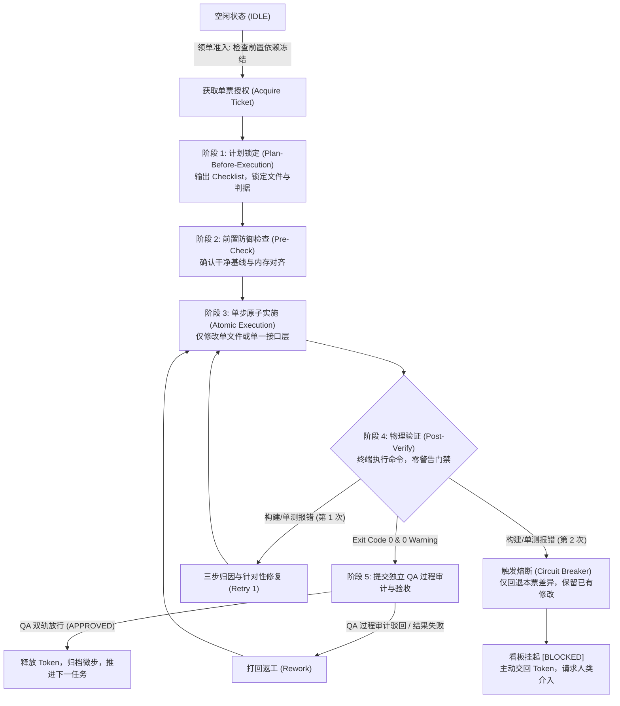

# 单票原子微步执行机制设计规范 (Single-Ticket Atomic Micro-Step Design)

> **设计基准**：本规范深度固化 [[AI_SoC_协作方案/human_input|human_input.md]] 中的《C/C++ 嵌入式与系统级工程长周期闭环协议》与《长周期复杂任务闭环协议》，旨在从根本上解决多 Agent 长任务中出现的“自主狂奔、越跑越偏、错误掩盖与上下文漂移”顽疾。

---

## 1. 核心问题与设计哲学

在嵌入式与软硬件复杂工程协作中，自主 Agent 最容易在以下三个场景失控：
1. **宽泛目标的自主狂奔**：给出一个粗粒度任务（如“实现主控状态机分发”），Agent 一口气修改了 5 个文件，底层数据结构与上层业务逻辑混杂，一旦出错无法定位。
2. **试错陷阱与掩耳盗铃**：构建报错后，Agent 不探究物理根因，通过粗暴类型强转（如 `(void*)`、强行去掉 `const`）或添加 `#pragma GCC diagnostic ignored` 强行消除编译警告，造成潜伏内存踩踏与硬件 HardFault。
3. **主观推测代替物理证据**：Agent 凭主观意淫声称“代码已按要求实现，逻辑理应正常”，缺乏真实的终端退出码（Exit Code）与物理测试日志。

**单票原子微步（Single-Ticket Atomic Micro-Step）的核心哲学是：**
> **“限制并发、步调放慢、颗粒极细、计划先行、物理校验、两次熔断”。**
> 任何代码变更，必须以人类或架构师能够随时打断、回退、审计的最小物理单元推进。

---

## 2. 核心机制定义



### 2.1 机制一：单票独占制 (Single-Ticket Exclusivity)
*   **Token 独占法则**：执行 Agent（ENG-MC / ENG-TH / ENG-SOC）在同一时间**仅允许持有并激活一张微步工单（Micro-Ticket Token）**。
*   **严禁自主连续认领**：在当前微步工单未通过物理验证并获得 QA 审计放行前，调度系统与看板严禁向该 Agent 派发下一张工单。
*   **输入门禁联动**：若上游输入未完全冻结（如未完成只读探针探测），工单保持 `[LOCKED]`，不可被领单。

### 2.2 机制二：微步拆解四段式公式 (The 4-Stage Micro-Step Formula)
任何工程特性必须纵向碾碎为符合**“30 分钟人类工作量”**的四个原子微步阶段。严禁跨阶段混合实施：

| 阶段代码 | 阶段名称 | 允许修改范围 | 绝对禁止行为 | 完成判定标准 (Pass Criteria) |
| :--- | :--- | :--- | :--- | :--- |
| **Stage A** | **接口与契约定义** | 仅允许修改 `.h` 头文件、协议结构体、枚举、宏开关 | 严禁编写任何 `.c/.cpp` 业务实现逻辑 | 引用该头文件的空构建通过，内存对齐检查无误 |
| **Stage B** | **符号桩函数打桩** | 新建/修改实现文件，仅提供 Stub 空函数（返回默认值） | 严禁编写复杂分支、中断处理与跨模块调用 | 编译系统成功识别新符号，链接器解析成功，零告警 |
| **Stage C** | **核心逻辑实现** | 仅填充单个函数或单个状态机分支实现 | 严禁回过头去同时修改 Stage A 冻结的头文件 | 增量构建 Exit Code 0，无未处理分支警告 |
| **Stage D** | **物理单测与静态分析** | 编写/执行针对该模块的测试用例、静态检查脚本 | 严禁引入外部未审计库或临时调试死循环 | `cppcheck` 零告警，单元测试用例 100% 通过 |

### 2.3 机制三：计划锁定先行 (Plan-Before-Execution Checklist)
触发条件：涉及驱动修改、通信协议帧变更、构建脚本调整、或涉及 2 个以上源码文件时，**严禁直接修改代码**。
执行 Agent 必须在动作前在对话与工单中锁定如下 Markdown 清单：

```markdown
### [PLAN] Micro-Ticket: TK-MC-042 (主控报文帧头解析)
- [ ] 目标文件清单:
  - 头文件: include/protocol/frame_parser.h (Stage A)
  - 实现文件: src/protocol/frame_parser.c (Stage B/C)
- [ ] 物理前置基线: Git Commit `a1b2c3d` (已验证干净)
- [ ] 物理验收命令:
  - 命令 1: `ninja -C build firmware.bin` (判定: Exit Code 0, 0 Warnings)
  - 命令 2: `cppcheck --error-exitcode=1 src/protocol/frame_parser.c` (判定: Exit Code 0)
- [ ] 回退保护点: 失败时依据开工快照/本票 diff 恢复本票差异，保留文件已有修改
```

### 2.4 机制四：两振出局熔断机制 (2-Strike Circuit Breaker)
*   **报错熔断**：一旦物理编译、链接或静态分析失败，**立即中断操作**，绝对禁止“顺水推舟进入下一步”。
*   **禁止盲目试错**：报错后严格执行**三步归因法**：
    1.  **【终端原始报错】**：原样截取编译器、链接器或单测框架的错误日志（包含行号与 Warning 详情）。
    2.  **【物理根因定位】**：分析具体技术原因（如符号未导出、头文件缺少包含防护、结构体内存偏移未对齐、指针生命周期不合法）。
    3.  **【针对性修复】**：针对根因实施单点修复。
*   **强制回退线**：如果**连续 2 次修复**仍未通过物理验收命令，**严禁进行第 3 次猜测性修改**。必须依据开工快照及本票差异回退本票修改，保留用户原有改动，将工单状态标记为 `[BLOCKED]`，附带前两次失败归因日志，交出 Token 并请求人类介入。

---

## 3. 单票工单 (Micro-Ticket) 标准数据结构

每个原子微步工单作为独立的 Markdown 任务卡或结构化记录保存，模板如下：

```yaml
---
ticket_id: TK-20261013-001
parent_task: MS-07
stage: Stage-A-Interface
owner: ENG-MC
status: IN_PROGRESS
retry_count: 0
git_baseline: "7f8e9a2"
target_files:
  - "firmware/marlin/include/gcode_dispatcher.h"
prerequisites:
  - "AI_SoC_协作方案/spec/frozen_serial_spec_20261013.md [FROZEN]"
verification_cmd: "make target_check -j4"
expected_exit_code: 0
---

## 动作描述
定义主控 Gcode 响应状态机枚举及 M115 报文结构体，严格添加 __attribute__((packed))。

## 物理执行证据记录 (开发 Agent 填报)
- 执行命令: `make target_check -j4`
- 实际退出码: 0
- 告警数量: 0 Warnings
- 终端日志摘要:
  ```text
  [100%] Built target firmware_check
  Target check passed with 0 errors and 0 warnings.
  ```

## 交付物与提交
- Git Commit: `b4c5d6e` (feat(mc): define gcode response struct)
```

---

## 4. 与公共看板和调度流的集成

1.  **看板状态映射**：
    *   主任务（如 `MS-07`）维持在 [[AI_SoC_协作方案/看板|看板.md]] 中；
    *   主任务下方挂载拆解出的微步工单链表：`TK-07A` $\to$ `TK-07B` $\to$ `TK-07C` $\to$ `TK-07D`；
    *   只有前一个微步在看板标记为 `[x] (Verified & QA Audited)`，后一个微步的 Token 才处于可认领状态。
2.  **不可定输入的探针工单（Spike Ticket）**：
    *   若依赖项未决，拆解出的第一个工单必须是只读的 `Spike Ticket`（例如：先确认当前固件已有只读 RX/版本入口，再发送允许查询并采真实回包，保存为物理样例文件）；
    *   探针工单通过后，产出的分析结论经确认冻结为 `frozen_spec_*.md`，后续实现工单方可解锁。

---

## 5. 违规判定红线 (Process Violations)

任何出现以下行为的 Agent，将被独立 QA 或 COORD 判定为**过程严重违规**，立即冻结其操作权限并回退代码：
1.  **未批先动**：未输出结构化 Checklist 即开始修改文件；
2.  **越界修改**：在 Stage A 步骤中悄悄修改了 `.c` 业务实现文件；
3.  **掩耳盗铃**：使用 `(void*)` 规避类型检查、移除 `const`、添加编译器忽略警告宏；
4.  **超时试错**：连续失败 3 次未主动回退基线；
5.  **虚假声明**：未附带真实终端命令与 Exit Code 0 证据即声称“已完成”。

## 本轮文档同步的应用边界

保留本规范的单票、先计划、单步验收和失败熔断原则。30 分钟是拆分目标，不是未验证的工期承诺；代码按本轮文件和独立判据拆微步，普通文档同步按用户授权的三批顺序核验。没有部署自动调度/Token 工具时，只能登记人工执行。

回退保护应对齐本轮开始时实际工作区：已存在用户改动时禁止整文件 checkout、reset 或 clean 覆盖旧内容，仅回退当前票产生的差异并保留失败证据。示例命令/日志不是已执行结果；M115 等只读探针也必须先确认实际 RX/命令入口，接口缺口由 MCQ 单列建设。QA 签署报告/事件，唯一 COORD 投影正式状态；未发生独立检查不能写 QA 已放行。
