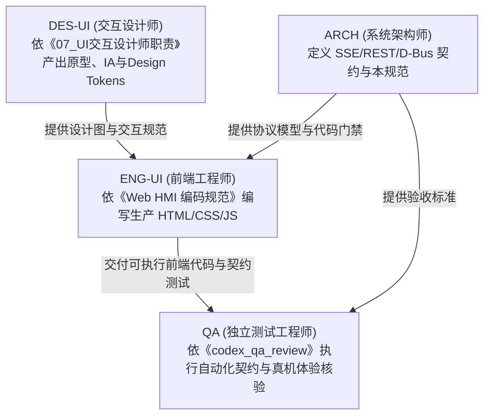
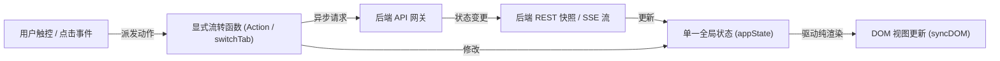

# Web HMI 前端开发与交互编码规范

本规范由系统架构师（ARCH System Architect）制定，作为全工程 Web 人机交互前端（Web HMI）、触控屏前端应用及相关 UI 契约测试的专用核心开发规范与硬性质量门禁。

所有参与 Web HMI 需求分析、交互设计、前端编码、集成审查与独立 QA 审计的角色（包括 `DES-UI`、`ENG-UI`、`ARCH`、`QA` 等），必须严格无条件遵守本规范。

代码注释统一遵循[代码注释与文档字符串规范](code_documentation_standard.md)：全部新增或修改的说明性注释及 docstring 使用中文，补齐模块、公共接口与关键逻辑说明，行为修改时同步更新。

---

## 1. 背景、定位与适用范围

### 1.1 背景与定位
当前工程总规则《C/C++ 编码规范》（`c_cpp_coding_standard.md`）聚焦于底层 MCU 裸机固件与 Linux C/C++ 守护服务开发，其强制要求的“零动态堆内存分配（禁用 malloc/new/STL）”、“指针运算显式化”、“禁用异常机制”等底层硬指标，属于硬件直驱与系统级性能保障门禁，**不适用于** 运行在高级浏览器/WebView 引擎（V8、WebKit）上的 Web 前端（HTML/CSS/JavaScript）。

然而，Web 前端在工业级全彩 3D 打印机控制台中直接掌管用户交互、运控下发、参数标定、热床与喷嘴高危加热监控。若前端代码缺乏工业级工程纪律约束，极易引发“伪造硬件状态全绿”、“虚假虚标进度条”、“长连接死循环与内存泄漏”、“触控误触或盲操困难”、“硬编码文案导致多语言崩溃”等致命安全与体验事故。

因此，本规范继承 C/C++ 规范在“确定性”、“有界性”、“防御性”上的核心工程思想，面向 Web 前端运行环境确立专门的架构模型与六大硬性门禁。

### 1.2 适用范围
本规范强制适用于：
1. `soc-ap/browser_hmi/` 下的所有前端代码（包括 `first_release` 及后续各演进版本）。
2. 未来运行在嵌入式 Linux 触摸屏（如 DSI/HDMI 7寸/10寸工业屏）上的 WebView/Electron/轻量级浏览器前端。
3. 远程 Web 控制台、局域网 mDNS 设备配置页面与工控交互扩展套件。
4. 对应上述前端的所有 DOM 契约测试（如 `test_hmi_contract.py`）及端到端自动化验收套件。

### 1.3 核心原则
- **真实第一 (Truth First)**：界面呈现必须 100% 忠实反映后端真实硬件与微服务遥测，严禁任何伪造或粉饰。
- **单向流动 (Unidirectional Flow)**：状态驱动视图（State $\rightarrow$ View），流转显式可追踪，严禁任意散落修改 DOM。
- **资源有界 (Bounded Resources)**：长连接、定时器、事件监听与 DOM 节点具备明确生命周期，零内存泄漏。
- **工效优先 (Ergonomics First)**：触控热区有界充足，支持暗黑/浅色工业对比度，防抖防误触。
- **契约先行 (Contract Driven)**：DOM 结构、通信协议与数据 Schema 具备自动化契约测试保护。

---

## 2. 与 C/C++ 规范的边界解耦与角色职责矩阵

### 2.1 规范边界解耦说明
前端代码运行在带垃圾回收（Garbage Collection）与事件循环（Event Loop）的 JavaScript 运行时中：
- **豁免项**：前端**完全豁免** C/C++ 的“零堆内存分配”限制（允许创建 JS 对象、数组、闭包与使用原生 Promise）、“禁用异常”限制（网络层推荐使用 `try-catch` 与 `async/await` 统一捕获异常）、“指针显式运算”限制（JS 无指针概念）。
- **继承与强化项**：前端**严格继承** C/C++ 规范中的“函数规模控制（单一职责、建议 $\le 50$ 行）”、“防御性参数校验（Guard Clause）”、“有界资源管控（防泄漏）”、“通信闭环与硬件真实性强门禁”。

### 2.2 角色协作与规范引用矩阵



| 角色 | 规范职责与边界 | 权威依据文档 |
| :--- | :--- | :--- |
| **`DES-UI`** | 负责端到端交互设计、Design Tokens（色彩、间距、字体）、状态机图例与触控工效规范。严禁直接提交生产前端代码。 | `07_UI交互设计师职责与交付规范.md` |
| **`ENG-UI`** | 负责 Web HMI 的 HTML、CSS、JS 具体落地，严守本文档六大硬性门禁，编写并维护前端契约测试。 | 本规范 (`web_ui_coding_standard.md`) |
| **`ARCH`** | 负责全机系统架构与服务契约，定义 HTTP/SSE 数据模型、哨兵故障码及前端规范裁决。 | 本规范及 `soc-ap/contracts/twin/` |
| **`QA`** | 在独立沙箱中执行前端 DOM 契约测试与体验验收，验证正向与故障/恢复闭环，严禁放行违规伪造代码。 | `codex_qa_review.md`、`delivery_and_coord_gate.md` |

---

## 3. 六大硬性门禁规范 (Six Strict Invariants)

### 门禁 1：硬件真实性与防伪门禁 (Truthfulness & Zero-Mock Invariant)

在工业 3D 打印与数控设备中，用户依据界面决定是否接触喷嘴、是否加载耗材或判定运动是否安全。**严禁在界面上粉饰太平或向用户呈现虚假正常数据**。

#### 1.1 严禁无硬件连接时界面“伪造全绿 PASS”
- 当系统处于未连接、脱机或初始化阶段时，所有设备状态徽章（Badges）与状态文本必须显式显示“未就绪/未连接/未知”（如 `status_unready`、`ver_status_unknown`），**严禁默认渲染为“合格”、“ONLINE”或“PASS”**。
- HTML 静态骨架中的初始占位文本必须为防御性缺省值（如 `--.- °C`、`未知`、`未就绪`、`未检查`），严禁在 HTML 模板中硬编码预置虚假正常参数。

#### 1.2 传感器数据有效性与离线防御映射
- 前端必须严格评估传感器及设备上报的有效性字段（如 `devices.<node>.valid`、`tool.quality`、`bed.quality`）。
- 当 `valid === false` 或状态为 `OFFLINE`、`QUERY_FAILED`、`STALE`、`UNKNOWN` 时，界面必须同步置为警告或危险样式，文案明确提示“设备离线”或“查询失败”，严禁当成正常状态渲染。

#### 1.3 严禁客户端合成假数据与虚假自增进度
- **零随机合成数据门禁**：严禁在前端代码中使用 `Math.random()` 模拟或合成喷嘴温度、热床温度、电机坐标、ADC 读数或风扇转速。
- **零本地假进度条门禁**：严禁使用本地纯定时器（`setInterval`）单方面自增打印进度百分比、层高或估算时间。所有作业进度推进必须严格以硬件执行 ACK 及后端 SSE 广播的 `job_update` 事件为唯一事实依据。

#### 1.4 哨兵值防御拦截与格式化标准
后端为防止浮点数在无连接时产生歧义，会采用工业级哨兵整数（Sentinel Values）表示传感器离线或开路/短路故障：
- `AISOC_TEMP_MILLIC_FAULT` (`2147483647` / `0x7FFFFFFF`)：传感器故障/短路；
- `AISOC_TEMP_MILLIC_OFFLINE` (`2147483646` / `0x7FFFFFFE`)：传感器脱机/未采集；
- 以及对应的 1/10 摄氏度哨兵 `0x7FFF` 与 `0x7FFE`。

**硬性门禁**：
前端提取温度函数（如 `extractTemperatureC`）在进行任何除法运算或 `toFixed()` 格式化前，**必须优先命中哨兵判断**：
```javascript
// 正确范式：优先捕获哨兵，映射为安全状态
function extractTemperatureC(obj) {
    if (!obj) return '--.-';
    var millic = obj.temperature_millic;
    var decic = obj.temp_deci_c;

    if (millic === 2147483647 || millic === 0x7FFFFFFF || decic === 0x7FFF) {
        return 'FAULT';
    }
    if (millic === 2147483646 || millic === 0x7FFFFFFE || decic === 0x7FFE) {
        return '--.-';
    }
    // 只有合法数值才允许转换为摄氏度
    if (typeof millic === 'number') {
        return (millic / 1000.0).toFixed(1);
    }
    return '--.-';
}
```
> [!CAUTION] 严禁将哨兵整数直接除以 1000 渲染为 `2147483.6 °C` 这类荒谬的异常浮点数。任何在页面上泄漏 `2147483.6` 的行为直接判定为交付门禁不合格！

#### 1.5 硬件离线 UI 阻断闭环与 Fail-Closed 机制
- 当底层硬件链路断开（如串口拔除、MCU 重启、网关返回 HTTP 503/504、或遥测 `hardware_online === false`）时，前端必须在 **100ms 内**触发 Fail-Closed 阻断机制：
  1. 顶部弹出高优先级脱机警告条（`#hw-offline-banner`）；
  2. 硬件连接胶囊（`#hw-conn-pill`）切为离线警告态；
  3. 全局锁定所有可能引发物理运动与加热的危险控件：三轴 Jog 步进按钮、一键回零按钮（`btnHomeAll`、`btnHomeXy`）、自动调平触发按钮（`btnTriggerLeveling`）、作业启动与恢复按钮（`btnJobStart`、`btnJobResume`）全部设为 `disabled = true`；
  4. 唯独保留 **E-STOP 紧急急停** 与 **故障复位/诊断查询** 入口可用。

---

### 门禁 2：单向数据流与状态机驱动 (State-Driven Architecture)

Web HMI 必须摒弃 jQuery 时代的“就地散落读写 DOM”坏味道，建立清晰、确定性的单向数据流体系。



#### 2.1 状态驱动视图 (State $\rightarrow$ View)
- 页面必须定义统一的状态容器（如 `appState`），集中记录当前连接态、硬件在线态、当前 Tab、当前 OOBE 步骤、传感器缓存、料槽配置等。
- 视图渲染必须由数据状态驱动。禁止在事件回调中穿插跨组件的深层 DOM 杂乱篡改，统一调用专门的同步函数（如 `syncSlotDOM(idx)`、`updateWeightValidationUI()`、`applyJobStatus(job)`）。

#### 2.2 显式状态机流转函数
- 界面的重大模态流转（如 Tab 切换、向导翻页、主题切换、弹窗显隐）必须封装为显式具名函数，严禁内联多处随意修改类名：
  - 例如导航切换统一走 `switchTab(targetTabId)`；
  - 向导步进统一走 `setOobeStep(stepNumber)`；
  - 硬件锁定统一走 `setControlsLocked(boolean)`。

#### 2.3 状态持久化语义边界与防冒充原则
- **前端持久化规范**：用户偏好设置（当前语言 `aisoc_lang`、主题 `aisoc_theme`）与不可逆用户旅程标记（如向导完成状态 `aisoc_oobe_completed`），在校验合法后持久化存储于 `localStorage`，并在初始化时健壮读回（必须包裹 `try-catch` 防御隐身模式或存储受限）。
- **设备物理状态严禁冒充**：本地 `localStorage` 仅允许保存纯前端 UI 偏好与流程标记，**严禁使用前端本地缓存来冒充或推断设备的实际物理状态**（例如严禁从 localStorage 读回“打印机当前处于就绪状态”；设备状态无论页面何时刷新，必须且仅能以从网关请求的 `/api/v1/temperature/snapshot` 或 `/api/v1/jobs/status` 实时响应为准）。
- **OOBE 向导完成闭环规范**：用户点击向导最后一步【完成】按钮时，必须原子化执行：
  1. 写入 `localStorage.setItem('aisoc_oobe_completed', 'true')`；
  2. 隐藏向导浮层（`oobeModal.style.display = 'none'`）；
  3. 调用 `switchTab('tab-dashboard')` 平滑导向打印工作台主界面；
  4. 弹出友好的成功 Toast 提示（`showToast(t('oobe_finished_toast'), 'success')`）。

---

### 门禁 3：长连接生命周期与零内存泄漏 (Lifecycle Safety & Resource Cleanup)

工业 HMI 通常在车间或桌面长达数周连续开机运行，任何无节制的内存膨胀、未清理的长连接或失控的定时器，都会导致低算力嵌入式 Linux 触摸屏卡死或浏览器标签页崩溃。

#### 3.1 SSE / WebSocket 严格生命周期管理
- **单例与幂等重连**：建立长连接前，必须先关闭或注销现有连接实例：
  ```javascript
  if (appState.eventSource) {
      appState.eventSource.close();
      appState.eventSource = null;
  }
  var es = new EventSource(GATEWAY_BASE_URL + '/api/v1/temperature/stream');
  appState.eventSource = es;
  ```
- **专用事件监听与异常衰退**：使用 `addEventListener('temp_update', ...)` 监听具名事件。`onerror` 回调中必须将 `appState.isConnected` 标记为 `false`，并使界面进入离线警告态，绝不允许在连接断开后保持假连接绿点。
- **防抖与有界重试**：严禁在 `onerror` 中不设间隔地死循环重新 `new EventSource()`，必须依托浏览器原生 EventSource 退避机制或采用指数退避算法（如 1s, 2s, 4s, 最大 30s）。

#### 3.2 定时器与异步资源清理
- 所有的 `setTimeout` 与 `setInterval` 句柄必须在状态对象或局部上下文中保存引用。
- 自销毁 DOM 节点（如临时弹出通知 Toast）必须在淡出动画结束后彻底从 DOM 树中移除（`removeChild`），**严禁只隐藏 `opacity: 0` 而任由无界 DOM 节点在 `<body>` 下堆积**：
  ```javascript
  setTimeout(function () {
      toast.style.opacity = '0';
      setTimeout(function () {
          if (toast.parentNode) {
              toast.parentNode.removeChild(toast);
          }
      }, 300);
  }, duration);
  ```

#### 3.3 DOM 事件监听防重复绑定
- 事件监听器的挂载必须集中在初始化阶段（如 `initSlotEvents`、`initNavEvents`），一次性执行。
- **严禁在状态刷新或 SSE 每次接收数据时为已有静态 DOM 元素重复添加 `addEventListener`**，否则会产生严重的事件倍增执行与内存泄漏。
- 对于动态刷新容器（如自动调平 5×5 网格 `levelingMeshGrid`、HMS 告警列表），重新渲染前必须先清空容器内容（`container.innerHTML = ''`）或采用事件委托模式。

---

### 门禁 4：工业级人机工效与 Design Tokens (Design System & Ergonomics)

Web HMI 在工业场景中必须经受戴手套操作、油污视窗、强弱光照及视线盲操的严苛考验。

#### 4.1 严禁滥用内联样式 (No Inline Styles)
- HTML 结构中**严禁滥用内联 `style="..."` 编写表现层代码**（除少数初始加载必须隐藏的容器使用 `style="display: none;"` 外）。
- 所有颜色、边距、字号、布局与状态变化必须通过 CSS 类名驱动。

#### 4.2 全局 CSS 变量系统 (Design Tokens)
- 前端样式库必须统一在 `:root`、`[data-theme="dark"]` 与 `[data-theme="light"]` 中定义设计变量（Tokens），涵盖：
  - 调色板：`--bg-base`、`--bg-surface`、`--bg-card`、`--border-color`、`--text-primary`、`--text-secondary`；
  - 语义色：`--accent`、`--success`、`--warning`、`--danger` 及其半透明浅色底（`*-light`）；
  - 工效度量：`--touch-min-size`、`--radius-sm`、`--radius-md`、`--radius-lg`、`--transition-fast`。
- **全量无缝双模主题**：页面必须支持暗色与浅色双模，通过 `html.setAttribute('data-theme', theme)` 即时切换，禁止依赖页面刷新。

#### 4.3 工业触控工效硬性度量
- **触控热区底线 $\ge 44 \times 44\text{px}$**：在 800×480 等触摸屏分辨率下，所有按钮（Button）、选项卡（Nav Tab）、滑块把手、步进控件与图标入口的点击热区尺寸**严禁小于 $44 \times 44\text{px}$**（推荐使用 `--touch-min-size: 44px` 或 `min-height: var(--touch-min-size)` 约束）。
- **手势误触防护**：全局根节点必须设置 `user-select: none;` 与 `-webkit-user-select: none;`，防止用户在触摸屏拖拽或连击时触发原生文本蓝色选中框；设置 `-webkit-tap-highlight-color: transparent;` 消除点击灰色遮罩。
- **E-STOP 急停一键可达**：全机软件紧急急停按钮（`#btn-header-estop`）必须永久固定在视窗顶部 Header 导航栏显著位置，采用醒目的红底高对比度警示设计，严禁隐藏在二级菜单或折叠弹层内。

---

### 门禁 5：国际化全量覆盖 (i18n Coverage)

AI SoC 打印机面向全球工业与消费市场，全机交互必须实现无死角的双语支持。

#### 5.1 严禁硬编码中英文明文字符串
- HTML 结构中的文本标签，除通用单位（`mm`、`°C`、`%`、`g`）或物理固件版本代号外，**严禁直接硬编码中文字符或英文字符**。静态文本节点必须挂载 `data-i18n="<key>"` 属性。
- JavaScript 中的交互提示、错误消息、Toast 通知、对话框、动态状态徽章，**必须 100% 经由 `t(key)` 翻译函数调用**。

#### 5.2 字典键集合 100% 对齐门禁 (Key Parity)
- 国际化字典中 `zh-CN` 与 `en-US` 的键集合必须 **100% 严格一致（对称）**。
- 严禁出现某语言独有而另一语言缺失导致的页面渲染为 `undefined` 或空串。前端契约测试必须自动对比两者的对称差集（Symmetric Difference）：
  $$\text{Keys}_{\text{zh-CN}} \Delta \text{Keys}_{\text{en-US}} = \emptyset$$

#### 5.3 动态免刷新即时生效
- 语言切换必须通过 `setLanguage(lang)` 执行，遍历所有 `[data-i18n]` 节点并批量更新 `textContent`，同时更新所有动态组件的显示文本。
- 语言切换过程**严禁触发 `location.reload()` 页面重新加载**，确保长连接不中断、用户当前表单输入不丢失。

---

### 门禁 6：模块化 JavaScript 规范与合约测试 (JS Standards & Contract Tests)

#### 6.1 模块化与函数整洁门禁
- **严格模式与作用域隔离**：全量自研 JavaScript 必须封装在立即执行函数（IIFE）或 ES 模块中，首行声明 `'use strict';`，严禁污染 `window` 全局作用域（仅允许暴露受限的调试诊断入口，如 `window.HMI_CORE`）。
- **函数单一职责与规模约束**：
  - 单个自研函数**建议控制在 50 行以内**；
  - 复杂流式逻辑（如解析网格、处理多段温度、构建图表）必须拆解为带具名含义的内部辅助小函数；
  - 函数嵌套层级严禁超过 3 层，优先采用卫语句（Guard Clause）提前返回。
- **异步统一错误拦截**：
  - 网络请求统一经由受控包装层（如 `fetchApi` 或 `sendPostRequest`），显式拦截 HTTP 503/504 硬件离线状态并触发安全降级；
  - 任何 Promise 链条必须显式包含 `.catch()` 异常处理，禁止出现未捕获的 Unhandled Rejection。

#### 6.2 前端契约测试硬门禁 (Contract Test Gate)
针对 Web HMI，代码编写完成不代表交付，**必须有独立的可执行契约测试作为物理门禁**。在 `soc-ap/browser_hmi/` 下必须常态化维护对应发版目录的契约测试脚本（如 `test_hmi_contract.py`）。

契约测试必须强制覆盖以下 8 大维度断言：
1. **DOM 契约完整性**：断言所有界面必选的核心 DOM 元素 ID 存在且唯一；
2. **硬件真实性与防伪规则正反向断言**：
   - 正向断言：未接入硬件或初始状态下，MC/TH 固件版本必须断言包含“未知”，状态必须断言包含“未就绪/未检查”；
   - 反向断言：断言代码与初始 HTML 中绝不包含 `Math.random`，绝不包含虚假版本号（如 `v1.0.0-mock`），绝不包含未连接时的“合格/ONLINE”；
3. **高危数据哨兵拦截断言**：断言 JS 逻辑中显式拦截 `2147483647`、`2147483646`、`0x7FFFFFFF`、`0x7FFFFFFE`，并断言代码中绝无 `2147483.6` 漏出；
4. **核心业务逻辑与算法校验**：如 4 通道混色权重和严格等于 10000 校验（COL-001/TWIN-17）；
5. **i18n 双语字典 100% 对齐校验**：自动提取 `I18N['zh-CN']` 与 `I18N['en-US']` 所有 Key，集合完全等价断言；
6. **工效度量与主题定义校验**：断言 CSS 中存在 `[data-theme="dark"]`、`[data-theme="light"]`，且断言触控热区变量 `--touch-min-size: 44px` 存在并被应用；
7. **数据交互 Schema 合规校验**：断言后端通信载荷符合 JSON Schema（如 `slot_schema.json`）；
8. **交互流程与状态持久化闭环校验**：断言包含 `switchTab` 导航流转、包含 `localStorage` 健壮读写键名（如 `aisoc_oobe_completed`）、包含友好 Toast 反馈。

---

## 4. 架构设计模式与典型代码范式

### 4.1 国际化多语言与 DOM 响应范式
```javascript
// app.js
var I18N = {
    'zh-CN': {
        hw_offline_banner_msg: '⚠️ 硬件连接已断开，运控与加热已锁定，请检查物理连线后重试',
        oobe_finished_toast: '新机自检向导已完成，已进入控制台'
    },
    'en-US': {
        hw_offline_banner_msg: '⚠️ Hardware offline. Motion & heating locked. Check physical wiring.',
        oobe_finished_toast: 'Setup wizard completed. Entered dashboard.'
    }
};

function t(key) {
    var dict = I18N[appState.lang] || I18N['zh-CN'];
    return dict[key] || key;
}

function setLanguage(lang) {
    if (!I18N[lang]) return;
    appState.lang = lang;
    document.documentElement.setAttribute('lang', lang);

    var elements = document.querySelectorAll('[data-i18n]');
    for (var i = 0; i < elements.length; i++) {
        var key = elements[i].getAttribute('data-i18n');
        if (key && I18N[lang][key]) {
            elements[i].textContent = I18N[lang][key];
        }
    }
}
```

### 4.2 硬件离线锁定与 Fail-Closed 范式
```javascript
function setControlsLocked(locked) {
    appState.isHwLocked = !!locked;
    var jogBtns = document.querySelectorAll('.btn-jog');
    for (var i = 0; i < jogBtns.length; i++) {
        jogBtns[i].disabled = locked;
    }
    if (dom.btnHomeAll) dom.btnHomeAll.disabled = locked;
    if (dom.btnHomeXy) dom.btnHomeXy.disabled = locked;
    if (dom.btnTriggerLeveling) dom.btnTriggerLeveling.disabled = locked;
    if (dom.btnJobStart) dom.btnJobStart.disabled = locked;
    if (dom.btnJobResume) dom.btnJobResume.disabled = locked;
}

function updateHardwareConnectionUI(isOnline) {
    if (isOnline === true) {
        if (dom.hwStatusDot) dom.hwStatusDot.className = 'status-dot online';
        if (dom.hwOfflineBanner) dom.hwOfflineBanner.style.display = 'none';
        setControlsLocked(false);
    } else if (isOnline === false) {
        if (dom.hwStatusDot) dom.hwStatusDot.className = 'status-dot offline';
        if (dom.hwOfflineBanner) dom.hwOfflineBanner.style.display = 'flex';
        setControlsLocked(true);
    } else {
        if (dom.hwStatusDot) dom.hwStatusDot.className = 'status-dot unknown';
        if (dom.hwOfflineBanner) dom.hwOfflineBanner.style.display = 'none';
    }
}
```

### 4.3 网络请求与 503 错误拦截范式
```javascript
function fetchApi(path, options) {
    var fullUrl = (path.indexOf('http') === 0) ? path : (GATEWAY_BASE_URL + path);
    return fetch(fullUrl, options).then(function (res) {
        if (res.status === 503 || res.status === 504) {
            return res.text().then(function (text) {
                var msg = '硬件已断开连接 (HTTP ' + res.status + ')';
                try {
                    var parsed = JSON.parse(text);
                    if (parsed && parsed.message) msg = parsed.message;
                } catch (e) {}
                showToast(msg, 'warning');
                setHardwareOnline(false); // 立即触发界面锁定
                var err = new Error(msg);
                err.status = res.status;
                return Promise.reject(err);
            });
        }
        return res;
    }).catch(function (err) {
        if (err.status === 503 || err.status === 504) {
            return Promise.reject(err);
        }
        showToast(t('net_error') || '网络通信异常', 'error');
        return Promise.reject(err);
    });
}
```

---

## 5. QA 独立审计与验收核对清单 (QA Audit Checklist)

在任何 Web HMI 交付物提交给 COORD 与主干合并前，前端责任人自检及独立 QA 审计必须逐项核对并签署以下清单：

| 序号 | 审计检查项 | 验证手段 / 预期结果 | 门禁判定 |
| :---: | :--- | :--- | :---: |
| **Q1** | **零伪造数据与真实性** | 检查代码中绝无 `Math.random()` 模拟数据；拔除真实/孪生硬件连接时，喷嘴/热床显示 `--.-`，设备状态显示“未连接/未就绪”，绝不可全绿。 | 阻断级 |
| **Q2** | **哨兵值防御映射** | 后端注入 `0x7FFFFFFF` / `0x7FFFFFFE` 时，界面准确显示 `FAULT` / `--.-`，DOM 与界面中绝对未出现 `2147483.6` 漏出。 | 阻断级 |
| **Q3** | **硬件离线 Fail-Closed** | 模拟硬件掉线或网关返回 HTTP 503/504 时，顶部离线横幅必须在 100ms 内弹出，所有 Jog/Home/Leveling/Start 按钮立即置灰被禁用。 | 阻断级 |
| **Q4** | **零本地假进度条** | 检查代码中绝无自增 progress 的本地定时器；暂停（PAUSED）时进度条立即停滞，进度仅随后端 `job_update` 事件推进。 | 阻断级 |
| **Q5** | **长连接生命周期** | 连续切换路由或反复重连时，检查无失控 EventSource 叠加；断开服务时进入退避重试，无紧密死循环。 | 阻断级 |
| **Q6** | **DOM 节点与内存防泄漏** | 频繁触发 Toast 通知与表格刷新，检查内存平稳；Toast 消失后其 DOM 节点被彻底清除，无内存堆积。 | 重要级 |
| **Q7** | **工业触控尺寸工效** | 检查 CSS 样式表，所有可交互按钮、选项卡点击区域尺寸均 $\ge 44 \times 44\text{px}$，已禁用文本选中（`user-select: none`）。 | 重要级 |
| **Q8** | **i18n 字典 100% 对称性** | 运行契约测试，断言 `zh-CN` 与 `en-US` 键集合完全对齐；切换语言时全局文案即时变动，页面不刷新。 | 阻断级 |
| **Q9** | **样式无内联与主题双模** | 检查 HTML 源码无违规内联 `style="..."`；切换 Dark / Light 主题时，界面背景与高对比度色彩无缝刷新。 | 重要级 |
| **Q10** | **契约测试全量通过** | 在宿主环境执行 `python3 -m unittest test_hmi_contract.py`，所有用例 100% PASS，测试报告归档。 | 阻断级 |

---

## 6. 关联引用与生效说明

- **基础规范**：本规范与 `project-control/.agents/rules/c_cpp_coding_standard.md` 互为补充，分别统治工程中的 Web 前端领域与嵌入式 C/C++ 领域。
- **设计输入**：本规范直接承接 `project-control/.agents/rules/07_UI交互设计师职责与交付规范.md` 确定的交互与体验标准。
- **交付门禁**：本规范作为 `project-control/.agents/rules/delivery_and_coord_gate.md` 在前端子模块执行审查与放行的法定准则。
- **生效日期**：自 2026-11-02 起正式生效，全项目组各相关角色严格执行。
