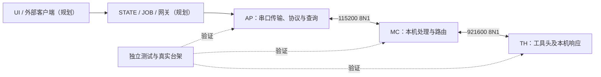
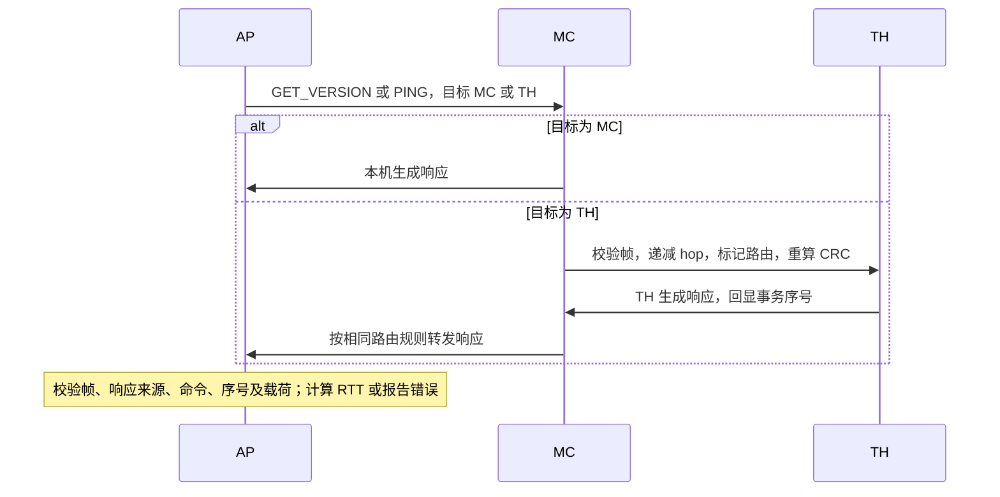

# AP–MC–TH 项目技术白皮书

日期：2026-10-28｜状态：说明性草稿，待独立 QA 审阅

本文介绍全彩 3D 打印机项目的技术边界、核心运行流程和当前进展。它是阅读入口，不取代正式协议、任务卡和对应版本的验收证据。

## 1. 目标与现状

系统以 Linux SoC 应用处理器（AP）提供上层入口，以运动控制器（MC）执行运动相关职责，以工具头控制器（TH）管理工具头外设。当前最小增量是 AP 经 MC 查询 MC 或 TH 的版本和心跳，并测量往返时间；这只是整机功能的一小部分。

截至本文日期，项目已有三端查询实现、协议向量和台架记录。[CR-10 结果](../evidence/cascade_recovery/CR-10/result.md)记载 RC2 候选在真实台架完成只读查询及 TH 失联恢复的验收；这一历史结论仅适用于该候选和报告范围。当前工作树还有未提交改动，不能把历史结论自动推广到当前源码或新固件。根目录 README 的“仍待组合 HIL”表述与 10 月 28 日交接及 CR-10 记录存在时间差，应以准确候选、任务卡和证据对账为准。

温度遥测有新的接口和代码工作，但仍须依照相应任务及证据确认状态；加热、运动、混色、升级和完整上层业务不属于上述只读验收范围。

## 2. 系统结构

| 部分 | 职责与位置 |
| --- | --- |
| AP | `soc-ap/`：Linux 宿主、串口传输、MiniMCProto 编解码及查询。 |
| MC | `mcu-p3/motion-controller-mcu/`：运动主控，处理本机消息并在 AP 与 TH 间转发。 |
| TH | `mcu-p3/color-engine-mcu/`：工具头控制器，处理发往自身的协议请求。 |
| 测试 | `test_harness/`：独立协议向量、宿主黑盒测试及硬件工具。 |
| 项目控制 | `project-control/`：需求、协议、任务、规则及证据的权威位置。 |

STATE、JOB、UI、网关，以及 DDS、D-Bus、MQTT 的业务接口是架构规划，并非当前已验收的完整系统。控制路径、部署边界和具体通信契约需要随业务增量冻结，参见[模块职责](../../.agents/rules/02_模块与Agent职责.md)与[温度模块架构草案](../interfaces/soc_temperature_module_architecture_icd_draft_20261028.md)。

## 3. 通信和运行流程

### 3.1 物理连接

| 链路 | 登记配置 |
| --- | --- |
| AP ↔ MC | VMware Linux `/dev/ttyUSB0`，MC USART2 PA2(TX)/PA3(RX)，115200、8N1、无硬件流控。 |
| MC ↔ TH | MC USART6 PA4(TX)/PA5(RX)，TH USART1 PB6(TX)/PB7(RX)，921600、8N1、无硬件流控。 |

TX 与对端 RX 交叉连接。接口登记和来源见[串口链路](../baseline/serial_links.md)；设备枚举、接线和板上固件在每次部署时重新核实。该登记文档的部分验证状态是早期快照，不能覆盖后续的具体验收记录。

### 3.2 一次查询如何完成

最小只读接口使用 MiniMCProto v2.0（Rev 2.0.3）：帧包括起始标记、源/目标、标志、命令、跳数、序号、载荷长度、载荷和 CRC-16。`GET_VERSION`（0x01）对应 `VERSION_REPORT`（0x02）；`PING`（0x03）对应 `PONG`（0x04）。MC 转发时不解析业务载荷、不替 TH 生成响应；跳数耗尽时丢弃。请求超时、错误响应及有界缓冲等约束以[只读级联 ICD](../interfaces/ap_mc_th_readonly_cascade_icd.md)为准。

AP 命令行查询路径打开串口、发送请求并等待匹配响应；普通宿主启动和查询模式是不同路径，具体参数以当前 `soc-ap/core/host/main.cpp` 为准。`soc-ap/README.md` 描述的是早期基础运行模式，不足以说明后续查询功能。设备发送成功不等于目标节点处理成功；必须验证匹配的真实回包。

## 4. 验证与边界

验证按层进行：协议参考向量检查帧和 CRC；PTY 等软件测试覆盖宿主解析、超时及错误；工程联调确认实际部署和数据路径；独立 Codex QA 在真实 AP、MC、TH 组合上验收正常与故障恢复。软件模拟不能替代真实硬件证据。

[CR-10 QA 报告](../evidence/cascade_recovery/CR-10/runs/run_01/qa_review_report.md)记录 40 次样本、四种查询及故障恢复；MC–TH 中间线没有独立逻辑分析仪直采，报告采用协议头和物理切断恢复证据，并披露该限制。报告与[交接文档](../handoff/HANDOFF_20261028.md)列出的 RTT 汇总不一致，因此本文不将某一组数字作为系统性能指标；测量结果应回到原始样本及候选版本核对。响应中的静态 boot ID / Git 值也不能独立证明芯片身份。

## 5. 维护入口

- [方案基线](../baseline/B0_方案基线.md)、[协议资料](../specs/README.md)、[只读 ICD](../interfaces/ap_mc_th_readonly_cascade_icd.md)。
- [候选清单](../releases/ap_mc_th_readonly_candidate.yaml)、[台架联调](../operations/ap_mc_th_joint_debug.md)、[CR-10 证据](../evidence/cascade_recovery/CR-10/result.md)。
- [主看板](../../.agents/kanban/KANBAN.md)及各任务卡记录后续进度；[新项目搭建经验](../guides/new_project_setup_howto.md)总结可复用方法。
