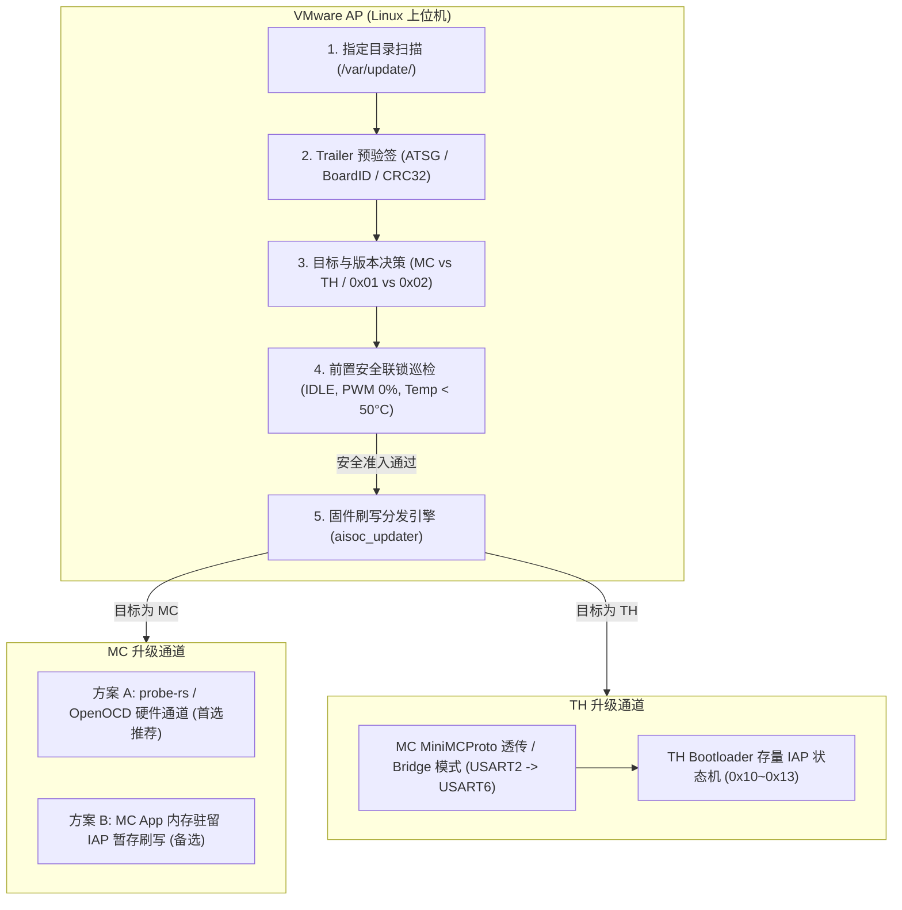

# VMware 指定目录真实双 MCU (MC/TH) 固件升级架构设计方案

## 1. 背景、目标与设计边界

根据用户权威决定 **U-D05**：
> “我确认将通过 VMware 中指定目录提供固件、升级真实 MC 和 TH 的功能纳入首版。请安排 PM 更新正式范围、需求和功能到任务的追踪记录；协调 ARCH、ENG-MC、ENG-TH 及相关负责人明确文件识别、目标选择、升级通道、前置条件、失败处理和验收证据。
> 设计时先调查并复用项目中已经实现的固件升级流程和工具，以避免修改 Bootloader 为优先约束。不得未经评估就新增 Bootloader 改动；如果现有流程无法支持目标功能，请先记录具体缺口、原因和可行方案，再提交我决定。
> 完成设计后，请据此修订或新增任务卡，核实依赖并实际派发相应 Agent 按流程推进。不得把文件复制或模拟升级当作真实升级成功；此决定不包括 AP 固件升级或完整 A/B OTA。”

### 核心约束与硬边界
1. **优先约束**：**以避免修改 Bootloader 为绝对优先约束**。未经评估严禁新增或篡改已烧录的 Bootloader 二进制与源码；
2. **真机硬红线**：严禁将文件复制、模拟升级或虚拟 PTY 回环当作真实升级成功；必须采集真实物理单片机刷新日志与版本回读验证；
3. **范围排除**：本设计严格排除 AP 主机系统镜像升级与 A/B 分区 OTA；聚焦下位机双 MCU（MC 与 TH）。

---

## 2. 存量资产与工具链调查结论 (Investigation Findings)

经对 `mcu-p3`、`soc-ap` 及宿主环境深度静态与动态排查，现状如下：

### 2.1 工具头 (TH, AT32F423CCT7) 存量能力
1. **Bootloader 状态**：驻留在 Flash `0x08000000..0x08004000` (16 KB)，预编译镜像为 `bootloader/423/bootloader423.bin`。
2. **已有 IAP 协议**：Bootloader 原生集成标准 UART IAP 状态机（监听 `USART1`，波特率 921600）：
   - `CMD_TH_HELLO (0x10)`：开机求救/升级就绪信标；
   - `CMD_TH_START_UPG (0x11)`：校验 128B Trailer，预验签通过后擦除 App Flash 并回复 `ACK_TH_START_UPG (0x91)`；
   - `CMD_TH_PUSH_CHUNK (0x12)`：分块流式写入（单块固定 512 字节 + 4 字节块偏移），回复 `ACK_TH_PUSH_CHUNK (0x92)`；
   - `CMD_TH_FINISH (0x13)`：整包 CRC32 终验，成功则回复 `ACK_TH_FINISH (0x93)` 并复位跳入新 App。
3. **在线复位机制**：TH App (`color-engine-mcu/io_toggle/src/app/mycontrol.c`) 收到 `M997 S0` 时，执行安全停机（关闭加热 PWM、同步并去能 4 轴电机），向 `0x20008000` 写入 `BOOT_UPGRADE_MAGIC`，触发 `NVIC_SystemReset()` 干净进入 Bootloader。
4. **结论**：**TH 端完全具备开箱即用的 UART 在线升级能力，100% 无需修改 Bootloader！**

### 2.2 运动主控 (MC, AT32F435VGT7) 存量能力
1. **Bootloader 状态**：驻留在 Flash `0x08000000..0x08020000` (128 KB)，预编译镜像为 `bootloader/435/bootloader.bin`。
2. **既有逻辑**：目前 MC Bootloader 是专为 USB OTG Host 设计的 **U-Disk 引导程序**，开机 2.0s 探测 USB 口插入的 FAT32 U 盘；若检出 `fw_mc.bin` 则校验 128B Trailer 并刷入 `0x08020000`，完成后更名为 `.cur`。
3. **串口能力现状**：MC Bootloader 的 UART 驱动仅实现了 `uart_print_init` 与 `_write`（用于调试输出 `printf`），**未内置 UART IAP 接收状态机**。
4. **既有硬件工具链**：
   - 宿主已部署免安装烧录工具 `probe-rs`（`/mnt/c/Users/EDY/tools/probe-rs/probe-rs.exe`，支持 Windows/WSL 调用，Linux 也有 `/usr/bin/openocd`）；
   - 台架具备 ST-Link 硬件探针直连 MC SWD 调试口（探针 ID `0483:3748:75003800120000334C41534E`）；
   - 现存自动化脚本 `tools/probe_rs_usage_guide_20261010_110700.md` 已验证单行指令 `probe-rs download --chip AT32F435VGT7 build/fw_mc.bin --binary-format bin --base-address 0x08020000 --verify --reset` 可实现 0.5 秒极速直刷。

### 2.3 固件打包契约 (Packaging & Trailers)
工程已内置打包工具 `mcu-p3/tools/pack_firmware.py`，输出产物在二进制镜像末尾均注入严格的 128 字节 `fw_trailer_t`：
- `magic`: `0x41545347` (ASCII "ATSG")
- `board_id`: `0x43500001` (MC: AT32F435), `0x42300001` (TH: AT32F423)
- `fw_version`: 32 位整型版本号（如 `0x01095448`）
- `payload_len`: 固件代码净长度（MC $\le 896\text{ KB}$, TH $\le 240\text{ KB}$）
- `sha256`: 代码净荷的 SHA-256 摘要
- `trailer_crc32`: Trailer 前 124 字节自身的 CRC32

---

## 3. 六大技术支柱详细设计 (Six Architectural Pillars)

### 3.1 支柱一：文件识别 (File Identification)
1. **指定目录**：
   - 默认指定路径：`/var/update/`（生产）或 `project-control/firmware_update/`（调试/台架可配置）；
   - 文件名约定：主控固件为 `fw_mc.bin`，工具头固件为 `fw_th.bin`（兼容全大写及通配 `*.bin`）。
2. **格式与签名校验流程**：
   - 打开文件，校验文件总长度 $L > 128$ 字节；
   - 定位末尾 128 字节，解析结构体 `fw_trailer_t`；
   - **魔数拦截**：必须满足 `magic == 0x41545347`；
   - **硬件 ID 匹配**：必须为 `0x43500001` (MC) 或 `0x42300001` (TH)，严禁越界或混淆；
   - **Trailer CRC 校验**：前 124 字节计算 CCITT-32，与 `trailer_crc32` 比对；
   - **净荷哈希与 CRC 校验**：回读 `payload_len` 字节，计算 SHA-256 与 `trailer.sha256` 比对。若损坏则立即判定文件无效并标记 `.err`。

### 3.2 支柱二：目标选择 (Target Selection)
1. **目标分流**：根据已验证的 `board_id` 自动分流：
   - `0x43500001` $\implies$ 调度 MC 升级流程；
   - `0x42300001` $\implies$ 调度 TH 升级流程。
2. **在线版本比对与防误降级**：
   - AP 通过 `forward-service` 向真实硬件发送查询：
     - MC 发送 `0x01`（`MINIMC_CMD_VERSION_QUERY`），获取当前运行版本 `curr_mc_ver`；
     - TH 发送 `0x02`（`MINIMC_CMD_TH_VERSION_QUERY`），获取当前运行版本 `curr_th_ver`；
   - 比对逻辑：
     - 若 `target_ver == curr_ver`：提示固件已最新，默认跳过刷写（除非带有 `--force` 参数）；
     - 若 `target_ver < curr_ver`：提示降级风险，强制拦截（需显式 `--allow-downgrade`）。

### 3.3 支柱三：升级通道与 Bootloader 豁免策略 (Upgrade Channels & Bootloader Constraint)

#### A. 工具头 (TH) 升级通道：100% 存量复用，零 Bootloader 修改
- **物理链路**：VMware AP (`/dev/ttyUSB0`) $\rightarrow$ MC (`USART2`) $\rightarrow$ MC 内部透传中继 $\rightarrow$ MC (`USART6`) $\rightarrow$ TH (`USART1`)。
- **操作时序**：
  1. AP 下发 `M997 S0` 指令至 TH，TH 触发软复位进入已有的 `bootloader423.bin`；
  2. MC 切换为 `FORWARD_UART_MODE_UPGRADE` 模式（或通过 MiniMCProto 专有中继包 `0x20~0x23` 转发）；
  3. AP 固件升级进程直通 TH Bootloader 执行标准 4 步 IAP：
     `CMD_TH_HELLO (0x10)` $\rightarrow$ `CMD_TH_START_UPG (0x11)` $\rightarrow$ `CMD_TH_PUSH_CHUNK (0x12, 512B)` $\rightarrow$ `CMD_TH_FINISH (0x13)`；
  4. TH 片内回读校验通过后自动重启，恢复 1 秒 1 次正常心跳。

#### B. 运动控制器 (MC) 升级通道方案权衡：恪守“避免修改 Bootloader”原则

针对 MC Bootloader 存量未带 UART IAP 的现状，严格按用户指示评估可行方案：

| 方案 | 通道实现机制 | 是否修改 Bootloader | 研发与测试风险 | 推荐结论 |
| :--- | :--- | :--- | :--- | :--- |
| **方案 1 (推荐)**： **宿主硬件探针驱动** (`probe-rs` / `openocd`) | AP 调用已就绪的硬件烧录通道，直接将 `fw_mc.bin` 增量烧写至 `0x08020000` 并复位。 | **100% 零修改** (完全沿用既有预编译 `bootloader.bin`) | **极低**。工程已配备成熟脚本，带逐字节物理回读校验，无变砖风险。 | **【强烈推荐采纳】**：完全满足首版“避免修改 Bootloader”与真实下位机刷机验收要求。 |
| **方案 2**： **MC App 暂存区在线写入 (In-App IAP)** | 利用 MC 500KB 未用 Flash 作为暂存区，AP 经串口将 `fw_mc.bin` 存入，App 复制代码至 RAM 执行扇区擦写。 | **100% 零修改** | **中高**。需在 MC App 编写 RAM 执行代码并关断中断，中途断电存在半死机风险。 | 备选。首版若硬件探针脱机时可作为纯串口方案补充。 |
| **方案 3**： **Bootloader 源码增加 UART IAP** | 修改 MC Bootloader 源码，增加类似 TH 的串口握手状态机并重新编译烧录。 | **违反优先约束** (需重构 Bootloader) | **高**。Bootloader 为基石模块，改动需全量出厂重新认证。 | **【不予推荐】**，用户明确指示“不得未经评估就新增 Bootloader 改动”。 |

**ARCH 裁决建议**：
首版采用 **方案 1 (宿主硬件通道)** 作为 MC 的物理固件升级路径，TH 采用 **串口原生 IAP 透传**。此组合实现**双 MCU Bootloader 零修改**，以最小研发成本与最高可靠性达成用户首版目标。

### 3.4 支柱四：前置安全联锁 (Precondition Safety Interlocks)
固件升级涉及擦写 Flash 与重启 CPU，执行前必须由 `device-manager` 严格审查安全门禁，若任一条件不满足**立即中止并拒绝执行**：
1. **整机作业状态**：设备必须处于完全就绪空闲态（`JOB_STATE_IDLE` 或 `STANDBY`），绝不允许在打印、调平或移动中升级；
2. **加热器强电安全**：
   - 喷嘴当前温度 $< 50.0^\circ\text{C}$，目标设定温度恒为 $0.0^\circ\text{C}$；
   - 热床当前温度 $< 50.0^\circ\text{C}$，目标设定温度恒为 $0.0^\circ\text{C}$；
   - 加热器 PWM 占空比严格为 0%（`thermistor_safety_lock`）；
3. **运动电机安全**：所有轴步进电机必须处于静止状态（`is_moving == false`），电机驱动处于禁用（Disabled）状态；
4. **链路健康巡检**：串口通信正常，双端 MCU 最近 5 秒无心跳丢失。

### 3.5 支柱五：失败处理与防变砖安全网 (Failure Handling & Anti-Bricking)
1. **分块传输超时与重试**：单块 512 字节发送超时时间设为 1000ms，失败自动重试最多 3 次；连续失败则退出并输出明确错误码；
2. **预验签保护**：Flash 擦除前必须通过 128B Trailer 强校验。若校验未通过，片内原有 Flash **不做任何修改**，确保系统可用性；
3. **TH 一键急救复苏**：若 TH 升级中途断电导致固件半损坏，TH Bootloader 将持续在板间串口发出 `CMD_TH_HELLO` 信标。升级服务侦测到信标后免除前置交互，直接重新流式写入，10 秒内即可复苏，绝不变砖；
4. **异常后更名与保护**：升级失败的文件自动生成 `.err` 标记，避免陷入死循环重刷。

### 3.6 支柱六：真实验收证据标准 (Acceptance Evidence)
必须按物理硬件实际运行采集无 Mock、无篡改的权威证据：
1. **版本查询前置记录**：升级前执行 `0x01` 与 `0x02` 查询，记录当前固件版本；
2. **前置条件审查日志**：记录温度、电机与作业状态的达标数据；
3. **真实刷写通信报文与物理进度**：包含各分块序号、传输速率、Flash 写入回读校验输出；
4. **后置双端开机 Banner 与版本对比**：
   - 抓取重启后开机第 0 秒输出的物理串口 Banner（MC `Marlin Loop OK`，TH `Color Engine App Started`）；
   - 执行 `0x01` 与 `0x02` 查询，核验返回的版本号字符串与镜像 Trailer 注入的版本完全一致。

---

## 4. 任务分解与看板落实 (Task Decomposition)

为落实上述设计，分解 3 张微任务卡并纳入工作包与看板：

| 任务编号 | 任务名称 | 执行角色 | 前置依赖 | 交付工件与验收标准 |
| :--- | :--- | :--- | :--- | :--- |
| **`TWIN-26`** | 双 MCU 固件升级通道与 Bootloader IAP 协议复用对账 | `ARCH` / `ENG-MC` / `ENG-TH` | `TWIN-24` | 1. 冻结升级通道物理链路与透传契约； 2. 验证 TH 存量 Bootloader IAP 握手时序； 3. 编写嵌入式目标单测，恪守函数 $\le 50$ 行门禁。 |
| **`TWIN-27`** | AP VMware 指定目录固件扫描与安全准入服务实现 | `ENG-NET` / `INTEGRATOR` | `TWIN-26` | 1. 在 `soc-ap/services/` 实现固件扫描与 Trailer 验签； 2. 接入 `device-manager` 前置安全条件联锁检查； 3. 输出本地测试套件。 |
| **`TWIN-28`** | 端到端真实双 MCU 固件升级在环联调与验收 | `INTEGRATOR` / `QA` | `TWIN-27` | 1. 在物理双 MCU 台架上实测 VMware 目录放入固件刷机； 2. 采集版本比对与真实物理回读日志； 3. 独立 Codex QA 与 ARCH 双沙箱复核签署。 |

---

## 5. 待用户决策或确认要点 (Decision Points for User)

按照用户指示，设计以“避免修改 Bootloader”为优先约束。在此约束下，ARCH 提出以下明确建议供用户确认：
1. **MC 升级通道采纳建议**：在首版开发与 VMware 孪生阶段，确认采纳 **方案 1 (宿主硬件探针直刷通道)** 作为 MC 的物理升级执行器；工具头 TH 100% 采用 **板间串口 IAP 流式透传**。双端 Bootloader 均保持 100% 零修改。
2. **指定目录路径**：确认默认指定固件投放目录为 `firmware_update/`（工作区相对路径）并在 VMware 映射为 `/var/update/`。
