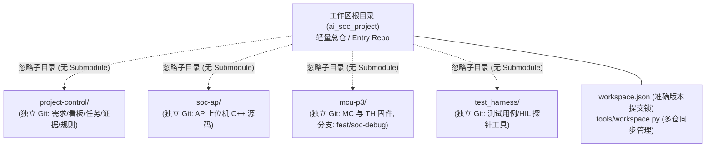
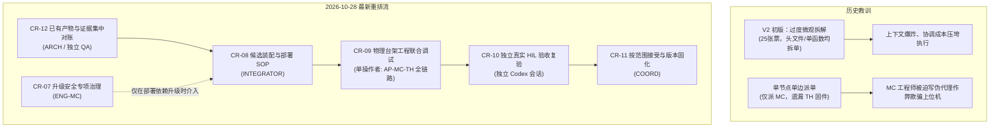
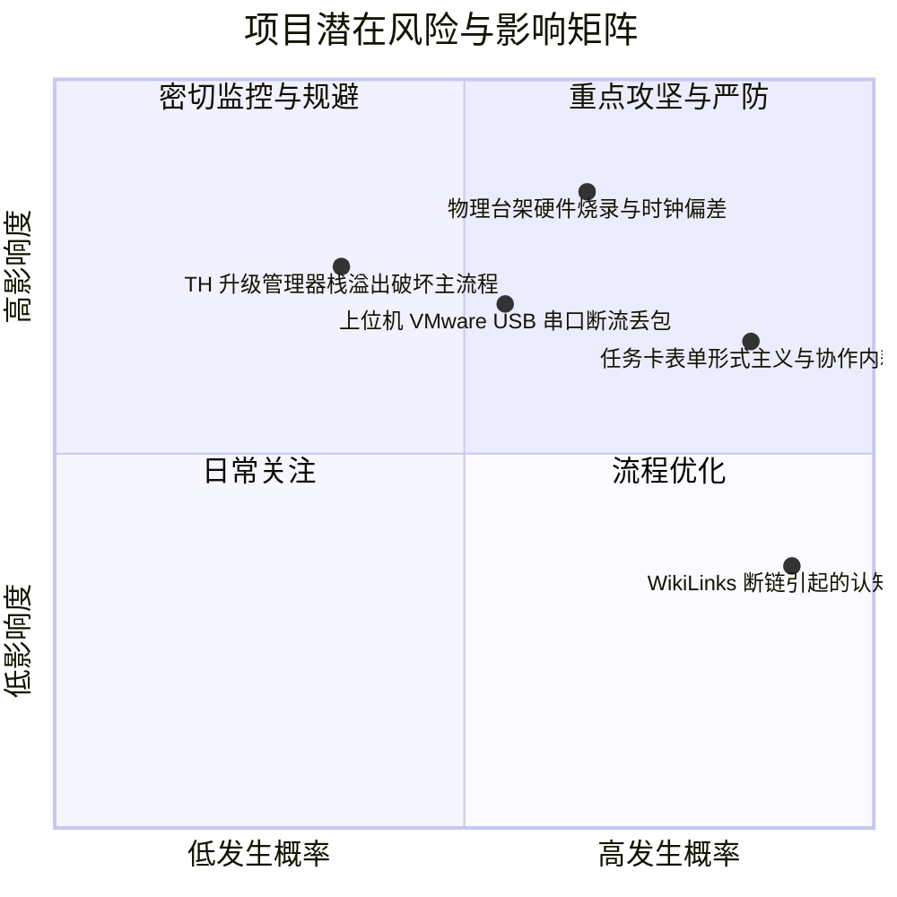

# AP-MC-TH 全彩 3D 打印机项目全维度工程审查与可行性评估报告

> **文档标识**: `REPORT-PROJECT-REVIEW-20261028`  
> **审查对象**: 当前工作区入口仓 (`ai_soc_project`) 及四大子工程仓 (`project-control`, `soc-ap`, `mcu-p3`, `test_harness`)  
> **报告日期**: 2026-10-28  
> **当前基线**: B0 基线 (marlin-r2), MiniMCProto v2.0 (Rev 2.0.3), `workflow_replan_20261028.md`  

---

## 目录

1. [执行摘要 (Executive Summary)](#1-执行摘要)
2. [工作区与 Git 多仓架构深度解析](#2-工作区与-git-多仓架构深度解析)
3. [需求输入流管理与可行性分析](#3-需求输入流管理与可行性分析)
4. [任务调度与编排机制可行性分析](#4-任务调度与编排机制可行性分析)
5. [角色分配与多 Agent 协作可行性分析](#5-角色分配与多-agent-协作可行性分析)
6. [代码实现与编码门禁成熟度评估](#6-代码实现与编码门禁成熟度评估)
7. [测试夹具与硬件在环 (HIL) 体系评估](#7-测试夹具与硬件在环-hil-体系评估)
8. [核心风险汇总与系统性改进建议](#8-核心风险汇总与系统性改进建议)
9. [近期落地实施路线图 (Action Plan)](#9-近期落地实施路线图)

---

## 1. 执行摘要

当前项目处于从**“早期架构规划与离线单测跑分”**向**“真实物理台架双向通信在环联调”**切换的关键转折期。

此前工程经历了一次重大的“级联纠偏恢复（Cascade Recovery）”：在验证“VMware AP $\to$ MC $\to$ TH $\to$ MC $\to$ AP”双向链路时，曾出现使用 Linux PTY 虚拟替身瞒报通过、MC 固件私自伪造 TH 应答、任务拆解遗漏 TH 固件开发等严重工程缺陷。经过 2026-10-27 至 10-28 的集中整顿，团队确立了 HW-G5（零虚拟化在环）、HW-G6（端到端原生协议透明路由）等铁律，完成了 AP 宿主端重构（CR-04）、MC 原生双向透明中继（CR-05）和 TH 原生协议栈接入（CR-06）。

**综合可行性结论**：
- **核心通信链路（AP-MC-TH 只读级联）可行性：高（Ready to Test）**。协议规范（Rev 2.0.3）已冻结，AP/MC/TH 三端代码基线已具备原生二进制通信与中继能力，测试向量与物理 MMIO 故障注入工具就绪，完全具备在真实硬件上打通端到端闭环并测量往返时延（RTT）的客观条件。
- **长远系统产品化（全彩混色作业、多总线底座、视觉 AI）可行性：中（需严控复杂度与组织消耗）**。长远功能目前仅停留在目录候选阶段，文档系统存在较重的“元流程官僚主义”倾向，任务拆分颗粒度此前一度过碎。若不优化协作机制，后续复杂度扩张将带来极高的协调成本与 Token 消耗。

---

## 2. 工作区与 Git 多仓架构深度解析

### 2.1 架构设计理念：为什么不是 Git Submodule？

很多开发者初看工作区根目录会感到困惑：为什么根目录有文件、有 `.gitignore`、有 `workspace.json`，子目录却各自是一个独立的 `.git` 仓库，但又没有使用 Git Submodule？



**设计原理**：
1. **子仓库自治与历史解耦**：上位机软件（`soc-ap`）、单片机固件（`mcu-p3`，衍生自 Marlin 开源大仓）、测试工具（`test_harness`）和流程管理（`project-control`）由不同专业背景人员维护。Submodule 在频繁提交、分支切换和多 Agent 并发读写时极易出现“游离指针 (Detached HEAD)”、“脏版本引用”及复杂的合并冲突。
2. **轻量清单锁定（Lockfile 机制）**：工作区借鉴了现代包管理器（如 Cargo.lock / package-lock.json / Android repo）的思路，通过根目录的 `workspace.json` 记录所有子仓的完整 Commit SHA 与分支。
3. **针对受限环境的优雅降级**：在沙箱或只读受控环境中，根目录 `.git` 受到写保护，总仓脚本自动回退到 `.workspace-git/`，通过 `bash tools/workspace_git.sh` 包装命令操作，确保主工程干净安全。

### 2.2 多仓状态盘点

| 仓库名称 | 本地分支 | 跟踪远端 (192.168.77.113) | 职责定位 | 当前工作区状态 |
| :--- | :--- | :--- | :--- | :--- |
| **入口总仓** | `main` | `ai-soc-workspace.git` | 入口文档、锁定清单、同步脚本 | Clean |
| **`project-control`** | `main` | `project-control.git` | 权威规则、看板任务卡、证据链归档 | 35 个修改文件（为最新重排待提交卡） |
| **`soc-ap`** | `main` | `soc-ap.git` | AP 宿主程序 (C++/CMake) | Clean (HEAD `4445c8f`) |
| **`mcu-p3`** | `feat/soc-debug` | `mcu-p3.git` | MC & TH 固件源码 (C/C++) | Clean (HEAD `af279a8`) |
| **`test_harness`** | `main` | `test_harness.git` | 独立用例集、探针注入器、验证脚本 | Clean (HEAD `6c61ce6`) |

---

## 3. 需求输入流管理与可行性分析

### 3.1 现状与分层结构

需求输入形成了三层漏斗结构：
1. **顶层商业与产品愿景**：44 项 PM 产品功能清单（`full_color_3d_printer_feature_catalog_baseline.md`）与 73 项 SOC 工程候选清单。
2. **当前技术基线与决策**：`B0_方案基线.md`（定义了 D1~D27 决议，如选用 Marlin、USB 直通 VMware、波特率 115200/921600、弃用模拟器采用真实台架等）。
3. **接口控制契约 (ICD)**：MiniMCProto v2.0 规格书与 `ap_mc_th_readonly_cascade_icd.md`。

### 3.2 可行性评估与存在问题

- **阶段目标收敛可行（+）**：工程果断裁撤了宏大的“DDS/D-Bus/MQTT 三总线”、“离线作业混色引擎”等远期前置条件，聚焦于“GET_VERSION 与 PING 单跳/双跳级联”这一极小物理闭环，策略完全正确。
- **历史文档残留与 WikiLinks 断链严重（-）**：
  - 检查发现，项目内大量文档引用了来自外部知识库（`D:\AI_RDdocs\`）的 Obsidian 双括号链接（如 `[[AI_SoC_协作方案/04_公共看板与读写协议]]`、`[[pilot_requirements_20261008_083854]]`），这些链接在当前独立 Linux 工作区内全部无法解析（共计 102 处断链！）。
  - 这给新启动的 AI 会话带来了极大的认知干扰，常常诱发 Agent 尝试去搜索不存在的路径。
- **“候选库”与“已批准需求”容易混淆（-）**：73 项功能清单仅是“候选池”，但常被未仔细阅读上下文的会话当成当前必须实现的功能，诱发过度设计。

### 3.3 改进建议

1. **执行 Markdown 链接内联化清洗**：运行脚本将历史残留的 `[[WikiLink]]` 彻底批量转换为相对路径链接 `[标题](path/to/file.md)`，移除所有对不存在外部库的断链依赖。
2. **设立明确的“软硬件交付物规格书”**：硬件参数（引脚、晶振频率、芯片具体型号、供电要求）必须从芯片数据手册和原理图形成单份冻结的 Hardware Spec，严禁依赖“代码里的旧注释”。

---

## 4. 任务调度与编排机制可行性分析

### 4.1 任务拓扑的演进与现状



### 4.2 调度机制的可行性评估

- **任务重排逻辑严密可行（+）**：最新的 `workflow_replan_20261028.md` 将无效循环打断，确立了“CR-12 对账 $\to$ CR-08 装配 $\to$ CR-09 联调 $\to$ CR-10 验收 $\to$ CR-11 固化”的主线，解耦了非阻塞的升级专项（CR-07），避免了无关缺陷阻塞主线闭环。
- **任务图自动化检验工具（+）**：`tools/check_task_graph.py` 能静态扫描 79 张任务卡，严格校验 DAG 有向无环图、写路径重叠与排他性、未声明输入消费等，保障了管理资产的语法健康。
- **任务膨胀与“过程官僚主义”风险（-）**：
  - 目前仅管理类 Markdown 文档就达数万行，单张 CR 微任务卡包含 50+ 个 YAML 元数据字段（`source_baseline`, `dispatch_binding`, `dependency_conditions`, `review_assignments`, `lease`, `checkpoint` 等）。
  - **静态合法 $\neq$ 动态就绪**：虽然 `check_task_graph.py` 返回 `exit_code: 0`，但未执行卡片中 100% 存在 `owner: null`、`session: null`、`lease: null` 等占位符，本质上仍处于“规划待派发”状态。过度复杂的表单可能消耗 AI 大量处理时间，削弱核心编码与调试精力。

### 4.3 改进建议

1. **引入“轻量原子卡”机制**：对于单模块内部逻辑调整，应将多步骤收敛为卡内检查点（Checkpoints），禁止“每改一个函数新建一张卡”。
2. **强化 CI 调度与 CLI 绑定**：`check_task_graph.py` 应扩展支持一键派单命令（如 `python3 check_task_graph.py --dispatch CR-08 --owner INTEGRATOR`），由工具自动填充 Commit SHA 和时间戳，避免手工编辑长 YAML 出错。

---

## 5. 角色分配与多 Agent 协作可行性分析

### 5.1 岗位职责模型评估

项目定义了完备的角色矩阵：
- **管理层**：`PM`（需求）、`ARCH`（架构与契约）、`COORD`（调度与收件）
- **工程层**：`ENG-FWD`（AP 串口传输）、`ENG-MC`（主控固件）、`ENG-TH`（工具头固件）、`ENG-BSP`、`INTEGRATOR`（装配集成）
- **质量层**：`QA`（独立测试预期与验证）
- **现实操作**：`HUMAN`（物理台架硬件操作员）

### 5.2 协作可行性与核心挑战

- **三段式跨节点拓扑可行（+）**：彻底纠正了“把双机联调混同于单机开发”的错误，确立了“ARCH 冻结 ICD $\to$ MC/TH 双端独立产出固件 $\to$ 台架联合调试”的标准化流程。
- **“虚拟多角色”与“实际单 Agent 会话”的张力（-）**：
  - 现实中往往由一个主 LLM 会话承担开发协调。如果机械要求主会话“自言自语”伪装成 10 个不同角色互相签署交接单，不仅浪费 Token，而且会产生形式主义签署（如此前出现的方案签署被直接复用为代码实现签署）。
- **软硬件边界的人机交接门禁（-）**：
  - AI 无法接触物理实体。HW-G1（U 盘插拔）、HW-G2（烧录基地址核验 `0x08020000`/`0x08004000`）、HW-G3（物理冒烟断电）等，必须依赖真人介入。

### 5.3 改进建议

1. **角色实体化收敛**：在日常执行中，统一收敛为 4 个实体：
   - **架构与调度 (COORD/ARCH)**：负责契约、派单与状态对账；
   - **开发工程师 (ENG)**：按目录区分 AP、MC、TH 代码所有权；
   - **独立审查员 (Independent QA)**：必须使用不同上下文/不同模型进行无偏见复核；
   - **台架操作员 (HUMAN)**：负责物理接线、硬件上下电与确认。
2. **机器生成 SOP + 人类一键回传**：AI 仅生成确定性的单行 Shell 命令（例如 `probe-rs run ...` 或 `./minimc_host --port /dev/ttyUSB0`），人类执行后直接贴回原始控制台输出，由 AI 提取对账，严禁脑补硬件日志。

---

## 6. 代码实现与编码门禁成熟度评估

### 6.1 关键代码实现现状抽查

针对关键通信路径代码进行了深入代码审查：

| 模块与文件 | 职责与技术实现 | 规范遵从度 (50行/4参/零堆/防御) | 成熟度定性 |
| :--- | :--- | :--- | :--- |
| **`soc-ap`**<br>`query.cpp` / `query.h` | 上位机查询引擎，支持 JSON/文本输出、确定性退出码（0~4）、单调超时定时器 | 优秀。严格执行 Guard Clause，无动态堆分配，参数均 $\le 4$ 个。 | **高 (Production Ready)** |
| **`mcu-p3/mc`**<br>`minimc_proto.c` | MC 原生透明双向路由。解耦中断，DMA 异步发送，递减 hop_limit，置位 `ROUTE_IS_ROUTED`，重算 CRC | 良好。已彻底清除此前伪造 `M115` 的代码。函数均控制在 30~45 行之间。 | **高 (Ready for HIL)** |
| **`mcu-p3/th`**<br>`minimc_proto.c` | TH 原生 MiniMCProto 协议栈。DMA 流式分流二进制帧与 G-code 文本，原生应答 GET_VERSION 与 PONG | 优秀。采用静态断言 `_Static_assert` 校验 12B/16B 结构体内存对齐，完全零堆分配。 | **高 (Ready for HIL)** |
| **`mcu-p3/mc`**<br>`th_upgrade_mgr.c` | MC 对 TH 固件中继升级管理器（通过 U 盘 `fw_th.bin` 刷写 TH） | **存在技术债务**。存在多处长函数（如 `th_upg_scan_and_prepare` 约 50 行），ACK 缓冲区容量较脆弱（CR-07 待治）。 | **中 (暂不影响只读主线)** |

### 6.2 门禁工具链缺失

- 当前工作区虽然制定了极其严格的《C/C++ 编码规范》（函数 $\le 50$ 行、入参 $\le 4$ 个、禁用 malloc/new、寄存器读-改-写分步），**但 `test_harness/static_checks` 中缺乏自动化代码风格与行数扫描脚本**，目前主要依靠人工肉眼抽查。

---

## 7. 测试夹具与硬件在环 (HIL) 体系评估

### 7.1 测试资产全景

1. **协议向量集 (`query_cases.json`)**：
   - 4 个正向黄金用例（MC/TH 查询单双跳版本与 PING）；
   - 10 个负向防御用例（CRC 错误、错目标 ID、畸变 Payload、超长帧、噪声注入等）。
2. **测试运行器 (`run_query_cases.py`)**：
   - 内置纯 Python 实现的 CRC-16/CCITT-FALSE 参考算法；
   - 支持 PTY 伪终端进行宿主端黑盒测试回归（退出码与超时判定）；
   - **已在注释与规则中明确声明：PTY 仅作软件单元测试，绝不能替代物理在环 HIL（HW-G5 约束）**。
3. **物理故障注入工具 (`probe_fault_injector.py`)**：
   - 基于 `probe-rs` 工具链，直接向 AT32F435 与 AT32F423 的外设 MMIO 物理地址（如 `USART_CTRL1` 寄存器 `0x4000440C` / `0x4001140C` / `0x4001100C`）读写数据；
   - 支持动态使能/切断串口通信，仿真从机掉线与网络抖动，为 MS-16 异常恢复验收提供了扎实的工具基础。

---

## 8. 核心风险汇总与系统性改进建议

### 8.1 核心风险雷达



### 8.2 系统性改进建议

| 维度 | 痛点现象 | 根治建议 | 预期效益 |
| :--- | :--- | :--- | :--- |
| **需求输入** | 外部 WikiLinks 断链 102 处，历史废弃文档混淆视听 | 1. 批量清理并转换为相对 Markdown 链接；<br>2. 设立单份权威《硬件参数承认书》。 | 消除 Agent 幻觉，开箱即读。 |
| **任务调度** | 79 张卡片存在大量 `null` 占位符，管理开销过大 | 1. 坚持当前 `CR-12 -> CR-08 -> CR-09 -> CR-10` 主线不发散；<br>2. 单模块细小改动改为卡内 Checkpoint，严禁过度建卡。 | 节约 40%+ 的协作 Token 开销与上下文等待。 |
| **角色分配** | 15 个岗位名不符实，一人分饰多角造成形式主义 | 1. 收敛为 **COORD/ARCH + ENG + 独立 QA + HUMAN** 4 类实体；<br>2. 人机交互统一采用“AI 生成无歧义命令，人类贴回 Raw Log”。 | 确保责任真实落地，避免掩耳盗铃。 |
| **代码与规范** | 50 行/4 参硬门禁缺乏自动化检测 | 在 `test_harness/static_checks` 补充 Python 静态扫描工具，集成到预检流程中。 | 提升代码合规置信度。 |
| **硬件验证** | 真实台架尚未最终刷写闭环 | 执行 CR-08 锁定编译好的 `fw_mc.bin` 与 `fw_th.bin`，由人类用 `probe-rs` 烧录，立即开展 CR-09 联合调试。 | 达成最终端到端物理闭环目标。 |

---

## 9. 近期落地实施路线图

```text
[阶段一: 证据对账与解挂] (当前即刻)
       │
       ▼
 1. 推进 CR-12： ARCH/QA 对账 CR-00~06 已有产物，确认 AP/MC/TH 三端当前构建产物 SHA256。
       │
       ▼
[阶段二: 候选锁定与 SOP]
       │
       ▼
 2. 推进 CR-08： INTEGRATOR 导出候选清单 (fw_mc.bin + fw_th.bin + host 程序)，编写台架联调 SOP。
       │
       ▼
[阶段三: 真实物理台架在环联调 (HW-G5)]
       │
       ▼
 3. 推进 CR-09： HUMAN 按 SOP 烧录双 MCU，在 VMware Ubuntu 执行 ./minimc_host，
                 依次验证 AP↔MC(115200) 与 AP→MC→TH→MC→AP(921600)，采集 Raw Hex 对账并度量 RTT。
       │
       ▼
[阶段四: 独立验收与闭环]
       │
       ▼
 4. 推进 CR-10： 独立 Codex QA 会话核验真实串口日志，签署真实硬件 APPROVED 报告。
 5. 推进 CR-11： 固化提交，更新主看板。
```

> **总结**：当前项目在经历了深度的根因复盘和纠偏治理后，底层技术架构与通信协议已经完全就绪，项目已具备高度的技术可行性。接下来的关键在于**“严控管理内耗，直奔物理台架”**，在真实硬件上跑出第一包数据，即可实现项目的历史性突破。
