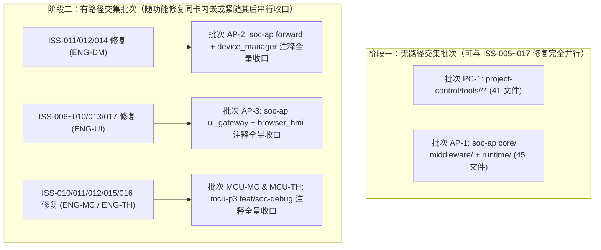

# 三仓代码中文注释规范化全量补齐架构拆解与防冲突排程方案

## 1. 目标与适用范围

根据收件单 `project-control/docs/work_intake/submissions/添加代码的注释.md` 及公共权威规范 [`project-control/.agents/rules/code_documentation_standard.md`](file:///home/sushaohua/workspace/ai_soc_project/project-control/.agents/rules/code_documentation_standard.md)，对工作区内三座目标代码仓库开展中文注释全量盘点与分批补齐：

1. **`soc-ap` 仓库**：从首个提交（Initial Commit）起至今的全部自研代码与脚本文件（`.c`, `.cc`, `.cpp`, `.h`, `.hpp`, `.js`, `.py`, `.sh`，含 `third_party/build.sh` 自研构建脚本，不含 `third_party/` 下游开源压缩包与第三方源码头文件）；
2. **`project-control` 仓库**：从首个提交起至今的全部工具、运行器、门禁检查器与测试脚本代码文件（`tools/**/*.py`, `tools/*.sh`）。**证据不可变红线**：`docs/evidence/**` 下的历史 QA 审计快照文件受 SHA-256 证据链哈希锁定保护，严禁回改历史证据文件；
3. **`mcu-p3` 仓库**：**严格限定在 `feat/soc-debug` 分支**，且仅覆盖自 `main` 分叉点（`merge-base`: `14b8057b04030bd659744c874c73ff8f09f29979`）以来新增（`A`）或修改（`M`）的代码文件。对存量 Marlin 与原厂 BSP 文件遵循最小修改预算（Minimal Diff Budget），仅对 `feat/soc-debug` 分支新增或修改的函数、结构体、宏定义与关键控制块补齐中文注释。

---

## 2. 中文注释粒度与质量硬性标准（依据 `code_documentation_standard.md`）

| 注释层级 | 必达要求 | 原文保留项（禁止生硬翻译） |
| :--- | :--- | :--- |
| **1. 文件/模块头注释** | 每个自研源码/头文件顶部必须包含中文 `@file`、`@brief` 与模块职责、所属层级及关键约束说明 | 文件路径、SPDX/许可证头、编译指示符、头文件保护宏 |
| **2. 类/结构体/枚举注释** | 公共结构体、枚举、状态机定义必须有中文用途说明；关键字段（单位如 `deci_c`/`millic`/`um`/`ms`、字节序、哨兵值如 `0x7FFF`/`0x7FFE`）必须逐字段中文注释 | 协议字段名、C/C++/Python 标识符、寄存器位域名 |
| **3. 函数与方法注释** | 全部公开与内部 `static` 函数必须具备中文 docstring / Doxygen 注释：说明**功能职责**、**输入输出参数（含单位与非空契约）**、**返回值/错误码语义**及**副作用/线程安全假设** | 函数名、参数名、强类型错误码枚举名（如 `AISOC_DEV_OK`） |
| **4. 复杂逻辑与分支块注释** | 协议组帧/解帧、CRC16 校验、跨节点级联（MC↔TH `s_mc_th_seq`）、超时退避、故障降级、DMA/寄存器读改写分步操作必须添加中文行内/块注释，解释**“为什么这样做”**与**边界条件** | 协议命令码十六进制字面量（`0x01`~`0x1C`）、日志固定键值前缀（`[MC-DBG]`、`[TH-DBG]`） |
| **5. 零逻辑变更铁律** | 纯注释补齐提交**严禁改变任何符号签名、结构体布局、控制流逻辑、字节序或运行期行为**；注释修改后必须100%通过既有编译与单测门禁 | 编译器属性（`__attribute__((packed))`、`static_assert`） |

---

## 3. 三仓目标代码文件全量盘点清单

### 3.1 `soc-ap` 仓库自研代码清单（共 90 个文件，按模块分为 3 个批次）

#### 批次 AP-1：核心协议、中间件、运行时与构建部署工具（45 个文件，责任角色：`ENG-SOC` / `ENG-DM`）
- **核心协议与底座（`contracts/` + `core/`，19 个文件）**：
  - `contracts/twin/telemetry_types.h`
  - `contracts/twin/job/job_types.h`, `contracts/twin/job/job_engine.h`, `contracts/twin/job/job_engine.c`, `contracts/twin/job/job_executor.h`, `contracts/twin/job/job_executor.c`, `contracts/twin/job/test_job_engine.c`
  - `core/forward/minimc/codec.h`, `core/forward/minimc/codec.cpp`, `core/forward/minimc/parser.h`, `core/forward/minimc/parser.cpp`
  - `core/forward/transport/serial_posix.h`, `core/forward/transport/serial_posix.cpp`
  - `core/host/main.cpp`, `core/host/query.h`, `core/host/query.cpp`
  - `core/net/mdns/mdns_advertiser.h`, `core/net/mdns/mdns_advertiser.c`, `core/net/mdns/test_mdns_advertiser.c`
  - `core/state/hms/hms_types.h`, `core/state/hms/hms_manager.h`, `core/state/hms/hms_manager.c`, `core/state/hms/test_hms_manager.c`
- **IPC 中间件与运行时监管（`middleware/` + `runtime/` + `tools/`，26 个文件）**：
  - `middleware/dbus/include/aisoc_dbus.h`, `middleware/dbus/src/aisoc_dbus_internal.h`, `middleware/dbus/src/aisoc_dbus_core.cpp`, `middleware/dbus/src/aisoc_dbus_client.cpp`, `middleware/dbus/src/aisoc_dbus_server.cpp`, `middleware/dbus/src/aisoc_dbus_msg.cpp`, `middleware/dbus/examples/client_example.cpp`, `middleware/dbus/examples/server_example.cpp`
  - `middleware/dds/include/aisoc_dds.h`, `middleware/dds/src/aisoc_dds_internal.hpp`, `middleware/dds/src/aisoc_dds_types.hpp`, `middleware/dds/src/aisoc_dds_types.cpp`, `middleware/dds/src/aisoc_dds.cpp`, `middleware/dds/src/aisoc_dds_common.cpp`, `middleware/dds/src/aisoc_dds_participant.cpp`, `middleware/dds/src/aisoc_dds_pub.cpp`, `middleware/dds/src/aisoc_dds_sub.cpp`, `middleware/dds/examples/publisher_example.cpp`, `middleware/dds/examples/subscriber_example.cpp`, `middleware/dds/tests/test_fastcdr_optional.cpp`
  - `runtime/common/service_lifecycle.h`, `runtime/common/service_lifecycle.cpp`, `runtime/vmware/supervisor.h`, `runtime/vmware/supervisor.cpp`, `runtime/vmware/main.cpp`
  - `runtime/build/tests/test_backoff.cpp`, `runtime/build/tests/test_service_lifecycle.cpp`, `runtime/build/tests/test_supervisor_topology.cpp`
  - `third_party/build.sh`, `tools/twin_build/build_vmware.sh`, `tools/twin_build/test_deploy_daemon_survival.sh`, `tools/diag/export_diag_pack.py`, `tools/diag/test_diag_export.py`, `tools/run_print_dryrun.sh`

#### 批次 AP-2：`forward_service` 与 `device_manager` 服务及配套测试（25 个文件，责任角色：`ENG-DM`）
- **服务源码（16 个文件）**：
  - `services/device_manager/device_manager_types.h`, `services/device_manager/device_manager_state.h`, `services/device_manager/device_manager_state.cpp`, `services/device_manager/device_manager_service.h`, `services/device_manager/device_manager_service.cpp`, `services/device_manager/device_manager_dbus.h`, `services/device_manager/device_manager_dbus.cpp`, `services/device_manager/device_manager_main.cpp`
  - `services/forward/forward_types.h`, `services/forward/forward_protocol.h`, `services/forward/forward_protocol.cpp`, `services/forward/forward_uart.h`, `services/forward/forward_uart.cpp`, `services/forward/forward_dbus.h`, `services/forward/forward_dbus.cpp`, `services/forward/forward_service.h`, `services/forward/forward_service.cpp`, `services/forward/forward_main.cpp`
- **对应单测与集成测试（9 个文件）**：
  - `tests/dbus/twin/test_dbus_ipc.cpp`, `tests/dds/twin/test_dds_pubsub.cpp`
  - `tests/device_manager/twin/test_device_manager.cpp`, `tests/device_manager/twin/test_device_manager_state.cpp`
  - `tests/forward/twin/test_forward_protocol.cpp`, `tests/forward/twin/test_forward_service.cpp`
  - `tests/integration/test_first_release_print_loop.c`, `tests/job/test_job_executor.c`, `tests/protocol/probe.cpp`, `tests/host/smoke.sh`

#### 批次 AP-3：`ui_gateway` 服务、Web HMI 前端及契约测试（20 个文件，责任角色：`ENG-UI`）
- **`ui_gateway` 服务（12 个文件）**：
  - `services/ui_gateway/ui_gateway_types.h`, `services/ui_gateway/ui_gateway_http.h`, `services/ui_gateway/ui_gateway_http.cpp`, `services/ui_gateway/ui_gateway_dbus.h`, `services/ui_gateway/ui_gateway_dbus.cpp`, `services/ui_gateway/ui_gateway_job_ctrl.h`, `services/ui_gateway/ui_gateway_job_ctrl.cpp`, `services/ui_gateway/ui_gateway_server.h`, `services/ui_gateway/ui_gateway_server.cpp`, `services/ui_gateway/ui_gateway_service.h`, `services/ui_gateway/ui_gateway_service.cpp`, `services/ui_gateway/ui_gateway_main.cpp`
- **Web HMI 与测试/部署脚本（8 个文件）**：
  - `browser_hmi/first_release/app.js`, `browser_hmi/first_release/test_hmi_contract.py`
  - `ui/twin/app.js`
  - `tests/ui_gateway/twin/test_ui_gateway.cpp`, `tests/ui_gateway/twin/test_ui_gateway_routes.cpp`, `tests/ui/twin/test_ui_contract.py`
  - `tools/deploy_twin.sh`

---

### 3.2 `project-control` 仓库工具与运行器代码清单（共 41 个文件，批次 PC-1）

- **调度运行器核心包（`tools/coord_runner/`，24 个文件）**：
  - `tools/coord_runner/__init__.py`, `tools/coord_runner/__main__.py`, `tools/coord_runner/approval_guard.py`, `tools/coord_runner/cas_writer.py`, `tools/coord_runner/checkpoint.py`, `tools/coord_runner/codex_adapter.py`, `tools/coord_runner/codex_qa.py`, `tools/coord_runner/errors.py`, `tools/coord_runner/job_launcher.py`, `tools/coord_runner/lease_manager.py`, `tools/coord_runner/m1_drill.py`, `tools/coord_runner/m2_drill.py`, `tools/coord_runner/models.py`, `tools/coord_runner/qa_contract.py`, `tools/coord_runner/reconciler.py`, `tools/coord_runner/review_bundle.py`, `tools/coord_runner/review_policy.py`, `tools/coord_runner/role_adapter.py`, `tools/coord_runner/runner.py`, `tools/coord_runner/scheduler.py`, `tools/coord_runner/service_ctl.py`, `tools/coord_runner/state_machine.py`, `tools/coord_runner/state_store.py`, `tools/coord_runner/work_intake.py`
- **QA 运行器与顶层检查器/脚本（`tools/`，6 个文件）**：
  - `tools/qa_runner/__init__.py`, `tools/qa_runner/qa_runner.py`, `tools/check_task_graph.py`, `tools/coord_queue.py`, `tools/delivery_checks.py`, `tools/push_to_server.sh`
- **配套单元测试套件（`tools/test_*.py`，11 个文件）**：
  - `tools/test_check_task_graph.py`, `tools/test_coord_recovery.py`, `tools/test_coord_runner.py`, `tools/test_coord_systemd_service.py`, `tools/test_delivery_checks.py`, `tools/test_phase1_intake_acceptance.py`, `tools/test_qa_pipeline.py`, `tools/test_qa_review_efficiency.py`, `tools/test_qa_runner.py`, `tools/test_review_policy.py`, `tools/test_work_intake.py`

---

### 3.3 `mcu-p3` 仓库 `feat/soc-debug` 分支新增与修改代码清单（共 24 个代码文件，分为 MC 与 TH 两批）

> **分支铁律**：仅在 `feat/soc-debug` 分支执行，仅覆盖相对于分叉基点 `14b8057b04030bd659744c874c73ff8f09f29979` 新增（`A`）或修改（`M`）的代码文件（加上 `ISS-011/015` 触及的 `thermistor.c`/`thermistor.h`）。

#### 批次 MCU-MC：MC 运动控制板新增与修改文件（13 个文件，责任角色：`ENG-MC`）
1. **本分支全新自研文件（4 个，执行 100% 全文件中文注释覆盖）**：
   - `motion-controller-mcu/project/inc/minimc_proto.h`
   - `motion-controller-mcu/project/inc/minimc_telemetry.h`
   - `motion-controller-mcu/project/src/minimc_proto.c`
   - `motion-controller-mcu/project/src/test_twin44_mc_debug.c`
2. **本分支修改的存量/BSP 文件（9 个，按 Minimal Diff Budget 对本分支新增/修改代码块补齐中文注释）**：
   - `motion-controller-mcu/project/inc/wk_usart.h`
   - `motion-controller-mcu/project/src/wk_usart.c`
   - `motion-controller-mcu/project/src/main.c`
   - `motion-controller-mcu/project/marlin/configure.h`
   - `motion-controller-mcu/project/marlin/marlin_core/Marlin_main.c`
   - `motion-controller-mcu/project/marlin/marlin_lcd/dgus_t300spro.c`
   - `motion-controller-mcu/project/marlin/marlin_lcd/memu_gui.c`
   - `motion-controller-mcu/project/marlin/marlin_module/thermistor.h`
   - `motion-controller-mcu/project/marlin/marlin_module/thermistor.c`

#### 批次 MCU-TH：TH 工具头板新增与修改文件（11 个文件，责任角色：`ENG-TH`）
1. **本分支全新自研文件（4 个，执行 100% 全文件中文注释覆盖）**：
   - `color-engine-mcu/io_toggle/inc/minimc_proto.h`
   - `color-engine-mcu/io_toggle/inc/minimc_telemetry.h`
   - `color-engine-mcu/io_toggle/src/app/minimc_proto.c`
   - `color-engine-mcu/io_toggle/src/user/test_twin45_th_debug.c`
2. **本分支修改的存量/BSP 文件（7 个，按 Minimal Diff Budget 对本分支新增/修改代码块补齐中文注释）**：
   - `color-engine-mcu/io_toggle/inc/thermistor_adc.h`
   - `color-engine-mcu/io_toggle/inc/usart.h`
   - `color-engine-mcu/io_toggle/src/app/mycontrol.c`
   - `color-engine-mcu/io_toggle/src/app/stepper.c`
   - `color-engine-mcu/io_toggle/src/app/thermistor_adc.c`
   - `color-engine-mcu/io_toggle/src/bsp/usart.c`
   - `color-engine-mcu/io_toggle/src/user/main.c`

---

## 4. 与 `ISS-20261105-005～017` 合并修复任务的防冲突排程（Anti-Conflict Schedule）

为彻底避免注释补齐任务与 `ARCH-PLAN-TWIN55-ISS-005-017-20261105` 的功能修复产生同一文件 Git 合并冲突，规定以下两阶段协同排程：

1. **第一阶段（零冲突立即并行）**：
   - **批次 PC-1（`project-control/tools/**`）** 与 **批次 AP-1（`soc-ap` 的 `core/`、`middleware/`、`runtime/`）** 与 `ISS-20261105-005～017` 的修改路径**完全无交集**（除 `contracts/twin/telemetry_types.h` 与 `test_first_release_print_loop.c` 划归 `ENG-DM` 同步处理外），可立即独立派单并行推进。
2. **第二阶段（同路径内嵌/顺延收口）**：
   - 在执行 `ISS-20261105-005～017` 功能修复（任务包 1 `ENG-DM`、任务包 2 `ENG-UI`、任务包 3 `ENG-MC`/`ENG-TH`）时，所触及的函数必须**当场按中文注释规范写好注释**；
   - 功能修复提交合入后（或在同一角色卡片的收尾步骤中），由同一角色顺延完成 **批次 AP-2**、**批次 AP-3** 与 **批次 MCU-MC / MCU-TH** 剩余未触及函数的中文注释全量补齐，确保零合并冲突。

---

## 5. 验收与门禁命令（Verification Gate）

1. **自动化回归不破坏门禁（必须 100% 通过）**：
   - `project-control`：`python3 -m unittest discover -s tools -p 'test_*.py'`
   - `soc-ap`：`bash tools/twin_build/build_vmware.sh` 及全部 CTest / `pytest` 契约测试通过
   - `mcu-p3`（`feat/soc-debug`）：MC 与 TH 交叉编译通过、`test_twin44_mc_debug` 与 `test_twin45_th_debug` 宿主机回归测试 100% 通过，`python3 ../test_harness/static_checks/check_coding_standard.py` 零违规。
2. **中文注释覆盖率核验**：
   - 核验全部目标文件均具备中文文件头 docstring/注释、全部自研函数均具备中文功能/参数/返回值注释、关键结构体与复杂协议/状态机分支均具备中文说明注释。
