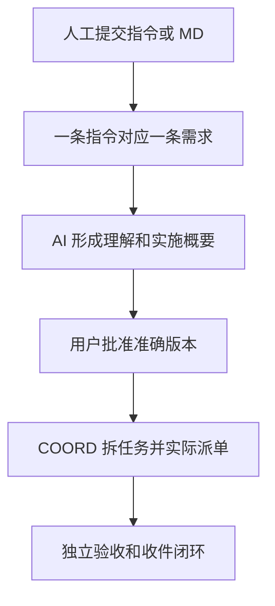

# COORD 三类人工入口与自动调度第一阶段设计

## 1. 本阶段交付和边界

目标是：**人提交一批自然语言指令或 MD 文档，系统保存原文；一条指令对应一条需求，COORD/PM 形成需求理解，ARCH 补充实施概要，程序生成分类 YAML 和待审批包。用户对准确版本批准后，COORD 将需求拆为多个角色的工程任务并持续推进。**不需要用户维护 YAML、编号或逐票转贴；已有有效批准直接引用。

revision 2 纳入用户已确认的输入和审批原则，替代旧版“人工填写每条 YAML”。接口细节和新增工具仍待独立技术审查，本文不冒充已经运行。

本阶段先做手动单步，再验证连续推进和恢复，最后部署定时唤醒。暂不验证 QA 自动创建 Issue、QA 固定轮次选版、buildno 发布体系及真实 MC/TH 验收自动化；这些由[QA 方案 v2](../planning/qa_automation_real_environment_acceptance_proposal_20261102_v2.md)的后续阶段承担。

排除自动入队不等于排除已有 QA 门禁。被处理任务的正式接受仍遵循服务器候选、独立 Docker、独立 Codex、报告非作者复核及必需 Owner 接受。没有通过就停在待审或相应阻塞，不能为演示调度自动填 Done。

本文是本次授权的设计交付，尚未经过正式独立接受，不是已部署能力声明。未创建正式任务、分配 Agent、安装服务、执行测试或修改业务实现。实施交接见[第一阶段 COORD 交接单](../planning/coord_intake_dispatch_phase1_handoff_20261103.md)。

## 2. 已核查输入及复用判断

### 2.1 本轮观察版本

以下为 2026-11-03 本地只读观察，不作为已经从服务器独立取得的实施/验收基线。实施前由 COORD 重新绑定并核验服务器准确版本，保留现有在途和用户改动。

| 仓库 | 本地观察 commit |
| --- | --- |
| 总仓 | `1e88c17a62bdcb63b4c0b78321eba3c44c3edc11` |
| project-control | `b4af2d32601a07d448ac8d67a07c57f5b9ab36ac` |
| soc-ap | `427dd6d82caceebb7b4642e78f1dbfa96ff5fc84` |
| mcu-p3 | `e051111e68dd61896ed42c0961153b167b8bca41` |
| test_harness | `ccf1476a0b98cb55ca9ee7bd49d73ca5d4704414` |

### 2.2 已有能力和本阶段增量

| 原件 | 可复用内容 | 不能据此认定已完成的内容 |
| --- | --- | --- |
| [队列](../planning/coord_autorun_queue_20261029.yaml)、[调度器](../../tools/coord_runner/scheduler.py) | 正式任务排序、依赖、并发和资源选择 | 当前主要读取 bootstrap/order 中的正式任务 ID，没有三类人工入口消费协议 |
| [队列投影工具](../../tools/coord_queue.py) | 只读展示、准备/恢复建议 | 自身不启动 Agent；checkpoint 文件存在也不足以证明活跃部署 |
| [Runner](../../tools/coord_runner/runner.py) | 执行阶段、已有 QA 链、错误分流和有界/常驻循环入口 | 默认作者执行器只解析、核验 HEAD；现有同步长调用不证明可同时推进其他事件 |
| [检查点](../../tools/coord_runner/checkpoint.py)、[租约](../../tools/coord_runner/lease_manager.py) | 状态恢复、原子文件替换、任务资源约束 | 不直接提供跨进程唯一 COORD、派单结果不明后的查询去重或三类收件持久化 |
| [任务发现](../../tools/check_task_graph.py) | 现有任务卡路径和结构/接受核对 | 不把 docs/issues/ 或新入口文件当正式执行任务 |
| [AUTO-01](../../.agents/kanban/microtasks/coord_automation/AUTO-01.md)、[AUTO-02](../../.agents/kanban/microtasks/coord_automation/AUTO-02.md) | 历史运行器、软件检查及独立审查输入 | 不重开全部旧票；仅对新增能力建关联任务并说明复用范围 |
| [AUTO-02 run_13 QA](../evidence/coord_automation/AUTO-02/runs/run_13/qa_review_report.md)及[非作者复核](../evidence/coord_automation/AUTO-02/runs/run_13/arch_review_report.md) | 报告明确限定锁定软件候选和所列检查 | 其接受不建立常驻生产调度、当前宿主角色派发或 HIL 能力 |

旧 AUTO 卡仍有模板正文、历史 readiness 和现有头部状态不完全一致的记录。由 COORD 在本次输入核对中明确历史范围，保留原件，不据此直接判定当前新能力已就绪或批量撤销旧结论。

## 3. 总体结构：入口、判断和执行分开



调度控制器、COORD 决策及角色作业分别有运行身份。控制器不冒充 PM/ARCH，COORD 不代做业务工程，角色名不等于实际会话，接收回执不等于任务完成。工程实现的技术拆分、依赖、接口、基线和允许路径须引用 ARCH 实际角色交付；COORD 只登记引用、核对前置与安排资源排程，主对话分阶段讨论不代替 ARCH 产物。

第一步必须核实实际宿主和调用能力：哪个实际 COORD 能接收程序请求、是否能保留原会话或建立受控恢复上下文、如何使用现行 `invoke_subagent`、如何查询任务及取回结果。工具名出现在旧文档中，不代表 Python 可直接调用。接口不可用时记录能力阻塞及可行方案，不能擅自改成所有角色都由另一种执行器代跑。

## 4. 人工原文、需求确认与机器入口协议

### 4.1 路径和唯一原件

建议实施时新增以下目录，本文不实际创建或启用队列：

```text
project-control/docs/work_intake/
  submissions/     人工一批指令一个 MD，保留来源和版本
  confirmations/   AI 生成的逐需求确认单和实施概要
  approvals/       程序登记并绑定实际人工批准来源
  issues/          程序生成的问题类 YAML，每条需求一份
  features/        程序生成的功能类 YAML，每条需求一份
  requirements/    程序生成的需求/澄清类 YAML，每条需求一份
```

人工只需自然语言或 MD，不必分类、维护 YAML 或填写机器编号。聊天输入由助手或接入程序按实际来源归档，不能伪造“用户原话”。一批指令可以用编号列表表达；公共约束保留并继承。边界不清时由 COORD 提出原文到需求的映射供确认，不擅自合并不同指令或将一条指令变成多个独立产品需求。

每条需求保留一个稳定需求 ID 和一份主分类 YAML。issues/features/requirements 是来源分类，同一需求不在三个目录各复制一份。需求可含多个验收点并关联多个角色任务；正式产品基线、已有 Issue 和方案原件继续保留，引用而非复制可独立改写的正文。后续 QA 自动提交属于第二阶段，本阶段由人提供原始指令。

表格用于自动汇总“原指令—需求—批准—工程任务—结果”，不作为多人同时编辑的另一套状态原件。原文保存业务意图，确认单保存可审查解释，YAML 保存机器索引，正式任务卡保存执行生命周期。

正式任务卡仍是现有 `.agents/kanban/` 等权威任务目录中的原件。入口不能直接带一个 Done 字段使调度器跳过接受；任务表、入口接收进度和运行作业状态各有明确含义。

### 4.2 最小字段

| 字段 | 约束 |
| --- | --- |
| `schema_version` | 固定协议版本，未知版本拒绝收件 |
| `id` / `revision` | 程序生成和维护唯一 ID 及正整数 revision，不同目录不能重复；人工不必填写 |
| `kind` | 仅 issue / feature / requirement，必须与所在目录匹配 |
| `enabled` | 有效生成项可被接收、澄清和编制方案；true 不代表用户批准实现，示例默认 false |
| `title` / `objective` | 简明现象或目标，不强迫提交者先提供根因或拆任务 |
| `source_refs` | 原始 submission ID/revision、具体指令锚点、原文/公共约束哈希及相关原件；不能只留下 AI 摘要 |
| `demand_ref` | 本条指令对应的稳定需求 ID、确认单 revision 和位置；一条指令一个需求，可关联多个工程任务 |
| `reported_by` | 实际提交人/来源；不伪造 Agent 运行身份 |
| `authorization_refs` / `approval_refs` | 原始授权和实际人工批准记录，绑定需求/方案准确版本、哈希及批准范围；不能由模型自填一个布尔值代替 |
| `requested_action` | triage / clarify / plan / execute；默认 triage，execute 仍须授权和依赖校验 |
| `priority_hint` | 建议优先级；不是提交者强制抢占资源的指令 |
| `related_ids` | 已知需求、Issue、正式任务等引用，可空；COORD 查重后再关联 |

Issue 类型补充预期来源、实际观察、复现及证据或明确未知项；Feature/Requirement 补充用户场景、目标与范围。以上由 AI 从原文和相关事实整理，不要求人工先填完整表。脚本只做格式解析、编号、校验和持久化，语义理解交 COORD/PM，技术边界交 ARCH；模型新增推断标为待确认，不混入原始事实。

实施提供简短 MD 输入模板、三类原文示例及其生成结果示例；示例不携带自动执行业务授权。语法错误、ID 冲突、越界来源或无效引用不能被当成已接受输入；原文里的命令说明不直接成为控制器可执行 shell。

### 4.3 revision、查重和撤回

- 收件记录绑定 `(id, revision, content_sha256)`。重复扫描相同内容返回已有回执，不新增任务或角色作业。
- 原文批次另绑定 submission ID/revision、内容哈希及逐指令到稳定需求 ID 的映射。用户改原文时，程序保存新版本，COORD 对既有需求做增量核对，不因列表重排、重扫或模型再次提取就新增一批需求。
- 同一 ID/revision 内容改变为输入冲突，要求明确新 revision；不能静默再次执行。
- 较高 revision 由 COORD 判断对原任务的影响。正在执行的任务保持原绑定，必要时修订/暂停受影响任务，不能用新原件替换旧候选上下文。
- 内容相似的不同 ID 可先分别接收，由 COORD 判断合并；保留每个来源和关联依据，不只靠标题相同自动丢弃。
- 删除文件或改 disabled 不等于取消在途工程。撤回必须有明确请求和授权，由 COORD 核对已发生动作后处置。
- 文件写入不完整、临时文件和解析错误不影响其他有效入口；不执行半份记录。记录错误和下次检查条件，不循环调用模型修复语法。

### 4.4 理解确认和方案审批

每条需求的确认单至少包含原话/来源、AI 对用户目标的理解、正常/异常/恢复验收场景、范围及排除项、公共约束、实施概要/依赖和真正待决定的问题。版本显示等单条需求可拆给 MC、TH、FWD、STATE、UI、INTEGRATOR/QA 等多个角色，但最终按同一需求的用户结果接受。

新目标默认将需求理解与实施概要组成一次待审批包，支持按批次批准全部或明确的部分需求。用户可选择“只确认需求，方案继续讨论”；这种批准不等于允许尚未批准的实现方案开工。详细技术设计由 ARCH、Owner 和独立检查按现有规则接受，只有重大范围/产品取舍或本仓明确要求时才再提交用户；已有准确有效批准不重复索要。

审批前允许在本次提交授权内安排只读调查、澄清和方案编制，也可以为这些准备工作登记正式任务，避免等待批准却无法产生方案。新增业务实现、未批准范围及硬件动作必须等相应批准和条件齐备；任务派单细节不得静默扩大用户接受的需求。

人工批准来源可为实际对话指令或受控评审记录。程序保存实际来源、批准者、时间、批次/需求 ID、需求 revision、方案位置/revision/哈希、批准范围及排除项。自然语言审批由 COORD 解释为具体版本映射；指代不明时澄清，不能靠扫描“批准”两个字或模型自写 `approved: true` 认定通过。部分批准只释放对应项，其余保持待审并继续其他就绪工作。

需求目标、验收或已批准实施范围发生实质变化时，新 revision 不继承不相符的旧批准；保留旧记录并提交变更部分确认。原文修订未改变某条需求和方案时可引用原有效批准，不为了全局列表编辑重复审批所有项。最终实现开工前，程序重新核对当前任务消费的需求/方案/批准绑定。

## 5. 程序与 AI 的接口及责任

| 动作 | 执行归属 | 结果要求 |
| --- | --- | --- |
| 保存 MD 原文、解析格式、编号、校验和回执 | 程序 | 批次/指令稳定映射、耐久接收和错误记录，人工不填 YAML |
| 理解目标、编制需求确认、分类和查业务重复 | COORD/PM；ARCH 提供实施概要 | 一条指令一条需求、原文约束不丢、推断与未决项明确 |
| 登记人工批准、生成分类 YAML 和检查版本绑定 | 程序 | 批准对应实际人工来源，不能自批；准备工作与实现释放分别判断 |
| 接受需求/架构专业判断 | PM/ARCH 和必需检查者 | 实际文档版本、接受及未决项；不是 COORD 生成几个字段替代 |
| 创建/修订卡、登记队列和实际写入 | 程序执行 COORD 的已校验决定 | 唯一 ID/revision、现有 schema、路径白名单、前置、租约及接收入口 |
| 启动/查询/取回角色任务 | 实际宿主适配器 | 真会话、job、模型、日志、准确任务和版本；提交后能查询 |
| 构建、已接受测试及物证采集 | 原工程执行器/QA Runner | 确定性命令、原始结果、正确来源和环境 |
| QA 专业审阅及报告复核 | 独立 Codex | 沿用当前正式链路，不能回退 self |
| 收件转换和正式卡回写 | 程序核验后由唯一 COORD 接受 | 只推进满足条件的既有生命周期，不能以进程 exit 0 写 Done |

COORD 每次接收“变化项＋关联任务＋在途作业＋规则/输入版本＋资源摘要”，不必反复阅读全仓。无变化、无回执、无到期动作时不调用模型。有待决事项但被资源/外部授权阻塞时保存原因和唤醒条件，不每轮重新发同样提示词。

结构化决定至少包含本次 decision ID、输入绑定、动作、目标角色/任务、范围、依据和下一检查条件。程序拒绝未知动作、错误 revision、无依据的越权、未接受的前置、非法路径或新增未批准需求；禁止从自然语言中搜索 APPROVED 字符串决定执行。

## 6. 实际 COORD 和角色作业适配

建议把宿主差异封装为可核验接口，名称是设计接口而非当前已有命令：

| 接口 | 语义 |
| --- | --- |
| `coordinate(request)` | 唤醒/继续登记的唯一 COORD，返回一个有界结构化决定；保留实际会话来源 |
| `submit_role_task(request, dispatch_key)` | 经现行工程委派通道发出任务，返回真实可查询 job/session |
| `query_role_job(job_id or dispatch_key)` | 查询在途、已结束或未知，不能把暂时超时当作从未派发 |
| `collect_role_result(job_id)` | 取得实际交付及原始运行记录，验证任务/revision、输入和候选一致 |

正式 QA 继续使用已有受控 Runner 和独立 Codex 适配，不把普通 `invoke_subagent` QA 返回当作独立审核。若宿主不能进行无交互角色派发，自动执行能力不成立；先调查并形成有依据的适配方案，而不是用默认 HEAD 读取器冒充实际工程师执行。

派单前持久化唯一 `dispatch_key`，绑定任务 ID/revision、阶段、输入版本和本次执行尝试。角色返回快慢不影响控制器收取其他事件；真正启动后先保存 job/session，后续周期查询和消费结果，不在调度线程同步等待完整构建或 QA。

若启动请求超时，结果未知，应按 dispatch_key 向宿主查询并对账。不能确认从未启动时禁止盲目重发；记录派单待核实，继续其他无关工作。宿主不支持幂等提交/查询时，将这种窗口列为能力缺口并先实现对账机制，不能声称恰好执行一次。

新 COORD 进程恢复时必须与旧实际会话及在途任务核对，不创建第二个有写权的协调者。历史会话 ID 不直接复用作新运行 ID；实际模型按现行默认及有证据的例外记录。

## 7. 存储、单实例和写入归属

### 7.1 权威数据划分

| 内容 | 权威归属 |
| --- | --- |
| 人工目标及授权来源 | submissions 原文和实际批准来源，程序保存版本，用户不维护 YAML |
| 需求理解/方案及批准索引 | 确认单的准确版本和绑定人工来源的审批记录；分类 YAML 只做机器索引，不另造独立产品正文 |
| 正式任务状态/Owner/依赖/接受 | 原任务卡及其正式证据，由唯一 COORD 维护 |
| 收件去重、决策请求、job/session 绑定、待投递事件 | 控制器运行存储，不是第二套业务看板 |
| 角色交付、QA 和非作者审阅 | 对应实际作者/独立会话证据，COORD 不代写 |

正式任务继续使用 `Backlog → Ready → InProgress → Review → Verify → Done` 及单独的 `blocked`/解除条件。Runner 内部阶段和进程作业状态只用于恢复执行，不能将 `CandidatePushed`、`SandboxQA` 或 `Blocked` 原样写为正式任务 status；入口的接收回执也不是新的工程任务生命周期。

建议新增运行存储使用 Python 标准库 SQLite，利用事务和唯一键实现收件、认领、派单意图及待投递事件；无需新增消息中间件。数据库位于宿主配置指定的本机可写运行目录，不放业务源码、Git 跟踪目录或未经接受的网络共享路径。

既有执行阶段状态机和 checkpoint 继续复用；新增数据库不再复制一份能独立判 Done 的业务状态。运行 checkpoint 是恢复快照，不能替代正式卡/报告。实施必须明确执行阶段只保留一个权威恢复来源，禁止 SQLite 和 JSON 各维护互相独立的 completed 列表。

### 7.2 单写入与崩溃恢复

- 首版只允许一个调度写进程，通过宿主锁和实际进程/会话登记约束。第二次触发合并待办或退出，不启动另一位 COORD。
- 先持久化接收/派单意图，再调用外部宿主，返回后记录真实作业。事件采用可重投、可去重的方式传递，不用“发过通知”代替回执。
- 任务卡写入、Git 提交和数据库事务不能假装具有跨系统原子性。保存带唯一操作 ID、前置内容哈希和目标文件集合的写入意图；写前比较原件，冲突停止该动作；恢复时对账已完成文件和日志，再续做或交 COORD 处理。
- 修改入口、正式任务或队列后只更新相应版本，保留既有任务和排序。不能覆盖整份静态队列、把未知 ID 当空卡派发，或让旧 bootstrap 因新增入口被重复启动。
- 租约过期只是需要核查，不自动证明实际 Agent 已停止。重派或重新分配有冲突资源前查询旧作业；无法确认时保持资源待核实。
- 正式证据导出到原 evidence 体系，运行数据库按宿主备份/恢复规程处理；重建运行进度需核对来源，不凭目录或文件存在宣称运行器已部署。

## 8. 调度循环和三步部署

控制器一次推进有明确边界：

1. 核对单实例和配置，恢复待对账动作与已登记实际作业。
2. 扫描原始提交、生成的分类记录、实际人工审批和角色返回，持久化接收/错误。
3. 有新指令时由 COORD/PM/ARCH 完成理解和方案，形成待审批包；已有有效批准则直接引用，不重复询问。
4. 校验决定及批准绑定，登记准备工作或已授权实现任务，按依赖及资源预算实际派发。
5. 启动已就绪的确定性动作或处理已完成结果，执行已有接受门禁。
6. 保存检查点/待办，返回本轮摘要，再等待事件或下次周期。

定时唤醒先复用既有 `poll_interval_seconds` 配置，本地观察值为 5 秒；它只是检查周期，不是强迫每 5 秒调用模型，也不是完成时间保证。一个待处理动作消耗时间较长时外置为作业，控制器不能被其阻塞。

| 核验步骤 | 内容 | 退出条件 |
| --- | --- | --- |
| 1：人工触发单步 | 人工 MD 输入，自动生成需求确认/分类记录，核验实际批准并调用角色 | 不手写 YAML 或逐票复制消息；一条需求可关联多个实际角色任务，未批准实现不启动 |
| 2：持续推进和恢复 | 等待中的工作、另一就绪工作、重复扫描、进程恢复 | 前者不拖住后者；不丢回执、不重复派单、不无证据推进 Done |
| 3：定时运行 | 由 INTEGRATOR 在接受的宿主上部署单个服务，复用同一调度入口 | 无人工触发也可接收处理；停止/重启可恢复，无任务时不空耗模型 |

Linux 宿主首版可用单个 systemd service 管理已有轮询循环，避免同时再部署一套 cron/timer 产生双实例。服务启动、停止、状态查询、检查点路径、授权账户和日志位置由实施绑定；宿主不适用时明确等价方案。本文不提供尚未实现的一键启动命令，也不安装该服务。

开发调度检查周期与 QA 换版检查点不同：本阶段只推进工程任务，不能因定时触发而重启 QA 或改写正在运行的候选。后续接入 QA 时保留 v2 的固定轮次边界。

## 9. 本阶段验收清单

测试原文和实际审批输入由人工准备，不要求人工写 YAML，也不使用 QA 自动创建 Issue 作为前置。表中编号不是新正式任务 ID。模拟适配器可用于程序单元检查，真实调度接受必须使用实际宿主、COORD、角色及会话记录。

| 编号 | 场景 | 通过判据 |
| --- | --- | --- |
| P1-01 | 一份 MD 中包含问题、功能和需求指令 | 原文逐条映射为需求及对应分类 YAML，保留公共约束；准确批准后关联实际任务，不要求人工填写 YAML |
| P1-02 | requirement 目标不清 | 实际安排 PM/必要 ARCH 澄清，关联产物；相关实现等待，其他就绪工作可继续 |
| P1-03 | feature 有已接受范围 | 按必要架构输入拆分并实际派发，范围未批准部分不擅自实现 |
| P1-04 | issue 根因未知或明确 | 未知时允许调查；明确时直接安排对应 Owner，保持发现和实现证据可追溯 |
| P1-05 | 同一记录重复扫描/重复通知 | 返回原接收与任务关联，无重复工程作业 |
| P1-06 | 同 ID/revision 内容改变、错误 schema、目录类型冲突 | 拒绝或标明输入冲突；其他有效记录继续处理 |
| P1-07 | 新 revision 遇到旧版在途工作 | 明确新旧绑定和影响，不静默换输入或重复派发 |
| P1-08 | 一个角色/QA 长时间执行，另一条就绪 | 后者能在资源约束内实际推进；不能只有两个 InProgress 标题而无实际运行 |
| P1-09 | 派单请求超时，或派发后控制器崩溃 | 先用实际宿主查重/对账，不盲目重发；未知记录可见 |
| P1-10 | 双重启动和租约过期但旧作业仍活跃 | 唯一 COORD，资源不被重新占用；恢复不依赖伪造空闲 |
| P1-11 | 角色退出 0 但无候选/证据，或 QA 拒绝/阻塞 | 不写 Done；保留准确错误、下一动作/解除条件，继续独立任务 |
| P1-12 | 候选未在服务器、报告/复核缺失或哈希不匹配 | 按既有正式门禁拒绝收件，普通 QA 子 Agent 回执不能替代独立 Codex |
| P1-13 | 写卡或队列时出现人工/其他角色修改 | 比较内容哈希并拒绝覆盖，保留操作意图，恢复可对账 |
| P1-14 | 手动单步后启用定时及服务重启 | 相同逻辑自动工作，重启不丢在途；无变化时不调用模型，服务存在不作为接受结论 |
| P1-15 | 已批准的小范围真实实现任务 | 实际工程师执行、提交交付，经适用独立 QA/复核后才能接受；到待审/阻塞时如实停止该票 |
| P1-16 | 删除入口、无执行授权或越界路径/指令 | 不取消已发动作、不自动扩大授权、不直接执行输入中的 shell；只记录并分流 |
| P1-17 | 一条指令需要多个工程师 | 保持一个需求 ID/用户验收目标，关联多个有边界任务，不擅自拆成多个产品需求 |
| P1-18 | 一批需求部分批准，或仅确认需求未批准实现概要 | 只释放准确获准的实现范围；未批准项保持待审，已获准工作可继续 |
| P1-19 | 无实际人工来源、旧版本批准或模型自填 approved | 拒绝作为实现开工依据，不因 enabled=true 或出现“批准”字符串放行 |
| P1-20 | 原文重排、需求/方案修改或重复提取 | 不重复建需求；未变项复用有效批准，实质变更另行确认，旧批准不套新范围 |

完成本阶段需覆盖三类入口和上述适用失败/恢复情形，附真实过程记录。纯模拟全部通过最多说明模块行为，不能证明宿主适配和定时部署。演练只使用已授权的有界软件任务，不为验证调度额外操作 MCU 或破坏现有业务。

所有软件验证走服务器锁定候选、独立沙箱、独立 Codex及报告非作者复核，按[现行交付门禁](../../.agents/rules/delivery_and_coord_gate.md)、[QA 规则](../../.agents/rules/codex_qa_review.md)和[总控执行清单](../planning/coord_autorun_tasklist_20261029.md)收件。原始输出、实际命令、非零用例、环境、会话和准确候选齐全后才给对应范围结论。

## 10. 需要 COORD 核实的实施前置

必须核实而尚未落实的事项：当前唯一 COORD 的真实接收入口及宿主自动调用能力、实际角色派发/查询协议、可用账号和进程生命周期、运行目录、单实例机制、租约/并发、已有在途工作与正式任务 ID、实际作者和独立 Reviewer、白名单及准确服务器基线。

这些缺口优先用一张有界调查/设计接受任务解决，不因未落实就虚构 ready。只有外部账号、权限或产品决定确需用户处理时，再提出具体缺项；其余技术方案由团队完成。

本阶段只允许对新增能力和必要关联处做最小改动，不批量重写规则、迁移历史任务或重置旧返工次数。默认作者执行器的真实派单能力应作为显式增量实现，不能继续以 HEAD 核验路径签署“自动执行已完成”。
