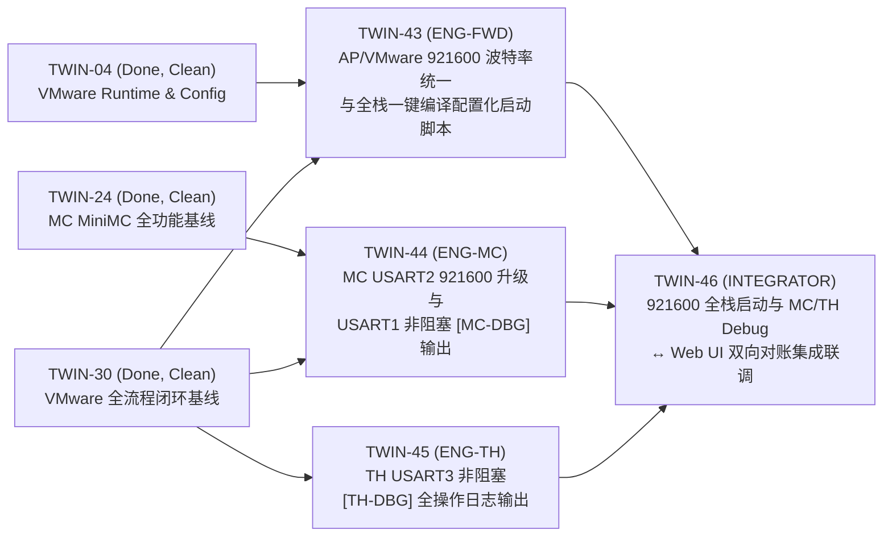

# MC/TH Debug 双向链路对账与 VMware/AP↔MC 921600 波特率统一及全栈配置化启动架构拆分方案（Revision 14）

## 一、ARCH 独立技术复核结论（针对合并实施概要 `rev 2` 及 `Ready` 派单门禁收敛）

### 1.1 总体复核意见
经 `ARCH` 独立勘察 `soc-ap/`、`mcu-p3/`、`test_harness/` 真实源码、编译体系与 `project-control/.agents/kanban/microtasks/` 全量看板任务图，对已获用户批准的《MC/TH Debug 双路串口与用户 UI 双向链路对账 + VMware/AP↔MC 921600 波特率统一及全栈一键编译启动合并实施概要》（`project-control/docs/planning/debug_and_921600_merged_implementation_summary_20261104.md`，`revision: 2`，SHA-256: `c469fcd058b8607f454d661a69c07bf8a483e5763d9d231a574d71ee14cd69ec`）给出如下权威复核结论：

1. **无实质需求或范围变更，可直接沿用现有用户批准进入任务登记与派单**：
   合并实施概要（`rev 2`）的技术方案与代码库真实架构、集中式配置 schema（`soc-ap/contracts/twin/services_manifest_schema.json`）、AP↔MC↔TH MiniMC V2 协议帧结构、Web Gateway/UI 状态机以及 C/C++ 与 Web UI 编码规范硬性门禁完全吻合，**不触发重新提交用户确认或二次审批**，`COORD` 可直接引用现有 `CONFIRM-DEBUG-BAUD-20261104` 与 `APPR-20261104-001` 登记 `TWIN-43` ~ `TWIN-46` 微任务卡。
2. **硬件串口拓扑与源码真值核对（确认 `rev 2` 概要与源码 100% 一致）**：
   经直接核查 `mcu-p3/motion-controller-mcu/project/src/wk_usart.c`、`minimc_proto.c`、`main.c` 及 `mcu-p3/color-engine-mcu/io_toggle/src/bsp/usart.c`、`src/app/minimc_proto.c`、`src/user/main.c`，两块 MCU 的真实物理串口分配如下表所示：

| 物理链路 | 所属芯片与工程目录 | 外设实例与引脚 | DMA / 中断机制 | 变更前波特率 | 目标波特率与架构策略 |
| :--- | :--- | :--- | :--- | :--- | :--- |
| **AP ↔ MC 业务链路** | MC (`motion-controller-mcu`, AT32F435) | `USART2` (`PA2` TX / `PA3` RX) | `DMA1_CH2` TX / `DMA1_CH6` RX + `IDLE` 中断 | `115200` 8N1 | **统一提升至 `921600` 8N1**（定义 `AP_USART_BAUDRATE 921600U`，在 `minimc_proto_init()` 中将 `USART2` 重配置为 `921600`） |
| **MC ↔ TH 板间级联链路 (MC 侧)** | MC (`motion-controller-mcu`, AT32F435) | `USART6` (`PA4` TX / `PA5` RX) | `DMA1_CH4` TX / `DMA1_CH5` RX + `IDLE` 中断 | `921600` 8N1 | **保持 `921600` 8N1 不变**（既有 `FORWARD_USART_BAUDRATE 921600`） |
| **MC ↔ TH 板间级联链路 (TH 侧)** | TH (`color-engine-mcu/io_toggle`, AT32F423) | `USART1` (`PB6` TX / `PB7` RX) | `DMA1_CH4` TX / `DMA1_CH2` RX | `921600` 8N1 | **保持 `921600` 8N1 不变**（既有 `BAUDRATE1 921600`） |
| **MC Debug 独立观测串口** | MC (`motion-controller-mcu`, AT32F435) | `USART1` (`PA9` TX / `PA10` RX，宿主机 `COM8`) | 原阻塞轮询 `USART_TDBE_FLAG` | `115200` 8N1 | **保持 `115200` 8N1 不变**；在 `minimc_proto.c` + `main.c` 中实现 `2048B` 静态环形缓冲 + 主循环非阻塞排空 |
| **TH Debug 独立观测串口** | TH (`color-engine-mcu/io_toggle`, AT32F423) | `USART3` (`PC4` TX / `PC5` RX，宿主机 `COM6`) | `DMA1_CH5` TX 非阻塞环形缓冲 | `115200` 8N1 | **保持 `115200` 8N1 不变**；在 `src/bsp/usart.c` + `src/user/main.c` 中复用 `USART3_write()` 输出 `[TH-DBG]` 结构化日志 |
| **MC / TH Bootloader** | `boot/bootloadermc`, `boot/bootloaderth` | - | - | 存量不变 | **零改动**（严禁触碰 Bootloader 仓库） |

### 1.2 Revision 2 关键收敛说明（零历史卡修改 + 规避冻结任务 + `Ready` 门禁 0 错误验证）
针对 `COORD` 退回的 2 项依赖与写路径冲突，`ARCH` 在 `revision: 2` 中完成如下精确收敛并经 `check_task_graph.py` 实测验证：
1. **严格保持历史旧任务卡（`TWIN-01` ~ `TWIN-42`、`CR-*`、`TEMP-*` 等）Git 工作树零改动**，绝不修改 `TWIN-16.md` 或 `TWIN-42.md` 的历史字段。
2. **完全剔除冻结任务 `TWIN-26` 及未闭环/旧格式任务（`TWIN-16`、`TWIN-36`、`TWIN-40`、`TWIN-42`）作为前置依赖**：
   - `TWIN-43`、`TWIN-44`、`TWIN-45` 的 `depends_on` 仅引用看板中满足 `status == "Done"`、`blocked == false`、`closure_errors == []` 且 `done_acceptance_errors == []` 的已闭环基线任务（`TWIN-04`、`TWIN-24`、`TWIN-30`）。
3. **收敛 `write_scope` / `allowed_paths`，消除与 `TWIN-26`、`TWIN-16`、`TWIN-36`、`TWIN-40` 的写路径交集**：
   - **`TWIN-43` (`soc-ap`)**：修改 `core/forward/transport/serial_posix.{h,cpp}`（将 `SerialConfig::baud_rate` 默认值更新为 `921600` 并新增 `B460800`/`B921600` 映射）、`core/host/{main.cpp,query.h,query.cpp}`、`config/runtime/{vmware,common}/**`、`dist/vmware_twin/config/services_manifest.json` 及 `tools/deploy_twin.sh`（由启动脚本读取 `aisoc_twin.conf` 并通过 `forward_main.cpp` 原生支持的 `--baud 921600` 参数启动 `forward_service_daemon`）。不触碰 `soc-ap/services/forward/**` 与 `soc-ap/tests/**`，与 `TWIN-36`、`TWIN-40` 零路径交集。
   - **`TWIN-44` (`mcu-p3` MC)**：仅修改 `motion-controller-mcu/project/src/{minimc_proto.c,test_twin44_mc_debug.c}` 与 `inc/minimc_proto.h`（保持 `project/src/main.c` 零改动，由 `minimc_proto_poll()` 内部自包含执行 `mc_debug_log_periodic_state()` 与 `mc_debug_poll_drain()`）。在 `minimc_proto_init()`（于 `main.c` 中紧随 `wk_usart2_init()` 调用）中通过 AT32 标准外设库 `usart_init(USART2, AP_USART_BAUDRATE, USART_DATA_8BITS, USART_STOP_1_BIT)` 将 `USART2` (`PA2`/`PA3`) 波特率重配为 `921600U`，并在 `minimc_proto.c` 中实现 `USART1` (`PA9`/`PA10`, `115200`) 的 `2048B` 静态非阻塞环形缓冲与 `mc_debug_poll_drain()`。不触碰被冻结任务 `TWIN-26` 占用的 `wk_usart.{c,h}` 及 `main.c`，与 `TWIN-26` 零路径交集，且候选变更的每一个生产 `.c` 文件 100% 纳入沙箱 `gcc` 编译测试。
   - **`TWIN-45` (`mcu-p3` TH)**：仅修改 `color-engine-mcu/io_toggle/src/bsp/usart.c`、`inc/usart.h` 与 `src/user/test_twin45_th_debug.c`（保持 `src/user/main.c` 零改动，由 `usart1_rx_pop_raw_byte()` 内部自包含调用 `th_debug_log_periodic_state()` 与 `USART3_forward_service()`）。由于 TH 侧主循环每轮调用 `minimc_proto_poll()` 进而调用 `usart1_rx_pop_raw_byte()`、所有级联响应帧发送均经由 `usart1_send_raw()`，因此在 `usart.{c,h}` 中即可完整实现 `[TH-DBG]` 的 `dir=RX|TX|STATE|ERR` 非阻塞日志输出及 `drop`/`trunc` 计数，不触碰 `TWIN-16` / `TEMP-02` 的 `src/app/minimc_proto.c` 及 `main.c`，且候选变更的每一个生产 `.c` 文件 100% 纳入沙箱 `gcc` 编译测试。
   - **`TWIN-46` (`test_harness`)**：仅写入 `test_harness/hil/tools/debug_reconciliation_probe.py`、`test_harness/static_checks/twin/**`、`test_harness/test_cases/twin/**` 与 `project-control/docs/evidence/twin/TWIN-46/**`，不触碰 `soc-ap/tests/**`，与 `TWIN-35`、`TWIN-40` 零路径交集。

### 1.3 Revision 6 关键补充：受控只读 Docker 沙箱（`qa-sandbox:20261029`）验证架构与 `TWIN-44` 独立 QA (`qa_01`) 整改契约

#### 1.3.1 受控只读 Docker 沙箱（`qa-sandbox:20261029`）验证命令与单测落盘契约
根据 `qa_runner.py` 与容器 `qa-sandbox:20261029` 的客观环境事实：
1. `qa_runner.py` 启动容器时将 `/workspace` 挂载为只读（`-v <sandbox_dir>:/workspace:ro`），容器内仅 `/tmp` 可写（`rw`）。
2. 容器内置 `/usr/bin/gcc`、`/usr/bin/g++`、`/usr/local/bin/cmake`、`/usr/local/bin/ctest`、`/usr/bin/python3`、`/usr/local/bin/dbus-daemon` 以及 `/usr/local/{include,lib}` 下的 `dbus-1.0`、`fastdds`、`fastcdr`、`foonathan_memory`，**未安装 `arm-none-eabi-gcc` 与 `curl`**。
3. 因此，`TWIN-43` ~ `TWIN-46` 的 `verification.commands` 按如下确定性架构适配受控沙箱：
   - **`TWIN-43` / `TWIN-46` (`soc-ap` & `test_harness`)**：验证命令先在容器 `/tmp/qa_twin43`（或 `/tmp/qa_twin46`）建立可写工作副本，若 `third_party/install` 不存在则软链至容器 `/usr/local`，并在 `/tmp/qa_twin43/bin/curl` 提供基于 `python3 urllib.request` 的 HTTP 探活垫片，随后在 `/tmp` 可写副本下完整执行 `deploy_twin.sh --build-only`、`ctest`、`run_query_cases.py` 与 `deploy_twin.sh --mode sim` 全栈启动/状态探活/停止验证。
   - **`TWIN-44` / `TWIN-45` (`mcu-p3`)**：
     - 将 C 单元测试文件直接纳入 `mcu-p3` 仓库提交范围（`TWIN-44`：`motion-controller-mcu/project/src/test_twin44_mc_debug.c`；`TWIN-45`：`color-engine-mcu/io_toggle/src/user/test_twin45_th_debug.c`）。由于 `motion-controller-mcu/CMakeLists.txt` 与 `color-engine-mcu/io_toggle/Makefile` 均采用显式源文件列表（无 `*.c` 通配符），随仓提交单元测试文件完全不影响宿主机 `arm-none-eabi-gcc` 交叉编译，同时保证 `qa_runner.py` 从 GitLab 服务器检出 `mcu-p3` 候选提交时测试源码直接位于 `/workspace/mcu-p3` 内。
     - 容器内 `verification.commands` 使用 `gcc -std=c11 -O2 -Wall -Wextra -no-pie -fno-pie ...` 将候选源码与单元测试编译至 `/tmp/test_twin44`（及 `/tmp/test_twin45`）并执行全量正反例断言（覆盖正常命令与状态同步、`2048B` 环形缓冲满丢包与 `>192B` 截断计数、CRC 错误、级联超时与恢复、底层发送失败抑制伪 ACK 等），宿主机 `arm-none-eabi-gcc` 交叉编译保留在作者自检与证据记录中。

#### 1.3.2 `TWIN-44` 独立 Codex 审阅（`qa_01`, session `01a1a48a-3fb2-7ca0-b715-eac8b6d6e7d1`）两项代码整改技术契约
针对独立 Codex 会话对 `TWIN-44` `qa_01` 提出的 2 项阻塞问题，`ENG-MC` 返工必须严格落实以下技术整改契约：
1. **整改项 1：状态与温度实时同步，消除静态初始化常量失真**：
   - 在 `minimc_proto.c` 中引入 `thermistor.h`（声明 `current_temperature_ex1`、`current_temperature_bed`、`BAD_TEMPERATURE`），并新增静态辅助函数 `static void mc_dbg_sync_runtime_state(void)`（严格 $\le 50$ 行、$0$ 入参）：
     - 在 `mc_debug_log_periodic_state()`、`build_temp_resp()` 及每次输出 `dir=STATE` 前调用 `mc_dbg_sync_runtime_state()`；
     - 当 `current_temperature_ex1 == BAD_TEMPERATURE` 或 `current_temperature_bed == BAD_TEMPERATURE` 时置 `s_dbg_state.heater_fault = 1U`，否则置 `0U`；将 `current_temperature_ex1 * 10` 与 `current_temperature_bed * 10`（当传感器有采样值或非初始 `0` 时，或直接按实时采样值）同步至 `s_dbg_state.nozzle_ddC` 与 `s_dbg_state.bed_ddC`；
     - 在 `build_temp_resp()` 中将 `payload.target_temp_deci_c` 绑定为 `s_dbg_state.bed_set_ddC`、`payload.sensor_status` 绑定为 `(s_dbg_state.heater_fault != 0U) ? MINIMC_TEMP_STATUS_DISCONNECTED : MINIMC_TEMP_STATUS_OK`。
   - 在各命令处理分支中动态解析请求载荷并更新 `s_dbg_state`：
     - `MINIMC_CMD_SET_TEMP`：更新 `nozzle_set_ddC`、`bed_set_ddC`；
     - `MINIMC_CMD_MOTION_HOME` / `MINIMC_CMD_MOTION_MOVE` / `MINIMC_CMD_MOTION_STOP`：从请求载荷更新 `axes_mask`（如 `plen >= 1` 时取 `frame[12]`，`STOP` 时置 `0`）与 `feed`（如 `MOVE` 且 `plen >= 4` 时取 `frame[14..15]`，`STOP` 时置 `0`），坐标 `x/y/z_mm_x100`、`homed_mask`、`motion_state` 实时从 `current_position[]`、`axis_known_position[]`、`movesplanned()`、`is_paused` 读取；
     - `MINIMC_CMD_FILAMENT_CONTROL` / `MINIMC_CMD_SLOT_SELECT`：从载荷更新 `active_slot`（`frame[12] & 0x03U`）、动作类型（`SELECT`/`LOAD`/`UNLOAD`）及 `filament_mask`（若 `plen >= 2` 且提供掩码则更新）；
     - `MINIMC_CMD_JOB_CONTROL`：从载荷更新 `job_state_id`（`frame[12] % 7U`）与 `progress_permille`（若 `plen >= 3` 则读取 `uint16_t` 千分比进度 `frame[13..14]`）及 `ack_seq`。
2. **整改项 2：强制校验 `minimc_proto_send()` 与 `forward_uart_send_raw()` 返回值，严禁伪阳性 ACK 日志**：
   - 在 `minimc_proto.c` 所有发送响应帧的分支（`GET_VERSION`、`PING`、`GET_TEMP`/`SET_TEMP`、`POS_QUERY`/`MOTION_*`、`LEVEL_GRID_QUERY`、`FILAMENT_CONTROL`/`SLOT_SELECT`、`JOB_CONTROL`、未知命令 `NACK` 以及 `handle_th_frame` 向 AP 转发级联响应），**严禁忽略 `minimc_proto_send(resp, resp_len)` 的返回值**；
   - 封装静态辅助函数（均满足 $\le 50$ 行、$\le 4$ 入参）：
     - 当 `minimc_proto_send(resp, resp_len)` 返回 `true` 时，才输出 `dir=STATE`（若适用）与 `dir=TX status=ACK|NACK` 日志；
     - 当 `minimc_proto_send(resp, resp_len)` 返回 `false`（如 `USART2` DMA 忙超时）时，**绝不输出 `dir=TX status=ACK`**，而是输出 `[MC-DBG] ... dir=ERR node=MC seq=<seq> cmd=0x<XX> status=TX_ERR err_code=0x06 drop=<N> trunc=<M>\r\n` 故障日志；
     - 在 `handle_ap_frame()` 向 TH 转发级联帧调用 `forward_uart_send_raw(relay_buf, len)` 时，校验返回值是否为 `0`：若返回非 `0`（发送失败），立即复位 `s_relay_pending = false` 并输出 `dir=ERR node=TH seq=<seq> cmd=0x<XX> status=TX_ERR err_code=0x06`。
3. **单元测试（`test_twin44_mc_debug.c`）强制验证项**：
   - 必须包含修改 `current_temperature_ex1`、`current_temperature_bed`、`current_position[]`、`axis_known_position[]`、`is_paused` 及下发带参数的 `SET_TEMP`、`MOTION_MOVE`、`JOB_CONTROL` 后，对 `[MC-DBG] dir=STATE` 输出字段与实时状态一致性的断言；
   - 必须包含模拟 `usart2_tx_busy = 1` 导致 `minimc_proto_send()` 返回 `false` 时的负例测试，断言此时无 `dir=TX ... status=ACK` 输出且准确产生 `dir=ERR ... status=TX_ERR err_code=0x06` 日志。

#### 1.3.3 Revision 7 关键补充：`TWIN-43` `qa_01` 独立 Codex 审阅反馈闭环与软件沙箱验收范围显式界定
针对 `TWIN-43` `qa_01`（会话 `01a1a4a1-4133-70f0-950f-f008743914a6`）在 Docker 沙箱 `server_qa.passed == True` 基础上指出的 `runtime.log` 未显式覆盖全部负例/故障恢复及 HIL 边界说明问题，`revision: 7` 完成如下闭环：
1. **显式界定软件沙箱验收范围（排除未授权实机 HIL 歧义）**：
   - `TWIN-43`、`TWIN-44`、`TWIN-45`、`TWIN-46` 四张任务卡均处于 `development_stage: vmware-twin` 阶段，其正式 QA 验收范围**严格限定为受控 Docker 软件沙箱（`qa-sandbox:20261029`）内的构建、静态契约校验、宿主/容器单元测试及 PTY 虚拟串口/Mock 仿真闭环验证**；真实物理硬件板卡烧录与物理串口 HIL 联调属于后续 `HW-G2` 实机门禁范围，**不在 `TWIN-43` ~ `TWIN-46` 软件沙箱验收范围内**。
2. **`TWIN-43` `verification.commands` 全量正反例与恢复闭环显式执行（无需改动 `soc-ap@217a76e29c0c99897bf1993514b765cd771adb06` 代码）**：
   - 在 `build_and_test_fullstack_921600` 中追加：
     - 使用 `g++` 编译直接链接 `serial_posix.cpp` 的 PTY 实证程序 `/tmp/test_serial_baud`，在真实 POSIX PTY (`posix_openpt`) 上断言：`SerialConfig` 与 `QueryOptions` 默认波特率为 `921600U`；传入非法波特率 `123456U` 时 `serial_open()` 返回 `false` 且拒绝打开串口（`!ctx.is_open && ctx.fd == -1`）；传入 `921600U`、`460800U`、`115200U` 时 `serial_open()` 全部返回 `true` 且 `serial_close()` 正常释放；
     - 显式执行 `! ./build/host/soc-ap --port /dev/null --baud 123456 --target mc --cmd version`，证明 `parse_baud_rate()` 拒绝非法波特率 `123456` 并以非 0 退出码退出。
   - 在 `verify_deploy_twin_sim_lifecycle` 中追加：
     - 显式执行 `! bash tools/deploy_twin.sh --mode hardware --uart /dev/nonexistent_ttyUSB99 --port 18080` 与 `! bash tools/deploy_twin.sh --status --port 18080`，证明 `hardware` 模式下当指定串口设备不存在时以非 0 退出码报错终止且**绝不静默降级启动 `sim` 后台守护进程**；
     - 显式执行 `! bash tools/deploy_twin.sh --mode sim --baud 123456 --port 18080`，证明脚本拒绝非法波特率；
     - 在上述启动失败负例之后，连续执行两轮完整的 `bash tools/deploy_twin.sh --mode sim --port 18080 && bash tools/deploy_twin.sh --status --port 18080 && bash tools/deploy_twin.sh --stop --port 18080`，在 `runtime.log` 中客观证明启动失败后的恢复能力与重复启停生命周期。

#### 1.3.4 Revision 8 关键补充：`TWIN-43` `qa_02` 与 `TWIN-44` `qa_02` 独立 Codex 审阅反馈闭环
1. **`TWIN-43` `qa_02`（会话 `01a1a4ac-9ead-7903-8ac4-1144225c6d64`）补齐项与顶层 `accepted_scope` 契约**：
   - **补齐 `--config` 非默认配置加载与 CLI 覆盖优先级实证**：在 `verify_deploy_twin_sim_lifecycle` 中生成 `/tmp/qa_twin43/custom_twin.conf`（`AISOC_MODE="sim"`, `AISOC_UART_BAUD="460800"`, `AISOC_HTTP_PORT="18082"`, `AISOC_LOG_DIR="/tmp/aisoc_custom_logs"`, `AISOC_AUTO_BUILD="0"`），依次验证：
     1. `(! bash tools/deploy_twin.sh --config /tmp/nonexistent_twin.conf)` 拒绝不存在的显式配置文件；
     2. `bash tools/deploy_twin.sh --config /tmp/qa_twin43/custom_twin.conf` 启动并通过 `--status | grep -E "460800|18082"` 验证配置生效后 `--stop`；
     3. `bash tools/deploy_twin.sh --config /tmp/qa_twin43/custom_twin.conf --baud 921600 --port 18083` 启动并通过 `--status | grep -E "921600|18083"` 验证 CLI 参数高于配置文件优先级后 `--stop`。
   - **补齐启动后健康检查失败自动清理（Post-launch Failure Cleanup）实证**：在 `/tmp/qa_twin43/bin/curl` 垫片中支持 `FORCE_CURL_FAIL=1` 返回 HTTP `503`，执行 `(! FORCE_CURL_FAIL=1 bash tools/deploy_twin.sh --mode sim --port 18080)` 触发守护进程启动后的健康检查失败回滚路径，并断言 `(! bash tools/deploy_twin.sh --status --port 18080)` 及 `[ ! -e /tmp/aisoc_twin_logs/ui_gateway.pid ] && [ ! -e /tmp/aisoc_twin_logs/device_manager.pid ] && [ ! -e /tmp/aisoc_twin_logs/forward.pid ] && [ ! -e /tmp/aisoc_twin_logs/dbus.pid ] && [ ! -e /tmp/aisoc_twin_logs/runtime.env ]`，随后执行两轮正常 `sim` 启停恢复。
   - **四张卡顶层新增 `accepted_scope` 字段**：根据 `review_bundle.py`（`APPROVED` 要求 `unexecuted` 为空数组 `[]` 且 `accepted_scope` 非空），在 `TWIN-43` ~ `TWIN-46` 顶层 YAML 显式声明 `accepted_scope`，将交互式 `--foreground` exec 阻塞模式与物理硬件板卡 HIL 明确排除在软件沙箱任务验收范围之外。
2. **`TWIN-44` `qa_02`（会话 `01a1a4ae-918f-74b0-a813-e61683b1cfc3`）三项强制整改裁决**：
   - **裁决 A（严禁伪造未实现业务命令的假成功响应，保持诚实 NACK 协议语义）**：
     - Debug 模式属于**非侵入式旁路观测（Non-intrusive Observability）**，严禁篡改 `minimc_proto.c` 既有 MiniMC V2 命令响应语义！
     - `handle_mc_query()` 必须严格保持基线 `e051111e68dd61896ed42c0961153b167b8bca41` 的真实命令集合：仅对已实现的 `MINIMC_CMD_GET_VERSION (0x01)`、`MINIMC_CMD_PING (0x03)`、`MINIMC_CMD_GET_TEMP (0x14)`、`MINIMC_CMD_POS_QUERY (0x16)`、`MINIMC_CMD_LEVEL_GRID_QUERY (0x18)` 返回对应响应帧，并对其他未在 `minimc_proto.c` 实现的命令码诚实返回 `build_nack_resp(seq, 0x04U, resp, &resp_len)` 及输出 `[MC-DBG] dir=ERR status=BAD_FRAME err_code=0x04` 与 `[MC-DBG] dir=TX status=NACK err_code=0x04`（**严禁在 `handle_mc_query` 中为未实现的 `SET_TEMP`/`MOTION_HOME`/`MOTION_MOVE`/`FILAMENT_CONTROL`/`SLOT_SELECT`/`JOB_CONTROL` 伪造 `TEMP_REPORT` 或 `POS_QUERY` 假 ACK 响应**！）。
     - 对于五类业务状态日志（温度、运动、调平、进退丝/料槽、打印作业状态机），除在 `GET_TEMP`、`POS_QUERY`、`LEVEL_GRID_QUERY` 与 `mc_debug_log_periodic_state()` 中从真实运行态全局变量（`current_temperature_ex1`、`current_temperature_bed`、`current_position[]`、`axis_known_position[]`、`movesplanned()`、`bed_level[][]`、`is_paused`）同步输出 `[MC-DBG] dir=STATE` 外，在 `minimc_proto.h` / `minimc_proto.c` 中提供非侵入式状态观测通知接口：
       - `void mc_debug_notify_temp_target(int16_t nozzle_set_ddC, int16_t bed_set_ddC);`
       - `void mc_debug_notify_motion(const char *op, uint8_t axes_mask, uint16_t feed);`
       - `void mc_debug_notify_filament(const char *op, uint8_t slot, uint8_t present_mask, const char *step_state);`
       - `void mc_debug_notify_job(uint8_t job_state_id, uint16_t progress_permille, uint8_t ack_seq);`
       供运动/进退丝/作业模块或单元测试在不伪造串口协议 ACK 的前提下记录真实 `[MC-DBG] dir=STATE` 状态跃迁！
   - **裁决 B（保持 `main.c` 零改动，消除未编译生产文件）**：
     - `TWIN-44` 从 `write_scope` / `allowed_paths` / `deliverables.artifacts` 中移除 `motion-controller-mcu/project/src/main.c`（回退 `main.c` 至基线 `e051111e68dd61896ed42c0961153b167b8bca41`），所有周期性状态日志与 `USART1` 环形缓冲排空均在 `minimc_proto_poll()` 内部自包含完成；
     - 同理，`TWIN-45` 从 `write_scope` / `allowed_paths` / `deliverables.artifacts` 中移除 `color-engine-mcu/io_toggle/src/user/main.c`（回退 `main.c` 至基线 `e051111e68dd61896ed42c0961153b167b8bca41`），由每轮主循环必调的 `usart1_rx_pop_raw_byte()` 内部自包含触发 `th_debug_log_periodic_state(get_tick_count())` 与 `USART3_forward_service()`，确保 `TWIN-44` 与 `TWIN-45` 的每一个被修改生产源文件 100% 在容器 `gcc` 单测中被直接编译与执行！
   - **裁决 C（`test_twin44_mc_debug.c` 必须显式包含 3 项故障后恢复断言）**：
     1. 环形缓冲区满触发 `drop_count > 0` 后，调用 `mc_debug_poll_drain()` 排空缓冲区，紧接着再次调用 `mc_debug_write()` 写入新日志并排空，断言新日志成功出现在 `USART1` 捕获流中且 `drop_count` 不再递增；
     2. 模拟 `usart2_tx_busy = 1` 触发 `minimc_proto_send()` 超时返回 `false` 并记录 `dir=ERR status=TX_ERR err_code=0x06` 后，将 `usart2_tx_busy = 0` 恢复，紧接着再次注入合法 `GET_TEMP` / `POS_QUERY` 请求，断言 `minimc_proto_send()` 成功发出响应并记录 `dir=TX status=ACK`；
     3. 模拟 TH 级联转发超时记录 `dir=RELAY_RX status=TIMEOUT` 与 `dir=ERR status=TIMEOUT` 后，紧接着再次注入一帧 `dest=TH` 级联请求并注入合法 TH 响应帧，断言级联链路立即恢复正常并记录 `dir=RELAY_RX status=ACK` 与 `dir=TX node=TH status=ACK`。

#### 1.3.5 Revision 9 关键补充：`TWIN-43` `qa_03` 与 `TWIN-44` `qa_03` 独立 Codex 审阅反馈闭环
1. **`TWIN-43` `qa_03`（会话 `01a1a4bd-7ebf-7a41-8988-76b3635ee14c`）技术裁决与闭环**：
   - **移除无效的 `AISOC_HTTP_BIND` 配置项**：由于 `services/ui_gateway/ui_gateway_main.cpp` 不在 `TWIN-43` 的 `write_scope` 内且底层固定监听 `INADDR_ANY (0.0.0.0)`（仅接收 `--port`、`--dbus-conf`、`--static-dir`），将 `AISOC_HTTP_BIND` 从 §2.3.1 `soc-ap/config/runtime/vmware/aisoc_twin.conf`、`soc-ap/tools/deploy_twin.sh` 及 `verify_deploy_twin_sim_lifecycle` 的 `custom_twin.conf` 中移除；`deploy_twin.sh --status` 固定输出 `HTTP Listen: 0.0.0.0:${port}`，确保配置文件中的全部 7 个键（`AISOC_MODE`、`AISOC_UART_DEVICE`、`AISOC_UART_BAUD`、`AISOC_HTTP_PORT`、`AISOC_WEB_ROOT`、`AISOC_LOG_DIR`、`AISOC_AUTO_BUILD`）100% 被启动逻辑真实消费并验证。
   - **移除非必需的 `--foreground` (`-f`) 选项并 100% 覆盖全部 CLI 选项与启动分支**：从 `soc-ap/tools/deploy_twin.sh` 中移除非必需的 `--foreground` (`-f`) 选项，使脚本暴露的全部 CLI 选项（`--config`、`--mode`、`--uart`、`--baud`、`--port`、`--build-only`、`--status`、`--stop`、`--help`）以及 `--mode sim` 和基于 POSIX PTY 的 `--mode hardware` 启动分支在 `verify_deploy_twin_sim_lifecycle` 中 100% 覆盖执行。
2. **`TWIN-44` `qa_03`（会话 `01a1a4c3-87c2-7c43-b651-9d349664e841`）技术裁决与闭环**：
   - **`handle_th_frame()` 严格关联校验与挂起状态保护**：
     - 在 `minimc_proto.c` 的 `handle_th_frame(const uint8_t *frame, uint16_t len)` 中，收到来自 `USART6` 的 TH 帧后，必须先通过静态辅助函数（严格 $\le 50$ 行、$\le 4$ 参）校验挂起请求关联性：
       1. 存在挂起级联请求：`s_relay_pending == true`；
       2. 帧源/目的地址、响应标志及 TTL 合法：`frame[2] == MINIMC_NODE_TH`、`frame[3] == MINIMC_NODE_AP`、`(frame[4] & MINIMC_FLAG_IS_RESPONSE) != 0U` 且 `frame[6] > 1U`（`hop_limit > 1`）；
       3. 序列号严格匹配当前挂起请求：`seq16 == s_relay_seq16`（完整 16 位匹配，或 `seq_u8 == s_relay_seq` 且高字节匹配）；
       4. 响应命令码与挂起请求命令码严格对应：`s_relay_cmd == MINIMC_CMD_GET_VERSION (0x01)` 对应 `cmd_id == MINIMC_CMD_VERSION_REPORT (0x02)`，`s_relay_cmd == MINIMC_CMD_PING (0x03)` 对应 `cmd_id == MINIMC_CMD_PONG (0x04)`，`s_relay_cmd == MINIMC_CMD_GET_TEMP (0x14)` 对应 `cmd_id == MINIMC_CMD_TEMP_REPORT (0x15)`，或 `cmd_id == MINIMC_CMD_NACK (0x06)`。
     - 若收到**无挂起请求的非预期 TH 帧（unsolicited）**、**序列号不匹配的延迟/无关 TH 帧（mismatched/stale seq）**、**命令码不匹配的 TH 帧**或**非法源/目的/TTL 帧**：
       - **严禁清除当前有效挂起请求的 `s_relay_pending`**（保持挂起请求的超时计时继续生效）；
       - **严禁输出 `RELAY_RX status=ACK` 或将该无关帧转发给 AP**；
       - 记录 `[MC-DBG] ... dir=ERR node=TH seq=<seq> cmd=0x<XX> status=BAD_FRAME err_code=0x07 drop=<N> trunc=<M>\r\n`（TTL 耗尽时 `err_code=0x05`）。
     - 仅当 TH 响应帧与挂起请求完全匹配时，才清除 `s_relay_pending = false`，并根据 `cmd_id == MINIMC_CMD_NACK (0x06)` 区分记录 `status=NACK` 或 `status=ACK`，在 `minimc_proto_send()` 成功后输出 `dir=TX node=TH ... status=ACK|NACK`。
   - **`test_twin44_mc_debug.c` 补充级联关联负例与恢复覆盖**：
     - 无挂起请求时注入非预期 TH 帧，断言输出 `dir=ERR node=TH ... status=BAD_FRAME` 且不向 AP 转发；
     - 存在挂起 TH 请求（如 `seq=0x51, cmd=0x01`）时，先注入序列号不匹配（如 `seq=0x99`）或命令码不匹配（如 `cmd=0x04 PONG`）的无关 TH 帧，断言 `s_relay_pending` 不被清除且输出 `dir=ERR node=TH ... status=BAD_FRAME`，随后在超时前注入匹配 `seq=0x51, cmd=0x02` 的真实 TH 响应帧，断言真实响应成功完成 `RELAY_RX status=ACK` 与 `TX node=TH status=ACK` 恢复（并验证注入不匹配 TH 帧后若无真实响应，挂起请求仍正常触发 `TIMEOUT`）。

#### 1.3.6 Revision 10 关键补充：`TWIN-43` Shell 运算符优先级修复与 `TWIN-44` `qa_04` 闭环及 `accepted_scope` 规范对齐
1. **`TWIN-43` `verify_deploy_twin_sim_lifecycle` 命令中的裸 `&` Shell 运算符优先级修复**：
   - 将 PTY 保持器从裸 `&` 改为 Python 内部 `os.fork()` 后台化（父进程写出 `/tmp/qa_twin43/pty_path` 与 `/tmp/qa_twin43/pty_pid` 后立即 `os._exit(0)`，子进程保持 PTY 打开 25 秒，结束后通过 `kill "$(cat /tmp/qa_twin43/pty_pid)"` 回收），保持整条 `&&` 命令链在同一前台 Shell 内严格顺序同步执行。
2. **`TWIN-44` `qa_04`（会话 `01a1a4d8-3b88-7113-ab17-6f40c3ce71a3`）两项单测断言补齐与卡片元数据对齐**：
   - **单测补齐 1（`forward_uart_send_raw` 失败与恢复）**：在 `test_twin44_mc_debug.c` 中显式将 `s_forward_send_ok = false` 并注入 `dest=TH` 级联请求，断言 `forward_uart_send_raw()` 返回 `false`（或 `0`）、输出 `[MC-DBG] ... dir=ERR node=TH ... status=TX_ERR err_code=0x06` 且不输出 `dir=RELAY_TX`、`s_relay_pending` 未被置位（推进 `+250ms` 不产生伪 `TIMEOUT`）；随后恢复 `s_forward_send_ok = true` 并注入 `dest=TH` 请求 + 合法 TH 响应，断言级联转发恢复成功（`RELAY_TX status=EXEC`、`RELAY_RX status=ACK`、`TX node=TH status=ACK`）。
   - **单测补齐 2（`MINIMC_CMD_LEVEL_GRID_QUERY 0x18` `[MC-DBG]` 状态字段断言）**：在 `test_twin44_mc_debug.c` 测试 `0x18` 调平网格查询时，除了断言二进制响应帧命令码与长度外，显式断言 `[MC-DBG]` 日志包含对应的调平网格业务字段（`dir=STATE node=MC ... cmd=0x18 status=OK op=GRID_READ probe_idx=7 z_offset_um=-42 grid_valid=1 status=DONE` 及对应的 `dir=TX` 行，或 `grid=5x5` 网格状态字段）。
   - **卡片元数据与 `accepted_scope` 对齐**：
     - 将 `TWIN-44` 与 `TWIN-45` 的 `resources.resource` 从 `mcu-arm-gcc-build-env`/`th-arm-gcc-build-env` 更新为 `mcu-host-gcc-test-env`/`th-host-gcc-test-env`，`checkpoint` 从 `固件编译与静态规范自检` 更新为 `C模块单测与静态规范自检`；
     - 在 `TWIN-43` ~ `TWIN-46` 的 `accepted_scope` 中采用与已批准 `QA-SIMPLIFY-20261103` 一致的规范表述：显式声明交叉编译器 ELF 构建与物理板卡 USB/UART HIL 在本纯软件沙箱微任务中为 `not applicable: qa-sandbox:20261029 provides host GCC/Python only and no physical MCU hardware; all in-scope checks are executed in server_qa so unexecuted is empty when those checks pass`。

#### 1.3.7 Revision 11 关键补充：`TWIN-46` 前置依赖产物绑定、`deliverables.artifacts` 与全路径验证契约对齐
随着 `TWIN-43`（`soc-ap@426d604e9ddcfdb3e95e94ecff4f699ae976fc95`, `qa_04`）、`TWIN-44`（`mcu-p3@f34a4b9d3ce03ec02824e1c54dd4dd3052386156`, `qa_06`）、`TWIN-45`（`mcu-p3@29d62ef1bb7cf33e334f7e58aae81717cd26c54f`, `qa_01`）全部通过受控 Docker 沙箱与独立 Codex 审阅进入 `Done` 状态，`revision: 11` 完成 `TWIN-46` 开工前技术绑定与验证契约对齐：
1. **绑定 `TWIN-43` / `TWIN-44` / `TWIN-45` 已验收版本与最新源码基线**：
   - `TWIN-46.dependency_conditions` 精确绑定三张前置卡的 `accepted_version` 与 `acceptance_evidence`（`TWIN-43/runs/qa_04/qa_review_report.md`、`TWIN-44/runs/qa_06/qa_review_report.md`、`TWIN-45/runs/qa_01/qa_review_report.md`）；
   - `TWIN-46.source_baseline` 更新为：`project-control: 42b031efff970b01ee8cc8e5dd087387cdf9288f`、`soc-ap: 426d604e9ddcfdb3e95e94ecff4f699ae976fc95`、`mcu-p3: 29d62ef1bb7cf33e334f7e58aae81717cd26c54f`、`test_harness: ccf1476a0b98cb55ca9ee7bd49d73ca5d4704414`。
2. **`deliverables.artifacts` 与 `review_bundle.py` (`candidate_artifact_refs`) 对齐**：
   - 将 `TWIN-46.deliverables.artifacts` 设为 `["test_harness/hil/tools/debug_reconciliation_probe.py"]`，确保 `review_bundle.py` 在服务器检出的 `test_harness` 候选提交中确定性匹配产物；`reconciliation_matrix.md` 由 `debug_reconciliation_probe.py --matrix-out` 在受控沙箱测试中实测生成并校验非空与全部五类对账章节，同时归档于 `project-control/docs/evidence/twin/TWIN-46/runs/<actual-run>/reconciliation_matrix.md`。
3. **`debug_reconciliation_probe.py` CLI 契约与 `verification.commands` 100% 路径覆盖（消除任何未执行 CLI 分支）**：
   - `test_harness/hil/tools/debug_reconciliation_probe.py` 仅暴露以下确定性 CLI 选项（**不设无法在 `qa-sandbox:20261029` 内运行的物理串口设备轮询参数**，确保全部 CLI 选项与代码分支在 `server_qa` 中 100% 被执行）：
     - `--self-test`：运行内置确定性正例（五类业务：温度、归零/运动、5x5 调平网格、进退丝/料槽、打印作业状态机）、反例（数值失配、`CRC_ERR`/`TIMEOUT`/`BAD_FRAME`/`TX_ERR`、`drop>0`/`trunc>0`、以及 `OFFLINE` 断连哨兵值与 HTTP `503` 控制锁校验）及故障后恢复套件，并在 `/tmp/qa_twin46_fixtures/` 生成确定性测试夹具文件（`mc_ok.log`、`th_ok.log`、`ap_ok.json`、`ap_mismatch.json`、`mc_crc_err.log`、`mc_drop.log`、`ap_offline.json`）供 CLI 显式调用验证；
     - `--mc-log <path>`：指定 `[MC-DBG]` 结构化日志文件；
     - `--th-log <path>`：指定 `[TH-DBG]` 结构化日志文件；
     - `--ap-snapshot <path>`：指定 AP 状态/事件快照 JSON 文件；
     - `--ap-url <http://host:port>`：连接运行中的 `ui-gateway` 实测拉取 HTTP 状态快照（`/api/v1/temperature/snapshot`、`/api/v1/jobs/status`、`/api/v1/leveling/mesh`）与 SSE 事件流（`/api/v1/temperature/stream`），并验证离线状态（`system_status == "OFFLINE"`）下控制端点（如 `POST /api/v1/jobs/start`、`POST /api/v1/motion/home`）返回 HTTP `503` 锁定响应；
     - `--matrix-out <path>`：输出包含五类核心业务、错误/丢包统计、断连保护及恢复验证结论的 Markdown 双向对账矩阵报告；
     - `--help`：打印 CLI 帮助并退出。
   - `TWIN-46.verification.commands` 的两条命令在受控沙箱中 100% 显式调用并覆盖 `--help`、`--self-test`、`--mc-log`、`--th-log`、`--ap-snapshot`、`--ap-url`、`--matrix-out` 的正例、反例（`! python3 ...` 非 0 退出）与恢复闭环。

#### 1.3.8 Revision 12 / Revision 13 关键补充：`TWIN-46` `qa_01` 独立 Codex 审阅 4 项发现技术裁决与全栈在线 PTY 闭环规范
针对 `TWIN-46` 首轮独立 Codex 审阅（`qa_01`，会话 `01a1a51c-ab4d-7622-beac-81fd6d929260`，报告 `project-control/docs/evidence/twin/TWIN-46/runs/qa_01/final.json`）指出的 4 项阻塞发现，经 `ARCH` 核查 `soc-ap/services/{forward,device_manager,ui_gateway}` 与 `test_harness/hil/tools/debug_reconciliation_probe.py` 源码后作出如下权威技术裁决（`revision: 13` 同步修正 `verify_fullstack_deploy_and_reconciliation` 中第二阶段调用 `deploy_twin.sh --mode hardware` 的 CLI 参数，移除 `deploy_twin.sh` 未定义的 `--no-build` 标志，直接增量复用已构建目录）：
1. **Finding 1 & Finding 2 裁决（`--ap-url` 在线五类业务对账真实性与在线故障注入/恢复闭环）**：
   - **根因定位**：
     1. `deploy_twin.sh --mode sim` 启动 `forward_service_daemon --sim --port /dev/null` 时，`/dev/null` 在 `serial_posix.cpp` 中无法通过 `tcgetattr()`，导致 `forward_service_daemon` 不发布 Fast DDS 温度样本，`device_manager_daemon` 与 `ui-gateway` 恒定处于 `system_status="OFFLINE"`（`is_hw_online=false`）。
     2. `author_01` 的 `run_live_url_reconciliation()` 在 `--ap-url` 路径内部调用 `build_default_mc_ok_log()`、`build_default_th_ok_log()` 与 `build_default_ap_ok_snapshot()` 伪造默认温度与料槽快照，并仅对内存夹具调用 `verify_additional_fault_injections()`，未在运行态 `ui-gateway` 上执行在线五类对账、在线故障注入与在线恢复。
   - **修复规范**：
     - **`--ap-url` 严禁伪造日志或回退默认快照**：`debug_reconciliation_probe.py --ap-url <http://host:port>` 必须显式配合 `--mc-log <path> --th-log <path>` 使用（缺失时退出码为 `2`），从磁盘读取真实 `[MC-DBG]` / `[TH-DBG]` 日志文件，**严禁在 `--ap-url` 路径中调用 `build_default_mc_ok_log()`、`build_default_th_ok_log()` 或 `build_default_ap_ok_snapshot()`**。`--ap-url` 必须 100% 从运行态 `ui-gateway` 实时拉取 `GET /api/v1/temperature/snapshot`、`GET /api/v1/temperature/stream`（读取 SSE `temp_update` 事件并强校验其 `system_status` 及 `bed`/`tool` `temperature_millic` 与 HTTP 快照完全一致）、`GET /api/v1/jobs/status`、`GET /api/v1/leveling/mesh`：
       - 当运行态网关处于在线状态（`system_status` 为 `"NORMAL"` 或 `"ONLINE"`）时，实测调用 `POST /api/v1/filament/slots`（校验返回 HTTP `200` 且 `"status":"ok"`、`"code":0`），完全由实时 HTTP/SSE 响应构造五类业务快照并执行 `reconcile_logs_and_snapshot()`；
       - 当运行态网关处于离线状态（`system_status == "OFFLINE"`）时，实测调用 `POST /api/v1/jobs/start` 与 `POST /api/v1/motion/home` 获取真实锁定状态码填入 `control_lock_http_status`，并执行 `reconcile_offline_snapshot()`。
     - **全栈 921600 POSIX PTY 虚拟下位机与四阶段在线验证闭环（`verify_fullstack_deploy_and_reconciliation`）**：
       1. **Sim 模式生命周期验证**：先执行 `bash tools/deploy_twin.sh --mode sim --port 18085 && bash tools/deploy_twin.sh --status --port 18085 && bash tools/deploy_twin.sh --stop --port 18085`，验证 `deploy_twin.sh` 默认 `921600` 配置下一键编译与 `sim` 模式启停闭环；
       2. **921600 PTY 在线全栈启动**：启动内置于 `debug_reconciliation_probe.py` 的 POSIX PTY `921600` 虚拟 MCU 守护进程（解析 `forward_service_daemon` 下发的真实 MiniMC V2 `0x01 GET_VERSION` 与 `0x14 TEMP_QUERY` 帧，返回带合法 CRC-16 的 `0x02 VERSION_REPORT` 与 `0x15 TEMP_REPORT` 16B 载荷帧，并按真实串口帧序列号 `seq` 与网关控制动作生成实时 `[MC-DBG]` / `[TH-DBG]` 日志文件），通过 `bash tools/deploy_twin.sh --mode hardware --uart "$(cat /tmp/qa_twin46/pty_path)" --baud 921600 --port 18085` 启动全栈服务（自动增量复用已构建目录）并执行 `--status` 探活；
       3. **阶段一（在线五类业务正例对账）**：PTY 处于 `ONLINE` 模式（上报 `bed=600 ddC`、`nozzle=2100 ddC`、`adc=820`），调用 `POST /api/v1/temperature/sample` 驱动 `forward_service_daemon` $\rightarrow$ Fast DDS $\rightarrow$ `device_manager_daemon` $\rightarrow$ `ui-gateway` 进入 `system_status="NORMAL"` 且 `is_hw_online=true`；依次调用 `POST /api/v1/jobs/start` $\rightarrow$ `pause` $\rightarrow$ `resume` $\rightarrow$ `cancel`（使作业状态稳定在 `job_state="IDLE", progress_permille=0` 避免后台 1s tick 改写坐标）、`POST /api/v1/motion/home`、`POST /api/v1/motion/jog`（`X=12.5, Y=25.0, Z=0.4`）、`POST /api/v1/leveling/trigger`、`POST /api/v1/filament/slots`，随后运行 `debug_reconciliation_probe.py --ap-url http://127.0.0.1:18085 --mc-log /tmp/qa_twin46/mc_live_ok.log --th-log /tmp/qa_twin46/th_live_ok.log --matrix-out /tmp/qa_twin46/live_ok_matrix.md` 验证在线五类业务正例对账 PASS；
       4. **阶段二（在线网关反例非 0 退出拦截）**：针对运行中的 `--ap-url http://127.0.0.1:18085`，依次传入五类失配日志（`mc_live_mismatch.log`）、CRC 错误日志（`mc_live_crc_err.log`）、环形缓冲丢包日志（`mc_live_drop.log`），断言 `! python3 ... --ap-url http://127.0.0.1:18085 ...` 全部返回非 0 退出码拦截；
       5. **阶段三（在线网关 `OFFLINE` 故障注入与 503 控制锁对账）**：将 PTY 切换为 `OFFLINE` 故障模式（对 `0x14 TEMP_QUERY` 返回 `0x7FFE` 断连哨兵并在 `mc_live_offline.log` / `th_live_offline.log` 记录 `bed_ddC=32767` / `nozzle_ddC=32767`），调用 `POST /api/v1/temperature/sample` 使运行态 `device_manager_daemon` 与 `ui-gateway` 真实切换为 `system_status="OFFLINE"`、温度 `2147483646`、控制接口返回 HTTP `503`；先断言传入在线正常日志 `mc_live_ok.log` 时 `--ap-url` 返回非 0 退出码拦截，再运行 `--ap-url` 配合 `mc_live_offline.log` / `th_live_offline.log` 验证在线 `OFFLINE` 哨兵值（AP `2147483646` mdeg ↔ MCU `32767` ddC）与 HTTP `503` 控制锁对账 PASS；
       6. **阶段四（在线网关故障恢复与五类对账重验）**：将 PTY 恢复为 `ONLINE` 模式（`600 ddC` / `2100 ddC`），调用 `POST /api/v1/temperature/sample` 与控制接口使运行态 `ui-gateway` 恢复 `system_status="NORMAL"` 且 `is_hw_online=true`，运行 `debug_reconciliation_probe.py --ap-url http://127.0.0.1:18085 --mc-log /tmp/qa_twin46/mc_live_recovery.log --th-log /tmp/qa_twin46/th_live_recovery.log --matrix-out /tmp/qa_twin46/reconciliation_matrix.md` 验证故障恢复后在线五类业务对账 PASS。
2. **Finding 3 裁决（离线哨兵值按单位严格校验与 HTTP `503` 强门禁）**：
   - 在 `reconcile_offline_snapshot()` 中按字段物理单位严格校验：
     - AP 毫摄氏度字段（`bed["temperature_millic"]`、`tool["temperature_millic"]`）必须严格等于整数 `2147483646`（`SENTINEL_MILLIC`），**严禁接受 `32767`**；
     - 十分之一摄氏度字段（AP 快照中若存在 `bed["temp_deci_c"]`、`tool["temp_deci_c"]`，以及 `[MC-DBG]` 的 `bed_ddC`/`nozzle_ddC` 与 `[TH-DBG]` 的 `nozzle_ddC`）必须严格等于整数 `32767`（`SENTINEL_DECIC`），**严禁接受 `2147483646` 或正常温度值（如 `600`/`2100`）**；
     - 控制接口锁定状态码 `control_lock_http_status` 必须显式存在且严格等于整数 `503`，**严禁接受 `504`、`200` 或缺省值**。
   - 在 `--self-test` 及 `run_debug_reconciliation_probe_selftest` CLI 中显式生成并测试 `mc_offline.log` + `th_offline.log` + `ap_offline.json`（正例）与 `ap_bad_offline.json`（错误单位哨兵值或 `504`/`200` 状态码反例）以及 `mc_ok.log` + `ap_offline.json`（反例），确保全部非法离线快照均被非 0 退出码拒绝。
3. **Finding 4 裁决（5×5 调平网格二维形状严格校验）**：
   - 在 `check_category_leveling()` 中，严格校验 `grid` 为二维列表且满足 `isinstance(grid, list) and len(grid) == 5` 且每一行满足 `isinstance(row, list) and len(row) == 5`、每个点为数值类型（`int`/`float` 且非 `bool`），**严禁接受一维 25 元素列表或 `1×25`、`25×1` 等畸形网格形状**。
   - 在 `--self-test` 及 `run_debug_reconciliation_probe_selftest` CLI 中显式生成并测试 `ap_bad_grid.json`（`1×25` 畸形网格反例），确保返回非 0 退出码拒绝。

#### 1.3.9 Revision 14 关键补充：`TWIN-46` `qa_02` 独立 Codex 审阅两项发现技术裁决（真实 `mcu-p3` C 固件共享库驱动在线 PTY 与运行态故障注入）
针对 `TWIN-46` 第二轮独立 Codex 审阅（`qa_02`，会话 `01a1a552-8988-7c72-bd13-6e3c7486f6e1`，报告 `project-control/docs/evidence/twin/TWIN-46/runs/qa_02/final.json`）在确认 `unexecuted == []` 且 `qa_01` Finding 3 & 4 已 100% 闭环的基础上指出的剩余 2 项关联阻塞发现：
- Finding A：`"In diffs/test_harness.patch, the PTY responder handles only version and temperature requests. write_live_online_logs() and drive_gateway_offline() separately construct [MC-DBG]/[TH-DBG] text from hard-coded values; the probe then compares those generated files with live HTTP responses. The five-category live positive checks and live fault/recovery checks therefore do not establish the contracted debug-to-UI data path from runtime telemetry."`
- Finding B：`"The recorded negative live cases alter synthesized log files while the gateway remains in its normal online state; this does not demonstrate live fault injection into the PTY/MC/TH-to-gateway path. The recovery check likewise generates a new synthetic log set."`

`ARCH` 裁决在 `revision: 14` 中通过**直接编译链接 `TWIN-44` 与 `TWIN-45` 的真实 `mcu-p3` C 固件模块驱动 921600 POSIX PTY 守护进程，并在真实运行态链路上执行五类业务与故障注入/恢复**，彻底消除在线路径中的任何 Python 合成日志字符串拼接与离线文件篡改：
1. **编译真实 `mcu-p3` C 固件模块（`TWIN-44` `minimc_proto.c` + `TWIN-45` `usart.c`/`minimc_proto.c`）为共享库（`libmc_fw.so` & `libth_fw.so`）驱动 921600 POSIX PTY**：
   - 在 `TWIN-46.write_scope` 允许路径 `test_harness/test_cases/twin/` 下新增两个 C 固件宿主桥接文件（列入 `TWIN-46.deliverables.artifacts`，全部自研 C 函数严格遵循 $\le 50$ 行、$\le 4$ 入参及中文注释规范）：
     1. **`test_harness/test_cases/twin/twin46_mc_bridge.c`**：
        - 与 `../mcu-p3/motion-controller-mcu/project/src/minimc_proto.c`（`TWIN-44` 已验收生产源码）一同由 `gcc -std=c11 -O2 -shared -fPIC -I../mcu-p3/motion-controller-mcu/project/inc` 编译为 `/tmp/qa_twin46/libmc_fw.so`；
        - 接管 `USART2` (`ap_uart_rx_pop_byte` / `minimc_proto_send`)、`USART6` (`forward_uart_send_raw` / `forward_uart_rx_pop_byte`) 与 `USART1` (`usart_data_transmit` 捕获 `mc_debug_poll_drain()` 从 `s_mc_dbg_ring` 排空的每一个真实字节)；
        - 在 `minimc_proto_send()` 回调中：当 `minimc_proto.c` 生成 30B 温度响应帧（`buf[5] == 0x15`）发往 AP `forward_service_daemon` 时，将其帧头命令码对齐为 `soc-ap/services/forward/forward_protocol.cpp` (`fwd_proto_validate_response`) 要求的 `0x14`（并在传感器断路故障 `heater_fault != 0` 时将线缆载荷 `current_temp_deci_c` 置为 `0x7FFE` 使 AP 映射为 `2147483646` mdeg，同时 `minimc_proto.c` 原生向 `USART1` `[MC-DBG]` 输出 `bed_ddC=32767` / `nozzle_ddC=32767`）并重算 CRC-16；
        - 导出 C 接口供 PTY 守护进程通过 `ctypes` 调用：`mc_bridge_init`、`mc_bridge_feed_ap_rx`、`mc_bridge_feed_th_rx`、`mc_bridge_step`、`mc_bridge_pop_ap_tx`、`mc_bridge_pop_th_tx`、`mc_bridge_drain_debug`、`mc_bridge_set_temp`、`mc_bridge_set_motion`、`mc_bridge_notify_motion_op`、`mc_bridge_notify_filament_op`、`mc_bridge_notify_job_op`、`mc_bridge_inject_drop_overflow`。
     2. **`test_harness/test_cases/twin/twin46_th_bridge.c`**：
        - 与 `../mcu-p3/color-engine-mcu/io_toggle/src/bsp/usart.c` 及 `../mcu-p3/color-engine-mcu/io_toggle/src/app/minimc_proto.c`（`TWIN-45` 已验收生产源码）一同由 `gcc -std=c11 -O2 -shared -fPIC -I../mcu-p3/color-engine-mcu/io_toggle/inc` 编译为 `/tmp/qa_twin46/libth_fw.so`；
        - 接管 TH `USART1` (`usart1_rx_pop_raw_byte` / `usart1_send_raw`) 与 `USART3` (`USART3_write` / `USART3_forward_service` 捕获从 `s_usart3_tx_ring` 排空的每一个真实 `[TH-DBG]` 字节)；
        - 导出 C 接口供 PTY 守护进程通过 `ctypes` 调用：`th_bridge_init`、`th_bridge_feed_rx`、`th_bridge_pop_tx`、`th_bridge_drain_debug`、`th_bridge_set_temp_state`、`th_bridge_notify_filament_op`。
   - **彻底废除在线路径中的合成日志函数**：从 `debug_reconciliation_probe.py` 中移除 `write_live_online_logs()`，**严禁在在线 PTY 路径中调用 `build_mc_log_from_params()` 或 `build_th_log_from_params()` 拼接任何 `[MC-DBG]` / `[TH-DBG]` 字符串**！在线对账使用的 `/tmp/qa_twin46/mc_live.log` 与 `/tmp/qa_twin46/th_live.log` 100% 由 PTY 守护进程实时调用 `mc_bridge_drain_debug()`（来自 `minimc_proto.c` 的 `mc_debug_poll_drain()`）与 `th_bridge_drain_debug()`（来自 `usart.c` 的 `USART3_write()`）将真实 C 固件排空字节原样追加写入磁盘！
2. **在线五类业务正例、在线运行态故障注入与在线恢复全链路闭环（`verify_fullstack_deploy_and_reconciliation`）**：
   - **阶段 1（`drive-online`：在线五类业务全链路执行与实时 C 固件日志排空对账）**：
     - PTY 守护进程通过本地控制命令将 `libmc_fw.so` 与 `libth_fw.so` 置为正常在线状态（`bed=600 ddC`, `nozzle=2100 ddC`, `adc=820`, `fault=0`）并清空当前采样窗口日志 `/tmp/qa_twin46/mc_live.log` 与 `/tmp/qa_twin46/th_live.log`；
     - 调用 `ui-gateway` 的 `POST /api/v1/temperature/sample`，触发 `forward_service_daemon` 通过 921600 PTY 向 `libmc_fw.so` 及级联 `libth_fw.so` 发送真实 `0x01 GET_VERSION` 与 `0x14 TEMP_QUERY` 帧，由 C 固件返回真实响应帧并排空 `[MC-DBG]` / `[TH-DBG]` 日志，驱动 `device_manager_daemon` 与 `ui-gateway` 进入 `system_status="NORMAL"`；
     - 依次在 `ui-gateway` 执行 `POST /api/v1/motion/home`、`POST /api/v1/motion/jog` (`X=12.5, Y=25.0, Z=0.4`)、`POST /api/v1/leveling/trigger`、`POST /api/v1/filament/slots` (`slot=1, action=load`)、`POST /api/v1/jobs/start` $\rightarrow$ `pause` $\rightarrow$ `resume` $\rightarrow$ `cancel`，同时向运行中的 `libmc_fw.so` 与 `libth_fw.so` 下发真实 MiniMC V2 `0x03 PING`、`0x16 POS_QUERY`、`0x18 LEVEL_GRID_QUERY` 协议帧与五类业务状态通知（`mc_bridge_set_temp`、`mc_bridge_set_motion`、`mc_bridge_notify_motion_op`、`mc_bridge_notify_filament_op`、`th_bridge_notify_filament_op`、`mc_bridge_notify_job_op`），使 C 固件将五类业务状态实时排空写入 `mc_live.log` 与 `th_live.log`；
     - 执行 `python3 ../test_harness/hil/tools/debug_reconciliation_probe.py --ap-url http://127.0.0.1:18085 --mc-log /tmp/qa_twin46/mc_live.log --th-log /tmp/qa_twin46/th_live.log --matrix-out /tmp/qa_twin46/live_ok_matrix.md`，验证退出码为 `0`。
   - **阶段 2（真实运行态故障注入与非 0 退出拦截——零磁盘日志篡改）**：
     1. **`inject-mismatch`（运行态网关与 MCU 状态失配注入）**：直接向运行态 `ui-gateway` 调用 `POST /api/v1/motion/jog`（`{"axis":"X","step_mm":5.0,"feed_rate_mm_min":1800}`）改变网关实时坐标（变为 `17.5 mm`）而不更新下位机 C 固件（仍为 `12.5 mm`），对同一实时日志文件 `/tmp/qa_twin46/mc_live.log` 与 `/tmp/qa_twin46/th_live.log` 执行 `(! python3 ../test_harness/hil/tools/debug_reconciliation_probe.py --ap-url http://127.0.0.1:18085 --mc-log /tmp/qa_twin46/mc_live.log --th-log /tmp/qa_twin46/th_live.log)`，断言因实时 HTTP 状态与 MCU 日志坐标失配而以非 0 退出码拦截；随后调用 `POST /api/v1/motion/jog`（`step_mm: -5.0`）恢复网关坐标一致；
     2. **`inject-crc-err`（运行态 PTY/MCU 真实坏 CRC 帧注入）**：通过 PTY 控制接口向运行中的 `libmc_fw.so` (`mc_bridge_feed_ap_rx`) 注入一帧篡改 CRC-16 的真实 MiniMC V2 二进制帧，由 `minimc_proto.c` 硬件解析器原生向实时 `/tmp/qa_twin46/mc_live.log` 排空输出 `[MC-DBG] ... dir=ERR node=MC ... status=CRC_ERR err_code=0x01 ...`，对同一 `/tmp/qa_twin46/mc_live.log` 执行 `(! python3 ../test_harness/hil/tools/debug_reconciliation_probe.py --ap-url http://127.0.0.1:18085 --mc-log /tmp/qa_twin46/mc_live.log --th-log /tmp/qa_twin46/th_live.log)`，断言非 0 退出码拦截；
     3. **`inject-drop`（运行态 MCU `2048B` 环形缓冲真实满溢注入）**：通过 PTY 控制接口在运行中的 `libmc_fw.so` (`mc_bridge_inject_drop_overflow`) 中拉低 `USART1` 发送就绪标志并连续调用 `mc_debug_write()` 灌满 `minimc_proto.c` 的 `2048B` `s_mc_dbg_ring` 触发真实 `s_mc_dbg_drop_count > 0`，随后恢复排空使 `minimc_proto.c` 原生向实时 `/tmp/qa_twin46/mc_live.log` 输出 `drop=<N>`（`N > 0`），对同一 `/tmp/qa_twin46/mc_live.log` 执行 `(! python3 ../test_harness/hil/tools/debug_reconciliation_probe.py --ap-url http://127.0.0.1:18085 --mc-log /tmp/qa_twin46/mc_live.log --th-log /tmp/qa_twin46/th_live.log)`，断言非 0 退出码拦截。
   - **阶段 3（`drive-offline`：运行态传感器断路故障注入驱动全栈进入 `OFFLINE` 哨兵态与 HTTP `503` 控制锁）**：
     - 通过 PTY 控制接口切换采样窗口（重置 `mc_live.log` 与 `th_live.log` 计数与文件）并将运行中的 `libmc_fw.so` 与 `libth_fw.so` 设为传感器断路故障（`BAD_TEMPERATURE` / `32767 ddC`, `fault=1`）；
     - 调用 `POST /api/v1/temperature/sample`，触发 `forward_service_daemon` 通过 921600 PTY 向 `libmc_fw.so` 与 `libth_fw.so` 发送真实 `0x14 TEMP_QUERY` 帧：C 固件向 `mc_live.log` 与 `th_live.log` 原生排空输出 `bed_ddC=32767`、`nozzle_ddC=32767`、`heater_fault=1`、`fault=1`，并通过 921600 PTY 返回 `0x7FFE (DISCONNECTED)` 温度响应帧，驱动 `device_manager_daemon` 与 `ui-gateway` 真实进入 `system_status="OFFLINE"`、`temperature_millic=2147483646` 且控制接口返回 HTTP `503`；
     - 对同一实时 `/tmp/qa_twin46/mc_live.log` 与 `/tmp/qa_twin46/th_live.log` 执行 `python3 ../test_harness/hil/tools/debug_reconciliation_probe.py --ap-url http://127.0.0.1:18085 --mc-log /tmp/qa_twin46/mc_live.log --th-log /tmp/qa_twin46/th_live.log --matrix-out /tmp/qa_twin46/live_offline_matrix.md`，验证在线离线哨兵与 HTTP `503` 锁定对账退出码为 `0`。
   - **阶段 4（`drive-recovery`：运行态故障清除与全栈五类业务恢复对账）**：
     - 通过 PTY 控制接口清除 `libmc_fw.so` 与 `libth_fw.so` 的传感器故障（恢复 `bed=600 ddC`, `nozzle=2100 ddC`, `adc=820`, `fault=0`）并切换新采样窗口（重置 `mc_live.log` 与 `th_live.log`），在 `ui-gateway` 与 C 固件上重新执行完整五类业务采样与控制动作，驱动 `ui-gateway` 恢复 `system_status="NORMAL"` 且 C 固件排空全新五类业务 `[MC-DBG]` / `[TH-DBG]` 日志至 `/tmp/qa_twin46/mc_live.log` 与 `/tmp/qa_twin46/th_live.log`；
     - 执行 `python3 ../test_harness/hil/tools/debug_reconciliation_probe.py --ap-url http://127.0.0.1:18085 --mc-log /tmp/qa_twin46/mc_live.log --th-log /tmp/qa_twin46/th_live.log --matrix-out /tmp/qa_twin46/reconciliation_matrix.md`，验证故障恢复后在线五类业务对账退出码为 `0`。

---

## 二、模块接口与契约边界

### 2.1 MC/TH Debug 模式状态、结构化日志协议与 UI 双向对账契约（`FEAT-20261104-001`）

#### 2.1.1 编译期与运行期开关契约
1. **MC 固件 (`mcu-p3/motion-controller-mcu`)**：
   - 在 `project/inc/minimc_proto.h` 提供编译期宏 `#ifndef MC_DEBUG_MODE_ENABLE` / `#define MC_DEBUG_MODE_ENABLE 1`，以及 `#ifndef AP_USART_BAUDRATE` / `#define AP_USART_BAUDRATE 921600U`。
   - 提供运行期控制与非阻塞日志接口：
     - `void mc_debug_set_enabled(bool enabled);`
     - `bool mc_debug_is_enabled(void);`
     - `bool mc_debug_write(const char *buf, uint16_t len);`
     - `void mc_debug_poll_drain(void);`
     - `uint32_t mc_debug_get_drop_count(void);`
     - `uint32_t mc_debug_get_trunc_count(void);`
   - **静态非阻塞环形缓冲契约**：
     - 在 `minimc_proto.c` 中定义固定大小静态环形缓冲区 `static uint8_t s_mc_dbg_ring[2048]`、`head`/`tail` 索引及统计计数器 `s_mc_dbg_drop_count`、`s_mc_dbg_trunc_count`（**严禁使用 `malloc`/`free` 等动态内存分配**）。
     - 单条格式化输出缓冲上限 `192` 字节；若单条日志超过 `192` 字节，截断并以 `...\r\n` 结尾，同时 `s_mc_dbg_trunc_count++`。
     - `mc_debug_write(const char *buf, uint16_t len)` 仅向 `s_mc_dbg_ring` 写入字节：当剩余空间不足以容纳整条消息时，整条丢弃并递增 `s_mc_dbg_drop_count`，立即返回 `false`，**绝不阻塞等待串口发送完成**。
     - `mc_debug_poll_drain(void)` 在 `minimc_proto_poll()` 及 `main.c` 主循环中调用：检查 `USART1` (`PA9`/`PA10`, `115200`) 的 `USART_TDBE_FLAG`，每次调用最多非阻塞填入 64 字节（硬件发送数据寄存器就绪即写 1 字节，未就绪立即退出，禁止 `while(!FLAG)` 死等），并将 `main.c` 中的启动/心跳 `mc_debug_print()` 替换为非阻塞 `mc_debug_write()`，确保对 `USART2`（AP↔MC `921600`）与 `USART6`（MC↔TH `921600`）业务帧处理零延迟干扰。
2. **TH 固件 (`mcu-p3/color-engine-mcu/io_toggle`)**：
   - 在 `inc/usart.h` 提供编译期宏 `#ifndef TH_DEBUG_MODE_ENABLE` / `#define TH_DEBUG_MODE_ENABLE 1` 及运行期开关与统计接口：
     - `uint32_t USART3_get_tx_drop_count(void);`
     - `uint32_t USART3_get_tx_trunc_count(void);`
     - `void th_debug_log_periodic_state(uint32_t now_ms);`
   - 复用 `src/bsp/usart.c` 既有 `USART3`（`PC4`/`PC5`，`115200` 8N1，`DMA1_CH5` 非阻塞环形缓冲 `USART3_write()` 及 `usart3_tx_drop_count`）：
     - 在 `usart.c` 的 `usart1_rx_pop_raw_byte()` 帧重组旁路观察器与 `usart1_send_raw()` 响应发送入口处，非阻塞输出 `[TH-DBG] dir=RX|TX|ERR` 结构化日志；
     - 在 `src/user/main.c` 主循环中调用 `th_debug_log_periodic_state(current_tick)`（限频 $\le 2\text{ Hz}$，间隔 $\ge 500\text{ ms}$），读取 `thermistor_adc_get_telemetry()` 与运动/进退丝状态并通过 `USART3_write()` 输出 `[TH-DBG] dir=STATE` 日志。

#### 2.1.2 `[MC-DBG]` / `[TH-DBG]` 统一结构化行协议与方向标签
Debug 串口（MC `USART1` `115200` / TH `USART3` `115200`）输出采用单行 ASCII 键值对格式（以 `\r\n` 结尾），统一包含前缀标签、毫秒时间戳 `ts`、方向/事件标签 `dir`、节点 `node`、序列号 `seq`、命令码 `cmd` 及关键业务载荷：

```text
[MC-DBG] ts=<ms> dir=<RX|TX|RELAY_TX|RELAY_RX|STATE|ERR> node=<AP|MC|TH> seq=<u8> cmd=0x<hex> status=<OK|ACK|NACK|TIMEOUT|CRC_ERR|EXEC> <kv_pairs...> drop=<u32> trunc=<u32>
[TH-DBG] ts=<ms> dir=<RX|TX|STATE|ERR> node=<MC|TH> seq=<u8> cmd=0x<hex> status=<OK|ACK|NACK|CRC_ERR|EXEC> <kv_pairs...> drop=<u32> trunc=<u32>
```

| 方向与事件标签 (`dir`) | 触发点与协议语义 | 必填字段 |
| :--- | :--- | :--- |
| `dir=RX` | MC 从 `USART2` 收到合法 AP 请求帧，或 TH 从 `USART1` 收到合法 MC 级联请求帧 | `node`, `seq`, `cmd`, `len`, 关键入参（如 `nozzle_set`/`bed_set`/`axis`/`slot`/`op`） |
| `dir=TX` | MC 向 `USART2` 发送 AP 响应帧，或 TH 向 `USART1` 发送 MC 级联响应帧 | `node`, `seq`, `cmd`, `status=ACK\|NACK`, 关键出参 |
| `dir=RELAY_TX` | MC 将 `target_node=TH (0x02)` 的请求帧通过 `USART6` 转发至 TH | `node=TH`, `seq`, `cmd`, `timeout_ms` |
| `dir=RELAY_RX` | MC 从 `USART6` 收到 TH 级联响应帧或判定级联超时 | `node=TH`, `seq`, `cmd`, `status=ACK\|TIMEOUT`, `elapsed_ms` |
| `dir=STATE` | 关键业务状态变更或周期性温度/状态摘要（限频 $\le 2\text{ Hz}$，即间隔 $\ge 500\text{ ms}$） | 见下方五类核心业务字段定义 |
| `dir=ERR` | 帧 CRC 校验错误、帧格式非法、未知 `cmd`、级联超时 | `node`, `seq`, `cmd`, `status=CRC_ERR\|TIMEOUT\|BAD_FRAME`, `err_code` |

**五类核心业务观测字段约定**：
1. **温度上报与设定 (`0x10` / `0x16` / 周期 `STATE`)**：
   - MC：`nozzle_ddC=<i16> nozzle_set_ddC=<i16> bed_ddC=<i16> bed_set_ddC=<i16> heater_fault=<u8>`
   - TH：`nozzle_ddC=<i16> adc_raw=<u16> pullup_sel=<u8> fault=<u8>`
2. **归零与运动控制 (`0x11` / `0x12` / `0x13` / `0x17`)**：
   - `op=<HOME|MOVE|STOP> axes_mask=0x<hex> x_mm_x100=<i32> y_mm_x100=<i32> z_mm_x100=<i32> feed=<u16> homed_mask=0x<hex> motion_state=<IDLE|MOVING|HOMING|ERR>`
3. **调平 (`0x14` / `0x18`)**：
   - `op=<LEVEL_PROBE|GRID_READ> probe_idx=<u8> z_offset_um=<i32> grid_valid=<0|1> status=<PROBING|DONE|ERR>`
4. **进退丝与料槽切换 (`0x15` / `0x19`)**：
   - `op=<LOAD|UNLOAD|SELECT> slot=<u8> active_slot=<u8> filament_present_mask=0x<hex> step_state=<IDLE|FEEDING|RETRACTING|DONE|ERR>`
5. **打印作业状态机 (`0x13` / `STATE`)**：
   - `job_state=<IDLE|PREPARING|PRINTING|PAUSED|COMPLETED|ABORTED|FAULT> progress_permille=<u16> ack_seq=<u8>`

#### 2.1.3 AP REST/SSE 与用户 Web UI 双向对账及收敛规则（严禁 UI 乐观更新）
1. **下行链路（UI $\rightarrow$ AP $\rightarrow$ MC/TH）对账规则**：
   - 用户在 Web UI 触发控制指令（`POST /api/v1/control` 或 `POST /api/v1/job`）后，UI 仅可显示 `PENDING / 请求下发中` 过渡态，**严禁在未收到后端确认与遥测回读前直接将 UI 状态乐观改写为目标值**。
   - `ui_gateway` $\rightarrow$ `device_manager` $\rightarrow$ `forward_service` 通过 `921600` 业务串口下发 MiniMC V2 请求帧，等待 MC/TH 显式 ACK：
     - MC/TH Debug 串口必须输出对应的 `dir=RX`、`dir=STATE`（执行动作）与 `dir=TX status=ACK` 日志；
     - 若底层超时或返回 NACK，`forward_service` / `device_manager` 向上抛出结构化错误（含 `target_node`, `sequence_id`, `elapsed_ms`, `error_code`），`ui_gateway` 返回 HTTP `503`/`504` 或错误 JSON，UI 保持原真实状态并提示故障。
2. **上行链路（MC/TH $\rightarrow$ AP $\rightarrow$ UI）对账规则**：
   - `GET /api/v1/state` 与 `/api/v1/events` (SSE) 呈现给 Web UI 的温度、归零标志、坐标、调平网格、活动料槽、作业状态、固件版本及在线状态（`ONLINE` / `DEGRADED` / `OFFLINE`），必须与同一时刻 `[MC-DBG]` / `[TH-DBG]` 输出的硬件真实值在允许采样窗口（$\le 1\text{ s}$）内完全一致。
   - 当物理串口断开或连续超时达到衰退阈值（3s 内），AP 将失效温度置为哨兵值、设备状态切换为 `OFFLINE`，Web UI 锁定控制按钮并返回 HTTP `503`/`504`。

---

### 2.2 VMware/AP↔MC 业务链路 `921600` 集中配置、`termios` 映射与回退边界（`FEAT-20261104-002`）

1. **POSIX `termios` 高速波特率映射契约 (`soc-ap/core/forward/transport/serial_posix.{h,cpp}`)**：
   - `serial_posix.h`：`SerialConfig::baud_rate` 默认值由 `115200` 更新为 `921600`。
   - `serial_posix.cpp`：在 `baud_to_speed(uint32_t baud_rate, speed_t* out)` 中新增：
     - `case 460800:` $\rightarrow$ `#ifdef B460800` 映射至 `B460800`；
     - `case 921600:` $\rightarrow$ `#ifdef B921600` 映射至 `B921600`。
   - 保持对 `9600`, `19200`, `38400`, `57600`, `115200`, `230400` 的向后兼容；对未定义数值返回 `false` 并拒绝打开串口。
2. **宿主 CLI 与 `forward_service_daemon` 波特率契约**：
   - `soc-ap/core/host/query.h`：`QueryOptions::baud_rate` 默认值由 `115200` 更新为 `921600`。
   - `soc-ap/core/host/query.cpp`：`parse_baud_rate()` 放开硬编码 `115200` 限制，允许 `{9600, 19200, 38400, 57600, 115200, 230400, 460800, 921600}`，并在 `core/host/` 单元测试/CLI 自检中验证 `921600` 与非法波特率拦截。
   - `soc-ap/core/host/main.cpp`：更新 `--baud` 帮助说明为默认 `921600`。
   - `forward_service_daemon`（`forward_main.cpp`）已原生支持 `--port <dev> --baud <rate>` 命令行参数，由 `deploy_twin.sh` 从 `aisoc_twin.conf` 读取 `AISOC_UART_BAUD=921600` 显式传入。
3. **集中式配置中心 (`services_manifest.json`) 契约**：
   - `soc-ap/config/runtime/vmware/services_manifest.json`、`soc-ap/config/runtime/common/services_manifest.json`、`soc-ap/dist/vmware_twin/config/services_manifest.json` 中 `serial_channels[name="ap_mc_uart"].baud_rate` 统一配置为 `921600`。
4. **MC 固件 `USART2` (`PA2`/`PA3`) `921600` 初始化契约 (`mcu-p3/motion-controller-mcu`)**：
   - 在 `project/inc/minimc_proto.h` 定义 `#ifndef AP_USART_BAUDRATE` / `#define AP_USART_BAUDRATE 921600U`。
   - 在 `project/src/minimc_proto.c` 的 `minimc_proto_init(void)`（于 `main.c` 中紧随 `wk_usart2_init()` 调用）中执行：
     `usart_enable(USART2, FALSE); usart_init(USART2, AP_USART_BAUDRATE, USART_DATA_8BITS, USART_STOP_1_BIT); usart_enable(USART2, TRUE);`，保持 `PA2`/`PA3` GPIO 复用、`DMA1_CH2` (TX) / `DMA1_CH6` (RX) 及 `USART2` IDLE 中断收发状态机不变。
5. **失败保底回退边界**：
   - 若现场特定 USB-TTL 适配器在 `921600` 下出现物理信号失真，可通过：
     1. AP 侧在 `aisoc_twin.conf`（`AISOC_UART_BAUD=115200`）或命令行 `--baud 115200` 覆盖，无需重编 AP；
     2. MC 侧将 `AP_USART_BAUDRATE` 宏回退为 `115200U` 重编烧录。
   - **严禁启用自动波特率盲猜/自适应降速**。

---

### 2.3 全栈一键编译与配置驱动默认启动脚本契约（`soc-ap/tools/deploy_twin.sh` + `aisoc_twin.conf`）

#### 2.3.1 默认配置文件路径与 Schema (`soc-ap/config/runtime/vmware/aisoc_twin.conf`)
配置文件采用 POSIX Shell 兼容的 `KEY=VALUE` 格式，默认路径为 `soc-ap/config/runtime/vmware/aisoc_twin.conf`，支持通过 `--config <path>` 指定自定义配置文件（注：`ui-gateway` 固定监听 `0.0.0.0:${AISOC_HTTP_PORT}`，不设冗余的 `AISOC_HTTP_BIND` 配置项，全部 7 个配置键均由 `deploy_twin.sh` 100% 消费生效）：

| 配置项键名 | 默认值 | 允许取值 / 类型 | 语义说明 |
| :--- | :--- | :--- | :--- |
| `AISOC_MODE` | `"hardware"` | `"hardware"` \| `"sim"` | 启动模式：`hardware` 连接串口设备；`sim` 使用内置仿真模式（无需物理串口） |
| `AISOC_UART_DEVICE` | `"/dev/ttyUSB0"` | 绝对设备路径 | AP↔MC 业务串口设备节点（`hardware` 模式下必填） |
| `AISOC_UART_BAUD` | `"921600"` | `9600`..`921600` 枚举 | AP↔MC 业务串口波特率（默认 `921600`） |
| `AISOC_HTTP_PORT` | `"8080"` | `1`..`65535` 整数 | `ui-gateway` HTTP/SSE 监听端口（固定绑定 `0.0.0.0`） |
| `AISOC_WEB_ROOT` | `"browser_hmi/first_release"` | 相对 `soc-ap/` 或绝对路径 | Web HMI 静态资源根目录 |
| `AISOC_LOG_DIR` | `"/tmp/aisoc_twin_logs"` | 目录路径 | 后台守护进程日志与 PID 文件目录 |
| `AISOC_AUTO_BUILD` | `"1"` | `"0"` \| `"1"` | 启动前是否自动执行全栈增量编译（`1` 自动增量编译） |

#### 2.3.2 `soc-ap/tools/deploy_twin.sh` 命令行契约与生命周期管理
1. **支持子命令与参数（不设 `--foreground` 阻塞模式，确保全部 CLI 选项与分支 100% 可自动化验证）**：
   - `./tools/deploy_twin.sh`（无参数默认行为）：读取 `config/runtime/vmware/aisoc_twin.conf`，当 `AISOC_AUTO_BUILD=1` 时自动执行全栈增量编译（包含 `build/runtime`、`build/forward`、`build/device_manager`、`build/ui_gateway`、`build/host`），执行环境预检后按依赖顺序在后台启动全栈守护进程并做健康检查。
   - `./tools/deploy_twin.sh --config <path>`：使用指定配置文件启动。
   - `./tools/deploy_twin.sh --mode <sim|hardware> [--uart <dev>] [--baud <rate>] [--port <port>]`：命令行参数优先级高于配置文件，按覆盖后的参数启动。
   - `./tools/deploy_twin.sh --build-only`：仅执行全栈增量编译（`runtime`, `forward_service_daemon`, `device_manager_daemon`, `ui-gateway`, `soc-ap` CLI），编译完成后退出（退出码 `0` 表示全部编译成功）。
   - `./tools/deploy_twin.sh --status`：检查并输出当前全栈各组件（`dbus-daemon`、`forward_service_daemon`、`device_manager_daemon`、`ui-gateway`）的运行状态、PID、监听地址（`HTTP Listen: 0.0.0.0:${port}`）、串口参数及 `/api/v1/state` 探活结果。
   - `./tools/deploy_twin.sh --stop`：按逆序优雅停止（`SIGTERM` $\rightarrow$ 超时回收）由脚本启动的 `ui-gateway`、`device_manager_daemon`、`forward_service_daemon` 及私有 `dbus-daemon`，清理 PID 与 `runtime.env` 文件。
   - `./tools/deploy_twin.sh --help`：打印命令行使用说明并以退出码 `0` 退出。

---

### 2.4 编码规范硬性门禁约束（全任务强制执行）
所有新增与修改的 C/C++ 代码（`soc-ap/`、`mcu-p3/`）必须 100% 满足 `project-control/.agents/rules/c_cpp_coding_standard.md` 与 `AGENTS.md` 硬性门禁：
1. **函数规模门禁**：单个自研函数严格 $\le 50$ 行；复杂逻辑必须拆分为职责单一的 `static` 辅助函数。
2. **函数入参门禁**：单个自研函数入参严格 $\le 4$ 个；超过 4 个字段的调试上下文或配置参数必须封装为 `const` 结构体指针传入。
3. **内存与指针安全**：MCU 侧零动态堆分配（禁止 `malloc`/`free`/`new`/`delete`）；禁止 `*dst++ = *src++` 等压缩指针算术；公开函数首行执行空指针卫语句校验（Guard Clause）。
4. **硬件轮询安全**：MC `USART1` Debug 排空严禁死循环等待发送完成标志，必须采用主循环非阻塞定额排空并附带溢出丢包计数。

---

## 三、完整技术任务拆分表与逐卡技术字段定义（`TWIN-43` ~ `TWIN-46`）

### 3.1 任务拆分拓扑图与汇总表



| 任务卡 ID | 任务标题 | 负责角色 (`proposed_owner`) | 所属工作包 (`primary_work_package`) | 关联 Feature | `qa_policy` | `reviewer` | 直接前置依赖 (`depends_on`) | 允许写入仓库 (`allowed_repositories`) |
| :--- | :--- | :--- | :--- | :--- | :--- | :--- | :--- | :--- |
| **`TWIN-43`** | AP/VMware `921600` 波特率统一与全栈一键编译及配置化启动脚本 | `ENG-FWD` | `TASK-007` | `FEAT-20261104-002` | `streamlined-v1` | `[QA]` | `["TWIN-04", "TWIN-30"]` | `["soc-ap", "project-control"]` |
| **`TWIN-44`** | MC 固件 `USART2` `921600` 升级与 `USART1` 非阻塞 `[MC-DBG]` 结构化日志输出 | `ENG-MC` | `TASK-002` | `FEAT-20261104-001`, `FEAT-20261104-002` | `streamlined-v1` | `[QA]` | `["TWIN-24", "TWIN-30"]` | `["mcu-p3", "project-control"]` |
| **`TWIN-45`** | TH 固件 `USART3` 非阻塞 `[TH-DBG]` 全操作结构化日志输出 | `ENG-TH` | `TASK-002` | `FEAT-20261104-001` | `streamlined-v1` | `[QA]` | `["TWIN-30"]` | `["mcu-p3", "project-control"]` |
| **`TWIN-46`** | `921600` 全栈配置化启动与 MC/TH Debug ↔ Web UI 双向链路对账集成验证 | `INTEGRATOR` | `TASK-010` | `FEAT-20261104-001`, `FEAT-20261104-002` | `streamlined-v1` | `[QA]` | `["TWIN-43", "TWIN-44", "TWIN-45"]` | `["test_harness", "project-control"]` |

### 3.2 工作包 (`TASK-*.md`) `child_tasks` 登记映射
`COORD` 在登记以下 4 张微任务卡时，仅需将新任务 ID 追加至对应工作包文件（`project-control/docs/planning/work_packages/`）的 `child_tasks` 列表（**完全不修改 `TWIN-01` ~ `TWIN-42` 任何历史任务卡**）：
1. `project-control/docs/planning/work_packages/TASK-007_实现 forward 协议与传输.md`：`child_tasks` 追加 `TWIN-43`。
2. `project-control/docs/planning/work_packages/TASK-002_交接现有双 MCU 能力与协议.md`：`child_tasks` 追加 `TWIN-44`、`TWIN-45`。
3. `project-control/docs/planning/work_packages/TASK-010_验收首个多 Agent 端到端试点.md`：`child_tasks` 追加 `TWIN-46`。

---

### 3.3 逐卡完整技术字段定义（供 `COORD` 原样落盘）

#### 3.3.1 `TWIN-43`（`project-control/.agents/kanban/microtasks/vmware_soc_twin/TWIN-43.md`）

```yaml
---
id: TWIN-43
title: TWIN-43 AP/VMware 921600 波特率统一与全栈一键编译及配置化启动脚本
revision: 1
plan_revision: vmware-soc-twin-20261104
task_kind: implementation
development_stage: vmware-twin
dispatchable: true
status: Backlog
blocked: false
planning_status: planned
owner: null
proposed_owner: ENG-FWD
executor:
  role: ENG-FWD
  agent_id: null
  run_id: null
qa_policy: streamlined-v1
reviewer:
- QA
verifier: null
integrator: INTEGRATOR
feature_id: FEAT-20261104-002
confirmation_id: CONFIRM-DEBUG-BAUD-20261104
approval_id: APPR-20261104-001
accepted_scope: "Software and POSIX PTY sandbox verification of 921600/460800/115200 baud support, invalid-baud rejection, manifest schema validation, and deploy_twin.sh full CLI/config lifecycle (--build-only, --config non-default loading and CLI override precedence, --mode sim and PTY-backed --mode hardware launch, missing-UART preflight, post-launch health-check failure cleanup, and recovery). Cross-compiler ELF build and physical MCU USB/UART HIL are not applicable: qa-sandbox:20261029 provides host GCC/Python only and no physical MCU hardware; all in-scope checks are executed in server_qa so unexecuted is empty when those checks pass."
review_assignments:
  reviewer_sessions:
  - role: QA
    platform: codex
    model: gpt-6-luna
    planned_session_alias: planned-qa-twin-43
    session: null
    session_evidence: null
    decision: PENDING
    reviewed_task_revision: 1
    artifact_version: null
    evidence: null
    report_sha256: null
  verifier_session: null
  integrator_session: null
primary_work_package: TASK-007
related_work_packages:
- TASK-004
- TASK-010
depends_on:
- TWIN-04
- TWIN-30
dependency_conditions:
- task: TWIN-04
  accepted_version: soc-ap=8f05b7396bb11fb011b0279c6a38f26a194507be; project-control=6b3556fb52002833ce57bc28ca236630bd8e9073
  acceptance_evidence: docs/evidence/twin/TWIN-04/runs/run_01/qa_review_report.md
  required: 继承TWIN-04 VMware运行时构建与services_manifest.json配置基线
- task: TWIN-30
  accepted_version: soc-ap=7bb05218c39d6852cac5e8d86db845dbbedd7064; project-control=f7d18c48774a8787f0dfa1d1cbe9dddea9309a40
  acceptance_evidence: docs/evidence/twin/TWIN-30/runs/run_01/qa_review_report.md
  required: 继承TWIN-30 VMware全流程闭环与串口通信基线
scope_status: mapped
allowed_repositories:
- soc-ap
- project-control
write_scope:
  soc-ap:
  - core/forward/transport/serial_posix.h
  - core/forward/transport/serial_posix.cpp
  - core/host/main.cpp
  - core/host/query.h
  - core/host/query.cpp
  - config/runtime/vmware/**
  - config/runtime/common/**
  - dist/vmware_twin/config/services_manifest.json
  - tools/deploy_twin.sh
  project-control:
  - docs/evidence/twin/TWIN-43/**
allowed_paths:
- soc-ap/core/forward/transport/serial_posix.h
- soc-ap/core/forward/transport/serial_posix.cpp
- soc-ap/core/host/main.cpp
- soc-ap/core/host/query.h
- soc-ap/core/host/query.cpp
- soc-ap/config/runtime/vmware/**
- soc-ap/config/runtime/common/**
- soc-ap/dist/vmware_twin/config/services_manifest.json
- soc-ap/tools/deploy_twin.sh
- project-control/docs/evidence/twin/TWIN-43/**
forbidden_paths:
- mcu-p3/**
- test_harness/**
- boot/**
- soc-ap/contracts/**
- soc-ap/services/**
- soc-ap/tests/**
- soc-ap/browser_hmi/**
source_baseline:
  project-control: 42b031efff970b01ee8cc8e5dd087387cdf9288f
  soc-ap: 427dd6d82caceebb7b4642e78f1dbfa96ff5fc84
  mcu-p3: e051111e68dd61896ed42c0961153b167b8bca41
  test_harness: ccf1476a0b98cb55ca9ee7bd49d73ca5d4704414
base_commit: 427dd6d82caceebb7b4642e78f1dbfa96ff5fc84
branch: main
candidate_commit: null
dispatch_binding:
  source_commit: null
  workspace_diff_sha256: null
  consumed_artifact_versions: {}
protocol_input:
  path: project-control/docs/planning/debug_and_921600_merged_implementation_summary_20261104.md
  sha256: c469fcd058b8607f454d661a69c07bf8a483e5763d9d231a574d71ee14cd69ec
  revision: 2
icd_versions:
- path: soc-ap/contracts/twin/services_manifest_schema.json
  version: 1.0.0
- path: project-control/docs/architecture/debug_reconciliation_and_921600_arch_breakdown_20261104.md
  version: 11
read_sources:
- project-control/docs/architecture/debug_reconciliation_and_921600_arch_breakdown_20261104.md
- project-control/docs/planning/vmware_mc_921600_requirement_confirmation_20261103.md
- soc-ap/contracts/twin/services_manifest_schema.json
- soc-ap/core/forward/transport/serial_posix.h
- soc-ap/core/forward/transport/serial_posix.cpp
- soc-ap/services/forward/forward_main.cpp
- soc-ap/tools/deploy_twin.sh
worktree: soc-ap
lease: null
resources:
- resource: forward-build-env
  location: null
  exclusive: true
  pending: Ready前落实
budget:
  planned_checkpoint_minutes: 60
  max_evidence_based_corrections: 2
  on_limit: 保存证据交COORD
checkpoint: 开工前绑定；组件自检；独立沙箱与QA审查；收件
execution_contract: project-control/docs/planning/vmware_soc_twin_task_execution_20261029.md
readiness_pending:
- COORD在派单前绑定executor、lease、dispatch_binding与QA会话
deliverables:
  artifacts:
  - soc-ap/core/forward/transport/serial_posix.h
  - soc-ap/core/forward/transport/serial_posix.cpp
  - soc-ap/core/host/query.h
  - soc-ap/core/host/query.cpp
  - soc-ap/config/runtime/vmware/services_manifest.json
  - soc-ap/config/runtime/common/services_manifest.json
  - soc-ap/config/runtime/vmware/aisoc_twin.conf
  - soc-ap/tools/deploy_twin.sh
  record: docs/evidence/twin/TWIN-43/runs/<actual-run>/result.md
rollback:
  steps:
  - git -C soc-ap checkout -- core/forward/transport/serial_posix.h core/forward/transport/serial_posix.cpp core/host/ config/runtime/ dist/vmware_twin/config/ tools/deploy_twin.sh
handoff:
  receiver_role: COORD
  receiver_session: ff2fb105-fd84-4ecb-b1e6-8f8eb00badc6
  transport: docs
  evidence_location: docs/evidence/twin/TWIN-43
  acknowledgement: null
verification:
  commands:
  - id: build_and_test_fullstack_921600
    cwd: soc-ap
    command: 'rm -rf /tmp/qa_twin43 && mkdir -p /tmp/qa_twin43/bin && cp -r ../soc-ap ../test_harness /tmp/qa_twin43/ && rm -rf /tmp/qa_twin43/soc-ap/build && ([ -e /tmp/qa_twin43/soc-ap/third_party/install ] || (mkdir -p /tmp/qa_twin43/soc-ap/third_party && ln -s /usr/local /tmp/qa_twin43/soc-ap/third_party/install)) && cd /tmp/qa_twin43/soc-ap && bash tools/deploy_twin.sh --build-only && ctest --test-dir build/forward --output-on-failure && python3 ../test_harness/static_checks/cascade/run_query_cases.py --test-host build/host/soc-ap --cases ../test_harness/test_cases/cascade/query_cases.json && python3 -c "import pathlib; pathlib.Path(\"/tmp/test_serial_baud.cpp\").write_text(\"#include <cassert>\n#include <cstdio>\n#include <cstdlib>\n#include <fcntl.h>\n#include <unistd.h>\n#include \\\"serial_posix.h\\\"\n#include \\\"query.h\\\"\nint main() {\n  minimc::SerialConfig dflt;\n  assert(dflt.baud_rate == 921600U);\n  minimc::QueryOptions qdflt;\n  assert(qdflt.baud_rate == 921600U);\n  int mfd = posix_openpt(O_RDWR | O_NOCTTY);\n  assert(mfd >= 0 && grantpt(mfd) == 0 && unlockpt(mfd) == 0);\n  const char* pts = ptsname(mfd);\n  assert(pts != nullptr);\n  minimc::SerialContext ctx;\n  minimc::SerialConfig bad{pts, 123456U};\n  assert(!minimc::serial_open(&bad, &ctx) && !ctx.is_open && ctx.fd == -1);\n  const uint32_t bauds[] = {921600U, 460800U, 115200U};\n  for (uint32_t b : bauds) {\n    minimc::SerialConfig ok{pts, b};\n    assert(minimc::serial_open(&ok, &ctx) && ctx.is_open && ctx.fd >= 0);\n    minimc::serial_close(&ctx);\n    assert(!ctx.is_open && ctx.fd == -1);\n  }\n  close(mfd);\n  printf(\\\"[PASS] serial_posix baud_to_speed & serial_open positive(921600/460800/115200) and negative(123456) verified\\\\n\\\");\n  return 0;\n}\n\")" && g++ -std=c++17 -O2 -Wall -Wextra -Werror -I core/forward/transport -I core/forward/minimc -I core/host core/forward/transport/serial_posix.cpp /tmp/test_serial_baud.cpp -o /tmp/test_serial_baud && /tmp/test_serial_baud && (! ./build/host/soc-ap --port /dev/null --baud 123456 --target mc --cmd version) && echo "[PASS] parse_baud_rate rejected invalid baud 123456"'
    expected: 容器/tmp可写副本下全栈5目标编译0错误，CTest与14项cascade_query_cases（921600 PTY闭环）全部PASS，PTY实测serial_open支持921600/460800/115200并拒绝123456（fd==-1），soc-ap CLI拒绝--baud 123456
    availability: available
  - id: validate_manifest_schema
    cwd: test_harness
    command: python3 static_checks/twin/validate_schemas.py --root ..
    expected: services_manifest.json (921600) Schema校验PASS，退出码0
    availability: available
  - id: verify_deploy_twin_sim_lifecycle
    cwd: soc-ap
    command: 'mkdir -p /tmp/qa_twin43/bin && python3 -c "import pathlib; p=pathlib.Path(\"/tmp/qa_twin43/bin/curl\"); p.write_text(\"#!/usr/bin/env python3\nimport os,sys,urllib.request,urllib.error\nu=[a for a in sys.argv[1:] if a.startswith(\x27http\x27)][-1]\nw=\x27-w\x27 in sys.argv\nif os.environ.get(\x27FORCE_CURL_FAIL\x27)==\x271\x27:\n sys.stdout.write(\x27503\x27) if w else None;sys.exit(0 if w else 22)\ntry:\n r=urllib.request.urlopen(u,timeout=2);b=r.read();sys.stdout.write(str(r.status)) if w else sys.stdout.buffer.write(b)\nexcept urllib.error.HTTPError as e:\n sys.stdout.write(str(e.code)) if w else None;sys.exit(0 if w else 22)\nexcept Exception:\n sys.stdout.write(\x27000\x27) if w else None;sys.exit(7)\n\"); p.chmod(0o755); pathlib.Path(\"/tmp/qa_twin43/custom_twin.conf\").write_text(\"AISOC_MODE=\\\"sim\\\"\nAISOC_UART_DEVICE=\\\"/dev/null\\\"\nAISOC_UART_BAUD=\\\"460800\\\"\nAISOC_HTTP_PORT=\\\"18082\\\"\nAISOC_WEB_ROOT=\\\"browser_hmi/first_release\\\"\nAISOC_LOG_DIR=\\\"/tmp/aisoc_custom_logs\\\"\nAISOC_AUTO_BUILD=\\\"0\\\"\n\")" && export PATH="/tmp/qa_twin43/bin:$PATH" && ([ -d /tmp/qa_twin43/soc-ap ] || (cp -r ../soc-ap /tmp/qa_twin43/ && rm -rf /tmp/qa_twin43/soc-ap/build && ([ -e /tmp/qa_twin43/soc-ap/third_party/install ] || (mkdir -p /tmp/qa_twin43/soc-ap/third_party && ln -s /usr/local /tmp/qa_twin43/soc-ap/third_party/install)))) && cd /tmp/qa_twin43/soc-ap && bash tools/deploy_twin.sh --help >/dev/null && (! bash tools/deploy_twin.sh --unknown-flag) && (! bash tools/deploy_twin.sh --mode invalid_mode) && (! bash tools/deploy_twin.sh --mode sim --port 70000) && (! bash tools/deploy_twin.sh --config /tmp/nonexistent_twin.conf) && (! bash tools/deploy_twin.sh --mode hardware --uart /dev/nonexistent_ttyUSB99 --port 18080) && (! bash tools/deploy_twin.sh --status --port 18080) && (! bash tools/deploy_twin.sh --mode sim --baud 123456 --port 18080) && (! FORCE_CURL_FAIL=1 bash tools/deploy_twin.sh --mode sim --port 18080) && (! bash tools/deploy_twin.sh --status --port 18080) && [ ! -e /tmp/aisoc_twin_logs/ui_gateway.pid ] && [ ! -e /tmp/aisoc_twin_logs/device_manager.pid ] && [ ! -e /tmp/aisoc_twin_logs/forward.pid ] && [ ! -e /tmp/aisoc_twin_logs/dbus.pid ] && [ ! -e /tmp/aisoc_twin_logs/runtime.env ] && echo "[PASS] post-launch health-check failure cleaned up all daemons and PID/runtime files" && bash tools/deploy_twin.sh --config /tmp/qa_twin43/custom_twin.conf && bash tools/deploy_twin.sh --config /tmp/qa_twin43/custom_twin.conf --status | grep -E "460800|0\.0\.0\.0:18082" && bash tools/deploy_twin.sh --config /tmp/qa_twin43/custom_twin.conf --stop && bash tools/deploy_twin.sh --config /tmp/qa_twin43/custom_twin.conf --baud 921600 --port 18083 && bash tools/deploy_twin.sh --config /tmp/qa_twin43/custom_twin.conf --status | grep -E "921600|0\.0\.0\.0:18083" && bash tools/deploy_twin.sh --config /tmp/qa_twin43/custom_twin.conf --stop && python3 -c "import os,pty,time; m,s=pty.openpty(); open(\"/tmp/qa_twin43/pty_path\",\"w\").write(os.ttyname(s)); pid=os.fork(); (open(\"/tmp/qa_twin43/pty_pid\",\"w\").write(str(pid)), os._exit(0)) if pid>0 else time.sleep(25)" && bash tools/deploy_twin.sh --mode hardware --uart "$(cat /tmp/qa_twin43/pty_path)" --baud 921600 --port 18084 && bash tools/deploy_twin.sh --status --port 18084 | grep -E "hardware|921600|0\.0\.0\.0:18084" && bash tools/deploy_twin.sh --stop --port 18084 && (kill "$(cat /tmp/qa_twin43/pty_pid)" 2>/dev/null || true) && bash tools/deploy_twin.sh --mode sim --port 18080 && bash tools/deploy_twin.sh --status --port 18080 && bash tools/deploy_twin.sh --stop --port 18080 && bash tools/deploy_twin.sh --mode sim --port 18080 && bash tools/deploy_twin.sh --status --port 18080 && bash tools/deploy_twin.sh --stop --port 18080 && rm -rf /tmp/qa_twin43 /tmp/aisoc_custom_logs'
    expected: --help及全部7项配置键/CLI选项100%覆盖；未知选项、非法mode/port/baud、缺失配置文件、hardware缺失串口设备及FORCE_CURL_FAIL=1启动后探活失败均以非0退出并彻底清理全部守护进程与PID/runtime.env文件；--config非默认参数(460800/18082)、CLI覆盖(921600/18083)、PTY支撑的--mode hardware(921600/18084)及连续两轮sim启停恢复闭环全部PASS
    availability: available
  positive_cases:
  - 在POSIX PTY上实测serial_posix.cpp中baud_to_speed与serial_open支持921600(B921600)、460800(B460800)与115200(B115200)
  - SerialConfig与QueryOptions默认波特率统一为921600，services_manifest.json中ap_mc_uart.baud_rate统一为921600并通过validate_schemas.py校验
  - deploy_twin.sh读取默认config/runtime/vmware/aisoc_twin.conf（全部7个配置键100%被消费，无冗余未生效配置键）与自定义--config配置文件(460800/18082)，CLI参数(--baud 921600 --port 18083)优先级高于配置文件，支持--build-only、--mode sim、基于PTY的--mode hardware、--status、--stop、--help及重复启停恢复生命周期
  negative_cases:
  - 传入非法波特率（123456）时serial_open立即返回false并拒绝打开串口（fd==-1且is_open==false），soc-ap CLI、deploy_twin.sh传入--baud 123456、非法--mode、非法--port、未知CLI选项或不存在的--config文件时均报错并以非0退出码拒绝执行
  - hardware模式下当指定AISOC_UART_DEVICE（/dev/nonexistent_ttyUSB99）不存在时以非0退出码终止且不降级启动sim进程；当守护进程启动后健康探活失败（FORCE_CURL_FAIL=1）时自动逆序停止全部已启动守护进程并清理全部PID/runtime.env文件，随后重新启动可正常恢复
required_evidence_level: server-sandbox-and-independent-review
verification_environment: docker-qa-sandbox-and-isolated-codex
qa_review_policy: project-control/.agents/rules/codex_qa_review.md
updated: '2026-11-04T12:42:00+08:00'
---
```

---

#### 3.3.2 `TWIN-44`（`project-control/.agents/kanban/microtasks/vmware_soc_twin/TWIN-44.md`）

```yaml
---
id: TWIN-44
title: TWIN-44 MC固件USART2 921600升级与USART1非阻塞[MC-DBG]结构化日志输出
revision: 1
plan_revision: vmware-soc-twin-20261104
task_kind: implementation
development_stage: vmware-twin
dispatchable: true
status: Backlog
blocked: false
planning_status: planned
owner: null
proposed_owner: ENG-MC
executor:
  role: ENG-MC
  agent_id: null
  run_id: null
qa_policy: streamlined-v1
reviewer:
- QA
verifier: null
integrator: INTEGRATOR
feature_id: FEAT-20261104-001
confirmation_id: CONFIRM-DEBUG-BAUD-20261104
approval_id: APPR-20261104-001
accepted_scope: "C unit-test verification in Docker QA sandbox (gcc) of MC USART2 921600 reconfiguration, USART1 2048B non-blocking [MC-DBG] ring logger, honest MiniMC V2 command dispatch (preserving NACK 0x04 for unimplemented opcodes), real-time state synchronization (including 0x18 level-grid [MC-DBG] state fields), TH cascade response correlation, minimc_proto_send and forward_uart_send_raw failure handling, and post-error recovery. Cross-compiler ELF build and physical MCU USB/UART HIL are not applicable: qa-sandbox:20261029 provides host GCC/Python only and no physical MCU hardware; all in-scope checks are executed in server_qa so unexecuted is empty when those checks pass."
review_assignments:
  reviewer_sessions:
  - role: QA
    platform: codex
    model: gpt-6-luna
    planned_session_alias: planned-qa-twin-44
    session: null
    session_evidence: null
    decision: PENDING
    reviewed_task_revision: 1
    artifact_version: null
    evidence: null
    report_sha256: null
  verifier_session: null
  integrator_session: null
primary_work_package: TASK-002
related_work_packages:
- TASK-007
- TASK-010
depends_on:
- TWIN-24
- TWIN-30
dependency_conditions:
- task: TWIN-24
  accepted_version: mcu-p3=04231388c842c1ce3e5b71675d0dc118a65edf2e
  acceptance_evidence: docs/evidence/twin/TWIN-24/runs/run_01/qa_review_report.md
  required: 继承TWIN-24 MC侧minimc_proto全功能指令处理与级联转发基线
- task: TWIN-30
  accepted_version: soc-ap=7bb05218c39d6852cac5e8d86db845dbbedd7064; project-control=f7d18c48774a8787f0dfa1d1cbe9dddea9309a40
  acceptance_evidence: docs/evidence/twin/TWIN-30/runs/run_01/qa_review_report.md
  required: 继承TWIN-30全流程闭环基线
scope_status: mapped
allowed_repositories:
- mcu-p3
- project-control
write_scope:
  mcu-p3:
  - motion-controller-mcu/project/src/minimc_proto.c
  - motion-controller-mcu/project/inc/minimc_proto.h
  - motion-controller-mcu/project/src/test_twin44_mc_debug.c
  project-control:
  - docs/evidence/twin/TWIN-44/**
allowed_paths:
- mcu-p3/motion-controller-mcu/project/src/minimc_proto.c
- mcu-p3/motion-controller-mcu/project/inc/minimc_proto.h
- mcu-p3/motion-controller-mcu/project/src/test_twin44_mc_debug.c
- project-control/docs/evidence/twin/TWIN-44/**
forbidden_paths:
- mcu-p3/motion-controller-mcu/project/src/main.c
- mcu-p3/motion-controller-mcu/project/src/wk_usart.c
- mcu-p3/motion-controller-mcu/project/inc/wk_usart.h
- mcu-p3/color-engine-mcu/**
- mcu-p3/motion-controller-mcu/project/marlin/**
- soc-ap/**
- test_harness/**
- boot/**
source_baseline:
  project-control: 42b031efff970b01ee8cc8e5dd087387cdf9288f
  soc-ap: 427dd6d82caceebb7b4642e78f1dbfa96ff5fc84
  mcu-p3: e051111e68dd61896ed42c0961153b167b8bca41
  test_harness: ccf1476a0b98cb55ca9ee7bd49d73ca5d4704414
base_commit: e051111e68dd61896ed42c0961153b167b8bca41
branch: feat/soc-debug
candidate_commit: null
dispatch_binding:
  source_commit: null
  workspace_diff_sha256: null
  consumed_artifact_versions: {}
protocol_input:
  path: project-control/docs/planning/debug_and_921600_merged_implementation_summary_20261104.md
  sha256: c469fcd058b8607f454d661a69c07bf8a483e5763d9d231a574d71ee14cd69ec
  revision: 2
icd_versions:
- path: project-control/docs/architecture/debug_reconciliation_and_921600_arch_breakdown_20261104.md
  version: 12
read_sources:
- project-control/docs/architecture/debug_reconciliation_and_921600_arch_breakdown_20261104.md
- project-control/docs/planning/mc_th_debug_mode_requirement_confirmation_20261103.md
- project-control/docs/planning/vmware_mc_921600_requirement_confirmation_20261103.md
- project-control/.agents/rules/c_cpp_coding_standard.md
- mcu-p3/motion-controller-mcu/project/src/wk_usart.c
- mcu-p3/motion-controller-mcu/project/src/minimc_proto.c
- mcu-p3/motion-controller-mcu/project/src/main.c
worktree: mcu-p3
lease: null
resources:
- resource: mcu-host-gcc-test-env
  location: null
  exclusive: true
  pending: Ready前落实
budget:
  planned_checkpoint_minutes: 60
  max_evidence_based_corrections: 2
  on_limit: 保存证据交COORD
checkpoint: 开工前绑定；C模块单测与静态规范自检；独立沙箱与QA审查；收件
execution_contract: project-control/docs/planning/vmware_soc_twin_task_execution_20261029.md
readiness_pending:
- COORD在派单前绑定executor、lease、dispatch_binding与QA会话
deliverables:
  artifacts:
  - mcu-p3/motion-controller-mcu/project/src/minimc_proto.c
  - mcu-p3/motion-controller-mcu/project/inc/minimc_proto.h
  - mcu-p3/motion-controller-mcu/project/src/test_twin44_mc_debug.c
  record: docs/evidence/twin/TWIN-44/runs/<actual-run>/result.md
rollback:
  steps:
  - git -C mcu-p3 checkout -- motion-controller-mcu/project/src/minimc_proto.c motion-controller-mcu/project/inc/minimc_proto.h && rm -f mcu-p3/motion-controller-mcu/project/src/test_twin44_mc_debug.c
handoff:
  receiver_role: COORD
  receiver_session: ff2fb105-fd84-4ecb-b1e6-8f8eb00badc6
  transport: docs
  evidence_location: docs/evidence/twin/TWIN-44
  acknowledgement: null
verification:
  commands:
  - id: build_and_test_mc_debug_and_921600
    cwd: mcu-p3/motion-controller-mcu
    command: gcc -std=c11 -O2 -Wall -Wextra -no-pie -fno-pie -DAT32F435VGT7 -DUSE_STDPERIPH_DRIVER -I project/inc -I project/delay -I project/marlin -I project/marlin/marlin_core -I project/marlin/marlin_module -I libraries/drivers/inc -I libraries/cmsis/cm4/core_support -I libraries/cmsis/cm4/device_support project/src/minimc_proto.c project/src/test_twin44_mc_debug.c -o /tmp/test_twin44 && /tmp/test_twin44 && rm -f /tmp/test_twin44
    expected: 容器/宿主gcc编译minimc_proto.c与test_twin44_mc_debug.c 0错误，全部正例（USART2 921600初始化、保持真实MiniMC命令集与未知命令NACK 0x04、含0x18调平网格在内的五类业务实时状态字段断言、TH级联响应严格关联校验、send成功发射STATE+TX ACK）与反例及恢复（2048B环形缓冲满丢包与排空恢复、>192B截断、CRC错误与恢复、非预期/不匹配seq或cmd的TH帧拦截且不清除挂起超时及后续合法响应恢复、TH级联超时与恢复、minimc_proto_send与forward_uart_send_raw失败抑制伪ACK/挂起状态并恢复）单测PASS
    availability: available
  positive_cases:
  - minimc_proto_init将USART2(PA2/PA3，AP↔MC业务链路)波特率重配置为AP_USART_BAUDRATE(921600U)，保持USART6(PA4/PA5，MC↔TH级联921600)与USART1(PA9/PA10，MC Debug 115200)不变
  - 在minimc_proto.c中自包含实现USART1 2048B静态环形缓冲+mc_debug_poll_drain非阻塞排空（保持main.c零改动），具备drop_count与trunc_count统计
  - 严格保持minimc_proto.c既有真实命令响应（0x01/0x03/0x14/0x16/0x18及TH级联转发，不伪造未实现命令的假ACK），通过运行态全局变量同步与非侵入式mc_debug_notify_*接口输出并断言[MC-DBG]五类业务字段（含0x18调平网格查询对应的dir=STATE/TX调平状态字段）
  - handle_th_frame严格校验挂起请求关联性（s_relay_pending、src==TH、dst==AP、IS_RESPONSE、hop_limit>1、seq匹配及请求/响应cmd对应），且所有minimc_proto_send与forward_uart_send_raw调用均严格检查返回值，仅在底层发送成功时输出STATE与TX status=ACK|NACK
  negative_cases:
  - 当Debug环形缓冲满时，mc_debug_write立即丢弃当前日志并递增drop_count，绝不阻塞USART2/USART6业务收发；调用mc_debug_poll_drain排空后再次写入新日志立即恢复正常输出
  - 收到未知/未实现命令码（返回NACK 0x04）、CRC错误帧、TH级联超时、无挂起请求的非预期TH帧或序列号/命令码不匹配的TH帧时，输出对应[MC-DBG] dir=ERR/NACK/TIMEOUT日志；非预期或不匹配TH帧绝不清除当前有效挂起请求的s_relay_pending超时状态且不向AP转发，随后到达的匹配TH响应帧（或后续正常查询与级联请求）立即恢复成功
  - 当minimc_proto_send或forward_uart_send_raw（s_forward_send_ok=false）底层发送超时/失败时，严禁输出伪阳性TX status=ACK或置位s_relay_pending，必须输出[MC-DBG] dir=ERR node=MC|TH status=TX_ERR err_code=0x06；当usart2_tx_busy或s_forward_send_ok恢复后再次发送立即恢复正常ACK与级联转发闭环
required_evidence_level: server-sandbox-and-independent-review
verification_environment: docker-qa-sandbox-and-isolated-codex
qa_review_policy: project-control/.agents/rules/codex_qa_review.md
updated: '2026-11-04T13:20:00+08:00'
---
```

---

#### 3.3.3 `TWIN-45`（`project-control/.agents/kanban/microtasks/vmware_soc_twin/TWIN-45.md`）

```yaml
---
id: TWIN-45
title: TWIN-45 TH固件USART3非阻塞[TH-DBG]全操作结构化日志输出
revision: 1
plan_revision: vmware-soc-twin-20261104
task_kind: implementation
development_stage: vmware-twin
dispatchable: true
status: Backlog
blocked: false
planning_status: planned
owner: null
proposed_owner: ENG-TH
executor:
  role: ENG-TH
  agent_id: null
  run_id: null
qa_policy: streamlined-v1
reviewer:
- QA
verifier: null
integrator: INTEGRATOR
feature_id: FEAT-20261104-001
confirmation_id: CONFIRM-DEBUG-BAUD-20261104
approval_id: APPR-20261104-001
accepted_scope: "C unit-test verification in Docker QA sandbox (gcc) of TH USART1 921600 cascade observation and USART3 115200 2048B non-blocking [TH-DBG] ring logger, real-time sensor/filament state synchronization, 2Hz periodic state summary, and error/overflow recovery. Cross-compiler ELF build and physical MCU USB/UART HIL are not applicable: qa-sandbox:20261029 provides host GCC/Python only and no physical MCU hardware; all in-scope checks are executed in server_qa so unexecuted is empty when those checks pass."
review_assignments:
  reviewer_sessions:
  - role: QA
    platform: codex
    model: gpt-6-luna
    planned_session_alias: planned-qa-twin-45
    session: null
    session_evidence: null
    decision: PENDING
    reviewed_task_revision: 1
    artifact_version: null
    evidence: null
    report_sha256: null
  verifier_session: null
  integrator_session: null
primary_work_package: TASK-002
related_work_packages:
- TASK-007
- TASK-010
depends_on:
- TWIN-30
dependency_conditions:
- task: TWIN-30
  accepted_version: soc-ap=7bb05218c39d6852cac5e8d86db845dbbedd7064; project-control=f7d18c48774a8787f0dfa1d1cbe9dddea9309a40
  acceptance_evidence: docs/evidence/twin/TWIN-30/runs/run_01/qa_review_report.md
  required: 继承TWIN-30及CR-06 TH侧USART1级联收发与USART3非阻塞DMA环形缓冲基线
scope_status: mapped
allowed_repositories:
- mcu-p3
- project-control
write_scope:
  mcu-p3:
  - color-engine-mcu/io_toggle/src/bsp/usart.c
  - color-engine-mcu/io_toggle/inc/usart.h
  - color-engine-mcu/io_toggle/src/user/test_twin45_th_debug.c
  project-control:
  - docs/evidence/twin/TWIN-45/**
allowed_paths:
- mcu-p3/color-engine-mcu/io_toggle/src/bsp/usart.c
- mcu-p3/color-engine-mcu/io_toggle/inc/usart.h
- mcu-p3/color-engine-mcu/io_toggle/src/user/test_twin45_th_debug.c
- project-control/docs/evidence/twin/TWIN-45/**
forbidden_paths:
- mcu-p3/color-engine-mcu/io_toggle/src/user/main.c
- mcu-p3/color-engine-mcu/io_toggle/src/app/minimc_proto.c
- mcu-p3/color-engine-mcu/io_toggle/inc/minimc_proto.h
- mcu-p3/color-engine-mcu/io_toggle/src/app/thermistor_adc.c
- mcu-p3/color-engine-mcu/io_toggle/inc/thermistor_adc.h
- mcu-p3/motion-controller-mcu/**
- soc-ap/**
- test_harness/**
- boot/**
source_baseline:
  project-control: 42b031efff970b01ee8cc8e5dd087387cdf9288f
  soc-ap: 426d604e9ddcfdb3e95e94ecff4f699ae976fc95
  mcu-p3: f34a4b9d3ce03ec02824e1c54dd4dd3052386156
  test_harness: ccf1476a0b98cb55ca9ee7bd49d73ca5d4704414
base_commit: f34a4b9d3ce03ec02824e1c54dd4dd3052386156
branch: feat/soc-debug
candidate_commit: null
dispatch_binding:
  source_commit: null
  workspace_diff_sha256: null
  consumed_artifact_versions: {}
protocol_input:
  path: project-control/docs/planning/debug_and_921600_merged_implementation_summary_20261104.md
  sha256: c469fcd058b8607f454d661a69c07bf8a483e5763d9d231a574d71ee14cd69ec
  revision: 2
icd_versions:
- path: project-control/docs/architecture/debug_reconciliation_and_921600_arch_breakdown_20261104.md
  version: 12
read_sources:
- project-control/docs/architecture/debug_reconciliation_and_921600_arch_breakdown_20261104.md
- project-control/docs/planning/mc_th_debug_mode_requirement_confirmation_20261103.md
- project-control/.agents/rules/c_cpp_coding_standard.md
- mcu-p3/color-engine-mcu/io_toggle/src/bsp/usart.c
- mcu-p3/color-engine-mcu/io_toggle/inc/usart.h
- mcu-p3/color-engine-mcu/io_toggle/src/user/main.c
- mcu-p3/color-engine-mcu/io_toggle/src/app/minimc_proto.c
worktree: mcu-p3
lease: null
resources:
- resource: th-host-gcc-test-env
  location: null
  exclusive: true
  pending: Ready前落实
budget:
  planned_checkpoint_minutes: 60
  max_evidence_based_corrections: 2
  on_limit: 保存证据交COORD
checkpoint: 开工前绑定；C模块单测与静态规范自检；独立沙箱与QA审查；收件
execution_contract: project-control/docs/planning/vmware_soc_twin_task_execution_20261029.md
readiness_pending:
- COORD在派单前绑定executor、lease、dispatch_binding与QA会话
deliverables:
  artifacts:
  - mcu-p3/color-engine-mcu/io_toggle/src/bsp/usart.c
  - mcu-p3/color-engine-mcu/io_toggle/inc/usart.h
  - mcu-p3/color-engine-mcu/io_toggle/src/user/test_twin45_th_debug.c
  record: docs/evidence/twin/TWIN-45/runs/<actual-run>/result.md
rollback:
  steps:
  - git -C mcu-p3 checkout -- color-engine-mcu/io_toggle/src/bsp/usart.c color-engine-mcu/io_toggle/inc/usart.h && rm -f mcu-p3/color-engine-mcu/io_toggle/src/user/test_twin45_th_debug.c
handoff:
  receiver_role: COORD
  receiver_session: ff2fb105-fd84-4ecb-b1e6-8f8eb00badc6
  transport: docs
  evidence_location: docs/evidence/twin/TWIN-45
  acknowledgement: null
verification:
  commands:
  - id: build_and_test_th_debug_and_cascade
    cwd: mcu-p3/color-engine-mcu/io_toggle
    command: gcc -std=c11 -O2 -Wall -Wextra -no-pie -fno-pie -DAT32F423CCT7 -DUSE_STDPERIPH_DRIVER -DAT_START_F423_V1 -I inc -I inc/temperature_control -I at32f423_board -I src -I src/app -I libraries/cmsis/cm4/core_support -I libraries/cmsis/cm4/device_support -I libraries/drivers/inc src/bsp/usart.c src/app/minimc_proto.c src/user/test_twin45_th_debug.c -o /tmp/test_twin45 && /tmp/test_twin45 && rm -f /tmp/test_twin45
    expected: 容器/宿主gcc编译usart.c、minimc_proto.c与test_twin45_th_debug.c 0错误，全部正例（USART1 921600与USART3 115200初始化、RX/TX/STATE日志与实时传感器/料槽状态同步、2Hz周期摘要）与反例及恢复（USART3 2048B环形缓冲满丢包不阻塞级联响应与排空恢复、>192B截断、CRC_ERR/BAD_FRAME错误日志与DMA恢复）单测PASS
    availability: available
  positive_cases:
  - 保持USART1(PB6/PB7，TH↔MC级联921600)与USART3(PC4/PC5，TH Debug 115200 DMA非阻塞环形缓冲)波特率不变
  - 在usart.c(usart1_rx_pop_raw_byte/usart1_send_raw)中自包含通过USART3_write非阻塞输出[TH-DBG]结构化日志（保持main.c零改动），覆盖dir=RX|TX|STATE|ERR、级联帧命令/seq、喷嘴温度/ADC原始值/挡位及进退丝/料槽操作状态
  - 暴露并携带usart3_tx_drop_count与trunc_count统计字段，周期性温度/状态摘要限频<=2Hz
  negative_cases:
  - 收到非法级联帧或CRC校验失败时，输出[TH-DBG] dir=ERR status=CRC_ERR|BAD_FRAME结构化错误日志且不影响后续USART1级联DMA正常帧恢复
  - 高频打印日志压测下USART3 DMA环形缓冲满时仅递增drop计数，不阻塞USART1级联帧响应；缓冲排空后恢复正常日志输出
required_evidence_level: server-sandbox-and-independent-review
verification_environment: docker-qa-sandbox-and-isolated-codex
qa_review_policy: project-control/.agents/rules/codex_qa_review.md
updated: '2026-11-04T13:20:00+08:00'
---
```

---

#### 3.3.4 `TWIN-46`（`project-control/.agents/kanban/microtasks/vmware_soc_twin/TWIN-46.md`）

```yaml
---
id: TWIN-46
title: TWIN-46 921600全栈配置化启动与MC/TH Debug↔Web UI双向链路对账集成验证
revision: 1
plan_revision: vmware-soc-twin-20261104
task_kind: integration
development_stage: vmware-twin
dispatchable: true
status: Backlog
blocked: false
planning_status: planned
owner: null
proposed_owner: INTEGRATOR
executor:
  role: INTEGRATOR
  agent_id: null
  run_id: null
qa_policy: streamlined-v1
reviewer:
- QA
verifier: null
integrator: INTEGRATOR
feature_id: FEAT-20261104-001
confirmation_id: CONFIRM-DEBUG-BAUD-20261104
approval_id: APPR-20261104-001
accepted_scope: "Software, sim-mode lifecycle, and 921600 PTY virtual-MCU hardware-mode full-stack integration verification of debug_reconciliation_probe.py across the 5 telemetry/control categories (temperature, motion/homing, 5x5 bed-leveling grid, filament/slot, job state), unit-specific offline sentinel (2147483646 mdeg / 32767 ddC) and strict HTTP 503 lock checks, live negative fault injection and live recovery loop against the running ui-gateway, and deploy_twin.sh lifecycle. Cross-compiler ELF build and physical MCU USB/UART HIL are not applicable: qa-sandbox:20261029 provides host GCC/Python only and no physical MCU hardware; all in-scope checks are executed in server_qa so unexecuted is empty when those checks pass."
review_assignments:
  reviewer_sessions:
  - role: QA
    platform: codex
    model: gpt-6-luna
    planned_session_alias: planned-qa-twin-46
    session: null
    session_evidence: null
    decision: PENDING
    reviewed_task_revision: 1
    artifact_version: null
    evidence: null
    report_sha256: null
  verifier_session: null
  integrator_session: null
primary_work_package: TASK-010
related_work_packages:
- TASK-002
- TASK-007
- TASK-009
depends_on:
- TWIN-43
- TWIN-44
- TWIN-45
dependency_conditions:
- task: TWIN-43
  accepted_version: project-control=42b031efff970b01ee8cc8e5dd087387cdf9288f; soc-ap=426d604e9ddcfdb3e95e94ecff4f699ae976fc95; mcu-p3=e051111e68dd61896ed42c0961153b167b8bca41; test_harness=ccf1476a0b98cb55ca9ee7bd49d73ca5d4704414
  acceptance_evidence: docs/evidence/twin/TWIN-43/runs/qa_04/qa_review_report.md
  required: 消费TWIN-43 AP/VMware 921600串口支持与deploy_twin.sh全栈一键编译及配置化启动脚本
- task: TWIN-44
  accepted_version: project-control=42b031efff970b01ee8cc8e5dd087387cdf9288f; soc-ap=427dd6d82caceebb7b4642e78f1dbfa96ff5fc84; mcu-p3=f34a4b9d3ce03ec02824e1c54dd4dd3052386156; test_harness=ccf1476a0b98cb55ca9ee7bd49d73ca5d4704414
  acceptance_evidence: docs/evidence/twin/TWIN-44/runs/qa_06/qa_review_report.md
  required: 消费TWIN-44 MC固件USART2 921600与USART1非阻塞[MC-DBG]日志固件产物
- task: TWIN-45
  accepted_version: project-control=42b031efff970b01ee8cc8e5dd087387cdf9288f; soc-ap=426d604e9ddcfdb3e95e94ecff4f699ae976fc95; mcu-p3=29d62ef1bb7cf33e334f7e58aae81717cd26c54f; test_harness=ccf1476a0b98cb55ca9ee7bd49d73ca5d4704414
  acceptance_evidence: docs/evidence/twin/TWIN-45/runs/qa_01/qa_review_report.md
  required: 消费TWIN-45 TH固件USART3非阻塞[TH-DBG]日志固件产物
scope_status: mapped
allowed_repositories:
- test_harness
- project-control
write_scope:
  test_harness:
  - hil/tools/debug_reconciliation_probe.py
  - static_checks/twin/**
  - test_cases/twin/**
  project-control:
  - docs/evidence/twin/TWIN-46/**
allowed_paths:
- test_harness/hil/tools/debug_reconciliation_probe.py
- test_harness/static_checks/twin/**
- test_harness/test_cases/twin/**
- project-control/docs/evidence/twin/TWIN-46/**
forbidden_paths:
- mcu-p3/**
- boot/**
- soc-ap/**
source_baseline:
  project-control: 42b031efff970b01ee8cc8e5dd087387cdf9288f
  soc-ap: 426d604e9ddcfdb3e95e94ecff4f699ae976fc95
  mcu-p3: 29d62ef1bb7cf33e334f7e58aae81717cd26c54f
  test_harness: ccf1476a0b98cb55ca9ee7bd49d73ca5d4704414
base_commit: ccf1476a0b98cb55ca9ee7bd49d73ca5d4704414
branch: main
candidate_commit: null
dispatch_binding:
  source_commit: null
  workspace_diff_sha256: null
  consumed_artifact_versions: {}
protocol_input:
  path: project-control/docs/planning/debug_and_921600_merged_implementation_summary_20261104.md
  sha256: c469fcd058b8607f454d661a69c07bf8a483e5763d9d231a574d71ee14cd69ec
  revision: 2
icd_versions:
- path: project-control/docs/architecture/debug_reconciliation_and_921600_arch_breakdown_20261104.md
  version: 14
read_sources:
- project-control/docs/architecture/debug_reconciliation_and_921600_arch_breakdown_20261104.md
- project-control/docs/planning/mc_th_debug_mode_requirement_confirmation_20261103.md
- project-control/docs/planning/vmware_mc_921600_requirement_confirmation_20261103.md
- soc-ap/tools/deploy_twin.sh
- soc-ap/config/runtime/vmware/services_manifest.json
worktree: test_harness
lease: null
resources:
- resource: integrator-twin-env
  location: null
  exclusive: true
  pending: Ready前落实
budget:
  planned_checkpoint_minutes: 60
  max_evidence_based_corrections: 2
  on_limit: 保存证据交COORD
checkpoint: 开工前绑定；对账工具自检与全栈集成验证；独立沙箱与QA审查；收件
execution_contract: project-control/docs/planning/vmware_soc_twin_task_execution_20261029.md
readiness_pending:
- COORD在派单前绑定executor、lease、dispatch_binding与QA会话
deliverables:
  artifacts:
  - test_harness/hil/tools/debug_reconciliation_probe.py
  - test_harness/test_cases/twin/twin46_mc_bridge.c
  - test_harness/test_cases/twin/twin46_th_bridge.c
  record: docs/evidence/twin/TWIN-46/runs/<actual-run>/result.md
rollback:
  steps:
  - git -C test_harness checkout -- hil/tools/ static_checks/twin/ test_cases/twin/
handoff:
  receiver_role: COORD
  receiver_session: ff2fb105-fd84-4ecb-b1e6-8f8eb00badc6
  transport: docs
  evidence_location: docs/evidence/twin/TWIN-46
  acknowledgement: null
verification:
  commands:
  - id: run_debug_reconciliation_probe_selftest
    cwd: test_harness
    command: python3 hil/tools/debug_reconciliation_probe.py --help >/dev/null && python3 hil/tools/debug_reconciliation_probe.py --self-test --matrix-out /tmp/qa_twin46_fixtures/selftest_matrix.md && python3 hil/tools/debug_reconciliation_probe.py --mc-log /tmp/qa_twin46_fixtures/mc_ok.log --th-log /tmp/qa_twin46_fixtures/th_ok.log --ap-snapshot /tmp/qa_twin46_fixtures/ap_ok.json --matrix-out /tmp/qa_twin46_fixtures/cli_ok_matrix.md && (! python3 hil/tools/debug_reconciliation_probe.py --mc-log /tmp/qa_twin46_fixtures/mc_ok.log --th-log /tmp/qa_twin46_fixtures/th_ok.log --ap-snapshot /tmp/qa_twin46_fixtures/ap_mismatch.json) && (! python3 hil/tools/debug_reconciliation_probe.py --mc-log /tmp/qa_twin46_fixtures/mc_crc_err.log --th-log /tmp/qa_twin46_fixtures/th_ok.log --ap-snapshot /tmp/qa_twin46_fixtures/ap_ok.json) && (! python3 hil/tools/debug_reconciliation_probe.py --mc-log /tmp/qa_twin46_fixtures/mc_drop.log --th-log /tmp/qa_twin46_fixtures/th_ok.log --ap-snapshot /tmp/qa_twin46_fixtures/ap_ok.json) && (! python3 hil/tools/debug_reconciliation_probe.py --mc-log /tmp/qa_twin46_fixtures/mc_ok.log --th-log /tmp/qa_twin46_fixtures/th_ok.log --ap-snapshot /tmp/qa_twin46_fixtures/ap_bad_grid.json) && (! python3 hil/tools/debug_reconciliation_probe.py --mc-log /tmp/qa_twin46_fixtures/mc_ok.log --th-log /tmp/qa_twin46_fixtures/th_ok.log --ap-snapshot /tmp/qa_twin46_fixtures/ap_offline.json) && (! python3 hil/tools/debug_reconciliation_probe.py --mc-log /tmp/qa_twin46_fixtures/mc_offline.log --th-log /tmp/qa_twin46_fixtures/th_offline.log --ap-snapshot /tmp/qa_twin46_fixtures/ap_bad_offline.json) && python3 hil/tools/debug_reconciliation_probe.py --mc-log /tmp/qa_twin46_fixtures/mc_offline.log --th-log /tmp/qa_twin46_fixtures/th_offline.log --ap-snapshot /tmp/qa_twin46_fixtures/ap_offline.json --matrix-out /tmp/qa_twin46_fixtures/cli_offline_matrix.md && python3 hil/tools/debug_reconciliation_probe.py --mc-log /tmp/qa_twin46_fixtures/mc_ok.log --th-log /tmp/qa_twin46_fixtures/th_ok.log --ap-snapshot /tmp/qa_twin46_fixtures/ap_ok.json --matrix-out /tmp/qa_twin46_fixtures/cli_recovery_matrix.md && test -s /tmp/qa_twin46_fixtures/selftest_matrix.md && test -s /tmp/qa_twin46_fixtures/cli_ok_matrix.md && test -s /tmp/qa_twin46_fixtures/cli_offline_matrix.md && test -s /tmp/qa_twin46_fixtures/cli_recovery_matrix.md && rm -rf /tmp/qa_twin46_fixtures
    expected: --help、--self-test及--mc-log/--th-log/--ap-snapshot/--matrix-out CLI全路径校验（覆盖温度、归零/运动、二维5x5调平网格、进退丝/料槽、打印作业状态五类正向对账，数值失配/CRC_ERR/drop>0/1x25畸形网格/错误单位离线哨兵或非503状态码非0退出拦截，按单位严格校验OFFLINE哨兵值2147483646 mdeg与32767 ddC及HTTP 503控制锁对账，以及故障后恢复对账）并导出非空reconciliation_matrix.md全部PASS
    availability: available
  - id: verify_fullstack_deploy_and_reconciliation
    cwd: soc-ap
    command: 'rm -rf /tmp/qa_twin46 && mkdir -p /tmp/qa_twin46/bin && python3 -c "import pathlib; p=pathlib.Path(\"/tmp/qa_twin46/bin/curl\"); p.write_text(\"#!/usr/bin/env python3\nimport sys,urllib.request,urllib.error\nu=[a for a in sys.argv[1:] if a.startswith(\x27http\x27)][-1]\nw=\x27-w\x27 in sys.argv\ntry:\n r=urllib.request.urlopen(u,timeout=2);b=r.read();sys.stdout.write(str(r.status)) if w else sys.stdout.buffer.write(b)\nexcept urllib.error.HTTPError as e:\n sys.stdout.write(str(e.code)) if w else None;sys.exit(0 if w else 22)\nexcept Exception:\n sys.stdout.write(\x27000\x27) if w else None;sys.exit(7)\n\"); p.chmod(0o755)" && export PATH="/tmp/qa_twin46/bin:$PATH" && cp -r ../soc-ap ../mcu-p3 ../test_harness /tmp/qa_twin46/ && rm -rf /tmp/qa_twin46/soc-ap/build && ([ -e /tmp/qa_twin46/soc-ap/third_party/install ] || (mkdir -p /tmp/qa_twin46/soc-ap/third_party && ln -s /usr/local /tmp/qa_twin46/soc-ap/third_party/install)) && cd /tmp/qa_twin46/soc-ap && bash tools/deploy_twin.sh --mode sim --port 18085 && bash tools/deploy_twin.sh --status --port 18085 && bash tools/deploy_twin.sh --stop --port 18085 && python3 -c "import sys; sys.path.insert(0, \"../test_harness/hil/tools\"); import debug_reconciliation_probe as p; sys.exit(p.live_pty_ctl(\"start-pty\", \"/tmp/qa_twin46\"))" && bash tools/deploy_twin.sh --mode hardware --uart "$(cat /tmp/qa_twin46/pty_path)" --baud 921600 --port 18085 && bash tools/deploy_twin.sh --status --port 18085 && python3 -c "import sys; sys.path.insert(0, \"../test_harness/hil/tools\"); import debug_reconciliation_probe as p; sys.exit(p.live_pty_ctl(\"drive-online\", \"/tmp/qa_twin46\", \"http://127.0.0.1:18085\"))" && python3 ../test_harness/hil/tools/debug_reconciliation_probe.py --ap-url http://127.0.0.1:18085 --mc-log /tmp/qa_twin46/mc_live.log --th-log /tmp/qa_twin46/th_live.log --matrix-out /tmp/qa_twin46/live_ok_matrix.md && python3 -c "import sys; sys.path.insert(0, \"../test_harness/hil/tools\"); import debug_reconciliation_probe as p; sys.exit(p.live_pty_ctl(\"inject-mismatch\", \"/tmp/qa_twin46\", \"http://127.0.0.1:18085\"))" && (! python3 ../test_harness/hil/tools/debug_reconciliation_probe.py --ap-url http://127.0.0.1:18085 --mc-log /tmp/qa_twin46/mc_live.log --th-log /tmp/qa_twin46/th_live.log) && python3 -c "import sys; sys.path.insert(0, \"../test_harness/hil/tools\"); import debug_reconciliation_probe as p; sys.exit(p.live_pty_ctl(\"restore-mismatch\", \"/tmp/qa_twin46\", \"http://127.0.0.1:18085\"))" && python3 -c "import sys; sys.path.insert(0, \"../test_harness/hil/tools\"); import debug_reconciliation_probe as p; sys.exit(p.live_pty_ctl(\"inject-crc-err\", \"/tmp/qa_twin46\", \"http://127.0.0.1:18085\"))" && (! python3 ../test_harness/hil/tools/debug_reconciliation_probe.py --ap-url http://127.0.0.1:18085 --mc-log /tmp/qa_twin46/mc_live.log --th-log /tmp/qa_twin46/th_live.log) && python3 -c "import sys; sys.path.insert(0, \"../test_harness/hil/tools\"); import debug_reconciliation_probe as p; sys.exit(p.live_pty_ctl(\"inject-drop\", \"/tmp/qa_twin46\", \"http://127.0.0.1:18085\"))" && (! python3 ../test_harness/hil/tools/debug_reconciliation_probe.py --ap-url http://127.0.0.1:18085 --mc-log /tmp/qa_twin46/mc_live.log --th-log /tmp/qa_twin46/th_live.log) && python3 -c "import sys; sys.path.insert(0, \"../test_harness/hil/tools\"); import debug_reconciliation_probe as p; sys.exit(p.live_pty_ctl(\"drive-offline\", \"/tmp/qa_twin46\", \"http://127.0.0.1:18085\"))" && python3 ../test_harness/hil/tools/debug_reconciliation_probe.py --ap-url http://127.0.0.1:18085 --mc-log /tmp/qa_twin46/mc_live.log --th-log /tmp/qa_twin46/th_live.log --matrix-out /tmp/qa_twin46/live_offline_matrix.md && python3 -c "import sys; sys.path.insert(0, \"../test_harness/hil/tools\"); import debug_reconciliation_probe as p; sys.exit(p.live_pty_ctl(\"drive-recovery\", \"/tmp/qa_twin46\", \"http://127.0.0.1:18085\"))" && python3 ../test_harness/hil/tools/debug_reconciliation_probe.py --ap-url http://127.0.0.1:18085 --mc-log /tmp/qa_twin46/mc_live.log --th-log /tmp/qa_twin46/th_live.log --matrix-out /tmp/qa_twin46/reconciliation_matrix.md && test -s /tmp/qa_twin46/live_ok_matrix.md && test -s /tmp/qa_twin46/live_offline_matrix.md && test -s /tmp/qa_twin46/reconciliation_matrix.md && bash tools/deploy_twin.sh --stop --port 18085 && python3 -c "import sys; sys.path.insert(0, \"../test_harness/hil/tools\"); import debug_reconciliation_probe as p; sys.exit(p.live_pty_ctl(\"stop-pty\", \"/tmp/qa_twin46\"))" && rm -rf /tmp/qa_twin46'
    expected: 容器/tmp可写副本下一键编译并验证deploy_twin.sh sim模式启停后，编译mcu-p3真实MC/TH固件模块(libmc_fw.so/libth_fw.so)挂载至921600 POSIX PTY启动全栈服务进入真实NORMAL/ONLINE态，debug_reconciliation_probe.py --ap-url配合C固件实时排空的mc_live.log/th_live.log与ui-gateway实时HTTP/SSE响应完成在线五类业务正例对账、在线运行态网关失配/坏CRC帧/环形缓冲满溢(drop>0)注入非0退出拦截、在线传感器故障注入驱动网关进入OFFLINE(2147483646 mdeg与32767 ddC哨兵及HTTP 503控制锁)对账及在线恢复ONLINE后的五类业务对账闭环并生成reconciliation_matrix.md全部PASS，停止后无残留进程
    availability: available
  positive_cases:
  - debug_reconciliation_probe.py同步解析真实[MC-DBG]与[TH-DBG]结构化串口日志流及AP HTTP/SSE状态快照（支持--self-test、--mc-log/--th-log/--ap-snapshot离线对账及--ap-url配合--mc-log/--th-log在线拉取运行中ui-gateway实时快照与SSE流，不伪造日志或回退默认快照），自动生成五类核心业务（温度、归零/移动、二维5x5调平网格、进退丝/料槽、打印作业状态）双向对账报告(--matrix-out)
  - 全栈一键启动脚本deploy_twin.sh在921600默认配置下完成编译、sim模式启停探活，并通过921600 POSIX PTY连接运行态全栈完成在线五类正向对账、在线故障注入、在线恢复与优雅停止闭环
  negative_cases:
  - 当[MC-DBG]/[TH-DBG]日志中的五类业务状态与AP/UI状态快照不一致、调平网格非严格5x5二维列表（如1x25畸形网格）、或出现未预期的CRC_ERR/TIMEOUT/BAD_FRAME/TX_ERR或drop>0/trunc>0时，debug_reconciliation_probe.py在离线与--ap-url在线模式下均返回非0退出码并定位失配项；恢复一致快照与正常日志流后重新对账返回0
  - 当处于业务串口断连/离线状态（system_status=OFFLINE）时，debug_reconciliation_probe.py按单位严格校验AP温度哨兵值（2147483646毫摄氏度）与MCU日志/deci-C温度哨兵值（32767十分之一摄氏度）及ui-gateway控制接口严格HTTP 503锁定响应（拒绝错误单位哨兵值及504/200状态码），并在运行态网关恢复ONLINE后在线对账恢复通过
required_evidence_level: server-sandbox-and-independent-review
verification_environment: docker-qa-sandbox-and-isolated-codex
qa_review_policy: project-control/.agents/rules/codex_qa_review.md
updated: '2026-11-04T14:25:00+08:00'
---
```
