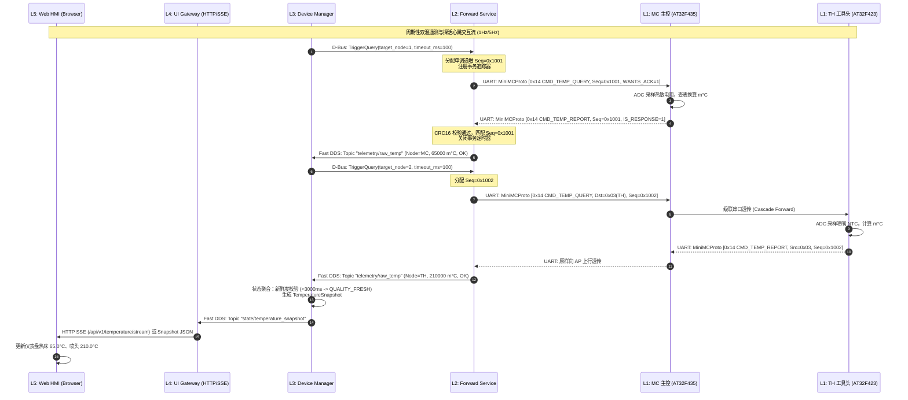
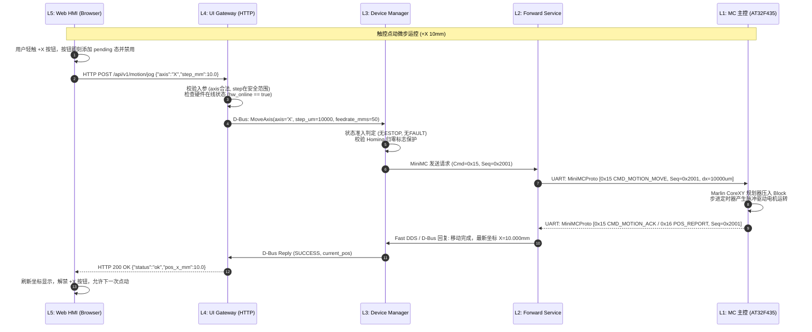
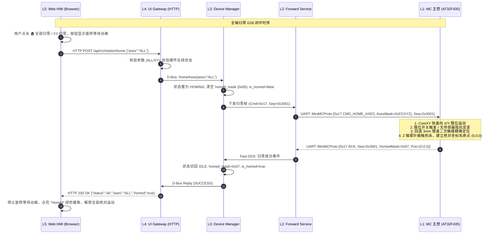
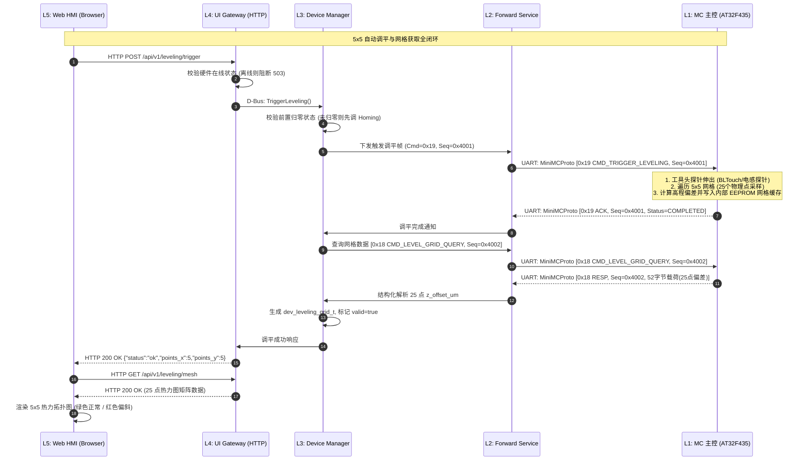
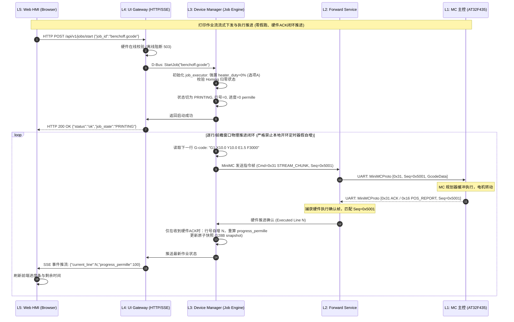
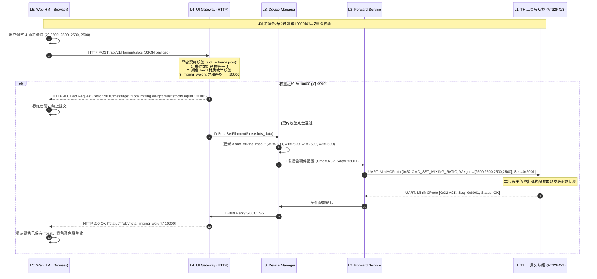
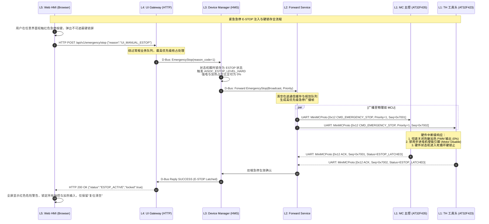
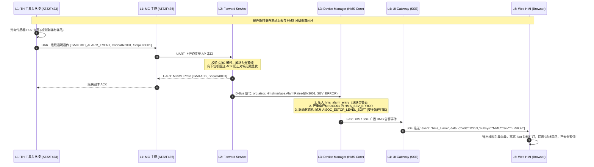
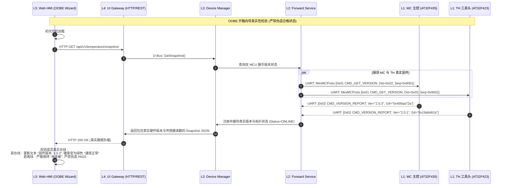
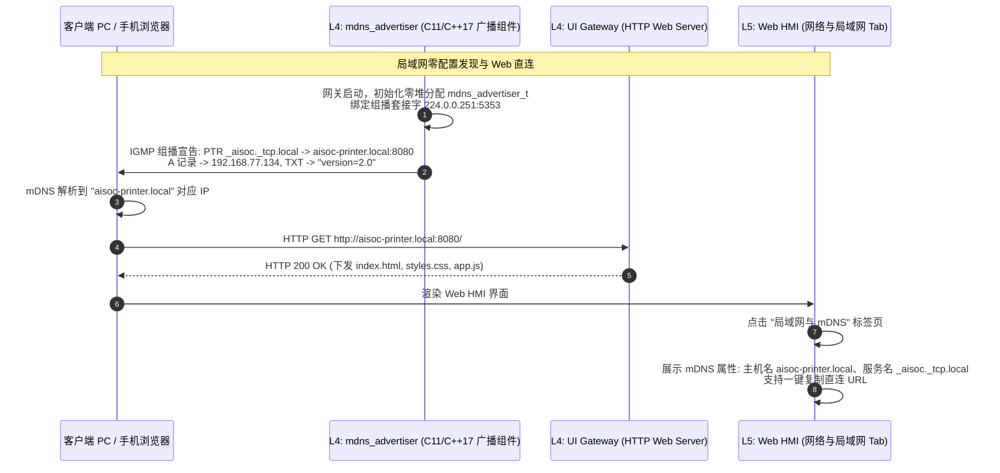

# 架构拆解阶段端到端单功能全流程闭环时序与协议映射权威规范矩阵

## 1. 架构愿景、设计方法论与硬性门禁

### 1.1 背景与系统性顽疾攻坚
在复杂嵌入式与分布式软硬件多模块系统集成开发中，传统模式极易滋生以下三大系统性顽疾：
1. **各模块自说自话与开环假跑**：上位机网关使用本地定时器自增坐标或打印进度，下位机执行失步或中断时上位机浑然不觉，造成“界面已经打印完毕，电机停在起点”的严重安全风险；
2. **异常吃报错与静默吞异常**：物理断线、校验错误或通信超时往往被吞没在底层，返回无语义的裸 `NULL` 或假成功，缺乏端到端结构化追溯链路；
3. **“发后即忘”伪异步失控**：指令发出后不绑定显式硬件 ACK 闭环，肆意设置 `no_reply=TRUE`，导致通信队列拥塞与硬件寄存器状态完全脱节。

为从架构源头根除上述顽疾，本规范遵照核心架构设计原则：**“在多模块系统集成的时候，必须一个功能一个功能梳理全流程；在架构拆解阶段就必须建立全链路闭环时序与协议映射”**。

```
+========================================================================================+
|                                5 层全链路端到端闭环架构                                    |
+========================================================================================+
| [L5 交互层] Browser Web HMI: 响应式触控面板、可视化图表、国际化、防呆锁与离线阻断横幅       |
|      ^ HTTP REST / SSE (Server-Sent Events) / 静态资产                                  |
| [L4 网关层] UI Gateway: 统一请求解析、输入契约校验 (Schema)、HTTP 503/504 故障熔断阻断     |
|      ^ D-Bus IPC 方法调用 / Fast DDS 状态发布订阅                                        |
| [L3 状态层] Device Manager: 权威单机状态机、HMS健康管理、作业流引擎、数据新鲜度仲裁         |
|      ^ D-Bus / Fast DDS (Topic: telemetry/raw_temp, telemetry/motion_status)            |
| [L2 转发层] Forward Service: MiniMCProto v2.0 编解码、流水号绑定、物理串口流控与降级保护    |
|      ^ 物理全双工 UART (/dev/ttyUSB0 @ 115200bps, SOF 0x55 0xAA, CRC-16/CCITT-FALSE)    |
| [L1 硬件层] Dual MCU Firmware: MC 运控主控 (AT32F435) + TH 工具头从控 (AT32F423)        |
+========================================================================================+
```

### 1.2 架构硬性铁律与不可动摇的设计不变量 (Architectural Invariants)
1. **绝对杜绝“发后即忘”（Zero Fire-and-Forget）**：
   - 系统中严禁存在任何无 ACK 绑定的开环功能。
   - 所有下行控制命令帧必须强制置位 `FLAGS_WANTS_ACK (0x01)`，严格杜绝 `no_reply=TRUE`。
   - 下位机必须回发携带相同 `Sequence ID` 的显式确认/响应帧，形成点对点闭环事务。
2. **绝对杜绝本地开环假跑定时器（Strict Realism & Zero Fabricated Progress）**：
   - 运控坐标刷新与作业进度进给必须 100% 以硬件底层执行 ACK 或遥测对账为物理基准。
   - 严禁在上位机使用本地纯时间定时器无脑自增打印行号或进度；链路中断或丢包时必须瞬时挂起为 `PAUSED`，行号和进度严格锁死。
3. **严格遵守选项 A 逻辑空跑强电锁死规范（Option A 0% Heater Duty Lockout）**：
   - 孪生仿真与空跑测试阶段，加热棒 PWM 占空比硬性锁死为 0%，拦截任何实际加热输出，保障验证过程本质物理安全。
4. **强类型结构化异常追溯门禁（Rule 7 Compliance）**：
   - 凡通信超时、丢包、校验失败或底层报错，必须生成携带四元组上下文的结构化异常：
     $$\text{Context} = \{\text{target\_node}, \text{sequence\_id}, \text{elapsed\_ms}, \text{error\_code}\}$$
   - 严禁匿名裸日志，逐层向上透传映射，直至 Web HMI 弹出结构化诊断提示。
5. **热插拔与物理拔线 3 秒 Fail-Closed 硬隔离**：
   - 拔除物理串口或硬件无响应超过 3000ms，状态机必须衰退降级，温度打入 `0x7FFFFFFE` (`2147483646`, `AISOC_TEMP_MILLIC_OFFLINE`) 权威哨兵值，Web HMI 格式化为 `--.- °C`（严禁泄漏浮点异常值）。
   - Web API 针对所有控制性接口即刻返回 `HTTP 503 Service Unavailable` 熔断拦截，前端控制罗盘自动置灰禁用。

---

## 2. 10 大核心垂直切片端到端全流程闭环时序与协议映射

---

### 2.1 功能 1：喷嘴/热床双温遥测与固件心跳 (Nozzle/Bed Telemetry & Firmware Heartbeat)

#### a. 端到端分层时序图


#### b. 下行协议帧与 Sequence ID 规则
- **报文格式**：MiniMCProto v2.0 自然对齐 12 字节帧头 + 0 字节载荷 + 2 字节 CRC-16 = 14 字节。
  - `SOF_1`: `0x55`, `SOF_2`: `0xAA`
  - `SRC_ID`: `0x01` (AP)
  - `DST_ID`: `0x02` (MC, 热床) 或 `0x03` (TH, 喷嘴)
  - `Flags`: `0x05` (`FLAGS_WANTS_ACK (0x01)` | `FLAGS_PROTO_VERSION_V2 (0x04)`)
  - `Cmd_ID`: `0x14` (`MINIMC_CMD_TEMP_QUERY`) 或 `0x03` (`MINIMC_CMD_PING`)
  - `Hop_Limit`: `0x04`, `Route_Ctrl`: `0x00`
  - `Seq`: 16-bit 模 65536 单调自增流水号（由 L2 Forward Service 独占维护）。
  - `Payload_Len`: `0x0000` (Ping 命令载荷 4 字节 `t_originate_ms`)。
  - `CRC16`: CCITT-FALSE (Poly=0x1021, Init=0xFFFF) 计算范围 Offset `0x00` 到 `0x0B`。
- **Sequence ID 规则**：严格遵循 Stop-and-Wait 单在途模型（In-Flight Limit = 1）。未收到对端针对当前 `seq` 的响应报文前，禁止发起同一 Peer 的下一可靠请求。

#### c. 物理硬件/MCU 执行与上行显式 ACK 配对帧
- **MCU 执行动作**：读取 12-bit ADC 原始采样值（范围 0~4095），校验开路（ADC $\ge$ 4090）或短路（ADC $\le$ 10），查表线性插值出毫摄氏度 `temp_millic`。
- **上行响应帧结构**：
  - `SRC_ID`: `0x02` (MC) 或 `0x03` (TH), `DST_ID`: `0x01` (AP)
  - `Flags`: `0x06` (`FLAGS_IS_RESPONSE (0x02)` | `FLAGS_PROTO_VERSION_V2 (0x04)`)
  - `Cmd_ID`: `0x14` (`MINIMC_CMD_TEMP_REPORT`) 或 `0x04` (`MINIMC_CMD_PONG`)
  - `Seq`: **严格原样回显原请求帧的 `seq`**。
  - `Payload_Len`: `0x000C` (12 字节)
  - **载荷内存布局 (`minimc_temp_report_payload_t`)**：
    | 偏移 | 字段 | 类型 | 说明 |
    | :--- | :--- | :--- | :--- |
    | 0x00..0x03 | `temperature_millic` | `int32_t` | 标定内部单位：0.001 °C (如 65000 = 65.0°C) |
    | 0x04 | `sensor_status` | `uint8_t` | 0=OK, 1=OPEN, 2=SHORT, 3=TIMEOUT, 4=UNKNOWN |
    | 0x05 | `heater_duty` | `uint8_t` | 选项 A 强电锁死模式下硬性锁定为 0% |
    | 0x06..0x07 | `raw_adc` | `uint16_t` | 12-bit ADC 原始采样值 (0~4095) |
    | 0x08..0x0B | `sample_tick_ms` | `uint32_t` | MCU 硬件自启动以来的单调滴答毫秒 |

#### d. 超时预算与重试策略 (Timeout Budget & Retry Policy)
- **单次超时时间**：`100 ms`。
- **最大重试次数**：2 次（单次事务总预算不超过 `300 ms`）。
- **重试退避间隔**：`20 ms` 固定延迟。

#### e. 超时/丢包/校验失败的结构化报错抛出链条
- **Rule 7 结构化异常生成**：L2 Forward 在超时达到 300ms 或 CRC 校验失败时，生成：
  ```json
  {
    "target_node": 1,
    "sequence_id": 4097,
    "elapsed_ms": 302,
    "error_code": 4099
  }
  ```
  *(注：`4099` 对应 `HMS_ERR_COMM_TIMEOUT = 0x1003`，CRC 错误对应 `0x1002`)*。
- **逐层透传与上报链路**：
  1. L2 Forward 向 L3 Device Manager 抛出 D-Bus 错误 `AISOC_DBUS_ERR_NAME_TIMEOUT`；
  2. L3 捕获后，触发 `hms_manager_raise_alarm(HMS_ERR_COMM_TIMEOUT, HMS_SEV_WARNING)`；
  3. L3 将数据新鲜度置为 `QUALITY_STALE`，发布更新的 `TemperatureSnapshot`；
  4. L4 UI Gateway 通过 SSE 推送状态更新及告警事件；
  5. L5 Web HMI 捕获事件，在仪表盘上展示黄色告警 Toast，指示灯转为黄色警告，禁止匿名裸报错。

#### f. 物理断线/热拔插失联时的 Fail-Closed 降级与阻断
- **3 秒老化与哨兵值注入**：当物理串口拔除（热插拔事件）或无有效数据持续超过 `3000 ms`：
  - L3 状态机将 MC/TH 节点判定为 `OFFLINE`，数据质量转为 `QUALITY_FAULT`；
  - 温度字段强制覆盖为权威降级哨兵值：
    $$\text{temp\_millic} = \text{0x7FFFFFFE}\ (2147483646 = \text{AISOC\_TEMP\_MILLIC\_OFFLINE})$$
  - 加热棒占空比 `heater_duty` 强制锁死为 0%；
  - Web 网关向前端下发温度数据，前端防御性解析并格式化为 `--.- °C`（严格杜绝 `2147483.6 °C` 浮点泄漏）；
  - Web HMI 顶部立即滑出红色离线横幅 `#hw-offline-banner`，控制按钮全部禁用；
  - 针对后续所有写操作与控制指令，L4 UI Gateway 统一返回 `HTTP 503 Service Unavailable`。

#### g. 恢复连接后的自愈与状态对齐机制
1. **物理探测与握手重连**：L2 Forward 循环轮询监测到串口重新枚举成功后，重新建立串口波特率配置；
2. **Epoch 校验与会话隔离**：L2 立即下发 `CMD_GET_VERSION (0x01)`；
3. **重启隔离**：若 MCU 返回的 `boot_id` 与断线前不一致，判定下位机发生非预期冷重启，立即重置 AP 端序列号流水线；
4. **状态对齐与解除阻断**：连续收到 3 帧有效且新鲜（$T_{\text{fresh}} < 3000\text{ms}$）的温度遥测后，L3 判定数据质量恢复为 `QUALITY_FRESH`，系统状态迁移为 `ONLINE`，L5 隐藏离线横幅，解禁触控交互。

---

### 2.2 功能 2：CoreXY 触控微步 Jog 运控 (Jog Motion)

#### a. 端到端分层时序图


#### b. 下行协议帧与 Sequence ID 规则
- **报文格式**：MiniMCProto v2.0，12B 帧头 + 16B 载荷 + 2B CRC = 30 字节。
  - `DST_ID`: `0x02` (MC 运控主控)
  - `Flags`: `0x05` (`FLAGS_WANTS_ACK` | `FLAGS_PROTO_VERSION_V2`)
  - `Cmd_ID`: `0x15` (`MINIMC_CMD_MOTION_MOVE`)
  - `Seq`: 独占单调递增流水号。
  - **载荷内存布局 (`minimc_motion_move_payload_t`)**：
    | 偏移 | 字段 | 类型 | 说明 |
    | :--- | :--- | :--- | :--- |
    | 0x00..0x03 | `dx_um` | `int32_t` | X 轴相对位移 (微米，+10mm = 10000) |
    | 0x04..0x07 | `dy_um` | `int32_t` | Y 轴相对位移 (微米) |
    | 0x08..0x0B | `dz_um` | `int32_t` | Z 轴相对位移 (微米) |
    | 0x0C..0x0D | `feedrate_mms` | `uint16_t` | 目标进给速度 (mm/s) |
    | 0x0E..0x0F | `reserved` | `uint16_t` | 0x0000 对齐填充 |

#### c. 物理硬件/MCU 执行与上行显式 ACK 配对帧
- **MCU 动作**：CoreXY 运动学解算电机 A/B 步数：
  $$\Delta \text{Step}_A = \Delta X + \Delta Y,\quad \Delta \text{Step}_B = \Delta X - \Delta Y$$
  规划匀加速梯形/S曲线速度前瞻，驱动电机完成走步。
- **上行响应帧**：MiniMCProto 20 字节载荷 (`MINIMC_CMD_POS_QUERY = 0x16` 格式或 Move ACK)。
  - `Cmd_ID`: `0x15` 或 `0x16`，`Flags`: `0x06` (`IS_RESPONSE`)，`Seq`: **严格回显原请求 seq**。
  - 载荷携带物理坐标 `pos_x_um`, `pos_y_um`, `pos_z_um`, `mc_state` (0=IDLE, 2=MOVING), `homed_mask`。

#### d. 超时预算与重试策略 (Timeout Budget & Retry Policy)
- **动态超时预算公式**：
  $$T_{\text{timeout}} = T_{\text{base}} (500\text{ms}) + \left(\frac{\text{dist\_mm}}{\text{feedrate\_mms}} \times 1000\right) \times 1.5$$
  微步点动典型超时为 `2000 ms`。
- **硬性重试禁令（Zero Blind Retry）**：
  - **对于相对位移运动指令，严禁盲目重发！** 盲目重发将导致电机二次累计位移，引发物理撞机。
  - 超时发生后，唯一合法的恢复动作为下发 `CMD_POS_QUERY (0x16)` 探查电机真实物理坐标。

#### e. 超时/丢包/校验失败的结构化报错抛出链条
- 异常四元组：`{"target_node": 1, "sequence_id": seq, "elapsed_ms": 2010, "error_code": 0x4004}`（`HMS_ERR_DRIVER_FAULT_STEPPER`）。
- 链路传递：L2 触发超时中断 $\to$ L3 标记运控异常并锁定运动 $\to$ L4 返回 `HTTP 504 Gateway Timeout` $\to$ L5 弹出明确告警窗并恢复按钮可用状态。

#### f. 物理断线/热拔插失联时的 Fail-Closed 降级与阻断
- 离线时 Web 前端 `.btn-jog` 全部置灰禁用；
- 若用户通过非法途径调用接口，L4 UI Gateway 首行拦截并返回：
  ```http
  HTTP/1.1 503 Service Unavailable
  {"error":503,"message":"Hardware offline: cannot jog motion"}
  ```

#### g. 恢复连接后的自愈与状态对齐机制
- 重连后，MC 当前物理坐标对 AP 而言处于未校准状态；
- L3 清除 `is_homed` 标志，将运动就绪状态降级，并在 Web HMI 上弹出“请先执行归零”的强制安全防呆提示。

---

### 2.3 功能 3：全轴归零 G28 (Homing All / XY)

#### a. 端到端分层时序图


#### b. 下行协议帧与 Sequence ID 规则
- **报文格式**：12B 帧头 + 4B 载荷 + 2B CRC = 18 字节。
  - `DST_ID`: `0x02` (MC)
  - `Flags`: `0x05` (`WANTS_ACK | V2`)
  - `Cmd_ID`: `0x17` (`MINIMC_CMD_HOME_AXES`)
  - `Seq`: 独立递增编号。
  - **载荷结构**：`axes_mask` (`uint8_t`, Bit0=X, Bit1=Y, Bit2=Z), `reserved` (3 字节 0x00 填充)。

#### c. 物理硬件/MCU 执行与上行显式 ACK 配对帧
- **MCU 动作**：驱动各轴依次触碰限位开关；完成后将底层寄存器坐标强置为 0，置位内部 `axis_homed` 标志位。
- **上行响应帧**：`Cmd_ID = 0x17`，`Flags = 0x06` (`IS_RESPONSE`)，`Seq` **严格回显**，载荷 20 字节 `minimc_pos_report_payload_t`：`pos_x_um=0`, `pos_y_um=0`, `pos_z_um=0`, `mc_state=0 (IDLE)`, `homed_mask=0x07`。

#### d. 超时预算与重试策略 (Timeout Budget & Retry Policy)
- **超时预算**：`30000 ms` (全轴归零机械行程长，预留 30 秒)。XY 轴单归零为 `15000 ms`。
- **重试策略**：**禁止任何自动盲重试**。归零超时通常代表皮带断裂、限位开关脱焊或机械卡死，盲目重试会扩大硬件损毁。

#### e. 超时/丢包/校验失败的结构化报错抛出链条
- 结构化报错：`{"target_node": 1, "sequence_id": seq, "elapsed_ms": 30005, "error_code": 0x4001}`（`HMS_ERR_HOMING_FAILED_X`）。
- 透传至 L5：Web UI 弹出警示模态框，提供“检查限位触点”的操作指导。

#### f. 物理断线/热拔插失联时的 Fail-Closed 降级与阻断
- 离线时 `#btn-home-all` 与 `#btn-home-xy` 强制禁用；后端接口返回 `HTTP 503 ("Hardware offline: cannot home axes")`。
- 归零过程中若断线，MC 失去 AP 心跳后触发硬件看门狗，立即切断电机使能。

#### g. 恢复连接后的自愈与状态对齐机制
- 物理串口恢复后，L3 强制将 `is_homed` 标定为 `false`，要求重新握手并显式执行 G28 归零。

---

### 2.4 功能 4：5x5 自动调平网格校准 G29 (Mesh Bed Leveling)

#### a. 端到端分层时序图


#### b. 下行协议帧与 Sequence ID 规则
- **网格查询帧 (`CMD_LEVEL_GRID_QUERY = 0x18`)**：
  - `DST_ID`: `0x02` (MC), `Flags`: `0x05`, `Cmd_ID`: `0x18`, `Payload_Len`: `0x0000`, 帧长 14 字节。

#### c. 物理硬件/MCU 执行与上行显式 ACK 配对帧
- **响应帧结构**：帧长 66 字节（12B 头 + 52B 载荷 + 2B CRC）。
  - `Flags`: `0x06` (`IS_RESPONSE`), `Cmd_ID`: `0x18`, `Seq`: **严格回显**。
  - **载荷内存布局 (`minimc_level_grid_payload_t`)**：
    | 偏移 | 字段 | 类型 | 说明 |
    | :--- | :--- | :--- | :--- |
    | 0x00 | `grid_points_x` | `uint8_t` | 固定为 5 |
    | 0x01 | `grid_points_y` | `uint8_t` | 固定为 5 |
    | 0x02..0x33 | `z_offset_um[25]` | `int16_t[25]` | 25 点高程偏差（微米，范围 -32768~+32767 um） |

#### d. 超时预算与重试策略 (Timeout Budget & Retry Policy)
- **调平总超时**：`120,000 ms`（120 秒，平均每点约 4.8 秒）。
- **网格数据读取超时**：`500 ms`，允许重试 2 次。
- **探针重试策略**：MC 固件在探针未触发行程前自动微抬升重测 1 次，连续 2 次无触发则终止调平并报错。

#### e. 超时/丢包/校验失败的结构化报错抛出链条
- 异常四元组：`{"target_node": 1, "sequence_id": seq, "elapsed_ms": 120010, "error_code": 0x4003}`（`HMS_ERR_HOMING_FAILED_Z` 或探针错误）。
- L5 Web UI 将热力图置为不可信灰度，并展示错误代码与检修指引。

#### f. 物理断线/热拔插失联时的 Fail-Closed 降级与阻断
- 离线时 `#btn-trigger-leveling` 禁用；
- 发起请求返回 `HTTP 503 ("Hardware offline: cannot trigger leveling")`。

#### g. 恢复连接后的自愈与状态对齐机制
- 重连后网格缓存标定为 `valid = false`；
- L3 自动下发 `0x18` 查询 MC 固件 EEPROM 中存储的历史持久化网格；若校验通过则恢复，否则提示重新校准。

---

### 2.5 功能 5：打印作业流流式下发与执行推进 (Job Execution Pipeline)

#### a. 端到端分层时序图


#### b. 下行协议帧与 Sequence ID 规则
- **报文格式**：`CMD_STREAM_CHUNK = 0x31`，载荷包含 G-code 压缩二进制指令或文本片段。
- **序列号规则**：每一下发块绑定独立的递增 `seq`；通过 PONG 报文内嵌的 `planner_buf_free` 实施滑窗信用流控，缓冲区为 0 时暂停下发。

#### c. 物理硬件/MCU 执行与上行显式 ACK 配对帧
- **上行响应**：MC 固件在指令被消费或执行完毕后回发响应，携带当前的实际坐标、空闲规划槽位 `planner_buf_free` 及原 `seq`。

#### d. 超时预算与重试策略 (Timeout Budget & Retry Policy)
- **单行超时**：依据插补段长度动态计算，保底超时 `5000 ms`。
- **超时处置**：连续 3 次探测无响应即刻挂起打印作业，状态置为 `PAUSED`，禁止跳过指令继续下发。

#### e. 超时/丢包/校验失败的结构化报错抛出链条
- 异常结构体：`{"target_node": 1, "sequence_id": seq, "elapsed_ms": 5015, "error_code": 0x1003}`。
- 作业引擎安全挂起，记录 `pause_reason = AISOC_PAUSE_COMM_TIMEOUT`，前端弹出“通信中断，已为您自动保持位姿暂停”提示。

#### f. 物理断线/热拔插失联时的 Fail-Closed 降级与阻断
- **严禁开环定时器假推进**：物理断线后，**行号严格冻结、进度千分比严格冻结、坐标严格冻结**；
- 无论外部经过多少秒，禁止伪造哪怕 1 行进度自增；
- 离线期间调用 `/api/v1/jobs/resume` 或 `/api/v1/jobs/start` 均被 L4 拦截并返回 `HTTP 503`。

#### g. 恢复连接后的自愈与状态对齐机制
- 重连后，作业引擎仍保持在 `PAUSED` 状态；
- 操作员点击 Web 界面“恢复打印”：系统先下发坐标对齐与回抽恢复指令，确认电机位置无漂移后，从断点行号严格恢复流式投递。

---

### 2.6 功能 6：4 通道混色配置与权重校验 (4-Channel Filament Slots & Mixing Ratio)

#### a. 端到端分层时序图


#### b. 下行协议帧与 Sequence ID 规则
- **报文格式**：12B 帧头 + 8B 载荷 + 2B CRC = 22 字节。
  - `DST_ID`: `0x03` (TH 工具头)
  - `Flags`: `0x05` (`WANTS_ACK | V2`)
  - `Cmd_ID`: `0x32` (`MINIMC_CMD_SET_MIXING_RATIO`)
  - `Seq`: 递增序列号。
  - **载荷结构**：4 个无符号 16 位整型 `uint16_t weights[4]`，分别代表 Slot 1~4 的混色权重（0~10000），线缆端序小端。

#### c. 物理硬件/MCU 执行与上行显式 ACK 配对帧
- **TH MCU 动作**：将权重配置写入多通道挤出混合插补器；
- **上行响应**：`Cmd_ID = 0x32`，`Flags = 0x06` (`IS_RESPONSE`)，`Seq` **严格回显**，`status = 0 (OK)`。

#### d. 超时预算与重试策略 (Timeout Budget & Retry Policy)
- **超时时间**：`500 ms`。
- **重试策略**：失败重试 2 次，重试间隔 `50 ms`。

#### e. 超时/丢包/校验失败的结构化报错抛出链条
- 异常四元组：`{"target_node": 2, "sequence_id": seq, "elapsed_ms": 505, "error_code": 0x3004}`（`HMS_ERR_FEED_TIMEOUT`）。
- 链路反馈：L4 返回错误信息，前端将滑块自动回滚至上一次已确认生效的数值。

#### f. 物理断线/热拔插失联时的 Fail-Closed 降级与阻断
- 硬件断开后，修改混色配置直接返回 `HTTP 503`；
- 前端色盘区域半透明置灰并显示锁孔图标。

#### g. 恢复连接后的自愈与状态对齐机制
- 重连后，L3 Device Manager 将内存中持久化的 4 通道配置主动重发推送给 TH，确保从控硬件寄存器与上位机状态完全同步。

---

### 2.7 功能 7：紧急急停 E-STOP 注入与硬锁存 (Emergency Stop & Reset)

#### a. 端到端分层时序图


#### b. 下行协议帧与 Sequence ID 规则
- **报文格式**：MiniMCProto v2.0，12B 帧头 + 4B 载荷 + 2B CRC = 18 字节。
  - `Flags`: `0x15` (`FLAGS_IS_PRIORITY (0x10)` | `FLAGS_WANTS_ACK` | `FLAGS_PROTO_VERSION_V2`)。
  - `Cmd_ID`: `0x12` (`MINIMC_CMD_EMERGENCY_STOP`)。
  - `Seq`: 独立分配。
  - **载荷结构**：`reason_code` (`uint8_t`, 1=MANUAL, 2=THERMAL_RUNAWAY, 3=CRASH), `reserved` (3 字节 0x00 填充)。

#### c. 物理硬件/MCU 执行与上行显式 ACK 配对帧
- **MCU 动作**：立即切断加热 MOS 栅极电平，禁用电机驱动使能端，返回显式确认 ACK。
- **上行响应**：`Cmd_ID = 0x12`，`Flags = 0x16` (`IS_PRIORITY | IS_RESPONSE`)，`Seq` **严格回显**。

#### d. 超时预算与重试策略 (Timeout Budget & Retry Policy)
- **极限超时时间**：`50 ms`。
- **重试策略**：若未收到 ACK，以 `50 ms` 间隔连续广播 3 次，直至硬件锁止确认。

#### e. 超时/丢包/校验失败的结构化报错抛出链条
- 异常四元组：`{"target_node": 1, "sequence_id": seq, "elapsed_ms": 50, "error_code": 0x5001}`（`HMS_ERR_HARD_ESTOP_ACTIVE`）。
- 写入 HMS 告警表首位，严重度定级为最高级 `HMS_SEV_FATAL`。

#### f. 物理断线/热拔插失联时的 Fail-Closed 降级与阻断
- 处于 ESTOP 锁存状态下，系统拒绝响应除解除急停外的任何 API 请求；拔出串口直接保持硬锁存。

#### g. 恢复连接后的自愈与状态对齐机制
- 解除急停必须调用 `/api/v1/emergency/clear`；
- L3 检查物理故障条件完全消除，向双 MCU 下发复位指令，重新初始化电机与温度控制，强制重新全轴归零。

---

### 2.8 功能 8：全机 HMS 错误码上报与严重度分级 (HMS Error Reporting & Severity)

#### a. 端到端分层时序图


#### b. 下行协议帧与 Sequence ID 规则
- **MCU 上报帧 (`CMD_ALARM_EVENT = 0x50`)**：
  - `SRC_ID`: `0x03` (TH), `DST_ID`: `0x01` (AP), `Flags`: `0x05`, `Cmd_ID`: `0x50`, `Payload_Len`: `0x0008` (8 字节), 帧长 22 字节。
  - **载荷内存布局 (`minimc_alarm_event_payload_t`)**：
    | 偏移 | 字段 | 类型 | 说明 |
    | :--- | :--- | :--- | :--- |
    | 0x00 | `alarm_level` | `uint8_t` | 1=INFO, 2=WARNING, 3=CRITICAL_ERROR |
    | 0x01 | `subsystem_id` | `uint8_t` | 1=COMM, 2=THERMAL, 3=MMU, 4=MOTION, 5=SAFETY |
    | 0x02..0x03 | `error_code` | `uint16_t` | 标准 HMS 错误码 (小端，如 0x3001) |
    | 0x04..0x07 | `timestamp_tick_ms` | `uint32_t` | 从控单调毫秒滴答 |

#### c. 物理硬件/MCU 执行与上行显式 ACK 配对帧
- **AP 确认动作**：L2 Forward 在校验合法后，必须回发 `CMD_ALARM_EVENT (0x50)` 确认帧（`Flags = 0x06`），原样携带请求 `Seq`。若下位机未收到确认，将按退避算法重发。

#### d. 超时预算与重试策略 (Timeout Budget & Retry Policy)
- **MCU 确认等待超时**：`200 ms`。
- **MCU 重发上限**：3 次。

#### e. 超时/丢包/校验失败的结构化报错抛出链条
- 错误规范：系统严格对齐 5 大子系统 16-bit 编码体系（`0x1000` 通信、`0x2000` 温控、`0x3001` 断料、`0x4000` 运控、`0x5000` 安全）。
- 结构化追溯字典映射，杜绝裸错误码展示。

#### f. 物理断线/热拔插失联时的 Fail-Closed 降级与阻断
- 串口断开本身触发 `HMS_ERR_COMM_UART_DISCONNECT (0x1001)`，严重度定为 `HMS_SEV_ERROR`，联动中止作业推进。

#### g. 恢复连接后的自愈与状态对齐机制
- 操作员处理故障后（如装入新耗材，光电开关复位），下位机上报 `0x3001` 清除帧，或上位机调用 `ClearAlarm(alarm_id)`，HMS 表中移除该项，系统解除软暂停。

---

### 2.9 功能 9：开箱引导向导 OOBE 硬件状态读取 (OOBE Wizard Hardware Readout)

#### a. 端到端分层时序图


#### b. 下行协议帧与 Sequence ID 规则
- **版本读取报文 (`CMD_GET_VERSION = 0x01`)**：
  - `DST_ID`: `0x02` (MC) 或 `0x03` (TH), `Flags`: `0x05`, `Cmd_ID`: `0x01`, `Payload_Len`: `0x0000`, 帧长 14 字节。

#### c. 物理硬件/MCU 执行与上行显式 ACK 配对帧
- **版本报告帧 (`CMD_VERSION_REPORT = 0x02`)**：
  - `Payload_Len`: 24 字节，包含 `proto_version_major`, `firmware_version`, `boot_id`, `git_commit`。

#### d. 超时预算与重试策略 (Timeout Budget & Retry Policy)
- **单次超时**：`300 ms`。
- **重试策略**：开箱自检循环探测，间隔 `1000 ms`。

#### e. 超时/丢包/校验失败的结构化报错抛出链条
- 异常四元组：`{"target_node": 2, "sequence_id": seq, "elapsed_ms": 305, "error_code": 0x1001}`。
- OOBE 界面第三步/第四步徽章保持黄色警告，禁止用户点击“完成开箱引导”按钮。

#### f. 物理断线/热拔插失联时的 Fail-Closed 降级与阻断
- 任何一端 MCU 离线，OOBE 向导最终确认页强制禁用“进入打印控制台”按钮，阻断带病投产。

#### g. 恢复连接后的自愈与状态对齐机制
- OOBE 页面保持对 SSE 流的监听；一旦物理线缆插上并完成握手，页面免刷新自动点亮为绿色。

---

### 2.10 功能 10：mDNS 局域网服务发现与直连 (mDNS Service Discovery)

#### a. 端到端分层时序图


#### b. 下行协议帧与 Sequence ID 规则
- **RFC 6762 / RFC 6763 规范报文**：
  - 组播地址：`224.0.0.251:5353` (IPv4)
  - 构造静态 DNS 报文：包含 Header (Flags=0x8400 响应), PTR Record, SRV Record (`port=8080`), TXT Record, A Record。
  - 全过程零堆动态分配（`MDNS_MAX_PACKET_SIZE = 1460` 静态栈缓冲）。

#### c. 物理硬件/MCU 执行与上行显式 ACK 配对帧
- 本功能属于 AP 宿主机与局域网交互层，不直接下发报文至 MCU；但其广播的 TXT 记录内嵌双 MCU 的真实固件版本号（来自 L3 汇总）。

#### d. 超时预算与重试策略 (Timeout Budget & Retry Policy)
- **宣告频率**：冷启动时连续广播 3 次（间隔 250ms, 500ms, 1000ms）；稳态运行周期为 `60 s`（基于 `TTL = 120 s`）。
- **查询响应超时**：在收到局域网 PTR 查询后，在 10~120ms 随机抖动窗口内回送单播/组播响应。

#### e. 超时/丢包/校验失败的结构化报错抛出链条
- 若网络接口未配置 IP 或套接字创建失败：
  ```json
  {
    "target_node": 0,
    "sequence_id": 0,
    "elapsed_ms": 0,
    "error_code": 4097
  }
  ```
  *(注：`4097` 对应网络失联)*。Web HMI 显示“局域网服务离线”。

#### f. 物理断线/热拔插失联时的 Fail-Closed 降级与阻断
- 当以太网网线拔除或 Wi-Fi 断开时，广播套接字捕获 `ENETDOWN`，立即停止广播；Web HMI 直连 URL 标记为“不可达”。

#### g. 恢复连接后的自愈与状态对齐机制
- 检测到网络恢复后，重新提取当前局域网 IP，刷新 A 记录与 PTR 报文并立即触发宣告。

---

## 3. 全功能协议映射与时序控制综合矩阵 (Master Closed-Loop Matrix Table)

下表汇总上述 10 大功能的全部核心协议参数、时序与异常降级策略，作为整机集成的权威仲裁基准：

| 序号 | 切片功能描述 | 涉及层级 | 下行指令字 | 目标节点 | Sequence ID 规则 | 预期硬件 ACK 帧 | 超时预算 | 异常重试策略 | 结构化错误码 (Rule 7) | 断线降级阻断行为 (Fail-Closed) |
| :--- | :--- | :--- | :--- | :--- | :--- | :--- | :--- | :--- | :--- | :--- |
| **01** | 双温遥测与探活心跳 | L5 $\to$ L1 | `0x14` / `0x03` | MC / TH | 单调自增，停等单在途 | `0x14` REPORT / `0x04` PONG (原Seq) | 100 ms | 允许重试 2 次 (20ms退避) | `0x1003` COMM_TIMEOUT / `0x1002` CRC | 3s 超时打入 `0x7FFFFFFE` 哨兵温，UI 显 `--.-°C`，切断加热 |
| **02** | CoreXY 触控微步点动 | L5 $\to$ L1 | `0x15` MOVE | MC (0x02) | 单调自增流水号 | `0x15` ACK 或 `0x16` POS_REPORT | 2000 ms | **严禁相对位移盲重试** | `0x4004` DRIVER_FAULT | 前端按钮禁用置灰，后端接口 503 阻断 |
| **03** | 全轴归零 (G28) | L5 $\to$ L1 | `0x17` HOME | MC (0x02) | 独占序列号 | `0x17` ACK, HomedMask=0x07, 原Seq | 30000 ms | **严禁盲重试** (防撞机) | `0x4001` HOMING_FAILED_X | 锁死绝对坐标运控，清除 `is_homed` |
| **04** | 5x5 自动调平 (G29) | L5 $\to$ L1 | `0x19` / `0x18` | MC (0x02) | 独占序列号 | `0x18` 52B 网格载荷 (25点偏差) | 120 s | 探针单点重试 1 次；查询重试 2 次 | `0x4003` HOMING_FAILED_Z | 调平网格置为无效，前端热力图红显 |
| **05** | 打印作业流式推进 | L5 $\to$ L1 | `0x31` CHUNK | MC (0x02) | 滑窗信用流水号 | `0x31` ACK 携带 buffer_free 与坐标 | 5000 ms | 连续 3 次无 ACK 自动挂起 PAUSED | `0x1003` COMM_TIMEOUT | **严禁开环定时器假自增**，行号与进度绝对锁死，接口 503 |
| **06** | 4通道混色与权重校验 | L5 $\to$ L1 | `0x32` MIX_CFG | TH (0x03) | 递增序列号 | `0x32` ACK, Status=0, 原Seq | 500 ms | 允许重试 2 次 (50ms退避) | `0x3004` FEED_TIMEOUT | 前端校验和 != 10000 报 400，离线报 503 |
| **07** | 紧急急停 E-STOP 注入 | L5 $\to$ L1 | `0x12` ESTOP | MC & TH | 优先级帧 (0x10) | `0x12` ACK, Status=LATCHED, 原Seq | 50 ms | 连续重发 3 次直至硬件锁死 | `0x5001` HARD_ESTOP_ACTIVE | 硬锁存切断强电，仅允许显式 Clear 指令复位 |
| **08** | 全机 HMS 错误码上报 | L1 $\to$ L5 | `0x50` ALARM | AP (0x01) | MCU 递增序列号 | AP 回送 `0x50` ACK 确认帧 | 200 ms | MCU 重发上限 3 次 | `0x3001` FILAMENT_RUNOUT 等 | 严重错误联动软暂停，致死错误联动硬急停 |
| **09** | OOBE 引导向导状态 | L5 $\to$ L1 | `0x01` GET_VER | MC & TH | 递增序列号 | `0x02` VERSION_REPORT (24B载荷) | 300 ms | 循环周期性轮询 | `0x1001` UART_DISCONNECT | 真实唯实原则：未连设备严禁伪造 PASS |
| **10** | mDNS 局域网服务发现 | L4 $\to$ LAN | PTR/SRV/A | 局域网广播 | RFC 6762 规范 | 局域网客户端接收单播/组播回应 | 120 ms | 周期性广播 (TTL=120s, 60s重发) | `0x1001` NET_LINK_DOWN | 断网停止广播，Web 界面直连标记不可达 |

---

## 4. 架构门禁合规自检与实施路径建议

1. **函数规模与入参门禁**：
   - 矩阵中所涉新增与重构自研 C/C++ 协议函数必须保持 $\le 50$ 行、入参 $\le 4$ 个；
   - 复杂报文与状态封装必须使用独立结构体指针（如 `minimc_pos_report_payload_t*`、`hms_alarm_entry_t*`）。
2. **指针与内存安全门禁**：
   - 全链路严禁任何运行时动态堆内存分配（零 `malloc`/`free`，零 `new`/`delete`）；
   - 公开接口函数首行强制布设防御性卫语句（Guard Clause）：
     ```c
     if (ptr == NULL || out_buf == NULL) {
         return AISOC_ERR_INVALID_PARAM;
     }
     ```
3. **交付后演进与集成推荐路径**：
   - 本规范作为整机协议与端到端闭环的权威仲裁基准，后续微任务必须以此为基线开展单元测试与集成验收；
   - 严禁任何子系统私自引入不在本矩阵内的开环绕行通路。
