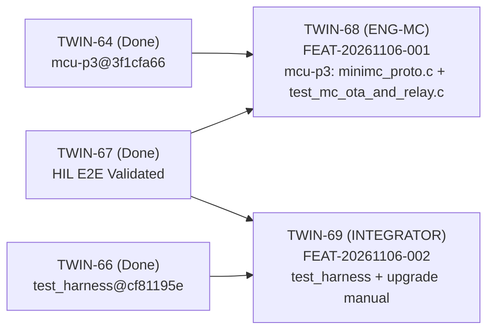

# `ISS-20261105-001` 追记核查与 `FEAT-20261106-001` / `FEAT-20261106-002` 架构拆解方案

本文档由 `ARCH` (`3ebc66f1-9ba1-40e8-b235-b6a30109b88a`) 在只读源码取证基础上编写，完成两项架构交付：
1. **专项核查 1 (`ISS-20261105-001` 追记 `20261106_soc_ap_backoff_build_failure_followup.md`)**：取证核实 `soc-ap/runtime/build/tests/test_backoff.cpp` 在当前 `soc-ap@main` (`7184edfc796923e2f2c6e3e57ef3a9f791164b51`)、`TWIN-51` (`75f8a1a670edabb21c8d3dfc79243e06f73099af`) 与 `TWIN-59` (`c6692b244e0aa09d04e7051293f9fef3c67535dd`) 的真实代码状态与 SHA-256，并对外部环境 `/home/sushaohua/testaaa/ai_soc_project/soc-ap` 的报错行号进行精确法医比对，给出技术裁决。
2. **专项拆解 2 (`FEAT-20261106-001` 与 `FEAT-20261106-002`)**：围绕 `TWIN-67` 物理 HIL 实操暴露的 **MC 级联代理毫秒时基采样次序导致无符号减法下溢 (`elapsed_ms=4294967295`)** 以及 **OTA 部署工具与操作手册默认 `512B` 标准分块对齐**，拆解为两个边界正交、零路径冲突的微任务 **`TWIN-68` (`ENG-MC`)** 与 **`TWIN-69` (`INTEGRATOR`)**。

---

## 1. 专项核查 1：`ISS-20261105-001` 追记 (`20261106_soc_ap_backoff_build_failure_followup.md`)

### 1.1 问题背景与用户追记摘要

用户在 `project-control/docs/work_intake/submissions/20261106_soc_ap_backoff_build_failure_followup.md` 中报告：在路径 `/home/sushaohua/testaaa/ai_soc_project/soc-ap` 执行 `./scripts/build.sh` 时，`test_backoff.cpp` 在 GCC 13 (`-O2 -Wall -Wextra -Werror`) 下触发 `-Werror=maybe-uninitialized` 编译失败：

```text
In file included from /home/sushaohua/testaaa/ai_soc_project/soc-ap/runtime/build/tests/test_backoff.cpp:9:
/home/sushaohua/testaaa/ai_soc_project/soc-ap/runtime/build/tests/test_backoff.cpp: In function 'void test_backoff_null_guards()':
/home/sushaohua/testaaa/ai_soc_project/soc-ap/runtime/build/tests/test_backoff.cpp:18:24: error: 'cfg' may be used uninitialized [-Werror=maybe-uninitialized]
   18 |     assert(backoff_init(NULL, &cfg) == LIFECYCLE_ERR_INVALID_ARGUMENT);
      |            ~~~~~~~~~~~~^~~~~~~~~~~~
In file included from /home/sushaohua/testaaa/ai_soc_project/soc-ap/runtime/build/tests/test_backoff.cpp:6:
/home/sushaohua/testaaa/ai_soc_project/soc-ap/runtime/build/include/service_lifecycle.h:146:20: note: by argument 2 of type 'const backoff_config_t*' to 'lifecycle_status_t backoff_init(backoff_state_t*, const backoff_config_t*)' declared here
  146 | lifecycle_status_t backoff_init(backoff_state_t* state, const backoff_config_t* config);
      |                    ^~~~~~~~~~~~
/home/sushaohua/testaaa/ai_soc_project/soc-ap/runtime/build/tests/test_backoff.cpp:14:22: note: 'cfg' declared here
   14 |     backoff_config_t cfg;
      |                      ^~~
```

### 1.2 本机目录核查与 `soc-ap@main` 提交历史 / SHA-256 对照

1. **宿主机目录存在性核查**：
   在权威服务器 (`192.168.77.113`) 上执行只读检查：`/home/sushaohua/testaaa/ai_soc_project/soc-ap` **在本机不存在**（`TESTAAA_EXISTS=0`），说明 `/home/sushaohua/testaaa/ai_soc_project/soc-ap` 位于外部测试机/虚拟机（如 VMware 目标机或本地开发机）的独立检出目录。
2. **`soc-ap@main` 演进历史与文件 SHA-256 精确取证**：

| 版本节点 | Git Commit SHA | 提交说明 | `runtime/build/tests/test_backoff.cpp` SHA-256 | `runtime/build/include/service_lifecycle.h` SHA-256 |
| --- | --- | --- | --- | --- |
| **`TWIN-51` 修复前** (`75f8a1a^`) | `89ac9d501ca76b1b7fd37b56b3400a80dd646d58` (至 `7c1f35015b58359985a8eb3dd0c6c1ef15f6ad58`) | `feat(soc-ap): implement TWIN-48 Web UI toast and error localization` | `e70bde70ea001809a428fda7e846f021fe38f38162d0bf066615c1e7d6cdf3dc` | `0c11fe8cae24c5a276c5f499ac269f0509226c53979df7b17fe44a9b243e2977` |
| **`TWIN-51` 修复提交** | `75f8a1a670edabb21c8d3dfc79243e06f73099af` | `fix(soc-ap): zero-initialize backoff test structs and harden build script` | `7270726a1482e27efbc6d431d7e36a972c01f781264cb67f06ae347065ef183d` | `ca304582a119e993eb1fde33bd90aa250309f2cbd5bf4b4899db624c14418e0f` |
| **`TWIN-59` 修复提交** | `c6692b244e0aa09d04e7051293f9fef3c67535dd` (及 `19534a9a4cb393176882fbad046129d55bba51f6`) | `fix(soc-ap): resolve fresh-clone build breakages and enforce trackable dist/index.html` | `7270726a1482e27efbc6d431d7e36a972c01f781264cb67f06ae347065ef183d` (未改动，完全保留) | `ca304582a119e993eb1fde33bd90aa250309f2cbd5bf4b4899db624c14418e0f` |
| **当前 `soc-ap@main` (`HEAD`, `TWIN-65`)** | `7184edfc796923e2f2c6e3e57ef3a9f791164b51` | `feat(soc-ap): implement Rev 2.0.4 dual-MCU OTA state machine, TH->MC ordering, and 3s disconnect decay (TWIN-65)` | `7270726a1482e27efbc6d431d7e36a972c01f781264cb67f06ae347065ef183d` (未改动，完全保留) | `ca304582a119e993eb1fde33bd90aa250309f2cbd5bf4b4899db624c14418e0f` |

### 1.3 编译报错行号法医比对（证明 `testaaa` 为 `TWIN-51` 之前的旧检出）

对比用户报错日志中的 4 处精确行号/列号，与 `TWIN-51` 修复前 (`75f8a1a^`) 及当前 `soc-ap@main` (`75f8a1a`..`7184edf`) 的源码行号完全吻合于 **`TWIN-51` 修复前版本**：

1. **`test_backoff.cpp` 的 `#include <assert.h>` 行号**：
   - 用户报错：`In file included from .../test_backoff.cpp:9:`
   - `75f8a1a^`（修复前）：第 9 行正是 `#include <assert.h>`。
   - `75f8a1a`..`HEAD`（修复后）：因顶部新增中文 `@file`/`@brief` 注释，第 11 行才是 `#include <assert.h>`。
2. **`test_backoff.cpp` 的 `cfg` 声明行号**：
   - 用户报错：`test_backoff.cpp:14:22: note: 'cfg' declared here` (`backoff_config_t cfg;`)
   - `75f8a1a^`（修复前）：第 13~14 行为未初始化的 `backoff_state_t st;` 与 `backoff_config_t cfg;`。
   - `75f8a1a`..`HEAD`（修复后）：第 20~21 行已修复为显式零初始化：
     ```cpp
     backoff_state_t st = {0U, 0U, 0ULL, false};
     backoff_config_t cfg = {0U, 0U, 0U, 0U, 0U};
     ```
     同时 `test_backoff_progression()`（第 42、49 行）与 `test_backoff_reset()`（第 92、99 行）中的 `st` 和 `cfg` 也全部完成了显式零初始化。
3. **`test_backoff.cpp` 的 `assert(backoff_init(NULL, &cfg) ...)` 行号**：
   - 用户报错：`test_backoff.cpp:18:24: error: 'cfg' may be used uninitialized`
   - `75f8a1a^`（修复前）：第 18 行正是 `assert(backoff_init(NULL, &cfg) == LIFECYCLE_ERR_INVALID_ARGUMENT);`。
   - `75f8a1a`..`HEAD`（修复后）：该语句位于第 26 行。
4. **`service_lifecycle.h` 的 `backoff_init` 声明行号**：
   - 用户报错：`service_lifecycle.h:146:20: note: by argument 2 of type 'const backoff_config_t*' to 'lifecycle_status_t backoff_init(...)'`
   - `75f8a1a^`（修复前）：第 146 行正是 `lifecycle_status_t backoff_init(backoff_state_t* state, const backoff_config_t* config);`。
   - `75f8a1a`..`HEAD`（修复后）：该声明位于第 159 行。

### 1.4 专项核查 1 技术结论与处置建议

- **技术结论**：
  1. 权威仓库 `soc-ap@main` 自 `TWIN-51` (`75f8a1a670edabb21c8d3dfc79243e06f73099af`) 起，历经 `TWIN-59` (`c6692b244e0aa09d04e7051293f9fef3c67535dd` / `19534a9a4cb393176882fbad046129d55bba51f6`) 直至当前 `HEAD` (`7184edfc796923e2f2c6e3e57ef3a9f791164b51`)，**已经完整包含 `test_backoff.cpp` 全部 `backoff_state_t` / `backoff_config_t` 零初始化修复**（SHA-256 恒为 `7270726a1482e27efbc6d431d7e36a972c01f781264cb67f06ae347065ef183d`），并已通过独立 Docker 沙箱与 Codex QA 终审（见 `project-control/docs/evidence/twin/TWIN-51/runs/qa_02/qa_review_report.md` 及 `TWIN-59/runs/qa_01/qa_review_report.md`）。
  2. 用户在 `/home/sushaohua/testaaa/ai_soc_project/soc-ap` 遇到的报错，100% 是由于该外部工作目录停留在 `TWIN-51` (`75f8a1a670edabb21c8d3dfc79243e06f73099af`) 之前的历史提交（`89ac9d5`..`7c1f350` 区间），未拉取最新远端 `main` 分支所致。
  3. **`soc-ap` 仓库无需任何代码修改，无需新建工程微任务**。COORD 可直接在 `ISS-20261105-001.yaml` 中引用本架构核查结论关闭该追记，并提示外部测试环境执行 `git -C /home/sushaohua/testaaa/ai_soc_project/soc-ap fetch origin && git -C /home/sushaohua/testaaa/ai_soc_project/soc-ap checkout main && git -C /home/sushaohua/testaaa/ai_soc_project/soc-ap pull --ff-only origin main` 同步至 `7184edfc796923e2f2c6e3e57ef3a9f791164b51`。

---

## 2. 专项拆解 2A：`FEAT-20261106-001` ➔ 微任务 `TWIN-68` (`ENG-MC`)

### 2.1 物理台架现象与源码根因定位

在 `TWIN-67` 物理 HIL 台架升级验证期间，宿主机 `COM12` 采集的 `MC-DBG` 原始日志（`project-control/docs/evidence/twin/TWIN-67/runs/author_02/mc_debug_raw.log` 第 12626~12630 行）捕获到如下关键异常序列：

```text
[MC-DBG] ts=1120280 type=RX peer=AP seq=474 cmd=0x21 status=EXEC payload_len=72
[MC-DBG] ts=1120280 type=RELAY_TX peer=TH seq=474 cmd=0x21 status=EXEC timeout_ms=200
[MC-DBG] ts=1120281 type=RELAY_RX peer=TH seq=474 cmd=0x21 status=TIMEOUT elapsed_ms=4294967295 err_code=0x03
[MC-DBG] ts=1120281 type=ERR peer=TH seq=474 cmd=0x21 status=TIMEOUT elapsed_ms=4294967295 err_code=0x03
[MC-DBG] ts=1120283 type=ERR peer=TH seq=474 cmd=0x00 status=BAD_FRAME err_code=0x07
```

**源码级根因追踪**（`mcu-p3/motion-controller-mcu/project/src/minimc_proto.c`）：
1. **入口过早采样 `now_ms`**：
   在 `minimc_proto_poll(void)`（第 2856~2864 行）中：
   ```c
   void minimc_proto_poll(void)
   {
       const uint32_t now_ms = wk_timebase_get();
       drain_ap_rx();
       drain_th_rx();
       check_th_relay_timeout(now_ms);
       mc_debug_log_periodic_state(now_ms);
       mc_debug_poll_drain();
   }
   ```
   `now_ms` 在 `drain_ap_rx()` 与 `drain_th_rx()` **之前**被采样（例如 `now_ms = 1120280`）。
2. **`drain_ap_rx()` 内部跨毫秒更新 `s_relay_start_ms` 与 `s_th_proxy_last_ms`**：
   当 `drain_ap_rx()` 解析出目标为 `MINIMC_NODE_TH (0x03)` 的级联帧并调用 `handle_th_relay_req()`（第 2368~2399 行）或 `minimc_proto_send_th_gcode()`（第 2747 行）时，经过 `forward_uart_send_raw()` 串口发送耗时后，SysTick `1ms` 中断恰好将 `wk_timebase_get()` 递增了 `+1ms`（变为 `1120281`），此时记录：
   - `s_th_proxy_last_ms = wk_timebase_get();`（第 2374 行，及 `handle_th_frame()` 第 2636 行）
   - `s_relay_start_ms = wk_timebase_get();`（第 2393 行，等于 `1120281`）
3. **`check_th_relay_timeout(now_ms)` 无符号减法下溢**：
   紧接着在同一轮 `minimc_proto_poll()` 中调用 `check_th_relay_timeout(now_ms)`（第 2757~2781 行），传入的仍是旧快照 `now_ms = 1120280`：
   - 第 2759 行：`(uint32_t)(now_ms - s_th_proxy_last_ms)` 计算 `(uint32_t)(1120280U - 1120281U) = 4294967295U (0xFFFFFFFFU) >= MC_TH_PROXY_TIMEOUT_MS (5000U)`，导致刚刚激活的 `s_th_proxy_active` 被立即误判超时关闭！
   - 第 2768~2769 行：`const uint32_t elapsed = (uint32_t)(now_ms - s_relay_start_ms);` 同样计算得到 `4294967295U >= s_relay_timeout_ms (200U / 1500U)`，导致刚刚发出的级联请求在同一轮轮询（实际耗时 `< 1ms`）被立即误判为 `TIMEOUT`，清除 `s_relay_pending = false`！
   - `2ms` 后（`ts = 1120283`），`TH Bootloader` 正常返回 `seq=474` 的 `0x00 CMD_ACK`，但因 `s_relay_pending` 已被误清零，在 `handle_th_frame()` 第 2652 行被当作无在途请求的孤儿帧丢弃并报 `BAD_FRAME err_code=0x07`，迫使上位机等待超时重传！

### 2.2 修复方案设计（双重防御：采样时序修正 + 32 位模半空间防下溢卫语句）

为彻底根除该缺陷并兼顾 32 位毫秒计数器正常回绕（`0xFFFFFFFFU -> 0x00000000U`），在 `mcu-p3/motion-controller-mcu/project/src/minimc_proto.c` 中实施双重防御（严格遵守 `c_cpp_coding_standard.md` 单函数 `<= 50` 行、入参 `<= 4` 个、卫语句优先及 `code_documentation_standard.md` 中文注释规范）：

1. **防御层一（修正 `minimc_proto_poll` 采样次序）**：
   在 `minimc_proto_poll(void)` 中，先执行 `drain_ap_rx()` 与 `drain_th_rx()`，再调用 `const uint32_t now_ms = wk_timebase_get();` 传入 `check_th_relay_timeout(now_ms)` 与 `mc_debug_log_periodic_state(now_ms)`，从源头保证 `now_ms` 绝不早于同轮收发更新的 `s_relay_start_ms` 和 `s_th_proxy_last_ms`。
2. **防御层二（`check_th_relay_timeout` 32 位无符号半空间防下溢保护）**：
   定义常量 `#define MC_TIME_HALF_RANGE_MS (0x80000000UL)`（或内联判别 `diff < 0x80000000UL`）：
   - 在无符号 32 位模运算中，当 `now_ms` 晚于或等于 `start_ms`（含跨 `0xFFFFFFFFU -> 0x00000000U` 正常正向回绕，只要正向流逝时间 `< 2^31 ms ≈ 24.85 天`）时，`elapsed = (uint32_t)(now_ms - start_ms)` 恒满足 `elapsed < 0x80000000UL`；
   - 当 `now_ms` 早于 `start_ms`（即发生采样乱序回退 / 负向差值下溢，如 `now_ms - start_ms = -1 = 0xFFFFFFFFU`）时，`elapsed >= 0x80000000UL`。
   - 因此在 `check_th_relay_timeout(uint32_t now_ms)` 中：
     ```c
     /**
      * @brief 检查在途 TH 级联请求超时与 5000ms 代理模式无活动自动恢复（含时基乱序下溢防护）
      * @param now_ms 当前系统毫秒计数
      */
     static void check_th_relay_timeout(uint32_t now_ms)
     {
         const uint32_t proxy_elapsed = (uint32_t)(now_ms - s_th_proxy_last_ms);
         if (s_th_proxy_active && (proxy_elapsed < 0x80000000UL) &&
             (proxy_elapsed >= MC_TH_PROXY_TIMEOUT_MS))
         {
             s_th_proxy_active = false;
             forward_uart_mode_set(FORWARD_UART_MODE_NORMAL);
         }
         if (!s_relay_pending)
         {
             return;
         }
         const uint32_t elapsed = (uint32_t)(now_ms - s_relay_start_ms);
         if ((elapsed >= 0x80000000UL) || (elapsed < s_relay_timeout_ms))
         {
             return;
         }
         s_relay_pending = false;
         s_relay_from_mc_local = false;
         char kv[64];
         (void)snprintf(kv, sizeof(kv), "elapsed_ms=%lu err_code=0x03", (unsigned long)elapsed);
         const mc_dbg_meta_t rrx_meta = { "RELAY_RX", "TH", s_relay_seq, s_relay_cmd, "TIMEOUT" };
         const mc_dbg_meta_t err_meta = { "ERR", "TH", s_relay_seq, s_relay_cmd, "TIMEOUT" };
         mc_dbg_emit(&rrx_meta, kv);
         mc_dbg_emit(&err_meta, kv);
     }
     ```
   - 该函数仅 **27 行**（`<= 50` 行）、**1 个参数**（`<= 4` 个参数）、最大嵌套 **1 层**（`<= 3` 层），完全符合 `c_cpp_coding_standard.md`。

### 2.3 宿主机单元测试扩充设计 (`mcu-p3/motion-controller-mcu/tests/test_mc_ota_and_relay.c`)

在 `mcu-p3/motion-controller-mcu/tests/test_mc_ota_and_relay.c` 中：
1. 为模拟 `forward_uart_send_raw()` 期间 SysTick 中断推进 `+1ms` 或 `check_th_relay_timeout` 收到落后时间戳的场景，在测试桩 `forward_uart_send_raw()` 中支持可配置钩子 `s_tick_advance_on_th_tx`（當 `s_tick_advance_on_th_tx > 0` 时，在 `forward_uart_send_raw` 内将 `s_mock_tick_ms += s_tick_advance_on_th_tx`），并可直接测试 `check_th_relay_timeout` 传入 `now_ms < s_relay_start_ms` 的回退边界。
2. 新增测试函数 `static void test_th_relay_timeout_underflow_and_wraparound(void)`（控制在 `<= 50` 行），覆盖以下三项断言：
   - **场景 A（同轮轮询期间 SysTick `+1ms` 推进 + `now_ms < s_relay_start_ms` 下溢防护）**：
     设置 `s_mock_tick_ms = 1120280U` 且 `s_tick_advance_on_th_tx = 1U`，发送 `DST=0x03` 的 `0x21 CMD_OTA_DATA` 帧（触发 `s_relay_start_ms = 1120281U`）；再显式调用 `check_th_relay_timeout(1120280U)` 模拟 `now_ms < s_relay_start_ms`（差值 `0xFFFFFFFFU`）。断言：`s_relay_pending == true`、`s_th_proxy_active == true`，未误触发 `TIMEOUT`；随后推进 `s_mock_tick_ms = 1120283U` 并注入 `TH` 的 `0x00 CMD_ACK`，断言 `MC` 成功将该 `ACK` 透传回 `AP`（`s_last_ap_tx_len == 18U && s_last_ap_tx[5] == MINIMC_CMD_ACK`）。
   - **场景 B（32 位毫秒计数器跨 `0xFFFFFFFFU -> 0x00000000U` 正常回绕）**：
     设置 `s_mock_tick_ms = 0xFFFFFFF0UL` 发起 `DST=0x03` 的 `0x21 CMD_OTA_DATA` 请求（超时阈值 `1500ms`），推进 `s_mock_tick_ms = 0x00000010UL`（真实流逝 `32ms < 1500ms`）调用 `minimc_proto_poll()`，断言 `s_relay_pending == true` 不误超时；再推进 `s_mock_tick_ms = 0x00000600UL`（真实流逝 `1552ms >= 1500ms`）调用 `minimc_proto_poll()`，断言 `s_relay_pending == false` 正常触发超时释放。

### 2.4 微任务 `TWIN-68` 任务卡规格契约

| 字段 | 权威设定值 |
| --- | --- |
| **`id`** | `TWIN-68` |
| **`title`** | `MC 级联代理 check_th_relay_timeout 无符号时基下溢修复与回绕单测闭环` |
| **`role`** | `ENG-MC` |
| **`issue_id`** | `FEAT-20261106-001` |
| **`demand_id`** | `DEM-20261106-001` |
| **`qa_policy`** | `streamlined-v1` |
| **`depends_on`** | `["TWIN-64", "TWIN-67"]` |
| **`dependency_conditions`** | `TWIN-64: Done`、`TWIN-67: Done` |
| **`source_baseline`** | `mcu-p3`: branch `feat/soc-debug`, commit `3f1cfa66c6d27422cf038936b29aca7e45edb511`<br>`project-control`: branch `main`, commit `33de1d299452a09d90f7e1f568d740903429cb83` |
| **`write_scope`** | `["mcu-p3", "project-control"]` |
| **`allowed_paths`** | - `mcu-p3/motion-controller-mcu/project/src/minimc_proto.c`<br>- `mcu-p3/motion-controller-mcu/tests/test_mc_ota_and_relay.c`<br>- `project-control/docs/tasks/TWIN-68.md`<br>- `project-control/docs/evidence/twin/TWIN-68/**` |
| **`forbidden_paths`** | - `soc-ap/**`<br>- `test_harness/**`<br>- `boot/bootloadermc/**`<br>- `boot/bootloaderth/**`<br>- `mcu-p3/toolhead-mcu/**` |
| **`verification.sandbox_image`** | `qa-sandbox:20261029` |
| **`verification.commands`** | 1. `cd /workspace/mcu-p3/motion-controller-mcu && bash tests/run_tests.sh`<br>2. `gcc -std=c99 -O2 -Wall -Wextra -Werror -I/workspace/mcu-p3/motion-controller-mcu/project/inc -I/workspace/mcu-p3/motion-controller-mcu/middlewares/usart -I/workspace/mcu-p3/motion-controller-mcu/project/marlin/marlin_module /workspace/mcu-p3/motion-controller-mcu/tests/test_mc_ota_and_relay.c /workspace/mcu-p3/motion-controller-mcu/project/src/minimc_crc16.c -o /tmp/test_mc_ota_and_relay && /tmp/test_mc_ota_and_relay` |

---

## 3. 专项拆解 2B：`FEAT-20261106-002` ➔ 微任务 `TWIN-69` (`INTEGRATOR`)

### 3.1 现状取证与差距定位

1. **协议与 `TH Bootloader` 真实能力核实**：
   - 在 `project-control/docs/specs/ap_mc_formal_protocol_v2_0_4_unified_ota_20261106.md` §1.2、§3.2、§5.6 以及 `boot/bootloaderth/inc/iap.h`（第 29~30、98、108~110 行）中，明确定义了：
     - `MINIMC_MAX_PAYLOAD_SIZE = 520U`（`8B` `0x21 CMD_OTA_DATA` 帧头 + 最大 `512B` 固件块 = `520B` 载荷，整帧最大 `534B`）；
     - `TH_BOOT_CAPABILITY_FLAGS = 0xE0080423U`：其中 `Bit 31 = 1`（Bootloader 模式）、`Bit 30 = 1`（擦除前 `128B ATSG Trailer` 准入）、`Bit 29 = 1`（首块 `512B` SRAM 延迟提交 + `Sector 127` 锚点）、**`Bits 16..23 = 0x08`（`Bit 19 = 1`，表示最大支持 `8 * 64B = 512B` 分块）**、`Bits 0..15 = 0x0423`（`AT32F423` 芯片标识）；
     - `CHUNK_MAX_SIZE = 512U`。
   - 同时，`mcu-p3` 的 `MC` 级联代理缓冲区已在 `TWIN-64` (`3f1cfa66`) 扩容至 `FORWARD_UART_TX_BUF_SIZE = 600` / `FORWARD_UART_RX_BUF_SIZE = 600`，原生支持 `512B` `0x21 CMD_OTA_DATA` 帧（总长 `534B`）单帧无损透传。
2. **部署脚本与升级说明书现存差距**：
   - **差距 1（`test_harness/hil/tools/hil_deploy_via_minimc_ota.py` 缺少显式默认分块常量、分块边界校验与完整 CLI 参数入口）**：
     - 当前 `hil_deploy_via_minimc_ota.py` 的 `run_single_node_four_stage_upgrade()` 虽然默认形参为 `chunk_size: int = 512`，但未导出协议级常量 `DEFAULT_OTA_CHUNK_SIZE = 512` / `MAX_OTA_CHUNK_SIZE = 512` / `MIN_OTA_CHUNK_SIZE = 64`，也未对非法 `chunk_size`（如 `<= 0` 或 `> 512`）做防御性拦截；
     - `main()` 目前仅解析 `--self-test`、`--dry-run`、`--pack-in`、`--pack-out`、`--board`、`--version`，尚未提供说明书第 33 行定义的 `--port`、`--baud`、`--th-pkg`、`--mc-pkg`、`--chunk-size`（默认 `512`）、`--receipt-out` 命令行参数（导致 `TWIN-67` 实操时临时编写了 `blk_size = 64` 的内联辅助脚本，产生 `1202` 个 `64B` 分块而非 `151` 个 `512B` 分块）；
     - 此外，在 `_stage2_start_and_stream()`（第 496~501 行）中，当 `chunk_size = 512` 时，首包 `off == 0` 发送 `512B` 后直接填满 `TH Bootloader` 的 `512B` Chunk0 SRAM 缓存（`o_st == 2 and c0_b == 512`）；若采用小于 `512B` 的分块（如 `64B`），则需累积至 `off + len(chunk) == 512` 才会填满 `512B` 首块缓存。应当在 `_stage2_start_and_stream()` 中确保 `DEFAULT_OTA_CHUNK_SIZE = 512` 时在第 0 块（`512B`）即完成 `chunk0_cached_observed` 核验，同时兼容累积满 `512B` 时的状态核验。
   - **差距 2（`project-control/docs/guides/minimc_v2_mcu_upgrade_and_hil_deployment_manual_20261105.md` 注释笔误与分块说明未对齐 `512B` 默认标准）**：
     - 说明书第 37 行将 `boot/bootloaderth@soc_debug` 的 `capability_flags = 0xE0080423` 误注为 `Bit19=1 64B 分块`，而紧随其后的 `boot/bootloadermc@soc_debug` (`0xC0080435`) 同样是 `Bits 16..23 = 0x08` (`Bit19=1`) 却正确注释为 `Bit19=1 512B 分块`。必须将第 37 行的 `TH Bootloader` 能力位注释修正为 `Bits 16..23=0x08 (Bit19=1) 512B 最大分块`；
     - 说明书第 33 行与第 66 行将常规 `TH` 串口升级描述为“`64B` 分块，共 `1202` 块，耗时 `170s~205s`”，应修正为默认采用协议标准 **`512B` 分块（`--chunk-size 512`，`76,896 B` 净荷共 `151` 块：`150 × 512B + 1 × 96B`，预计耗时 `25s~45s`）**，并在第 66 行与第 96 行保留客观历史说明（注明 `TWIN-67` `runs/author_01..03` 首次台架实操曾以兼容 `64B` / `1202` 块完成压力验证，标准工具默认已切换为 `512B` / `151` 块）。

### 3.2 修复方案设计

1. **`test_harness/hil/tools/hil_deploy_via_minimc_ota.py` 增强设计**：
   - 定义显式协议常量：
     ```python
     DEFAULT_OTA_CHUNK_SIZE = 512
     MAX_OTA_CHUNK_SIZE = 512
     MIN_OTA_CHUNK_SIZE = 64
     TH_BOOT_CAPABILITY_MAX_CHUNK = ((TH_BOOT_CAPABILITY & 0x00FF0000) >> 16) * 64  # 0x08 * 64 = 512
     MC_BOOT_CAPABILITY_MAX_CHUNK = ((MC_BOOT_CAPABILITY & 0x00FF0000) >> 16) * 64  # 0x08 * 64 = 512
     ```
   - 在 `_stage2_start_and_stream()` 入口增加 `chunk_size` 边界校验（若 `chunk_size <= 0 or chunk_size > MAX_OTA_CHUNK_SIZE` 则拒绝并写入 `trace.error_detail`），默认参数统一使用 `chunk_size: int = DEFAULT_OTA_CHUNK_SIZE`（`512`）。
   - 在 `run_ordered_th_then_mc_upgrade()` 中支持可选参数 `chunk_size: int = DEFAULT_OTA_CHUNK_SIZE`，默认以 `512B` 分块执行先 `TH (0x03)` 后 `MC (0x02)` 四阶段升级。
   - 在 `main()` 中完整支持说明书定义的 CLI 参数：
     - `--chunk-size`（`type=int, default=DEFAULT_OTA_CHUNK_SIZE` 即 `512`）
     - `--port`（`type=str, default="/dev/ttyUSB0"`）、`--baud`（`type=int, default=921600`）
     - `--th-pkg`（`type=str, default=""`）、`--mc-pkg`（`type=str, default=""`）、`--receipt-out`（`type=str, default=""`）
     - 当指定 `--th-pkg` 与 `--mc-pkg` 且处于 `--dry-run`（或仿真模式）时，使用 `VirtualDualMcuOtaTarget` 对真实传入的固件包（或内置仿真包）按 `args.chunk_size`（默认 `512`）执行完整四阶段协议演练并输出 JSON 回执；当指定物理串口部署时，复用同一套 `512B` 分块帧编码器与四阶段状态机。
   - 在 `run_builtin_selftest()` 中扩充自检断言：
     - 验证 `TH_BOOT_CAPABILITY_MAX_CHUNK == 512` 且 `MC_BOOT_CAPABILITY_MAX_CHUNK == 512`；
     - 验证对 `76,896 B`（真实 `TH App` 净荷大小）按默认 `DEFAULT_OTA_CHUNK_SIZE = 512` 分片时，`chunks_sent == 151`（`150 * 512 + 96 == 76896`）且 `bytes_sent == 76896`，耗时与帧数较 `64B`（`1202` 块）降低 `87.4%`。
2. **`test_harness/hil/tests/test_mcu_firmware_upgrade.py` 单元测试扩充**：
   - 新增测试用例验证：
     1. `DEFAULT_OTA_CHUNK_SIZE == 512` 且 `TH_BOOT_CAPABILITY (0xE0080423)` / `MC_BOOT_CAPABILITY (0xC0080435)` 的 `Bits 16..23` 解码均为 `512B`；
     2. `76,896 B` `TH` 镜像在默认 `512B` 分块下精确发送 `151` 帧 `0x21 CMD_OTA_DATA` 并完成 Stage 1~4 闭环；
     3. 非法 `chunk_size`（如 `0` 或 `513`）被确定性拦截。
3. **`project-control/docs/guides/minimc_v2_mcu_upgrade_and_hil_deployment_manual_20261105.md` 同步修订（升级至 `revision: 5`）**：
   - 修正第 37 行 `TH Bootloader` `capability_flags = 0xE0080423` 的位域说明为：`Bit31=1` Boot 模式，`Bit30=1` ATSG 擦除前准入，`Bit29=1` 首块 512B SRAM 延迟提交，`Bits 16..23=0x08 (Bit19=1)` 512B 最大分块，`0x0423`；
   - 更新第 33 行与第 66 行的默认分块参数说明为协议标准 `512B` 分块（`--chunk-size 512`，`76,896 B` 净荷共 `151` 块：前 `150` 块各 `512B` + 尾块 `96B`），并保留 `TWIN-67` 历史 `64B / 1202` 块实测兼容记录说明。

### 3.3 微任务 `TWIN-69` 任务卡规格契约

| 字段 | 权威设定值 |
| --- | --- |
| **`id`** | `TWIN-69` |
| **`title`** | `MiniMC OTA 部署工具默认 512B 分块对齐与升级部署说明书能力位图勘误` |
| **`role`** | `INTEGRATOR` |
| **`issue_id`** | `FEAT-20261106-002` |
| **`demand_id`** | `DEM-20261106-002` |
| **`qa_policy`** | `streamlined-v1` |
| **`depends_on`** | `["TWIN-66", "TWIN-67"]` |
| **`dependency_conditions`** | `TWIN-66: Done`、`TWIN-67: Done` |
| **`source_baseline`** | `test_harness`: branch `main`, commit `cf81195eca55bcd772ef2daa2fd4aa41634c1492`<br>`project-control`: branch `main`, commit `33de1d299452a09d90f7e1f568d740903429cb83` |
| **`write_scope`** | `["test_harness", "project-control"]` |
| **`allowed_paths`** | - `test_harness/hil/tools/hil_deploy_via_minimc_ota.py`<br>- `test_harness/hil/tests/test_mcu_firmware_upgrade.py`<br>- `project-control/docs/guides/minimc_v2_mcu_upgrade_and_hil_deployment_manual_20261105.md`<br>- `project-control/docs/tasks/TWIN-69.md`<br>- `project-control/docs/evidence/twin/TWIN-69/**` |
| **`forbidden_paths`** | - `soc-ap/**`<br>- `mcu-p3/**`<br>- `boot/bootloadermc/**`<br>- `boot/bootloaderth/**` |
| **`verification.sandbox_image`** | `qa-sandbox:20261029` |
| **`verification.commands`** | 1. `python3 /workspace/test_harness/hil/tools/hil_deploy_via_minimc_ota.py --self-test`<br>2. `python3 -m unittest discover -s /workspace/test_harness/hil/tests -p "test_mcu_firmware_upgrade.py" -v` |

---

## 4. 跨任务依赖拓扑与并发调度无冲突证明



- **路径正交性**：
  - `TWIN-68` (`ENG-MC`) 仅写入 `mcu-p3/motion-controller-mcu/project/src/minimc_proto.c`、`mcu-p3/motion-controller-mcu/tests/test_mc_ota_and_relay.c` 及 `project-control` 下自身任务卡/证据目录；
  - `TWIN-69` (`INTEGRATOR`) 仅写入 `test_harness/hil/tools/hil_deploy_via_minimc_ota.py`、`test_harness/hil/tests/test_mcu_firmware_upgrade.py`、`project-control/docs/guides/minimc_v2_mcu_upgrade_and_hil_deployment_manual_20261105.md` 及 `project-control` 下自身任务卡/证据目录；
  - 两者业务代码仓库完全正交（`mcu-p3` vs `test_harness`），`allowed_paths` 零交集，支持 COORD 并行或顺序派发。
