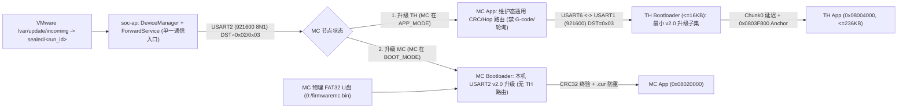
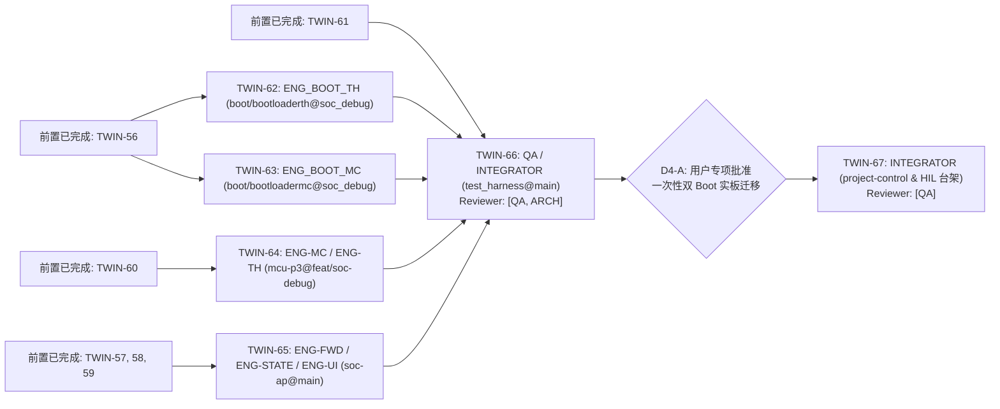

# MiniMCProto v2.0 双 MCU（MC/TH）统一固件升级完整主架构方案（`REQ-20261105-003`）

| 修订版本 | 日期 | 牵头角色与会话 ID | 修订摘要与状态 |
| :--- | :--- | :--- | :--- |
| `revision: 1` | 2026-11-05 | `ARCH` (`3a7ad206-fef7-4d28-b3c8-1ee5bce395a5`，接力 Phase A 会话 `ef428595-f4d6-46a7-9d12-07e1fd215641`) | 汇总 `ARCH` 跨仓协议对账回执 (`r2`)、多端工程专项技术输入 (`07a1f6dc`, `r1`) 与独立 Codex `QA` 规划输入 (`01a1aafd` / `01a1ab34`, `r2`)，形成版本化主方案（`sha256: 6c0e672c50bc526d8b4e662c2c354114ef5c8c0180d4a3dd5563908726584c7a`）。 |
| `revision: 2` | 2026-11-06 | `ARCH` (`3a7ad206-fef7-4d28-b3c8-1ee5bce395a5`) | **用户正式确认（`2026-11-06T09:15:30+08:00`, `status: approved-by-user`）**： 1. 固化用户对第 9 章 `D1 = Option D1-A`、`D2 = Option D2-A`、`D3 = Option D3-A`、`D4 = Option D4-A` 的正式拍板结论； 2. 保持历史 `Rev 2.0.3` 规范文件（`9f8d4f96...`）原位只读不改以保护历史任务卡哈希，将正式升级版 `Rev 2.0.4` 权威协议规范落盘至新路径 [ap_mc_formal_protocol_v2_0_4_unified_ota_20261106.md](file:///home/sushaohua/workspace/ai_soc_project/project-control/docs/specs/ap_mc_formal_protocol_v2_0_4_unified_ota_20261106.md)（`sha256: ec874cab3f8f98fec6412b2da2b4f1fa52bfd8a33601da21e908b0ffaeb0522c`）； 3. **新增第 10 章《正式实施任务拆分、依赖拓扑、接口契约、源码基线与允许路径（`TWIN-62 ~ TWIN-67`）》**，供 `COORD` 登记正式任务卡并按序派发。 |

---

## 1. 用户已定边界、六仓真实能力基线与旧方案冲突/迁移处理

### 1.1 用户已明确的 8 项刚性边界（不再重复作为选择题）
1. **VMware 目录文件升级真实双板 App**：通过 VMware 指定目录（`/var/update/`）中的固件包升级真实 MC、TH App；严禁以文件复制、模拟器或探针刷写替代最终 MiniMCProto v2.0 升级功能。
2. **全链路统一 MiniMCProto v2.0**：所有升级串口通信统一使用 **MiniMCProto v2.0**（以 `SPEC-PROTO-20261015-153000 / Rev 2.0.3` 为基准输入并演进至 `Rev 2.0.4`）；彻底移除 TH Bootloader 原 `0x5A 0xA5` 私有 IAP 数据通道，不设协议转换层或裸 ASCII 旁路。
3. **100% 保留 MC 原有 U盘升级完整能力**：USB Host 枚举、FAT32 文件识别、`128B ATSG Trailer` 准入、Flash 擦写回读、跳转生效及 `.bin -> .cur/.err` 防重复刷写形成独立完整回归范围，绝不只保留底层驱动。
4. **MC Bootloader 绝不承担 TH 路由**：TH 串口升级路径固定为 `AP (0x01) -> MC App (0x02 维护路由) -> TH Bootloader (0x03)`；当 MC App 不可用时，必须先通过 MC Bootloader（串口或 U盘）恢复 MC App，再恢复 TH。
5. **TH Bootloader 严守 16KB（`16,384` 字节）硬边界**：仅实现 MiniMCProto v2.0 最小升级子集（7 个命令码），不引入路由、温控、运动、G-code 或作业处理栈；超 `16,384B` 链接强制失败。
6. **TH 净 App 上限沿用既定 236KB（`241,664` 字节）**：TH Boot 分区（`0x08000000..0x08003FFF`）、TH App 基址（`0x08004000`）与 Anchor 扇区（`0x0803F800`）不重划；跨仓 4 处遗留 `240KB` 参数一次性对齐至 `236KB`。
7. **先确认方案再拆卡派工**：本阶段只做多端统一方案；必须经用户确认本方案及第 9 章裁决项后，才允许进入任务卡拆分、`depends_on` 登记与工程开发派发。
8. **后续常规测试与 HIL 部署全面禁用 `probe-rs`**：功能交付后，所有测试与 HIL 台架搭建中的常规 MC/TH App 固件部署统一走本升级流程（或受控 U盘回归），严禁使用 `probe-rs` 或其他 SWD/JTAG 探针写入工具替代；升级能力就绪前相关部署保持阻塞。

### 1.2 六仓规则入口、当前观察 Commit 基线与“源码 vs 现场片上”严格区分

| 仓库名称 | 分支 | 当前观察 HEAD Commit | 仓内规则入口与共享规则 `SOURCE.json` 溯源 | 源码真实能力现状 vs 现场物理片上已部署状态区分 |
| :--- | :--- | :--- | :--- | :--- |
| `project-control` | `main` | `5686e1931123650bb2251045353c18c8baa00f65` | [project-control/AGENTS.md](file:///home/sushaohua/workspace/ai_soc_project/project-control/AGENTS.md)（权威源仓 `17e0887da07ceb3b017623b791b6a6999e837c79`） | 主规范 `Rev 2.0.3` 已有 `0x20~0x23` 框架，但与业务扩展 `0x10/0x12` 存在同码冲突（见 §3）。 |
| `soc-ap` | `main` | `19534a9a4cb393176882fbad046129d55bba51f6` | [soc-ap/AGENTS.md](file:///home/sushaohua/workspace/ai_soc_project/soc-ap/AGENTS.md) [SOURCE.json](file:///home/sushaohua/workspace/ai_soc_project/soc-ap/.agents/rules/shared/SOURCE.json) (`17e0887d...`) | **源码现状**：`codec.h` 支持 `1024B` 载荷，但 `forward_protocol.h` 控制缓冲仅 `64B`；`telemetry_types.h` 仅声明 `0x20~0x23` 宏，**尚无 `firmware_updater` 实现**。 **现场状态**：VMware AP 尚未部署任何 MCU OTA 编排服务。 |
| `mcu-p3` | `feat/soc-debug` | `191e355a4227268a472bafd6862d4a8c854e0544` | [mcu-p3/.repo-rules/AGENTS.md](file:///home/sushaohua/workspace/ai_soc_project/mcu-p3/.repo-rules/AGENTS.md) [SOURCE.json](file:///home/sushaohua/workspace/ai_soc_project/mcu-p3/.repo-rules/SOURCE.json) (`17e0887d...`) | **源码现状**：MC/TH `MINIMC_MAX_PAYLOAD_SIZE = 64U`，MC `USART6` DMA 缓冲 `256B`；`th_upgrade_mgr.c` 仍发旧 `5A A5` 帧与裸 `"M997 S0"`；TH App `boot_id` 为静态常量 `0x8877AA55U`。 **现场状态**：片上 App 不具备 MiniMCProto v2.0 升级或大帧路由能力。 |
| `boot/bootloadermc` | `soc_debug` | `4fc171ea61912561949b9a0cfc1da8975e4c39ba` | [boot/bootloadermc/.repo-rules/AGENTS.md](file:///home/sushaohua/workspace/ai_soc_project/boot/bootloadermc/.repo-rules/AGENTS.md) [SOURCE.json](file:///home/sushaohua/workspace/ai_soc_project/boot/bootloadermc/.repo-rules/SOURCE.json) (`17e0887d...`) | **源码现状**：已实现 USB Host U盘升级（`usbh_user.c`），但**无 `USART2` 驱动与 MiniMCProto v2.0 协议栈**，且 `verify_trailer_struct()` 未核验 `trailer_crc32`。 **现场状态**：片上 Boot 身份待后续获批只读核实，不支持串口升级。 |
| `boot/bootloaderth` | `soc_debug` | `769fccbe52464ad7ceb856c5e89cb0d25abbbf87` | [boot/bootloaderth/.repo-rules/AGENTS.md](file:///home/sushaohua/workspace/ai_soc_project/boot/bootloaderth/.repo-rules/AGENTS.md) [SOURCE.json](file:///home/sushaohua/workspace/ai_soc_project/boot/bootloaderth/.repo-rules/SOURCE.json) (`17e0887d...`) | **源码现状**：已有首块 `512B` SRAM 缓存、2KB 扇区擦写与 `0x0803F800` Anchor，但通信层仍为私有 `5A A5` + 累加和。 **现场状态**：片上 Boot 不支持 MiniMCProto v2.0，需前置一次性受控迁移（见 §6.4）。 |
| `test_harness` | `main` | `9f3918a2f9fc79a683ce218436b005e593a7109b` *(初查 `d14ed043...`)* | [test_harness/AGENTS.md](file:///home/sushaohua/workspace/ai_soc_project/test_harness/AGENTS.md) [SOURCE.json](file:///home/sushaohua/workspace/ai_soc_project/test_harness/.agents/rules/shared/SOURCE.json) (`17e0887d...`) | **源码现状**：`check_opcode_alignment.py` 硬编码 17 项业务码，未覆盖 `0x20~0x23` 与双 Boot；`test_mcu_firmware_upgrade.py` 尚未创建。 |

### 1.3 与历史方案（`U-D05` / `2026-10-31` 设计稿）及冻结任务卡 `TWIN-26~28` 的冲突与迁移关系

| 历史文档 / 任务卡 | 历史设计内容或状态 | 与本轮新方案的冲突点 | 架构裁决与迁移处置规则 |
| :--- | :--- | :--- | :--- |
| [first_release_scope_decision_20261029.md](file:///home/sushaohua/workspace/ai_soc_project/project-control/docs/planning/product/first_release_scope_decision_20261029.md) (`U-D05`, `rev 7`) & [mcu_firmware_upgrade_design_20261031.md](file:///home/sushaohua/workspace/ai_soc_project/project-control/docs/analysis/mcu_firmware_upgrade_design_20261031.md) (`rev 1`) | 1. MC 走宿主机 `probe-rs` / `st-flash` 直刷； 2. TH 走 `5A A5` 私有 IAP（`0x10~0x13` + 累加和）； 3. 含 `240KB` 上限、“ECDSA 预验签”、“10秒断电自愈”及“零 Bootloader 修改”表述。 | 违反用户第 1/2/5/6/8 条边界：探针直刷与 `5A A5` 私有协议被明确废弃；双 Boot 必须在 `soc_debug` 分支改造以支持 MiniMCProto v2.0。 | **正式替代旧数据通道与探针路线**：将 `U-D05` 与 `2026-10-31` 设计稿标记为 `superseded_by: ARCH-MASTER-MINIMC-V2-UNIFIED-MCU-UPGRADE-20261105`；废止探针刷 App、`5A A5` 通道、“预验签”夸大表述与 `240KB` 参数，保留 TH 首块 512B 延迟提交与 `0x0803F800` Anchor 底层保护资产。 |
| [TWIN-26.md](file:///home/sushaohua/workspace/ai_soc_project/project-control/.agents/kanban/microtasks/vmware_soc_twin/TWIN-26.md) / [TWIN-27.md](file:///home/sushaohua/workspace/ai_soc_project/project-control/.agents/kanban/microtasks/vmware_soc_twin/TWIN-27.md) / [TWIN-28.md](file:///home/sushaohua/workspace/ai_soc_project/project-control/.agents/kanban/microtasks/vmware_soc_twin/TWIN-28.md) | `TWIN-26` 为基于旧 `0x10~0x13` / `M997` 的 `software-verified` 且 `blocked: true` 冻结；`TWIN-27/28` 为 `Backlog / blocked` 未实现。 | 旧卡绑定了 `5A A5` 透传、裸 `"M997"` 及旧版号假设（误把 `0x01/0x02` 当作区分 MC/TH）。 | **保持历史冻结原样不改写**：保留 `TWIN-26~28` 历史签署与 `blocked: true` 冻结状态作为审计留痕，**不解冻、不套用旧软件报告充当新协议验收**；待本方案获用户确认后，按新契约另行创建新任务序列。 |

---

## 2. 实际规划角色会话、接单回执与专业输入索引表

本方案由 `COORD` 实际委派各专业角色会话只读核查六仓源码与规范后汇总而成，所有前置交付物均已落盘并核验 SHA-256：

| 参与角色 | 实际执行会话 UUID | 交付物路径与版本 | SHA-256 摘要 | 核心专业结论与合入章节 |
| :--- | :--- | :--- | :--- | :--- |
| **用户收件 / 需求基准** | 用户 & `COORD` | [20261105_minimc_v2_upgrade_coord_planning_prompt.md](file:///home/sushaohua/workspace/ai_soc_project/project-control/docs/work_intake/submissions/20261105_minimc_v2_upgrade_coord_planning_prompt.md) (`rev 3`) [minimc_v2_unified_mcu_upgrade_proposal_20261105.md](file:///home/sushaohua/workspace/ai_soc_project/project-control/docs/planning/minimc_v2_unified_mcu_upgrade_proposal_20261105.md) (`rev 2`) [minimc_v2_mcu_upgrade_and_hil_deployment_manual_20261105.md](file:///home/sushaohua/workspace/ai_soc_project/project-control/docs/guides/minimc_v2_mcu_upgrade_and_hil_deployment_manual_20261105.md) (`rev 1`) | `4699feade73d9e621b5ead2bade96ba195c488446de6e215bbb9b5276dcfcc80` `72c1a91a1487b7184ba371ea3ed653d038c741a7e8baf2eb98316e0d91e6dc2f` `87b0b859e3e7e4cf7e8733ac88d90d1e0fd94f3b3e2117abfea9af3b14d4e6a9` | 确立 8 项刚性边界、“先解决协议契约冲突再定型升级接口”原则及常规测试/HIL 部署禁用 `probe-rs` 门禁（合入 §1 ~ §9）。 |
| **`ARCH` (Phase A 核查 & Phase B 汇总)** | Phase A: `ef428595-f4d6-46a7-9d12-07e1fd215641` Phase B: `3a7ad206-fef7-4d28-b3c8-1ee5bce395a5` | [minimc_v2_upgrade_arch_audit_receipt_20261105.md](file:///home/sushaohua/workspace/ai_soc_project/project-control/docs/planning/minimc_v2_upgrade_arch_audit_receipt_20261105.md) (`rev 2`) | `05308b35432bb483c2600130133b6105922159f3e3e763646d6468af15d9a6c0` | 完成 `0x00~0x50` 全命令跨源对账，定位 `0x10`/`0x12`/`0x00`/`64B` 四大冲突与 `check_opcode_alignment.py` 三大盲区，定义四阶段确认语义（合入 §3, §5）。 |
| **`ENG-FWD` / `ENG-STATE` / `ENG-MC` / `ENG-TH` / `ENG_BOOT_MC` / `ENG_BOOT_TH` / `INTEGRATOR` / `ENG-UI` / `ENG-NET`** | `07a1f6dc-f47c-45e5-bf00-37ec14e2dfda` *(前序 `484ac302-bd54-4e1b-be9f-0227e1475d5d`)* | [minimc_v2_upgrade_engineering_inputs_20261105.md](file:///home/sushaohua/workspace/ai_soc_project/project-control/docs/planning/minimc_v2_upgrade_engineering_inputs_20261105.md) (`rev 1`) | `c79477a0b9bfa2b18d1451b91b2a6188aa4b50f72bc742a8640aa0a696a1610b` | 给出各端 RAM/DMA 扩容预算、停等超时矩阵、`th_upgrade_mgr.c` 迁移方案、四仓一致 Trailer 常量（`0x00010000` / `0x43500001` / `0x42300001`）、TH Boot 16KB 预算（`10,590B`）与 4 处 `240KB` 修正行号（合入 §3 ~ §8）。 |
| **独立 Codex `QA`（规划作者）** | `r1`: `01a1aafd-f2d4-7b91-a422-04ef47aefeb6` `r2`: `01a1ab34-f811-7ce2-b9d2-ae177ab18aef` | [minimc_v2_upgrade_qa_planning_input_20261105.md](file:///home/sushaohua/workspace/ai_soc_project/project-control/docs/planning/minimc_v2_upgrade_qa_planning_input_20261105.md) (`rev 2`) | `f41d27c2214cacd1113397f20eb50038a404df94781f4bfdb18239d5d6f246d9` | 审计 `check_opcode_alignment.py` 提交历史（`dccf2de1` / `2812f60f`），制定静态 `S01~S04`、Docker `D01~D08`、真实 HIL `H01~H06`、负例 `N01~N10`、U盘 `U01~U08`、冲突/MTU `C01~C09`/`M01~M08` 及 `G01~G25` 黄金字节向量（合入 §3, §8）。 |

---

## 3. 协议契约冲突对账与统一演进裁定（先解决契约冲突，再定型升级接口）

### 3.1 全量命令码（`0x00 ~ 0x50`）跨源对账总表

以下逐项对账主规范 [SPEC-PROTO-20261015-153000 (`Rev 2.0.3`)](file:///home/sushaohua/workspace/ai_soc_project/project-control/docs/specs/ap_mc_formal_protocol_v2_0_multidevice_routing_draft_20261015.md)、已接受扩展方案（[SPEC-ALIGN-20261102-01](file:///home/sushaohua/workspace/ai_soc_project/project-control/docs/specs/minimcproto_ack_nack_contract_alignment_matrix_20261102.md)、[PLAN-E2E-20261104 (`rev 3`)](file:///home/sushaohua/workspace/ai_soc_project/project-control/docs/planning/end_to_end_physical_link_remediation_plan_20261104.md)）、四端源码及检查器 [check_opcode_alignment.py](file:///home/sushaohua/workspace/ai_soc_project/test_harness/static_checks/minimcproto/check_opcode_alignment.py)：

| Cmd ID | 主规范 `Rev 2.0.3` | 现行代码 / 已接受扩展 | 方向与 Flags (`v2=0x04`) | 请求/响应载荷长度、布局与单位 | 对账分类与统一演进裁定 |
| :--- | :--- | :--- | :--- | :--- | :--- |
| **`0x00`** | `CMD_ACK` (4B) | `MINIMC_CMD_ACK` (`0x17` 现回 0B) | 从$\to$主 `0x06` | **标准 4B**：`planner_buf_free:1B`, `rx_fifo_free_units:1B`, `reserved:2B` | **[功能子集 $\to$ 统一 4B]** OTA 与新命令统一发 4B `0x00 CMD_ACK`（18B 整帧）；AP 对 `0x17` 兼容接收 0B/4B。 |
| **`0x01`** | `CMD_GET_VERSION` | `MINIMC_CMD_GET_VERSION` | 主$\to$从 `0x05` | 请求 **0B**（14B 整帧）；响应 `0x02`（16B） | **[无冲突]** `DST=0x02` 查 MC，`DST=0x03` 查 TH；App 与 Boot 均支持。 |
| **`0x02`** | `CMD_VERSION_REPORT` | `MINIMC_CMD_VERSION_REPORT` | 从$\to$主 `0x06` | 响应 **16B**：`proto:2B`, `fw:2B`, `boot_id:4B`, `git_commit:4B`, `capability_flags:4B` | **[无冲突]** `capability_flags Bit 31` 严格区分 `APP_MODE(0)` 与 `BOOT_MODE(1)`（详见 §5.2）。 |
| **`0x03`** | `CMD_PING` | `MINIMC_CMD_PING` | 双向 `0x05` | 请求 **4B**：`uint32_t t_originate_ms` (ms)；响应 `0x04`（12B） | **[无冲突]** App 与 Boot 均支持。 |
| **`0x04`** | `CMD_PONG` | `MINIMC_CMD_PONG` | 双向 `0x06` | 响应 **12B**：`t_orig:4B`, `t_rx:4B`, `planner_free:1B`, `rx_free:1B`, `reserved:2B` | **[无冲突]** 三端源码均为 12B。 |
| **`0x05`** | *(未分配)* | AP `MINIMC_CMD_ESTOP_ACK` (悬空宏) | — | 无（MCU 从未发送 `0x05`） | **[历史残留死宏 $\to$ 清理]** `0x05` 绝非 `CMD_ACK`；删除 AP `telemetry_types.h#L61` 悬空宏，请求未知 `0x05` 回 `NACK 0x04`。 |
| **`0x06`** | `CMD_NACK` (3B) | `MINIMC_CMD_NACK` (3B) | 双向 `0x06` | 响应 **3B**：`uint8_t error_code`, `uint16_t expected_seq` (LE) | **[无冲突]** 经 `SPEC-ALIGN-20261102-01` 统一为 3B（17B 整帧）。 |
| **`0x07`** | `CMD_LOG_MESSAGE` | 仅 AP 声明宏，走独立物理 Debug 口 | 从$\to$主 `0x04` | 变长 **2~128B** (`level:1B`, `module_id:1B`, `msg[]`) | **[功能子集]** 首发采用独立 `115200` 物理 Debug 口输出，协议预留不冲突。 |
| **`0x10`** | **`CMD_SYSTEM_CONTROL`** (3B: Reboot/JumpToBoot) | **`MINIMC_CMD_SET_TEMP`** (4B: 设温，AP 头同时声明两宏！) | 主$\to$从 `0x05` | - `Rev 2.0.3` **3B**：`action:1B`, `delay_ms:2B`，回 `0x00` - 现实现 **4B**：`nozzle_deci_c:2B`, `bed_deci_c:2B` (`0.1°C`)，回 `0x15` | **[核心语义冲突 D1]** 严禁按 3B/4B 猜协议！推荐 **D1-A**：保留 `0x10=SET_TEMP(4B)`，将 `SYSTEM_CONTROL(4B)` 移至 **`0x1D`**（见 §3.2.1）。 |
| **`0x11`** | *(未登记)* | `MINIMC_CMD_MOTION_HOME` | 主$\to$MC `0x05` | 请求 **4B**：`axes_mask:1B`, `reserved:1B`, `feedrate_mm_s:2B` (`mm/s`)；回 `0x16` (20B) | **[已批准扩展]** 纳入 `Rev 2.0.4` 正式注册。 |
| **`0x12`** | **`CMD_EMERGENCY_STOP`** (广播 `0xFF`, `Flags=0x14`, 2B/0B) | **`MINIMC_CMD_MOTION_MOVE`** (16B 单播坐标移动，`DST=0x02`) | `Rev 2.0.3`: `0x14` 现实现: `0x05` | - `Rev 2.0.3` **2B/0B** 急停（无 ACK） - 现实现 **16B**：`axes:1B`, `rel:1B`, `feed_mm_min:2B`, `x/y/z_um:12B` (`um`)，回 `0x16` | **[核心语义冲突 D2]** 推荐 **D2-A**：锁定 `0x12=MOTION_MOVE(16B)`，将唯一急停指令统一锁定为 **`0x17`**（见 §3.2.2）。 |
| **`0x13`** | *(未登记)* | `MINIMC_CMD_JOB_CONTROL` | 主$\leftrightarrow$MC `0x05/0x06` | 请求 **4B** (`op:1B`, `res:1B`, `total:2B`)；响应 **8B** (`state:1B`, `ack_seq:1B`, `permille:2B`, `exec_lines:2B`, `total_lines:2B`) | **[已批准扩展]** 纳入 `Rev 2.0.4` 正式注册。 |
| **`0x14`** | *(未登记)* | `TEMP_QUERY` / `GET_TEMP` | 主$\to$从 `0x05` | 请求 **0B**；响应 `0x15 TEMP_REPORT`（16B） | **[合法别名]** `MINIMC_CMD_TEMP_QUERY` 与 `MINIMC_CMD_GET_TEMP` 同义白名单。 |
| **`0x15`** | *(未登记)* | `TEMP_REPORT` / `TEMP_REPORT_V2` *(MC/TH 残留 `FILAMENT_CONTROL=0x15`)* | 从$\to$主 `0x06` | 响应 **16B**：`cur_deci_c:2B`, `tgt_deci_c:2B`, `adc:2B`, `status:1B`, `pwm:1B`, `ts_ms:4B`, `res:4B` | **[合法别名 + 死宏清理]** 保留 `TEMP_REPORT(_V2)`；将 MC/TH 头文件中未使用的 `FILAMENT_CONTROL` 统一迁至 `0x19U`。 |
| **`0x16`** | *(未登记)* | `POS_QUERY` / `POS_REPORT` | 主$\leftrightarrow$MC `0x05/0x06` | 请求 **0B**；响应 **20B** (`x/y/z/e_um:16B`, `mc_state:1B`, `homed_mask:1B`, `res:2B`) | **[已批准扩展]** 纳入 `Rev 2.0.4`。 |
| **`0x17`** | *(未登记)* | `MOTION_STOP` / `EMERGENCY_STOP` | 主$\to$从 `0x15`/`0x05`/`0x14` | 请求 **1B/2B** (`stop_mode:1B` [`1=E-Stop, 0=Clear`], `reason:1B`)；单播回 `0x00 CMD_ACK`，广播无 ACK | **[与 `0x12` 联动急停契约 D2]** 见 §3.2.2。 |
| **`0x18`** | *(未登记)* | `LEVEL_GRID_QUERY` | 主$\leftrightarrow$MC `0x05/0x06` | 请求 **1B** (`probe_idx=7`)；响应 **52B** (`grid_x:1B=5`, `grid_y:1B=5`, `z_offset_um[25]:50B`) | **[已批准扩展]** 纳入 `Rev 2.0.4`。 |
| **`0x19`** | *(未登记)* | `SLOT_SELECT` / `FILAMENT_CONTROL` | 主$\leftrightarrow$从 `0x05/0x06` | 请求 **4B** (`slot:1B`, `act:1B`, `len_mm:2B`)；响应 **4B** (`active:1B`, `mask:1B`, `state:1B`, `code:1B`) | **[合法别名 + 已批准扩展]** 纳入 `Rev 2.0.4`。 |
| **`0x1A`** | *(未登记)* | `LEVEL_TRIGGER` | 主$\to$MC `0x05` | 请求 **0B/1B**；响应 `0x18`（52B） | **[已批准扩展]** 纳入 `Rev 2.0.4`。 |
| **`0x1B`** | *(未登记)* | `FILAMENT_LEGACY` | 仅 MCU 接收兼容 | 同 `0x19`（4B），AP 已停发 | **[向后兼容接收别名]** 纳入白名单。 |
| **`0x1C`** | *(未登记)* | `GCODE_EXEC` | 主/MC$\to$从 `0x05/0x06` | 请求 **2B+N** (`line_len:1B[1..60]`, `flags:1B`, `gcode[N]`)；响应 **4B** (`status:1B`, `free:1B`, `ack_seq:2B`) | **[已批准扩展]** 纳入 `Rev 2.0.4`。 |
| **`0x1D`** | *(未分配)* | **推荐新分配 `CMD_SYSTEM_CONTROL`** | 主$\to$从 `0x05` | 请求 **4B**：`action:1B`, `target_component:1B`, `delay_ms:2B` (LE)；响应 `0x00 CMD_ACK` (4B) | **[推荐新增系统控制码 D1-A]** 专职 Reboot / JumpToBootloader。 |
| **`0x20`** | `CMD_OTA_START` (16B) | 仅 AP 声明宏 | 主$\to$Boot `0x05` | **统一 144B**：`16B 标准头 + 128B ATSG Trailer`；擦除前准入通过回 `0x00 CMD_ACK` (4B) | **[升级契约裁定 D3]** 解决擦除前 128B Trailer 原子准入（见 §3.2.3 & §5.3）。 |
| **`0x21`** | `CMD_OTA_DATA` (8B+N) | 仅 AP 声明宏 | 主$\to$Boot `0x05` | **8B 头** (`offset:4B`, `chunk_bytes:2B`, `chunk_crc16:2B`) + `data[1..512B]`（默认 `256B`）；回 `0x00` (4B) | **[升级契约裁定 D3]** 端点最大载荷统一为 `520B`（整帧 `534B`）。 |
| **`0x22`** | `CMD_OTA_FINISH` (8B) | 仅 AP 声明宏 | 主$\to$Boot `0x05` | **固定 8B**：`fw_crc32:4B`, `action_after_verify:1B`, `reserved[3]:3B`；终验提交后回 `0x00` (4B) | **[无冲突]** 100% 复用主规范 8B 布局（注：任务 prompt 简记 12B 系笔误，主规范与实现统一锁定为 8B 载荷 / 22B 整帧）。 |
| **`0x23`** | `CMD_OTA_STATUS` (8B) | 仅 AP 声明宏 | 主$\leftrightarrow$Boot `0x05/0x06` | 请求 **0B**；响应 **8B**：`ota_state:1B`, `error_code:1B`, `cached_chunk0_bytes:2B`, `bytes_written:4B` | **[无冲突]** `bytes_written` 严格定义为已物理写入 Flash 并回读通过的字节数。 |
| **`0x31/40/50`** | `STREAM_CHUNK` / `TELEMETRY` / `ALARM` | 仅 AP 声明宏，首发未启用 | 预留 | 预留扩展，Boot 模式显式拒绝（回 `NACK 0x04`） | **[功能子集 / 预留]** 无命令码冲突。 |

### 3.2 核心冲突剖析与跨端一致裁定方案

1. **冲突 1 (`0x10`)：`SYSTEM_CONTROL` vs `SET_TEMP`**
   - **问题**：`Rev 2.0.3` 定义 `0x10 = CMD_SYSTEM_CONTROL (3B)`，而 `PLAN-E2E-20261104` 及三端代码已将 `0x10` 实现并验收为 `MINIMC_CMD_SET_TEMP (4B)`，且 [telemetry_types.h#L64-L65](file:///home/sushaohua/workspace/ai_soc_project/soc-ap/contracts/twin/telemetry_types.h#L64-L65) 同时定义两宏为 `0x10U`。**严禁按 3B/4B 长度猜测同一 `0x10` 命令！**
   - **推荐方案 `Option D1-A`（ARCH 与九端工程一致推荐）**：保持 **`0x10 = MINIMC_CMD_SET_TEMP (4B)`** 不变（零破坏已通过 HIL 验收的温控链路），将 **`CMD_SYSTEM_CONTROL (4B: action, target_component, delay_ms)`** 正式分配至未占用的 **`0x1D`**，并发布主规范 `Rev 2.0.4`。
   - **备选方案 `Option D1-B`**：恢复 `0x10 = CMD_SYSTEM_CONTROL`，将 `SET_TEMP` 迁至 `0x1D`（需同步重改 AP/MC/TH 设温代码、单测与 HIL 探针，过渡期存在混版本设温误触发重启风险，不推荐）。

2. **冲突 2 (`0x12` & `0x17`)：`EMERGENCY_STOP` vs `MOTION_MOVE` / `MOTION_STOP`**
   - **问题**：`Rev 2.0.3` 及 `reference_vectors.py` `V04` 将 `0x12` 定义为广播急停，而三端代码已将 `0x12` 实现为 `MOTION_MOVE (16B)`、将急停放在 `0x17`。若向当前 MC 发送 `0x12` 广播急停，会被当作 `MOTION_MOVE` 因长度不足拒绝！
   - **推荐方案 `Option D2-A`（ARCH 与工程一致推荐）**：在 `Rev 2.0.4` 中正式锁定 **`0x12 = MINIMC_CMD_MOTION_MOVE (16B)`**，锁定 **`0x17 = MINIMC_CMD_EMERGENCY_STOP`（同义别名 `MINIMC_CMD_MOTION_STOP`）** 为唯一急停命令码，同时支持：(a) **单播受控急停**（`DST=0x02/0x03, Flags=0x15/0x05, Len=1B/2B`，立即停机并回 `0x00 CMD_ACK`，满足 `AGENTS.md` §7 显式 ACK 门禁）；(b) **全网特权广播急停**（`DST=0xFF, Flags=0x14, WANTS_ACK=0, Len=2B`，MC 本地急停并向 TH 广播转发，不回 ACK）；同步将 `V04` 黄金向量更新为 `Cmd=0x17`。
   - **备选方案 `Option D2-B`**：恢复 `0x12 = EMERGENCY_STOP`，将 `MOTION_MOVE` 迁至 `0x1E`（需全量改动三端运动控制代码与测试，不推荐）。

3. **冲突 3 (`MAX_PAYLOAD_SIZE` & `0x20 OTA_START` 准入)**
   - **统一端点 MTU（`520B` 载荷 / `534B` 整帧）**：协议规范层保持理论上限 `1024B`；嵌入式端点统一将 `MINIMC_MAX_PAYLOAD_SIZE` 定为 **`520B`**（`8B OTA_DATA 头 + 512B 最大净固件块`，默认发送 `256B` 块即 `264B` 载荷；末块允许 `1..512B`）。MC App 同步扩容 `AP_RING_CAPACITY = 1024B`、`FORWARD_UART_TX/RX_BUF_SIZE = 600B` 并修复 `drain_th_rx()` `64B` 截断（静态 SRAM 仅增 `~2.31KB` / `384KB`）；TH Boot 复用既有 `s_rx_ctx.payload[520]` 与 `s_chunk0_buf[512]`（静态 `.bss` 仅增 `14B`，缩减发送栈缓冲 `tx_buf[32]` 反而净省 `494B` 栈空间）；TH App 仅收 `0x1D (4B)`，保持 `64B` 零增量。
   - **统一 `0x20 CMD_OTA_START` 为 `144B` 原子准入帧（推荐 `Option T-A`）**：前 `16B` 完全保持 `Rev 2.0.3` 标准头偏移，紧接 `128B ATSG Trailer`。Boot 收到 `0x20` 单帧后立即完成全量元数据与 `trailer_crc32` 准入校验，通过后才擦除首扇区/Anchor 并回 `0x00 CMD_ACK`；不通过则零擦除并回 `0x06 CMD_NACK`。

4. **`check_opcode_alignment.py` 静态门禁演进要求**
   - 经 `ARCH` 与独立 `QA`（审计提交 `dccf2de1` $\to$ `2812f60f`）确认：现脚本仅正向比对三端头文件硬编码的 17 个宏，不检同值异义碰撞、未覆盖 `0x14/0x1D/0x20~0x23` 及双 Boot 仓、不检 `MAX_PAYLOAD_SIZE`。
   - **演进要求**：待契约确认后，改造检查器从版本化协议注册表加载预期，覆盖 **5 个端点**（`soc-ap`、`MC App`、`TH App`、`bootloadermc`、`bootloaderth`），强制执行**反向数值唯一性断言**（除显式登记白名单外，严禁两个不同语义宏共享同一数值）及结构体 `sizeof` / `MAX_PAYLOAD_SIZE (520B)` 校验，并由非作者独立 Codex 会话完成 `ARCH` 复核。

---

## 4. 跨系统架构、链路/模式所有权、正常与恢复时序及兼容矩阵

### 4.1 跨系统拓扑与串口独占所有权切换

- **唯一通信所有者与并发隔离**：
  1. **AP 端**：进入 `UPGRADING_MAINTENANCE` 时，`DeviceManager` 暂停周期性 `0x14 TEMP_QUERY`、`0x16 POS_QUERY`、`0x01 GET_VERSION` 轮询；屏蔽常规 `1.5s STALE / 3.0s OFFLINE -> FAULT` 误判，同时对外明确暴露 `system_status = "UPGRADING_MAINTENANCE"`（**严禁显示为业务健康通过**），拦截普通控制 API 并返回 `HTTP 409/503`；`ForwardService` 持有 `uart_mutex` 排他执行 Stop-and-Wait（`in_flight = 1`）升级事务。
  2. **MC App 端**：收到针对 `DST=0x03` 的 `0x1D` 或 `0x20~0x23` 时，切换 `USART6` 为 `FORWARD_UART_MODE_OTA_ROUTE`——拦截本地 `forward_uart_send_line()` 的 G-code/温度下发并停用旧 `th_upgrade_mgr` 5s 轮询，但允许 `minimc_proto` 通过扩容至 `600B` 的 `forward_uart_send_raw()` 透明转发 `DST=0x03` 帧（校验 CRC16 $\to$ `hop_limit - 1` $\to$ `route_ctrl |= 0x04` $\to$ 重算 CRC16）。

### 4.2 正常双节点串行升级主时序（标准顺序：先 TH `0x03`，后 MC `0x02`）

1. **阶段 A（文件原子投放与封存展示）**：文件以 `.part` 写入 `/var/update/incoming/`，校验哈希后 `fsync` + `rename` 为 `.bin`；系统识别后仅置为 `PACKAGE_STAGED_PENDING_CONFIRM` 并展示包身份，**绝不自动开刷**。
2. **阶段 B（用户确认与 4 项硬安全准入）**：用户确认后，AP 将包复制至只读封存目录 `/var/update/sealed/<run_id>/<pkg>.bin`（`0444`），重验文件 SHA-256、净荷 `payload_sha256`、`payload_crc32` 与 `128B ATSG Trailer`；同时原子核验 **4 项安全前提**（作业 `IDLE`、运动静止 `mc_state == 0`、双板温度采样有效且新鲜、热床/喷头目标温度为 `0` 且 `heater_duty_percent == 0%`）。
3. **阶段 C（先升级 TH `DST=0x03`：AP $\to$ MC App $\to$ TH Boot）**：
   - AP 发 `0x1D CMD_SYSTEM_CONTROL (action=2, delay_ms=50)` $\to$ TH App 置热端 PWM 0% 锁死、电机去能，**先回二进制 `0x00 CMD_ACK (4B)` 并等待 `USART1_TDC` 排空**（严禁发裸 ASCII `"ok2/M997"`），写 `0x20008000 = 0x55504744 ("UPGD")` 后软复位；
   - AP 轮询 `0x01 -> 0x02` 确认 TH `capability_flags Bit 31 == 1 (BOOT_MODE)` 且 `board_id` 匹配 `0x0423`；
   - AP 发 `0x20 CMD_OTA_START (144B)` $\to$ TH Boot 校验 Trailer 通过后擦除 `0x08004000` (Sector 8) 与 `0x0803F800` (Sector 127) 并回 `0x00 CMD_ACK`；
   - AP 按 `256B`（最大 `512B`）逐块发 `0x21 CMD_OTA_DATA` $\to$ TH Boot 将首块 `offset < 512B` 仅缓存在 `s_chunk0_buf[512]`（不写 Flash），后续块按需跨 2KB 扇区擦除、半字写入并逐字节回读比对，回 `0x00 CMD_ACK`（期间 AP 可发 `0x23 CMD_OTA_STATUS` 对账实际落盘 `bytes_written`）；
   - AP 发 `0x22 CMD_OTA_FINISH (8B)` $\to$ TH Boot 联合 `s_chunk0_buf[512]` 与 Flash `0x08004200..` 计算全片 IEEE CRC32，匹配后先写 `0x0803F800` Anchor 再写 `0x08004000` 首块 512B，回 `0x00 CMD_ACK`，排空串口后跳转新 TH App；
   - AP 轮询 `0x01 -> 0x02` 核实 TH 回到 `APP_MODE (Bit 31 == 0)`、动态 `boot_id` 已更新、`git_commit_short` 匹配目标包，且 `0x14 -> 0x15` 恢复真实新鲜温度采样后，TH 升级方可判定完成。
4. **阶段 D（再升级 MC `DST=0x02`：AP $\to$ MC Boot）**：
   - TH 恢复正常后，AP 向 `DST=0x02` 发 `0x1D (action=2)` $\to$ MC App 锁死加热 0% 与电机、回 `0x00 CMD_ACK`、写 SRAM 魔数 `0x55504732 ("UPG2")` 并软复位驻留 `bootloadermc`；
   - AP 直连 `bootloadermc` (`USART2`) 执行相同的 `0x01/0x02 -> 0x20 (144B) -> 0x21 -> 0x23 -> 0x22` 升级与硬件 CRC32 终验，重启后核实 MC 新 App `boot_id` 刷新、版本匹配及双板温度/状态恢复，最终释放 `UPGRADING_MAINTENANCE` 锁。

### 4.3 MC App 现有从 U盘升级 TH (`th_upgrade_mgr.c`) 的同构迁移方案

- **彻底移除 `5A A5` 与裸 `"M997 S0"`**：将 [th_upgrade_mgr.c](file:///home/sushaohua/workspace/ai_soc_project/mcu-p3/motion-controller-mcu/project/marlin/marlin_module/th_upgrade_mgr.c) 中读取 MC U盘 `0:/fw_th.bin` 后的升级动作，100% 替换为发送标准 MiniMCProto v2.0 帧（`0x1D` 进 Boot $\to$ `0x01/0x02` 查 `BOOT_MODE` $\to$ `0x20 [144B]` $\to$ `0x21 [8B+512B]` $\to$ `0x22 [8B]`），删除 `wk_usart.c` 中 `forward_uart_send_frame/recv_frame` (`5A A5`) 死代码，并将 `TH_FLASH_MAX_APP_SIZE` 修正为 `236KB`。**该逻辑仅在 MC App 中运行，绝不进入 MC Bootloader**。

### 4.4 异常、断连、掉电与恢复处理矩阵（如实声明能力边界）

> **诚实能力声明**：本方案**不承诺断点续传（Resume from partial offset）、不承诺双分区 A/B 自动回滚、不启用 ECDSA 密码学非对称验签**。任何传输中断或掉电后的恢复均以**重新安全准入、重新握手、`0x20 OTA_START` 重新擦写并完整重传镜像**为唯一确定性基线。

| 异常场景 | 各端确定性响应与状态转移 | 恢复路径与判据 |
| :--- | :--- | :--- |
| **单帧超时 / 丢 ACK 重传** | AP 按分阶段超时（`0x1D` 500/800ms，`0x20/0x22` 3000/3500ms，`0x21` 800/1200ms）重试 `1~3` 次；Boot 对 `offset == s_last_written_offset` 的重复块**不重复擦写 Flash、不重复累加计数，直接幂等重发 `0x00 CMD_ACK`**。 | 重试成功则继续；超出重试上限则中止会话，上报结构化故障 `{target_node, sequence_id, elapsed_ms, error_code, ota_phase}`。 |
| **外层 CRC16 错 vs 内块 `chunk_crc16` 错 vs 乱序/越界** | - 外层 CRC16 错或 `L > 520B`：按主规范 §6 **静默丢弃**并递增错误计数，由发送端超时重传； - 外层 CRC 正确但 `chunk_crc16` 错：零写入，回 `0x06 CMD_NACK (ERR_COMMAND_REJECTED = 0x06)`； - `offset != expected_offset`：零写入，回 `0x06 CMD_NACK (ERR_OTA_INVALID_OFFSET = 0x13)`。 | 发送端收到 NACK 立即停止或按期望重发，绝不写入损坏或错位数据。 |
| **错板 / 超限 (`>236KB`) / 非法组件 (`Boot=0x02`)** | `0x20 OTA_START` 准入阶段直接拦截，回 `0x06 CMD_NACK`（超限回 `0x14 ERR_OTA_IMAGE_OVERSIZE`，其余回 `0x06`），**Flash 擦写调用计数为 0**。 | 原 App 与 Anchor 完好无损，直接软复位或继续运行原 App。 |
| **物理拔线 (`/dev/ttyUSB*` 或板间线断开)** | AP 3s 内降级并置失效温度为哨兵值，CPU 占用 $\le 2\%$（基于 `poll()` 阻塞/退避，严禁忙轮询），升级状态机立即挂起/失败并锁死控制返回 HTTP 503/504。 | 物理重连后，重新探测 `0x01 -> 0x02` 识别节点处于 `BOOT_MODE` 还是 `APP_MODE`，从头发起 `0x20` 完整重传。 |
| **升级中途复位 / 断电（TH 或 MC）** | - **TH**：因首块 512B 仅在 SRAM 且 `0x08004000` 与 `0x0803F800` 已擦除，重上电 `flash_verify_app_integrity()` 必然判定无效并**100% 安全驻留 `bootloaderth`**； - **MC**：`0x08020000` 未通过 CRC 终验或栈顶无效，重上电驻留 `bootloadermc`。 | 重新上电后无需探针，直接通过串口（或 MC U盘）重新发起 `0x20 -> 0x21 -> 0x22` 即可恢复。 |
| **MC App 不可用（且 TH 亦待恢复）** | AP 探测 `0x02` 无 App 响应但 `bootloadermc` 在线（或插入 U盘）；此时**严禁向 `0x03` 发起升级**。 | **Step 1**：先通过 `AP -> MC Boot (USART2)` 或 MC U盘恢复 MC App 并核验上线； **Step 2**：再经恢复后的 MC App 路由升级 TH Boot。 |

---

## 5. 唯一协议与镜像字节契约、四阶段确认语义硬隔离

### 5.1 帧结构与双 CRC 算法不变量
- **12B 帧头 + 载荷 + 2B CRC16**：`55 AA | SRC(1B) | DST(1B) | FLAGS(1B) | CMD(1B) | HOP(1B) | ROUTE(1B) | SEQ_LE(2B) | LEN_LE(2B) | PAYLOAD(0..520B) | CRC16_LE(2B)`。
- **外层帧 `CRC16` 与 `0x21` 内块 `chunk_crc16`**：均为 **CRC-16/CCITT-FALSE**（`Poly=0x1021, Init=0xFFFF, RefIn=false, RefOut=false, XorOut=0x0000`，小端发送）；外层覆盖 `Offset 0 (0x55)` 至载荷末字节，`chunk_crc16` 仅覆盖 `firmware_bytes[0..chunk_bytes-1]`。
- **Trailer `header_crc32` 与全片镜像 `fw_crc32`**：均为标准 **IEEE 802.3 CRC-32**（反射多项式 `0xEDB88320, Init=0xFFFFFFFF, XorOut=0xFFFFFFFF`，小端编码），仅覆盖真实净荷字节 `payload_size`（不含 Trailer，不含末块凑字补齐的 `0xFF`）。

### 5.2 核心升级与控制命令字节布局契约总表（全小端序 Little-Endian）

| 命令码与名称 | 载荷长度 | 字节偏移、字段类型与精确取值定义 | 正常响应与错误码 (`0x06 CMD_NACK`) |
| :--- | :--- | :--- | :--- |
| **`0x01 GET_VERSION`** | `0B` | 无载荷（14B 整帧，`Flags=0x05`） | 回 `0x02 VERSION_REPORT (16B)` |
| **`0x02 VERSION_REPORT`** | `16B` | `+0`: `proto_major(2)`, `+1`: `proto_minor(0)`, `+2`: `fw_major`, `+3`: `fw_minor`, `+4..7`: `boot_id (uint32_t)`, `+8..11`: `git_commit_short (uint32_t)`, `+12..15`: `capability_flags (uint32_t)`： - **App 态**：`Bit 31 = 0` (`MC=0x00000003`, `TH=0x00000007`)； - **Boot 态**：`Bit 31 = 1` (`0x80000000`) \| `Bit 30 (ATSG)` \| `Bit 29 (Chunk0+Anchor)` \| `MaxChunk/64 << 16 (0x080000)` \| `board_id_low16`（MC Boot = **`0xC0080435`**，TH Boot = **`0xE0080423`**）。 | 从$\to$主响应 (`Flags=0x06`)，不回 ACK |
| **`0x1D CMD_SYSTEM_CONTROL`** *(推荐 D1-A)* | `4B` | `+0`: `uint8_t action` (`0=Noop, 1=Reboot, 2=JumpToBootloader`) `+1`: `uint8_t target_component` (`1=Main App, 0=System`) `+2..3`: `uint16_t delay_ms` (默认 `50ms`) | 安全准入通过先回 `0x00 CMD_ACK (4B)` 再延时复位；忙或不安全回 `0x06 CMD_NACK` (`0x05 DEVICE_BUSY` / `0x06 REJECTED`) |
| **`0x20 CMD_OTA_START`** *(推荐 T-A)* | `144B` | - **`+0..15` (16B 标准头)**：`target_device:1B (2=MC, 3=TH)`, `target_component:1B (必须为 1=App)`, `force_flag:1B`, `reserved:1B(0)`, `fw_size_bytes:4B`, `fw_crc32:4B`, `new_version_raw:4B`； - **`+16..143` (128B `ATSG` Trailer，`<IIIII32s32s32s8sI`)**：   `+16..19`: `magic = 0x41545347U` (LE: `47 53 54 41`)   `+20..23`: `struct_version = 0x00010000U` *(四仓源码已统一)*   `+24..27`: `board_id` (**MC=`0x43500001U`**, **TH=`0x42300001U`**)   `+28..31`: `version_code`   `+32..35`: `payload_len` (须等于 `fw_size_bytes`；TH $\le 241,664$, MC $\le 917,504$)   `+36..67`: `payload_sha256[32]`   `+68..131`: `sig_r[32] + sig_s[32]` (预留全 `0`)   `+132..139`: `reserved[8]` (全 `0`)   `+140..143`: `trailer_crc32` (Trailer 前 124B 的 IEEE CRC32) | 准入通过并完成首扇区/Anchor 擦除后回 `0x00 CMD_ACK (4B)`； 失败**零擦除**并回 `0x06 CMD_NACK`： - 超限：`0x14 ERR_OTA_IMAGE_OVERSIZE` - 错板/坏 Trailer/组件非 App：`0x06 ERR_COMMAND_REJECTED` - 擦除硬件失败：`0x10 ERR_OTA_ERASE_FAILED` |
| **`0x21 CMD_OTA_DATA`** | `8B + N` (`N=1..512`) | `+0..3`: `uint32_t offset` (字节偏移，须等于期望偏移或上一块重传偏移) `+4..5`: `uint16_t chunk_bytes` (常规 `256` 或 `512`，末块允许 `1..512`) `+6..7`: `uint16_t chunk_crc16` (`firmware_bytes` 的 CRC16-CCITT-FALSE) `+8..7+N`: `uint8_t firmware_bytes[N]` | 缓存(Chunk0)或写入回读通过回 `0x00 CMD_ACK (4B)`； 失败回 `0x06 CMD_NACK`： - 偏移错：`0x13 ERR_OTA_INVALID_OFFSET` - 写/回读失败：`0x11 ERR_OTA_WRITE_FAILED` - 内块 CRC 错/长度不符：`0x06 ERR_COMMAND_REJECTED` |
| **`0x22 CMD_OTA_FINISH`** | `8B` | `+0..3`: `uint32_t fw_crc32` (净荷全量 IEEE CRC32) `+4`: `uint8_t action_after_verify` (`1=立即跳转/重启新 App, 0=留驻 Boot`) `+5..7`: `uint8_t reserved[3]` (全 `0`) | 全片 CRC32 校验 + Anchor & Chunk0 提交通过回 `0x00 CMD_ACK (4B)`； CRC 不匹配回 `0x06 CMD_NACK` (`0x12 ERR_OTA_CRC_MISMATCH`) |
| **`0x23 CMD_OTA_STATUS`** | 请求 `0B` 响应 `8B` | 响应 `+0`: `uint8_t ota_state` (`0=IDLE, 1=ERASED, 2=CHUNK0_CACHED_RAM, 3=FLASH_WRITING, 4=VERIFIED_COMMITTED, 5=ERROR`) `+1`: `uint8_t error_code` `+2..3`: `uint16_t cached_chunk0_bytes` (`0` 或 `512`) `+4..7`: `uint32_t bytes_written` (**实际已写入 Flash 并回读通过的持久字节数**) | 响应 `0x23 (8B, Flags=0x06)` |
| **`0x00 CMD_ACK`** | `4B` | `+0`: `planner_buf_free`, `+1`: `rx_fifo_free_units`, `+2..3`: `reserved(0)` | 肯定应答 (`Flags=0x06`) |
| **`0x06 CMD_NACK`** | `3B` | `+0`: `error_code`, `+1..2`: `uint16_t expected_seq` (LE) | 否定应答 (`Flags=0x06`) |

### 5.3 四阶段确认语义硬隔离表（严禁将缓存 ACK 或 FINISH ACK 冒充最终升级成功）

| 确认阶段 | 物理动作与存储介质状态 | 线缆应答与 `0x23 OTA_STATUS` 字段表现 | 允许对外宣称的语义与严格禁令 |
| :--- | :--- | :--- | :--- |
| **Stage 1：首块 SRAM 缓存确认** (`CHUNK0_CACHED_RAM`) | TH Boot 收到 `offset = 0` 的前 `512B` 数据块，校验 `chunk_crc16` 通过后仅拷入 `s_chunk0_buf[512]`；**`0x08004000` Flash 保持 `0xFFFFFFFF` 已擦除态**。 | 回 `0x00 CMD_ACK`；此时 `0x23 OTA_STATUS` 的 `ota_state = 2 (CHUNK0_CACHED_RAM)`，`cached_chunk0_bytes = 512`，**`bytes_written = 0`**！ | 仅表示首块已缓存在易失 SRAM；**严禁计入已落盘 Flash 字节数，掉电后该 512B 立即消失**。 |
| **Stage 2：分块物理落盘确认** (`FLASH_WRITTEN`) | Boot 收到后续块（TH `offset >= 512B`；MC `offset >= 0`），按需擦除 2KB 扇区、执行 Flash 半字/字编程并**逐字节物理回读比对一致**。 | 回 `0x00 CMD_ACK`；`0x23 OTA_STATUS` 的 `ota_state = 3 (FLASH_WRITING)`，`bytes_written` 仅累加已实际写入 Flash 并回读通过的字节。 | 仅表示对应分块已写入 Flash；未完成 Stage 3 前镜像不可启动，严禁显示 `100% 完成`。 |
| **Stage 3：整包终验与原子提交确认** (`IMAGE_VERIFIED_COMMITTED`) | 收到 `0x22 OTA_FINISH` 后，Boot 完成全量净荷 IEEE CRC32 校验，(TH) 先写 `0x0803F800` Anchor 并回读通过，再将 `s_chunk0_buf[512]` 写入 `0x08004000` 并回读通过，最后全片 Flash 净荷复核一致。 | 回 `0x00 CMD_ACK`；`ota_state = 4 (VERIFIED_COMMITTED)`，`bytes_written = fw_size_bytes`。 | 仅证明镜像已在 Flash 完整提交并准备跳转；**收到 `0x22` 的 `CMD_ACK` 仍不等于新 App 已启动成功**！ |
| **Stage 4：新 App 启动与业务恢复确认** (`NEW_APP_ONLINE_VERIFIED`) | 新 App 完成外设初始化，响应 AP 的 `0x01 GET_VERSION -> 0x02 VERSION_REPORT` 及 `0x14 TEMP_QUERY -> 0x15 TEMP_REPORT`。 | `0x02` 中 `Bit 31 == 0 (APP_MODE)`、`boot_id != pre_upgrade_boot_id`、`fw_major/minor` 与 `git_commit_short` 匹配目标包；`0x15` 返回新鲜有效温度且加热 `0%`。 | **唯一允许 AP 退出维护态并向用户/HIL 宣称 `100% SUCCEEDED` 的最终判据**。 |

---

## 6. 镜像/分区/校验边界、TH Boot 16KB 预算、236KB 对齐与初始 Boot 迁移

### 6.1 镜像文件、128B `ATSG` Trailer、末块填充与三方校验职责矩阵

- **字节范围严格区分**：
  - **发布包文件总长 (`file_size`)** = **净 App 代码字节数 (`payload_len`)** + **`128B ATSG Trailer`**（仅 `payload_len` 字节进入 MCU App Flash，**128B Trailer 绝不写入 App 代码区**，仅在 TH Boot 中存入 `0x0803F800` Anchor 元数据区）。
  - **末块凑字填充 (`Padding`)**：若 `payload_len` 非 4 字节整数倍，Boot 在写末块最后 `1~3` 字节时在 RAM 临时缓冲末尾补 `0xFF` 以满足 Flash 半字/字编程对齐，但 **`fw_crc32` 与 `bytes_written` 严格按真实 `payload_len` 计算，绝不把填充字节混入净荷长度**（且修复 `bootloadermc` U盘路径原 4B 补齐 CRC 与串口 IEEE CRC32 口径不一致问题，统一按 `payload_len` 精确字节计算标准 IEEE 802.3 CRC32）。

| 校验项 / 字段 | 偏移与长度 | 打包器 (`pack_firmware.py`) | AP 升级服务 (`soc-ap`) | MC Boot (`bootloadermc`) | TH Boot (`bootloaderth`) |
| :--- | :--- | :--- | :--- | :--- | :--- |
| 文件总长 `== payload_len + 128` | 文件级 | 生成并校验 | **强制校验**（拒绝截断/附加字节） | U盘模式强制校验 | 串口由 AP 剥离后传 `144B` 头 |
| `magic == 0x41545347U` (`47 53 54 41`) & `struct_ver == 0x00010000U` | `+0..7` (`8B`) | 写入 | **擦除前强制校验** | **擦除前强制校验** | **擦除前强制校验** |
| `board_id` (`MC=0x43500001U`, `TH=0x42300001U`) & `target_component == 1` | `+8..11` (`4B`) | 按 `--board` 写入 | **强制核对目标节点与包匹配** | **强制校验 `0x43500001U`** | **强制校验 `0x42300001U`** |
| `payload_len` 分区上限校验 | `+16..19` (`4B`) | 强制拦截超限 | **强制校验** | `0 < len <= 917,504B (896KB)` | **`0 < len <= 241,664B (236KB)`** |
| `trailer_crc32`（Trailer 前 124B IEEE CRC32） | `+124..127` (`4B`) | 计算写入 | **擦除前强制校验** | **擦除前强制校验** *(本次补齐)* | **擦除前强制校验** |
| `payload_sha256[32]`（净荷 SHA-256） | `+20..51` (`32B`) | 计算写入 | **发包前强制校验净荷 SHA-256** | 不验（省 Flash，由 CRC32 兜底） | 存入 Anchor，不跑 SHA-256 运算 |
| `chunk_crc16` & 逐块 Flash 物理回读比对 | 每块 (`2B`) | — | 发送前逐块计算填充 | 接收校验 + **写后逐字回读比对** | 接收校验 + **写后逐字节回读比对** |
| 全片净荷 `fw_crc32`（IEEE 802.3 CRC32） | `0x20`/`0x22` (`4B`) | 计算写入清单 | 发送前计算填入 `0x20`/`0x22` | `0x22` 对 Flash 全净荷回读终验 | `0x22` 对 `Chunk0+Flash` 及落盘后全净荷终验 |
| `sig_r[32]` / `sig_s[32]`（预留签名位） | `+52..115` (`64B`) | 填全 `0x00` | 检查全 `0`（**不宣称已做密码学验签**） | 预留未启用 | 预留未启用 |

### 6.2 双 MCU Flash 分区布局与保留区刚性边界

| 节点与芯片型号 | 分区名称 | 物理起止地址 | 容量上限（扇区数） | 架构用途与越界保护要求 |
| :--- | :--- | :--- | :--- | :--- |
| **MC 节点** `AT32F435VGT7` (`1024KB` Flash / `384KB` SRAM) | **MC Bootloader** | `0x08000000 ~ 0x0801FFFF` | `128 KB` (`64 × 2KB`) | 驻留 `bootloadermc`（含 USB Host + FatFs + `USART2` MiniMCProto v2.0），运行期严禁自擦写。 |
| ↳ | **MC Main App** | `0x08020000 ~ 0x080FF7FF` | `894 KB` (`915,456 B`) | 驻留 MC App（Marlin + MiniMCProto v2.0 路由）；保留 `0x080FF800..0x080FFFFF` (末尾 2KB) 存放 U盘升级防重元数据。 |
| **TH 节点** `AT32F423CCT7` / `AT32A423` (`256KB` Flash / `48KB` SRAM) *(注：见下方型号核实要求)* | **TH Bootloader** | `0x08000000 ~ 0x08003FFF` | **`16 KB` (`16,384 B`, Sector 0~7)** | **16KB 硬边界**：链接脚本 `LENGTH = 16K`，统计 `.isr_vector + .text + .rodata + .ARM.exidx + .data(LMA)` 严禁越过 `0x08003FFF`。 |
| ↳ | **TH Main App** | `0x08004000 ~ 0x0803EFFF` | **`236 KB` (`241,664 B`, Sector 8~125)** | **净 App 236KB 硬上限**：首块 `512B` (`0x08004000..0x080041FF`) 在 `0x21` 阶段仅缓存于 SRAM，`0x22` 终验通过后才最后写入。 |
| ↳ | **预留隔离扇区** | `0x0803F000 ~ 0x0803F7FF` | `2 KB` (Sector 126) | App 尾端与 Anchor 之间的安全隔离扇区，禁止 App 侵入。 |
| ↳ | **TH Anchor 区** | `0x0803F800 ~ 0x0803FFFF` | `2 KB` (Sector 127) | 存放 `app_anchor_meta_t`（`ANCHOR_MAGIC = 0x414E4348U` + `128B Trailer` + `fw_crc32` + `anchor_crc32`）；修复 `flash_verify_app_integrity()`，无有效 Anchor 时禁止直接跳入未验证镜像。 |

> **芯片型号命名核实要求**：`boot/bootloaderth` 工程文件使用 `AT32A423`（车规同核同寄存器映射后缀），而 `mcu-p3` TH App 使用 `AT32F423CCT7`。在实现阶段由 `ENG_BOOT_TH` 与 `ENG-TH` 核对物理板芯片丝印、`DBGMCU_IDCODE` 与启动文件/链接脚本映射并在构建证据中明确记录，两仓 `board_id` 统一锁定为 `0x42300001U`。

### 6.3 TH Bootloader 16KB (`16,384B`) Flash / 48KB SRAM 详细预算与 4 处 `240KB -> 236KB` 对齐清单

1. **`ENG_BOOT_TH` 16KB Flash 与 48KB SRAM 逐段字节预算表**（基于 `arm-none-eabi-gcc -Os -ffunction-sections -fdata-sections -Wl,--gc-sections -specs=nano.specs`）：

| 资源类别 | 段名 / 区域 | `DEBUG_LOG_ENABLE=1` (开 `USART3` 精简日志) | `DEBUG_LOG_ENABLE=0` (关日志) | 边界与安全裕度核算 |
| :--- | :--- | :--- | :--- | :--- |
| **16KB Flash** (`0x08000000..0x08003FFF`) | `.isr_vector` (`startup_at32a423.o`) | `432 B` | `432 B` | 固定中断向量表 |
| ↳ | `.text` (Clock/Startup + StdPeriph `crm/gpio/usart/flash/pwc`) | `3,100 B` (`1,180 + 1,920`) | `3,020 B` | 经 `--gc-sections` 裁剪后标准外设库 |
| ↳ | `.text` (`flash.o` + `usart.o` + `iap.o` + `main.o` 最小 v2.0 子集) | `3,390 B` (`1,150 + 2,240`) | `2,680 B` | 含无表 `crc16_ccitt(44B)` + `crc32_ieee(68B)` + 7 命令状态机 |
| ↳ | `.text` (`newlib-nano`) + `.rodata` + `.ARM.exidx` + `.data (LMA)` | `3,668 B` (`2,680 + 960 + 28`) | `488 B` | 移除冗余长字符串后极度紧凑 |
| **Flash 装载总计** | **Total Flash LMA Occupancy** | **`10,590 Bytes` (`10.34 KB`, `64.6%`)** | **`6,620 Bytes` (`6.46 KB`, `40.4%`)** | **余量 `+5,794 B` (`35.4%`) / `+9,764 B` (`59.6%`)**；超 `16,384B` 链接器直接报错退出 |
| **48KB SRAM** (`0x20000000..0x2000BFFF`) | `.data (28B)` + `.bss (2,292B)` + `0x20008000 魔数区 (8B)` + `Peak Stack (<=768B)` | **总计 `3,096 Bytes` (`3.02 KB`)** | **总计 `3,096 Bytes`** | 将 `iap_send_frame` 栈缓冲从 `526B` 缩至 `32B`（净省 `494B` 栈），**SRAM 裕度 `46,056 B` (`93.7%`)** |

2. **跨仓 4 处遗留 `240KB` 一次性修正为 `236KB` (`241,664B`) 的精确落点**：
   - ① [boot/bootloaderth/tools/pack_firmware.py#L18,L33](file:///home/sushaohua/workspace/ai_soc_project/boot/bootloaderth/tools/pack_firmware.py#L18)：`MAX_PAYLOAD_SIZE = 240 * 1024` $\to$ **`236 * 1024`** (`241,664B`)；
   - ② [boot/bootloaderth/inc/iap.h#L58](file:///home/sushaohua/workspace/ai_soc_project/boot/bootloaderth/inc/iap.h#L58)：结构体注释 `<= 240KB` $\to$ **`<= 236KB / 241664B`**（对齐 [inc/flash.h#L30](file:///home/sushaohua/workspace/ai_soc_project/boot/bootloaderth/inc/flash.h#L30) `APP_MAX_SIZE`）；
   - ③ [mcu-p3/color-engine-mcu/.../AT32F423xC_FLASH.ld#L34](file:///home/sushaohua/workspace/ai_soc_project/mcu-p3/color-engine-mcu/io_toggle/libraries/cmsis/cm4/device_support/startup/gcc/linker/AT32F423xC_FLASH.ld#L34)：`FLASH LENGTH = 240K` $\to$ **`LENGTH = 236K`**；
   - ④ [mcu-p3/motion-controller-mcu/project/inc/th_upgrade_mgr.h#L21,L45](file:///home/sushaohua/workspace/ai_soc_project/mcu-p3/motion-controller-mcu/project/inc/th_upgrade_mgr.h#L21)（及 `boot/bootloadermc/app_test/inc/th_upgrade_mgr.h#L21`）：`TH_FLASH_MAX_APP_SIZE` 从 `240U * 1024U` $\to$ **`236U * 1024U`**。

### 6.4 首次新版 Bootloader 安装与特殊救援方案（与常规 App 升级严格分离）
- **严格隔离原则**：本方案在协议层禁止运行期 Bootloader 自升级（`0x20` 中 `target_component != 1` 直接回 `NACK 0x06`）。由于当前物理板卡上的旧 Bootloader 尚不支持 MiniMCProto v2.0，在新版 `bootloadermc` 与 `bootloaderth` 通过独立 Docker 编译、体积/边界门禁（`S01~S04`）及软件集成验证后，**首次将新版双 Boot 烧入物理板卡 `0x08000000`**（或未来因极端硬件故障导致 Boot 扇区损坏的特殊救援）必须作为**一次性专项前置迁移操作**单独向用户申请授权并记录独立迁移台账，**绝不作为常规 App 测试/HIL 部署的探针例外**。一旦新版双 Boot 驻留片上，后续一切 MC/TH App 部署与中断恢复均 100% 走 MiniMCProto v2.0 串口或 MC U盘完成。

---

## 7. 各模块影响范围、最小修改预算、风险与粗略工作量估算

> **阶段纪律声明**：本表仅评估技术影响范围与粗略工作量，**在本方案获用户确认前，不创建任何实现任务卡、不登记实现 `depends_on`、不派发代码修改**。所有新增/修改自研函数严格执行 $\le 50$ 行、$\le 4$ 参、零动态堆分配与中文注释门禁。

| 角色与目标仓库 | 核心影响文件范围（精准最小修改预算 Minimal Diff Budget） | 主要技术风险与防控措施 | 粗略工作量估算 |
| :--- | :--- | :--- | :--- |
| **`ARCH`** `project-control` | [ap_mc_formal_protocol_v2_0_multidevice_routing_draft_20261015.md](file:///home/sushaohua/workspace/ai_soc_project/project-control/docs/specs/ap_mc_formal_protocol_v2_0_multidevice_routing_draft_20261015.md)（升级至 `Rev 2.0.4`：纳管 `0x10~0x1D`、更新 `0x20 [144B]` / `520B MTU` / `V04` 急停向量）。 | 防止规范与各端头文件二次漂移 $\to$ 与 5 端静态检查器同步锁定版本哈希。 | `0.5 人日` |
| **`ENG_BOOT_TH`** `boot/bootloaderth` (`soc_debug`) | [inc/iap.h](file:///home/sushaohua/workspace/ai_soc_project/boot/bootloaderth/inc/iap.h)、[src/iap.c](file:///home/sushaohua/workspace/ai_soc_project/boot/bootloaderth/src/iap.c)、[src/flash.c](file:///home/sushaohua/workspace/ai_soc_project/boot/bootloaderth/src/flash.c)、[src/main.c](file:///home/sushaohua/workspace/ai_soc_project/boot/bootloaderth/src/main.c)、[tools/pack_firmware.py](file:///home/sushaohua/workspace/ai_soc_project/boot/bootloaderth/tools/pack_firmware.py)（替换 `5A A5` 为 7 命令 v2.0 子集，修复无 Anchor 回退漏洞，对齐 `236KB`）。 | 16KB 体积超限或栈溢出 $\to$ 采用无表 CRC16/32、缩减 `tx_buf[32]`，预计仅 `10.34KB`，留有 `5.66KB` 余量。 | `1.5 人日` |
| **`ENG_BOOT_MC`** `boot/bootloadermc` (`soc_debug`) | [bootloader/src/main.c](file:///home/sushaohua/workspace/ai_soc_project/boot/bootloadermc/bootloader/src/main.c)、[usbh_user.c](file:///home/sushaohua/workspace/ai_soc_project/boot/bootloadermc/bootloader/src/usbh_user.c)、新增 `boot_uart_ota.c/.h`（保留 100% U盘升级，新增 `USART2 921600` 本机 `DST=0x02` v2.0 升级，补齐 `trailer_crc32` 校验與跳转前 `USART2` 复位）。 | 串口探测与 2.0s U盘枚举冲突 $\to$ 单一写入所有者互斥锁，任一通道激活即锁定。 | `1.5 人日` |
| **`ENG-MC`** `mcu-p3` (`feat/soc-debug`) | [minimc_proto.h](file:///home/sushaohua/workspace/ai_soc_project/mcu-p3/motion-controller-mcu/project/inc/minimc_proto.h)、[minimc_proto.c](file:///home/sushaohua/workspace/ai_soc_project/mcu-p3/motion-controller-mcu/project/src/minimc_proto.c)、[wk_dma.h](file:///home/sushaohua/workspace/ai_soc_project/mcu-p3/motion-controller-mcu/project/inc/wk_dma.h)、[wk_usart.c](file:///home/sushaohua/workspace/ai_soc_project/mcu-p3/motion-controller-mcu/project/src/wk_usart.c)、[th_upgrade_mgr.h/.c](file:///home/sushaohua/workspace/ai_soc_project/mcu-p3/motion-controller-mcu/project/marlin/marlin_module/th_upgrade_mgr.c)（扩容 `520B/600B/1024B`，修复 `drain_th_rx` 截断，支持 `0x1D` 与 `DST=0x03` 维护路由，将 U盘升级 TH 迁至 v2.0 并清理 `5A A5`）。 | Marlin 存量代码耦合 $\to$ 严守最小修改预算，不动 Marlin 运动内核，仅改协议与升级模块。 | `1.5 人日` |
| **`ENG-TH`** `mcu-p3` (`feat/soc-debug`) | [minimc_proto.h](file:///home/sushaohua/workspace/ai_soc_project/mcu-p3/color-engine-mcu/io_toggle/inc/minimc_proto.h)、[minimc_proto.c](file:///home/sushaohua/workspace/ai_soc_project/mcu-p3/color-engine-mcu/io_toggle/src/app/minimc_proto.c)、[AT32F423xC_FLASH.ld](file:///home/sushaohua/workspace/ai_soc_project/mcu-p3/color-engine-mcu/io_toggle/libraries/cmsis/cm4/device_support/startup/gcc/linker/AT32F423xC_FLASH.ld)（新增 `0x1D` 安全停机+回 ACK+写 `0x20008000` 复位，动态 `boot_id`，链接脚本 `236K`）。 | 复位过早吞掉 ACK $\to$ 强制轮询 `USART1_TDC` 发送完成标志并延时 `50ms` 后再复位。 | `1.0 人日` |
| **`ENG-FWD` / `ENG-STATE` / `ENG-UI`** `soc-ap` (`main`) | [telemetry_types.h](file:///home/sushaohua/workspace/ai_soc_project/soc-ap/contracts/twin/telemetry_types.h)、[forward_protocol.h/.cpp](file:///home/sushaohua/workspace/ai_soc_project/soc-ap/services/forward/forward_protocol.h)、[forward_service.cpp](file:///home/sushaohua/workspace/ai_soc_project/soc-ap/services/forward/forward_service.cpp)、[device_manager_state.h/.cpp](file:///home/sushaohua/workspace/ai_soc_project/soc-ap/services/device_manager/device_manager_state.h)、新增 `firmware_updater.h/.cpp`、扩展 [ui_gateway_server.cpp](file:///home/sushaohua/workspace/ai_soc_project/soc-ap/services/ui_gateway/ui_gateway_server.cpp)。 | 升级重启被误判为断连 `FAULT` 或提前报成功 $\to$ 维护态挂起常规超时衰退，严格按 Stage 1~4 推进。 | `2.0 人日` |
| **`INTEGRATOR` & `QA`** `test_harness` & `project-control` | [check_opcode_alignment.py](file:///home/sushaohua/workspace/ai_soc_project/test_harness/static_checks/minimcproto/check_opcode_alignment.py)、[reference_vectors.py](file:///home/sushaohua/workspace/ai_soc_project/test_harness/static_checks/minimcproto/reference_vectors.py)、新增 OTA 软件/HIL 套件与 `hil_deploy_via_minimc_ota.py`、补齐并实操验证 [升级操作与 HIL 部署说明书](file:///home/sushaohua/workspace/ai_soc_project/project-control/docs/guides/minimc_v2_mcu_upgrade_and_hil_deployment_manual_20261105.md)。 | 测试工具同源造假 $\to$ QA 预期独立推导并经非作者独立 Codex 会话完成 `ARCH` 复核。 | `2.0 人日` |

---

## 8. 软件/真实 HIL 分层验收、MC U盘完整回归、黄金字节向量与《升级操作与 HIL 部署说明书》计划

本章完整吸纳独立 Codex `QA` 规划输入 [minimc_v2_upgrade_qa_planning_input_20261105.md](file:///home/sushaohua/workspace/ai_soc_project/project-control/docs/planning/minimc_v2_upgrade_qa_planning_input_20261105.md)（`revision: 2`, `sha256: f41d27c2214cacd1113397f20eb50038a404df94781f4bfdb18239d5d6f246d9`），沿用已正式生效的 `qa_policy: streamlined-v1`（[qa_streamline_cutover_20261103.md](file:///home/sushaohua/workspace/ai_soc_project/project-control/docs/planning/qa_streamline_cutover_20261103.md) `rev 2`）：**QA 作者编写的用例、固定字节向量、故障夹具与检查器必须先由未参与作者工作的独立 Codex 会话完成非作者 `ARCH` 复核**，随后由受控 Runner 在独立 Docker 沙箱执行客观构建与测试，再由宿主机独立 Codex 只读审阅同一服务器候选快照与物证；**本规划阶段所有测试项执行状态均为“未执行”**。

### 8.1 静态门禁、Docker 软件集成、真实物理 HIL 与负例/恢复矩阵总览

| 验收层级与编号 | 核心测试场景与通过判据 | 必需客观物证（同轮绑定 `run_id / node / tx_id / boot_id / seq / offset`） |
| :--- | :--- | :--- |
| **静态与构建门禁** `S01 ~ S04` | - **`S01` (TH Boot 16KB)**：`[0x08000000, 0x08004000)` 全装载段（`.isr_vector+.text+.rodata+.ARM.exidx+.data LMA`）$\le 16,384B$，注入超限段必须构建非零失败； - **`S02` (RAM/栈)**：48KB SRAM 内 `.data/.bss/栈` 与 `0x20008000` 不冲突； - **`S03` (TH 236KB)**：全路径对齐 `241,664B`，覆盖 `241,663 / 241,664 / 241,665B` 与旧 `240KB` 边界； - **`S04` (代码规范与 5 端契约)**：函数 $\le 50$ 行、$\le 4$ 参，5 端 `check_opcode_alignment.py` 无同码异义碰撞。 | 独立 Docker 构建日志、ELF/BIN/map 段地址清单、超限失败退出码、静态检查器 JSON 报告及 SHA-256。 |
| **Docker 软件集成** `D01 ~ D08` `C01 ~ C09` `M01 ~ M08` | - **`D01~D04`**：128B Trailer 小端解析、VMware `.part -> .bin -> sealed` 封存防并发、`0x1D/0x20/0x21/0x22/0x23` 完整流程、`520B` MTU 与末块填充边界； - **`D05~D08`**：TH 首块缓存 `bytes_written=0` 与落盘增量对账、终验/Anchor 保护、MC App 透明路由（`Hop-1, Route|=0x04`）、AP 维护互斥锁； - **`C01~C09` & `M01~M08`**：`0x10/0x1D` 与 `0x12/0x17` 语义隔离、混版本阻断、`64B` 旧断点与 `1025B` 超限头立即拒收恢复。 | Flash 仿真模型调用序列与前后快照（证明错包/超限 `erase_count == 0`）、双段路由字节流对账日志。 |
| **负例与异常恢复** `N01 ~ N10` | - **`N01/N02`**：超时有界重试 + 结构化故障上报；丢 ACK 同 `seq/offset` 重传幂等（不二次擦写、不重复加计数）； - **`N03~N06`**：外层 CRC16 静默丢弃 vs 内块 `chunk_crc16` NACK、乱序/越界拒绝、错板/`241,665B` 零擦除拒绝、作业忙/温度失效拒绝准入； - **`N07~N10`**：拔除 `/dev/ttyUSB*` 后 AP CPU $\le 2\%$ 且 3s 内置哨兵值并返回 HTTP 503/504；擦除后/仅首块缓存/传输中/提交前**断电或复位 100% 驻留 Boot**，重连后完整重传恢复；单板失败如实报告混合版本；MC App 不可用时先恢复 MC 再恢复 TH。 | 故障注入时序日志、AP 进程 CPU 采样曲线、断电前后 Boot 驻留 `0x02 (Bit 31=1)` 原始响应、重传恢复完整报文。 |
| **真实物理 HIL 出口** `H01 ~ H06` | - **`H01/H02`**：核实双 Boot 身份与端口映射；投放真实 `firmwareth.bin` / `firmwaremc.bin` 至 VMware `/var/update/`，验证加热 0% 锁死、电机去能、新鲜温度安全准入； - **`H03` (先 TH)**：`AP -> MC App -> TH Boot` 完整升级，采集 AP↔MC 与 MC↔TH 双段原始 Hex 及 `[MC-DBG]`/`[TH-DBG]`； - **`H04` (后 MC)**：TH 新 App 恢复后，`AP -> MC Boot` 升级 MC 自身； - **`H05` (身份与业务恢复)**：双板 `0x01->0x02` 核实 `Bit 31==0`、动态 `boot_id` 变化、`git_commit_short` 匹配本轮候选，完成 `0x03/0x04` PING 与 `0x14/0x15` 真实新鲜温度恢复； - **`H06` (非实现者说明书验证)**：非实现者按正式说明书独立完成一次受控部署与 HIL 交接。 | **四方同轮绑定物证**：① 入口/UI 状态快照与封存清单；② 带毫秒时戳的原始双向串口 Hex 流；③ 双板 Boot/App Debug 原始日志；④ Flash 校验摘要与新 App 动态 `boot_id` / 真实物理温度测量记录。 |

### 8.2 MC 原有 U盘升级完整回归矩阵（`U01 ~ U08`，独立必验入口）

| 用例编号 | 覆盖场景（严禁以串口升级或探针刷写替代） | 验收判据与必需物证 |
| :--- | :--- | :--- |
| **`U01 ~ U03`** | **USB Host 枚举、FAT32 识别与 128B Trailer 准入**：冷启动有盘/无盘有效 App/无盘无效 App、正确 `firmwaremc.bin` (`fw_mc.bin`)、仅放 `fw_th.bin`（MC Boot 绝不误刷 TH 包）、坏 `magic`/`board_id`/`trailer_crc32`/超限包。 | `[MC_BL]` 物理串口日志、错包拒绝前后 Flash 不变证据。 |
| **`U04 ~ U06`** | **Flash 擦写终验、跳转生效与 `.cur/.err` 防重复刷写**：`0x08020000` 写入与硬件 CRC32 比对、外设复位跳转新 App（核对动态 `boot_id` 与 `git_commit`）、成功后原子改名为 `.cur`（重上电擦写次数为 `0`）、失败改名为 `.err`。 | 物理 U盘文件系统目录/哈希快照（证实 `.bin` 消失且 `.cur` 持久存在）、重上电零擦写日志、新 App `0x02` 响应。 |
| **`U07`** | **新串口升级与 U盘入口并发互斥**：同时提供 `USART2` 升级请求与 U盘包，验证单一写入所有者仲裁，不交错擦写。 | 仲裁日志与最终一致的 Flash 镜像校验。 |
| **`U08`** | **MC App 从 U盘调用升级 TH (`th_upgrade_mgr.c` 迁移回归)**：U盘提供 `0:/fw_th.bin`，MC App 通过迁移后的 **MiniMCProto v2.0 (`0x1D/0x20/0x21/0x22`)** 升级 TH Boot（无任何 `5A A5` 或 `"M997"`），成功后改名 `fw_th.cur` 并核验 TH 新 App 上线。 | MC↔TH 物理链路捕获的原生 MiniMCProto v2.0 升级帧、U盘 `fw_th.cur` 快照、TH 新 App `0x02` 响应。 |

### 8.3 黄金字节向量（Golden Wire Vectors `G01 ~ G25`）索引与契约裁定适配说明

独立 `QA` 在 [minimc_v2_upgrade_qa_planning_input_20261105.md §8](file:///home/sushaohua/workspace/ai_soc_project/project-control/docs/planning/minimc_v2_upgrade_qa_planning_input_20261105.md#L354-L874) 中已给出 `G01 ~ G25` 共 25 组完整逐字节候选向量（含 `G01/G02` 双跳版本查询、`G03/G04` 系统控制与广播急停、`G05~G08` OTA 四命令、`G09~G15` NACK/CRC/超限 `241,665B` 负例、`G16~G19` MTU 边界、`G20~G25` Flags/坏 CRC/伪 `0x05` ACK/Flash 错误）。
- **与第 9 章裁决项的精确绑定规则**：
  1. `G01, G02, G06~G09, G12~G15, G17~G20, G22~G25` 在推荐方案下帧结构与错误码预期完全适用；
  2. 若用户确认推荐方案 **`D1-A`（`0x1D = CMD_SYSTEM_CONTROL [4B]`）**、**`D2-A`（`0x17 = EMERGENCY_STOP`）** 与 **`D3`（`0x20 OTA_START = 144B`、端点 MTU = `520B`）**，则在实现前由 QA 作者将 `G03` (`Cmd=0x1D, Len=4B`)、`G04/G21` (`Cmd=0x17`)、`G05/G13` (`144B` 含 128B Trailer) 及 `520B` 最大块正例补充重算 CRC16，交非作者独立 Codex 会话完成 `ARCH` 复核后作为正式冻结测试向量投入 Docker Runner。

### 8.4 《升级操作与 HIL 部署说明书》完成计划与常规测试停用 `probe-rs` 门禁

- **说明书责任链与发布门禁**（对应 [minimc_v2_mcu_upgrade_and_hil_deployment_manual_20261105.md](file:///home/sushaohua/workspace/ai_soc_project/project-control/docs/guides/minimc_v2_mcu_upgrade_and_hil_deployment_manual_20261105.md) `rev 1`）：
  1. **主责与协同**：由 **`INTEGRATOR` 主责**维护，在功能实现阶段协同 `ENG-FWD`、`ENG-MC`、`ENG-TH`、`ENG_BOOT_MC`、`ENG_BOOT_TH` 补齐第 2~7 节全部实测参数（准确 CLI/HTTP 入口、工作目录、退出码、`/var/update/incoming -> sealed/<run_id>` 规则、发布包 `ATSG` 哈希清单、双板 Boot 能力核实命令、`921600/115200` 端口映射、受控恢复步骤与 `hil_deployment_receipt.json` 归档路径）；当前规划阶段保持 `draft` 状态，绝不虚构未验证命令。
  2. **非实现者独立实操验证（`H06`）**：功能实现后，必须由**非实现者**仅依据说明书在真实 VMware + 双 MCU 台架上独立完成一次受控升级与台架部署交接，经独立 Codex `QA` 核验四方原始证据通过后，方可将说明书状态切换为 `executable-validated`。
  3. **常规测试与 HIL 部署全面停用 `probe-rs`**：后续所有测试与 HIL 任务的常规 MC/TH App 部署 100% 强制消费本升级流程并校验 `hil_deployment_receipt.json`，彻底停用 `probe-rs` 等探针写 App；升级流程未完成验证前，依赖新固件部署的测试保持阻塞。

---

## 9. 实质待决事项用户正式确认记录（`2026-11-06T09:15:30+08:00` 已全部拍板锁定）

前文第 1.1 节列出的 8 项刚性边界与以下 4 项跨源契约及迁移授权裁决项，已于 `2026-11-06T09:15:30+08:00` 获用户一次性正式确认拍板，作为后续全链路实现与独立 QA 验收的唯一冻结契约：

| 裁决编号 | 实质裁决事项 | 用户正式拍板结论（`APPROVED`） | 生效契约与落地约束 |
| :--- | :--- | :--- | :--- |
| **`D1`** | **`0x10` 命令码冲突裁定** （主规范 `SYSTEM_CONTROL` vs 现已验收 `SET_TEMP`） | **已确认：`Option D1-A`** | 保持 **`0x10 = MINIMC_CMD_SET_TEMP (4B)`** 不变；新增 **`0x1D = CMD_SYSTEM_CONTROL (4B: action, target_component, delay_ms)`** 专职系统复位与跳入 Bootloader；主规范已升级至 `Rev 2.0.4`（`sha256: ec874cab3f8f98fec6412b2da2b4f1fa52bfd8a33601da21e908b0ffaeb0522c`）。 |
| **`D2`** | **`0x12` / `0x17` 急停与运动命令冲突裁定** | **已确认：`Option D2-A`** | 锁定 **`0x12 = MINIMC_CMD_MOTION_MOVE (16B)`**；唯一急停命令码统一为 **`0x17 = MINIMC_CMD_EMERGENCY_STOP`（同义别名 `MINIMC_CMD_MOTION_STOP`）**，支持单播显式 ACK 急停（`Flags=0x15/0x05`）与全网特权广播急停（`DST=0xFF, Flags=0x14`，黄金向量 `V04` CRC 更新为 `6C 9E`）；彻底清理 `0x05 ESTOP_ACK` 死宏与 `0x15 FILAMENT_CONTROL` 冲突宏。 |
| **`D3`** | **`0x20 CMD_OTA_START` 擦除前 Trailer 绑定与共同 MTU 上限** | **已确认：`Option D3-A`** | 锁定 **`0x20 CMD_OTA_START` 为固定 `144B`（`16B 标准头 + 128B ATSG Trailer`）** 擦除前原子准入帧（校验失败零擦除）；锁定嵌入式端点共同最大载荷为 **`MINIMC_MAX_PAYLOAD_SIZE = 520B`（整帧 `534B` = `8B OTA_DATA 头 + 512B 最大块`，默认发送 `256B` 块）**。 |
| **`D4`** | **首次将新版双 Bootloader 部署上板的专项迁移授权方式** | **已确认：`Option D4-A`** | 当新版 `bootloadermc` (`TWIN-63`) 与 `bootloaderth` (`TWIN-62`) 完成开发并通过独立 Docker 编译、16KB/236KB 静态门禁（`S01~S04`）及软件集成验证（`TWIN-66`）后，由 `COORD` 提交专项前置 Boot 迁移申请（附上准确候选 commit 与二进制 SHA-256），经用户批准后执行**一次性受控 Boot 迁移烧录**；此后一切常规 MC/TH App 部署 100% 走 MiniMCProto v2.0 升级流程（严禁再用 `probe-rs` 刷 App）。 |

---

## 10. 正式实施任务拆分、依赖拓扑、接口契约、源码基线与允许路径（`TWIN-62 ~ TWIN-67`）

### 10.1 任务依赖拓扑图（DAG）与全套公共输入引用基线

- **全任务强制绑定的权威契约输入清单（`inputs` + `sha256`）**：
  1. **本主架构方案（`revision: 2`）**：`project-control/docs/architecture/minimc_v2_unified_mcu_upgrade_architecture_20261105.md`（任务卡登记本文件 `revision: 2` 落盘 SHA-256）；
  2. **权威协议主规范（`Rev 2.0.4`）**：[project-control/docs/specs/ap_mc_formal_protocol_v2_0_4_unified_ota_20261106.md](file:///home/sushaohua/workspace/ai_soc_project/project-control/docs/specs/ap_mc_formal_protocol_v2_0_4_unified_ota_20261106.md)（`sha256: ec874cab3f8f98fec6412b2da2b4f1fa52bfd8a33601da21e908b0ffaeb0522c`；历史 `Rev 2.0.3` 原件 [ap_mc_formal_protocol_v2_0_multidevice_routing_draft_20261015.md](file:///home/sushaohua/workspace/ai_soc_project/project-control/docs/specs/ap_mc_formal_protocol_v2_0_multidevice_routing_draft_20261015.md) 保持 `sha256: 9f8d4f9607cb3e76cc30b9ee2f971b23c3e0d936611188466a71f4aa15f3ce54` 只读锁定）；
  3. **多端工程专项技术输入（`revision: 1`）**：[project-control/docs/planning/minimc_v2_upgrade_engineering_inputs_20261105.md](file:///home/sushaohua/workspace/ai_soc_project/project-control/docs/planning/minimc_v2_upgrade_engineering_inputs_20261105.md)（`sha256: c79477a0b9bfa2b18d1451b91b2a6188aa4b50f72bc742a8640aa0a696a1610b`）；
  4. **独立 Codex QA 规划输入（`revision: 2`）**：[project-control/docs/planning/minimc_v2_upgrade_qa_planning_input_20261105.md](file:///home/sushaohua/workspace/ai_soc_project/project-control/docs/planning/minimc_v2_upgrade_qa_planning_input_20261105.md)（`sha256: f41d27c2214cacd1113397f20eb50038a404df94781f4bfdb18239d5d6f246d9`）；
  5. **升级操作与 HIL 部署说明书草案（`revision: 1`）**：[project-control/docs/guides/minimc_v2_mcu_upgrade_and_hil_deployment_manual_20261105.md](file:///home/sushaohua/workspace/ai_soc_project/project-control/docs/guides/minimc_v2_mcu_upgrade_and_hil_deployment_manual_20261105.md)（`sha256: 87b0b859e3e7e4cf7e8733ac88d90d1e0fd94f3b3e2117abfea9af3b14d4e6a9`）；
  6. **仓库共享规则基线**：`project-control/.agents/rules/repository_rule_sources.json`（`source_commit: 17e0887da07ceb3b017623b791b6a6999e837c79`）。

---

### 10.2 `TWIN-62 ~ TWIN-67` 逐卡完整技术规格表

#### (1) `TWIN-62`：TH Bootloader 16KB 预算内 MiniMCProto v2.0 最小升级子集与 236KB 对齐
- **目标仓库与分支**：`worktree: boot/bootloaderth`，分支 `soc_debug`（严禁切 `main`）
- **精确源码基线 Commit**：`769fccbe52464ad7ceb856c5e89cb0d25abbbf87`
- **执行角色与审阅策略**：`owner_role: ENG_BOOT_TH`，`reviewer: [QA]`，`qa_policy: streamlined-v1`
- **前置依赖 (`depends_on`)**：`[TWIN-56]`
- **允许修改路径 (`allowed_paths`)**：
  - `boot/bootloaderth/inc/iap.h`
  - `boot/bootloaderth/inc/flash.h`
  - `boot/bootloaderth/inc/usart.h`
  - `boot/bootloaderth/src/iap.c`
  - `boot/bootloaderth/src/flash.c`
  - `boot/bootloaderth/src/main.c`
  - `boot/bootloaderth/src/usart.c`
  - `boot/bootloaderth/tools/pack_firmware.py`
  - `boot/bootloaderth/Makefile`
  - `boot/bootloaderth/tests/`（宿主机/Docker 可运行的 Boot 协议状态机与 Flash 仿真单测）
- **禁止修改路径 (`forbidden_paths`)**：`soc-ap/`、`mcu-p3/`、`boot/bootloadermc/`、`test_harness/`、`boot/bootloaderth/.repo-rules/`、`boot/bootloaderth/ldscripts/AT32A423xC_FLASH.ld`（保持 `FLASH LENGTH = 16K` 硬约束不扩大）
- **核心接口契约与实现职责**：
  1. 彻底移除 `0x5A 0xA5` 私有帧头、`CMD_TH_HELLO (0x10)` ~ `ACK_TH_FINISH (0x93)` 及累加和，在 `USART1 (PA9/PA10 @ 921600 8N1)` 上实现 `DST == 0x03` 的 MiniMCProto v2.0 最小 7 命令子集：`0x01 GET_VERSION` $\to$ `0x02 VERSION_REPORT (16B, capability_flags=0xE0080423U, 动态 boot_id)`、`0x03 PING` $\to$ `0x04 PONG (12B)`、`0x1D CMD_SYSTEM_CONTROL (4B)`、`0x20 CMD_OTA_START (144B)`、`0x21 CMD_OTA_DATA (8B + 1..512B, MINIMC_MAX_PAYLOAD_SIZE=520U)`、`0x23 CMD_OTA_STATUS (8B)`、`0x22 CMD_OTA_FINISH (8B)` 及标准 `0x00 CMD_ACK (4B)` / `0x06 CMD_NACK (3B)`；
  2. `0x20 (144B)` 擦除前强制校验 `target_device==0x03`、`target_component==1`、`magic==0x41545347U`、`struct_version==0x00010000U`、`board_id==0x42300001U`、`0 < payload_len <= 241664U (236KB)`（超限回 `NACK 0x14`）及 `trailer_crc32`；任一失败**零 Flash 擦除**；
  3. 保持首块 `offset < 512` 缓存在 `s_chunk0_buf[512]`（此时 `0x23` 的 `cached_chunk0_bytes=512, bytes_written=0`），`offset >= 512` 写 Flash 并逐字节回读比对后累加 `bytes_written`，支持重传块幂等 ACK；`0x22` 联合 `s_chunk0_buf` 与 Flash 计算全量 IEEE CRC32，通过后先写 `0x0803F800` Anchor 再写 `0x08004000` 首块 512B；修复 `flash_verify_app_integrity()` 在无有效 Anchor 时的回退漏洞；
  4. 将 `iap_send_frame()` 栈缓冲缩至 `tx_buf[32]`；将 `tools/pack_firmware.py#L18,L33` 与 `inc/iap.h#L58` 的 `240KB` 修正为 `236KB (241,664B)`。
- **可验证命令与验收判据**：
  - `make -C boot/bootloaderth clean all && arm-none-eabi-size -A boot/bootloaderth/build/bootloaderth.elf`：验证 `.isr_vector + .text + .rodata + .ARM.exidx + .data(LMA) <= 16,384 Bytes` 且生成的 `.bin` 文件大小 $\le 16,384\text{B}$（`S01`），SRAM 占用与 `0x20008000` 魔数区无冲突（`S02`），`pack_firmware.py` 拦截 `241,665B` 包（`S03`）；自研函数 100% 满足 $\le 50$ 行、$\le 4$ 参、零动态堆分配与中文注释（`S04`）。

---

#### (2) `TWIN-63`：MC Bootloader 原生 `USART2` MiniMCProto v2.0 本机升级与 U盘完整能力共存
- **目标仓库与分支**：`worktree: boot/bootloadermc`，分支 `soc_debug`（严禁切 `main`）
- **精确源码基线 Commit**：`4fc171ea61912561949b9a0cfc1da8975e4c39ba`
- **执行角色与审阅策略**：`owner_role: ENG_BOOT_MC`，`reviewer: [QA]`，`qa_policy: streamlined-v1`
- **前置依赖 (`depends_on`)**：`[TWIN-56]`
- **允许修改路径 (`allowed_paths`)**：
  - `boot/bootloadermc/bootloader/inc/`
  - `boot/bootloadermc/bootloader/src/`
  - `boot/bootloadermc/scripts/pack_firmware.py`
  - `boot/bootloadermc/app_test/inc/th_upgrade_mgr.h`（修正遗留 `240U * 1024U -> 236U * 1024U`）
  - `boot/bootloadermc/bootloader/cmake/` 或 `CMakeLists.txt` / `Makefile`
  - `boot/bootloadermc/tests/`（宿主机/Docker 可运行的 MC Boot 协议、U盘/串口互斥与 Trailer 校验单测）
- **禁止修改路径 (`forbidden_paths`)**：`soc-ap/`、`mcu-p3/`、`boot/bootloaderth/`、`test_harness/`、`boot/bootloadermc/.repo-rules/`
- **核心接口契约与实现职责**：
  1. **100% 保留既有 USB Host U盘升级完整闭环**（`0:/firmwaremc.bin` / `0:/fw_mc.bin` 识别、擦除前 `128B ATSG Trailer` 校验、`0x08020000` 擦写回读、硬件/IEEE CRC32 终验、`.cur/.err` 原子改名与重挂载 FS Check），并**补齐 `verify_trailer_struct()` 对 `trailer.trailer_crc32`（前 124B IEEE CRC32）的实际校验**，统一按精确 `payload_len` 计算 IEEE 802.3 CRC32；
  2. 新增 `USART2 (PA2/PA3 @ 921600 8N1)` 中断环形缓冲（`1024B`）与 `DST == 0x02` 的 MiniMCProto v2.0 本机升级协议栈（`MINIMC_MAX_PAYLOAD_SIZE = 520U`，支持 `0x01/0x02 [capability_flags=0xC0080435U]`、`0x03/0x04`、`0x1D`、`0x20 [144B, board_id=0x43500001U, payload_len<=917504B]`、`0x21`、`0x23`、`0x22` 及 `0x00/0x06`）；**严禁初始化 `USART6` 或转发任何 `DST == 0x03` 帧**；
  3. 实现跨软复位升级魔数 `0x55504732UL ("UPG2")` 检测（命中有魔数或 `0x08020000` App 无效时持续驻留 Boot 监听 U盘与 `USART2`）及冷启动 `2000ms` 并发探测窗口下的**单一写入所有者互斥锁**（U盘与 `USART2` 先激活者锁定写入权，拒绝另一入口并发擦写）；
  4. 在 `jump_to_app(0x08020000)` 中补齐 `USART2` `USART_TDC_FLAG` 排空、去能与 `CRM_USART2_PERIPH_RESET` 外设复位。
- **可验证命令与验收判据**：
  - Docker 内完成 `bootloadermc` 交叉编译产出 `bootloadermc.elf/.bin` 及宿主机单测通过，验证 `0x20 (144B)` 准入、错板/坏 `trailer_crc32` 零擦除拒绝、串口与 U盘互斥锁及函数 $\le 50$ 行/$\le 4$ 参门禁。

---

#### (3) `TWIN-64`：MC/TH App 520B 载荷扩容、`0x1D` 受控进 Boot、MC 维护透明路由与 `th_upgrade_mgr.c` 同构迁移
- **目标仓库与分支**：`worktree: mcu-p3`，分支 `feat/soc-debug`
- **精确源码基线 Commit**：`191e355a4227268a472bafd6862d4a8c854e0544`
- **执行角色与审阅策略**：`owner_role: ENG-MC / ENG-TH`，`reviewer: [QA]`，`qa_policy: streamlined-v1`
- **前置依赖 (`depends_on`)**：`[TWIN-60]`
- **允许修改路径 (`allowed_paths`)**：
  - `mcu-p3/motion-controller-mcu/project/inc/minimc_proto.h`
  - `mcu-p3/motion-controller-mcu/project/src/minimc_proto.c`
  - `mcu-p3/motion-controller-mcu/project/inc/wk_dma.h`
  - `mcu-p3/motion-controller-mcu/project/src/wk_usart.c`
  - `mcu-p3/motion-controller-mcu/project/inc/th_upgrade_mgr.h`
  - `mcu-p3/motion-controller-mcu/project/marlin/marlin_module/th_upgrade_mgr.c`
  - `mcu-p3/motion-controller-mcu/tests/`
  - `mcu-p3/color-engine-mcu/io_toggle/inc/minimc_proto.h`
  - `mcu-p3/color-engine-mcu/io_toggle/src/app/minimc_proto.c`
  - `mcu-p3/color-engine-mcu/io_toggle/src/app/mycontrol.c`
  - `mcu-p3/color-engine-mcu/io_toggle/libraries/cmsis/cm4/device_support/startup/gcc/linker/AT32F423xC_FLASH.ld`
  - `mcu-p3/color-engine-mcu/tests/`
- **禁止修改路径 (`forbidden_paths`)**：`soc-ap/`、`boot/`、`test_harness/`、`mcu-p3/.repo-rules/`、以及 `mcu-p3` 中无关的 Marlin 运动规划核心文件（严守最小修改预算）
- **核心接口契约与实现职责**：
  1. **协议宏对齐 `Rev 2.0.4`（`D1-A / D2-A / D3-A`）**：在 MC/TH `minimc_proto.h` 中保持 `MINIMC_CMD_SET_TEMP = 0x10U`、`MINIMC_CMD_MOTION_MOVE = 0x12U`、`MINIMC_CMD_MOTION_STOP = 0x17U`（新增同义宏 `MINIMC_CMD_EMERGENCY_STOP = 0x17U`，支持单播回 4B `0x00 CMD_ACK` 与广播 `0xFF, Flags=0x14` 无 ACK 急停）；将残留 `#define MINIMC_CMD_FILAMENT_CONTROL 0x15U` 修正为 `0x19U`；新增 `#define MINIMC_CMD_SYSTEM_CONTROL 0x1DU` 及 `0x20~0x23` 宏定义；
  2. **MC App 缓冲区扩容与 `DST=0x03` 维护透明路由（`ENG-MC`）**：将 MC `MINIMC_MAX_PAYLOAD_SIZE` 升至 `520U`（`MINIMC_MAX_FRAME_SIZE = 534U`）、`AP_RING_CAPACITY = 1024U`、`FORWARD_UART_TX/RX_BUF_SIZE = 600U`；修复 `drain_th_rx()` 局部 `th_buf[64]` 截断缺陷；在维护路由态下暂停向 TH 发送 `0x1C` G-code 行，允许 `forward_uart_send_raw()` 透明转发 `DST=0x03` 的 `0x01/0x03/0x1D/0x20/0x21/0x22/0x23` 帧（校验 CRC16 $\to$ `hop_limit - 1` $\to$ `route_ctrl |= 0x04` $\to$ 重算 CRC16）及反向回传 TH 响应；
  3. **MC/TH App 响应 `0x1D CMD_SYSTEM_CONTROL (action=2 JumpToBootloader)` 安全停机与软复位**：校验非忙安全态（否则回 `NACK 0x05`），立即将热床/热端 PWM 0% 锁死、步进电机去能，**先回发标准 4B `0x00 CMD_ACK`（严禁在业务串口发裸 ASCII `"ok2/M997"`）并带超时计数器轮询 `USART_TDC_FLAG` 排空**，随后写入跨复位魔数（MC 写 `0x55504732UL "UPG2"`，TH 写 `0x20008000UL = 0x55504744UL "UPGD"`），延时 `delay_ms` 后调用 `NVIC_SystemReset()`；将 TH App 静态 `TH_BOOT_ID` 改为每次启动动态变化的非零 `boot_id`；
  4. **MC App U盘升 TH (`th_upgrade_mgr.c`) 同构迁移至 MiniMCProto v2.0**：将 `th_upgrade_mgr.c` 中的 `"M997 S0"` 与 `0x10~0x13` 私有 `5A A5` 帧调用统一替换为 MiniMCProto v2.0 的 `0x1D -> 0x01/0x02 -> 0x20 (144B) -> 0x21 (8B+512B) -> 0x22 (8B)`，删除 `wk_usart.c` 中 `forward_uart_send_frame/recv_frame` (`5A A5`) 死代码；将 `th_upgrade_mgr.h#L21` 与 `AT32F423xC_FLASH.ld#L34` 的 `240KB` 修正为 `236KB (241,664B)`。
- **可验证命令与验收判据**：
  - 在 Docker 中完成 MC App 与 TH App 交叉构建（验证 TH App 链接脚本 `LENGTH = 236K` 生效）并运行 `test_mc_proto_v2` 与 `test_th_proto_v2` 宿主机单测全绿，覆盖 `534B` 大帧路由、`0x1D` 停机回 ACK 置魔数、`0x17` 单播/广播急停及 `th_upgrade_mgr` v2.0 状态机。

---

#### (4) `TWIN-65`：SoC AP 协议栈对齐 `Rev 2.0.4`、`/var/update` 原子封存、维护互斥与四阶段升级编排服务
- **目标仓库与分支**：`worktree: soc-ap`，分支 `main`
- **精确源码基线 Commit**：`19534a9a4cb393176882fbad046129d55bba51f6`
- **执行角色与审阅策略**：`owner_role: ENG-FWD / ENG-STATE / ENG-UI`，`reviewer: [QA]`，`qa_policy: streamlined-v1`
- **前置依赖 (`depends_on`)**：`[TWIN-57, TWIN-58, TWIN-59]`
- **允许修改路径 (`allowed_paths`)**：
  - `soc-ap/contracts/twin/telemetry_types.h`
  - `soc-ap/services/forward/forward_protocol.h`
  - `soc-ap/services/forward/forward_protocol.cpp`
  - `soc-ap/services/forward/forward_service.h`
  - `soc-ap/services/forward/forward_service.cpp`
  - `soc-ap/services/device_manager/device_manager_state.h`
  - `soc-ap/services/device_manager/device_manager_state.cpp`
  - `soc-ap/services/device_manager/firmware_updater.h` *(新增)*
  - `soc-ap/services/device_manager/firmware_updater.cpp` *(新增)*
  - `soc-ap/services/ui_gateway/ui_gateway_server.h`
  - `soc-ap/services/ui_gateway/ui_gateway_server.cpp`
  - `soc-ap/tests/`
  - `soc-ap/CMakeLists.txt`
- **禁止修改路径 (`forbidden_paths`)**：`mcu-p3/`、`boot/`、`test_harness/`、`soc-ap/.agents/rules/`
- **核心接口契约与实现职责**：
  1. **头文件契约对齐 `Rev 2.0.4`**：在 `telemetry_types.h` 中删除悬空宏 `#define MINIMC_CMD_ESTOP_ACK 0x05U`，将 `MINIMC_CMD_SYSTEM_CONTROL` 从 `0x10U` 改为 `0x1DU`（消除与 `MINIMC_CMD_SET_TEMP 0x10U` 的碰撞），定义 `minimc_payload_sys_ctrl_t (4B)`、`minimc_fw_trailer_t (128B)`、`minimc_payload_ota_start_t (144B)`、`minimc_payload_ota_data_hdr_t (8B)`、`minimc_payload_ota_finish_t (8B)`、`minimc_payload_ota_status_t (8B)` 及 `static_assert` 尺寸断言；将 `fwd_ctrl_rx_t` 与发送缓冲扩容至支持 `520B` 载荷（`534B` 整帧）；
  2. **`/var/update` 原子就绪、只读封存与离线预检（`firmware_updater`）**：忽略 `.part` 临时文件，发现完整 `.bin` 仅置为 `PACKAGE_STAGED_PENDING_CONFIRM`；用户确认后复制到 `/var/update/sealed/<run_id>/<pkg>.bin`（`0444`），离线校验文件总长 `== payload_len + 128`、`magic == 0x41545347U`、`struct_version == 0x00010000U`、`board_id`（MC=`0x43500001U`, TH=`0x42300001U`）、净荷上限（TH $\le 241,664\text{B}$, MC $\le 917,504\text{B}$）、`trailer_crc32`、`payload_sha256` 与 `fw_crc32`；
  3. **4 项硬安全准入与 `UPGRADING_MAINTENANCE` 互斥状态机（`ENG-STATE`）**：核验作业 `IDLE`、运动静止 `mc_state==0`、双板温度有效新鲜、热床/喷头目标温度为 `0` 且 `heater_duty_percent==0%`；升级期间暂停周期 `0x14/0x16/0x01` 轮询，抑制预期软复位窗口的 `1.5s STALE / 3.0s OFFLINE -> FAULT` 误报，对外明确标识 `UPGRADING_MAINTENANCE`（严禁显示为业务健康通过），拦截普通控制请求并返回 HTTP 409/503；
  4. **分阶段停等状态机与 Stage 1~4 确认硬隔离（`ENG-FWD / ENG-UI`）**：按先 TH (`0x03`) 后 MC (`0x02`) 顺序（MC App 不可用时先恢复 MC），执行 `0x1D -> 0x01/0x02 (核实 Bit31==1 BOOT_MODE) -> 0x20 (144B) -> 0x21 (默认 256B 块) -> 0x23 -> 0x22 (8B)`，严格区分展示 `Stage 1 (CHUNK0_CACHED_RAM, bytes_written=0)`、`Stage 2 (FLASH_WRITTEN)`、`Stage 3 (IMAGE_VERIFIED_COMMITTED)` 与 `Stage 4 (NEW_APP_ONLINE_VERIFIED)`——**唯有收到新 App 的 `0x02 (Bit31==0, boot_id != old_boot_id, git_commit 匹配)` 且 `0x14->0x15` 恢复新鲜有效温度后，才允许宣称 `100% SUCCEEDED`**；提供 CLI/HTTP 受控升级触发与状态查询入口。
- **可验证命令与验收判据**：
  - `cmake -B soc-ap/build -S soc-ap && cmake --build soc-ap/build && ctest --test-dir soc-ap/build --output-on-failure`：全部既有单测与新增 `test_firmware_updater` / `test_forward_ota_protocol` 单测 100% 通过。

---

#### (5) `TWIN-66`：5 端契约静态门禁、`G01~G25` 黄金向量、Docker 软件 OTA 集成测试套件与自动化部署工具
- **目标仓库与分支**：`worktree: test_harness`，分支 `main`
- **精确源码基线 Commit**：`9f3918a2f9fc79a683ce218436b005e593a7109b`
- **执行角色与审阅策略**：`owner_role: QA / INTEGRATOR`，`reviewer: [QA, ARCH]`（**强制要求：由未参与作者工作的独立 Codex 会话承担非作者 `ARCH` 复核**），`qa_policy: streamlined-v1`
- **前置依赖 (`depends_on`)**：`[TWIN-61, TWIN-62, TWIN-63, TWIN-64, TWIN-65]`
- **允许修改路径 (`allowed_paths`)**：
  - `test_harness/static_checks/minimcproto/check_opcode_alignment.py`
  - `test_harness/static_checks/minimcproto/reference_vectors.py`
  - `test_harness/static_checks/minimcproto/run_codec_cases.py`
  - `test_harness/static_checks/minimcproto/run_ota_software_suite.py` *(新增)*
  - `test_harness/hil/tools/hil_deploy_via_minimc_ota.py` *(新增)*
  - `test_harness/hil/twin_capture/twin_capture_analyzer.py`
  - `test_harness/hil/tools/debug_reconciliation_probe.py`
  - `test_harness/hil/tests/test_mcu_firmware_upgrade.py` *(新增)*
- **禁止修改路径 (`forbidden_paths`)**：`soc-ap/`、`mcu-p3/`、`boot/bootloadermc/`、`boot/bootloaderth/`、`test_harness/.agents/rules/`
- **核心接口契约与实现职责**：
  1. **升级 5 端 `check_opcode_alignment.py`（`S04`）**：扫描 `soc-ap/contracts/twin/telemetry_types.h`、`mcu-p3` MC/TH `minimc_proto.h`、`boot/bootloadermc` 与 `boot/bootloaderth` 协议头文件共 **5 个端点**，校验 `Rev 2.0.4` 全量命令集（含 `0x10=SET_TEMP`、`0x12=MOTION_MOVE`、`0x14=TEMP_QUERY`、`0x17=EMERGENCY_STOP`、`0x1D=SYSTEM_CONTROL`、`0x20~0x23=OTA_*`）、**反向数值唯一性断言**（除白名单同义别名外，严禁两个不同业务宏共享同一数值，注入冲突宏负例必须报错退出）及 `MINIMC_MAX_PAYLOAD_SIZE == 520U`；
  2. **更新 `reference_vectors.py` 与 `G01~G25` 黄金字节向量**：按 `D1-A / D2-A / D3-A` 裁定更新 `V04` (`Cmd=0x17`, CRC `6C 9E`) 及 `G01~G25` 固定正负字节向量（含 `0x1D [4B]`、`0x20 [144B]`、`520B` 最大块、`241,665B` 超限 `NACK 0x14`、内块 CRC 失败 `NACK 0x06`、伪 `0x05` ACK 拒绝、`1025B` 超限头立即拒收恢复）；
  3. **实现 Docker 软件集成与故障注入测试套件（`S01~S04, D01~D08, C01~C09, M01~M08, N01~N10`）**：在独立 Docker 沙箱内串联真实 AP 升级服务、MC App 路由模型与 MC/TH Bootloader 状态机 + Flash 仿真层，完整验证 `.part -> .bin -> sealed` 封存、TH 首块缓存 `bytes_written=0`、错板/超限 `erase_count==0`、丢 ACK 幂等重传、断电驻留 Boot 重传恢复、MC App 不可用时先恢复 MC 再恢复 TH；
  4. **实现 `hil_deploy_via_minimc_ota.py` 自动化升级部署工具**：提供常规测试/HIL 部署唯一入口，完成后自动核验新 App `boot_id` 刷新与 `git_commit_short` 并生成标准 `hil_deployment_receipt.json`（彻底替代 `probe-rs download`）。
- **可验证命令与验收判据**：
  - `python3 test_harness/static_checks/minimcproto/check_opcode_alignment.py && python3 test_harness/static_checks/minimcproto/run_codec_cases.py && python3 test_harness/static_checks/minimcproto/run_ota_software_suite.py`：在独立 Docker 沙箱内 100% 通过，且测试工具/向量经非作者独立 Codex 会话完成 `ARCH` 复核并签署 `APPROVED`。

---

#### (6) `TWIN-67`：真实物理 HIL 全链路升级验收、MC U盘完整回归与《升级操作与 HIL 部署说明书》非实现者实操验证
- **目标仓库与分支**：`worktree: project-control`（配合唯一 VMware AP + 真实双 MCU 物理 HIL 台架排他租约），分支 `main`
- **精确源码基线 Commit**：绑定 `TWIN-62 ~ TWIN-66` 已通过独立 Docker 软件 QA 的服务器锁定候选 Commit 组合
- **执行角色与审阅策略**：`owner_role: INTEGRATOR`，`reviewer: [QA]`（宿主机独立 Codex 只读审阅四方客观物证），`qa_policy: streamlined-v1`
- **前置依赖 (`depends_on`)**：`[TWIN-66]` **+ `D4-A` 用户专项批准的一次性新版双 Bootloader (`bootloadermc` & `bootloaderth`) 实板迁移完成记录**
- **允许修改路径 (`allowed_paths`)**：
  - `project-control/docs/guides/minimc_v2_mcu_upgrade_and_hil_deployment_manual_20261105.md`（升级至 `revision: 2`, `status: executable-validated`）
  - `project-control/docs/qa/evidence/` 或本轮 run 对应的 HIL 证据归档目录与 `hil_deployment_receipt.json`
- **禁止修改路径 (`forbidden_paths`)**：`soc-ap/`、`mcu-p3/`、`boot/bootloadermc/`、`boot/bootloaderth/`、`test_harness/`（严禁在 HIL 验收阶段偷偷修改业务或测试源码）
- **核心接口契约与实现职责**：
  1. **前置核查（`H01`）**：核实 `D4-A` 一次性双 Boot 实板迁移授权与完成记录，通过 `0x01 -> 0x02` 只读确认双板 Boot 支持 MiniMCProto v2.0（`Bit 31=1`），锁定 `/dev/ttyUSB*` 业务口（`921600`）与双板独立 Debug 口（`115200`）采集器；
  2. **真实物理 HIL 正常、异常恢复与热拔线全链路执行（`H02 ~ H05`, `N05/N07/N08`）**：
     - 将已封存的真实 `firmwareth.bin` / `firmwaremc.bin` 投放至 VMware `/var/update/incoming/`，验证安全准入（强电加热 0% 锁死、电机去能、真实新鲜温度）；
     - 执行 **先 TH (`0x03`, AP $\to$ MC App $\to$ TH Boot) 后 MC (`0x02`, AP $\to$ MC Boot)** 串行升级，采集双段原始双向串口 Hex、`[MC-DBG]`/`[TH-DBG]` 与 Flash 校验证据；核实双板新 App 启动后 `Bit 31==0`、动态 `boot_id` 刷新、`git_commit_short` 匹配本轮候选且 `0x14->0x15` 真实新鲜温度恢复；
     - 执行真机错板/超限 `241,665B` 零擦除拒绝（`N05`）、传输中断/复位驻留 Boot 重新完整刷写恢复（`N08`）、拔除 `/dev/ttyUSB*` 后 AP CPU $\le 2\%$ 且 3s 内置哨兵值返回 HTTP 503/504（`N07`）；
  3. **MC 原有 U盘升级独立完整物理回归（`U01 ~ U08`）**：在真实物理 MC 板上完成 FAT32 U盘 `0:/firmwaremc.bin` 升级、`.cur/.err` 持久改名防重刷验证、串口与 U盘互斥验证，以及 U盘提供 `0:/fw_th.bin` 时由 MC App 通过新 MiniMCProto v2.0 (`0x1D/0x20/0x21/0x22`) 升级 TH Boot 的完整回归（`U08`）；
  4. **补齐《升级操作与 HIL 部署说明书》并完成非实现者独立实操验证（`H06`）**：`INTEGRATOR` 补齐说明书第 2~8 节全部真实命令、路径、退出码与恢复步骤；安排**非实现者**仅按说明书独立完成一次受控双板升级与台架部署，产出 `hil_deployment_receipt.json`；经独立 Codex `QA` 对照同轮四方物证审阅通过后，将说明书切换为 `executable-validated`。
- **可验证命令与验收判据**：
  - 独立 Codex `QA` 只读核验同轮绑定的四方物证（① 入口结果与 `hil_deployment_receipt.json`；② 带毫秒时戳的原始双向串口 Hex 流；③ 双板 Boot/App Debug 原始日志；④ Flash 校验摘要、U盘 `.cur` 快照、新 App 动态 `boot_id` 变化与真实温度测量记录）100% 闭环一致并签署 `APPROVED`。
