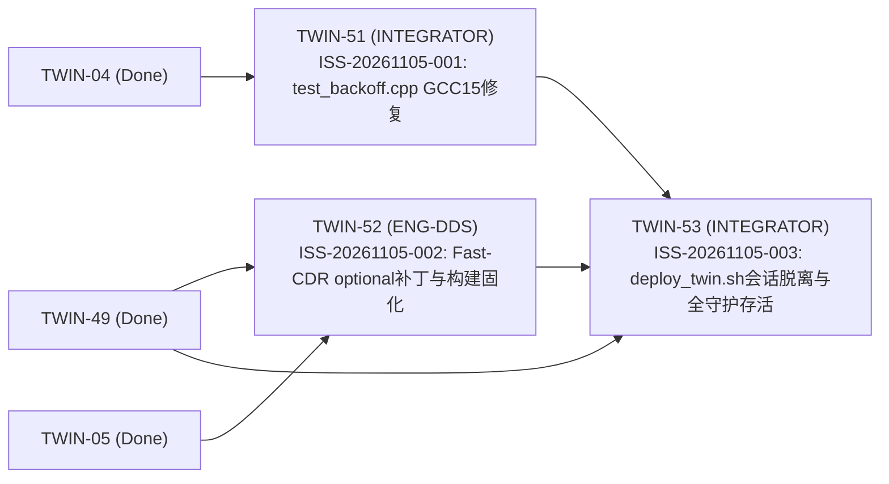

# `soc-ap` 编译阻断、Fast-CDR 崩溃与守护进程存活问题只读根因调查与架构任务拆解 (`2026-11-05`)

## 1. 调查范围、输入绑定与环境事实基线

### 1.1 收件输入与源码基线核验
1. **收件提交单原件**：[`project-control/docs/work_intake/submissions/20261105_soc_ap_build_and_startup_issues.md`](file:///home/sushaohua/workspace/ai_soc_project/project-control/docs/work_intake/submissions/20261105_soc_ap_build_and_startup_issues.md)（`sha256: 5660ee81542768228ed17c2a0755ff066cec28665edcd6a5974048a23e3803ea`）。
2. **三项关联 Issue / Demand**：
   - [`ISS-20261105-001.yaml`](file:///home/sushaohua/workspace/ai_soc_project/project-control/docs/work_intake/issues/ISS-20261105-001.yaml) / `DEM-20261105-001`：`test_backoff.cpp` 在 GCC 15 下触发 `-Werror=maybe-uninitialized` 阻断全栈编译。
   - [`ISS-20261105-002.yaml`](file:///home/sushaohua/workspace/ai_soc_project/project-control/docs/work_intake/issues/ISS-20261105-002.yaml) / `DEM-20261105-002`：Fast-CDR 2.2.5 `optional<T>` 拷贝/移动构造函数未判空导致 Fast-DDS 启动 `SIGSEGV`（exit 139）且修复未固化入版本控制。
   - [`ISS-20261105-003.yaml`](file:///home/sushaohua/workspace/ai_soc_project/project-control/docs/work_intake/issues/ISS-20261105-003.yaml) / `DEM-20261105-003`：`deploy_twin.sh` 启动的 4 个守护进程在脚本退出或调用会话断开时随会话终止。
3. **跨环境只读对比事实**：
   - 当前服务器工作区 `/home/sushaohua/workspace/ai_soc_project/soc-ap` 的 `HEAD` 为 `7c1f35091850b39f4ba3ff9b242043a62f3e5b74`。
   - 提交单中提及的 `/home/sushaohua/tmp/ai_soc_project` 位于用户 VMware Ubuntu 客户机环境（搭载 GCC 15），在当前服务器宿主机上不存在该路径（宿主机编译器为 `gcc/g++ (Ubuntu 9.4.0-1ubuntu1~20.04.2) 9.4.0`）。
   - 本次只读调查严格区分**服务器工作区已追踪代码事实**、**`third_party/archives/` 原始归档包事实**、**`.gitignore` 忽略目录残存状态**与**用户 VMware GCC 15 现场反馈事实**。

---

## 2. 三项 Issue 逐项只读根因调查与最小可靠修复设计

### 2.1 `ISS-20261105-001` / `DEM-20261105-001`：GCC 15 下 `test_backoff.cpp` `-Werror=maybe-uninitialized` 全栈构建阻断

#### 2.1.1 精确代码位置与调用链定位
1. **被测头文件与函数签名**（[`soc-ap/runtime/common/service_lifecycle.h#L118-L149`](file:///home/sushaohua/workspace/ai_soc_project/soc-ap/runtime/common/service_lifecycle.h#L118-L149)）：
   ```cpp
   int32_t backoff_init(backoff_state_t* state, const backoff_config_t* config);
   int32_t backoff_reset(backoff_state_t* state, const backoff_config_t* config);
   int32_t backoff_next_delay(
       backoff_state_t* state,
       const backoff_config_t* config,
       uint32_t* out_delay_ms
   );
   int32_t backoff_is_exhausted(
       const backoff_state_t* state,
       const backoff_config_t* config,
       bool* out_exhausted
   );
   ```
2. **CMake 编译参数与全栈脚本触发链**：
   - [`soc-ap/runtime/build/CMakeLists.txt#L77-L79`](file:///home/sushaohua/workspace/ai_soc_project/soc-ap/runtime/build/CMakeLists.txt#L77-L79) 为 `test_backoff` 显式开启了 `-Wall -Wextra -Werror -Wpedantic -fno-exceptions -fno-rtti`。
   - [`soc-ap/tools/twin_build/build_vmware.sh#L33-L45`](file:///home/sushaohua/workspace/ai_soc_project/soc-ap/tools/twin_build/build_vmware.sh#L33-L45) 使用 `-DCMAKE_BUILD_TYPE=Release`（对应 `-O2`）配置并构建 `soc-ap/runtime/build` 下的全部目标（含 `test_backoff`）。
3. **触发告警的精确源码位置**（[`soc-ap/runtime/build/tests/test_backoff.cpp#L11-L25`](file:///home/sushaohua/workspace/ai_soc_project/soc-ap/runtime/build/tests/test_backoff.cpp#L11-L25)）：
   ```cpp
   static void test_backoff_null_guards(void)
   {
       backoff_state_t st;
       backoff_config_t cfg;
       uint32_t delay = 0U;
       bool exhausted = false;

       assert(backoff_init(NULL, &cfg) == LIFECYCLE_ERR_INVALID_ARGUMENT);
       assert(backoff_init(&st, NULL) == LIFECYCLE_ERR_INVALID_ARGUMENT);
       assert(backoff_reset(NULL, &cfg) == LIFECYCLE_ERR_INVALID_ARGUMENT);
       assert(backoff_next_delay(NULL, &cfg, &delay) == LIFECYCLE_ERR_INVALID_ARGUMENT);
       assert(backoff_next_delay(&st, &cfg, NULL) == LIFECYCLE_ERR_INVALID_ARGUMENT);
       assert(backoff_is_exhausted(NULL, &cfg, &exhausted) == LIFECYCLE_ERR_INVALID_ARGUMENT);
   }
   ```

#### 2.1.2 编译器静态分析根因
1. 在 `test_backoff_null_guards()` 中，局部变量 `backoff_state_t st;`（第 13 行）和 `backoff_config_t cfg;`（第 14 行）均**未初始化**。
2. 尽管 [`soc-ap/runtime/common/service_lifecycle.cpp#L51-L115`](file:///home/sushaohua/workspace/ai_soc_project/soc-ap/runtime/common/service_lifecycle.cpp#L51-L115) 在任一指针为 `NULL` 时会在入口卫语句立即返回 `LIFECYCLE_ERR_INVALID_ARGUMENT` 而不解引用另一非空指针，但 `service_lifecycle.cpp` 位于独立编译单元（`libaisoc_runtime_common.a`）。
3. 从 GCC 11 起（在 GCC 15 `-Wall -Wextra -Werror` 下更为严格），编译器的 `-Wmaybe-uninitialized` 跨函数边界启发式规则规定：**只要将未初始化局部对象的地址传递给 `const T*` 只读指针形参**（如 `const backoff_config_t* config` 和 `const backoff_state_t* state`），编译器即判定被调函数预期读取该对象内容，从而对未初始化的 `cfg` 和 `st` 抛出 `-Werror=maybe-uninitialized`。
4. 此外，在 [`test_backoff.cpp#L29-L36`](file:///home/sushaohua/workspace/ai_soc_project/soc-ap/runtime/build/tests/test_backoff.cpp#L29-L36)（`test_backoff_progression`）和 [`test_backoff.cpp#L74-L81`](file:///home/sushaohua/workspace/ai_soc_project/soc-ap/runtime/build/tests/test_backoff.cpp#L74-L81)（`test_backoff_reset`）中，`backoff_state_t st;` 同样在声明时未零初始化。

#### 2.1.3 最小可靠修复方案
1. 在 [`soc-ap/runtime/build/tests/test_backoff.cpp`](file:///home/sushaohua/workspace/ai_soc_project/soc-ap/runtime/build/tests/test_backoff.cpp) 的 `test_backoff_null_guards()`、`test_backoff_progression()`、`test_backoff_reset()` 中，对栈上结构体 `backoff_state_t st` 与 `backoff_config_t cfg` 进行显式零初始化：
   - `backoff_state_t st = {0U, 0U, 0ULL, false};`
   - `backoff_config_t cfg = {0U, 0U, 0U, 0U, 0U};`
2. **严禁削弱 `-Werror` 或关闭 `-Wmaybe-uninitialized`**；保留全部空指针防御断言语义不变。
3. 在沙箱验证命令中，除默认构建外，显式使用 `g++ -O2 -Wall -Wextra -Werror -Wmaybe-uninitialized` 编译 `test_backoff.cpp` 并注入回归检查（确认源码中不存在未初始化的 `backoff_state_t st;` 或 `backoff_config_t cfg;` 裸声明）。

---

### 2.2 `ISS-20261105-002` / `DEM-20261105-002`：Fast-CDR 2.2.5 `optional<T>` 未判空拷贝/移动构造导致 `forward_service_daemon` / `device_manager_daemon` 启动 `SIGSEGV`（exit 139）

#### 2.2.1 崩溃机制、归档包与忽略目录对比根因
1. **原始归档包缺陷核实**：
   只读解压对比 [`soc-ap/third_party/archives/Fast-CDR-2.2.5.tar.gz`](file:///home/sushaohua/workspace/ai_soc_project/soc-ap/third_party/archives/Fast-CDR-2.2.5.tar.gz) 内的 `Fast-CDR-2.2.5/include/fastcdr/xcdr/optional.hpp`（第 72~86 行）：
   ```cpp
   optional(
           const optional<T>& val)
       : storage_(val.storage_.engaged_)
   {
       ::new(&storage_.val_)T(val.storage_.val_);
   }

   optional(
           optional<T>&& val)
       : storage_(val.storage_.engaged_)
   {
       ::new(&storage_.val_)T(std::move(val.storage_.val_));
   }
   ```
   而在同目录 [`detail/optional.hpp#L24-L47`](file:///home/sushaohua/workspace/ai_soc_project/soc-ap/third_party/src/Fast-CDR-2.2.5/include/fastcdr/xcdr/detail/optional.hpp#L24-L47) 中，`optional_storage<T>` 定义为：
   ```cpp
   union
   {
       char dummy_;
       T val_;
   };
   bool engaged_ = false;
   ```
   当 `optional<T>` 处于空状态（`engaged_ == false`）时，联合体仅通过 `dummy_(0)` 初始化了首字节，`val_` 从未构造，其余字节全部为栈/堆上的未初始化随机垃圾数据。
2. **Fast-DDS 3.6.2 启动 `SIGSEGV`（exit 139）触发链**：
   - `forward_service_daemon`（[`soc-ap/services/forward/forward_service.cpp#L487-L505`](file:///home/sushaohua/workspace/ai_soc_project/soc-ap/services/forward/forward_service.cpp#L487-L505)）与 `device_manager_daemon`（[`soc-ap/services/device_manager/device_manager_service.cpp#L417-L433`](file:///home/sushaohua/workspace/ai_soc_project/soc-ap/services/device_manager/device_manager_service.cpp#L417-L433)）在启动时调用 `aisoc_dds_participant_create()` / `aisoc_dds_publisher_create()`。
   - Fast-DDS 3.6.2 在创建 DomainParticipant 与 DataWriter/DataReader 时，内部构造并拷贝/移动 `PublicationBuiltinTopicData` 与 `SubscriptionBuiltinTopicData`。
   - 这两个内置结构体包含多个默认处于未激活态（`engaged_ == false`）的 `eprosima::fastcdr::optional<std::string>` 及复杂非平凡类型成员。
   - 当 `PublicationBuiltinTopicData` 发生拷贝或移动构造时，未打补丁的 `optional<std::string>` 拷贝/移动构造函数**在未检查 `if (val.storage_.engaged_)` 的情况下**，直接对未初始化的 `val.storage_.val_` 调用 `std::string` 拷贝构造函数，触发 `std::string::_M_construct` 解引用野指针与随机长度，立即抛出 `SIGSEGV`（退出码 `139`）。
3. **为什么干净检出或跨机环境必然复现**：
   - [`soc-ap/.gitignore#L1-L6`](file:///home/sushaohua/workspace/ai_soc_project/soc-ap/.gitignore#L1-L6) 忽略了 `third_party/build/`、`third_party/install/`、`third_party/src/`。
   - 当前服务器工作区中未入库的 `third_party/src/Fast-CDR-2.2.5/include/fastcdr/xcdr/optional.hpp` 与 `third_party/install/include/fastcdr/xcdr/optional.hpp` 曾被手工加上 `if (val.storage_.engaged_)`，但 [`soc-ap/third_party/build.sh`](file:///home/sushaohua/workspace/ai_soc_project/soc-ap/third_party/build.sh) 在从 [`soc-ap/third_party/archives/Fast-CDR-2.2.5.tar.gz`](file:///home/sushaohua/workspace/ai_soc_project/soc-ap/third_party/archives/Fast-CDR-2.2.5.tar.gz) 解压构建时**没有任何补丁步骤**！
   - 更关键的是：`optional.hpp` 是 C++ 模板头文件，**在编译 `Fast-DDS-3.6.2`（生成 `libfastdds.so.3.6.2`）时就已经被内联编译进 `libfastdds.so`**。若仅修改下游或未在编译 `Fast-CDR` 与 `Fast-DDS` 之前对解压源码打补丁，则 `libfastdds.so` 内部的 `PublicationBuiltinTopicData` 仍会执行未判空的机器码并崩溃。

#### 2.2.2 最小可靠且可重现的修复方案
1. **将补丁正式纳入 `soc-ap` Git 版本控制**：
   - 新增受版本控制的补丁文件 `soc-ap/third_party/patches/Fast-CDR-2.2.5-optional-engaged-guard.patch`，精确修复 `Fast-CDR-2.2.5/include/fastcdr/xcdr/optional.hpp` 的拷贝构造函数与移动构造函数：
     ```cpp
     optional(
             const optional<T>& val)
         : storage_(val.storage_.engaged_)
     {
         if (val.storage_.engaged_)
         {
             ::new(&storage_.val_)T(val.storage_.val_);
         }
     }

     optional(
             optional<T>&& val)
         : storage_(val.storage_.engaged_)
     {
         if (val.storage_.engaged_)
         {
             ::new(&storage_.val_)T(std::move(val.storage_.val_));
         }
     }
     ```
2. **在 [`soc-ap/third_party/build.sh`](file:///home/sushaohua/workspace/ai_soc_project/soc-ap/third_party/build.sh) 中固化幂等打补丁与头文件/动态库一致性校验**：
   - 新增辅助函数 `apply_fastcdr_patch()`（$\le 50$ 行，中文注释）：在 `unpack_sources()` 之后、`build_fastcdr()` 与 `build_fastdds()` 之前执行：
     - 检查 `src/Fast-CDR-2.2.5/include/fastcdr/xcdr/optional.hpp` 是否已包含 `if (val.storage_.engaged_)`；若未包含，则应用 `patches/Fast-CDR-2.2.5-optional-engaged-guard.patch`（并在应用后二次校验两处构造函数均已带上 `if (val.storage_.engaged_)` 守卫，否则立即报错退出）。
   - 在 `verify_install()` 中新增补丁落盘校验：不仅检查 `libfastcdr.so` / `libfastdds.so` 存在，还必须校验 `install/include/fastcdr/xcdr/optional.hpp` 中存在 `if (val.storage_.engaged_)` 守卫（共 2 处），且若已安装的 `optional.hpp` 未打补丁，强制重新解压、打补丁并重编 `Fast-CDR` 与 `Fast-DDS`。
3. **新增无路径冲突的独立回归单测（`soc-ap/middleware/dds/tests/`）**：
   - 在 `soc-ap/middleware/dds/tests/CMakeLists.txt` 与 `soc-ap/middleware/dds/tests/test_fastcdr_optional.cpp` 中新增独立 CTest 套件：
     1. 栈/堆脏内存（`0xA5` 填充）下对未激活（`engaged == false`）的 `eprosima::fastcdr::optional<std::string>` 执行拷贝构造与移动构造，断言 `has_value() == false` 且零崩溃；
     2. 对已激活（`engaged == true`）的 `eprosima::fastcdr::optional<std::string>` 执行拷贝构造与移动构造，断言字符串内容完整一致；
     3. 真实调用 `aisoc_dds_participant_create()`、`aisoc_dds_publisher_create()`、`aisoc_dds_subscriber_create()` 完整覆盖 Fast-DDS `PublicationBuiltinTopicData` 发现路径，断言进程无 `SIGSEGV`。

---

### 2.3 `ISS-20261105-003` / `DEM-20261105-003`：`deploy_twin.sh` 退出或调用会话结束时后台守护进程随之终止（及假阳性就绪掩盖崩溃）

#### 2.3.1 精确代码位置与双重根因定位
只读核查 [`soc-ap/tools/deploy_twin.sh#L505-L615`](file:///home/sushaohua/workspace/ai_soc_project/soc-ap/tools/deploy_twin.sh#L505-L615)，定位到两处相互叠加的致命缺陷：

1. **缺陷 A：4 个守护进程未脱离调用方会话/进程组/控制终端，且 `dbus-daemon` 完全未屏蔽 `SIGHUP`**：
   - 在 [`soc-ap/tools/deploy_twin.sh#L527-L528`](file:///home/sushaohua/workspace/ai_soc_project/soc-ap/tools/deploy_twin.sh#L527-L528) 中：
     ```bash
     "${DBUS_BIN}" --config-file "${DBUS_CONF}" --print-address=1 --nofork \
         > "${AISOC_LOG_DIR}/dbus.addr" 2> "${AISOC_LOG_DIR}/dbus.log" &
     ```
     `dbus-daemon` 使用了 `--nofork`，但**既没有 `nohup`、也没有 `setsid`、没有 `< /dev/null` 重定向标准输入、也没有 `disown`**。
     当执行 `deploy_twin.sh` 的非交互式子 Shell、SSH 远程命令会话或控制终端结束并向会话/进程组广播 `SIGHUP`（或关闭 stdin 管道）时，`dbus-daemon` 立即被终止；由于 `forward_service_daemon`、`device_manager_daemon`、`ui-gateway` 均依赖该私有 D-Bus 总线，总线断开也会引发连锁异常或退出。
   - 在 [`soc-ap/tools/deploy_twin.sh#L547-L592`](file:///home/sushaohua/workspace/ai_soc_project/soc-ap/tools/deploy_twin.sh#L547-L592) 中：
     `forward_service_daemon`、`device_manager_daemon`、`ui-gateway` 虽然使用了 `nohup ... > ...log 2>&1 &`，但：
     - **未将标准输入重定向到 `/dev/null`（缺少 `< /dev/null`）**：在 SSH 或管道子 Shell 下，后台子进程继续持有调用方 stdin 文件描述符；
     - **未使用 `setsid` 脱离调用方会话（SID）与进程组（PGID），也未调用 `disown` 从当前 Shell 作业表移除**：当调用方或非交互式包装器按进程组清理（`kill -TERM -$PGID` 或会话 Leader 退出清理）时，同一进程组内的守护进程会收到信号并退出。

2. **缺陷 B：`deploy_twin.sh` 就绪探针存在静态文件假阳性，未校验 4 个守护进程真实存活**：
   - 在 [`soc-ap/tools/deploy_twin.sh#L510-L512`](file:///home/sushaohua/workspace/ai_soc_project/soc-ap/tools/deploy_twin.sh#L510-L512) 中，脚本在启动任何守护进程前预先在静态 Web 根目录写入了静态文件 `${RUNTIME_WEB_ROOT}/api/v1/state`：
     ```bash
     mkdir -p "${RUNTIME_WEB_ROOT}/api/v1/temperature"
     echo '{"status":"OK","service":"ui-gateway","mode":"'${DEPLOY_MODE}'"}' > "${RUNTIME_WEB_ROOT}/api/v1/state"
     ```
   - 随后在 [`soc-ap/tools/deploy_twin.sh#L596-L614`](file:///home/sushaohua/workspace/ai_soc_project/soc-ap/tools/deploy_twin.sh#L596-L614) 的就绪轮询中，脚本**仅检查 `curl http://127.0.0.1:${HTTP_PORT}/api/v1/state` 是否返回 `200`**，完全没有检查 `dbus.pid`、`forward.pid`、`device_manager.pid`、`ui_gateway.pid` 对应的 4 个进程是否仍然存活！
   - 这导致即便 `forward_service_daemon` 和 `device_manager_daemon` 在启动 50ms 内因 `ISS-20261105-002`（SIGSEGV 139）或串口错误崩溃退出，只要 `ui-gateway` 仍在运行，脚本就会立即宣布 `AI-SoC VMware Twin Full Stack Deployed Successfully!`，随后用户执行 `--status` 时才发现后台守护进程早已死光。

#### 2.3.2 最小可靠修复方案
1. **统一会话隔离守护进程启动器 `launch_detached_daemon()`**：
   - 在 [`soc-ap/tools/deploy_twin.sh`](file:///home/sushaohua/workspace/ai_soc_project/soc-ap/tools/deploy_twin.sh) 中封装函数 `launch_detached_daemon()`（$\le 50$ 行，入参 $\le 4$ 个：`$1=pid_file`、`$2=stdout_file`、`$3=stderr_file`、`shift 3` 后 `$@` 为命令及参数，中文注释）：
     - 若系统存在 `setsid`，使用 `setsid nohup "$@" < /dev/null > "${stdout_file}" 2> "${stderr_file}" &` 启动，确保子进程拥有独立 SID 与 PGID、忽略 `SIGHUP`、且 `fd 0/1/2` 完全脱离调用终端/管道；若无 `setsid`，回退为 `nohup "$@" < /dev/null > "${stdout_file}" 2> "${stderr_file}" &`。
     - 立即捕获 `$!` 写入 `${pid_file}`，并执行 `disown "${daemon_pid}" 2>/dev/null || true` 将其移出 Shell 作业表。
   - `dbus-daemon`、`forward_service_daemon`、`device_manager_daemon`、`ui-gateway` 全部统一通过 `launch_detached_daemon()` 启动。
2. **在 `ensure_third_party_built()` 中联动校验 Fast-CDR 补丁头文件**：
   - 在 [`soc-ap/tools/deploy_twin.sh#L183-L202`](file:///home/sushaohua/workspace/ai_soc_project/soc-ap/tools/deploy_twin.sh#L183-L202) 的 `ensure_third_party_built()` 中，增加检查 `grep -q "if (val.storage_.engaged_)" "${THIRD_PARTY_INSTALL}/include/fastcdr/xcdr/optional.hpp" 2>/dev/null`；若未打补丁则自动调用 `bash "${REPO_ROOT}/third_party/build.sh"` 重建第三方库。
3. **加固就绪探针 `verify_all_daemons_alive()`，杜绝假阳性成功**：
   - 在 [`soc-ap/tools/deploy_twin.sh#L596-L614`](file:///home/sushaohua/workspace/ai_soc_project/soc-ap/tools/deploy_twin.sh#L596-L614) 的 HTTP 就绪轮询期间与 HTTP 200 达成后（含短暂稳定窗口 `200ms` 后二次复核），调用 `run_status >/dev/null 2>&1` 校验 `dbus-daemon`、`forward_service_daemon`、`device_manager_daemon`、`ui-gateway` 全部 4 个 PID 必须真实存活；若任一守护进程退出，立即打印该进程的崩溃日志尾部、调用 `run_stop` 清理现场并以非 0 状态码失败退出。
4. **新增自动化会话退出与 `SIGHUP` 存活验证脚本 `soc-ap/tools/twin_build/test_deploy_daemon_survival.sh`**：
   - 在独立子 Shell / 会话中调用 `deploy_twin.sh` 完成部署，向启动子 Shell 所属进程组发送 `SIGHUP` 并令启动子 Shell 退出；
   - 等待 `1s` 后校验：
     - `deploy_twin.sh --status` 返回 `0`，4 个守护进程 PID 全部存活（`kill -0` 通过且非僵尸态 `Z`）；
     - 4 个守护进程的 `/proc/<pid>/fd/0` 均指向 `/dev/null`；
     - `curl http://127.0.0.1:<port>/api/v1/state` 与 `/api/v1/temperature/snapshot` 正常响应 HTTP 200；
     - `deploy_twin.sh --stop` 能干净停止全部 4 个守护进程。

---

## 3. 架构微任务拆解（`TWIN-51`、`TWIN-52`、`TWIN-53`）与依赖/路径无冲突证明

### 3.1 路径无冲突与前置依赖合规性核验
经对 [`project-control/.agents/kanban/microtasks/`](file:///home/sushaohua/workspace/ai_soc_project/project-control/.agents/kanban/microtasks) 下全部微任务执行 `check_task_graph.py` 静态拓扑扫描，确认：
1. **零未完成任务路径重叠**：
   - 当前工作区中处于 `Review` 的 `TWIN-40` 声明了 `allowed_paths: ['soc-ap/tests/**', ...]`。
   - 为严格遵守“`allowed_paths` 不得与任何未 `Done` 任务重叠且 `depends_on` 不得依赖未 `Done` 任务”的铁律，本方案将新增的 Fast-CDR `optional<T>` 单测放置在 `ENG-DDS` 所属的 `soc-ap/middleware/dds/tests/` 下（仅与已 `Done` 的 `TWIN-05` 有序衔接），将守护进程会话存活测试放置在 `INTEGRATOR` 所属的 `soc-ap/tools/twin_build/` 下（仅与已 `Done` 的 `TWIN-04` 有序衔接）。
   - 三张新任务卡 `TWIN-51`、`TWIN-52`、`TWIN-53` 的 `allowed_paths` 与所有 `Backlog` / `Review` 任务（`CR-07`、`TWIN-13`、`14`、`27`、`28`、`31`~`40`、`46`）**交集为空（0 重叠）**。
2. **前置依赖 `Done` 状态核验与 COORD 看板元数据规范化提醒**：
   - `TWIN-51` 仅依赖 `TWIN-04`（`status: Done`，`check_task_graph.py --check-done TWIN-04` 为 0 错误）。
   - `TWIN-52` 依赖 `TWIN-05` 与 `TWIN-49`（两者均为 `status: Done`；`TWIN-49` 已传递包含 `TWIN-04` 祖先）。
   - `TWIN-53` 依赖 `TWIN-49`、`TWIN-51`、`TWIN-52`（`TWIN-49` 已传递包含 `TWIN-04` 与 `TWIN-43` 祖先）。
   - **COORD 落卡前置提醒**：只读检查发现已 `Done` 的 [`TWIN-49.md#L37-L42`](file:///home/sushaohua/workspace/ai_soc_project/project-control/.agents/kanban/microtasks/vmware_soc_twin/TWIN-49.md#L37-L42) 与 `TWIN-50.md#L37-L42` 中 `review_assignments.reviewer_sessions[0].report_path` 写成了相对路径 `docs/evidence/twin/TWIN-49/runs/qa_04/qa_review_report.md`（而 `TWIN-43.md` / `TWIN-47.md` / `TWIN-48.md` 均为 `/home/sushaohua/workspace/ai_soc_project/project-control/docs/evidence/...` 绝对路径），导致 `delivery_checks.py:validate_streamlined_entry()` 的 `if Path(name).is_absolute():` 分支未命中。请 COORD 在落卡 `TWIN-52` / `TWIN-53` 时，同步将 `TWIN-49.md#L37,L42`（及 `TWIN-50.md#L37,L42`）的 `session_evidence.path` 与 `report_path` 规范化为 `/home/sushaohua/workspace/ai_soc_project/project-control/docs/evidence/...` 绝对路径（已在内存中实测规范化后 `closure_errors(TWIN-49) == []`）。



---

### 3.2 微任务一：`TWIN-51`（对应 `ISS-20261105-001` / `DEM-20261105-001`）

#### 3.2.1 任务卡元数据定义
- **`id`**: `TWIN-51`
- **`title`**: `TWIN-51 修复test_backoff.cpp在GCC15下的-Werror=maybe-uninitialized编译阻断`
- **`owner` / `proposed_owner` / `executor.role`**: `INTEGRATOR`
- **`primary_work_package`**: `TASK-004`（需将 `TWIN-51` 登记入 `project-control/docs/planning/work_packages/TASK-004.md` 的 `child_tasks`）
- **`related_work_packages`**: `['TASK-010']`
- **`qa_policy`**: `streamlined-v1`
- **`reviewer`**: `['QA']`
- **`issue_id`**: `ISS-20261105-001`
- **`demand_id`**: `DEM-20261105-001`
- **`depends_on`**:
  - `TWIN-04`
- **`dependency_conditions`**:
  ```yaml
  - task: TWIN-04
    accepted_version: soc-ap=8f05b7396bb11fb011b0279c6a38f26a194507be; project-control=6b3556fb52002833ce57bc28ca236630bd8e907be
    acceptance_evidence: docs/evidence/twin/TWIN-04/runs/run_01/qa_review_report.md
    required: 继承TWIN-04 runtime/build与test_backoff单测构建基线
  ```
- **`allowed_repositories`**: `['soc-ap', 'project-control']`
- **`write_scope`**:
  ```yaml
  soc-ap:
    - runtime/build/tests/test_backoff.cpp
  project-control:
    - docs/evidence/twin/TWIN-51/**
  ```
- **`allowed_paths`**:
  ```yaml
  - soc-ap/runtime/build/tests/test_backoff.cpp
  - project-control/docs/evidence/twin/TWIN-51/**
  ```
- **`forbidden_paths`**:
  ```yaml
  - mcu-p3/**
  - test_harness/**
  - boot/**
  - soc-ap/services/**
  - soc-ap/middleware/**
  - soc-ap/tools/**
  ```
- **`deliverables`**:
  ```yaml
  artifacts:
    - soc-ap/runtime/build/tests/test_backoff.cpp
  record: docs/evidence/twin/TWIN-51/runs/author_01/result.md
  ```

#### 3.2.2 精确修改规范
1. 修改 [`soc-ap/runtime/build/tests/test_backoff.cpp`](file:///home/sushaohua/workspace/ai_soc_project/soc-ap/runtime/build/tests/test_backoff.cpp)：
   - 在 `test_backoff_null_guards(void)`（第 11~25 行）中，将未初始化的 `backoff_state_t st;` 与 `backoff_config_t cfg;` 改为显式零初始化，并补充中文说明注释：
     ```cpp
     /* 显式零初始化栈上结构体，消除GCC 15下const指针形参触发的-Werror=maybe-uninitialized */
     backoff_state_t st = {0U, 0U, 0ULL, false};
     backoff_config_t cfg = {0U, 0U, 0U, 0U, 0U};
     ```
   - 在 `test_backoff_progression(void)`（第 29 行）和 `test_backoff_reset(void)`（第 74 行）中，同步将 `backoff_state_t st;` 初始化为 `backoff_state_t st = {0U, 0U, 0ULL, false};`。
   - 保持所有函数 $\le 50$ 行、入参 $\le 4$ 个，不删减任何 `assert(...)` 用例，不改动 `CMakeLists.txt` 的 `-Werror` 门禁。

#### 3.2.3 验收命令契约（`verification`）
```yaml
verification:
  commands:
    - id: build_and_test_backoff_werror_uninitialized
      cwd: soc-ap
      command: 'rm -rf /tmp/qa_twin51 && mkdir -p /tmp/qa_twin51 && (! grep -En "backoff_(state|config)_t[[:space:]]+(st|cfg)[[:space:]]*;" runtime/build/tests/test_backoff.cpp) && g++ -std=c++17 -O2 -Wall -Wextra -Werror -Wpedantic -Wmaybe-uninitialized -fno-exceptions -fno-rtti -Iruntime/common runtime/build/tests/test_backoff.cpp runtime/common/service_lifecycle.cpp -o /tmp/qa_twin51/test_backoff_strict && /tmp/qa_twin51/test_backoff_strict && cmake -S runtime/build -B /tmp/qa_twin51/build -DCMAKE_BUILD_TYPE=Release -DCMAKE_CXX_FLAGS_RELEASE="-O2" && cmake --build /tmp/qa_twin51/build --parallel && ctest --test-dir /tmp/qa_twin51/build --output-on-failure && rm -rf /tmp/qa_twin51'
      expected: 源码静态扫描确认无未初始化的backoff_state_t/backoff_config_t局部变量，g++ -O2 -Wall -Wextra -Werror -Wmaybe-uninitialized严格编译零告警通过，且runtime/build全套Release CTest（test_service_lifecycle、test_backoff、test_supervisor_topology）100% PASS
      availability: available
  positive_cases:
    - test_backoff.cpp中所有栈上backoff_state_t与backoff_config_t结构体均显式零初始化，在-O2 -Wall -Wextra -Werror -Wmaybe-uninitialized下零告警编译通过
    - test_backoff_null_guards、test_backoff_progression、test_backoff_reset全部断言100%通过
  negative_cases:
    - 严禁通过移除-Werror或添加-Wno-maybe-uninitialized掩盖未初始化告警；静态检查发现未初始化st/cfg裸声明时立即失败
```

---

### 3.3 微任务二：`TWIN-52`（对应 `ISS-20261105-002` / `DEM-20261105-002`）

#### 3.3.1 任务卡元数据定义
- **`id`**: `TWIN-52`
- **`title`**: `TWIN-52 Fast-CDR 2.2.5 optional未初始化拷贝崩溃补丁固化与third_party可重现构建`
- **`owner` / `proposed_owner` / `executor.role`**: `ENG-DDS`
- **`primary_work_package`**: `TASK-005`（需将 `TWIN-52` 登记入 `project-control/docs/planning/work_packages/TASK-005.md` 的 `child_tasks`）
- **`related_work_packages`**: `['TASK-004', 'TASK-007', 'TASK-010']`
- **`qa_policy`**: `streamlined-v1`
- **`reviewer`**: `['QA']`
- **`issue_id`**: `ISS-20261105-002`
- **`demand_id`**: `DEM-20261105-002`
- **`depends_on`**:
  - `TWIN-05`
  - `TWIN-49`
- **`dependency_conditions`**:
  ```yaml
  - task: TWIN-05
    accepted_version: soc-ap=81362a6489704926c89d9b4f93e7a480d610474e; project-control=0c49669a2a89668ef2273197f43a5a852d63be91
    acceptance_evidence: docs/evidence/twin/TWIN-05/runs/run_01/qa_review_report.md
    required: 继承TWIN-05 Fast-DDS中间件封装与Fast-CDR归档基线
  - task: TWIN-49
    accepted_version: project-control=17e0887da07ceb3b017623b791b6a6999e837c79; soc-ap=333178c66280e785ae1a5c089a6e2a05075cc926; mcu-p3=016e1236af75f6f19282d6b000f4b1b68bd96cc3; test_harness=30c21f74e74179994eb475c38cc4afc2c1427a26
    acceptance_evidence: docs/evidence/twin/TWIN-49/runs/qa_04/qa_review_report.md
    required: 继承TWIN-49 third_party/build.sh构建入口基线
  ```
- **`allowed_repositories`**: `['soc-ap', 'project-control']`
- **`write_scope`**:
  ```yaml
  soc-ap:
    - third_party/patches/Fast-CDR-2.2.5-optional-engaged-guard.patch
    - third_party/build.sh
    - middleware/dds/tests/CMakeLists.txt
    - middleware/dds/tests/test_fastcdr_optional.cpp
  project-control:
    - docs/evidence/twin/TWIN-52/**
  ```
- **`allowed_paths`**:
  ```yaml
  - soc-ap/third_party/patches/Fast-CDR-2.2.5-optional-engaged-guard.patch
  - soc-ap/third_party/build.sh
  - soc-ap/middleware/dds/tests/CMakeLists.txt
  - soc-ap/middleware/dds/tests/test_fastcdr_optional.cpp
  - project-control/docs/evidence/twin/TWIN-52/**
  ```
- **`forbidden_paths`**:
  ```yaml
  - mcu-p3/**
  - test_harness/**
  - boot/**
  - soc-ap/tests/**
  - soc-ap/services/**
  - soc-ap/tools/**
  ```
- **`deliverables`**:
  ```yaml
  artifacts:
    - soc-ap/third_party/patches/Fast-CDR-2.2.5-optional-engaged-guard.patch
    - soc-ap/third_party/build.sh
    - soc-ap/middleware/dds/tests/CMakeLists.txt
    - soc-ap/middleware/dds/tests/test_fastcdr_optional.cpp
  record: docs/evidence/twin/TWIN-52/runs/author_01/result.md
  ```

#### 3.3.2 精确修改规范
1. **新增受 Git 追踪的补丁文件 `soc-ap/third_party/patches/Fast-CDR-2.2.5-optional-engaged-guard.patch`**：
   - 针对 `Fast-CDR-2.2.5/include/fastcdr/xcdr/optional.hpp` 第 72~91 行的拷贝构造函数 `optional(const optional<T>& val)` 与移动构造函数 `optional(optional<T>&& val)` 增加 `if (val.storage_.engaged_)` 判空守卫。
2. **修改 [`soc-ap/third_party/build.sh`](file:///home/sushaohua/workspace/ai_soc_project/soc-ap/third_party/build.sh)**（全部新增说明注释使用中文，单个函数 $\le 50$ 行）：
   - 新增 `verify_fastcdr_optional_patched()`：接收目标 `optional.hpp` 路径，校验其中 `if (val.storage_.engaged_)` 出现次数 $\ge 2$。
   - 新增 `apply_fastcdr_patches()`：在 `unpack_sources()` 之后、`build_fastcdr()` 与 `build_fastdds()` 之前调用；若 `src/Fast-CDR-2.2.5/include/fastcdr/xcdr/optional.hpp` 尚未打补丁，则应用 `patches/Fast-CDR-2.2.5-optional-engaged-guard.patch`（支持 `patch -p1` 或确定性 Python 替换兜底），随后调用 `verify_fastcdr_optional_patched` 验证补丁已生效。
   - 更新 `verify_install()`：除校验动态库与 `dbus-daemon` 外，调用 `verify_fastcdr_optional_patched "${INSTALL_DIR}/include/fastcdr/xcdr/optional.hpp"`；若已安装头文件未包含该补丁守卫，返回非 0 触发重新解压、打补丁并重编 `Fast-CDR` 与 `Fast-DDS`。
3. **新增回归测试 `soc-ap/middleware/dds/tests/CMakeLists.txt` 与 `soc-ap/middleware/dds/tests/test_fastcdr_optional.cpp`**（每个函数 $\le 50$ 行、入参 $\le 4$ 个，中文注释）：
   - `test_unengaged_optional_on_dirty_memory()`：在填充 `0xA5` 的对齐缓冲区上 placement-new 构造默认未激活的 `eprosima::fastcdr::optional<std::string>`，对其执行拷贝构造与移动构造，验证 `has_value() == false` 且不触发 `std::string::_M_construct` 崩溃；
   - `test_engaged_optional_copy_and_move()`：对包含长字符串（`> 32` 字节，突破 SSO 小字符串优化强制走堆分配）的已激活 `optional<std::string>` 执行拷贝构造与移动构造，验证值语义完整；
   - `test_dds_builtin_topic_participant_and_pub_startup()`：调用 `aisoc_dds_participant_create()`、`aisoc_dds_publisher_create()`、`aisoc_dds_subscriber_create()` 并完成一次样本收发，验证 Fast-DDS `PublicationBuiltinTopicData` 完整初始化路径零崩溃。

#### 3.3.3 验收命令契约（`verification`）
```yaml
verification:
  commands:
    - id: build_and_test_fastcdr_optional_patch_and_dds_startup
      cwd: soc-ap
      command: 'rm -rf /tmp/qa_twin52 && mkdir -p /tmp/qa_twin52/raw && tar -xzf third_party/archives/Fast-CDR-2.2.5.tar.gz -C /tmp/qa_twin52/raw && test "$(grep -c "if (val.storage_.engaged_)" /tmp/qa_twin52/raw/Fast-CDR-2.2.5/include/fastcdr/xcdr/optional.hpp || true)" -eq 0 && cp -r ../soc-ap /tmp/qa_twin52/soc-ap && ([ -e /tmp/qa_twin52/soc-ap/third_party/install ] || (mkdir -p /tmp/qa_twin52/soc-ap/third_party && cp -a /usr/local /tmp/qa_twin52/soc-ap/third_party/install)) && cp /tmp/qa_twin52/raw/Fast-CDR-2.2.5/include/fastcdr/xcdr/optional.hpp /tmp/qa_twin52/soc-ap/third_party/install/include/fastcdr/xcdr/optional.hpp && rm -rf /tmp/qa_twin52/soc-ap/third_party/src/Fast-CDR-2.2.5 && (! bash /tmp/qa_twin52/soc-ap/third_party/build.sh --verify) && mkdir -p /tmp/qa_twin52/soc-ap/third_party/src/foonathan_memory-0.7-3 /tmp/qa_twin52/soc-ap/third_party/src/Fast-DDS-3.6.2/thirdparty/asio/asio/include /tmp/qa_twin52/soc-ap/third_party/src/Fast-DDS-3.6.2/thirdparty/tinyxml2 /tmp/qa_twin52/soc-ap/third_party/src/dbus-1.16.2 && touch /tmp/qa_twin52/soc-ap/third_party/src/Fast-DDS-3.6.2/thirdparty/asio/asio/include/asio.hpp /tmp/qa_twin52/soc-ap/third_party/src/Fast-DDS-3.6.2/thirdparty/tinyxml2/tinyxml2.cpp && bash /tmp/qa_twin52/soc-ap/third_party/build.sh fastcdr && bash /tmp/qa_twin52/soc-ap/third_party/build.sh --verify && bash /tmp/qa_twin52/soc-ap/third_party/build.sh && test "$(grep -c "if (val.storage_.engaged_)" /tmp/qa_twin52/soc-ap/third_party/install/include/fastcdr/xcdr/optional.hpp)" -eq 2 && cmake -S /tmp/qa_twin52/soc-ap/middleware/dds/tests -B /tmp/qa_twin52/build_opt_test && cmake --build /tmp/qa_twin52/build_opt_test --parallel && LD_LIBRARY_PATH="/tmp/qa_twin52/soc-ap/third_party/install/lib:${LD_LIBRARY_PATH:-}" ctest --test-dir /tmp/qa_twin52/build_opt_test --output-on-failure && cmake -S /tmp/qa_twin52/soc-ap/tests/dds/twin -B /tmp/qa_twin52/build_dds_twin && cmake --build /tmp/qa_twin52/build_dds_twin --parallel && LD_LIBRARY_PATH="/tmp/qa_twin52/soc-ap/third_party/install/lib:${LD_LIBRARY_PATH:-}" ctest --test-dir /tmp/qa_twin52/build_dds_twin --output-on-failure && rm -rf /tmp/qa_twin52'
      expected: 先注入未打补丁的原始optional.hpp触发third_party/build.sh --verify负向拒绝放行（[FAIL] missing engaged guard并返回非0），随后执行build.sh fastcdr自动从Fast-CDR-2.2.5.tar.gz干净解压、应用Fast-CDR-2.2.5-optional-engaged-guard.patch、重编并安装两处engaged守卫，再次执行build.sh --verify与build.sh校验100%通过；test_fastcdr_optional与test_dds_pubsub全套CTest 100% PASS且零SIGSEGV
      availability: available
  positive_cases:
    - Fast-CDR-2.2.5.tar.gz干净解压后通过third_party/patches/Fast-CDR-2.2.5-optional-engaged-guard.patch幂等打上两处if (val.storage_.engaged_)守卫
    - 脏内存上未激活的eprosima::fastcdr::optional<std::string>拷贝/移动构造与Fast-DDS participant/publisher创建100%通过且无SIGSEGV
  negative_cases:
    - 当install/include/fastcdr/xcdr/optional.hpp缺失if (val.storage_.engaged_)守卫时，verify_install拒绝放行并触发重新打补丁构建
```

---

### 3.4 微任务三：`TWIN-53`（对应 `ISS-20261105-003` / `DEM-20261105-003`）

#### 3.4.1 任务卡元数据定义
- **`id`**: `TWIN-53`
- **`title`**: `TWIN-53 加固deploy_twin.sh后台守护进程会话隔离、SIGHUP免疫与四进程存活探针`
- **`owner` / `proposed_owner` / `executor.role`**: `INTEGRATOR`
- **`primary_work_package`**: `TASK-010`（需将 `TWIN-53` 登记入 `project-control/docs/planning/work_packages/TASK-010.md` 的 `child_tasks`）
- **`related_work_packages`**: `['TASK-004', 'TASK-007']`
- **`qa_policy`**: `streamlined-v1`
- **`reviewer`**: `['QA']`
- **`issue_id`**: `ISS-20261105-003`
- **`demand_id`**: `DEM-20261105-003`
- **`depends_on`**:
  - `TWIN-49`
  - `TWIN-51`
  - `TWIN-52`
- **`dependency_conditions`**:
  ```yaml
  - task: TWIN-49
    accepted_version: project-control=17e0887da07ceb3b017623b791b6a6999e837c79; soc-ap=333178c66280e785ae1a5c089a6e2a05075cc926; mcu-p3=016e1236af75f6f19282d6b000f4b1b68bd96cc3; test_harness=30c21f74e74179994eb475c38cc4afc2c1427a26
    acceptance_evidence: docs/evidence/twin/TWIN-49/runs/qa_04/qa_review_report.md
    required: 继承TWIN-49 deploy_twin.sh一键编译与清场基线
  - task: TWIN-51
    accepted_version: <待TWIN-51 Done后绑定实际commit>
    acceptance_evidence: docs/evidence/twin/TWIN-51/runs/qa_01/qa_review_report.md
    required: 继承TWIN-51 test_backoff.cpp GCC 15编译修复
  - task: TWIN-52
    accepted_version: <待TWIN-52 Done后绑定实际commit>
    acceptance_evidence: docs/evidence/twin/TWIN-52/runs/qa_01/qa_review_report.md
    required: 继承TWIN-52 Fast-CDR optional补丁与DDS守护进程防SIGSEGV修复
  ```
- **`allowed_repositories`**: `['soc-ap', 'project-control']`
- **`write_scope`**:
  ```yaml
  soc-ap:
    - tools/deploy_twin.sh
    - tools/twin_build/test_deploy_daemon_survival.sh
  project-control:
    - docs/evidence/twin/TWIN-53/**
  ```
- **`allowed_paths`**:
  ```yaml
  - soc-ap/tools/deploy_twin.sh
  - soc-ap/tools/twin_build/test_deploy_daemon_survival.sh
  - project-control/docs/evidence/twin/TWIN-53/**
  ```
- **`forbidden_paths`**:
  ```yaml
  - mcu-p3/**
  - test_harness/**
  - boot/**
  - soc-ap/tests/**
  - soc-ap/services/**
  - soc-ap/middleware/**
  ```
- **`deliverables`**:
  ```yaml
  artifacts:
    - soc-ap/tools/deploy_twin.sh
    - soc-ap/tools/twin_build/test_deploy_daemon_survival.sh
  record: docs/evidence/twin/TWIN-53/runs/author_01/result.md
  ```

#### 3.4.2 精确修改规范
1. **修改 [`soc-ap/tools/deploy_twin.sh`](file:///home/sushaohua/workspace/ai_soc_project/soc-ap/tools/deploy_twin.sh)**（全部新增说明注释使用中文，单个函数 $\le 50$ 行）：
   - **在 `ensure_third_party_built()` 中增加 Fast-CDR 补丁头文件检查**：
     - 除检查 `libdbus-1.so`、`libfastcdr.so`、`libfastdds.so`、`dbus-daemon` 外，检查 `grep -q "if (val.storage_.engaged_)" "${THIRD_PARTY_INSTALL}/include/fastcdr/xcdr/optional.hpp" 2>/dev/null`；若不满足则执行 `bash "${REPO_ROOT}/third_party/build.sh"`。
   - **新增独立会话后台启动函数 `launch_detached_daemon()`**：
     ```bash
     # 以独立会话(setsid)+忽略SIGHUP(nohup)+闭合标准输入(</dev/null)启动后台守护进程并移出作业表
     launch_detached_daemon() {
         local pid_file="$1"
         local stdout_file="$2"
         local stderr_file="$3"
         shift 3
         local daemon_pid=""
         if command -v setsid >/dev/null 2>&1; then
             setsid nohup "$@" < /dev/null > "${stdout_file}" 2> "${stderr_file}" &
             daemon_pid=$!
         else
             nohup "$@" < /dev/null > "${stdout_file}" 2> "${stderr_file}" &
             daemon_pid=$!
         fi
         echo "${daemon_pid}" > "${pid_file}"
         disown "${daemon_pid}" 2>/dev/null || true
     }
     ```
   - **统一替换 4 个守护进程启动点**：
     - `dbus-daemon`（原第 527~530 行）：使用 `launch_detached_daemon "${AISOC_LOG_DIR}/dbus.pid" "${AISOC_LOG_DIR}/dbus.addr" "${AISOC_LOG_DIR}/dbus.log" "${DBUS_BIN}" --config-file "${DBUS_CONF}" --print-address=1 --nofork` 启动。
     - `forward_service_daemon`（原第 547~554 行）、`device_manager_daemon`（原第 569~570 行）、`ui-gateway`（原第 590~591 行）：全部改用 `launch_detached_daemon` 启动。
   - **加固就绪探针，强制校验全部 4 个守护进程存活**：
     - 新增 `check_all_daemons_alive()`（校验 `dbus.pid`、`forward.pid`、`device_manager.pid`、`ui_gateway.pid` 均存在且 `is_pid_running` 为真）。
     - 在第 598~614 行的就绪轮询中：每次轮询若发现任一已启动的守护进程提前退出（`! check_all_daemons_alive`），立即中断等待并失败清理；当 `curl .../api/v1/state` 返回 HTTP `200` 后，`sleep 0.2` 并再次执行 `check_all_daemons_alive`，只有 HTTP 200 且 4 个守护进程全部存活才置 `READY=1`。
2. **新增自动化回归测试脚本 `soc-ap/tools/twin_build/test_deploy_daemon_survival.sh`**：
   - 在子进程会话中运行 `bash tools/deploy_twin.sh --mode sim --port <test_port> --uart <dummy_uart>`，并在部署脚本退出后向该调用子进程组发送 `SIGHUP`；
   - 休眠 `1s` 后断言：
     1. `bash tools/deploy_twin.sh --status --port <test_port>` 返回 `0`；
     2. `dbus.pid`、`forward.pid`、`device_manager.pid`、`ui_gateway.pid` 中的 4 个 PID 全部存活，且 `/proc/<pid>/fd/0` 均指向 `/dev/null`；
     3. HTTP `/api/v1/state` 与 `/api/v1/temperature/snapshot` 返回 `200`；
     4. 反向测试：人为 `kill -9` 掉 `forward_service_daemon` 后，`deploy_twin.sh --status` 必须返回非 0；
     5. 执行 `bash tools/deploy_twin.sh --stop --port <test_port>` 后 4 个进程全部干净退出。

#### 3.4.3 验收命令契约（`verification`）
```yaml
verification:
  commands:
    - id: test_deploy_twin_session_disconnect_and_four_daemon_survival
      cwd: soc-ap
      command: 'rm -rf /tmp/qa_twin53 && mkdir -p /tmp/qa_twin53/bin && python3 -c "import pathlib; p=pathlib.Path(\"/tmp/qa_twin53/bin/curl\"); p.write_text(\"#!/usr/bin/env python3\nimport sys,urllib.request,urllib.error\nu=[a for a in sys.argv[1:] if a.startswith(\x27http\x27)][-1]\nw=\x27-w\x27 in sys.argv\ntry:\n r=urllib.request.urlopen(u,timeout=2);b=r.read();sys.stdout.write(str(r.status)) if w else sys.stdout.buffer.write(b)\nexcept urllib.error.HTTPError as e:\n sys.stdout.write(str(e.code)) if w else None;sys.exit(0 if w else 22)\nexcept Exception:\n sys.stdout.write(\x27000\x27) if w else None;sys.exit(7)\n\"); p.chmod(0o755)" && export PATH="/tmp/qa_twin53/bin:$PATH" && cp -r ../soc-ap /tmp/qa_twin53/soc-ap && ([ -e /tmp/qa_twin53/soc-ap/third_party/install ] || (mkdir -p /tmp/qa_twin53/soc-ap/third_party && ln -s /usr/local /tmp/qa_twin53/soc-ap/third_party/install)) && cd /tmp/qa_twin53/soc-ap && bash tools/twin_build/test_deploy_daemon_survival.sh && rm -rf /tmp/qa_twin53'
      expected: 子Shell与独立会话执行deploy_twin.sh退出并收到SIGHUP后，dbus-daemon、forward_service_daemon、device_manager_daemon、ui-gateway四个守护进程100%存活（非Z态）、fd/0均重定向至/dev/null、--status返回0、HTTP接口正常响应200，且任一守护进程异常退出时--status与就绪探针准确返回非0并清理
      availability: available
  positive_cases:
    - deploy_twin.sh通过setsid+nohup+</dev/null+disown启动全部4个守护进程，调用Shell退出及SIGHUP广播后4个守护进程全部持续存活
    - 就绪探针同时校验HTTP 200与全部4个守护进程PID存活，--status返回0且--stop干净回收全部进程
  negative_cases:
    - 若任一后台守护进程（如forward_service_daemon或device_manager_daemon）在启动期崩溃退出，deploy_twin.sh拒绝因静态/api/v1/state文件误报成功，立即返回非0并清理残留进程
```

---

## 4. 三条 Issue 的端到端复验与关闭判据

| Issue / Demand | 绑定微任务 | 责任角色 | 独立沙箱 (`qa-sandbox:20261029`) 必过客观证据 | 端到端关闭条件 |
| :--- | :--- | :--- | :--- | :--- |
| `ISS-20261105-001` / `DEM-20261105-001` | `TWIN-51` | `INTEGRATOR` | `g++ -O2 -Wall -Wextra -Werror -Wmaybe-uninitialized` 严格编译 `test_backoff.cpp` 零告警通过，`runtime/build` 下 3 项 CTest（`test_service_lifecycle`、`test_backoff`、`test_supervisor_topology`）全部 `Passed` | `TWIN-51` 获独立 Codex QA `APPROVED` 并置 `Done` |
| `ISS-20261105-002` / `DEM-20261105-002` | `TWIN-52` | `ENG-DDS` | 从 `Fast-CDR-2.2.5.tar.gz` 干净解压并自动打上 `Fast-CDR-2.2.5-optional-engaged-guard.patch`，`test_fastcdr_optional` 与 `test_dds_pubsub` 100% `Passed`，无 `SIGSEGV (139)` | `TWIN-52` 获独立 Codex QA `APPROVED` 并置 `Done` |
| `ISS-20261105-003` / `DEM-20261105-003` | `TWIN-53` | `INTEGRATOR` | `test_deploy_daemon_survival.sh` 验证子会话退出 + `SIGHUP` 后 4 个守护进程（`dbus-daemon`、`forward_service_daemon`、`device_manager_daemon`、`ui-gateway`）全部存活、`fd/0 -> /dev/null`、`--status` 返回 0、HTTP 200 正常响应 | `TWIN-53` 获独立 Codex QA `APPROVED` 并置 `Done` |
