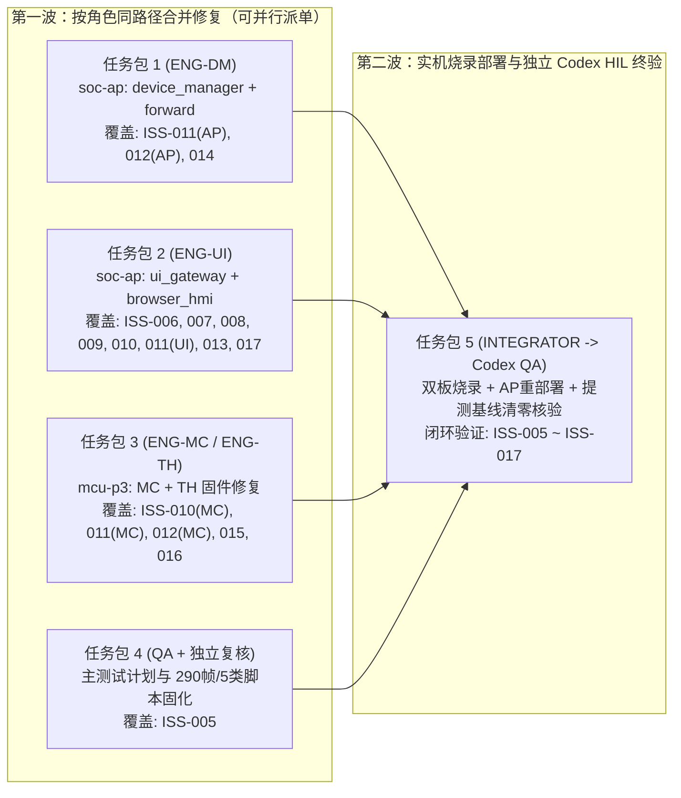

# TWIN-55 独立 QA 提单（`ISS-20261105-005`～`017`）分类核实与合并修复架构方案

## 1. 背景与源码核查基线

在 `TWIN-55` 第一阶段独立 Codex QA 实机审计（`codex_qa_01`，报告见 `project-control/docs/evidence/twin/TWIN-55/runs/codex_qa_01/stage1_qa_report.md`）中，独立审计员结合 `TWIN-54` 历史交接缺口与本轮真实浏览器 + SoC AP + 双 MCU HIL 实测证据，共登记了 13 条 Issue（`ISS-20261105-005` ～ `ISS-20261105-017`）。

`ARCH` 基于当前锁定的三仓只读源码基线完成了全链路逐行核查：
- **`soc-ap` 基线**：`79932746d225bb115010c5545ef3f7499482e137`
- **`mcu-p3` 基线**：`891a8bb252814c83992a49b01fbe11ba83b92a1f`（分支：`feat/soc-debug`）
- **`test_harness` 基线**：`d14ed04321c6d4f5ddb35a8801604a8af53b5b60`

本方案严格区分**已证实的现场事实**、**已核实的软件源码根因**与**需实机硬件进一步排查的物理项（禁止由代码静态外推）**，并按**同修改路径、同根因、同执行角色**原则将 13 条问题归并为紧凑的批处理修复任务包，杜绝拆成 13 张串行碎片卡。

---

## 2. 13 条 Issue 逐项分类核实、源码根因定位与定性表

### 2.1 分类总览矩阵

| Issue ID | 归属分类 | 优先级批次 | 核实定性结论 | 涉及仓库与核心定位 | 负责角色 |
| :--- | :--- | :--- | :--- | :--- | :--- |
| **`ISS-20261105-007`** | **A 类：已确认真功能/控制失真缺陷** | **P0（第一优先）** | **代码根因已证实**：前端保存料槽配置硬编码 `action: 1 (LOAD)` 与默认 `2100` (210°C)，后端 `/api/v1/filament/slots` 默认初始化 `{1U, 1U, 2100}` 并无条件触发 `0x10`+`0x19` 加热进丝 | `soc-ap/browser_hmi/first_release/app.js#L720-L729` `soc-ap/services/ui_gateway/ui_gateway_server.cpp#L255` | `ENG-UI` |
| **`ISS-20261105-008`** | **A 类：已确认真功能/控制失真缺陷** | **P0（第一优先）** | **代码根因已证实**：前端点击模型卡片 `[data-load-model]`（“一键载入”）直接调用 `POST /api/v1/jobs/start` 启动打印，绕过了“载入暂存 -> 点击开始打印”两阶段交互门禁 | `soc-ap/browser_hmi/first_release/app.js#L1626-L1635` `soc-ap/services/ui_gateway/ui_gateway_server.cpp#L549` | `ENG-UI` |
| **`ISS-20261105-010`** | **A 类：已确认负向边界校验缺失** | **P0（第一优先）** | **代码根因已证实**：`handle_filament_slots_route()` 未校验混色权重和（`10000`）、单槽权重范围（`0..10000`）、`slot_id`（`1..4`）及 `action`（`0..2`），导致非法权重返回 `200`，越界 `slot_id=5`/`action=-1` 下发至 TH 触发 NACK 并被映射为 `504`；且 MC `handle_mc_filament()` 对 `slot_id` 做了 `& 0x03U` 截断掩盖而非返回 NACK `0x03` | `soc-ap/services/ui_gateway/ui_gateway_server.cpp#L249-L285` `mcu-p3/motion-controller-mcu/project/src/minimc_proto.c#L1558` | `ENG-UI` `ENG-MC` |
| **`ISS-20261105-011`** | **A 类：软件有效性降级门禁缺失 + 硬件热床通道待查** | **P0（第一优先）** | **软件根因已证实 + 硬件物理根因待实机排查**： 1. **软件侧**：MC `temperaturetable.c#L104-L113` 在 ADC 超量程（开路 `>4081` 或短路 `<70`）时返回 `MAX_TEMP = 300`（`300°C`），而 `minimc_proto.c#L669` 未拦截 `raw_bed >= MAX_TEMP` 或热床超量程（`5~130°C`）；AP `device_manager_state.cpp#L175` 与 HMI `app.js#L1240` 亦未对热床 `>130°C` 做 `FAULT` 降级。 2. **硬件侧（禁外推）**：PC2 热床 ADC 通道实际是开路（未接热敏电阻 `ADC>4081`）还是短路，须导出真实 `avg1` ADC 读数现场核实 | `mcu-p3/motion-controller-mcu/project/src/minimc_proto.c#L666-L703` `soc-ap/services/device_manager/device_manager_state.cpp#L175-L186` `soc-ap/browser_hmi/first_release/app.js#L1240-L1254` | `ENG-MC` `ENG-DM` `ENG-UI` |
| **`ISS-20261105-013`** | **A 类：断线故障降级与传感器失真缺陷** | **P0（第一优先）** | **代码根因已证实**：`updateUIFromTelemetry()` 在 `hwOnline === false` 时仍无条件调用 `updateOobeTelemetryLinks()` 将 OOBE Step 4 及 4 路断料检测覆盖为绿色 `正常 (料丝在位)`；`updateOobeSensorsRealism()` 仅检查 `!appState.isConnected` 而未检查 `!appState.hwOnline` | `soc-ap/browser_hmi/first_release/app.js#L855-L859,L1256-L1267,L1299` | `ENG-UI` |
| **`ISS-20261105-014`** | **A 类：3s 物理断线状态机与哨兵值降级缺陷** | **P0（第一优先）** | **代码根因已证实**： 1. `telemetry_types.h#L133` 将 `AISOC_FRESHNESS_FAULT_MS` 设为 `10000U`（10s），`device_manager_state.cpp#L20` 将 `AISOC_DEV_VER_ONLINE_TIMEOUT_NS` 设为 5s，违反 3s 退化红线； 2. `forward_service.cpp#L169` 在串口查询超时时未发射 `LinkStateChanged(false)`； 3. `device_manager_dbus.cpp#L60` 在 `GetSnapshot` 时未重算新鲜度，且离线/超 3s 时未将温度打入离线哨兵值 `AISOC_TEMP_MILLIC_OFFLINE (2147483646)` 及 `device_state="OFFLINE"` | `soc-ap/contracts/twin/telemetry_types.h#L132-L133` `soc-ap/services/forward/forward_service.cpp#L169-L180` `soc-ap/services/device_manager/device_manager_state.cpp#L20-L22,L290-L308` `soc-ap/services/device_manager/device_manager_dbus.cpp#L56-L111` | `ENG-DM` |
| **`ISS-20261105-006`** | **B 类：API 契约与交接基线同步缺陷** | **P1（同批合并）** | **代码根因已证实**：`ui_gateway_server.cpp#L582` 仅拦截 `/api/v1/temperature/snapshot`，导致 `/api/v1/state` 落入静态文件路由并读取 `deploy_twin.sh#L580` 启动时生成的静态文件（恒为 `GEN=1, OFFLINE` 且无扩展名返回 `application/octet-stream`） | `soc-ap/services/ui_gateway/ui_gateway_server.cpp#L582-L602` `soc-ap/tools/deploy_twin.sh#L580,L665` | `ENG-UI` `INTEGRATOR` |
| **`ISS-20261105-009`** | **B 类：API/前端上传校验缺失缺陷** | **P1（同批合并）** | **代码根因已证实**：后端 `/api/v1/jobs/upload`（`ui_gateway_server.cpp#L549`）完全未读取 `req->body` 无条件返回 `200`；前端 `app.js#L1641` 未校验 `.gcode`/`.gco`/`.nc` 扩展名、`size > 0` 及有效 G-code 指令内容 | `soc-ap/services/ui_gateway/ui_gateway_server.cpp#L549-L550` `soc-ap/browser_hmi/first_release/app.js#L1641-L1649` | `ENG-UI` |
| **`ISS-20261105-012`** | **B 类：遥测 `raw_adc` 字段映射缺失缺陷** | **P1（同批合并）** | **代码根因已证实**：`device_manager_state.cpp#L250,L407` 在接收 DDS `aisoc_raw_temp_t`（已含 `raw_adc`）及序列化 `/api/v1/temperature/snapshot` 时漏存、漏输出 `"raw_adc"` 字段；且 MC `minimc_proto.c#L699` 固定填 `3200U`/`4095U` 未透传真实热床 ADC 采样值 | `soc-ap/services/device_manager/device_manager_state.cpp#L250-L268,L407-L420` `mcu-p3/motion-controller-mcu/project/src/minimc_proto.c#L699` | `ENG-DM` `ENG-MC` |
| **`ISS-20261105-017`** | **B 类：HTTP 404 响应缓冲区截断缺陷** | **P1（同批合并）** | **代码根因已证实**：`ui_gateway_server.cpp#L191` 中 `char err_resp[256]` 仅 256B，扣除 251B HTTP 响应头后仅剩 4B（`{"er`），截断了 35B 的 404 JSON 响应体 | `soc-ap/services/ui_gateway/ui_gateway_server.cpp#L191-L194` | `ENG-UI` |
| **`ISS-20261105-015`** | **C 类：MCU Debug 裸打印污染与长行截断** | **P1（MCU 同批）** | **代码根因已证实**： 1. `thermistor.c#L129` 在 DMA 轮询超时时直接调用裸 `printf("adc SS_ADC_BUSY \r\n");` 污染 `USART1`； 2. `minimc_proto.h#L25` 中 `MC_DBG_LINE_MAX_LEN` 设为 `192U`（小于 `mc_dbg_emit` 的 `line_buf[256]`），当 `POS_QUERY` 坐标较大时单行达 204B 触发 `trunc++`（`...`） | `mcu-p3/motion-controller-mcu/project/marlin/marlin_module/thermistor.c#L129` `mcu-p3/motion-controller-mcu/project/inc/minimc_proto.h#L24-L26` | `ENG-MC` |
| **`ISS-20261105-016`** | **C 类：MCU `boot_id` 静态常量与版本溯源** | **P1（MCU 同批）** | **代码根因已证实**：MC `minimc_proto.c#L576`（固定 `0x01020304`）与 TH `minimc_proto.c#L26`（固定 `0x8877AA55`）将 `boot_id` 与 `git_commit_short` 硬编码为编译期常量，复位后 `boot_id` 不变，且未绑定构建期真实 Git 短 SHA | `mcu-p3/motion-controller-mcu/project/src/minimc_proto.c#L576-L583` `mcu-p3/color-engine-mcu/io_toggle/src/app/minimc_proto.c#L26-L27,L201-L210` | `ENG-MC` `ENG-TH` |
| **`ISS-20261105-005`** | **D 类：QA 主计划、冻结子例与复合压测工具缺口** | **P1（QA 准备）** | **流程与工具缺口已证实**：缺失经独立非作者复核的 `hil_full_acceptance_master_plan_20261105.md`、290 帧高频突发压测脚本及 5 类复合序列脚本 | `project-control/docs/planning/hil_full_acceptance_master_plan_20261105.md` `test_harness/hil/` | `QA` |

---

### 2.2 重点疑难项深度技术剖析（区分软件根因与硬件排查项）

#### （1）`ISS-20261105-011`：MC 热床 `300.0°C`（`bed_ddC=3000`）的双重根因拆解
1. **已证实的软件根因（MC + AP + Web HMI 三层缺失热床量程门禁）**：
   - **MC 固件层**：在 [`mcu-p3/motion-controller-mcu/project/marlin/marlin_module/thermistor.c#L9,L188`](file:///home/sushaohua/workspace/ai_soc_project/mcu-p3/motion-controller-mcu/project/marlin/marlin_module/thermistor.c#L9) 与 [`temperaturetable.c#L104-L113`](file:///home/sushaohua/workspace/ai_soc_project/mcu-p3/motion-controller-mcu/project/marlin/marlin_module/temperaturetable.c#L104-L113) 中，存量 Marlin 查表函数 `TempReadtoCelsius(avg1, MAX_TEMP)` 在 ADC 采样值超出查表上下界（`reading < 70` 短路或 `reading > 4081` **热敏电阻开路/未接入**）时，直接返回 `max_allowed_value = MAX_TEMP = 300`（即 `300°C`）作为安全哨兵！然而 [`minimc_proto.c#L667-L673`](file:///home/sushaohua/workspace/ai_soc_project/mcu-p3/motion-controller-mcu/project/src/minimc_proto.c#L667-L673) 的 `mc_dbg_sync_runtime_state()` 仅判断了 `(raw_bed == BAD_TEMPERATURE) || (raw_bed < -200)`，未识别 `raw_bed >= 300`（查表超界哨兵）或热床物理合法量程上界（`raw_bed > 130` 或 `raw_bed < 5`），导致开路/超界时向 AP 报告 `current_temp_deci_c = 3000`、`sensor_status = MINIMC_TEMP_STATUS_OK (0)`！
   - **SoC AP `device_manager` 层**：[`device_manager_state.cpp#L175-L186`](file:///home/sushaohua/workspace/ai_soc_project/soc-ap/services/device_manager/device_manager_state.cpp#L175-L186)（`eval_sample_quality()`）与 [`device_manager_service.cpp#L45-L57`](file:///home/sushaohua/workspace/ai_soc_project/soc-ap/services/device_manager/device_manager_service.cpp#L45-L57)（`is_sample_valid()`）未区分热床（`node 1`，物理有效范围 `5.0~130.0°C` = `5000..130000 millic`）与喷头（`node 2`，物理有效范围 `5.0~300.0°C` = `5000..300000 millic`），将 `300000 millic` 的热床温度判定为 `sensor_status="OK"`、`quality="FRESH"`。
   - **Web HMI 层**：[`app.js#L1250`](file:///home/sushaohua/workspace/ai_soc_project/soc-ap/browser_hmi/first_release/app.js#L1250) 在 OOBE Step 3 明确声明热床有效范围为 `5~130°C`，但 [`app.js#L1240`](file:///home/sushaohua/workspace/ai_soc_project/soc-ap/browser_hmi/first_release/app.js#L1240) 的 `updateBedTelemetry()` 对任意数值 `mcTemp` 均渲染为绿色 `正常 (300.0 °C)`。
2. **需实机硬件核查的物理项（严禁由代码静态外推）**：
   - 修复 MC 固件使 `minimc_temp_report_payload_t.raw_adc_value` 透传真实的 `ADC1` Ch12（PC2）热床滤波采样值（而非原 [`minimc_proto.c#L699`](file:///home/sushaohua/workspace/ai_soc_project/mcu-p3/motion-controller-mcu/project/src/minimc_proto.c#L699) 硬编码的 `3200U`/`4095U`）后，在实机上读取 `bed.raw_adc`：
     - 若实机 `bed.raw_adc > 4081`（接近 `4095`），则证实当前 HIL 台架 MC 板 PC2 热床热敏电阻接口处于**物理未接插件（开路）**状态；此时 MC/AP/UI 必须诚实输出 `MINIMC_TEMP_SENTINEL_FAULT (0x7FFF)` / `AISOC_TEMP_MILLIC_FAULT (2147483647)`、`sensor_status="OPEN"`、`quality="FAULT"` 及红色故障告警，绝不伪装成正常温度；
     - 若台架已接热床热敏电阻或假负载电阻，则核查实测室温（`15~35°C`）与 ADC 读数是否匹配。

#### （2）`ISS-20261105-014`：拔除/断开串口 > 3s 的状态机与哨兵值退化链路
- **根因链条**：
  1. `AGENTS.md` 硬指标要求：“拔除 `/dev/ttyUSB*` 后 CPU 占用必须 $\le 2\%$；**3s 内状态机衰退并将失效温度打入哨兵值**，Web 界面锁定控制并返回 HTTP 503/504”。
  2. 但 [`soc-ap/contracts/twin/telemetry_types.h#L133`](file:///home/sushaohua/workspace/ai_soc_project/soc-ap/contracts/twin/telemetry_types.h#L133) 中 `AISOC_FRESHNESS_FAULT_MS` 被定义为 `10000U`（10s），[`soc-ap/services/device_manager/device_manager_state.cpp#L20-L22`](file:///home/sushaohua/workspace/ai_soc_project/soc-ap/services/device_manager/device_manager_state.cpp#L20-L22) 中 `AISOC_DEV_VER_ONLINE_TIMEOUT_NS` 被定义为 `5000000000ULL`（5s）、`AISOC_DEV_VER_STALE_TIMEOUT_NS` 为 `15000000000ULL`（15s）。因此在断连 `3.5s` 时，状态机仍处于 `< 5s` / `< 10s` 的 `ONLINE` / `STALE` 窗口！
  3. 更关键的是，当 `POST /api/v1/temperature/sample` 触发 `handle_request_immediate_sample()`（[`device_manager_dbus.cpp#L68-L111`](file:///home/sushaohua/workspace/ai_soc_project/soc-ap/services/device_manager/device_manager_dbus.cpp#L68-L111)）且 `forward_service_execute_query()`（[`forward_service.cpp#L169-L180`](file:///home/sushaohua/workspace/ai_soc_project/soc-ap/services/forward/forward_service.cpp#L169-L180)）因串口无响应返回 `AISOC_FWD_ERR_TIMEOUT` 时，`forward_service` 未发射 `LinkStateChanged(target_node, false, "UART_QUERY_TIMEOUT")`，`device_manager` 也未更新节点离线状态；且 `handle_get_snapshot()`（[`device_manager_dbus.cpp#L56-L66`](file:///home/sushaohua/workspace/ai_soc_project/soc-ap/services/device_manager/device_manager_dbus.cpp#L56-L66)）在返回快照 JSON 前未调用 `dev_state_eval_freshness()` 与 `dev_state_eval_version_freshness()`！

---

## 3. 合并修复任务拆解（按角色与同路径归并为 4 个工程任务包 + 1 个集成验收闭环）

为避免碎片化串行派单，将全部 13 条 Issue 按代码仓路径与职责边界归并为以下 **4 个并行/准并行研发与 QA 准备任务包**，随后由 `INTEGRATOR` 统一刷机部署并交独立 Codex QA 复验。

---

### 3.1 任务包 1（`ENG-DM`）：SoC AP 遥测有效性门禁、`raw_adc` 透传与 3s 断线哨兵退化闭环

- **覆盖 Issue**：`ISS-20261105-011`（AP 侧）、`ISS-20261105-012`（AP 侧）、`ISS-20261105-014`
- **允许修改路径（`allowed_paths`）**：
  - `soc-ap/contracts/twin/telemetry_types.h`
  - `soc-ap/services/device_manager/device_manager_state.cpp`
  - `soc-ap/services/device_manager/device_manager_service.cpp`
  - `soc-ap/services/device_manager/device_manager_dbus.cpp`
  - `soc-ap/services/forward/forward_service.cpp`
  - `soc-ap/tests/device_manager/twin/test_device_manager.cpp`
  - `soc-ap/tests/device_manager/twin/test_device_manager_state.cpp`
  - `soc-ap/tests/forward/twin/test_forward_service.cpp`
  - `soc-ap/tests/integration/test_first_release_print_loop.c`
- **精确修复设计**：
  1. **3s 断线与老化阈值对齐（`ISS-20261105-014`）**：
     - 在 [`soc-ap/contracts/twin/telemetry_types.h#L132-L133`](file:///home/sushaohua/workspace/ai_soc_project/soc-ap/contracts/twin/telemetry_types.h#L132-L133)（及 `test_first_release_print_loop.c#L587-L588`）中，将 `AISOC_FRESHNESS_STALE_MS` 调整为 `1500U`（1.5s），将 `AISOC_FRESHNESS_FAULT_MS` 调整为 **`3000U`（3.0s）**，严格满足 3s 内衰退为离线/哨兵值的硬指标；
     - 在 [`soc-ap/services/device_manager/device_manager_state.cpp#L20-L22`](file:///home/sushaohua/workspace/ai_soc_project/soc-ap/services/device_manager/device_manager_state.cpp#L20-L22) 中，将 `AISOC_DEV_VER_ONLINE_TIMEOUT_NS` 与 `AISOC_DEV_VER_STALE_TIMEOUT_NS` 统一收紧至 `1500000000ULL`（1.5s）与 `3000000000ULL`（3.0s）；
     - 在 [`soc-ap/services/forward/forward_service.cpp#L169-L180`](file:///home/sushaohua/workspace/ai_soc_project/soc-ap/services/forward/forward_service.cpp#L169-L180) 与 `#L293-L300` 中，当 `query_wait_and_publish()` 或 `version_query_wait_and_log()` 返回超时/错误（`r_st != AISOC_FWD_OK`）时，发射 `forward_service_emit_link_state(state, target_node, false, "SERIAL_TIMEOUT_OR_IO")`；当收包成功时发射 `forward_service_emit_link_state(state, target_node, true, "OK")`；
     - 在 [`soc-ap/services/device_manager/device_manager_dbus.cpp#L56-L66`](file:///home/sushaohua/workspace/ai_soc_project/soc-ap/services/device_manager/device_manager_dbus.cpp#L56-L66)（`handle_get_snapshot()`）中，生成快照 JSON 前显式调用 `dev_state_eval_freshness(state, get_monotonic_ns())` 与 `dev_state_eval_version_freshness(state, get_monotonic_ns())`；在 `handle_request_immediate_sample()`（`#L98-L108`）中，若 `forward_query_rpc()` 失败，立即调用 `dev_state_handle_link_change(state, node, false, get_monotonic_ns())`；
     - 在 [`soc-ap/services/device_manager/device_manager_state.cpp#L290-L308`](file:///home/sushaohua/workspace/ai_soc_project/soc-ap/services/device_manager/device_manager_state.cpp#L290-L308)（`eval_sensor_freshness()`）中，当 `node_offline` 为真或 `elapsed_ms >= AISOC_FRESHNESS_FAULT_MS (3000U)` 时，将该通道 `temperature_millic` 置为离线哨兵值 **`AISOC_TEMP_MILLIC_OFFLINE` (`2147483646`)**、`sensor_status = AISOC_SENSOR_TIMEOUT`、`quality = AISOC_QUALITY_FAULT`；当 MC 或 TH 任一关键节点离线或超时 $\ge 3000\text{ ms}$ 时，顶层 `device_state` 置为 `"OFFLINE"`（并在快照 JSON 中输出 `"device_state":"OFFLINE"`）。
  2. **热床与喷头物理有效量程门禁（`ISS-20261105-011` AP 侧）**：
     - 在 [`soc-ap/contracts/twin/telemetry_types.h`](file:///home/sushaohua/workspace/ai_soc_project/soc-ap/contracts/twin/telemetry_types.h) 中定义物理有效温度边界常量：
       - 热床（`node 1`）：`AISOC_BED_VALID_MIN_MILLIC = 5000`（`5.0°C`），`AISOC_BED_VALID_MAX_MILLIC = 130000`（`130.0°C`）；
       - 喷头（`node 2`）：`AISOC_NOZZLE_VALID_MIN_MILLIC = 5000`（`5.0°C`），`AISOC_NOZZLE_VALID_MAX_MILLIC = 300000`（`300.0°C`）。
     - 在 [`device_manager_state.cpp#L175-L186`](file:///home/sushaohua/workspace/ai_soc_project/soc-ap/services/device_manager/device_manager_state.cpp#L175-L186)（`eval_sample_quality()`）与 [`device_manager_service.cpp#L45-L57`](file:///home/sushaohua/workspace/ai_soc_project/soc-ap/services/device_manager/device_manager_service.cpp#L45-L57)（`is_sample_valid()`）中，若 `source_node == 1U` 且 `temperature_millic` 超出 `[5000, 130000]`（例如 `300000`），或 `source_node == 2U` 且超出 `[5000, 300000]`，强制判定为传感器异常：将快照中的 `temperature_millic` 置为 `AISOC_TEMP_MILLIC_FAULT (2147483647)`、`sensor_status` 置为 `AISOC_SENSOR_OPEN`（或保留底层非 OK 状态）、`quality` 置为 `AISOC_QUALITY_FAULT`、`state->is_fault = true`，严禁将 `300.0°C` 热床标记为 `OK`/`FRESH`。
  3. **`raw_adc` 完整映射进温度快照 JSON（`ISS-20261105-012` AP 侧）**：
     - 在 [`soc-ap/contracts/twin/telemetry_types.h`](file:///home/sushaohua/workspace/ai_soc_project/soc-ap/contracts/twin/telemetry_types.h) 的 `aisoc_temp_snapshot_t`（或 `device_manager_state_t`）中保存 `bed_raw_adc` 与 `tool_raw_adc`（`uint16_t`）；
     - 在 [`device_manager_state.cpp#L250-L268`](file:///home/sushaohua/workspace/ai_soc_project/soc-ap/services/device_manager/device_manager_state.cpp#L250-L268)（`dev_state_update_raw_sample()`）中写入 `sample->raw_adc`；
     - 在 [`device_manager_state.cpp#L407-L420`](file:///home/sushaohua/workspace/ai_soc_project/soc-ap/services/device_manager/device_manager_state.cpp#L407-L420)（`dev_state_get_snapshot_json()`）中，为 `"bed"` 与 `"tool"` 子对象补充 `"raw_adc":%u` 字段（即 `{"temperature_millic":%d,"temperature_c":%s,"raw_adc":%u,"sensor_status":"%s","quality":"%s"}`）。

---

### 3.2 任务包 2（`ENG-UI`）：SoC AP `ui_gateway` 与 `browser_hmi` 契约校验、显式动作门禁与离线状态同步

- **覆盖 Issue**：`ISS-20261105-006`、`ISS-20261105-007`、`ISS-20261105-008`、`ISS-20261105-009`、`ISS-20261105-010`、`ISS-20261105-011`（UI 侧）、`ISS-20261105-013`、`ISS-20261105-017`
- **允许修改路径（`allowed_paths`）**：
  - `soc-ap/services/ui_gateway/ui_gateway_server.cpp`
  - `soc-ap/services/ui_gateway/ui_gateway_job_ctrl.cpp`
  - `soc-ap/services/ui_gateway/ui_gateway_job_ctrl.h`
  - `soc-ap/browser_hmi/first_release/app.js`
  - `soc-ap/tools/deploy_twin.sh`
  - `soc-ap/tests/ui_gateway/twin/test_ui_gateway_routes.cpp`
  - `soc-ap/tests/ui/twin/test_ui_contract.py`
  - `soc-ap/browser_hmi/first_release/test_hmi_contract.py`
- **精确修复设计**：
  1. **`/api/v1/state` 动态路由统一与移除静态假文件（`ISS-20261105-006`）**：
     - 在 [`soc-ap/services/ui_gateway/ui_gateway_server.cpp#L582`](file:///home/sushaohua/workspace/ai_soc_project/soc-ap/services/ui_gateway/ui_gateway_server.cpp#L582) 的 `dispatch_http_request()` 中，将 `std::strcmp(req->path, "/api/v1/temperature/snapshot") == 0` 扩展为同时匹配 `std::strcmp(req->path, "/api/v1/state") == 0`，统一由 `handle_snapshot_route(server, client)` 返回实时 `application/json` 权威快照；
     - 在 [`soc-ap/tools/deploy_twin.sh#L580,L665`](file:///home/sushaohua/workspace/ai_soc_project/soc-ap/tools/deploy_twin.sh#L580) 中删除生成静态文件 `${RUNTIME_WEB_ROOT}/api/v1/state` 的逻辑（改为通过 HTTP 请求 `http://127.0.0.1:${PORT}/api/v1/state` 验证动态接口）。
  2. **保存料槽配置与物理加热/进丝解耦 + 混色与槽位参数 400 强校验（`ISS-20261105-007`、`ISS-20261105-010`）**：
     - **前端 [`app.js#L720-L729`](file:///home/sushaohua/workspace/ai_soc_project/soc-ap/browser_hmi/first_release/app.js#L720-L729)（`saveSlotsToBackend()`）**：点击 `#btn-save-slots`（“保存料槽映射配置”）时，请求载荷改为 `action: 0`（仅选槽/保存配置，**严禁传 `action: 1` LOAD**），且 `target_temp_deci_c: appState.targetThDeciC`（未设定目标温度时传 `0`，**严禁隐式回退 `2100`**）；仅当用户显式点击进丝（`#btn-filament-load`）或退丝（`#btn-filament-unload`）按钮时才发送 `action: 1` 或 `action: 2`；
     - **后端 [`ui_gateway_server.cpp#L249-L285`](file:///home/sushaohua/workspace/ai_soc_project/soc-ap/services/ui_gateway/ui_gateway_server.cpp#L249-L285)（`handle_filament_slots_route()`）**：
       - 将默认参数改为 `ui_gw_filament_params_t params = { 1U, 0U, 0 };`（默认 `action = 0U` SELECT，`target_temp_deci_c = 0`）；
       - 新增独立静态校验辅助函数 `validate_filament_slots_body(const char* body, ui_gw_filament_params_t* out_params, char* err_msg, size_t err_cap)`（符合 $\le 50$ 行、$\le 4$ 参数门禁）：
         1. 校验 `slot_id` / `active_slot`：若存在，必须为整数且在 `1..4` 范围内（否则返回 HTTP `400 Bad Request`）；
         2. 校验 `action`：若为数值必须在 `0..2` 范围内，若为字符串必须为 `"select"` / `"load"` / `"unload"`（负数如 `-1` 或 `>2` 立即返回 HTTP `400 Bad Request`）；
         3. 校验 `total_mixing_weight` 与 `slots` 数组中的 `mixing_weight`：每个槽位 `mixing_weight` 必须为 `[0, 10000]` 整数；若提供了 `total_mixing_weight` 或 `slots` 权重数组，权重总和必须严格等于 `10000`（如 `9999`、`-1`、`10001` 均立即返回 HTTP `400 Bad Request`，绝不返回 `200` 或透传下发导致 `504`）。
  3. **模型“一键载入”与“开始打印”两阶段解耦（`ISS-20261105-008`）**：
     - 在 [`soc-ap/browser_hmi/first_release/app.js#L1626-L1635`](file:///home/sushaohua/workspace/ai_soc_project/soc-ap/browser_hmi/first_release/app.js#L1626-L1635) 中，点击 `[data-load-model]` 按钮时**严禁调用 `/api/v1/jobs/start`**！改为仅将模型名称暂存至前端状态与 DOM（`appState.selectedModel = model; dom.jobModelName.textContent = model;`），并调用 `POST /api/v1/jobs/upload`（附带合法预置模型标识 `{ name: model, preset: true }`）完成模型载入就绪提示；只有当用户显式点击 `#btn-job-start`（“开始打印”）时，才发送 `POST /api/v1/jobs/start`。
  4. **G-code 文件上传前后端双重合法性校验（`ISS-20261105-009`）**：
     - **前端 [`app.js#L1641-L1649`](file:///home/sushaohua/workspace/ai_soc_project/soc-ap/browser_hmi/first_release/app.js#L1641-L1649)**：
       - 检查文件名后缀必须为 `.gcode`、`.gco` 或 `.nc`（不区分大小写）；
       - 检查 `f.size > 0`（拒绝 0 字节空文件）；
       - 使用 `FileReader` 读取文件前 4KB 文本，校验至少包含一行合法 G-code 指令（匹配 `/^\s*(G0|G1|G28|G29|G90|G91|G92|M82|M83|M104|M106|M107|M109|M114|M140|M190|T[0-3])\b/m`），并将首段有效 G-code 摘要作为 `content_preview` 随 `{ name: f.name, size: f.size, content: preview }` 提交至 `POST /api/v1/jobs/upload`；校验失败时在 UI 弹出红色错误提示并拒绝更新 `#job-model-name`。
     - **后端 [`ui_gateway_server.cpp#L549-L550`](file:///home/sushaohua/workspace/ai_soc_project/soc-ap/services/ui_gateway/ui_gateway_server.cpp#L549-L550)**：
       - 将 `/api/v1/jobs/upload` 委托给专用处理函数 `handle_job_upload_route(client, req->body)`：校验 `name` 扩展名（`.gcode`/`.gco`/`.nc`），且校验：若 `preset: true` 则 `name` 必须在预置模型白名单（`3DBenchy.gcode`、`Calibration_Cube.gcode`、`MultiColor_Tower.gcode`）内；若为普通文件上传，则 `size > 0` 且 `content` 中必须包含至少一条合法 G/M/T 指令，否则一律返回 HTTP `400 Bad Request`（`{"status":"error","code":400,"message":"Invalid or empty G-code file"}`）。
  5. **离线状态与热床超量程的前端诚实展示（`ISS-20261105-011` UI 侧、`ISS-20261105-013`）**：
     - 在 [`app.js#L1240-L1254`](file:///home/sushaohua/workspace/ai_soc_project/soc-ap/browser_hmi/first_release/app.js#L1240-L1254)（`updateBedTelemetry()`）中，增加热床物理量程检查：`const isBedRangeValid = (mcTemp !== null && mcTemp >= 5.0 && mcTemp <= 130.0 && bed.quality !== 'FAULT' && bed.sensor_status === 'OK');`，当超出 `5~130°C`（如 `300.0°C`）或 `bed.quality === 'FAULT'` 时，热床卡片与 OOBE Step 3 徽章必须显示红色故障态（`异常/超量程`），绝不渲染为绿色 `正常`；
     - 在 [`app.js#L855`](file:///home/sushaohua/workspace/ai_soc_project/soc-ap/browser_hmi/first_release/app.js#L855)（`updateOobeSensorsRealism()`）中，将 `if (!appState.isConnected)` 修正为 `if (!appState.isConnected || !appState.hwOnline)`；
     - 在 [`app.js#L1256-L1267,L1299`](file:///home/sushaohua/workspace/ai_soc_project/soc-ap/browser_hmi/first_release/app.js#L1256-L1267)（`updateOobeTelemetryLinks()`）中，仅当 `appState.hwOnline === true` 时才将 `dom.oobeFwdStatus`、`dom.oobeRunoutStatus` 与 `updateRunoutSensorsDOM(true)` 置为在线/在位；当 `!appState.hwOnline` 时，调用 `updateOobeSensorsRealism()` 将 OOBE Step 4 及 4 路断料传感器全部置为离线/未知态（`离线 / 未知`）。
  6. **未知 API 路由 404 JSON 响应缓冲区扩容（`ISS-20261105-017`）**：
     - 在 [`soc-ap/services/ui_gateway/ui_gateway_server.cpp#L191-L194`](file:///home/sushaohua/workspace/ai_soc_project/soc-ap/services/ui_gateway/ui_gateway_server.cpp#L191-L194) 中，将 `char err_resp[256];` 扩容为 `char err_resp[512];`（或直接调用 `send_json_and_close(client, 404, "{\"error\":404,\"message\":\"Not Found\"}");`），确保 HTTP 404 响应头 `Content-Length: 35` 与完整 35B JSON 载荷字节级一致。

---

### 3.3 任务包 3（`ENG-MC` + `ENG-TH`）：双 MCU 固件热床量程/ADC 透传、`[MC-DBG]` 零截断无裸打印、动态 `boot_id` 与版本绑定

- **覆盖 Issue**：`ISS-20261105-010`（MC 侧）、`ISS-20261105-011`（MC 侧）、`ISS-20261105-012`（MC 侧）、`ISS-20261105-015`、`ISS-20261105-016`
- **分支约束**：严格限定在 `mcu-p3` 的 `feat/soc-debug` 分支开发与提交。
- **允许修改路径（`allowed_paths`）**：
  - **MC 侧（`ENG-MC`）**：
    - `mcu-p3/motion-controller-mcu/project/inc/minimc_proto.h`
    - `mcu-p3/motion-controller-mcu/project/src/minimc_proto.c`
    - `mcu-p3/motion-controller-mcu/project/marlin/marlin_module/thermistor.c`
    - `mcu-p3/motion-controller-mcu/project/marlin/marlin_module/thermistor.h`
    - `mcu-p3/motion-controller-mcu/project/src/test_twin44_mc_debug.c`
    - `mcu-p3/motion-controller-mcu/CMakeLists.txt`
  - **TH 侧（`ENG-TH`）**：
    - `mcu-p3/color-engine-mcu/io_toggle/src/app/minimc_proto.c`
    - `mcu-p3/color-engine-mcu/io_toggle/src/user/test_twin45_th_debug.c`
    - `mcu-p3/color-engine-mcu/io_toggle/Makefile`
- **精确修复设计**：
  1. **MC 热床真实 ADC 透传与超量程/开路故障判定（`ISS-20261105-011`、`ISS-20261105-012`）**：
     - 在 [`mcu-p3/motion-controller-mcu/project/marlin/marlin_module/thermistor.c`](file:///home/sushaohua/workspace/ai_soc_project/mcu-p3/motion-controller-mcu/project/marlin/marlin_module/thermistor.c) 中导出只读过滤后原始 ADC 变量 `volatile uint16_t g_last_bed_adc_raw` 与 `volatile uint16_t g_last_ex1_adc_raw`（在 `Thermistor_Update()` 算出 `avg`、`avg1` 时更新）；
     - 在 [`mcu-p3/motion-controller-mcu/project/src/minimc_proto.c#L664-L706`](file:///home/sushaohua/workspace/ai_soc_project/mcu-p3/motion-controller-mcu/project/src/minimc_proto.c#L664-L706) 的 `mc_dbg_sync_runtime_state()` 与 `build_temp_resp()` 中：
       - 将 `bed_fault` 判定条件收紧为：
         `const bool bed_fault = (raw_bed == (int16_t)BAD_TEMPERATURE) || (raw_bed < 5) || (raw_bed > 130) || (g_last_bed_adc_raw > 4081U) || (g_last_bed_adc_raw < 70U);`
         （注：宿主机单测弱符号默认 `current_temperature_bed = 25`、`g_last_bed_adc_raw = 3200U`，保持兼容）；
       - 当 `bed_fault` 为真时，`s_dbg_state.bed_ddC = MINIMC_TEMP_SENTINEL_FAULT (0x7FFF)`，`payload.sensor_status = (g_last_bed_adc_raw < 70U) ? MINIMC_TEMP_STATUS_SHORT : MINIMC_TEMP_STATUS_DISCONNECTED`；
       - `payload.raw_adc_value = g_last_bed_adc_raw;`（透传真实 ADC 转换值，消除 `3200U` 硬编码）。
  2. **MC 耗材指令 `0x19` 槽位与动作越界 NACK 保护（`ISS-20261105-010` MC 侧）**：
     - 在 [`mcu-p3/motion-controller-mcu/project/src/minimc_proto.c#L1556-L1560`](file:///home/sushaohua/workspace/ai_soc_project/mcu-p3/motion-controller-mcu/project/src/minimc_proto.c#L1556-L1560) 的 `handle_mc_filament()` 中，在执行状态更新前与 TH 保持一致：
       `if ((req.slot_id >= 4U) || (req.action > 3U)) { send_mc_nack(frame, seq, 0x03U); return; }`
       严禁通过 `req.slot_id & 0x03U` 将非法槽位掩盖为合法 ACK。
  3. **消除 `USART1` 裸 `SS_ADC_BUSY` 打印并消除 `[MC-DBG]` 长行截断（`ISS-20261105-015`）**：
     - 在 [`mcu-p3/motion-controller-mcu/project/marlin/marlin_module/thermistor.c#L129`](file:///home/sushaohua/workspace/ai_soc_project/mcu-p3/motion-controller-mcu/project/marlin/marlin_module/thermistor.c#L129)（存量代码最小修改预算：仅改 1 行）移除裸 `printf("adc SS_ADC_BUSY \r\n");`，避免非结构化裸文本污染 `USART1` `[MC-DBG]` 串口流；
     - 在 [`mcu-p3/motion-controller-mcu/project/inc/minimc_proto.h#L24-L26`](file:///home/sushaohua/workspace/ai_soc_project/mcu-p3/motion-controller-mcu/project/inc/minimc_proto.h#L24-L26) 中：
       - 将 `MC_DBG_LINE_MAX_LEN` 从 `192U` 提升至 **`256U`**（与 `mc_dbg_emit()` 的 `line_buf[256]` 对齐，彻底消除 204B `POS_QUERY` 日志行的 `trunc` 截断）；
       - 将 `MC_DBG_RING_CAPACITY` 从 `2048U` 提升至 **`4096U`**，将 `MC_DBG_DRAIN_BUDGET` 从 `64U` 提升至 **`128U`**，确保高频突发下 `drop=0, trunc=0`。
  4. **MC 与 TH 动态 `boot_id` 生成及构建期 `git_commit_short` 绑定（`ISS-20261105-016`）**：
     - **动态 `boot_id`**：
       - 在 MC `minimc_proto_init()` 与 TH `minimc_proto_init()` 启动初始化时，结合硬件重置计数器/系统滴答与芯片 UID/ADC 初始低位抖动（并在每次调用 `minimc_proto_init()` 时单调递增 `s_boot_epoch_counter`），生成非零且每次复位后必变化的 32-bit `s_runtime_boot_id`（并在 `[MC-DBG]` / `[TH-DBG]` 启动首行或 `VERSION_REPORT` 中一致返回）；
     - **构建期 `git_commit_short`**：
       - 在 MC `CMakeLists.txt` 与 TH `Makefile` 中通过 `git rev-parse --short=8 HEAD` 自动注入 `-DFW_GIT_COMMIT_SHORT=0x<8hex>U`（若无 Git 环境则回退默认宏），并在 `build_version_resp()` 中使用 `FW_GIT_COMMIT_SHORT` 填充 `out_buf[20..23]`。

---

### 3.4 任务包 4（`QA` + 独立非作者复核）：全量 HIL 主测试计划、290 帧突发与 5 类复合序列脚本固化

- **覆盖 Issue**：`ISS-20261105-005`
- **允许修改路径（`allowed_paths`）**：
  - `project-control/docs/planning/hil_full_acceptance_master_plan_20261105.md`
  - `test_harness/hil/`（新增或完善 290 帧高频突发压测脚本与 5 类复合序列测试脚本）
- **交付要求**：
  1. 产出正式主测试计划 `project-control/docs/planning/hil_full_acceptance_master_plan_20261105.md`，完整冻结：
     - 47 项（正例 + 反例 + 故障注入 + 断线恢复）逐项输入、步骤、预期 HTTP/API 响应、预期串口协议帧、预期 `[MC-DBG]`/`[TH-DBG]` 日志及物理效果；
     - 290 帧高频突发压测的精确帧构成、发送速率、窗口时长及 `seq > 255`（16-bit 序列号不回绕）、`CRC_ERR = 0`、`BAD_FRAME = 0`、`drop = 0`、`trunc = 0` 客观判据；
     - 5 类复合业务序列（归零 -> 调平 -> 设温 -> 选槽/进退丝 -> 作业生命周期流转 + 急停）自动化/半自动化执行脚本与断言；
     - 提测前现场环境清零 SOP（双板复位、清理残留作业、采集新鲜基线快照、核对 PID/epoch/boot_id/commit）。
  2. 按 `codex_qa_review.md` 完成独立非作者复核并留存复核记录。

---

### 3.5 任务包 5（`INTEGRATOR` -> 独立 Codex QA）：统一实机烧录、干净提测基线交接与 Stage 1+2 终验

- **前置依赖**：任务包 1、2、3、4 全部完成并通过各自单元/门禁检查。
- **执行步骤**：
  1. `INTEGRATOR` 在实机烧录最新 `mcu-p3` 双板固件（MC + TH）并重新部署 `soc-ap` 三服务；
  2. 执行提测前环境清零 SOP：
     - 复位 MC 与 TH，确认复位前后 `boot_id` 真实变化、协议上报 `git_commit_short` 与 `mcu-p3` `HEAD` 完全一致；
     - 采集新窗口 `[MC-DBG]` 与 `[TH-DBG]`，确认无 `adc SS_ADC_BUSY` 裸输出、初始窗口 `drop=0, trunc=0`；
     - 核查实机热床 `bed.raw_adc` 读数并在交接清单中如实登记热床传感器物理接入状态与故障降级表现；
     - 刷新交接包中的服务 PID、启动 epoch、双端 `/api/v1/state` 与 `/api/v1/temperature/snapshot` 一致性证据；
  3. 移交独立 Codex QA 会话执行全量 HIL 闭环复验，逐条核销 `ISS-20261105-005` ～ `ISS-20261105-017`。

---

## 4. 工程门禁与合规约束

1. **函数规模与参数个数门禁**：全部新增/修改的自研 C/C++ 与 JS 函数严格遵守单函数 $\le 50$ 行、入参 $\le 4$ 个、卫语句优先、嵌套 $\le 3$ 层。
2. **存量代码最小修改预算（Minimal Diff Budget）**：对 `mcu-p3/motion-controller-mcu/project/marlin/marlin_module/thermistor.c` 仅做导出 `g_last_bed_adc_raw` 与移除单行裸 `printf` 的最小定点修改，严禁无关重构。
3. **中文代码注释硬性规范**：本次修改触及的所有函数与文件同步按 `project-control/.agents/rules/code_documentation_standard.md` 补齐中文文件头与函数职责/参数/返回值注释（与专项注释补齐计划协同，避免重复返工）。
