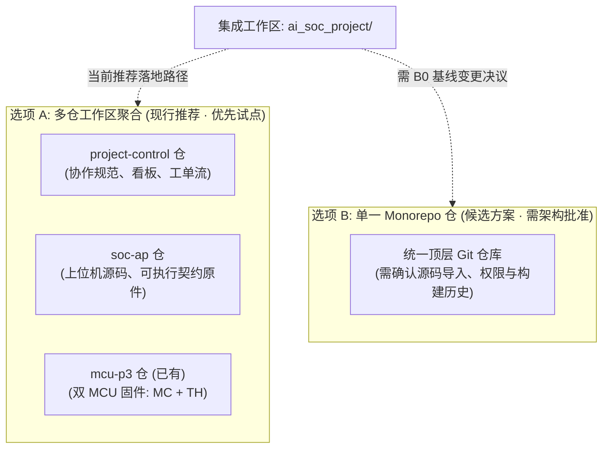
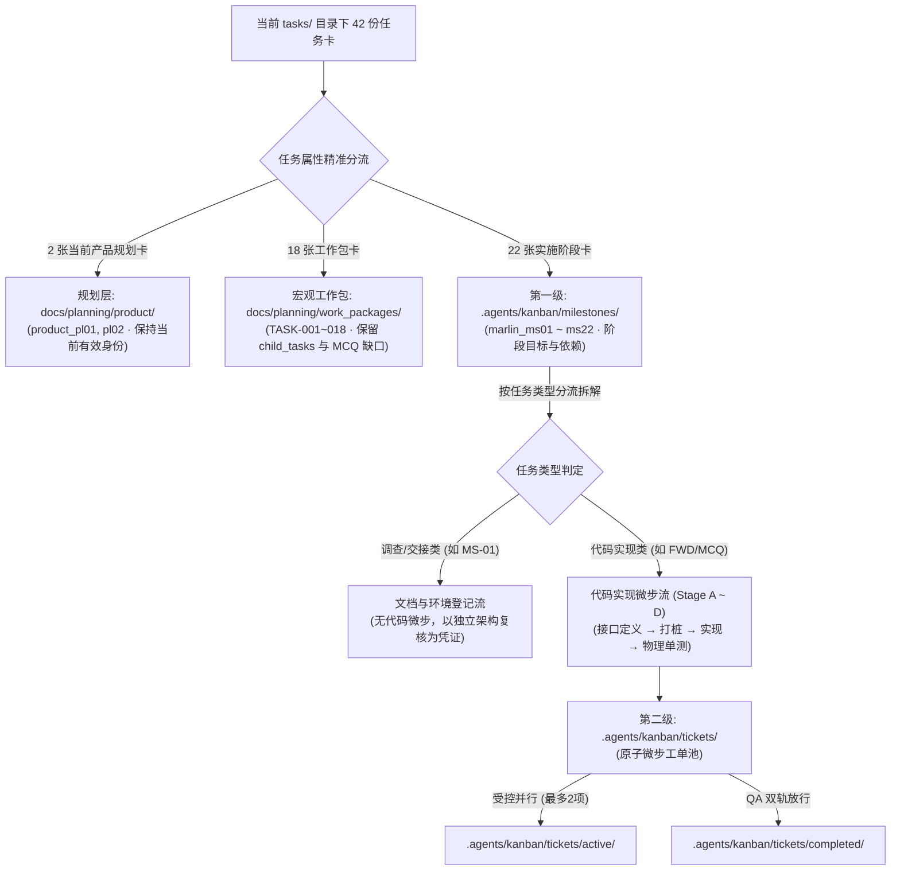
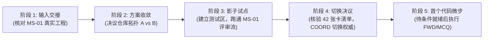

# 独立工程目录架构与任务分层治理方案评估 (候选设计版)

> **文档定位与评估基准**：本方案为**候选设计（Candidate Design）**，旨在吸收 [[AI_SoC_协作方案/independent_project_architecture_review_20261013_142951|评审与修改建议]]，系统论证将工程代码构建区从 Obsidian 文档知识库（`/mnt/d/AI_RDdocs`）中剥离、建立独立 Linux 工作区（`ai_soc_project`）、以及对现有 42 份任务卡实施分层治理的可行性与迁移边界。
> **特别声明**：本方案在完成 [[AI_SoC_协作方案/tasks/marlin_ms01_20261007_214108|MS-01]] 输入交接与小范围试点前，**不直接作为生产执行基线**，不变更现行权威任务原件。

---

## 1. 方案背景与动因分析

### 1.1 现状与结构性冲突
当前所有产出均存放在 `/mnt/d/AI_RDdocs`（Obsidian 知识库），存在三大结构性冲突与待验证假设：
1.  **知识库与工程代码的职责混淆**：
    *   知识库的核心是“思考、研讨、记录与复盘”；
    *   工程代码的核心是“可重复构建、单元测试、版本追溯、固件烧录与微步闭环”。两者混存容易导致构建临时文件（`build/`、`*.o`）与文档交错。
2.  **跨文件系统 I/O 与权限表现（待测假设）**：
    *   `/mnt/d/` 属于 Windows NTFS 经 9P/drvfs 挂载到 WSL/Linux。
    *   `[UNVERIFIED]` 性能假设：在 NTFS 挂载目录下进行 C/C++ 交叉编译的 I/O 损耗高于 Linux 原生 ext4 文件系统，且 NTFS 对 Linux 原生文件权限（`chmod +x`、Socket 管道）的支持存在兼容性隐患。该项收益需在相同工程与工具链下通过基准测试予以实测。
3.  **开发工作区与运行主机的环境分离**：
    *   依据 [[AI_SoC_协作方案/baseline/B0_方案基线|B0 决策 D25]]，SoC 上位机程序实际运行于 **VMware Ubuntu 独立虚拟机**中，USB 直通端口（如 `/dev/ttyUSB0`）也挂载在虚拟机内部。
    *   单纯将开发工程移至 Linux/WSL 的 ext4 目录，并不能直接让 VMware 虚拟机访问到文件或串口；必须显式设计代码传输/挂载通道（如 SSH/rsync 或共享工作区）与设备独占访问规则。
4.  **任务卡扁平堆积对上下文的干扰（待测假设）**：
    *   当前 `tasks/` 目录下扁平存放着 **42 份** `.md` 任务卡（含 22 张 MS 实施卡、18 张 `TASK-*` 工作包卡、2 张 `product_pl*` 产品规划卡）。
    *   `[UNVERIFIED]` 上下文假设：扁平堆放容易使 Agent 在全局检索时引入已归档或非当前范围的历史上下文。该项需通过实际 RAG 命中率与 Token 消耗对比验证。

---

## 2. 独立工程架构与仓库拓扑选项

### 2.1 仓库拓扑架构决策（对齐现行规范）

现行 [[AI_SoC_协作方案/04_公共看板与读写协议#10.1.1 推荐的项目目录和 Git 仓库划分|公共看板与读写协议 §10.1.1]] 推荐在纯工作区下并排放置 `project-control`（协作治理）、`soc-ap`（上位机源码）以及由真实代码负责人管理的 MCU 私有仓；§10.1.2 建议可执行契约随代码仓维护，管理仓仅保留链接与准确版本。针对未来工程布局，提出两个架构选项供评审决议：



*   **选项 A（维持现有多仓划分推荐，工作区聚合 · 优先试点路径）**：
    *   `ai_soc_project/` 仅作为开发与集成的**本地工作区目录（Super-Workspace）**，不直接初始化单一顶层主 Git 仓；
    *   内部包含独立的 Git 仓库：`project-control`（治理与工单）、`soc-ap`（上位机与可执行契约原件）、以及经 [[AI_SoC_协作方案/tasks/marlin_ms01_20261007_214108|MS-01]] 正式交接后引入的已有双 MCU 固件仓 `mcu-p3`（统一管理主控 MC 与从控 TH 固件）；
    *   **优点**：与现行协议完全一致，避免私有代码越权复制或嵌套仓混乱。
*   **选项 B（单一大仓库 Monorepo · 候选方案）**：
    *   将治理、上位机、双 MCU 固件全部合并至单个顶层 Git 仓库；
    *   **准入条件**：必须由真实代码负责人确认源码导入方式、权限、提交历史与构建脚本，并正式提请架构决策更新 B0 基线与公共协议。
*   **统一约束（集成清单机制）**：
    *   无论采用选项 A 还是 B，均必须建立一份权威的**《集成清单 (Integration Manifest)》**，严格锁定：各个仓库的远程 URL、精确 Commit Hash、可执行契约版本号、固件与配置哈希、以及构建验证入口。

### 2.2 工作区参考目录拓扑 (Candidate Layout)

依据选项 A（多仓工作区聚合模式）与现行 [[AI_SoC_协作方案/04_公共看板与读写协议#10.1.1 推荐的项目目录和 Git 仓库划分|公共看板与读写协议 §10.1.1]]，工作区物理拓扑结构如下：
`ai_soc_project/` 本身作为纯工作区目录（无顶层 `.git`），`.agents/` 物理归属于 `project-control` 独立管理仓，主控与从控固件统一在已有的 `mcu-p3` 仓库内按子目录管理，各子系统作为独立 Git 仓库并排检出：

```text
ai_soc_project/                      # 【纯工作区目录，本身无 .git】
│
├── project-control/                 # 【独立 Git 仓库 1：治理与管理仓】(COORD 主责)
│   ├── .git/                        # project-control 的版本历史
│   ├── .agents/                     # ← 权威的看板、工单与 QA 审计流 (归属本仓)
│   │   ├── kanban/                  # 看板 (KANBAN.md) 与两级工单 (milestones/, tickets/)
│   │   ├── audit_logs/              # QA 审计报告 (QA-REPORT-*.md)
│   │   └── rules/                   # 协作规范镜像与微步指引
│   ├── docs/                        # 架构决策记录 (ADR)、基线与参考文档
│   │   ├── baseline/                # 物理硬基线 (引脚分配、AT32型录、B0决策)
│   │   ├── specs/                   # 架构决策与管理规范文档 (只读链接/摘要)
│   │   └── planning/                # 规划卡 (product/) 与工作包 (work_packages/)
│   └── manifest.yaml                # 集成版本锁 (锁定其他子仓 Commit)
│
├── soc-ap/                          # 【独立 Git 仓库 2：上位机源码】(ENG-SOC 负责)
│   ├── .git/
│   ├── config/                      # 配置文件 (同步至 VMware Ubuntu 运行)
│   ├── core/                        # 核心守护进程源码与状态分发
│   └── specs/                       # 【可执行契约原件】(二进制帧定义、M115契约代码)
│
├── mcu-p3/                          # 【独立 Git 仓库 3：双 MCU 固件已有仓库】(已有仓，ENG-MC / ENG-TH 负责)
│   ├── .git/
│   ├── mc/                          # 主控固件源码 (AT32F435, Marlin 内核, ENG-MC 负责)
│   │   ├── include/                 # Stage A 接口层 (头文件/结构体)
│   │   └── src/                     # Stage B/C 逻辑层 (驱动/状态机)
│   └── th/                          # 工具头从控固件源码 (AT32A423, ENG-TH 负责)
│       ├── include/                 # Stage A 接口层 (头文件/结构体)
│       └── src/                     # Stage B/C 逻辑层 (驱动/状态机)
│
├── test_harness/                    # 【独立 Git 仓库 4：QA 黑盒验收与测试套件仓】(独立 QA 专属)
│   ├── .git/
│   ├── hil/                         # 硬件在环测试脚本 (待核示例: probe_m115.py 等)
│   ├── static_checks/               # cppcheck、clang-tidy 自动化检测脚本
│   └── test_cases/                  # 黑盒边界用例库
│
├── tools/                           # 【工程集成与自动化工具】(INTEGRATOR 负责)
│   ├── flash_mc.sh                  # probe-rs 烧录脚本 (遵守 < /dev/null 规则)
│   ├── flash_th.sh                  # probe-rs 烧录从控脚本
│   └── sync_to_vm.sh                # 宿主机至 VMware Ubuntu 代码/配置同步脚本
│
├── artifacts/                       # 【发布与验证交付物】(索引、manifest、SHA256 与构建报告)
│
└── .agents -> ./project-control/.agents  # (可选软链接：方便在工作区根路径直接访问)
```

### 2.3 角色协同与访问权限约定 (RBAC & Controls)

依据现行 [[AI_SoC_协作方案/04_公共看板与读写协议#9. 哪些控制真的存在|公共看板与读写协议 §9]]，当前项目处于**“人工规则模式”**，必须严格区分“角色权限约定”与“系统级技术强制隔离”：
*   **当前实施模式（规则约束与 COORD 唯一把关）**：
    *   权限表是各 Agent 必须遵循的行为红线；
    *   通过 COORD 唯一派单、任务 Revision、租约登记、资源互斥与回执确认来防止冲突。
*   **未来技术强制隔离的前提（待部署项）**：
    *   若要实现 OS 级防越权，需进一步配置独立的 Linux 系统账户、只读挂载沙箱、Git Pre-receive 服务端钩子或 CI 门禁。

| 仓库 / 目录组件 | COORD (协调) | ARCH (架构) | ENG-MC (主控) | ENG-TH (从控) | ENG-SOC (上位机) | 独立 QA (审计) | INTEGRATOR (集成) |
| :--- | :---: | :---: | :---: | :---: | :---: | :---: | :---: |
| `project-control/.agents/kanban/` | **读写 (权威)** | 只读 | 只读 | 只读 | 只读 | 只读 | 只读 |
| `project-control/.agents/audit_logs/`| 只读 | 只读 | 只读 | 只读 | 只读 | **读写 (专属)** | 只读 |
| `project-control/docs/specs/` | 只读 | **读写 (主责)** | 只读 | 只读 | 只读 | 只读 | 只读 |
| `mcu-p3/mc/` (主控固件目录) | 只读 | 只读 | **读写 (受控)** | 只读 | 只读 | **只读** | 只读 |
| `mcu-p3/th/` (从控固件目录) | 只读 | 只读 | 只读 | **读写 (受控)** | 只读 | **只读** | 只读 |
| `soc-ap/` (上位机与契约原件) | 只读 | 只读 | 只读 | 只读 | **读写 (受控)** | **只读** | 只读 |
| `test_harness/` (测试套件仓) | 只读 | 只读 | 只读 | 只读 | 只读 | **读写 (专属)** | 配合维护 |
| `tools/` (构建与工具链) | 只读 | 审查 | 只读 | 只读 | 只读 | 只读 | **读写 (主责)** |
| `artifacts/` (交付与报告) | 只读 | 只读 | 只读 | 只读 | 只读 | **签署报告** | **打包发布** |

---

## 3. 任务文档的两级分层治理与无缝迁移

### 3.1 任务分类与两级分层治理模型

目前 `tasks/` 目录下共有 **42 份** `.md` 任务卡，必须按任务属性精确分流，严禁随意删除或破坏父子关联：



#### 1. 规划层卡片（2 张）
*   `product_pl01_*.md` 与 `product_pl02_*.md`：**维持当前活跃规划卡身份**，定义整机 FDM 需求基线，存入 `docs/planning/product/`。

#### 2. 宏观工作包结构（18 张）
*   `TASK-001` 至 `TASK-018`：完整保留其作为上层工作包的定位、`child_tasks` 与 `related_tasks` 结构、以及尚未决议的 `MCQ-01 ~ MCQ-06` 接口缺口。
*   **非派单属性**：不直接作为执行派单卡，而是存入 `docs/planning/work_packages/` 作为全系统追溯视图。

#### 3. 第一级：实施阶段卡 (Milestones, 22 张)
*   `marlin_ms01` 至 `marlin_ms22`：存放于 `.agents/kanban/milestones/`，面向人类负责人与 COORD，定义阶段交付物与前置依赖。

#### 4. 第二级：原子微步工单 (Micro-Tickets, 适用类型约束)
*   **适用类型限定**：微步拆解四阶段（Stage A 接口 $\to$ Stage B 打桩 $\to$ Stage C 实现 $\to$ Stage D 验证）**仅适用于代码实现类任务**（以“可独立验收的物理变更”确定颗粒度）。
*   **非代码任务处理**：对于像 `MS-01` 这样的“调查/环境登记类任务”，**严禁强行要求 Stub 打桩、构建和 HIL 测试**；其完成凭证为实际仓库登记、环境版本记录与独立复核结论。
*   **并行策略对齐**：纠正“全项目全局单票串行”说法，严格维持现行 [[AI_SoC_协作方案/04_公共看板与读写协议#7. 看板怎么转|公共看板与读写协议 §7]] 规则：
    *   **单执行者单票**（作者一次只持有一张活跃卡）；
    *   **共享资源互斥**（如串口、物理台架）；
    *   **起步通常一张卡，最多两张实现卡并行**；
    *   **独立调查、QA 准备工作允许按资源并行推进**。

### 3.2 迁移实施防护：防双权威 (Dual Authority) 机制

为防止在迁移过程中出现“两个可写副本”导致状态分叉，必须执行以下防护规程：
1.  **逐文件迁移清单 (File-by-File Migration Checklist)**：
    *   在迁移实施前，编制包含全部 42 份文件的明细清单，标注原路径、新路径、任务 ID、类型、frontmatter 状态、依赖关系与双链映射。
2.  **原子切换时点 (Cutover Point)**：
    *   **切换前**：原知识库内的卡片为唯一可写权威，新工程目录仅作为只读镜像或测试区；
    *   **切换时**：记录切换时点对应的 Git Commit Hash；
    *   **切换后**：新工程工作区内的卡片成为唯一可写权威，原知识库目录全部转换为只读快照或仅保留跳转链接。
3.  **引用完整性复核**：
    *   切换后必须完整校验 42 张卡的 ID 唯一性、依赖链路、Obsidian 双链（`[[...]]`）与 Canvas 引用；
    *   软链接仅作为经 Windows/Obsidian 实测可用的可选辅助手段，**不作为唯一防断链预案**。

---

## 4. 方案多维度评估与风险分析

### 4.1 可行性与收益评估（客观化修正）

1.  **构建与工具链可行性**：
    *   `probe-rs`（0.32.0）、GCC ARM 工具链和 Ninja 在标准 Linux 目录结构下具备成熟生态支持；
    *   必须在工具链配置中明确加入宿主机与 VMware 虚拟机的代码同步与串口独占规则。
2.  **性能与降噪收益（待测假设）**：
    *   `[UNVERIFIED]` 编译性能收益：预计在原生 Linux 文件系统下编译耗时优于 Windows 挂载区，但需在试点阶段通过实际编译计时（同一工程、冷热构建）对比验证；
    *   `[UNVERIFIED]` 上下文检索收益：分层治理旨在降低历史任务干扰，但单纯搬运目录若未配合合理的 RAG / 检索配置，并不能保证 Agent 仅检索当前微步，需实测 Token 与提示词表现。
3.  **独立 QA 审查的可操作性**：
    *   QA 拥有独立的测试套件目录与审计报告产出区，并在一票否决权制度下运作；
    *   固件 `.bin` 二进制不直接堆放于 Git 核心仓库，由构建/发布清单（Manifest）记录其 SHA256 哈希值；QA 报告必须严格绑定候选 Commit 与环境参数。

### 4.2 潜在风险与应对预案矩阵

| 风险项 | 严重级 | 风险表现 | 应对预案 (Mitigation) |
| :--- | :---: | :--- | :--- |
| **R1. 双权威与状态分叉** | 高 | 迁移期间新旧两个目录均被 Agent 写入，导致状态不一致。 | 实行严格的原子切换时点；切换后原知识库文件加只读标记，唯一权威由 COORD 投影认定。 |
| **R2. 仓库拓扑与私有源码冲突** | 高 | 未经真实负责人授权盲目建顶层仓，导致源码嵌套或泄露。 | 先行落实 MS-01 交接；优先按“选项 A（多仓聚合工作区）”组织，由代码负责人把关 MCU 仓。 |
| **R3. 虚拟机环境与开发区脱节** | 中 | 宿主机代码改动后，VMware Ubuntu 无法直接执行。 | 在 `tools/` 提供一键 rsync 同步与校验脚本，确保 VM 内构建与运行环境版本一致。 |
| **R4. 规则被误当成技术强隔离** | 中 | 误以为修改了目录名就杜绝了 Agent 越界写代码。 | 保持清醒认知：当前为人工派单与规则审核模式；QA 执行严格的 Diff 过程审计作为最后防线。 |
| **R5. 跨系统查看与链接失效** | 低 | Windows 下打开 Linux 文件不便，或双链跳转异常。 | 推荐 VSCode `Remote-WSL`；在知识库保留全局导航页，迁移前后严格复核双链。 |

---

## 5. 试点准入与实施推进建议

### 5.1 试点准入条件 (Gating Criteria)
在正式切换工程目录前，必须满足以下三项前置条件：
1.  **完成 MS-01 输入核对**：完成真实主控/模拟工程的来源、版本、配置及构建命令登记，明确实际代码负责人的仓库拓扑倾向（选项 A 还是 B）。
2.  **编制 42 张任务卡迁移清单**：完成逐卡元数据、依赖和双链映射核验。
3.  **建立回退基线**：记录原知识库 Git Commit；若试点出现断链或阻塞，立即停止新目录写入，保持原知识库继续运转。

### 5.2 分阶段推进路线图



1.  **阶段 1：输入核对（当前第一优先级）**：推进 [[AI_SoC_协作方案/tasks/marlin_ms01_20261007_214108|MS-01]]，由 INTEGRATOR 登记现有工程真实状态。
2.  **阶段 2：拓扑决议**：根据 MS-01 结论，由架构与代码负责人最终选定仓库组织形式（选项 A 或 B）。
3.  **阶段 3：影子试点 (Shadow Pilot)**：在独立目录建立非权威镜像工作区，以 MS-01（调查类）验证控制流与 QA 独立复核机制。
4.  **阶段 4：权威切换**：清单核验全部通过后，由 COORD 更新主看板投影，正式切换任务写入权。
5.  **阶段 5：首个代码微步**：在真实入口与上游条件满足后，挑选一项具体的 FWD 或 MCQ 微步，完整验证 Stage A~D 与 HIL 流程。

---

## 6. 评估结论

> **独立 Linux 工程工作区与任务分层具备明确的试点价值。**
> 仓库划分、原件位置、角色强制权限和全局并行策略仍需与现行基线对齐并完成试点验证；构建性能、检索收益和 HIL 可行性目前为待测假设 `[UNVERIFIED]`。
> 建议在完成 **MS-01 输入交接**、**42 张卡逐文件迁移清单编制** 与 **小范围影子试点** 后，再由 COORD 决策是否切换权威任务原件。
