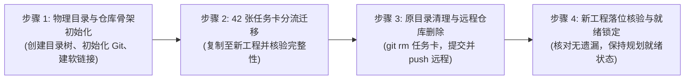

# 独立工程目录创建与文件迁移执行计划 (Directory Setup & File Migration Plan)

> **核心原则与阶段定位**：
> 1. **当前阶段定位**：本项目目前**严格处于方案规划阶段，尚未到达任务启动与执行阶段**。
> 2. **本次执行边界**：本次操作**仅限于独立工程物理目录结构的创建、以及规划文档与任务卡的分流迁移**。
> 3. **绝对不涉及任何任务**：不派发任何任务、不认领任何工单、不编写任何业务实现代码、不执行任何编译构建与串口联调。目标是交付一套物理清晰、骨架完整、资产就绪的独立工程工作区。

---

## 1. 物理目录拓扑结构目标 (Target Layout)

依据 [[AI_SoC_协作方案/independent_project_architecture_and_evaluation_20261013_135840|架构评估方案]] 与现行规范，工作区部署于 Linux 环境（如 `~/workspace/ai_soc_project/`），顶层为纯工作区目录（不设顶层 `.git`），并排建立 4 个核心 Git 仓骨架及辅助目录：

```text
ai_soc_project/                      # 【纯工作区根目录，本身无顶层 .git】
│
├── project-control/                 # 【核心治理仓 (独立 Git)】(存放协作资产、文档、版本锁)
│   ├── .git/
│   ├── .agents/                     # ← 权威协作与管理目录
│   │   ├── kanban/                  # 看板与任务卡分流存放区
│   │   │   ├── KANBAN.md            # 全局看板初始模板
│   │   │   └── milestones/          # 阶段任务卡 (承接 22 份 marlin_ms01~ms22)
│   │   ├── audit_logs/              # QA 审计报告存放目录 (预留空目录)
│   │   └── rules/                   # 协作规范镜像 (存放微步规范、QA清单)
│   ├── docs/                        # 项目设计、基线与规划资产
│   │   ├── baseline/                # 物理硬基线文档
│   │   ├── specs/                   # 接口与协议规范文档
│   │   └── planning/                # 规划资产分流归放区
│   │       ├── product/             # 产品规划卡 (承接 2 份 product_pl01, pl02)
│   │       └── work_packages/       # 宏观工作包 (承接 18 份 TASK-001~018)
│   └── manifest.yaml                # 集成版本锁初始模板
│
├── soc-ap/                          # 【上位机系统仓 (独立 Git)】(预留源码骨架目录)
│   ├── .git/
│   ├── config/                      # 配置文件目录
│   ├── core/                        # 核心守护进程源码目录
│   ├── specs/                       # 契约原件目录
│   └── tests/                       # 单元测试目录
│
├── mcu-p3/                          # 【双 MCU 固件已有仓 (已有独立 Git)】(统一管理主从控)
│   ├── .git/
│   ├── mc/                          # 主控固件源码目录 (AT32F435, include/ 与 src/)
│   └── th/                          # 工具头从控固件源码目录 (AT32A423, include/ 与 src/)
│
├── test_harness/                    # 【QA 独立测试套件仓 (独立 Git)】(预留测试夹具骨架)
│   ├── .git/
│   ├── hil/                         # 硬件在环测试脚本目录
│   ├── static_checks/               # 静态检查配置目录
│   └── test_cases/                  # 测试用例目录
│
├── tools/                           # 【工程辅助脚本目录】(构建/烧录/环境同步脚本)
├── artifacts/                       # 【交付制品目录】(预留固件与哈希索引目录)
│
└── .agents -> ./project-control/.agents  # (工作区根目录软链接，方便全局索引)
```

---

## 2. 实施步骤：全流程落地规程

本次执行完全收敛为**“骨架创建”**、**“资产迁移”**与**“原目录清理及远程同步删除”**，不含任何任务推进动作：



---

### 步骤 1：物理目录与仓库骨架初始化 (SOP-01)

*   **执行责任人**：INTEGRATOR
*   **操作目标**：在目标路径生成空目录树并初始化 Git 仓库。

#### 具体执行命令集：
```bash
# 1. 建立顶层工作区
mkdir -p ~/workspace/ai_soc_project
cd ~/workspace/ai_soc_project

# 2. 建立 project-control 仓骨架并初始化 Git
mkdir -p project-control
cd project-control && git init
mkdir -p .agents/kanban/milestones \
         .agents/audit_logs \
         .agents/rules \
         docs/baseline \
         docs/specs \
         docs/planning/product \
         docs/planning/work_packages
touch manifest.yaml
cd ..

# 3. 建立 soc-ap 仓骨架并初始化 Git
mkdir -p soc-ap
cd soc-ap && git init
mkdir -p config core specs tests
cd ..

# 4. 检出/准备 mcu-p3 已有固件仓骨架
# (若已有远端则 git clone，否则建立本地目录结构备用)
mkdir -p mcu-p3
cd mcu-p3
if [ ! -d ".git" ]; then
    git init
    mkdir -p mc/include mc/src th/include th/src
fi
cd ..

# 5. 建立 test_harness 仓骨架并初始化 Git
mkdir -p test_harness
cd test_harness && git init
mkdir -p hil static_checks test_cases
cd ..

# 6. 建立辅助目录与软链接
mkdir -p tools artifacts
ln -s project-control/.agents .agents
```

*   **步骤 1 验收标准**：`~/workspace/ai_soc_project/` 下 4 个仓库目录及子目录结构建立完毕，Git 初始化无报错，软链接 `.agents` 指向正确。

---

### 步骤 2：42 张任务卡与规约文件分流迁移 (SOP-02)

*   **执行责任人**：COORD
*   **操作目标**：将当前存放在 `/mnt/d/AI_RDdocs/AI_SoC_协作方案/` 下的 **42 份任务卡**及**核心规则文档**精准分流复制到新工程中，理清资产层级。

#### 1. 任务资产 42 张卡分流对照表：

| 资产类型 | 原始文件列表 | 目标存放路径 (在 project-control 仓中) | 迁移后定位说明 |
| :--- | :--- | :--- | :--- |
| **产品规划卡**<br/>(共 2 份) | `product_pl01_20261008_083854.md`<br/>`product_pl02_20261008_083854.md` | `docs/planning/product/` | 保持**当前活跃规划卡**身份，作为整机产品需求与规划输入 |
| **宏观工作包**<br/>(共 18 份) | `TASK-001_收敛 FDM 产品需求和验收.md` 至<br/>`TASK-018_接入 MQTT 网关业务映射和授权.md` | `docs/planning/work_packages/` | 完整保留原有工作包结构、`child_tasks` 与 `MCQ-01~06` 接口缺口，作为**全局追溯视图（非派单卡）** |
| **阶段实施卡**<br/>(共 22 份) | `marlin_ms01_20261007_214108.md` 至<br/>`marlin_ms22_20261008_083854.md` | `.agents/kanban/milestones/` | 存放于阶段里程碑卡池，作为后续各阶段的目标定义与依赖说明卡 |

#### 2. 协作规范与治理文件迁移对照表：

| 文件名称 | 原始路径 | 目标存放路径 |
| :--- | :--- | :--- |
| **单票原子微步设计规范** | `AI_SoC_协作方案/single_ticket_atomic_microstep_design_20261013_113636.md` | `project-control/.agents/rules/` |
| **独立 QA 审查清单与指引** | `AI_SoC_协作方案/qa_audit_checklist_guide_20261013_115611.md` | `project-control/.agents/rules/` |
| **工程架构与评估文档** | `AI_SoC_协作方案/independent_project_architecture_and_evaluation_20261013_135840.md` | `project-control/docs/baseline/` |
| **本执行计划** | `AI_SoC_协作方案/independent_project_architecture_execution_plan_20261017_113458.md` | `project-control/docs/baseline/` |

#### 迁移执行命令示例：
```bash
SRC_DIR="/mnt/d/AI_RDdocs/AI_SoC_协作方案"
TARGET_PC="$HOME/workspace/ai_soc_project/project-control"

# 1. 迁移产品规划卡 (2 份)
cp "${SRC_DIR}/tasks/product_pl"*.md "${TARGET_PC}/docs/planning/product/"

# 2. 迁移宏观工作包卡 (18 份)
cp "${SRC_DIR}/tasks/TASK-"*.md "${TARGET_PC}/docs/planning/work_packages/"

# 3. 迁移实施阶段卡 (22 份)
cp "${SRC_DIR}/tasks/marlin_ms"*.md "${TARGET_PC}/.agents/kanban/milestones/"

# 4. 迁移规则与规范文件
cp "${SRC_DIR}/single_ticket_atomic_microstep_design_20261013_113636.md" "${TARGET_PC}/.agents/rules/"
cp "${SRC_DIR}/qa_audit_checklist_guide_20261013_115611.md" "${TARGET_PC}/.agents/rules/"
cp "${SRC_DIR}/independent_project_architecture_and_evaluation_20261013_135840.md" "${TARGET_PC}/docs/baseline/"
cp "${SRC_DIR}/independent_project_architecture_execution_plan_20261017_113458.md" "${TARGET_PC}/docs/baseline/"
```

*   **步骤 2 验收标准**：42 份任务卡与 4 份核心规范文件完整复制到目标位置，逐文件检查文件名与内容无截断。

---

### 步骤 3：原目录任务卡清理与远程仓库同步删除 (SOP-03)

*   **执行责任人**：COORD
*   **操作目标**：在确认新工程（`ai_soc_project/project-control`）已 100% 完整接管全部 42 份任务卡与规约文档后，将原知识库中的任务卡彻底清理，并从远程 Git 仓库中同步删除，彻底消除“双权威”隐患。
*   **前置硬性门禁**：**必须先确认新工程仓库中的文件已全部落地并完成初始提交**，严禁在未确认新工程文件完好前执行删除。

#### 具体执行命令集：
```bash
cd /mnt/d/AI_RDdocs

# 1. 从原 Git 仓库中物理移除全部 42 份任务卡
git rm -r AI_SoC_协作方案/tasks/

# 2. 提交删除变更至原本地 Git 仓库
git commit -m "chore: purge 42 task cards after migration to independent project-control repo"

# 3. 将删除操作同步推送到原远程仓库 (彻底删除远程副本)
git push origin main
```

*   **原知识库重定向保留（避免断链）**：
    在原 `AI_SoC_协作方案/看板.md` 与 `00_开始这里.md` 中更新权威说明：
    “所有 42 份实施任务卡已从本库物理移除并同步清除远程，唯一权威原件已迁移至 `~/workspace/ai_soc_project/project-control`。”
*   **步骤 3 验收标准**：
    *   原目录 `/mnt/d/AI_RDdocs/AI_SoC_协作方案/tasks/` 已物理移除；
    *   `git status` 显示原仓库工作区干净；
    *   `git push` 执行成功，远程仓库中的 `AI_SoC_协作方案/tasks/` 记录已被同步清除。

---

### 步骤 4：新工程迁移落位核验与就绪锁定 (SOP-04)

*   **执行责任人**：ARCH / COORD
*   **操作目标**：完成新工程内文件计数核对与 Git 初始快照，正式确立“规划就绪”状态。

#### 检查清单：
1.  **新工程文件数量核验**：
    *   `ls -1 ~/workspace/ai_soc_project/project-control/docs/planning/product/ | wc -l` 必须严格等于 **2**；
    *   `ls -1 ~/workspace/ai_soc_project/project-control/docs/planning/work_packages/ | wc -l` 必须严格等于 **18**；
    *   `ls -1 ~/workspace/ai_soc_project/project-control/.agents/kanban/milestones/ | wc -l` 必须严格等于 **22**；
    *   合计迁移卡片数量为 **42 份**。
2.  **新工程提交初始快照 (Initial Commit)**：
    在 `project-control` 执行：
    ```bash
    cd ~/workspace/ai_soc_project/project-control
    git add .
    git commit -m "chore: scaffold project structure and migrate 42 planning tasks"
    ```
3.  **状态保持说明**：
    *   原知识库 `/mnt/d/AI_RDdocs` 任务卡已全部清除并同步远程，仅保留方案与架构思考；
    *   新工程目录 `~/workspace/ai_soc_project/` 完成骨架建立与文件归位，**处于静态规划就绪（Planning Ready）状态**；
    *   **在此之后，不触发任何任务流转，等待项目负责人进一步指令**。

---

## 3. 本次执行验收判据 (Final Sign-off)

| 检查项 | 判定标准 | 状态 |
| :--- | :--- | :---: |
| **工作区根目录** | `~/workspace/ai_soc_project/` 独立建立，非嵌套仓库 | 待执行 |
| **仓库划分** | 包含 `project-control`, `soc-ap`, `mcu-p3`, `test_harness` 4 仓骨架 | 待执行 |
| **软链接设置** | `ai_soc_project/.agents -> ./project-control/.agents` 正常可用 | 待执行 |
| **任务卡分流迁移** | 42 份卡片按规划 (2)、工作包 (18)、阶段卡 (22) 准确归位新仓，无文件丢失 | 待执行 |
| **原目录与远程删除** | **原 tasks/ 目录全部 42 份文件通过 git rm 移除、提交并 git push 推送至远程，彻底无残留** | 待执行 |
| **任务静默状态** | **未认领、未执行任何任务，代码与测试均处于零动作静默状态** | **严格保证** |
