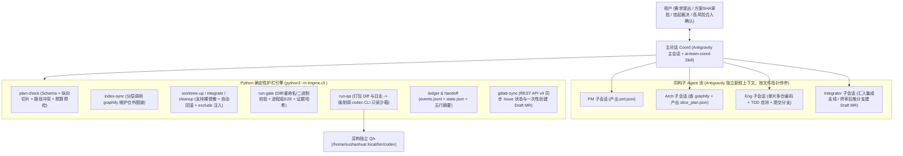
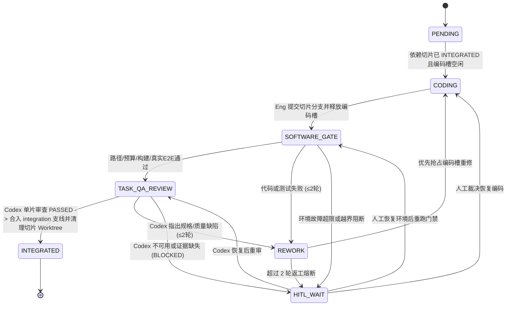

# 多仓嵌入式 AI 研发团队：架构演进与改造设计方案

本文档基于对当前仓库 31 个文件的[逐行审查报告](./line_by_line_review.md)、参考库 `~/agents/skillslab`（`superpowers`、`mattpocock/skills`、`graphify`）的工程模式，以及与您对齐的全部核心决策编制。确认本方案后即可进入代码与文档改造阶段。

---

## 一、已锁定的核心架构共识（Design Decisions）

| 决策维度 | 已确认方案 | 解决的痛点与设计收益 |
| :--- | :--- | :--- |
| **1. 主控与宿主形态** | **常驻主对话担任 `Coord` + Python 确定性 CLI 护栏 + 子 Agent / 外部 CLI 派单** | 人始终与同一个 `Coord` 主会话自然对话；同构角色走原生独立子会话，确定性规则与异构审查全部收归 Python 硬门禁，杜绝口头放行。 |
| **2. 多片分支与集成** | **需求级集成支线（`ai-team/<req>/integration`）** | 单片在独立 Worktree 验收通过后即汇入需求集成支线并释放执行配额，**彻底消除原设计 ≥3 片在 MVP 阶段卡死 `WIP=2` 的死锁**。 |
| **3. Draft MR 时机** | **全部切片汇入集成支线 + 整支线终审通过后，一次性创建各改动仓 Draft MR** | 避免半成品切片频繁打扰评审人；每个改动仓对整份需求只产出一个干净、经完整回归和终审的 Draft MR。 |
| **4. 独立 QA 策略** | **严格强制本机异构 `codex` CLI 只读审查，不可用即 `BLOCKED` 挂起** | 宿主机已就绪 `/home/sushaohua/.local/bin/codex`（`0.172.0`）；通过跨模型家族、只读沙箱审查实现零妥协独立验收。 |
| **5. 领域边界划分** | **内核通用、目标外置（Engine Generic, Target Externalized）** | 将 `c308l`、`rv1126b_*` 构建档位等硬件特定概念全部下沉至 `targets/<target>.yaml`，核心 Schema 与 Python 引擎可复用于任意多仓嵌入式平台。 |
| **6. 大仓检索加速** | **分层预建 `graphify` 图谱索引** | 宿主机已就绪 `/home/sushaohua/.local/bin/graphify`；对 `printer-soc` 与 `bsp-platform` 全量建图，对 `kernel-6.1` 与 `buildroot` 仅按 `target.yaml` 登记的板级子目录做 AST 建图，索引放仓外 `runtime/indices/`。 |
| **7. 人机与外部协同** | **本地 CLI + Git 收据账本 + 内网 GitLab Issue/MR API 同步** | 宿主机未装 `glab`，直接用 Python 标准库 `urllib.request` 对接内网 GitLab REST API v4（零新增三方依赖），实现本地收据与远端 Issue/Draft MR 双向闭环。 |

---

## 二、总体运行拓扑（Coord + Harness + Python Engine + Codex QA）



> [!IMPORTANT]
> **防上下文腐化与防丢进度铁律（吸收自 `skillslab/superpowers`）**
> 1. **主对话不碰业务代码、不读巨型日志**：`Coord` 每次只读取 `engine` 输出的**五行交接摘要**与 `state.json`；全文 Diff、编译输出、`graphify` 报告一律写成磁盘文件，以路径指针传给子 Agent 或 `codex`。
> 2. **账本抗压缩恢复（Ledger-First Recovery）**：即使主对话触发 `/compact` 上下文压缩，`Coord` 读取 `runtime/<request_id>/state.json` 与各仓 Git 分支实况即可精确恢复断点，绝不重复派发已完成切片。

---

## 三、全新生命周期与需求级集成支线状态机

采用**需求级集成支线**与**整支线终审后一次性建 Draft MR**后，原本扁平混杂的状态拆分为清晰的**两层状态机**（需求级状态 + 切片级状态），彻底消除死锁与状态歧义：

### 1. 需求级状态流转（Request Lifecycle）
1. `PLANNING`：`PM` 生成 `prd.json` $\rightarrow$ `engine index-sync` 准备图谱 $\rightarrow$ `Arch` 生成 `slice_plan.json` $\rightarrow$ `engine plan-check` 机器预检。
2. `QA_PLAN_REVIEW`：`engine run-qa --stage plan_review` 调用 `codex` 独立审查 PRD 覆盖度、切片纵向闭环与兼容性（`codex` 不可用则置 `BLOCKED`）。
3. `AWAITING_APPROVAL`：向用户展示预审结论及 `prd_sha256` / `plan_sha256`；用户批准后落盘审批收据，并在所有计划写仓初始化 `ai-team/<request_id>/integration` 支线。
4. `SLICES_IN_PROGRESS`：按拓扑依赖逐片调度执行（单 `Eng` 编码槽，返工优先）；每片通过单片门禁与单片 `codex` 审查后快进/变基汇入 `ai-team/<request_id>/integration` 并清理该片临时 Worktree。
5. `WHOLE_BRANCH_REVIEW`：所有切片均进入 `INTEGRATED` 后，检出集成支线组合，运行全量关联门禁命令 + `codex` **整支线终审**（审查跨切片交互与整体规范，最多允许一轮修复波次）。
6. `MR_DRAFT_CREATED`（**MVP 默认终点**）：整支线终审通过后，一次性将各写仓 `ai-team/<request_id>/integration` 推送至内网 GitLab，按 `merge_order` 说明创建一套互相关联的 **Draft MR** 并回写总控 Issue。
7. `HIL_VERIFIED` $\rightarrow$ `MERGED`（**正式投产延伸**）：实板 HIL 收据（绑定 `board_id`、`firmware_sha256`、观察物证）齐备后，按风险等级由 `Integrator` 串行合入 `main`。
8. 异常/取消终态：`BLOCKED`（缺 `codex`、环境故障超限、变基冲突等保留现场挂起）、`SUPERSEDED`（需求/方案升版后旧版归档）、`CANCELLED`。

### 2. 切片级状态流转（Slice Lifecycle）



---

## 四、模块重构与契约升级设计

### 1. Python 引擎包结构重构（消除反向依赖与循环导入）

在 `ai-team-mvp/` 下补齐标准包结构，将原 4 个文件拆解为职责单向、无环的 8 个内聚模块与统一 CLI 入口：

```text
ai-team-mvp/
├── .ai-team/
│   ├── workflow.yaml                 # 通用两层状态机、预算阈值与重试熔断策略
│   ├── roles/                        # 统一补齐 permission / budget / output_contract 的 6 角色定义
│   ├── rules/                        # 更新后的编码规范、纵向切片与全局护栏文档
│   ├── skills/                       # 按角色细分子权限的技能声明 + Coord 操作规程
│   ├── schemas/                      # 升级版通用 JSON Schemas (含 target/role 配置自检 Schema)
│   └── targets/
│       └── rv1126b.yaml              # 外置目标配置：四仓拓扑、构建档位、variant_checks(c308l)、graphify范围、门禁
├── engine/
│   ├── __init__.py
│   ├── policy.py                     # PolicyError、Schema缓存校验、规范化JSON哈希、路径与重命名匹配原语
│   ├── git_ops.py                    # 安全 git 封装(禁交互提示/超时)、裸仓与普通仓兼容识别、重命名numstat解析
│   ├── plan_checker.py               # 纵向切片预检(含防误杀正则、受保护路径/嵌套仓冲突预检、外置variant校验)
│   ├── workspace_mgr.py              # 需求 integration 支线初始化、切片 Worktree 事务创建/自动回滚/exclude注入/逆序清理
│   ├── gate_runner.py                # 候选仓校验、进程组E2E执行(防孤儿进程+超时保日志+duration计时)
│   ├── qa_runner.py                  # 生成 BASE..HEAD 评审包文件，强制调用 codex CLI 只读沙箱并校验结构化结论
│   ├── index_mgr.py                  # 按 target.yaml 的 index_policy 调用 graphify 构建/增量刷新仓外知识图谱
│   ├── ledger.py                     # events.jsonl 追加写、state.json 快照重建、收据读写与五行摘要渲染
│   ├── gitlab_sync.py                # 标准库 urllib 对接 GitLab REST API v4 (Issue 评论/标签同步 + 终审后批量建 Draft MR)
│   └── cli.py                        # Coord 调用的统一命令行入口 (plan-check / init-req / next / worktree-* / run-gate / run-qa / handoff / create-mrs)
├── examples/                         # 更新为通用 variant_checks 格式并补齐回放对账闭环的 2 套样例
└── tests/
    ├── __init__.py
    └── ...                           # 按模块拆分的完整单测套件（隔离夹具、覆盖正向/反向/边界与 CLI）
```

---

### 2. “内核通用、目标外置”配置与 Schema 升级要点

#### （1）目标配置文件 [rv1126b.yaml](file:///home/sushaohua/pipline/ai-team-mvp/.ai-team/targets/rv1126b.yaml) 扩展结构
将原先散落在 `slice_plan.schema.json`（`c308l`）和 `ci_gate.yaml`（`rv1126b_*` 构建档位）中的专案逻辑全部收敛到 `targets/<target>.yaml`：
- **`repos.<repo>`**：
  - 增加 `allowed_urls`（列表，兼容组织主仓地址与本地镜像/个人开发仓覆盖，替代原先死板的单一 URL 字符串相等判断）；
  - 增加 `required_profiles_on_write`（如修改 `kernel-6.1` 强制要求 `build_profiles` 包含 `rv1126b_kernel`）；
  - 增加 `index_policy`：
    - `printer-soc` / `bsp-platform`：`{tool: graphify, mode: full}`
    - `kernel-6.1`：`{tool: graphify, mode: scoped_ast, paths: [arch/arm64/boot/dts/rockchip, drivers/dma, drivers/tty/serial]}`
    - `buildroot`：`{tool: graphify, mode: scoped_ast, paths: [board/rockchip/rv1126b, configs, package/rockchip]}`
- **`protected_paths`**：扩充为 `[.ai-team/**, .gitlab-ci.yml, .gitlab/**, .gitmodules]`。
- **`build_profiles`**：从 `ci_gate.yaml` 迁入目标配置，并标记默认必选主平台前缀。
- **`variant_checks`**：声明本目标强制要求 Arch 逐片表态的关联平台/变体列表：
  ```yaml
  variant_checks:
    c308l:
      description: 共享应用或公共服务变更对 C308L 机型的兼容性验证判断
      required_profile_when_enabled: c308l
  ```

#### （2）Schema 升级要点
- **[prd.schema.json](file:///home/sushaohua/pipline/ai-team-mvp/.ai-team/schemas/prd.schema.json)**：增加 `revision`（整数 `>=1`）与可选 `gitlab_issue` 绑定字段；`AC-x` 正则收紧为 `^AC-[1-9][0-9]*$`；所有必填文本增加非空白正则 `\S`。
- **[slice_plan.schema.json](file:///home/sushaohua/pipline/ai-team-mvp/.ai-team/schemas/slice_plan.schema.json)**：将硬编码属性 `"c308l"` 替换为通用字典 `"variant_checks": {"additionalProperties": {"$ref": "#/definitions/variant_decision"}}`，由 `plan_checker.py` 对照当前 `target.yaml` 的 `variant_checks` 键集合做精确匹配校验；在 `historical_replay` 模式下依然保留 `base_ref` 基线，但将整需求归并方式与 `delivery` 区分。
- **[handoff.schema.json](file:///home/sushaohua/pipline/ai-team-mvp/.ai-team/schemas/handoff.schema.json)**：
  - `stage` 扩展为：`["plan_review", "approval", "candidate", "software", "task_qa", "integrated", "whole_branch_qa", "replay", "hil", "draft_mr", "merge"]`；
  - 增加 `mode`（`"delivery" | "historical_replay"`）与可选 `failure_category`（`"code" | "environment" | "qa_unavailable" | "policy"`）；
  - 当 `status != "PASSED"` 时强制 `required: ["reason", "failure_category"]`；
  - 当 `stage == "hil"` 时强制 `required: ["board_id", "firmware_sha256"]`；
  - 新增 `config` 自检 Schema，在引擎启动时自动校验 `workflow.yaml`、`roles/*.yaml`、`skills/*.yaml`、`targets/*.yaml` 自身完整性。

---

### 3. 异构 Codex QA 强门禁设计（`engine/qa_runner.py`）

严格落实**“强制本机 `codex` CLI，不可用即 `BLOCKED`”**：
1. **探活与零妥协阻断**：执行前用 `shutil.which("codex")` 检查可执行文件；若缺失、退出码异常、超时或输出不满足 JSON Verdict Schema，立即生成 `status: "BLOCKED", failure_category: "qa_unavailable"` 收据并进入 `HITL_WAIT`，**绝不回退到当前会话自审**。
2. **只读隔离调用**：
   - 先由引擎确定性生成评审包文件 `runtime/<request_id>/reviews/<slice_or_final>/review_package.md`（含锁定 PRD 对应场景、切片契约、`git log --oneline base..head`、`git diff --stat`、`git diff -M -U10 base..head`、以及 E2E 日志定位与摘要）；
   - 调用 `codex exec --sandbox read-only --cd <workspace_root> --output-schema <verdict.schema.json> -o <verdict.json> <prompt>`（运行前通过 `codex exec --help` 校验参数兼容性并封装适配器），从两轴（**Spec 验收覆盖与证据真实性** + **Standards 代码质量与兼容性**）输出结构化裁决（`PASSED` / `FAILED` 附 `BLOCKER`/`MINOR`/`NIT` 清单 / `BLOCKED`）。

---

### 4. 逐行审查 P0/P1 缺陷定点修复清单

1. **路径与安全边界**：
   - 修复 `path_matches(path, "dir/**")` 同时匹配 `path == "dir"`（防顶层符号链接/子模块替换绕过 `.ai-team/**`）；
   - 在 `plan_checker.py` 预检阶段提前拦截：`allowed_paths` 命中 `protected_paths`、父仓（`bsp-platform`）`allowed_paths` 侵入子仓挂载路径（`kernel-6.1/**` 等）、以及各仓预算之和小于整片预估行数等矛盾配置；
   - 修复 `HORIZONTAL_GOAL` 为 `(?<!不)(?:仅|只)...`，消除对“不仅定义接口，还…”的误判。
2. **Git Worktree 与裸仓健壮性**：
   - `git_ops.py` 支持 `git clone --mirror/--bare` 本地裸镜像作为 `sources`（通过 `--is-bare-repository` 分支校验），统一设置 `GIT_TERMINAL_PROMPT=0`、`stdin=DEVNULL` 与命令超时；
   - `create_slice_worktrees` 包裹事务 `try/except`，任一子仓装配失败自动逆序卸载已建 Worktree 与临时分支；
   - 装配嵌套子仓后自动向根仓 Worktree 的 `$GIT_DIR/info/exclude` 写入子仓相对路径，彻底杜绝因历史基线 `.gitignore` 缺失导致的 `bsp-platform 有未提交改动` 误报；
   - `gate_runner.py` 改用 `git diff --numstat -z -M` 同时校验重命名新旧双路径，且纯移动文件不再双倍消耗 Diff 行数预算。
3. **门禁子进程生命周期**：
   - `Popen(..., start_new_session=True)` 启动门禁，超时通过 `os.killpg` 清理整棵编译/测试进程树，并将超时前已产生的 `stdout` 完整落盘至仓外 `runtime/<request_id>/logs/`，返回结果补齐 `duration` 秒数。

---

## 五、分步实施计划（获批后执行顺序）

1. **阶段一：基础契约与配置升级**
   - 升级 `.ai-team/schemas/`（`prd`、`slice_plan`、`handoff` + 新增配置与 QA Verdict Schema）；
   - 升级 `.ai-team/targets/rv1126b.yaml`、`workflow.yaml`、6 个 `roles/*.yaml`、3 个 `skills/*.yaml` 及 3 份 `rules/*.md`；
   - 同步更新 `examples/telemetry-home/` 与 `examples/uart6-replay/`（将 `recorded_candidate.json` 纳入回放对账闭环）。
2. **阶段二：Python 确定性引擎重构与扩展**
   - 实现 `policy.py`、`git_ops.py`、`plan_checker.py`、`workspace_mgr.py`（含需求 `integration` 支线汇入与逆序清理）、`gate_runner.py`、`qa_runner.py`（对接 `codex-cli`）、`index_mgr.py`（对接 `graphify`）、`ledger.py`、`gitlab_sync.py` 与统一 `cli.py`（保留 `python3 -m engine.orchestrator` 兼容入口）。
3. **阶段三：主会话 Coord Skill 与项目文档就位**
   - 新增仓库级 Coord 调度规程 Skill（指导主会话如何用 `engine.cli` + 子 Agent 驱动全流程）；
   - 初始化 Git 仓库，完善 `.gitignore`，重写根目录 `AGENTS.md` 与 `ai-team-mvp/README.md`（含术语表、架构图、全量命令与单测指南）。
4. **阶段四：全量自动化测试验证**
   - 编写覆盖预检、裸仓与普通仓嵌套 Worktree、异常回滚、重命名/二进制/受保护路径门禁、需求级集成支线多片流转（验证 ≥3 片无死锁）、Codex QA 包装器（含缺失 `BLOCKED` 断言）、分层 `graphify` 命令构造及 GitLab API 模拟测试，确保 100% 通过。
