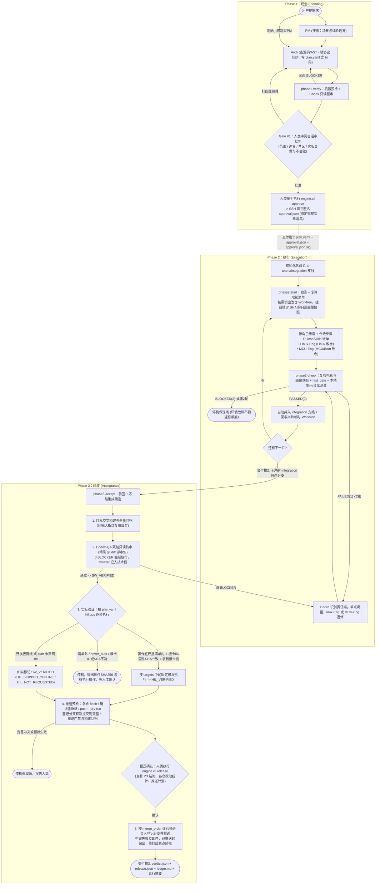

# 需求与架构共识定稿（三阶段 · 角色多维约束 · 单仓自治双模版）

## 修订记录

| 版本 | 时间 | 变更摘要 | 状态 |
| :--- | :--- | :--- | :--- |
| `v1.0` | `2026-11-27 11:46` | 确立"两端卡死，中间全自动"、6 席角色、按需 Worktree、SSH 安全冒烟与极简 Python 引擎 | 已演进 |
| `v1.1` | `2026-11-27 11:49` | 确立 **Phase 1（规划）→ Phase 2（执行）→ Phase 3（验收）** 三阶段主干 | 已演进 |
| `v1.2` | `2026-11-27 12:18` | 三阶段关口交付物收拢为单一 `plan.yaml`；新增角色六维约束矩阵与单仓独立自治管理 | 已演进 |
| `v1.3` | `2026-11-27 14:05` | 按审核意见修订 6 项 P0：① 仓拓扑（后在 v1.4 调整）；② 画像只读快照 + SHA 锁定；③ 挂载撞名检测；④ `approval.json` 由人类用 SSH 密钥签发，并绑定完整哈希清单；⑤ 实板操作改为 Gate #1 预授权 + 白名单执行；⑥ 行数预算放宽为测试强制的 1000/1500 行。P1 待决项见第七节 | 已演进 |
| `v1.4` | `2026-11-27 15:23` | 落定仓与目录：① 5 仓（`bsp-platform` 内嵌 `kernel-6.1`、`buildroot`，`printer-soc` 与 `mcu-p3` 和它并列），bootloader 与 `test_harness` 第一版不纳入；② 只服务 RV1126B；③ 最终交付为合入各仓登记分支；④ 画像复用现有 `agents` 仓，工作副本在 `repos/agents/`，按仓指定子目录；⑤ 总工作区目录定稿（`ai-team-mvp/`、`repos/`、`runtime/`、`docs/design/`）；⑥ 知识库第一版不接入；⑦ MC/TH App OTA 可预授权（D-2）；⑧ 合入与推送规则（D-4）；⑨ 跨栈切片派两个 Eng（P1-1）；D-5 暂缓；⑩ 仓库实测后补充 `links` / `local_excludes` / `forbidden_paths` | 待确认执行 |

---

## 一、四大架构支柱

1. **流程三阶段解耦 + 两端卡死、中间全自动**
   - 严格按 **Phase 1（规划）→ Phase 2（执行）→ Phase 3（验收）** 推进。
   - **开头只批一次**：人类在 Gate #1 审批 `plan.yaml` 中的验收判据、模块目录级边界、禁区，以及**实板操作清单（`hil` 段）**。获批后一路自动跑到 Phase 3 的独立审查和白名单内的实板验证。**结尾推送到远端前，人类再确认一次**（第一版先建立信任，以后可以放开，D-4）。中途只在以下情况停机找人：连败 2 轮熔断、环境 `BLOCKED`、需要执行清单外或 `never_auto` 的实板操作。
2. **角色多维度硬约束（不同角色加载正交的 `Rules × Skills`）**
   - 每个角色由六个维度限定：准入阶段、模型与异构隔离、物理写域与分支红线、专属规则、专属技能、输入/输出契约。不把所有规则和技能塞给所有 Agent。
3. **仓库独立自治 + 跨仓协同双模管理（Standalone & Integrated）**
   - 每个受管仓都有独立的 **`AGENTS.md`、`.agents/rules/`、`.agents/skills/`、`docs/`**，单独打开即可开发自检。进入总控流水线时，引擎从**锁定 SHA 的只读画像快照**挂载规则，检测并拒绝撞名，保证 `git status --porcelain` 为空（详见第四节）。
4. **代码与契约精简可读，行数预算由测试强制**
   - 生产代码 **≤1000 行**，生产代码加单测合计 **≤1500 行**，由 `tests/test_budget.py` 强制检查（参照 `project-control` 门禁 ≤920 行的实测规模）。单函数 ≤50 行、≤4 个参数，全中文注释，同样由测试检查引擎自身。
   - 人机共读的主文档只有 **`plan.yaml` + `ledger.md`**。其余机器文件（`approval.json`、`verdict.json` 等）见第二节权威文件清单，用 Python 扁平校验，不再维护多套嵌套 JSON Schema。唯一例外是 Codex 裁决，它必须保留 `--output-schema`。

---

## 二、三阶段流转与关口交付物



### 关口交付物

| 阶段关口 | 唯一权威交付物 | 核心约束 |
| :--- | :--- | :--- |
| **Phase 1 → Phase 2** | **`plan.yaml`**（含 `hil` 段）+ **`approval.json`** + **`approval.json.sig`**<br>*(改协议时同步更新 `contracts/*.yaml`；超复杂设计可选附 `design.md`)* | `phase2-start`、`phase2-check`、`phase3-accept` 每次都先用 `ssh-keygen -Y verify` 验签，再复算哈希清单（见第五节）。任何一项不符直接 `BLOCKED`。 |
| **Phase 2 → Phase 3** | **各改仓 `ai-team/<req>/integration` 支线** + `phase2_state.json` | 全部切片已通过 `fast_gate` 并完成合龙，临时 Worktree 已清理，各仓 `git status --porcelain` 为空。 |
| **Phase 3 → 结单** | **`verdict.json`** + **`release.json` + `.sig`**（推送确认）+ **`ledger.md` 新增行** + **五行摘要** | 绑定各仓 40 位 Commit、画像快照 SHA、构建日志哈希、`Codex` 会话 ID，以及实板操作记录（操作 ID、板卡 ID、固件 SHA256、原始日志哈希）。 |

### 合入与推送（D-4，2026-11-27 用户确认）

| 环节 | 规则 |
| :--- | :--- |
| **合入方式** | 先变基再快进。登记分支有新提交时，先把各仓 integration 变基到最新，重跑 `fast_gate` 和 P3 构建回归，通过后快进合入，保证证据对应最终推送的提交。变基没有冲突时不重跑 Codex 终审；出现冲突则停机，不自动解决冲突 |
| **推送确认** | 引擎输出 P3 结论、各仓改动统计和推送计划。人类在自己的终端执行 `engine.cli release --req <req>`，用审批时同一把 SSH 密钥签名生成 `release.json`，绑定 `verdict.json` 哈希、各仓待推送的提交和顺序。签名之后任何提交变化都会作废这次确认 |
| **多仓顺序** | `plan.yaml` 声明 `merge_order`（Arch 按需求决定，计入审批哈希）；没声明时用 `rv1126b.yaml` 的 `merge_order_default`：`kernel-6.1 → buildroot → bsp-platform → mcu-p3 → printer-soc`（先底层后上层，避免上层先用上下层还没推送的协议或接口） |
| **预检与失败** | 推送前先对所有仓预检：`fetch`、确认能快进、`push --dry-run`。全部通过才按顺序逐个推送。中途仍然失败时立即停下，已推送的保留，不自动回滚，报告人类；修好后从断点续推 |

### 权威文件清单

| 文件 | 写入方 | 格式 | 校验方式 |
| :--- | :--- | :--- | :--- |
| `plan.yaml` | PM（场景段）、Arch（技术段与 `hil` 段） | YAML | `plan.py` 扁平校验 |
| `contracts/*.yaml`、`design.md` | Arch | YAML / MD | 计入审批哈希清单 |
| `approval.json` + `.sig` | **只能由人类**执行 `engine.cli approve` 生成 | JSON + SSH 签名 | `ssh-keygen -Y verify` + 哈希复算 |
| `release.json` + `.sig` | **只能由人类**执行 `engine.cli release` 生成 | JSON + SSH 签名 | 绑定 `verdict.json` 哈希、各仓待推送的 40 位提交与推送顺序 |
| `runtime/<req>/mounts.json` | 引擎 | JSON | 记录每仓画像快照路径、SHA、实际挂载名 |
| `phase2_state.json` | 引擎 | JSON | 断点恢复用，可由 Git 实况重建 |
| `final.json`（Codex 裁决） | Codex CLI | JSON（`--output-schema`） | `validate_graded_verdict()` |
| `verdict.json`、`ledger.md` | 引擎 | JSON / MD | 结单证据 |

---

## 三、角色六维硬约束矩阵（`Role = 维度限制 × 专属 Rules × 专属 Skills`）

每个角色在 `.ai-team/roles/<role>.yaml` 中声明以下 6 个维度。引擎派单时只组装该角色对应的规则与技能，门禁阶段校验其写域与模型隔离。

| 角色 ID | ① 准入阶段 | ② 模型与异构隔离限制 | ③ 物理写域与分支红线 | ④ 注入的 Rules（全局 + 仓级叠加） | ⑤ 角色专属 Skills（+ 仓级 Skills） | ⑥ 输入 → 准出交付契约 |
| :--- | :---: | :--- | :--- | :--- | :--- | :--- |
| **`Coord`** | P1 / P2 / P3 | 当前主会话（跑 P2 时禁与 QA 同源家族） | 仅 `runtime/` 与治理账本；**业务仓只读**；**禁止执行 `engine.cli approve`** | `global_guardrails` | `coord-orchestrator`、`swarm_pane` | 用户意图 + 门禁摘要 → 派单指针 / 人类汇报 |
| **`PM`** | 仅 P1 | 首选 `gemini-4-neon-high` → 备 `neon-xhigh` | 仅 `plan.yaml` 场景段；**代码与契约只读** | `global_guardrails` | `product-requirements` | 用户原话 → 场景、`AC`、正负体验与边界 |
| **`Arch`** | 仅 P1 | 首选 `gemini-4-carbon-high` → 备 `neon-xhigh` | 仅 `plan.yaml` 技术段与 `hil` 段（及 `contracts/`）；**业务源码只读** | `slicing_rules`、`global_guardrails` | `arch-deep-spec`、`graphify`（按需 AST） | `AC` + 各仓 `AGENTS.md` → 调用链锚点 + `plan.yaml` |
| **`Linux-Eng`** | 仅 P2 | 独立新鲜子会话（**严禁与 Codex-QA 同家族**） | **仅限 `domain: linux` 授权仓**的切片模块白名单 | `coding_standards`、`slicing_rules` + 所改仓 `.agents/rules`（只读快照） | `contract-tdd` + 所改仓 `.agents/skills` | 切片任务单 + 契约指针 → Linux 仓提交 SHA + 单测绿灯 |
| **`MCU-Eng`** | 仅 P2 | 独立新鲜子会话（**严禁与 Codex-QA 同家族**） | **仅限 `domain: mcu` 授权仓**白名单；严守 `prohibited_branches`（Boot 禁 `main`/`master`） | `coding_standards`、`slicing_rules` + 所改仓 `.agents/rules`（只读快照） | `contract-tdd` + 所改仓 `.agents/skills` | 切片任务单 + 契约指针 → 固件仓提交 SHA + 产包/单测绿灯 |
| **`Codex-QA`** | P1 预审 & P3 终审 | 强制本机独立 `codex` CLI（`gpt-6.2-sol/astra` High）；缺失即 `BLOCKED` | **`--sandbox read-only`**（全仓只读） | `qa_audit_rules` | P1: `plan-pre-review`<br>P3: `two-axis-qa-audit` | P1: `plan.yaml` → 预审结论<br>P3: 精简 `git diff` 评审包 → 分级 `final.json` |

> [!NOTE]
> **跨栈切片（P1-1，2026-11-27 用户确认：派两个 Eng）**。以下为初稿细则，随实施方案一起审阅：
> - 两个 Eng 在同一个切片工作区内工作，各自只写本 domain 的仓，各自只加载本仓画像。
> - 接缝真源是 `.ai-team/contracts/minimc_v2.yaml`。协议需要改动时由 Arch 在 P1 改好并计入审批，Eng 不得自行修改。
> - 默认串行派单，顺序与 `merge_order` 一致：先 MCU-Eng（`mcu-p3`），再 Linux-Eng（AP 仓），由下层先提供新协议能力。`plan.yaml` 可以覆盖这个顺序。
> - 两端都提交后，才对整片跑 `phase2-check`。失败时由 Coord 根据失败位置单点唤醒责任端返修，返修轮次按切片计（共 2 轮）。

> [!NOTE]
> 任何 Agent 角色都不得执行 `engine.cli approve`，也不得写 `approval.json`、`.ai-team/allowed_signers` 或 `targets/*.yaml` 中的 `hil_ops`。后两者属于 `protected_paths`。

---

## 四、仓库管理体系：单仓独立自治 + 多仓协同双模兼容

### 1. RV1126B 产品受管仓拓扑（2026-11-27 用户确认）

RV1126B 产品由 AP 侧 4 仓和 MCU 侧 3 仓组成，另有 1 个跨仓测试台架仓，全部登记在 `.ai-team/targets/rv1126b.yaml`：

| 仓 | 路径（相对工作区根） | 系统 / `domain` | 开发分支 = 最终合入分支 | 状态 |
| :--- | :--- | :--- | :--- | :--- |
| `bsp-platform` | `bsp-platform` | AP · RV1126B Linux / linux | `main` | ✅ 已登记 |
| `kernel-6.1` | `bsp-platform/kernel-6.1`（嵌套） | AP / linux | `main` | ✅ 已登记 |
| `buildroot` | `bsp-platform/buildroot`（嵌套） | AP / linux | `main` | ✅ 已登记 |
| `printer-soc` | `printer-soc`（与 `bsp-platform` 并列） | AP 应用软件 / linux | `main` | ✅ 已登记 |
| `mcu-p3` | `mcu-p3`（与 `bsp-platform` 并列） | MC + TH 单片机 / mcu | `feat/soc-debug`（远端已核实） | ✅ 已登记；`bootloader/**` 设为禁区 |
| `bootloadermc` / `bootloaderth` | — | MC / TH 引导 | — | ⏸ 第一版不纳入（用户决定，出问题单独处理） |
| `test_harness` | — | 跨仓测试台架 | — | ⏸ 第一版不纳入（用户确认） |

```text
<工作区根>/
├── bsp-platform/          # AP：RV1126B Linux 底座（父仓，含 u-boot / device / rkbin）
│   ├── kernel-6.1/        # 嵌套独立仓
│   ├── buildroot/         # 嵌套独立仓
│   └── printer-soc -> ../printer-soc   # 软链：SDK 构建脚本要求 $RK_SDK_DIR/printer-soc
├── printer-soc/           # AP：应用软件栈（HelixScreen / DM / Forward / file-service / Gateway）
└── mcu-p3/                # MC + TH 单片机固件（与 AP 系统无关，独立并列）
```

> [!IMPORTANT]
> 第一版只服务 RV1126B，共 5 仓。整机与 AP 系统架构的描述方式见第七节 D-5。

**仓级附加配置（2026-11-27 实测后确认，均写在 `rv1126b.yaml`）**：
- `links`：`bsp-platform/printer-soc → ../printer-soc`。`bsp-platform` 的 `device/rockchip/common/scripts/mk-printer-soc.sh` 写死 `PRINTER_SOC_DIR="$RK_SDK_DIR/printer-soc"`，所以 `printer-soc` 物理上并列存放，再用软链满足构建脚本。引擎在主检出和每个切片工作区里都会建这个软链，不改任何业务仓。
- `local_excludes`：`bsp-platform` 中的 `/printer-soc`（`.gitignore` 里的 `/printer-soc/` 带斜杠，匹配不到软链）以及构建生成的 `device/rockchip/.chip`、`device/rockchip/rv1126b`，由引擎写入本地 `info/exclude`，不改 `.gitignore`。
- `forbidden_paths`：`mcu-p3` 的 `bootloader/**`（第一版不纳入 bootloader），任何改动都由 `fast_gate` 拦截。

### 2. 单仓标准自治结构（Standalone 形态）

每个仓逻辑上都具备四件套：
- **`AGENTS.md`**：本仓入口，说明技术栈、模块分工、单仓编译测试命令和本仓核心禁令。
- **`.agents/rules/`**：本仓专属硬规范，例如 `mcu-p3` 的 AT32 时钟/VTOR/Marlin 最小改动规范，`kernel-6.1` 的 DTS/checkpatch 规范。
- **`.agents/skills/`**：本仓专属技能，例如 `printer-soc-build`、`dual-mcu-env`、`diagnosing-bugs`。
- **`docs/`**：本仓芯片手册、原理图摘要、架构图与设计记录。

### 3. 画像来源与版本锁定（2026-11-27 用户确认：复用现有 `agents` 仓）

画像**直接复用现有的 `agents` 仓**（远端 `git@github.com:sushaohua/agents.git`，沿用 `~/agents` 的配置），在 `repos/agents/` 放一份工作副本，不另建新仓。原因：`printer-soc`、`mcu-p3` 是 C308L 与 RV1126B 共用的业务仓，画像只能有一套，否则会产生漂移。仓内其他产品的目录（`skillslab`、`c308l-sdk` 等）不影响使用：流水线只按锁定版本导出需要的子目录，C308L 那边也有自己锁定的提交，互不干扰。

| 业务仓 | 画像子目录（`rv1126b.yaml` 的 `profile` 字段） | 备注 |
| :--- | :--- | :--- |
| `bsp-platform` | `rv1126b-q1/` | 第一版同时覆盖 `kernel-6.1` 与 `buildroot`；需整理成 `.agents/{rules,skills}` + `docs/` 的标准结构 |
| `kernel-6.1`、`buildroot` | 无（`null`） | 以后需要时再拆出独立子目录 |
| `printer-soc` | `printer-soc/` | 与 C308L 共用；平台差异（如 `/dev/ttyS1`、c308l 构建）需拆成独立规则文件 |
| `mcu-p3` | `mcu-p3/` | 与 C308L 共用 |

- `rv1126b.yaml` 顶层登记 `profile_repo: {path: agents, url, pinned_sha}`，路径相对 `repos/`。
- `pinned_sha` 计入 `approval.json` 哈希清单。流水线只认远端上存在的已提交内容，所以允许同时存在多个工作副本（如 `~/agents`、`repos/agents`），但都必须推到同一个远端。
- 业务仓自身不跟踪 `AGENTS.md/.agents/docs`，统一走挂载。`profile: null` 的仓不挂载画像。

### 4. 挂载规则：只读快照 + 撞名检测

| 场景 | 挂载来源 | 写权限 |
| :--- | :--- | :--- |
| **流水线**（`phase2-start` 切出的切片 Worktree、Phase 3 冻结候选） | 用 `git archive <pinned_sha> <subdir>` 导出到 `runtime/<req>/profiles/<repo>@<sha12>/`，再 `chmod -R a-w` | **只读**。Eng 无法穿过软链修改规则或技能 |
| **单仓日常开发**（`repo-manage setup`） | 直接指向 `repos/agents/<repo>/` 工作树 | 可写，便于人维护规则；不参与任何门禁结论 |

`mount_repo_profile()` 对三个挂载名逐一检查：

| 挂载名 | 业务仓中已存在（被跟踪或为普通文件/目录） | 处理 |
| :--- | :--- | :--- |
| `AGENTS.md` | 是 | **`BLOCKED`**：该仓应改为模式 A，或人工处理冲突 |
| `.agents` | 是 | **`BLOCKED`**：同上 |
| `docs` | 是（例如上游 `buildroot` 自带 `docs/`） | 不覆盖，改挂到 **`.agents-docs`**，并在 `mounts.json` 记录实际路径 |

- 挂载名统一写入 `git rev-parse --git-path info/exclude`，兼容普通克隆与 Linked Worktree。
- `phase2-check` 和 `phase3-accept` 会复核三件事：快照目录的树哈希没有变化；业务仓 diff 中没有出现挂载名；`git status --porcelain` 为空。
- **嵌套仓**（`bsp-platform` 内含 `kernel-6.1` / `buildroot`）的父子两层规则作用域，待第七节 P1-10 定稿。

### 5. 仓库管理 CLI（不跑流水线也能单独管仓）

- `python3 -m engine.cli repo-manage status [--repo <name>]`：查看全部或单个仓库的分支、基线、干净度、预编译 sysroot 状态，以及画像挂载的完整性和 SHA 是否匹配。
- `python3 -m engine.cli repo-manage setup [--repo <name>]`：为单个或全部仓校验远端、挂接画像软链并配置 `exclude`（日常开发模式，不导出快照）。

---

## 五、人类审批签发（Gate #1 防伪）

### 1. 签发流程

1. Coord 呈交白话审批包，内容包括：范围、AC、模块目录级边界、禁区、Codex 预审结论，以及实板"会做 / 不会做"清单。
2. **人类在自己的终端**执行 `python3 -m engine.cli approve --req <req>`。引擎打印哈希清单摘要，要求人类输入 `plan_sha256` 的前 8 位确认。
3. 引擎调用 `ssh-keygen -Y sign -n ai-team-approval -f <人类私钥>` 签名 `approval.json`，生成 `approval.json.sig`。**私钥必须设置口令**，签名时由人类输入，Agent 无法代签。
4. 后续每个阶段命令都先用 `ssh-keygen -Y verify -f .ai-team/allowed_signers -I <签发人> -n ai-team-approval` 验签。`allowed_signers` 属于 `protected_paths`。

### 2. `approval.json` 绑定的哈希清单

```json
{
  "req": "REQ-xxx",
  "approved_by": "sushaohua",
  "approved_at": "2026-11-27T14:30:00+08:00",
  "hashes": {
    "plan.yaml": "<sha256>",
    "contracts/*.yaml": {"<file>": "<sha256>"},
    "design.md": "<sha256 或 null>",
    "targets/rv1126b.yaml": "<sha256>",
    "roles/*.yaml": {"<file>": "<sha256>"},
    "rules/*.md": {"<file>": "<sha256>"}
  },
  "base_commits": {"<repo>": "<40位>"},
  "profile_shas": {"<repo>": "<40位>"}
}
```

任一文件被改、仓基线或画像 SHA 变化，都直接 `BLOCKED`。处理方式是回到 P1 重新预审并重新签发。方案变更的完整回流规则见第七节 P1-6。

---

## 六、实板操作：Gate #1 预授权 + 白名单执行（2026-11-27 用户确认采用方案 B）

### 1. `targets/rv1126b.yaml` 中的操作目录（由人维护，属于 `protected_paths`）

```yaml
hil_ops:
  soc_app_deploy:
    cmd: "scp {pkg} root@{board_ip}:/tmp && ssh root@{board_ip} /usr/bin/install_pkg /tmp/{pkg_name}"
  soc_service_restart:
    cmd: "ssh root@{board_ip} systemctl restart printer-soc"
  read_version:
    cmd: "python3 tools/read_ver.py --port {mc_port}"
  capture_log:
    cmd: "ssh root@{board_ip} 'journalctl -u printer-soc --since -60s'"
  mc_app_ota:
    cmd: "python3 tools/serial_ota.py --port {mc_port} --fw {fw} --expect-sha {sha}"
    # 可预授权（2026-11-27 用户确认 D-2）
  th_app_ota:
    cmd: "..."         # 经 MC 级联转发；可预授权（同上）
  swd_flash_boot:   {never_auto: true}
  partition_write:  {never_auto: true}
  kernel_rootfs_flash: {never_auto: true}
```

### 2. `plan.yaml` 中的 `hil` 段（由 Arch 声明，计入审批哈希）

```yaml
hil:
  board_id: RV1126B-EVB1-V11-#03
  ops: [soc_app_deploy, mc_app_ota, read_version, capture_log]
  expect: "日志出现 [MC-DBG] home_done，读回版本 = 本次构建版本"
```

### 3. 审批包中的白话呈现

> 批准后，Phase 3 软件全绿时，引擎将**自动**对板卡 `#03`：① 部署 printer-soc 安装包；② 串口 OTA 升级 MC App；③ 读回版本；④ 抓 60 秒日志。
> **不会做**：刷 Bootloader、改分区、刷内核或 rootfs、TH App OTA，以及任何目录外的命令。

人可以逐项删减。被删掉的操作和 `never_auto` 操作，到 Phase 3 时一律停机，当场请示。

### 4. 引擎强制约束

- 只按操作 ID 调用固定模板，LLM 不拼接任何命令。模板参数只能取本次 Phase 3 构建产物，固件 SHA256 必须与构建记录一致。
- 执行前先拿 `runtime/locks/<board_id>` 板卡独占锁，并核对 `board_id`。
- 每项操作的退出码、原始日志和哈希都写入 `verdict.json`。
- 板卡离线时如实标记 `HIL_SKIPPED_OFFLINE`，不等待、不冒充通过。

---

## 七、确认状态与待决事项（v1.4）

### 1. 已确认

| 事项 | 结论 |
| :--- | :--- |
| 6 项 P0 | 全部按审核方案落入正文（第一、四、五、六、八节） |
| 服务范围 | 只服务 RV1126B |
| 受管仓 | 5 仓（2026-11-27 15:46 已全部放入 `repos/`，状态核实干净）：`bsp-platform`（内嵌 `kernel-6.1`、`buildroot`），`printer-soc`、`mcu-p3` 与之并列；bootloader 与 `test_harness` 第一版不纳入（P1-2 随之取消） |
| 最终交付 | integration 支线合入各仓在 `rv1126b.yaml` 中登记的分支 |
| 画像仓 | 复用现有 `agents` 仓（GitHub），工作副本在 `repos/agents/`，按仓指定子目录 |
| 目录结构 | 见第八节；需求记录放 `ai-team-mvp/requests/<req>/` 并纳入 Git |
| 知识库 | 第一版不接入 |
| 实板操作 | 方案 B：Gate #1 预授权 + 白名单执行；MC/TH App OTA 可列入预授权目录（D-2） |
| 跨栈切片（P1-1） | 同一切片同时改 AP 仓与 `mcu-p3` 时，派 Linux-Eng 和 MCU-Eng 两个 Eng。协作细则见第三节注 |
| 合入与推送（D-4） | ① 先变基再快进；② 推送前人类确认一次；③ `plan.yaml` 声明 `merge_order`，未声明时用默认顺序；④ 先预检所有仓，中途失败即停、保留已推送、断点续推。详见第二节"合入与推送" |
| 行数预算 | 生产 ≤1000 行，含测试合计 ≤1500 行 |

### 2. 暂缓（用户决定稍后再议）

| # | 事项 |
| :-- | :-- |
| D-5 | 整机与 AP 架构描述（`system.md`、`module_map.yaml`、`minimc_v2.yaml`）的起草人和内容来源。存放位置已定 |

### 3. 待仓库放入 `repos/` 后由我补齐（再交用户确认）

| # | 事项 |
| :-- | :-- |
| D-6 | 画像整理方案：`rv1126b-q1/` 改成标准结构；`printer-soc/` 把 C308L 与 RV1126B 的平台差异拆成独立规则文件 |
| P1-5 | 基于真实仓结构给出完整的跨栈 `plan.yaml` 样例（PM 段 / Arch 段 / `hil` 段） |
| P1-4 | 目录级白名单下的 Diff 预算字段（`max_files / max_lines / protected_globs`） |
| P1-10 | 嵌套仓处理：`bsp-platform` 内 `kernel-6.1`、`buildroot` 的 Worktree 装配与父仓 exclude |
| — | 核实各仓实际分支、撞名情况、构建与测试入口 |

### 4. 实施前由我起草的细则（无需单独决策，随实施方案一起审）

| # | 事项 |
| :-- | :-- |
| P1-1 细则 | 跨栈切片中两个 Eng 的派单顺序与接缝交接（初稿见第三节注） |
| P1-6 / P1-7 | P2 方案变更回流路径；P3 BLOCKER 返修波次规则 |
| P1-9 | 切片并入 integration 的合流细则（交付端的基线漂移已由 D-4 定为变基 + 重验） |
| P1-11 | 模型异构的声明式校验，以及各 Eng 的首选和备用模型 |
| P1-12 | 已废止决策清单：Draft MR、GitLab API、graphify 预建索引、`historical_replay`、`variant_checks`、Integrator |
| P1-13 | 缺失的 Skills 和 Rules 清单（`coord-orchestrator`、`contract-tdd`、`qa_audit_rules` 等） |
| P1-14 | 构建缓存的输入指纹组成 |
| P1-15 | 现有文件 → 新文件的迁移映射与验收标准 |

---

## 八、重构后目录与文件全览（2026-11-27 用户确认）

```text
/home/sushaohua/pipline/                     # 总工作区
├── AGENTS.md
├── docs/design/                             # 设计与审核文档（含本文）
│
├── ai-team-mvp/                             # ① 总控仓：引擎 + 配置 + 需求记录（Git）
│   ├── .ai-team/
│   │   ├── targets/rv1126b.yaml             # 5 仓 + profile_repo 登记、hil_ops 上板操作目录（受保护）
│   │   ├── roles/                           # coord / pm / arch / linux_eng / mcu_eng / codex_qa
│   │   ├── rules/                           # 跨仓公共规则
│   │   ├── skills/                          # 流程技能 SKILL.md
│   │   ├── system/                          # system.md + module_map.yaml（整机与模块架构）
│   │   ├── contracts/                       # minimc_v2.yaml（AP↔MC 协议机器契约）
│   │   └── allowed_signers                  # 审批签名公钥（受保护）
│   ├── requests/<req>/                      # 每个需求一个目录，纳入 Git
│   │   ├── plan.yaml
│   │   ├── approval.json + approval.json.sig
│   │   └── design.md（可选）
│   ├── ledger.md                            # 结单账本
│   ├── engine/                              # plan / workspace / gates / codex_qa / cli（生产 ≤1000 行）
│   ├── examples/
│   └── tests/                               # 含 test_budget.py（合计 ≤1500 行）
│
├── repos/                                   # ② 业务仓主检出 + 画像仓
│   ├── bsp-platform/                        #   AP：RV1126B Linux 底座（父仓）
│   │   ├── kernel-6.1/                      #     嵌套独立仓
│   │   └── buildroot/                       #     嵌套独立仓
│   ├── printer-soc/                         #   AP：应用软件
│   ├── mcu-p3/                              #   MC + TH 单片机固件
│   └── agents/                              #   画像仓工作副本：复用现有 agents 仓（见第四节第 3 小节）
│
└── runtime/                                 # ③ 引擎运行时，不进 Git
    ├── <req>/
    │   ├── worktrees/<slice>/               #   只切出本片要改的仓，布局与 repos/ 一致
    │   ├── profiles/<repo>@<sha12>/         #   从 repos/agents 按 pinned_sha 导出的只读快照
    │   ├── reviews/  logs/
    │   ├── mounts.json  phase2_state.json  verdict.json
    ├── locks/<board_id>                     #   开发板独占锁
    └── cache/                               #   同一输入指纹的构建结果复用
```

外部依赖只有本机 `codex` CLI。知识库第一版不接入。

---

当前版本 `v1.4`。已没有待用户决策的事项（D-5 暂缓）；第七节第 3 小节待仓库放入后补齐；第 4 小节随实施方案一并审阅。
