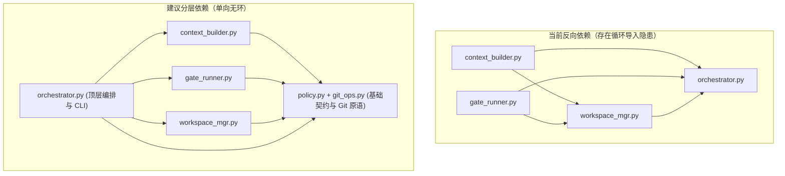

# `/home/sushaohua/pipline` 全量文档与代码逐行审查报告

本次审查覆盖工作区全部 **31 个文件（共 1,213 行）**，并在当前宿主机环境（Python `3.8.10`、Git `2.25.1`、PyYAML `5.3.1`、jsonschema `3.2.0`）实测通过现有 CLI 预检与 7 个单元测试。整体设计非常克制、清晰——“纵向行为切片 + 多仓 Git Worktree 锁定 + 真实入口 E2E 取证 + 五行交接收据”的核心骨架质量很高，但在**跨模块依赖方向、状态机与 WIP 交互、裸仓/嵌套 Worktree 边界、路径规则与重命名计算、Schema 与配置一致性**上存在若干高优先级隐患。

---

## 全局高优发现速览（Top Findings）

> [!CAUTION]
> **P0 级核心阻断与安全边界问题（共 5 项）**
> 1. **MVP 模式下 ≥3 个切片必然永久死锁**：[workflow.yaml](file:///home/sushaohua/pipline/ai-team-mvp/.ai-team/workflow.yaml#L12-L14) 将 `MR_DRAFT` 计入 `counts_towards_wip` 且 `max_wip: 2`，而 [workflow.yaml](file:///home/sushaohua/pipline/ai-team-mvp/.ai-team/workflow.yaml#L54) 定义 MVP 终点就是 `MR_DRAFT`（不进入 `MERGED`）。一旦前两片到达 `MR_DRAFT`，[orchestrator.py](file:///home/sushaohua/pipline/ai-team-mvp/engine/orchestrator.py#L153) 的 `next_slice()` 将永远返回 `None`，第 3 片起无法启动。
> 2. **本地镜像（Bare Mirror）无法装配工作区**：[README.md](file:///home/sushaohua/pipline/ai-team-mvp/README.md#L23) 要求操作方提供“目标仓本地镜像”（通常为 `git clone --mirror/--bare`），但 [workspace_mgr.py](file:///home/sushaohua/pipline/ai-team-mvp/engine/workspace_mgr.py#L67) 执行 `git rev-parse --show-toplevel`，该命令在任何 bare 仓库上必然以退出码 `128` 报错退出。
> 3. **多仓 Worktree 创建无事务回滚，半途失败即污染源仓与目录**：[workspace_mgr.py](file:///home/sushaohua/pipline/ai-team-mvp/engine/workspace_mgr.py#L82-L86) 循环执行 `git worktree add -b ai-team/...`。若第 2~4 个子仓失败（如分支残留、非空目录冲突），已创建的父仓 Worktree 与本地分支不会回滚，且整个代码库尚未实现 [git_ops.yaml](file:///home/sushaohua/pipline/ai-team-mvp/.ai-team/skills/git_ops.yaml#L9-L12) 声明的 `worktree_remove`。
> 4. **受保护目录顶层符号链接绕过 `path_matches`**：[orchestrator.py](file:///home/sushaohua/pipline/ai-team-mvp/engine/orchestrator.py#L49-L52) 对 `.ai-team/**` 取 `rule[:-2]`（即 `.ai-team/`）做 `startswith`。若候选提交将 `.ai-team` 替换为顶层 symlink 或 submodule（Git Diff 路径为 `".ai-team"` 无尾斜杠），`path_matches(".ai-team", ".ai-team/**")` 返回 `False`，绕过保护检查；同时 `check_plan()` 未在预检期拦截 `allowed_paths` 与 `protected_paths` 的重叠。
> 5. **模块依赖方向倒置（未来接入必触发循环引用）**：底层模块 `workspace_mgr`、`gate_runner`、`context_builder` 全部反向 `from .orchestrator import ...`。一旦顶层 `orchestrator.py` 需要串联调用它们驱动状态流转，立即产生循环导入（`ImportError`）。



---

## 一、根目录与工程脚手架逐行审查

### 1. [AGENTS.md](file:///home/sushaohua/pipline/AGENTS.md#L1-L21)
- **L1–5 (`Project Structure`)**：仍保留空仓初始化模板文案（*"This directory starts without source code, tests, assets, or Git metadata"*），与实际已落地的 `ai-team-mvp/`（含 `engine/`、`tests/`、`.ai-team/`、`examples/`）严重脱节；且代码放在 `ai-team-mvp/engine/` 而非 L5 约定的 `src/`，根目录 `/home/sushaohua/pipline`（注意目录名 `pipline` 拼写少了一个 `e`）也缺少顶层 `README.md` 指引。
- **L7–9 (`Build and Development`)**：声称 *"has no build, test, or local run commands yet"*，应同步更新为 `ai-team-mvp` 的实际预检与单测命令，并完成 `git init`（目前根目录与 `ai-team-mvp/` 均未初始化 Git 仓库，无法按 L9 验证 clean checkout）。
- **L11–13 (`Coding Style`)**：尚未引入格式化/静态检查配置（建议补充 `pyproject.toml` 配置 `ruff` 规则与 `python_requires = ">=3.8"`）。
- **L15–17 (`Testing`)**：要求记录完整测试套件和**单个测试**的运行方式，但子目录 `README.md` 仅写了全量运行命令，未写单个测试运行命令。

### 2. [README.md](file:///home/sushaohua/pipline/ai-team-mvp/README.md#L1-L32)
- **L1–3**：信息密度高，但首次阅读缺少关键领域术语说明（如 `C308L` 与 `RV1126B` 双平台关系、`MC`/`TH`/`AP` 节点含义、以及 `bsp-platform` 作为外层根目录包裹其余三仓的四仓嵌套拓扑）。
- **L8**：*"使用 RV1126B 装配脚本的资源准备模式时，需避开其子仓克隆逻辑"* —— 未写明具体脚本名称与参数，也不如 [slicing_rules.md](file:///home/sushaohua/pipline/ai-team-mvp/.ai-team/rules/slicing_rules.md#L17) 直观（根本原因是 `git worktree` 下子仓 `.git` 是普通文件而非目录，旧脚本 `[ -d .git ]` 判断会误判为未克隆）。建议在此直接点明原因和脚本入口。
- **L15–21**：
  - L15 提及安装 `requirements.txt`，但代码块缺少 `python3 -m pip install -r requirements.txt`；
  - L20 补充单测单跑示例（如 `python3 -m unittest tests.test_vertical_slicing.PlanTests.test_examples_and_gate_binding`）以符合 `AGENTS.md` L17；
  - 未按 `AGENTS.md` L5 说明 `engine/` 下 4 个核心模块各自的职责入口。
- **L23**：*"Coord、Eng 和 Integrator 的首选与备用模型暂用旧队已记录的 Antigravity 型号"* —— 遗漏了 `PM`（[pm.yaml](file:///home/sushaohua/pipline/ai-team-mvp/.ai-team/roles/pm.yaml#L2-L3) 同样使用 `antigravity` 客户端与 `gemini-4-neon-*` 型号）。
- **L25**：*"UART6 回放读取历史候选和实板记录，并保留历史证据标记"* —— **与现状不符**：当前 `orchestrator` 执行 L19 命令时只读取 `prd.json` 和 `slice_plan.json`，全仓没有任何代码或测试读取同目录下的 `recorded_candidate.json`，建议明确标注“历史候选对账执行器待接入”或补齐回放校验逻辑。
- **L29–32**：引用了仓库内并不存在的临时文件名 `gemini-code-1795696415298.md`、`gemini-code-1795696418457.yaml` 及外部工程 `project-control`。建议将决策沉淀为仓内 ADR 文档，移除不可追溯的临时文件名。

### 3. [.gitignore](file:///home/sushaohua/pipline/ai-team-mvp/.gitignore#L1-L4)
- **L3–4**：`**/__pycache__/` 已包含 `/__pycache__/`，L3 冗余。
- **缺失项**：缺少 `*.py[cod]`、`/.pytest_cache/`、`/.venv/`、`/.coverage`、`/.ruff_cache/`、`/.mypy_cache/`。在本机执行 `pytest` 时即会在工作区生成未忽略的 `.pytest_cache/`。

### 4. [requirements.txt](file:///home/sushaohua/pipline/ai-team-mvp/requirements.txt#L1-L2) 与包结构
- **L1–2**：`jsonschema>=3.2,<5` 与 `PyYAML>=5.3,<7` 恰好兼容当前宿主机 Ubuntu 20.04 系统自带包（`3.2.0` / `5.3.1`），便于内网离线运行，这一点非常务实。但需注意：
  1. `PyYAML 5.3.x` 存在历史反序列化漏洞（CVE-2020-14343），代码必须严格保持只用 `yaml.safe_load`（禁止 `yaml.load` / `full_load`），联网环境建议升级至 `PyYAML>=6.0.1,<7`；
  2. `jsonschema` 跨度从 `3.2` 到 `4.x` 极大（`4.24+` 已停止支持 Python 3.8），建议在 `README.md` 注明离线基线版本。
- **缺失 `__init__.py`**：`engine/` 与 `tests/` 均缺少 `__init__.py`，当前依赖 PEP 420 隐式命名空间包，容易与 `PYTHONPATH` 中同名目录冲突，且导致 `unittest discover -s tests` 将 `tests` 顶层注入 `sys.path`。建议补齐空的 `engine/__init__.py` 与 `tests/__init__.py`。

---

## 二、Python 核心引擎逐行审查

### 5. [orchestrator.py](file:///home/sushaohua/pipline/ai-team-mvp/engine/orchestrator.py#L1-L180)
- **L11 (`TEAM_DIR`)**：模块级硬编码常量，单测若需构造隔离的 `.ai-team` 配置夹具需 monkeypatch；建议作为默认参数传入 `validate_schema` / `check_plan`。
- **L12–13 (`HORIZONTAL_ID`, `HORIZONTAL_GOAL`)**：
  - **误杀 Bug（L13）**：正则 `r"(?:仅|只)(?:实现|修改|编写|补充)?(?:建表|定义接口|...)"` 未排除前导“不”字。若切片目标写为 **“不仅定义接口，还打通主页遥测显示”**，子串 `"仅定义接口"` 会命中正则并被误判为“按层拆分”！应改为负向后行断言 `r"(?<!不)(?:仅|只)..."`。
  - **漏检缺口**：[slicing_rules.md](file:///home/sushaohua/pipline/ai-team-mvp/.ai-team/rules/slicing_rules.md#L7) 点名的“搭空框架”、“留到最后补测试”、“单独建数据结构”均未被覆盖。
- **L20–21 (`load_yaml`)**：当 YAML 文件为空或全注释时，`yaml.safe_load` 返回 `None` 而非 `{}`，下游下标访问会抛 `TypeError` 而非 `PolicyError`。建议校验返回值类型（如 `isinstance(data, dict)`）。
- **L24–27 (`validate_schema`)**：
  - 每次调用都重新读取磁盘 JSON 并实例化 `Draft7Validator`，可用 `@functools.lru_cache(maxsize=None)` 缓存编译后的 Validator；
  - 校验失败抛出原生 `jsonschema.ValidationError`（不继承 `PolicyError`），导致调用方必须同时捕获两类异常，且 CLI 输出极其冗长。建议捕获 `ValidationError` 后提取路径和摘要包装为 `PolicyError`（或统一异常基类）。
- **L30–32 (`read_document`)**：直接对原始文件字节求 `sha256`。若跨平台检出触发 CRLF/LF 转换或格式化工具调整缩进，`prd_sha256` / `plan_sha256` 即会改变并导致已签发收据全部失效。建议在文档中明确“禁止格式化已批准 JSON”或改用规范化 JSON（`json.dumps(..., sort_keys=True, separators=(",", ":"))`）计算摘要。
- **L35–46 (`valid_path_rule`)**：
  - L45 `ord(char) >= 32` 放行了 `0x7f`（ASCII `DEL` 控制字符），且未拦截首尾空格路径段（如 `" src/foo"`）；建议增加 `ord(char) != 127` 及 `all(part.strip() == part for part in parsed.parts)`。
- **L49–52 (`path_matches`)**：
  - **P0 边界绕过**：当 `rule` 为 `".ai-team/**"` 时，`rule[:-2]` 为 `".ai-team/"`。若改动对象是名为 `".ai-team"` 的顶层符号链接或子模块（无 `/ `后缀），`path.startswith(".ai-team/")` 为 `False`！建议改为：
    ```python
    if rule.endswith("/**"):
        prefix = rule[:-3]
        return path == prefix or path.startswith(prefix + "/")
    ```
- **L64 (`known_profiles`)**：`check_plan` 已接收 `target` 和 `workflow` 参数，内部却又绕过参数直接读磁盘 `TEAM_DIR / "skills" / "ci_gate.yaml"`；且 `rv1126b_*` / `c308l` 属于目标硬件特定档位，应归属 `targets/rv1126b.yaml` 而非通用技能定义。
- **L80–84 (`e2e_gates` 校验)**：L83 `gate["required_repos"]` 在目标配置漏写该键时会抛未捕获的 `KeyError`（L169 `main` 未捕获 `KeyError`），应改用 `gate.get("required_repos")`。
- **L85–89 & L125–127（Diff 预算一致性缺口）**：
  - 未校验 `sum(spec["max_diff_lines"] for spec in item["repos"].values()) >= item["estimated_diff_lines"]`（例如单仓预算设 10 行，整片预估 150 行、整片上限 200 行，当前能通过预检，但执行期永远不可能合法完成）；
  - [workflow.yaml](file:///home/sushaohua/pipline/ai-team-mvp/.ai-team/workflow.yaml#L29) 中的 `default_per_repo_limit: 200` 在全仓代码中完全未被读取或校验。
- **L91–95（堆叠深度与依赖语义缺口）**：
  - `parents` 只收集使用了 `{"candidate_of": parent}` 的上游切片。若 `S1 -> S2 -> S3` 通过 `depends_on` 串联但部分仓未写 `candidate_of`，`depth` 不会累加；
  - 若 `parent in dependencies` 修改了某仓 `repo`（`repo in planned[parent]["merge_order"]`），而下游切片在该仓仍填写静态旧 SHA 而非 `{"candidate_of": parent}`，当前预检不会告警，下游将静默丢弃上游改动。
- **L100–104 (`build_profiles`)**：未检查在 `rv1126b` 目标下不能只填 `["c308l"]`（不含任何 `rv1126b_*` 档位），也未检查写 `kernel-6.1` 时是否必须包含 `rv1126b_kernel`。
- **L113–134 (`check_repo_inputs`)**：
  - **预检漏检受保护路径**：若 `slice_plan.json` 将 `.gitlab-ci.yml` 或 `.ai-team/**` 写入 `allowed_paths`，`check_plan` 会放行通过，直到 Eng 改完代码跑门禁时才在 `gate_runner.py` 报错；
  - **预检漏检嵌套仓路径穿透**：`bsp-platform` 挂载在 `.`，若 `bsp-platform.allowed_paths` 写入 `["printer-soc/**"]` 或 `["kernel-6.1/**"]`，会与子仓挂载目录重叠，应在预检期禁止父仓 `allowed_paths` 覆盖子仓 `path`。
- **L137–155 (`next_slice`)**：
  - **P0 死锁**：如全局发现第 1 条所述，MVP 终点 `MR_DRAFT` 仍在 `counts_towards_wip` 内，2 片到达 `MR_DRAFT` 后后续切片永久饥饿；
  - **入参状态未校验**：若 `states` 字典含拼写错误的状态名（如 `"CODEING"`），不会计入 `eng_slots` 或 `in_flight`，静默破坏单槽互斥约束。建议校验 `states.keys() <= planned.keys()` 且状态值均在 `workflow["states"]` 中。
- **L158–177 (`main`)**：
  - L167 固定加载 `workflow["target"]` 而非根据 `plan["target"]` 加载对应 target 配置；
  - L169 未捕获 `KeyError`，且 `ValidationError` 原样打印会将整份 JSON 实例刷屏到 stderr。

---

### 6. [workspace_mgr.py](file:///home/sushaohua/pipline/ai-team-mvp/engine/workspace_mgr.py#L1-L87)
- **L8–10 (`SHA`, `REQ_ID`, `SLICE_ID`)**：与 JSON Schema 中的正则重复维护，建议集中定义或增加一致性单测。
- **L13–19 (`git`)**：
  - 未传 `stdin=subprocess.DEVNULL`、未注入环境变量 `GIT_TERMINAL_PROMPT=0`，若遇到凭证或交互提示将永久挂起；
  - 未设置 `timeout`；
  - 若系统未安装 `git`，抛原生 `FileNotFoundError` 而非 `PolicyError`。
- **L22–46 (`resolve_bases`)**：
  - **阶段耦合过死（L33）**：硬编码要求 `receipt["stage"] == "software"`。但 [workflow.yaml](file:///home/sushaohua/pipline/ai-team-mvp/.ai-team/workflow.yaml#L17) 规定 `stacked_start_requires: [SW_VERIFIED, HIL_VERIFIED, MR_DRAFT, MERGE_QUEUE, PARTIAL_MERGE, MERGED]`。若调用方按切片保存“最新收据”（例如上游已推进到 `stage: "hil"` 或 `"draft_mr"`），`resolve_bases` 反而会报错拒绝！应允许已通过的后续阶段收据，或明确约定 `receipts` 参数专指软件阶段收据映射。
- **L55–87 (`create_slice_worktrees`)**：
  - **P0 Bare Mirror 阻断（L67–69）**：`git rev-parse --show-toplevel` 在 `git clone --mirror` / `--bare` 镜像仓上必败。应先通过 `git rev-parse --is-bare-repository` 判断：若为 `true` 则比对 `--git-dir`，否则比对 `--show-toplevel`；
  - **原生异常泄漏（L66）**：`sources[repo]` 缺键抛 `KeyError`，路径不存在时 `.resolve(strict=True)` 抛 `FileNotFoundError`，均未转为 `PolicyError`；
  - **嵌套子仓被父仓当作未跟踪文件风险（L81–86）**：`kernel-6.1`、`buildroot`、`printer-soc` 检出在 `bsp-platform` 工作区内部。单测（`test_vertical_slicing.py` L122）之所以通过，是因为测试手工给 `bsp-platform` 写了 `.gitignore`。真实环境中一旦某个历史基线提交的 `bsp-platform/.gitignore` 漏写某个子目录，`gate_runner.py` L20 的 `git status --untracked-files=all` 会立即报 `bsp-platform 有未提交改动`！建议在装配后校验 `git check-ignore`，或写入该 Worktree 专属的 `$GIT_DIR/info/exclude`；
  - **P0 无回滚与缺清理函数（L82–86）**：循环中途失败不清理已建子工作区和分支；且未实现 `remove_slice_worktrees`（需按 `len(path.parts)` **逆序**先删子仓 Worktree 再删根仓 `bsp-platform`，并调用 `git worktree prune`）。

---

### 7. [gate_runner.py](file:///home/sushaohua/pipline/ai-team-mvp/engine/gate_runner.py#L1-L91)
- **L16–19**：`git(...).decode()` 默认严格 UTF-8，遇到非 UTF-8 路径字节会抛 `UnicodeDecodeError`（对比 L45 使用了更稳健的 `os.fsdecode`）。
- **L28–31 & L41–53（Diff 统计与重命名策略矛盾）**：
  - L28 使用 `git diff --numstat -z --no-renames`。若仅移动/重命名一个 150 行文件且零逻辑修改，`--no-renames` 会拆成“删 150 行 + 增 150 行 = **300 行 Diff**”，极易误触发 200 行单仓预算红线；同时与 [coding_standards.md](file:///home/sushaohua/pipline/ai-team-mvp/.ai-team/rules/coding_standards.md#L9)“重命名同时检查旧路径和新路径”的表述存在语义偏差（开启 `-M` 并解析 `-z` 双路径记录即可同时校验新旧路径且按真实改动行数计费）；
  - 未检查新增符号链接（mode `120000`）指向仓外敏感路径或子模块（mode `160000`）变更。
- **L57–61**：L58 `target["repos"][repo]["path"]` 在 L61 `diff_summary` 校验 `checkouts.keys()` 之前执行，若传入未知 `repo` 会抛 `KeyError` 而非 `PolicyError`。L63 `target["e2e_gates"][gate_id]` 同理。
- **L69–70（门禁命令黑名单）**：只拦截了 `{"true", "echo", "printf", "sh", "bash", "dash", "ruff", "flake8", "eslint"}`，可通过 `/usr/bin/env bash`、`zsh`、`python3 -c "pass"` 轻易绕过；同时又一刀切禁止了以 `bash scripts/run_e2e.sh` 方式调用合法脚本（要求脚本必须有 `+x` 和 shebang）。建议在文档写明登记脚本须直接可执行（带 shebang），并在黑名单补充 `env`、`zsh`、`ksh`。
- **L71–80（子进程执行、超时与日志落盘缺陷）**：
  1. **超时孤儿进程与管道挂起**：`subprocess.run(..., timeout=...)` 超时只杀直接子进程，不杀进程组（编译/QEMU/守护进程常派生孙进程持有 stdout 句柄导致阻塞或残留锁）。应使用 `Popen(..., start_new_session=True)` 配合 `os.killpg`；
  2. **超时丢失现场日志**：发生 `TimeoutExpired` 时 L77 直接抛异常，`exc.stdout` 中最关键的卡死位置日志未写入 `log_path`；
  3. **`log_path` 父目录与位置未保护**：未执行 `log_path.parent.mkdir(parents=True, exist_ok=True)`；且若调用方误把 `log_path` 放在 `root`（`bsp-platform`）内，L78 写入日志文件会导致 L80 `after = diff_summary(...)` 检测到未跟踪文件并误报“候选状态发生变化”；
  4. **漏记 `duration` 字段**：[ci_gate.yaml](file:///home/sushaohua/pipline/ai-team-mvp/.ai-team/skills/ci_gate.yaml#L4) 明确要求记录 `duration`，但 L83–91 返回字典缺少耗时统计（可用 `time.monotonic()` 补齐）。

---

### 8. [context_builder.py](file:///home/sushaohua/pipline/ai-team-mvp/engine/context_builder.py#L1-L42)
- **L7–11 (`single_line`)**：若 `limit <= 0`，`compact[:limit - 1]` 会变成负数切片而非截断为空，建议加 `if limit < 1: raise ValueError(...)`。
- **L14–33 (`render_slice_handoff`)**：
  - **缺失 `request_id` / `prd_sha256` / `plan_sha256` 交叉核对**：函数入参只有单条 `item`（不含 `request_id` 和文档哈希），无法校验 `receipt["request_id"]` 是否属于当前计划，存在跨需求串单风险；
  - **不支持规划阶段交接**：[handoff.schema.json](file:///home/sushaohua/pipline/ai-team-mvp/.ai-team/schemas/handoff.schema.json#L12) 定义了需求级阶段 `plan_review` 与 `approval`（无 `slice_id`），但模块内缺少对应的 `render_plan_handoff`；
  - **标点拼接细节（L24–26）**：若 `next_action` 末尾自带句号（如 `"退回返工。"`），拼接后会出现 `"退回返工。。原因 ..."`，建议先 `.strip().rstrip("。.;；")`。
- **L36–42 (`render_git_handoff`)**：
  - **`repo_id` 未做合法性校验**：若 `repo_id` 为空或包含 `@` / `:`，生成的 `git:{repo_id}@{commit}:{path}` 无法被下游无歧义解析；建议校验 `re.fullmatch(r"[a-z0-9][a-z0-9._-]*", repo_id)`；
  - **目录路径触发原生 JSON 异常**：若 `path` 在该提交中是目录，`git show commit:dir` 会以退出码 `0` 输出 `tree ...` 文本，`json.loads` 随后抛出晦涩的 `JSONDecodeError` 而非 `PolicyError`。建议捕获 `(UnicodeDecodeError, json.JSONDecodeError)` 转抛 `PolicyError`。

---

## 三、`.ai-team/` 配置、角色、技能与规则逐行审查

### 9. [workflow.yaml](file:///home/sushaohua/pipline/ai-team-mvp/.ai-team/workflow.yaml#L1-L92)
- **L14 & L54**：`MR_DRAFT` 计入 `counts_towards_wip` 与 `mvp.endpoint: MR_DRAFT` 冲突（见全局发现 #1）。建议区分 `mvp` 与 `production` 模式的 WIP 集合，或在 `MR_DRAFT` 交付后释放 MVP WIP 配额。
- **L28–29**：`recommended_total_range` 与 `default_per_repo_limit: 200` 未接入 `orchestrator.check_plan()`。
- **L46 (`receipt_identity`)**：列出的 `[request_id, slice_id, plan_sha256, candidate_refs, gate_inputs, artifact_sha256]` 与 [handoff.schema.json](file:///home/sushaohua/pipline/ai-team-mvp/.ai-team/schemas/handoff.schema.json#L5) 实际字段（`prd_sha256`、`evidence`，无 `gate_inputs` / `artifact_sha256`）不一致。
- **L51 (`hil_claim_requires`)**：要求 `[candidate_refs, firmware_sha256, board_id, observation_evidence]`，但 `handoff.schema.json` 设置了 `additionalProperties: false` 且未定义 `firmware_sha256` 与 `board_id` 字段，导致合规的 HIL 收据无法直接结构化落盘。
- **L71–84 (`states` 状态迁移表)**：
  - 缺少请求取消或方案升版作废的终态（如 `SUPERSEDED` / `CANCELLED`），L8 规定重审升版后旧切片无合法终态可去；
  - L77 `MR_DRAFT` 与 L78 `HIL_VERIFIED` 互相可达，且 `MR_DRAFT` 可直达 `MERGE_QUEUE`：由于状态只是单一枚举，从 `SW_VERIFIED -> MR_DRAFT` 与从 `HIL_VERIFIED -> MR_DRAFT` 落在同一个 `MR_DRAFT` 状态名上，状态本身丢失了“是否已完成 HIL”的记忆，完全依赖外部守卫判断。建议拆分为 `MR_DRAFT` 与 `READY_TO_MERGE`（或要求必须经 `MR_DRAFT -> HIL_VERIFIED -> MERGE_QUEUE` 单向推进）。

### 10. [rv1126b.yaml](file:///home/sushaohua/pipline/ai-team-mvp/.ai-team/targets/rv1126b.yaml#L1-L31)
- **L3 (`protected_paths`)**：仅保护 `[.ai-team/**, .gitlab-ci.yml]`，建议补充 `.gitlab/**`（GitLab CI 子模板常用目录）和 `.gitmodules`。
- **L20 (`printer-soc.url`)**：前三仓均位于组织命名空间 `software/soc/rv1126b-q1-base/...`，唯独 `printer-soc` 写成了个人命名空间 `ssh://git@192.168.77.79:2222/sushaohua/printer-soc.git`！由于 [workspace_mgr.py](file:///home/sushaohua/pipline/ai-team-mvp/engine/workspace_mgr.py#L70-L72) 强制要求源仓 `origin` URL 字符串完全相等，其他成员或 CI 机器若克隆主仓地址或使用 HTTPS/SSH 别名将全部报错。建议确认为正式主仓地址，或支持白名单/规范化比对。
- **L21–31 (`e2e_gates`)**：缺少注释或 Schema 说明启用门禁时需补充的字段格式（`status: enabled`、`argv: [...]`、`timeout_seconds: 300`）。

### 11. 角色定义 `roles/*.yaml`（6 个文件）
- **结构不对称且未纳入自动校验**：目前全仓没有任何代码加载或校验 `roles/*.yaml`：
  - [arch.yaml](file:///home/sushaohua/pipline/ai-team-mvp/.ai-team/roles/arch.yaml#L5-L20) 定义了完整的 `permission`、`budget`、`output_contract`；
  - 其余 5 个角色——[pm.yaml](file:///home/sushaohua/pipline/ai-team-mvp/.ai-team/roles/pm.yaml#L1-L9)、[coord.yaml](file:///home/sushaohua/pipline/ai-team-mvp/.ai-team/roles/coord.yaml#L1-L9)、[eng.yaml](file:///home/sushaohua/pipline/ai-team-mvp/.ai-team/roles/eng.yaml#L1-L10)、[qa.yaml](file:///home/sushaohua/pipline/ai-team-mvp/.ai-team/roles/qa.yaml#L1-L10)、[integrator.yaml](file:///home/sushaohua/pipline/ai-team-mvp/.ai-team/roles/integrator.yaml#L1-L10)——均缺少 `permission`、`budget` 和 `output_contract`（例如 `PM` 产出 `prd.json` 却未绑定 `schemas/prd.schema.json`；`ENG` 受 `workflow.yaml` L23 预算熔断约束却无 `budget` 上限；`QA` 要求严格只读却未声明 `business_repo_write: false`）。
- **[arch.yaml](file:///home/sushaohua/pipline/ai-team-mvp/.ai-team/roles/arch.yaml#L7)**：`target_git_read_only: [log, status, show, rev-parse, grep]` 漏掉了只读浏览目录树极常用的 `ls-tree` / `ls-files` 和对比基线的 `diff`。
- **模型回退方向疑问（全部 6 个文件 L3）**：`preferred: *-high, fallback: *-xhigh` 将更昂贵/配额更紧的 `xhigh` 设为 `fallback`。若 `fallback` 用于配额耗尽/限流兜底，同系列更高规格往往更易限流；若意为“疑难问题升档推理”，建议将键名改为 `escalation` 以免运行时客户端误用。

### 12. 技能定义 `skills/*.yaml`（3 个文件）
- **[repo_search.yaml](file:///home/sushaohua/pipline/ai-team-mvp/.ai-team/skills/repo_search.yaml#L1-L5)**：L2 `tools: [rg, git_show, git_log, git_diff]` 与 `arch.yaml` L7 的 Git 子命令白名单不一致（`git_diff` 在此允许但在 `arch.yaml` 未列）。
- **[ci_gate.yaml](file:///home/sushaohua/pipline/ai-team-mvp/.ai-team/skills/ci_gate.yaml#L1-L7)**：L4 `duration` 未在 `gate_runner.py` 实现；L6 `build_profiles` 混入了 `rv1126b` 专有档位。
- **[git_ops.yaml](file:///home/sushaohua/pipline/ai-team-mvp/.ai-team/skills/git_ops.yaml#L1-L12)**：L2 标注 `owner: INTEGRATOR` 且 L10 含 `merge`，但 [eng.yaml](file:///home/sushaohua/pipline/ai-team-mvp/.ai-team/roles/eng.yaml#L4) 也将 `git_ops` 赋给了 `ENG`，未按子能力拆分（Eng 只应拥有候选分支提交权，不应拥有 `worktree_add/remove` 与远端 `merge` 权）。

### 13. 规则文档 `rules/*.md`（3 个文件）
- **[coding_standards.md](file:///home/sushaohua/pipline/ai-team-mvp/.ai-team/rules/coding_standards.md#L1-L11)**：
  - L9 *"用精确路径或相对目录前缀授权"* —— 代码实际只接受精确文件路径 `a/b.c` 或以 `/**` 结尾的前缀 `a/b/**`（写 `a/b` 或 `a/b/` 会被拒绝或仅匹配同名单文件），建议在文档中明确写出 `dir/**` 语法示例；
  - L9 重命名规则需与 `gate_runner.py` 的 `--no-renames`（或改为 `-M`）对齐。
- **[slicing_rules.md](file:///home/sushaohua/pipline/ai-team-mvp/.ai-team/rules/slicing_rules.md#L1-L25)**：
  - L7 *"整片预算建议 150–300 行，硬上限 400 行。实际小修可低于规划预算下限"* —— 建议补充说明：`slice_plan.json` 中整片 `max_diff_lines` 规划字段最低仍须填 `50`（受 Schema `minimum: 50` 限制），但单仓 `max_diff_lines`、`estimated_diff_lines` 及实际提交行数均可低于 50 行，避免 Arch 为 15 行小修填写 `max_diff_lines: 20` 触发 Schema 报错；
  - L5 建议补充说明切片与 `scenario_id` 为 **N:1** 关系（多个切片可共同分担同一个 `AC-x`，但单个切片只能绑定一个 `scenario_id`）。
- **[global_guardrails.md](file:///home/sushaohua/pipline/ai-team-mvp/.ai-team/rules/global_guardrails.md#L1-L17)**：
  - L17 区分了“代码返工最多两轮”与“瞬时环境故障重试一次且不扣返工额度”，建议在 `handoff.schema.json` 中显式增加 `failure_category: "code" | "environment" | "policy"`（或明确规定 `FAILED` 对应代码返工、`BLOCKED` 对应环境/缺证挂起），让引擎可确定性地执行该规则。

---

## 四、JSON Schema 契约逐行审查

### 14. [prd.schema.json](file:///home/sushaohua/pipline/ai-team-mvp/.ai-team/schemas/prd.schema.json#L1-L33)
- **L18 (`scenarios[].id`)**：正则 `"^AC-[0-9]+$"` 允许 `"AC-0"` 或 `"AC-00"`，建议与 `slice_id` 风格统一为 `"^AC-[1-9][0-9]*$"`。
- **L9, L19, L30**：`"minLength": 1` 允许纯空白字符串 `"   "`，建议增加 `"pattern": "\\S"`。
- **版本字段建议**：对比 `slice_plan.schema.json` 有 `revision` 字段，`prd.schema.json` 建议同步引入 `revision` 以便人工审批时直观识别第几版需求。

### 15. [slice_plan.schema.json](file:///home/sushaohua/pipline/ai-team-mvp/.ai-team/schemas/slice_plan.schema.json#L1-L80)
- **L51 (`scenario_id`)**：同步收紧为 `"^AC-[1-9][0-9]*$"`。
- **L50, L72 (`goal`, `c308l.rationale`)**：补充 `"pattern": "\\S"` 防止空白占位。
- **L65 (`max_diff_lines`)**：硬编码了 `"minimum": 50, "maximum": 400`，与 `workflow.yaml` L25–26 (`planned_total_min: 50`, `planned_total_max: 400`) 重复定义——若修改 `workflow.yaml` 放宽上限到 450，仍会被 Schema 硬拦截。建议单测校验两处数值同步，或仅由一处权威控制。

### 16. [handoff.schema.json](file:///home/sushaohua/pipline/ai-team-mvp/.ai-team/schemas/handoff.schema.json#L1-L42)
- **L12 (`stage`) 与历史回放脱节**：`enum` 仅有 `["plan_review", "approval", "candidate", "software", "hil", "draft_mr", "merge"]`，缺少与 `workflow.yaml` L59 `REPLAY_VERIFIED` 对应的 `"replay"` 阶段；且因 L4 `"additionalProperties": false`，无法按 `README.md` L25 / `global_guardrails.md` L15 写入 `mode: "historical_replay"` 或历史出处标记！
- **L13 (`status`)**：当 `status` 为 `"FAILED"`、`"BLOCKED"` 或 `"PARTIAL"` 时，`reason`（L14）目前是可选字段！这会导致失败/阻断交接单可以不写原因通过校验。建议增加条件约束：当 `status != "PASSED"` 时强制 `required: ["reason"]`。
- **L34–38 (`if/then`)**：当 `stage` 为 `plan_review` 或 `approval` 时未加 `else` 约束（例如禁止携带伪造的 `slice_id`）；且当 `stage` 为 `"hil"` 时未强制要求 `board_id` 与 `firmware_sha256`（对齐 `workflow.yaml` L51）。

---

## 五、样例与单元测试逐行审查

### 17. `examples/telemetry-home/`（[prd.json](file:///home/sushaohua/pipline/ai-team-mvp/examples/telemetry-home/prd.json#L1-L16)、[slice_plan.json](file:///home/sushaohua/pipline/ai-team-mvp/examples/telemetry-home/slice_plan.json#L1-L32)）
- 两个文件设计规范，四仓 `base_ref` 恰好承接 `uart6-replay/recorded_candidate.json` 的产出 SHA，体现了真实演进脉络。建议在 `README.md` 点明这一上下游示例关系，能极大提升可读性。

### 18. `examples/uart6-replay/`（[prd.json](file:///home/sushaohua/pipline/ai-team-mvp/examples/uart6-replay/prd.json#L1-L13)、[slice_plan.json](file:///home/sushaohua/pipline/ai-team-mvp/examples/uart6-replay/slice_plan.json#L1-L45)、[recorded_candidate.json](file:///home/sushaohua/pipline/ai-team-mvp/examples/uart6-replay/recorded_candidate.json#L1-L10)）
- **[slice_plan.json](file:///home/sushaohua/pipline/ai-team-mvp/examples/uart6-replay/slice_plan.json#L30-L37)**：L30–31 修改了 `printer-soc` 的 C++ 源码与单测，但 L37 `build_profiles` 写了 `["rv1126b_host", "rv1126b_kernel", "rv1126b_firmware"]`，未像 `telemetry-home` 那样包含 `"rv1126b_app"`。若 `rv1126b_firmware` 已包含应用交叉编译，建议在 `ci_gate.yaml` 注明档位包含关系，否则应补上 `"rv1126b_app"`。
- **[recorded_candidate.json](file:///home/sushaohua/pipline/ai-team-mvp/examples/uart6-replay/recorded_candidate.json#L1-L10)**：
  - 目前为“孤儿文件”（无 Schema、无代码读取、无测试校验）；
  - 缺少 `schema_version`、`request_id`、`slice_id`；
  - L9 `"historical_handoff"` 指向仓外不存在的相对路径 `agent_docs/handoff_rv1126b_uart6m1_hil_and_printer_soc_transition_20261126_173930.md`。

### 19. [test_vertical_slicing.py](file:///home/sushaohua/pipline/ai-team-mvp/tests/test_vertical_slicing.py#L1-L208)
- **脏状态连续断言隐患（L41–54 & L174–185）**：
  - L48–54 在将 `estimated_diff_lines` 改为 `351` 断言失败后**未恢复原值**，紧接着注入 `item["owned_paths"] = []` 断言 `ValidationError`。此处仅因 Schema 校验恰好排在预算校验之前才未误报；
  - L175–184 同理：先提交超预算的 3 行改动，**未回退**就继续提交 `.gitlab-ci.yml` 测试受保护路径拦截。建议每个反向用例使用独立的 `copy.deepcopy` 或 `subTest` 隔离现场。
- **Git 默认分支环境依赖（L117）**：`git init --quiet` 在宿主机 Git `2.25.1` 下依赖全局 `init.defaultBranch`（默认常为 `master`），而 `rv1126b.yaml` 声明分支为 `main`。建议初始化后执行 `git symbolic-ref HEAD refs/heads/main`，保证跨机器确定性。
- **夹具性能（L105–139）**：`WorktreeTests` 每个测试方法都重新 `git init` 4 个源仓并提交（约 24 次子进程调用），可将源仓初始化提至 `setUpClass` 只做一次。
- **关键未覆盖测试盲区**：
  1. `orchestrator.main()` CLI 正常输出与异常退出码；
  2. `resolve_bases()` 正常解析上游收据的正向路径（目前 L70 只测了缺收据报错，从未测成功解析！）；
  3. `gate_runner.py` 二进制文件变更拦截（`added == b"-"`）、只读依赖仓 HEAD 漂移拦截、写仓零改动拦截、门禁执行期间篡改工作区（`before != after`）拦截、以及命令超时处理；
  4. `path_matches()` 针对同名前缀目录（如 `src_extra/a` vs `src/**`）与顶层受保护路径（`.ai-team`）的边界用例。

---

## 六、分阶段改进路线图建议

| 优先级 | 改动模块 | 具体动作建议 |
| :--- | :--- | :--- |
| **P0（立即修复）** | `orchestrator.py` / `workflow.yaml` | 1. 解决 MVP `MR_DRAFT` 占用 `counts_towards_wip` 导致第 3 片起永久死锁的问题；<br>2. 修复 `path_matches` 对顶层 `.ai-team` 的漏判，并在 `check_plan` 阶段提前拦截 `allowed_paths` 与 `protected_paths` / 子仓挂载点的冲突；<br>3. 修复 `HORIZONTAL_GOAL` 对“不仅…”句式的误杀；<br>4. 抽离 `engine/common.py`（或 `policy.py` + `git_ops.py`），消除 `orchestrator` 被底层反向引用的架构倒置。 |
| **P0（立即修复）** | `workspace_mgr.py` / `gate_runner.py` | 1. 支持 `git clone --mirror/--bare` 裸仓作为 `sources`（替换单纯的 `--show-toplevel` 检查）；<br>2. 为 `create_slice_worktrees` 增加异常回滚并补齐逆序清理函数 `remove_slice_worktrees`；<br>3. 为 `run_candidate_e2e` 增加进程组超时清理、超时日志保留、`log_path` 目录创建与仓外位置校验，并补齐 `duration` 返回值；<br>4. 为 `git()` 增加 `GIT_TERMINAL_PROMPT=0`、`stdin=DEVNULL` 和默认超时。 |
| **P1（契约闭环）** | `.ai-team/schemas/` & YAML 配置 | 1. 在 `handoff.schema.json` 补齐历史回放标记/阶段、非 `PASSED` 必填 `reason`、HIL 必填 `board_id` 与 `firmware_sha256`；<br>2. 对齐 `resolve_bases` 与 `stacked_start_requires` 的阶段范围；<br>3. 核查 `rv1126b.yaml` 中 `sushaohua/printer-soc.git` 个人地址，并将 `build_profiles` 从 `ci_gate.yaml` 迁入 `targets/rv1126b.yaml`；<br>4. 补齐其余 5 个角色的 `permission`/`budget`/`output_contract` 并增加配置自检测试。 |
| **P2（工程加固）** | 文档、脚手架与 `tests/` | 1. 初始化 Git 仓库，更新根目录 `AGENTS.md` 与 `ai-team-mvp/README.md`，补齐 `engine/__init__.py`、`tests/__init__.py` 与完善的 `.gitignore`；<br>2. 为 `recorded_candidate.json` 建立 Schema 与回放校验入口（或清理孤儿引用）；<br>3. 拆分 `test_vertical_slicing.py` 中的脏状态连续断言，补齐 `resolve_bases` 正向测试、二进制 Diff 与门禁防篡改单测。 |
