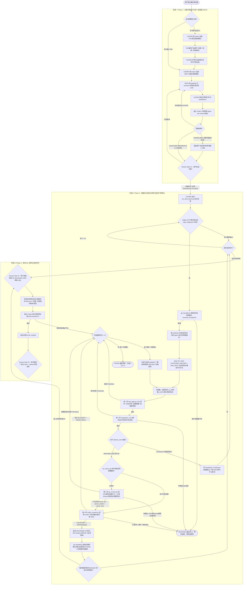
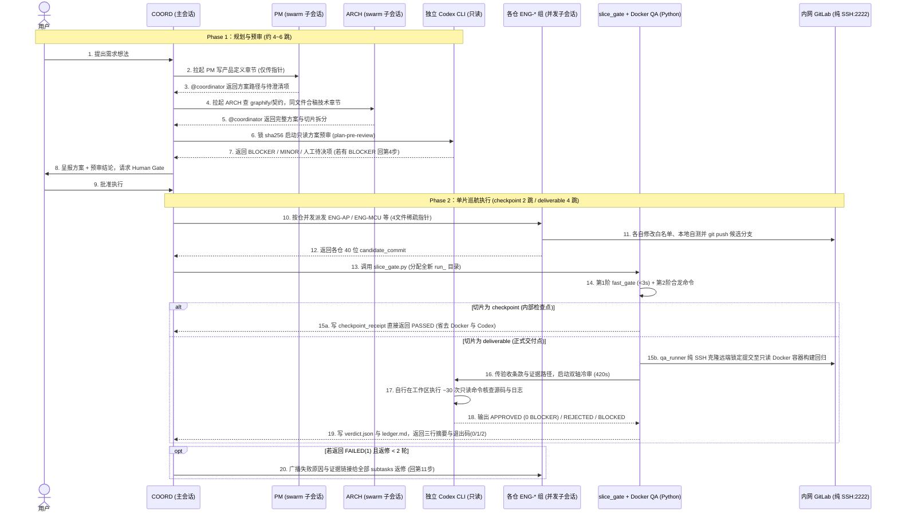

# `project-control`（AI SoC V2）全流程真实流转图

本文档严格依据 `/home/sushaohua/workspace/ai_soc_project/project-control` 当前 `HEAD (8dc3a1b)` 的现役规则与工具代码逆向绘制（已排除封存于 `tools/legacy/` 的 V1 废弃状态机），供直观审视其**信息流、控制流、交接跳数与门禁卡点**后再做架构决断。

---

## 一、全景端到端主干流转图（Phase 1 规划 → Phase 2 四阶漏斗 → Phase 3 真机与发布）

---

## 二、单次需求跨角色真实交互跳数图（Sequence View）

下图按时间轴还原 `project-control` 处理一个含多仓改动切片时的**真实会话往返跳数**（可直观看到哪些跳数是核心防线，哪些跳数产生了通信折返开销）：

---

## 三、架构拍板参考：`project-control` 实战得失对照表

对照上面的流转图，可以把 `project-control` 的机制清晰拆为**“千锤百炼必须保留的护栏”**和**“造成拖慢与高成本的摩擦点”**两列，方便您逐项拍板：

| 环节 | `project-control` 验证成功的精华（建议保留） | `project-control` 暴露的摩擦点（建议在 `ai-team-mvp` 改进） |
| :--- | :--- | :--- |
| **1. 规划期 (Phase 1)** | 同一份方案原地迭代（禁碎片草稿）；送人类审批前先过一次独立 Codex 预审拦客观漏项；目标明确的小修跳过 PM 直拉 ARCH。 | **PM 传声筒跳数**：新需求固定 `User ↔ COORD ↔ PM ↔ COORD ↔ ARCH` 多轮中转；其实主会话 `COORD` 直接与用户把场景问清，再一次拉起 `ARCH` 出方案更短平快。 |
| **2. 角色与写仓切分** | `COORD` 对业务仓严格只读；双 Bootloader 禁写 `main` 分支硬红线；稀疏四文件指针传参不贴聊天历史。 | **片内按仓拆人 + 巨型切片**：一片塞 5 个功能改 31 个文件（如 `SLICE-09`），且片内拆给 `ENG-AP`/`ENG-MCU`/`ENG_BOOT` 并发盲写，合龙挂了向全员广播返修（磨到 18 轮）。**改为“≤300 行薄片 + 1 个 `Eng` 跨仓贯穿整片”可根治。** |
| **3. 本地工作区隔离** | 根仓 `.gitignore` 忽略子仓，禁止使用 Git submodule；Git 调用剥离父仓环境变量并禁交互提示。 | **无切片级 Worktree**：各 `ENG-*` 直接在共享主目录改代码并被强制先 `git push` 到远端服务器才能跑第 3 阶容器 QA（导致 `P-01` 频繁停下找人要 push 权限）。**改为本地镜像派发隔离 Worktree，全部验完再统一推远端更顺畅。** |
| **4. 门禁漏斗设计** | **`<3s` `fast_gate` 前置反造假** + **`checkpoint / deliverable` 分流** + **三态退出码 (`0/1/2`) `BLOCKED` 零扣返修额度** + **同输入指纹缓存复用 (`try_reuse_qa`)**。 | **Codex 漫游全仓烧 Token**：第 4 阶只传路径和 SHA，让 Codex 自己跑 30+ 次命令读整份长方案与大日志（单轮 50 万+ Token、易超时）。**改为引擎预生成含精确 `git diff` 的精简评审包，可将冷审缩至几万 Token。** |
| **5. 远端同步与交接** | **彻底去除 GitLab HTTP API / Token**，全靠纯 Git/SSH 直连 + `git ls-remote` 读回校验；禁止收据“自指当前仓 Commit SHA”；`0 BLOCKER` 强制放行并将 `MINOR` 记技术债表。 | **临时树散落根目录**：构建中间树曾以 `.slice-08-*.tmp` 散落在控制仓根下占 25 GiB。**统一收口到 `runtime/<req>/` 并在准出后自动回收即可解决。** |
