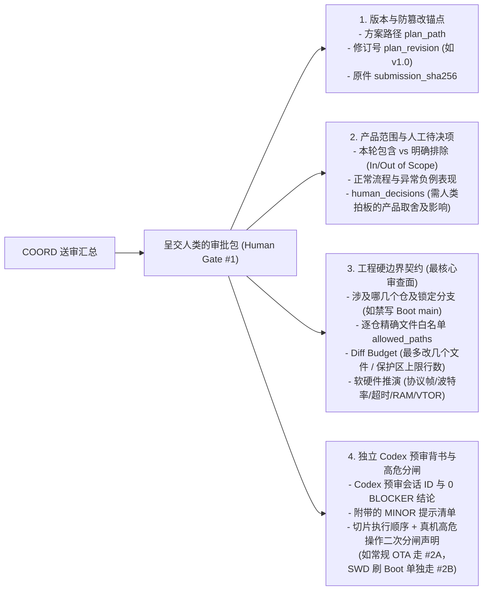
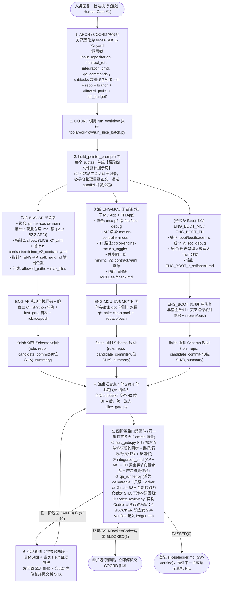

# `project-control` 深度流转图（第二版：角色协作、审批内容与工程派单详解）

> [!NOTE]
> 第一版全景概览图已原样保留在 [project_control_flow.md](./project_control_flow.md)。本第二版聚焦您关心的**四个核心交接截面**，严格依据 `project-control` 真实源码与运行物证（如 `SLICE-09` 的派发记录、方案修订链与 `run_slice_batch.py`）逐字段展开。

---

## 一、`COORD → PM ↔ ARCH → COORD`：详细方案是如何协作生成的？

在 `project-control` 中，`PM` 与 `ARCH` **绝不各自写独立文档**，而是在 `project-control/docs/planning/{摘要}_implementationplan_{时间戳}.md` **同一个文件内按章节串行接力、原地迭代**，所有往返均经主会话 `COORD` 中转。

```mermaid
flowchart TD
    U(["1. 用户向主会话 COORD 提出想法"]) --> C0["2. COORD 查 config/role_models.yaml 与 swarm models 额度"]
    C0 --> Triage{"需求边界是否已完全明确?"}

    Triage -->|"模糊需求 / 含产品取舍"| SpawnPM["3a. COORD 用 swarm add 拉起 PM (gemini-4-neon-high)"]
    Triage -->|"明确小修 / 纯技术修复 (跳过PM)"| SpawnArchDirect["3b. COORD 直接拉起 ARCH (gemini-4-carbon-high)"]

    subgraph PMStage["PM 职责区：只写方案《第 1 部分》(业务仓与契约 100% 只读)"]
        SpawnPM --> PMBrief["COORD 传入稀疏指针 Brief：角色=PM + 技能=product-requirements + 方案路径 + 用户原话摘要"]
        PMBrief --> PMWrite["4. PM 原地编写《第 1 部分：产品目标与验收定义》\n§1.1 背景与冻结基线  §1.2 范围(In/Out)与优先级\n§1.3 正常主流程与异常恢复矩阵  §1.4 UI/状态文案规范\n§1.7 待 ARCH 物理核实的技术未知项列表 (OI-01 ~ OI-0N)"]
        PMWrite --> PMRet["5. PM 发消息唤醒主会话：@coordinator + 回执 JSON\n{plan_path, plan_revision, changed_sections, open_items}"]
    end

    PMRet --> CoordRelay1["6. COORD 记录派发证据 dispatch_pm_*.json，读取 open_items 转派 ARCH"]
    CoordRelay1 --> SpawnArch["7. COORD 用 swarm add 拉起/复用 ARCH (gemini-4-carbon-high)"]
    SpawnArchDirect --> ArchBrief
    SpawnArch --> ArchBrief["COORD 传入稀疏指针 Brief：角色=ARCH + 技能=arch-deep-spec + 同一方案路径 + 待消解 OI 列表"]

    subgraph ArchStage["ARCH 职责区：原地合成方案《第 2 部分》(业务仓源码只读)"]
        ArchBrief --> ArchStep1["8a. 物理取证：调 graphify path/explain 查 AST + 读 contracts/minimc_v2_contract.yaml"]
        ArchStep1 --> ArchStep2["8b. 写 §2.1 受管仓基线表 + 逐仓精确到文件的 allowed_paths 白名单 + Diff Budget"]
        ArchStep2 --> ArchStep3["8c. 写 §2.2 真实符号调用链核实表 (仓:文件:函数 EXTRACTED) + 逐条消解 PM 的 OI-01~OI-0N"]
        ArchStep3 --> ArchConflict{"发现技术不可行或需缩减产品范围?"}
        ArchConflict -->|"是 (ARCH 严禁私自砍需求)"| BackToPM["反馈给 COORD -> 唤醒 PM 调整范围或汇总向用户请示取舍"]
        BackToPM --> PMWrite
        ArchConflict -->|"否 (全部闭环)"| ArchStep4["8d. 写 §2.3~§2.5 复杂接缝 Design-It-Twice 比选 + 串口/超时/RAM/VTOR 推演 + SLICE-XX 切片与正负验收命令 + 回滚预案"]
        ArchStep4 --> ArchRet["9. ARCH 更新头部实名修订表，发 @coordinator + 回执 JSON\n{plan_path, plan_revision, changed_sections, open_items}"]
    end

    ArchRet --> PreRevLock["10. COORD 执行 sha256sum 锁定方案原件，启动独立 Codex 只读预审 (plan-pre-review)"]
    PreRevLock --> PreRevCheck{"独立 Codex 预审结论?"}
    PreRevCheck -->|"检出客观 BLOCKER (漏文件/超预算/验收不可执行)"| BackToAuthor["COORD 不打扰用户，直接退回 PM 或 ARCH 在原件升版修订并补审"]
    BackToAuthor --> ArchStep1
    PreRevCheck -->|"0 BLOCKER (产出 pre_review/review.json)"| ReadyHuman(["11. 正式交回 COORD 汇总，准备呈报人类审批 (Human Gate #1)"])
```

### 交回给 `COORD` 的真实产物清单（两部分）
1. **消息板结构化回执（唤醒 `COORD` 用，绝不贴大段正文）**：
   - 必须以 `@coordinator` 开头，载荷为 `{ "plan_path": "project-control/docs/planning/...md", "plan_revision": "v1.0", "changed_sections": ["§2.1~§2.5"], "open_items": [...], "summary_head": "一句话摘要" }`。
2. **磁盘上的单一真相源（SSoT）方案原件 + 独立预审回执**：
   - 头部带实名修订历史表（精确到客户端与模型 ID，如 `AI (Antigravity-CLI / ARCH / gemini-4-carbon-high)`）；
   - `PM` 的第 1 部分 + `ARCH` 的第 2 部分已合为一篇自洽文档（所有 `OI-xx` 均已对位消解）；
   - 配套的独立 Codex 预审产物 `docs/evidence/planning/<方案名>/pre_review_<轮次>/review.json`（含 `read_sha256`、`findings`、`human_decisions`）。

---

## 二、`COORD` 交给人类（`Human Gate #1`）检查什么？具体包括哪些内容？

在未拿到人类明确的 **“批准执行 / Approved”** 指令前，全工作区严禁修改一行工程代码。`COORD` 呈交人类的不是散乱对话，而是**绑定了精确 SHA-256 的四大块审阅内容**：

| 人类检查维度 | 具体核对条目（来自真实方案规范） | 批准后的法律效力 |
| :--- | :--- | :--- |
| **① 做不做、做到哪** | `§1.2` 包含/排除范围、`§1.3` 正常与缺包/断连/并发负例预期、以及预审单列的 `human_decisions` 取舍项。 | 锁定验收标准；后续任何 Agent 不得私自缩减需求或篡改验收通过条件。 |
| **② 允许碰哪些文件** | `§2.1` 受管仓读写表（哪些仓**只读**、哪些仓**可写**）、精确到具体文件路径的 `allowed_paths`、`max_files` 与存量保护区 `max_protected_lines`。 | 转化为 `fast_gate.py` 的硬拦截规则；多改 1 个白名单外文件或超 1 行保护预算直接拒单。 |
| **③ 跨板协议与硬件安全** | `§2.2~§2.3` 是否改动 `minimc_v2_contract.yaml`、串口命令/ACK 字节长度、超时毫秒数、静态内存上限、Flash 分区与 VTOR 跳转地址。 | 锁死 AP ↔ MC ↔ TH 三端通信契约，禁止工程角色临场发明协议或使用动态堆分配。 |
| **④ 授权颗粒度边界** | 明确区分：**本次批准仅授予“本地/批次代码实现与软件四阶门禁巡航权”**；涉及真机串口刷写（Gate #2A）、SWD 擦写 Bootloader（Gate #2B）或正式发布（Gate #3）仍须到点停机另行请示。 | 防止 AI 拿着方案批准直接去擦写物理开发板 Flash 或强推远端生产分支。 |

---

## 三、人类批准后，如何拆单并派发给 `ENG-AP`、`ENG-MC`、`ENG-TH`？

### 1. 先看关键席位映射：`ENG-MC` 与 `ENG-TH` 在 V2 中是如何分工的？
在 `project-control` 的真实仓库拓扑（[02_模块与Agent职责.md](file:///home/sushaohua/workspace/ai_soc_project/project-control/.agents/rules/02_模块与Agent职责.md#L22-L28) 与 [manifest.yaml](file:///home/sushaohua/workspace/ai_soc_project/project-control/manifest.yaml#L31-L78)）中，AP、MC、TH 按**物理 Git 仓库与安全等级**映射如下：

| 业务端 | 现役角色席位 | 唯一允许写入的仓库与目录范围 | 强制锁定分支（硬红线） | 角色演进说明 |
| :--- | :--- | :--- | :--- | :--- |
| **AP 端（应用全栈）** | **`ENG-AP`** | `printer-soc/`（Helix UI $\rightarrow$ D-Bus/DDS $\rightarrow$ `device_manager` $\rightarrow$ `forward` 串口服务） | `main` | 包干应用层全栈，不碰内核/SDK |
| **AP 端（底座/内核）** | **`ENG-PLATFORM`** | `sdk/c308l/` 中切片逐项点名的独立子 Git 仓 | 产品指定分支 | 严禁授予整个 SDK 递归写权 |
| **MC + TH 应用固件** | **`ENG-MCU`** *(原 `ENG-MC` + `ENG-TH` 合一)* | **同属 `mcu-p3/` 仓**： • MC 侧：`motion-controller-mcu/`（AT32F435 + Marlin + USART6 透明中继） • TH 侧：`color-engine-mcu/io_toggle/`（AT32F423 工具头温控/急停） | `feat/soc-debug` | 因 MC App 与 TH App 共处同一个 `mcu-p3` 仓库与同一分支，V2 合并为 **`ENG-MCU`** 统一包干，彻底消除同仓双 Agent 并发踩踏与级联中继扯皮 |
| **MC Bootloader** | **`ENG_BOOT_MC`** | 独立仓 `boot/bootloadermc/`（VTOR `0x08020000`） | `soc_debug`（**严禁写 `main`**） | 从 `mcu-p3` 剥离独立建仓，防误改变砖 |
| **TH Bootloader** | **`ENG_BOOT_TH`** | 独立仓 `boot/bootloaderth/`（VTOR `0x08004000`） | `soc_debug`（**严禁写 `main`**） | 从 `mcu-p3` 剥离独立建仓，防误改变砖 |
| **跨仓联调与测试台架** | **`INTEGRATOR`** | `test_harness/`（黄金向量检查、全进程合龙与 HIL 脚本） | `main` | 严禁写改包字节垫片（Shim） |

---

### 2. 获批后从 `COORD` 派发到各端 `ENG` 并合龙的完整动作链

---

## 四、全链路精确载荷速查表（每一跳到底传了什么数据？）

| 交接跳 | 发送方 $\rightarrow$ 接收方 | 实际传递的精确内容（字段级） | 防失控机制 |
| :--- | :--- | :--- | :--- |
| **第 1 跳** | `COORD` $\rightarrow$ `PM` | 角色 `PM`、`product-requirements` 技能路径、本任务唯一方案路径 `.md`、用户原话摘要 | 禁改业务仓与契约；无产品歧义的小修直接跳过此跳 |
| **第 2 跳** | `PM` $\rightarrow$ `COORD` $\rightarrow$ `ARCH` | 同一个 `.md` 文件（已写好 `§1.1~§1.7` 含 `OI-01..N` 未知项）+ `@coordinator {plan_path, plan_revision, changed_sections, open_items}` | `ARCH` 必须逐一消解 `OI-xx`；若需砍功能必须打回 `PM` 问用户，禁私自降标 |
| **第 3 跳** | `ARCH` $\rightarrow$ `COORD` $\rightarrow$ `Codex 预审` | 合成完整的 `.md` 原件 + `sha256sum` 锁定值 + 适用规则文件哈希 | 检出客观 `BLOCKER` 在内部闭环打回作者重修，不拿半成品消耗人类精力 |
| **第 4 跳** | `COORD` $\rightarrow$ **人类用户** | 锁定 `submission_sha256` 的方案路径 + 范围/白名单/预算/契约摘要 + Codex 预审结论 + 单列人工待决项 `human_decisions` | 未收到明确“批准执行”前，零代码改动 |
| **第 5 跳** | `COORD` (`run_slice_batch.py`) $\rightarrow$ `ENG-AP` / `ENG-MCU (MC+TH)` / `ENG_BOOT_*` | **仅 4 个文件路径指针**（`plan_path`、`slices/SLICE-XX.yaml`、`contracts/minimc_v2_contract.yaml`、`<ROLE>_selfcheck.md`）+ 唯一 `repo` / `branch` / `allowed_paths` / `diff_budget` | 子会话零历史聊天噪音；AP、MC、TH 强制对齐同一份 YAML 协议契约真源 |
| **第 6 跳** | 各端 `ENG-*` $\rightarrow$ `slice_gate.py` | 各仓已推送的 40 位 `candidate_commit` JSON + 自检报告 | **多仓连坐**：缺一仓不跑门禁；任一端越界、造假或协议错位，整片拦截返修 |
