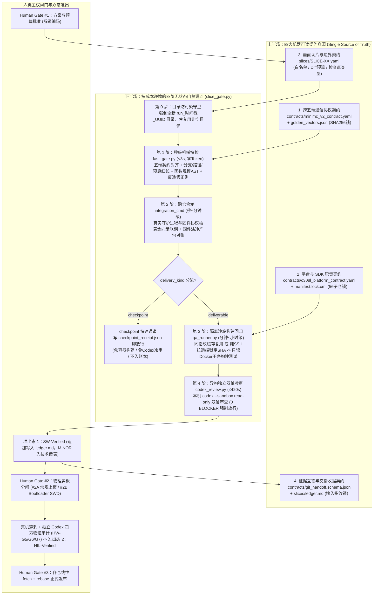
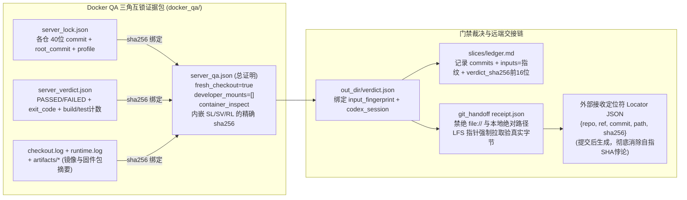

# `project-control` V2 门禁与契约体系深度拆解（Contract-as-Data & 四阶无状态漏斗）

本文档严格依据 `/home/sushaohua/workspace/ai_soc_project/project-control` 现役源码（`contracts/`、`tools/sync_contracts.py`、`tools/gates/`、`tools/qa_runner/`、`tools/workflow/` 及 `.agents/rules/`）逆向拆解。

整套体系的核心哲学只有一句话：**把人类和架构师立下的规矩写成机器可读的数据契约（Contract-as-Data），再用按成本从低到高排列的无状态漏斗逐层硬拦截，让昂贵的大模型冷审和真机台架只处理机器查不出的深层语义问题。**

---

## 一、全景架构：四大契约真源 × 四阶自动门禁 × 三道人类闸门

---

## 二、契约层深度拆解：四份契约分别锁死了什么？

### 1. 跨五端通信协议契约（[minimc_v2_contract.yaml](file:///home/sushaohua/workspace/ai_soc_project/project-control/contracts/minimc_v2_contract.yaml) + [sync_contracts.py](file:///home/sushaohua/workspace/ai_soc_project/project-control/tools/sync_contracts.py)）
解决嵌入式多仓最致命的“AP 改了命令码或结构体位域，MCU 或 Bootloader 头文件没同步”顽疾，严禁各端手抄 Markdown 表格：
- **帧与位域硬参数（`framing`）**：锁死帧头 `SOF=0x55AA`、`12B` Header、`2B` `CRC-16/CCITT-FALSE (poly=0x1021, init=0xFFFF)`、最小允许的最大载荷 `min_max_payload_bytes: 520` / 帧长 `534`（保障 512B OTA 数据块通行）、`128B` `ATSG` 升级尾块，以及 `version_code_layout: major[31:24], minor[23:16], patch[15:8], build[7:0]`。
- **禁用与防碰撞双向校验（`forbidden` & `canonical_commands`）**：
  - 显式封杀历史废弃指令码 `0x05` 与废弃宏 `MINIMC_CMD_ESTOP_ACK`；
  - 对全部五端 C/C++ 头文件（`printer-soc`、`mcu-p3` 的 MC 与 TH、`bootloadermc`、`bootloaderth`）同时做**正向值校验**、**未登记私有 `MINIMC_CMD_*` 宏拦截**与**反向数值唯一性校验**（防止两个不同语义的宏映射到同一个十六进制码）；
  - **按端分级要求**：3 个 App 端（`full_app_table: true`）必须覆盖全套业务指令；2 个 Bootloader 端（`full_app_table: false`）只强制要求实现 `boot_required: true` 的 11 条核心引导/急停/OTA 指令，避免引导区膨胀。
- **黄金字节向量防伪锁（`golden_vectors`）**：不仅核对 `golden_vectors.json` 的精确 `sha256` 和最少向量数（`>=25` 条），`sync_contracts.py` 还会在内存中逐帧重算所有正例的 `CRC-16`，防止有人手改测试向量凑绿灯。

### 2. 平台与 SDK 职责契约（[c308l_platform_contract.yaml](file:///home/sushaohua/workspace/ai_soc_project/project-control/contracts/c308l_platform_contract.yaml)）
专门治理 Repo 管理的巨型多项目 SDK（`sdk/c308l` 含 56 个独立 Git 仓）：
- **逐项目 Owner 白名单**：54 个底层仓（U-Boot `bl2/bl30/bl31/bl33/fip`、内核 `aml-5.15`、ISP/VENC、工具链、`release-tool`）归属 `ENG-PLATFORM`；`craftdance-kliper` 与 `moonraker` 显式锁为 `READ_ONLY`。
- **ABI 与验证边界声明**：锁死 `armv7l` hard-float `glibc 2.33`，并用契约条文界定三种 `profile` 的证明上限——`host-software` 不证明目标板、`c308l-app` 不证明 HIL、`c308l-system` 生成镜像不证明实板启动成功。
- **物理排他资源表（`resource_policy.exclusive`）**：将 `mcu_uart`、`display`、`touch`、`camera`、`data_volume` 列为排他资源，物理访问强制要求单次授权。

### 3. 垂直切片任务与边界契约（[TEMPLATE_SLICE.yaml](file:///home/sushaohua/workspace/ai_soc_project/project-control/slices/TEMPLATE_SLICE.yaml) / [SLICE-09.yaml](file:///home/sushaohua/workspace/ai_soc_project/project-control/slices/SLICE-09.yaml)）
每张切片卡既是派单说明书，也是门禁检查器的规则输入：
- **准出级别分流**：`delivery_kind: checkpoint | deliverable`；交付点通过 `covered_checkpoints` 锁定必须已就绪的前序检查点列表，漏项直接阻塞。
- **子任务四重围栏（`subtasks[]`）**：
  1. `repo` + `branch`：锁定唯一仓库与合法开发分支；
  2. `allowed_paths`：`fnmatch` 精确路径/通配白名单；
  3. `diff_budget.max_files`：单仓改动文件总数硬上限；
  4. `diff_budget.protected_globs` + `max_protected_lines`：对开源存量或高危核心文件（如 `**/Marlin_main.c`），既豁免存量代码的 50 行函数重构要求，又严卡本次允许触碰的最大增删行数！

### 4. 三层防伪证据与服务端交接收据契约（[git_handoff.schema.json](file:///home/sushaohua/workspace/ai_soc_project/project-control/contracts/git_handoff.schema.json) + `server_qa.json`）
为彻底消灭“口头报绿”、“本地脏文件混入测试”和“自指 Commit SHA 死循环”，设计了严密的哈希链：

---

## 三、门禁层深度拆解：四阶漏斗每一阶具体怎么审？

### 第 1 阶：秒级机械与反造假快检（[fast_gate.py](file:///home/sushaohua/workspace/ai_soc_project/project-control/tools/gates/fast_gate.py)，`<3s`）
在消耗任何编译算力和大模型 Token 之前，用纯 Python AST 与正则在 3 秒内拦住四类违规：

| 检查模块 | 具体拦截规则（命中任一条即返回 `FAILED(1)`） | 对应源码函数 |
| :--- | :--- | :--- |
| **① 五端协议同步** | 五端 C/C++ 头文件常量偏离 `minimc_v2_contract.yaml`、存在禁用码 `0x05`、命令码碰撞、OTA 缓冲 `<520B`、黄金帧 CRC 错误。 | `sync_contracts.verify_workspace_contracts()` |
| **② 仓库/分支/预算边界** | `boot/*` 仓当前分支为 `main`（触犯引导区红线）；分支与切片声明不符；改动文件数 `> max_files`；受保护存量文件增删行数 `> max_protected_lines`；改动路径不在 `allowed_paths` 内。 | `check_subtask_boundary()` |
| **③ 代码规模与注释 AST** | • **Python**：模块、类、函数/异步函数缺少中文 docstring；除 `self/cls` 外入参 `> 4` 个；去空行注释后函数体 `> 50` 行。 • **C/C++**：使用指针自增/自减黑魔法（`*p++` / `*p--`）；存在无超时空分号死等 `while(...);`；函数入参 `> 4` 个或有效代码 `> 50` 行（命中 `protected_globs` 的第三方存量文件豁免此项）。 | `check_python_ast()` `_scan_c_source()` |
| **④ 反造假特征扫描** | • 代码文件（`.c/.cpp/.h/.py/.js/.ts`）残留未消解的 `[UNVERIFIED]` 标记； • `test_harness` 或 `*bridge*` 文件中出现篡改协议帧字节垫片（`frame[n] = 0x..`）； • `*probe*` 文件中使用 `ctypes.CDLL` 后门注入伪造日志。 | `check_anti_fake_markers()` |

> [!TIP]
> **连门禁脚本自身都受预算门禁约束（防工具腐化）**：[test_v2_gates.py](file:///home/sushaohua/workspace/ai_soc_project/project-control/tools/test_v2_gates.py#L60-L69) 中专门设有自检用例，强制要求全部 6 个生产门禁脚本合计 **`<= 920` 行**（含单测总计 `<= 1190` 行），且门禁代码自身必须 100% 通过 `check_python_ast` 与 `check_anti_fake_markers`！

---

### 第 2 阶：跨仓合龙与检查点分流（[slice_gate.py](file:///home/sushaohua/workspace/ai_soc_project/project-control/tools/gates/slice_gate.py#L175-L189)）
1. 在工作区执行切片定义的 `integration_cmd`（默认 `180s` 超时，自动注入 `AISOC_FAST_GATE_DONE=1` 避免重复跑第 1 阶），完整输出固化至 `out_dir/integration.log`。
2. **故障智能定性**：若退出码为 `124`（超时）或日志含 `docker daemon`、`ssh:` 等基础设施故障特征，归类为 **`BLOCKED(2)`**（不扣工程返修轮次）；其余非零退出归为 **`FAILED(1)`**。
3. **两级准出分流**：
   - 若 `delivery_kind == "checkpoint"`：调用 `save_checkpoint_receipt()` 写出 `CHECKPOINT_READY` 收据后直接返回 `PASSED(0)`，省去高昂的容器克隆与 Codex 冷审；
   - 若 `delivery_kind == "deliverable"`：计算全局 `input_fingerprint` 并采集全部输入仓 40 位 `HEAD` SHA，送入第 3 阶。

---

### 第 3 阶：零信任服务端检出与只读 Docker 沙箱（[qa_runner.py](file:///home/sushaohua/workspace/ai_soc_project/project-control/tools/qa_runner/qa_runner.py)）
这一阶专门防止“在我机器上能跑（因为依赖了本地未提交文件、未跟踪库或手工改过的 SDK）”：
1. **同输入指纹缓存复用（`try_reuse_qa`）**：先扫描历史 `run_*/docker_qa`，只有当**各仓 40 位提交、根仓提交、`profile`、容器镜像 digest、`qa_commands` 列表及三角互锁 SHA256 全部一字不差**且此前为 `PASSED` 时，才直接复用证据跳过重编；任一因子变化立即失效重跑。
2. **纯 SSH 远端可达核验与隔离检出**：
   - 沙箱目录建在工作区外的 `/tmp/qa_sandboxes/<task>_<run>_<utc>`（`0700` 权限，若路径落在开发工作树内直接报错拒绝）；
   - 通过 `ssh -o BatchMode=yes` 与 `git ls-remote` 验证所有目标仓提交均已推送至内网 GitLab 服务器（拒绝未推送的本地私有提交）；
   - 全新 `git init + fetch + checkout --force <40位SHA>`，随后执行 `verify_clean_worktree` 确认零脏文件，并按映射把 `agents/<subdir>` 的规则软链接挂入沙箱子仓（写入 `.git/info/exclude` 保持工作树干净）。
3. **预审字节锁保护的 SDK 恢复与双卷隔离容器**：
   - 若为 `c308l-app` / `c308l-system`，先比对 `tools/sdk_workspace.py` 的 SHA256 是否严格等于配置中人工预先批准的 `accepted_c308l_system_sdk_tool_sha256`（防止候选代码篡改恢复脚本），再按 `printer-soc` 内的 `manifest.lock.xml` 重建并校验 56 个 SDK 子项目；
   - 启动锁定 `sha256` digest 的容器：**源码目录强制只读挂载（`-v sandbox:/workspace:ro`）**，输出目录独立挂载（`-v sandbox_output:/output:rw`），从物理上杜绝测试过程污染或偷改源码树。
4. **退出码与证据强一致反查（`slice_gate.py` L85–127）**：`qa_runner` 退出后，`slice_gate` 不信退出码一面之词，重新打开 `server_qa.json`、`server_verdict.json`、`server_lock.json` 逐个复算字节 SHA256 并核对锁定提交集合——若进程返回 `0` 但证据缺项/未通，或进程非 `0` 但 `passed != False`，一律按证据冲突判 **`BLOCKED(2)`**！

---

### 第 4 阶：独立异构 Codex 双轴分级冷审（[codex_review.py](file:///home/sushaohua/workspace/ai_soc_project/project-control/tools/gates/codex_review.py)）
在机器门禁确认“代码规范合规、合龙全通、干净容器编译单测全绿”之后，最后请异构大模型做防伪与深层逻辑审计：
- **硬隔离启动参数**：固定调用 `/home/sushaohua/.local/bin/codex exec --skip-git-repo-check --sandbox read-only -c approval_policy="never" -c model_reasoning_effort="high" -m <model> --json --output-schema schema.json --output-last-message final.json -`（默认 `gpt-6.2-sol`，高风险切片配 `gpt-6.2-astra`，默认限时 `420s`）。
- **防伪会话溯源**：解析 `codex.jsonl` 事件流，必须抓到真实的 `thread.started` 事件提取 `session_id` 并统计 `turn.completed` 真实 Token 消耗；缺 `session_id` 直接抛 `CodexGateBlockedError`。
- **双正交审计轴**：
  1. **`spec_realism`（Spec 真实性与防作弊轴）**：查正负验收判据是否真闭环、有无硬编码假状态、有无本地定时器假推进进度、有无中继私自降级/伪造下游 ACK、有无 0 调用悬空钩子；
  2. **`embedded_safety`（嵌入式安全与预算轴）**：查零动态堆分配、指针深度 `<=2`、空指针守卫、指令-ACK 超时冒泡与 `{target_node, seq_id, elapsed_ms, error_code}` 结构化错误溯源、擦除 Flash 前 128B Trailer 预校验、存量改动是否严守预算。
- **防吹毛求疵死锁铁律（`validate_graded_verdict`）**：
  - 发现项必须标 `BLOCKER` / `MINOR` / `NIT`；
  - **`0 BLOCKER` 时严禁判 `REJECTED`**（若模型填了 0 个 `BLOCKER` 却给 `REJECTED`，校验器直接抛异常拦截！`0 BLOCKER` 必须放行 `APPROVED`，所有 `MINOR` 由脚本自动摘录进 `slices/ledger.md` 第二节“非阻断技术债登记表”留待后续收敛）；
  - **存在 `BLOCKER` 时严禁判 `APPROVED`**。

---

## 四、三态裁决与返修熔断互锁契约（为什么不会误扣返修次数？）

`project-control` V2 在经历首单踩坑后，在 [slice_gate.py](file:///home/sushaohua/workspace/ai_soc_project/project-control/tools/gates/slice_gate.py) 与 [run_slice_batch.py](file:///home/sushaohua/workspace/ai_soc_project/project-control/tools/workflow/run_slice_batch.py#L96-L154) 之间建立了一套非常值得复用的**三态互锁状态表**：

| 裁决状态 (`status`) | 强制退出码 | 触发场景举例 | 工程返修额度消耗 | 巡航器后续动作 |
| :---: | :---: | :--- | :---: | :--- |
| **`PASSED`** | **`0`** | `checkpoint` 前两阶全通；或 `deliverable` 四阶全通且 Codex `0 BLOCKER` | **0 次** | `deliverable` 自动幂等写入 `ledger.md` (`SW-Verified`)；若 `requires_hil_immediately=true` 则停机请示 `Human Gate #2`，否则自动推进下一片 |
| **`FAILED`** | **`1`** | `fast_gate` 规范/路径违规、合龙断言失败、容器构建/测试失败、Codex 检出真 `BLOCKER` | **消耗 1 轮** *(上限 2 轮)* | 若已用轮次 `< 2`：把失败阶段、精简原因与当次 `file://` 证据链接发回原保活 `ENG-*` 定向修复并分配新 `run_` 目录重审；满 2 轮立即熔断停机 |
| **`BLOCKED`** | **`2`** | 非空证据目录复用、未 `git push` 致远端不可达、SSH/Docker 守护进程异常、Codex CLI 缺失或 `420s` 超时、权限被拒、**缺失 `verdict.json` 或退出码与 `verdict.json` 冲突** | **严格 0 次** *(绝不误伤)* | **绝对不唤醒 `ENG-*` 瞎改代码**！立即保留现场停机，向 `COORD` / 人类报告环境阻塞原因，排障后用新目录无损续跑 |

---

## 五、真机 HIL 防伪契约（`HW-G1 ～ HW-G7`）

软件拿绿牌（`SW-Verified`）后，若要升级为正式投产态（`HIL-Verified`），必须跨过最后一道物理防伪契约（见 [codex_qa_review.md](file:///home/sushaohua/workspace/ai_soc_project/project-control/.agents/rules/codex_qa_review.md#L47-L51) 与 [hil-and-issue-triage](file:///home/sushaohua/workspace/ai_soc_project/project-control/.agents/skills/hil-and-issue-triage/SKILL.md)）：
1. **授权分闸（`HW-G1/G2/G4`）**：物理插拔 U 盘等人工确认；常规固件走串口 OTA（`Gate #2A`）；SWD 探针擦写 Bootloader 首地址必须单独获批（`Gate #2B`，锁死 `probe-rs` 芯片型号与探针 ID）；温控/限位保护参数禁私改。
2. **零虚拟化底线（`HW-G5/G6`）**：严禁以 PTY、Loopback、模拟器替代板端真实物理串口（`/dev/ttyS1`）；必须留存带毫秒级时间戳的双向 `Raw Hex TX / RX` 原始帧，有效协议关联回包数为 `0` 直接判 `REJECTED`。
3. **四方固件身份链闭合（`HW-G7`）**：`AP + MC + TH + Bootloader` 四端的 **源码 40 位 Commit SHA $\leftrightarrow$ 构建二进制 SHA256 $\leftrightarrow$ 烧录/OTA 事务记录 $\leftrightarrow$ 板端 `0x01/0x02` 现场协议读回版本号** 必须四方完全咬合。

---

## 六、对当前新项目（`pipline/ai-team-mvp`）门禁契约的精简吸收建议

对照 [ai-team-mvp/engine/gate_runner.py](file:///home/sushaohua/pipline/ai-team-mvp/engine/gate_runner.py) 现状（仅 91 行，只做了 `git status`、路径/行数统计和单条 `subprocess.run`），我们不需要照搬 `project-control` 近千行的重型 Docker + 远端 SSH 克隆全套设施，只需**精准移植其最值钱的 5 条核心契约机制**：

1. **前置 `<1s` `fast_gate`**：在跑编译和 E2E 前，加入 `prohibited_branches` 分支红线、`[UNVERIFIED]` / 改包 Shim 反造假扫描、以及可按目标仓开关的函数规模检查。
2. **三态退出码（`0 / 1 / 2`）+ 证据互锁**：把 `gate_runner.py` 现在的二元 `E2E_PASSED / E2E_FAILED` 升级为 `PASSED(0) / FAILED(1) / BLOCKED(2)`，超时、工具缺失、工作区被篡改一律归 `BLOCKED(2)` 零扣返修额度。
3. **`checkpoint` 与 `deliverable` 两级门禁分流**：中间切片只跑 `fast_gate + 本地 Worktree E2E` 秒速并入 `integration` 支线；只在交付点跑一次完整制镜/回归 + 一次异构 `Codex` 双轴冷审。
4. **`0 BLOCKER` 强制放行 + `MINOR` 记技术债表**：直接复用 `codex_review.py` 的 JSON Schema 与 `validate_graded_verdict()` 逻辑，根治大模型审查吹毛求疵卡死流水线的问题。
5. **去远端前置依赖（比 `project-control` 更进一步）**：`project-control` 的 `qa_runner.py` 强制要求每片先 `git push` 到内网服务器才能进容器测试（引发首单 `P-01` 频繁停机要权限）；新项目可直接把**本地只读挂载切片/集成支线 Worktree + 独立 `/output` 可写卷**作为软件门禁输入，待整需求终审全绿后，最后一步才通过纯 SSH 推送远端。
