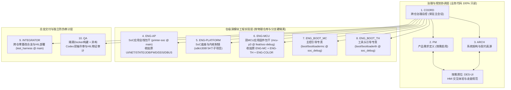

# `project-control` V2 角色定义体系深度解析（维度 · 职责 · Skills 全景）

本文档基于 `/home/sushaohua/workspace/ai_soc_project/project-control` 与独立规则技能托管仓 `/home/sushaohua/workspace/ai_soc_project/agents` 的现役权威源码逆向整理，完整还原 **AI SoC V2 角色体系的构成维度、10+1 席职责边界，以及全量 Skills 映射关系**。

---

## 一、演进背景：从 V1“19 席按层切碎”到 V2“10 席仓级深模块包干”

在早期 V1 阶段，项目曾按内部软件分层设立了多达 **19 个水平微角色**（例如把同一个 SoC 应用拆成 `ENG-FWD`、`ENG-JOB`、`ENG-STATE`、`ENG-UI`、`ENG-NET`、`ENG-DDS`、`ENG-DBUS`、`ENG-MQTT`、`ENG-SIM` 等），导致一条简单的温度查询或急停链路需要跨 6~7 个角色反复交接、大量耗费在内部接口扯皮上。

**`project-control` V2 的核心改革**（见 [02_模块与Agent职责.md](file:///home/sushaohua/workspace/ai_soc_project/project-control/.agents/rules/02_模块与Agent职责.md)）是按 **“物理 Git 仓库 + 硬件安全域 + 深模块端到端包干”** 收敛为 **10 席核心角色 + 1 个按需体验设计席位（`DES-UI`）**：

---

## 二、角色定义的九大构成维度（Role Definition Dimensions）

与只写几行提示词的轻量配置不同，`project-control` V2 将每个角色的定义严密拆解为 **9 个正交维度**，分散固化在规则、契约、模型表与切片 YAML 中协同生效：

| 维度编号 | 维度名称 | 约束与定义内容 | 权威载体文件 |
| :---: | :--- | :--- | :--- |
| **维度 1** | **岗位身份与会话形态** *(Identity & Runtime)* | 角色唯一 ID（注意下划线与连字符严格区分，如 `ENG-MCU` vs `ENG_BOOT_MC`）、所属职责序列、运行时载体（主会话常驻 / `swarm` 保活子会话 / `run_workflow` 巡航子会话 / 外部独立 CLI 进程）。 | [02_模块与Agent职责.md](file:///home/sushaohua/workspace/ai_soc_project/project-control/.agents/rules/02_模块与Agent职责.md) [bootloader_role_boundaries.md](file:///home/sushaohua/workspace/ai_soc_project/project-control/.agents/rules/bootloader_role_boundaries.md) |
| **维度 2** | **模型路由与异构隔离** *(Model & Vendor Isolation)* | 首选模型、额度耗尽时的备用高级模型、继承兜底策略，以及 **D4 异构防自审红线**（写代码的角色与正式 `QA` 严禁同属 OpenAI 家族，违者直接 `BLOCKED`）。 | [role_models.yaml](file:///home/sushaohua/workspace/ai_soc_project/project-control/config/role_models.yaml) [codex_review.py](file:///home/sushaohua/workspace/ai_soc_project/project-control/tools/gates/codex_review.py) |
| **维度 3** | **物理写入仓与分支红线** *(Repo & Branch Confinement)* | 唯一允许写入的 Git 仓库路径、SDK 子项目级 Owner 归属、强制锁定的开发分支与**绝对禁止写入的分支**（如双 Bootloader 禁写 `main`）。 | [workspace.json](file:///home/sushaohua/workspace/ai_soc_project/workspace.json) [c308l_platform_contract.yaml](file:///home/sushaohua/workspace/ai_soc_project/project-control/contracts/c308l_platform_contract.yaml) |
| **维度 4** | **文件白名单与修改预算** *(Path Whitelist & Diff Budget)* | 任务级精确可写文件列表 `allowed_paths`、最大改动文件数 `max_files`、存量敏感代码保护匹配 `protected_globs` 与最大允许改动行数 `max_protected_lines`、单函数 `≤50` 行/`≤4` 参。 | [TEMPLATE_SLICE.yaml](file:///home/sushaohua/workspace/ai_soc_project/project-control/slices/TEMPLATE_SLICE.yaml) [fast_gate.py](file:///home/sushaohua/workspace/ai_soc_project/project-control/tools/gates/fast_gate.py) |
| **维度 5** | **三层规则加载链** *(Rule Resolution Chain)* | 开工必读的三层权威规范：① 根总纲 $\rightarrow$ ② `project-control/.agents/rules/` 跨仓唯一公共原件 $\rightarrow$ ③ `agents/<repo>/` 软链接挂载的分仓芯片/架构细则（通过提交 SHA 锁定版本）。 | [repository_rule_sources.json](file:///home/sushaohua/workspace/ai_soc_project/project-control/.agents/rules/repository_rule_sources.json) [repository_rule_boundaries.md](file:///home/sushaohua/workspace/ai_soc_project/project-control/.agents/rules/repository_rule_boundaries.md) |
| **维度 6** | **两级挂载技能集** *(Assigned Skills)* | **全局流程技能**（`project-control/.agents/skills/`，控制规划、预审、巡航、双轴冷审、HIL 分诊）+ **分仓专业技能**（`agents/<repo>/.agents/skills/`，提供 TDD、UI、交叉编译、排障与探针脚本）。 | `project-control/.agents/skills/*` `agents/<repo>/.agents/skills/*` |
| **维度 7** | **深模块包干职责边界** *(End-to-End Ownership)* | 在所辖仓库内必须一竿子打通的完整业务/硬件链路（例如 `ENG-AP` 必须从触屏 UI 一路包干到串口收发守护进程，禁止停在半截中间件）。 | [02_模块与Agent职责.md](file:///home/sushaohua/workspace/ai_soc_project/project-control/.agents/rules/02_模块与Agent职责.md) |
| **维度 8** | **严禁越界与反造假红线** *(Hard Prohibitions)* | 针对该岗位最易犯的作弊或越权行为设定的“一票否决”禁令（如禁硬编码假状态、禁改帧字节 Shim、禁私自缩减需求、禁未验签擦除 Flash）。 | [fast_gate.py](file:///home/sushaohua/workspace/ai_soc_project/project-control/tools/gates/fast_gate.py) [codex_qa_review.md](file:///home/sushaohua/workspace/ai_soc_project/project-control/.agents/rules/codex_qa_review.md) |
| **维度 9** | **输入/输出契约与硬件门禁** *(I/O Contract & HW Gates)* | 接单接收哪几个指针、完工必须返回什么 JSON Schema / 证据文件、在 RACI 矩阵中承担 `R`（执行）还是 `A`（拍板）、以及受哪些物理硬件门禁（`HW-G1~G7`）约束。 | [delivery_and_coord_gate.md](file:///home/sushaohua/workspace/ai_soc_project/project-control/.agents/rules/delivery_and_coord_gate.md) [角色任务提示词.md](file:///home/sushaohua/workspace/ai_soc_project/project-control/.agents/rules/templates/角色任务提示词.md) |

---

## 三、10 席核心角色 + 1 个按需席位 逐席全维度详解

### 1. 治理、规划与设计序列（业务源码 100% 只读）

#### （1）`COORD` —— 跨仓治理总控与批次编排员
- **会话与模型**：**即用户启动的当前主会话本身**（不进 `role_models.yaml`、不由外部派发；使用 Antigravity 启动即 Antigravity 主会话，注意跑工程巡航时主会话禁选 `gpt-*` 以避开 QA 同源冲突）。
- **物理写边界**：仅限 `project-control/`（`slices/`、`docs/`、证据归档）及获明确方案白名单授权时的根仓治理文件（如 `workspace.json`）。**对全部 7 个业务/固件/SDK 仓 100% 只读**。
- **核心职责**：
  1. 主持 Phase 1 两阶段协议入口：按需用 `swarm` 拉起 `PM` / `ARCH` 并中转澄清，锁方案 `sha256sum` 触发独立 Codex 预审，汇总呈报用户审批（`Human Gate #1`）；
  2. 主持 Phase 2 有界巡航：调用 `run_slice_batch.py` 并发派发工程子席位、监管四阶门禁退出码（`0/1/2`）与 `verdict.json` 互锁、维护唯一准出账本 `slices/ledger.md`；
  3. 主持异常熔断与高危请示：遇环境阻塞（`BLOCKED`）零扣返修停机排障；满 2 轮返修熔断升级人类；排定真机 HIL 台架独占窗口（`Human Gate #2`）与线性 `rebase` 发布（`Human Gate #3`）。
- **严禁红线**：严禁亲自下场修改任何一行 C/C++/UI/固件业务代码；严禁口头宣布门禁通过或忽略非 0 退出码；严禁替 `PM` 拍板产品范围或替 `ARCH` 改写技术字段。
- **绑定 Skills**：`slice-batch-orchestrator`、`plan-pre-review`、`hil-and-issue-triage`、宿主内置 `swarm_pane`。

#### （2）`PM` —— 产品经理（按需启用）
- **会话与模型**：Antigravity 下由 `COORD` 通过 `swarm add(name="pm")` 保活拉起；首选 `gemini-4-neon-high`，备用 `gemini-4-neon-xhigh`，双竭才继承主会话（目标明确的小修/缺陷修复直接跳过 `PM`）。
- **物理写边界**：**仅限 `project-control/docs/planning/` 当前任务方案的《第 1 部分：产品定义》章节**；业务仓、SDK、协议契约、公共规则全部只读。
- **核心职责**：
  1. 区分“用户要解决的问题”与“表面实现手段”，梳理用户场景、功能优先级草案、包含与排除范围（In/Out of Scope）；
  2. 定义正常用户主流程与缺包/断连/超时/并发异常表现，将模糊要求转化为可观察的验收判据；
  3. 列出需 `ARCH` 源码取证核实的未知技术项（`OI-01 ~ OI-0N`），与 `ARCH` 往返对齐后统一向用户沟通产品取舍。
- **严禁红线**：严禁把 PM 提议写成“用户已确认决定”；严禁独自承诺硬件能力或工期；严禁编写底层协议契约或直接向工程角色派单。
- **绑定 Skills**：`product-requirements`。

#### （3）`ARCH` —— 软件与系统架构师
- **会话与模型**：Antigravity 下由 `COORD` 通过 `swarm add(name="arch")` 保活拉起；首选长上下文强推理模型 `gemini-4-carbon-high`，备用 `gemini-4-neon-xhigh`。
- **物理写边界**：仅限 `project-control/docs/planning/` 当前任务方案的《第 2 部分：技术架构与切片规划》、`docs/architecture/`、单一机器契约源 `contracts/*.yaml` 及切片定义 `slices/SLICE-XX.yaml`；**业务仓源码 100% 只读**。
- **核心职责**：
  1. **AST 物理取证**：对涉及业务仓运行 `graphify path / explain` 与源码检索，输出精确到 `仓:文件:函数` 的《端到端真实符号调用链与现状断点核实表》，未证实硬件事实标 `[UNVERIFIED]`；
  2. **消解未知与接缝比选**：逐项消解 `PM` 的 `OI-xx`；对跨芯片同步、流控、Bootloader 跳转等关键接缝执行 `Design-It-Twice`（对比至少两种方案）；维护唯一协议契约 `contracts/minimc_v2_contract.yaml`；
  3. **软硬件推演与预算锁定**：推演波特率吞吐、指令-ACK 超时、中断优先级、零堆分配静态 RAM 上限与 Flash VTOR 偏移；锁定逐仓精确文件白名单 `allowed_paths`、`Diff Budget` 与拓扑有序垂直切片 `SLICE-XX`。
- **严禁红线**：严禁未查代码凭印象派票；严禁遇到技术困难时静默缩减产品需求（须退回 `PM`/用户裁决）；严禁拆出纯改头文件或空壳接口的水平微票。
- **绑定 Skills**：`arch-deep-spec`、全局 `graphify`（及单仓设计参考 `printer-soc-plan`）。

#### （附）`DES-UI` —— UI/UX 交互体验设计师（按需协同席位）
- **定位与写边界**：归属需求与体验协调序列，仅写 `project-control/docs/design/ui_ux/`、`docs/design/checklists/` 或合并方案中的 UI 交互章节，不写 C/C++ 生产代码。
- **核心职责**：产出端到端用户旅程图、信息架构（核心功能 $\le 2$ 次点击直达、最小触控热区 $\ge 48\times 48\text{ px}$、全局急停顶层 1 击可达）、组件五态（初始/加载/就绪/缺包或离线/错误）与明确下一步引导文案、以及供 `INTEGRATOR`/`QA` 执行的真机体验走查清单（`UX Audit Checklist`）。

---

### 2. 仓级深模块工程实现序列（Phase 2 写入主力）

> **工程序列共同模型策略**：在 `run_slice_batch.py` 自动巡航中统一使用 `agent(..., workspace="inherit")` 继承主会话模型档位，接收**稀疏四文件指针**（方案路径、切片 YAML、协议契约路径、自检报告输出路径），完工通过 Schema 返回 `{role, repo, candidate_commit, summary}`。

#### （4）`ENG-AP` —— SoC-AP 应用全栈包干工程师
- **唯一可写范围**：`printer-soc/`（主分支 `main` 或授权切片分支），仅限切片 `allowed_paths` 内的文件（已完整收编原 `ENG-UI`、`ENG-NET`、`ENG-STATE`、`ENG-JOB`、`ENG-FWD`、`ENG-DDS`、`ENG-DBUS`、`ENG-MQTT` 在应用仓内的职责）。
- **端到端包干职责**：
  - 本地触屏 `services/helixscreen/`（v1.0.9 普通源码树与 LVGL XML/CJK 字库管理）与外部 `Gateway` 接入；
  - D-Bus 与 Fast DDS 中间件封装、`device_manager`（整机状态机、急停/故障正交仲裁、控制准入）与 `job_engine`；
  - 唯一物理串口访问者 `forward` 守护进程（MiniMCProto v2 编解码、流控、OTA 镜像校验与静态环形队列状态发布）及产品打包脚本。
- **专属红线**：`Forward` 独占物理 UART，严禁 UI 或 DM 直访串口；严禁在网关或 UI 硬编码内存假状态、用开环本地定时器假装进度推进；严格区分“RPC 已受理”、“MCU 协议 ACK”与“物理动作完成”。
- **绑定分仓规则（`agents/printer-soc/.agents/rules/`）**：`architecture.md`、`cpp-c-application.md`、`protocol-ipc.md`、`build-dependencies.md`、`testing-evidence.md`、`board-operations.md`。
- **绑定分仓 Skills（`agents/printer-soc/.agents/skills/`）**：`printer-soc-contracts`（兼容 `contract-vertical-tdd`）、`printer-soc-hmi`（兼容 `hmi-frontend-design`）、`printer-soc-debug`（兼容 `systematic-link-debugging`）、`printer-soc-build`（附测试矩阵，兼容 `c308l-app-delivery`）、`printer-soc-hil`、`printer-soc-plan`。

#### （5）`ENG-PLATFORM` —— SoC 平台与 SDK 底层工程师
- **唯一可写范围**：`sdk/c308l/` Repo 客户端内**经切片逐项明确授权的独立子 Git 项目、产品分支与白名单路径**（依据 [c308l_platform_contract.yaml](file:///home/sushaohua/workspace/ai_soc_project/project-control/contracts/c308l_platform_contract.yaml) 管辖内核 `aml-5.15`、U-Boot `bl2/bl30/bl31/bl33/fip`、驱动、ISP/VENC 媒体库、`release-tool` 等 54 个平台项目；`craftdance-kliper` 与 `moonraker` 锁死 `READ_ONLY`）。
- **端到端包干职责**：板级启动链、Linux 内核与设备树（DTS/Pinmux）、内核驱动、目标用户态 ABI（`armv7l` hard-float `glibc 2.33`）、相机/媒体底层、rootfs 裁剪与 UBI/AML 系统镜像制镜接缝。
- **专属红线**：严禁将 `sdk/c308l` 当作单一仓库授予根目录递归写权；厂商基线可 `detached HEAD`，但任何工程修改必须建在明确的产品分支上；严禁 `repo sync --force-sync` 清空工作区或破坏 manifest 派生链接；严禁越界代写 Helix UI 或打印业务。
- **绑定分仓规则与 Skills（`agents/c308l-sdk/`）**：`rules/repository.md`；技能 `sdk-platform-integration`。

#### （6）`ENG-MCU` —— 双 MCU 应用固件包干工程师（原 `ENG-MC` + `ENG-TH` + `ENG-COLOR` 合一）
- **唯一可写范围**：`mcu-p3/`，**强制锁定开发分支 `feat/soc-debug`**。管辖同仓下两个固件子工程：
  - **MC 主控侧**（`motion-controller-mcu/`）：雅特力 `AT32F435VGT7`（288MHz，App VTOR 基址 `0x08020000`），基于 Marlin 运动与温控核心 + `USART2`（对 AP）与 `USART6`（对 TH，921600bps）原生透明路由中继；
  - **TH 工具头侧**（`color-engine-mcu/io_toggle/`）：雅特力 `AT32F423CCT7`（144MHz，App VTOR 基址 `0x08004000`），7 轴换色/挤出控制、热端采样与急停执行。
- **端到端包干职责**：双板 MiniMCProto v2 协议命令响应、MC 透明中继与代理状态机、双端宿主 `gcc` 单元/孪生测试套件、交叉编译与 `pack_firmware.py`（`ATSG` 头 + CRC32 + SHA256）产包、以及真实 `[MC-DBG]`/`[TH-DBG]` 埋点。
- **专属红线**：Marlin 开源存量代码（如 `Marlin_main.c`）严守极小 `max_protected_lines` 预算，禁大面积无关重构；**严禁 MC 中继层私自解包转译 G-code 或替离线 TH 伪造下游 ACK（HW-G6）**；严禁无超时硬件死等轮询 `while(!FLAG);`、严禁裸机动态堆分配、严禁跨仓偷改独立 Bootloader 仓。
- **绑定分仓规则（`agents/mcu-p3/.agents/rules/`）**：`c_cpp_coding_standard.md`、`api_modular_design.md`、`dual_mcu_firmware_spec.md`、`task_execution_protocol.md`、`qa_handoff.md`。
- **绑定分仓 Skills（`agents/mcu-p3/.agents/skills/`）**：`contract-vertical-tdd`、`systematic-link-debugging`、`diagnosing-bugs`、`dual-mcu-env`（含探针/串口环境探测脚本）、`code-review`（提交前本地双轴自检）、`pdf`（芯片手册寄存器提取）、`drawio-diagram`。

#### （7）`ENG_BOOT_MC` —— 主控 MCU Bootloader 专责工程师
- **唯一可写范围**：独立仓库 `boot/bootloadermc/`，**严格锁定 `soc_debug` 分支（绝对严禁切入或写入 `main`/`master`）**。
- **端到端包干职责**：AT32F435 上电引导、`2000ms` 升级探测窗与显式驻留标志（`UPG2` / `0x1D` / `0x20` / U 盘）判定、128B ATSG Trailer 擦前预验签、2KB Flash 扇区临界区擦写与看门狗喂狗、外设反初始化（含 USB SE0 断连）与 `0x08020000` VTOR 安全跳转。
- **专属红线**：**向 `main` 分支提交即刻触发 `fast_gate` 红线拦截**；严禁未通过 Trailer 校验前擦除任何 Flash 扇区；实板 SWD 探针烧录 `0x08000000` 必须单独申请 `Human Gate #2B` 单次授权（仅允许 `probe-rs --chip AT32F435VGT7`）。
- **绑定分仓规则与 Skills（`agents/bootloadermc/`）**：`at32f435_firmware_spec.md`、`c_cpp_coding_standard.md`、`api_modular_design.md`、`task_execution_protocol.md`、`qa_handoff.md`；技能 `contract-vertical-tdd`。

#### （8）`ENG_BOOT_TH` —— 工具头 MCU Bootloader 专责工程师
- **唯一可写范围**：独立仓库 `boot/bootloaderth/`，**严格锁定 `soc_debug` 分支（绝对严禁写入 `main`/`master`）**。
- **端到端包干职责**：AT32F423 上电 144MHz CRM 时钟与 1.3V LDO/Flash Latency 配置、经 MC 级联转发的串口 IAP 升级接收、`0x42300001` Board ID 强隔离校验、128B Trailer 预验签擦写、`0x08004000` VTOR 8 步安全跳转及配合 MC GPIO 控制 `NRST` 硬件防变砖自愈。
- **专属红线**：同 `ENG_BOOT_MC` 分支与擦写红线；此外**严禁在 TH Bootloader 中引入 USB Host 协议栈或 FatFs 文件系统**（受 16KiB 分区严格限制）；烧录仅限 `probe-rs --chip AT32F423CCT7 --probe <ID>`。
- **绑定分仓规则与 Skills（`agents/bootloaderth/`）**：`at32a423_firmware_spec.md`、`c_cpp_coding_standard.md`、`api_modular_design.md`；技能 `contract-vertical-tdd`。

---

### 3. 合龙联调与独立审计序列

#### （9）`INTEGRATOR` —— 跨仓零篡改合龙与 HIL 部署工程师
- **会话与模型**：巡航期运行于 `agent()` 档位（严格禁止配 `codex` 或 `gpt-*` 模型以保持与 `QA` 异构）。
- **唯一可写范围**：`test_harness/`（`main` 分支）及切片显式授权的跨仓部署/核验脚本；在纯走查/资源评估任务（如 `UX-01`、`S09-RES`）中业务仓写预算为 `0`。
- **核心职责**：
  1. 维护跨仓静态契约检查（如 `check_opcode_alignment.py`、黄金字节向量）与真实多进程合龙联调套件；
  2. 锁定 AP + SDK 锁 + MC/TH App + 双 Bootloader 的完整版本向量，执行清洁打包与授权后的实板部署；
  3. 在 `Human Gate #2` 获批后执行真机 HIL 穿刺与物理物证采集（双向 Raw Hex、时戳、实板读回版本、板端负载采样）。
- **严禁红线**：**绝对严禁编写篡改协议帧字节的测试桥垫片（Shim，如 `frame[i] = 0x..`）或用 `ctypes.CDLL` 后门注入伪造固件日志**（`fast_gate.py` 专项正则扫描拦截）。
- **绑定规则与 Skills**：`agents/test_harness/AGENTS.md` + `rules/repository.md`；技能 `contract-vertical-tdd`、`systematic-link-debugging`、`hil-and-issue-triage`。

#### （10）`QA` —— 隔离沙箱回归与异构独立冷审席
- **会话与模型（物理隔离双引擎）**：
  - **执行层（`qa_runner.py`）**：确定性 Python 驱动只读 Docker 容器（`host-software` / `c308l-app` / `c308l-system` 三种锁定 digest 镜像），纯 SSH 从内网 GitLab 全新克隆锁定 Commit 构建测试；
  - **审计层（`codex_review.py`）**：强制调用本机独立 `/home/sushaohua/.local/bin/codex`（默认 `gpt-6.2-sol` High 推理档；涉及 Bootloader、跨板协议或复杂并发时升档为 `gpt-6.2-astra` High 档），强制 `--sandbox read-only -c approval_policy="never"`。
- **物理写边界**：源码与契约 **100% 只读**；仅由外层门禁脚本向 `project-control/docs/evidence/<SLICE>/<run_id>/` 落盘审计证据。
- **核心职责**：
  1. 核验候选提交在远端真实可达、容器全新检出构建全绿、ARM ABI 与镜像入镜权限合规；
  2. 执行 **`spec_realism`（Spec 覆盖与防假测试/假状态）** + **`embedded_safety`（内存/超时/Flash 安全与 Diff 预算）** 双轴三级（`BLOCKER / MINOR / NIT`）冷审；`0 BLOCKER` 签发 `APPROVED` 放行，`MINOR` 记入技术债表；
  3. 在真机里程碑审计四方物证链（固件 SHA256 自洽 + 真实 `/dev/ttyS1` 毫秒级双向 Raw Hex 对账），签发 `HIL-Verified`。
- **严禁红线**：严禁使用同源 `invoke_subagent` 普通子会话冒充独立 Codex 冷审；严禁挂载开发者本地脏工作树或本地 SDK 代替服务端干净检出；严禁在 `0 BLOCKER` 时用 `MINOR/NIT` 卡死批次，也严禁在存在 `BLOCKER` 时放行；严禁把交叉编译通过或 PTY/Mock 当作真机 HIL 通过。
- **绑定规则与 Skills**：[codex_qa_review.md](file:///home/sushaohua/workspace/ai_soc_project/project-control/.agents/rules/codex_qa_review.md)；技能 `two-axis-qa-audit`、`plan-pre-review`、`hil-and-issue-triage`。

---

## 四、全量 Skills 技能字典与角色映射全景表

`project-control` V2 的技能体系采用 **“控制仓流程技能 + 分仓领域技能”** 两层架构（物理分布在 `project-control/.agents/skills/` 与 `agents/<repo>/.agents/skills/` 中，共 **17 个去重核心技能**）：

### 1. 控制仓跨仓治理与流程技能（`project-control/.agents/skills/`，6 项）

| 技能名称 (`name`) | 绑定角色 | 触发阶段 | 核心职责与产出约束 |
| :--- | :---: | :--- | :--- |
| **[product-requirements](file:///home/sushaohua/workspace/ai_soc_project/project-control/.agents/skills/product-requirements/SKILL.md)** | `PM` | Phase 1 需求澄清 | 将模糊诉求整理为场景、范围、优先级、正负用户流程与待 `ARCH` 核实的 `OI` 列表，原地写入方案第 1 部分。 |
| **[arch-deep-spec](file:///home/sushaohua/workspace/ai_soc_project/project-control/.agents/skills/arch-deep-spec/SKILL.md)** | `ARCH` | Phase 1 架构深拆 | 强制四步流水线：`graphify` AST 取证调链 $\rightarrow$ `Design-It-Twice` 接缝比选与更新契约 YAML $\rightarrow$ 波特率/超时/RAM/VTOR 推演与 `Diff Budget` $\rightarrow$ 原地合成方案第 2 部分与 `SLICE-XX.yaml`。 |
| **[plan-pre-review](file:///home/sushaohua/workspace/ai_soc_project/project-control/.agents/skills/plan-pre-review/SKILL.md)** | `COORD` + `QA (Codex)` | Gate #1 送审前 | 锁定方案 `sha256sum`，启动独立只读 `codex exec --ephemeral` 预审方案漏项；客观 `BLOCKER` 直接打回作者原地修订，人工取舍单列 `human_decisions` 呈交用户。 |
| **[slice-batch-orchestrator](file:///home/sushaohua/workspace/ai_soc_project/project-control/.agents/skills/slice-batch-orchestrator/SKILL.md)** | `COORD` | Phase 2 批次巡航 | 指导 `COORD` 核对 Gate #1 批准后启动 `run_slice_batch.py`，执行输入指纹幂等续跑、4 文件稀疏指针派单、2 轮保活返修熔断与 Gate #2 停机请示。 |
| **[two-axis-qa-audit](file:///home/sushaohua/workspace/ai_soc_project/project-control/.agents/skills/two-axis-qa-audit/SKILL.md)** | `QA (Codex)` | Phase 2 第 4 阶冷审 | 围绕 `spec_realism`（防伪真实性）与 `embedded_safety`（嵌入式安全与预算）双轴输出 `BLOCKER/MINOR/NIT` 结构化裁决。 |
| **[hil-and-issue-triage](file:///home/sushaohua/workspace/ai_soc_project/project-control/.agents/skills/hil-and-issue-triage/SKILL.md)** | `INTEGRATOR` / `QA` / `COORD` | Phase 3 真机 HIL | 规范单次物理授权、零虚拟化红线、四方关联物证采集（身份+入口+串口 Raw Hex+板端状态），以及按根因调用链去重分诊、区分 `BLOCKED` 与代码缺陷。 |

---

### 2. 分仓工程领域专属技能（`agents/<repo>/.agents/skills/`，11 项核心能力）

| 技能名称 (`name`) | 挂载仓库 | 适用角色 | 解决的具体工程问题 |
| :--- | :--- | :---: | :--- |
| **`contract-vertical-tdd`** | `printer-soc`、`mcu-p3`、`bootloadermc`、`bootloaderth`、`test_harness` | 全部 `ENG-*` / `INTEGRATOR` | **工程角色核心基本功**：源码物理核验 $\rightarrow$ 契约黄金字节向量先行写失败测试（红-绿-重构）$\rightarrow$ 严守 `≤50` 行/`≤4` 参/中文注释/`Diff Budget` $\rightarrow$ 线性 `rebase` 冲突熔断自检。 |
| **`systematic-link-debugging`** *(在 AP 仓亦封装为 `printer-soc-debug`)* | `printer-soc`、`mcu-p3`、`test_harness` | `ENG-AP` / `ENG-MCU` / `INTEGRATOR` | 跨芯片链路（`UI ↔ IPC ↔ Forward UART ↔ MC USART2 ↔ Marlin ↔ USART6 ↔ TH`）超时、丢包或状态不一致时的四阶段逐跳取证法，禁止盲猜打补丁或改包掩盖。 |
| **[printer-soc-plan](file:///home/sushaohua/workspace/ai_soc_project/agents/printer-soc/.agents/skills/printer-soc-plan/SKILL.md)** | `printer-soc` | `ENG-AP` / `ARCH` | 单仓或跨服务（DM / Forward / Helix / Gateway）演进时的职责切分、路径白名单与兼容方案设计。 |
| **[printer-soc-contracts](file:///home/sushaohua/workspace/ai_soc_project/agents/printer-soc/.agents/skills/printer-soc-contracts/SKILL.md)** | `printer-soc` | `ENG-AP` | MiniMCProto / D-Bus / Fast DDS / HTTP 契约演进与 C++17/C 生产调用链最小预算垂直实现。 |
| **[printer-soc-hmi](file:///home/sushaohua/workspace/ai_soc_project/agents/printer-soc/.agents/skills/printer-soc-hmi/SKILL.md)** *(兼容名 `hmi-frontend-design`)* | `printer-soc` | `ENG-AP` | `services/helixscreen/` 本地 LVGL XML 与 C++ 页面开发：UI 主线程安全、真实后台状态/阶段绑定、回调生命周期防悬垂、CJK 字形覆盖校验。 |
| **[printer-soc-build](file:///home/sushaohua/workspace/ai_soc_project/agents/printer-soc/.agents/skills/printer-soc-build/SKILL.md)** *(兼容名 `c308l-app-delivery`)* | `printer-soc` | `ENG-AP` | 宿主 CTest、第三方锁、C308L 交叉编译、Helix 快照构建、ARM ABI 依赖检查与产品安装树打包（内置 `test-matrix.md`）。 |
| **[printer-soc-hil](file:///home/sushaohua/workspace/ai_soc_project/agents/printer-soc/.agents/skills/printer-soc-hil/SKILL.md)** | `printer-soc` | `ENG-AP` / `INTEGRATOR` | 获授权后的 C308L 板端部署、离线/在线服务实例启停、`/dev/ttyS1` 串口排他探针抓包与临时实例清理。 |
| **[sdk-platform-integration](file:///home/sushaohua/workspace/ai_soc_project/agents/c308l-sdk/.agents/skills/sdk-platform-integration/SKILL.md)** | `sdk/c308l` | `ENG-PLATFORM` | Repo 多项目输入锁核验、内核/驱动/U-Boot 最小修改、SDK 外隔离构建、ABI 与系统镜像验证。 |
| **[dual-mcu-env](file:///home/sushaohua/workspace/ai_soc_project/agents/mcu-p3/.agents/skills/dual-mcu-env/SKILL.md)** | `mcu-p3` | `ENG-MCU` | 含 `setup_env.py` 与 `monitor_upgrade.py`：双 MCU 调试环境自检、`probe-rs` ST-Link 芯片握手与串口 0.5s 预热复位抓包配置。 |
| **[diagnosing-bugs](file:///home/sushaohua/workspace/ai_soc_project/agents/mcu-p3/.agents/skills/diagnosing-bugs/SKILL.md)** | `mcu-p3` | `ENG-MCU` | AT32F435 / AT32F423 裸机 HardFault、DMA/串口时序竞争、软复位 `.bss` 状态残留等硬件故障实证排查闭环。 |
| **`code-review` / `pdf` / `drawio-diagram`** | `mcu-p3` | `ENG-MCU` / `ARCH` | 固件提交前本地双轴自检、芯片 Datasheet/Reference Manual PDF 寄存器位表提取、以及未压缩 `.drawio` 内存分区/拓扑图绘制。 |

---

## 五、全角色总览速查矩阵（职责 × 写边界 × 模型 × 技能一键对照）

| 角色 ID | 序列 | 唯一可写仓与分支 | 模型路由策略 | 核心挂载 Skills | 准出交付物 |
| :--- | :---: | :--- | :--- | :--- | :--- |
| **`COORD`** | 治理 | `project-control @ main` *(业务仓只读)* | 用户启动的主会话本身 | `slice-batch-orchestrator`、`plan-pre-review`、`swarm_pane` | 派发记录、门禁裁决汇总、`slices/ledger.md` |
| **`PM`** | 规划 | 方案 `.md` 第 1 部分 *(代码/契约只读)* | `swarm`: `gemini-4-neon-high` $\rightarrow$ `neon-xhigh` | `product-requirements` | 方案 `§1.1~§1.7`（范围/主异常流/`OI` 待决表） |
| **`ARCH`** | 规划 | 方案 `.md` 第 2 部分 + `contracts/` + `slices/` | `swarm`: `gemini-4-carbon-high` $\rightarrow$ `neon-xhigh` | `arch-deep-spec`、`graphify` | 方案 `§2.1~§2.5`（AST 调链/白名单/预算）+ `SLICE-XX.yaml` |
| **`DES-UI`** | 设计 | `docs/design/` 或方案 UI 节 | 按需协同 | —（遵循 `07_UI交互设计师规范`） | 旅程图、2 击直达信息架构、五态文案、`UX Checklist` |
| **`ENG-AP`** | 工程 | `printer-soc @ main` | 巡航继承主会话档位（禁与 QA 同源） | `printer-soc-{contracts,hmi,debug,build,hil,plan}`、`contract-vertical-tdd` | 40 位 `candidate_commit` + 宿主/交叉单测绿灯 + `ENG-AP_selfcheck.md` |
| **`ENG-PLATFORM`** | 工程 | `sdk/c308l` 授权子项目及产品分支 | 巡航继承主会话档位 | `sdk-platform-integration` | 子项目 `candidate_commit` + ABI/镜像构建证据 + 自检报告 |
| **`ENG-MCU`** | 工程 | `mcu-p3 @ feat/soc-debug` *(含 MC + TH App)* | 巡航继承主会话档位 | `contract-vertical-tdd`、`systematic-link-debugging`、`diagnosing-bugs`、`dual-mcu-env`、`pdf` | `mcu-p3` 40 位 `candidate_commit` + 双板 `fw_mc/th.bin` + 宿主单测绿灯 |
| **`ENG_BOOT_MC`** | 工程 | `boot/bootloadermc @ soc_debug` *(禁 `main`)* | 巡航继承主会话档位 | `contract-vertical-tdd` | `bootloadermc` 40 位提交 + `≤128KB` 二进制与超时跳转单测 |
| **`ENG_BOOT_TH`** | 工程 | `boot/bootloaderth @ soc_debug` *(禁 `main`)* | 巡航继承主会话档位 | `contract-vertical-tdd` | `bootloaderth` 40 位提交 + `≤16KB` 零 USB/FatFs 二进制与单测 |
| **`INTEGRATOR`** | 合龙 | `test_harness @ main` | 巡航档位（禁 `gpt-*` / `codex`） | `contract-vertical-tdd`、`systematic-link-debugging`、`hil-and-issue-triage` | 跨仓合龙脚本、版本锁包、真机 HIL 四方原始物证包 |
| **`QA`** | 审计 | 仅 `docs/evidence/` *(`--sandbox read-only`)* | Docker 沙箱 + 独立 Codex (`gpt-6.2-sol` / `astra` High) | `two-axis-qa-audit`、`plan-pre-review`、`hil-and-issue-triage` | `server_qa.json` + `codex/final.json` (`BLOCKER/MINOR/NIT`) |

---

## 六、对比启示：给新项目 `pipline/ai-team-mvp` 角色与技能设计的提炼建议

把 `project-control` V2 的这套成熟体系与当前 `ai-team-mvp/.ai-team/`（6 个极简角色 YAML + 3 个只有 5~12 行的抽象技能 YAML）放在一起对比，取舍非常清晰：

1. **角色切分上，`ai-team-mvp` 的“按切片跨仓单 `Eng`”比 `project-control` V2 的“按仓拆多个 `ENG-*`”更轻、更快**：
   - `project-control` V2 因为没有切片级多仓 Git Worktree，只能靠“一人锁一仓”防踩踏，代价是一条跨仓薄行为也得同时拉起 `ENG-AP` + `ENG-MCU` 并发盲写再连坐返修；
   - 新项目有了 `runtime/<req>/worktrees/<slice>/` 多仓隔离工作区后，**工程执行层只需保留 1 个通用 `Eng` 角色**，但**按该切片触碰了哪个仓，动态挂载对应仓的专属规则与领域 Skill**（例如切片改了 `kernel-6.1` + `printer-soc`，这个 `Eng` 就自动加载内核设备树规范与 `printer-soc` 技能，兼得“零跨人扯皮”与“领域专业度”！）。
2. **分支红线维度必须从 `project-control` V2 补回 `target.yaml`**：
   - `project-control` V2 把 `prohibited_branches: [main, master]`（如 Bootloader 严禁写 `main`）作为角色维度锁死并在 `fast_gate` 强拦截；新项目只需把这一条下沉到 `targets/<target>.yaml` 的各仓配置中，无需为此拆出专门的 `ENG_BOOT_*` 角色，也能守住同样的硬件防变砖红线。
3. **Skills 设计上，淘汰“5 行声明式伪 YAML”，采用 `project-control` 的“可操作纪律手册 `SKILL.md`”**：
   - `ai-team-mvp` 目前的 `repo_search.yaml`、`ci_gate.yaml`、`git_ops.yaml` 只是给引擎看的配置字段，对大模型几乎没有实战指导力；
   - 真正让 Agent 少犯错的是 `project-control` 里像 `arch-deep-spec`（强制 AST 取证调链 + 接缝比选）、`contract-vertical-tdd`（反造假红绿灯自检）、`two-axis-qa-audit`（`0 BLOCKER` 放行铁律）这样**短小精悍（30~50 行）、直击高频错误模式的 `SKILL.md`**。
