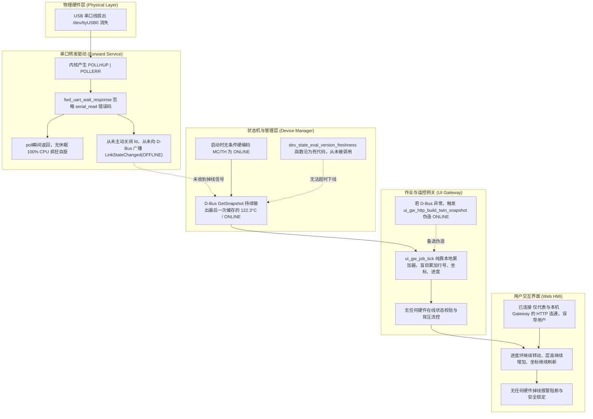
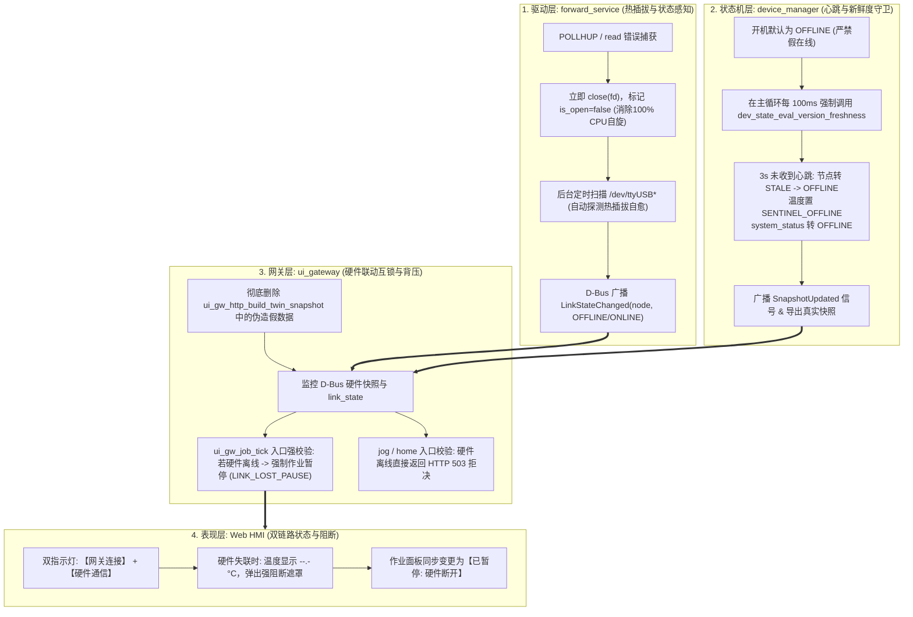

# AI-SoC 智能 3D 打印系统全架构“硬件真实性与物理闭环”深度 Review 与整改方案

> [!IMPORTANT]
> **本报告针对用户指出的核心故障——“拔出 ttyUSB 后，界面依然在继续跑”进行全系统架构级审查。**
> 这一现象并非单一模块的代码 Bug，而是一个**深层次的架构设计缺陷**：系统在多个层面存在**“假拟真（Open-loop Fake Simulation）”与“乐观伪造（Default Optimism）”**倾向，导致软件逻辑与底层硬件真实物理状态严重脱节。在物理硬件断开时，系统未能形成“端到端真实性链条”，反而出现软件脱离硬件的“幻觉运行（Hallucinatory Execution）”。

---

## 一、系统性根因全景分析

当物理拔出 `ttyUSB` 时，系统中各层的真实运行状态与失控链条如下：

---

## 二、全系统类似缺陷盘点（11 项关键设计缺陷）

经对 `soc-ap`、`services`、`contracts` 以及前端代码的系统级 Review，共排查出 **11 项同类架构缺陷**，分为 5 大类别：

### 类别 A：假拟真与伪造兜底 (Fake Telemetry & Default Optimism)

1. **缺陷 1：Device Manager 启动盲目假在线**
   - **代码位置**：[device_manager_service.cpp#L120-L137](file:///home/sushaohua/workspace/ai_soc_project/soc-ap/services/device_manager/device_manager_service.cpp#L120-L137)
   - **表现**：服务在 `init_default_mcu_versions` 中，直接在内存把 MC 和 TH 初始化为 `valid = true`、`status = ONLINE`，并填入默认固件版本号与 Commit。
   - **危害**：即使宿主机从未插入过任何单片机，只要服务一启动，外部查询立即得到 `ONLINE`，违反“未验证即离线”的基本原则。
2. **缺陷 2：UI Gateway 降级快照硬编码伪造数据**
   - **代码位置**：[ui_gateway_http.cpp#L182-L205](file:///home/sushaohua/workspace/ai_soc_project/soc-ap/services/ui_gateway/ui_gateway_http.cpp#L182-L205)
   - **表现**：当 D-Bus 连接断开或获取快照为空时，`ui_gw_http_build_twin_snapshot` 直接组装了一段假 JSON：`system_status: ONLINE`、`bed: 24.5°C`、`tool: 117.7°C`、`status: ONLINE`。
   - **危害**：中间件故障被恶意掩盖，向前端提供虚假的安全感。
3. **缺陷 3：5×5 自动调平高程网格完全静态伪造**
   - **代码位置**：[ui_gateway_job_ctrl.cpp#L145-L165](file:///home/sushaohua/workspace/ai_soc_project/soc-ap/services/ui_gateway/ui_gateway_job_ctrl.cpp#L145-L165)
   - **表现**：`ui_gw_leveling_get_mesh_json` 直接返回写死在 C++ 代码里的 25 个浮点数（`-0.08` 至 `0.21`），没有调用真实探针驱动，点击“重新测量”也仅是在内存中重新返回这一串静态数据。
   - **危害**：调平功能完全处于“假拟真”状态，未与 MC 的探针传感器形成闭环。

---

### 类别 B：开环假跑与无物理闭环反馈 (Open-Loop Actuation Without Feedback)

4. **缺陷 4：流式作业引擎脱离硬件，纯软件空跑**
   - **代码位置**：[ui_gateway_job_ctrl.cpp#L193-L218](file:///home/sushaohua/workspace/ai_soc_project/soc-ap/services/ui_gateway/ui_gateway_job_ctrl.cpp#L193-L218)
   - **表现**：`ui_gw_job_tick` 使用定时器 `s_tick_accumulator += delta_ms` 驱动。不管硬件在不在，每秒加 1 行，三角函数算出 X/Y/Z/E 坐标，假装执行 G-code。
   - **危害**：完全没有向下位机下发 G-code，没有下位机 Planner Buffer 背压流控，没有等待 MC 的 `ok` 应答。用户拔掉机器，打印机界面依然“正在打印”。
5. **缺陷 5：手动轴控 (Jog) 与归零 (Home) 纯修改本地内存变量**
   - **代码位置**：[ui_gateway_job_ctrl.cpp#L100-L140](file:///home/sushaohua/workspace/ai_soc_project/soc-ap/services/ui_gateway/ui_gateway_job_ctrl.cpp#L100-L140)
   - **表现**：用户点击 `▲ +Y` 或 `🏠 归零`，网关仅仅把内部变量 `s_job.pos_y_mm += step`，拼出一句 `G1 Y...` 字符串并返回成功，根本没有发送串口报文给运动控制器。
   - **危害**：界面显示电机已移动，但物理机器纹丝不动；真实发生堵转或脱调时，软件完全失明。
6. **缺陷 6：软件急停与物理断电脱节**
   - **代码位置**：[ui_gateway_job_ctrl.cpp#L170-L185](file:///home/sushaohua/workspace/ai_soc_project/soc-ap/services/ui_gateway/ui_gateway_job_ctrl.cpp#L170-L185)
   - **表现**：点击 E-STOP 仅设置了网关内的布尔标志 `estop_active = true`。如果物理链路已断开或串口阻塞，`M112` 无法可靠送达硬件，无法切断步进驱动使能与 PWM 发热。

---

### 类别 C：僵尸状态常驻与心跳检测瘫痪 (Zombie States & Dead Timeout Logic)

7. **缺陷 7：单片机新鲜度超时判定函数沦为“死代码”**
   - **代码位置**：[device_manager_state.cpp#L660-L685](file:///home/sushaohua/workspace/ai_soc_project/soc-ap/services/device_manager/device_manager_state.cpp#L660-L685)
   - **表现**：工程里编写了非常完善的 `eval_single_mcu_freshness`（判定 3 秒超时转 `STALE`，15 秒转 `OFFLINE`），但在整个系统的主循环、分发调度、D-Bus 回调中，**没有任何地方调用它**！
   - **危害**：一旦单片机上报过一次版本，其状态在 AP 内存中永远是 `ONLINE`，机器被砸碎了它也是 `ONLINE`。
8. **缺陷 8：传感器断流后历史数值永久冻结**
   - **代码位置**：[device_manager_state.cpp#L260-L290](file:///home/sushaohua/workspace/ai_soc_project/soc-ap/services/device_manager/device_manager_state.cpp#L260-L290)
   - **表现**：当温控采样由于拔线停止更新时，质量评估虽然可能变成 `FAULT`，但 `bed_temp_millic` 始终保留着断线前最后一刻的数值（如 122.3°C），而不是标记为无效值（`SENTINEL_OFFLINE`）。
   - **危害**：前端显示停留在 122.3°C，操作员无法判断这是“当前正在恒温保温”还是“传感器已经失联”。

---

### 类别 D：硬件通信故障下的失控与自愈缺失 (Fault Unhandled & No Self-Healing)

9. **缺陷 9：串口拔出触发 POLLHUP 导致 100% CPU 疯狂自旋**
   - **代码位置**：[forward_uart.cpp#L108-L121](file:///home/sushaohua/workspace/ai_soc_project/soc-ap/services/forward/forward_uart.cpp#L108-L121)
   - **表现**：底层 `serial_read` 在设备拔出后返回 `false`（检测到 `POLLHUP | POLLERR`），但外层循环不检查返回值。由于 `poll()` 发现挂起事件立即返回 0 毫秒延时，进程以最高速度疯狂轮询死 `fd`，单核 CPU 瞬间被打到 85%~100%。
   - **危害**：整机发热卡顿，D-Bus 和 DDS 消息得不到调度，加剧整个控制系统雪崩。
10. **缺陷 10：串口热插拔与设备号漂移无法自愈**
    - **代码位置**：[forward_service.cpp#L101-L107](file:///home/sushaohua/workspace/ai_soc_project/soc-ap/services/forward/forward_service.cpp#L101-L107)
    - **表现**：USB 线重新插入后，Linux 内核通常将其分配为 `/dev/ttyUSB1`，而 `forward_service` 始终绑定启动参数 `--port /dev/ttyUSB0`，且从未尝试重新枚举 `/dev/ttyUSB*` 或根据 VID:PID 重连。
    - **危害**：用户即便插回 USB 线，系统也永远无法恢复，必须人工重启后台所有进程。

---

### 类别 E：人机交互状态语义混淆 (Frontend Semantic Conflation)

11. **缺陷 11：Web HMI “网络连通”与“硬件在线”混淆**
    - **代码位置**：[app.js#L835-L840](file:///home/sushaohua/workspace/ai_soc_project/soc-ap/browser_hmi/first_release/app.js#L835-L840)
    - **表现**：顶栏只有一个绿色的“已连接”标签。只要浏览器连上了 `127.0.0.1:8080` 的 SSE，它就标绿显示“已连接”。即使快照中 `system_status` 是 `DEGRADED` 或 `OFFLINE`，该标志依然绿得刺眼。
    - **危害**：操作人员完全被界面欺骗，以为物理设备处于良好受控状态。

---

## 三、架构级整改方案：重构“物理真实闭环链条”

为彻底杜绝上述问题，必须确立**五大不可违背的架构原则（Architectural Invariants）**：

> [!CAUTION]
> ### 五大物理真实性架构原则
> 1. **单向物理真实性原则 (Single Source of Physical Truth)**：严禁在未收到硬件应答时乐观伪造任何状态；开机默认必须是 `UNREADY / OFFLINE`；严禁在降级快照中硬编码伪造数据。
> 2. **故障即阻断原则 (Fail-Closed & Hardware Interlock)**：通信链路一旦中断（超 3 秒心跳失联），作业引擎必须**硬性挂起并暂停**（切入 `PAUSED_LINK_LOST`），所有运动和加热接口立即闭锁，拒绝接收新的相对位移指令。
> 3. **全链路双状态透明原则 (Dual-Link State Transparency)**：前端必须彻底拆解并同时显示【🌐 本地网关: 正常】与【🖨️ 打印机硬件: 在线/离线/故障】两个独立维度。
> 4. **热插拔自愈与看门狗原则 (Auto-Reconnection & Hotplug Watchdog)**：串口驱动层必须具备感知 `POLLHUP` 并自动优雅关闭、周期性扫描 `/dev/ttyUSB*` 或按硬件特征动态重新绑定的自愈能力。
> 5. **基于物理背压的流式闭环原则 (ACK-Based Streaming with Planner Buffer)**：作业引擎必须将 G-code 真正转换为 MiniMCProto 指令下发，依据 MC 规划器回传的 `ok` 确认帧推进进度，严禁纯定时器累加空跑。

---

### 系统改造架构拓扑图

---

## 四、分阶段实施路径 (Roadmap)

### 阶段 1：防御止血与下线阻断 (Phase 1: Fail-Closed Protection)
*目标：拔掉 USB 线后，CPU 不再自旋，界面在 3 秒内报警，作业立刻被硬件联动强行暂停，温度变为离线。*
1. **`forward_uart.cpp`**：
   - 检查 `serial_read` 返回值，捕获 `POLLHUP` 或错误立即 `close(fd)` 并置 `is_open = false`；
   - 消除 100% CPU 空转，退出 `wait_response` 并向 D-Bus 广播 `LinkStateChanged(node, false)`。
2. **`device_manager_service.cpp` & `device_manager_state.cpp`**：
   - 彻底删除 `init_default_mcu_versions` 预设 `ONLINE` 的逻辑，开机默认为 `UNKNOWN / OFFLINE`；
   - 在 `device_manager_dispatch` 中强制调用 `dev_state_eval_version_freshness(state, now_ns)`；
   - 当超时时，将 MC/TH 设为 `OFFLINE`，将 `snapshot.bed_temp_millic` 和 `tool_temp_millic` 设为 `AISOC_TEMP_MILLIC_OFFLINE`，将 `system_status` 置为 `OFFLINE`。
3. **`ui_gateway_http.cpp` & `ui_gateway_job_ctrl.cpp`**：
   - 剔除 `ui_gw_http_build_twin_snapshot` 伪造假在线数据，降级快照如实输出 `system_status: "DISCONNECTED"`、温度 `--.-`；
   - 在 `ui_gw_job_tick` 首行加入硬件互锁卫语句：若 `system_status != "ONLINE"`，立刻触发 `ui_gw_job_pause()`，设置原因 `PAUSE_REASON_LINK_LOST`，流式步进立即停摆；
   - `ui_gw_job_jog` 和 `ui_gw_job_home` 在硬件离线时返回 `UI_GW_ERR_HARDWARE_OFFLINE`。
4. **`app.js` & `index.html`**：
   - 顶栏拆分为【🌐 本地网关: 正常】与【🖨️ 打印机硬件: 在线/离线】；
   - 硬件 `OFFLINE` 时，温度显示 `--.- °C (离线)`，弹出非阻塞/阻塞式告警条。

### 阶段 2：热插拔探测与自动重连自愈 (Phase 2: Auto-Reconnection & Hotplug)
*目标：重新插上 USB 线后，系统无需重启，自动识别 `/dev/ttyUSB*` 并恢复通信。*
1. **`forward_service.cpp`**：
   - 增加空闲探测扫描线程/定时器：当串口处于关闭态时，每隔 1 秒扫描 `/dev/ttyUSB*`（通过 VID:PID 或设备遍历）；
   - 找到可用节点时自动执行 `fwd_uart_open` 并发送协议握手帧；
   - 握手成功后向 D-Bus 广播 `LinkStateChanged(node, true)`，全系统恢复在线。

### 阶段 3：G-code 流式下发与单片机背压闭环 (Phase 3: Real Motion & Flow Control)
*目标：彻底废除数学纯模拟步进，打通真正的 G-code 串口下发与 MC 应答推进。*
1. 将 `job_executor.c`（已有的 `aisoc_job_executor` 合约组件）接入 `ui_gateway`；
2. 每一个 G-code 块通过 MiniMCProto `STREAM_CHUNK` 真正发送到 MC；
3. MC 规划器执行完并回传 `ok` / 缓冲区空闲水位信号后，AP 端作业引擎才允许当前行数 `current_line++`；
4. 真实坐标完全来自于 MC 的 `0x16` 位置回传报文。

---

## 五、需要您审批的决策点

在开始执行上述改造之前，请您确认以下关键设计取向：

| 决策项 | 备选项 A (推荐: 工业级严格闭环) | 备选项 B (轻量兜底) | 差异说明 |
|---|---|---|---|
| **1. 物理拔线时的作业行为** | **立即安全暂停 (Safe Pause)** 保留当前行号与打印上下文，待插回并自检后可继续打印 | **直接报错终止 (Fault Abort)** 视作灾难性故障，直接取消作业复位到 IDLE | 推荐 A，符合工业 3D 打印机断电/断线恢复逻辑 |
| **2. 热插拔端口漂移处理** | **动态扫描 `/dev/ttyUSB*` 自动重连** 无论是 USB0 还是 USB1，只要匹配波特率即自动绑定 | **仅尝试重连原端口 `/dev/ttyUSB0`** 若端口号变更则报错提示人工介入 | 推荐 A，提升现场调试和插拔容错体验 |
| **3. 实施切分策略** | **立即优先执行阶段 1 (止血与硬互锁)** 先彻底解决“拔线继续跑”和“85% CPU 空转”，验收通过后再进阶段 2/3 | **阶段 1 与阶段 2 合并实施** 一次性完成下线阻断与重连自愈 | 推荐先执行阶段 1，立即见效且风险可控 |

---

> [!NOTE]
> 请审阅本架构 Review 与整改方案。确认上述决策项后，我将立即依规签发任务、分配 Agent 角色并执行代码落地！
