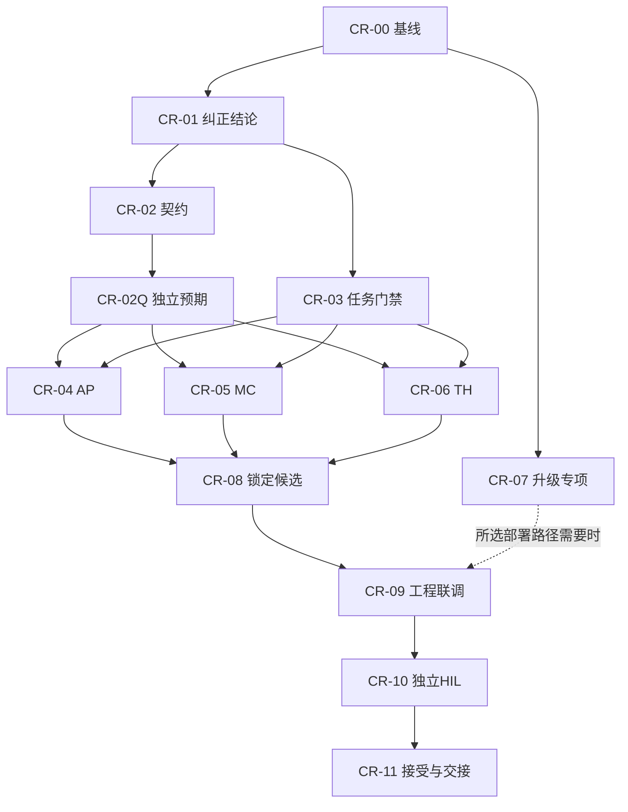

# AP—MC—TH 级联纠偏与同类漏洞治理实施方案

## 0. 先看这一页：修改哪些文件、做哪些操作

目标只有一个：VMware AP 发出符合既有协议的只读请求，MC 原生转发，TH 真实生成响应，MC 转回，AP 严格关联响应并记录 RTT。通过正常、失联和恢复验证后，才接受这个准确版本组合。

| 顺序 | 修改位置（均为后续拟修改） | 实际操作 | 谁负责 | 退出条件 |
| --- | --- | --- | --- | --- |
| 1 | 控制仓新增撤回记录；MS-07、MCQ-0106、MS-14 卡及 KANBAN | 保留历史报告，追加结论限制/撤回，阻止下游继续消费错误通过结论；修复卡片 YAML | 唯一实际 COORD | 每个受影响候选都有版本、理由、证据和恢复条件 |
| 2 | `project-control/tools/check_task_graph.py`、新增工具反例测试、相关任务卡 | 补 MCU 卡扫描、状态/依赖/审查/租约/产物检查，修正看板投影 | 控制工具作者；独立 Codex 检查 | 当前坏卡明确失败；隔离反例不能绕过 |
| 3 | 新增最小级联 ICD；引用 `soc-ap/contracts/minimcproto/v2-commands.md` | 接受 GET_VERSION/PING、路由、超时、MTU、缓冲及设备身份契约；先固定独立预期 | ARCH＋ENG-FWD/MC/TH；独立 QA | 双端与 AP 用同一版本，不重定义现有命令 |
| 4 | AP 的 `main.cpp`、`serial_posix.*`；新增查询测试与 CMake 注册 | 正确命令/载荷、完整响应关联、失败退出码、有界 I/O、完整日志 | ENG-FWD；独立 Codex 检查 | 本文列出的主机误报反例全部按预期拒绝 |
| 5 | MC 的 `minimc_proto.*`、`memu_gui.c`、`wk_usart.*`、DMA/IRQ 必要接点 | 删除文本转译及固定 TH 回包；ISR 只交接数据；实现双向原生路由和缓冲所有权 | ENG-MC；独立 Codex 检查 | 路由向量及异步事件测试通过，产出准确 `fw_mc.bin` |
| 6 | TH 新增 `minimc_proto.*`，接入 `usart.c`/`main.c`/Makefile | 接入原生帧解析、版本报告、PONG；停止业务串口裸文本污染 | ENG-TH；独立 Codex 检查 | 真实节点字段来自 TH，产出准确 `fw_th.bin` |
| 7 | `th_upgrade_mgr.*`、对应收发接口与升级 SOP | 单独修复 ACK 接收容量、事务关联和文件预检；升级风险未解决前不采用有缺陷的中继升级路径 | ENG-MC/TH；独立 Codex 检查 | 内存边界与错误 ACK/文件反例通过，部署路径有证据 |
| 8 | 新增级联候选清单、刷写与联调记录、独立 HIL 用例/采集器 | 锁定 AP/MC/TH 制品；按已授权设备分阶段联调；另交独立验收 | INTEGRATOR → COORD 联调 → 独立 QA | 正常、TH 失联、恢复均符合准确契约 |
| 9 | MS-17/MS-21、交接入口；最后更新 `workspace.json` | COORD 按证据放行；分别提交各仓；锁定恢复版本；有发布授权时推送核对远端 SHA | COORD/INTEGRATOR | 本地接受、实际部署、服务器同步分别有记录 |

本轮交付为本方案及独立审查材料，以上操作尚未执行。源码未修改，正式卡片未改状态，未刷写/复位/占用串口，未推送。新增文件列表见第 4 节；具体操作顺序见第 5 节。

## 1. 文档身份、规则与审查基线

### 1.1 修订历史

| 版本 | 时间 | 修订人 | 内容 | 审查/批准状态 |
| --- | --- | --- | --- | --- |
| 1.0 | 2026-10-27T16:20:03+08:00 | AI (Codex), /root | 首版：复核既有问题、同类漏洞、文件清单、分票顺序、验收与回退 | 独立内容审查另留 run；实施批准未取得 |

本文件是该纠偏任务的唯一方案原件，同任务后续原地修订，不再复制出多个“最终版”。跨仓计划存于 `project-control/docs/`；MCU 子票引用本文件。历史复盘、历史 QA 报告、旧候选均保留。

适用规则：根 `AGENTS.md`、控制仓 `.agents/rules/04_公共看板与读写协议.md`、`codex_qa_review.md`、`c_cpp_coding_standard.md`、单票原子微步规则；MCU 同时遵守工作区软链 `mcu-p3/AGENTS.md`。后者要求“在用户明确给出批准指令前，严禁产生任何代码修改行为”。本次用户要求方案文档与排查，已完成方案准备；实施不借用“方案已写”当作已批准。

### 1.2 准确源码快照

| 仓库 | 分支 | 审查开始时 HEAD |
| --- | --- | --- |
| 工作区入口 | main | `9cf4f7c281345941904e042b5ae7494fdccda1a7` |
| project-control | main | `8a042927ea0c3b58ea26d3a7b197f5727a1b42fb` |
| soc-ap | main | `8d6c446cd3b0bac57054723ba7da9cd797ab4131` |
| mcu-p3 | feat/soc-debug | `a679133204ecbb81ad48694f5372c125db2e749f` |
| test_harness | main | `5a2ebe49e26ffb76a55ab74de652142ce9961de7` |

控制仓已有两份未跟踪飞书指南及 Python 缓存，测试仓已有 Python 缓存；这些不是本轮产物，保留且不自动提交/删除。AP、MCU 工作树审查开始时干净。本次 `workspace.json` 已绑定上述四个子仓提交，不沿用前轮“锁文件落后”的判断。`manifest.yaml` 含日期化工程基线，不因比 HEAD 旧就自动重写；恢复清单、工程接受基线、实机部署版本分别管理。

源码/文档复核可证明实现与记录的状态；主机 PTY 和故障注入只证明主机软件行为；没有实机运行就不确认板上固件、接线或当前物理响应。

### 1.3 对原复盘的必要更正

原文：[AP-MC-TH 联调偏差复盘](../analysis/ap_mc_th_cascade_verification_issues_and_root_cause_analysis_20261027.md)。它提供问题线索；标题里的 Approved 不替代准确版本的接受记录。

1. 原 QA 已记录真实日志零有效帧，仍签 APPROVED；不能写成“未查看真实日志”。
2. MC 没有解析 TH 返回文本，而是接收完成事件触发生成硬编码版本响应，身份与版本均不能由它证明。
3. MS-14 已要求 TH 独立微步，MS-17 已定义独立双 MCU 验收；缺口是子票未落实、前置被绕过和实际联合调试未组织。
4. 透明路由条款在协议 §2.2，原文 §2.4 引用错误；中继要解析路由头及校验 CRC，禁止的是业务解包/转译；还需设置 `ROUTE_IS_ROUTED`。
5. 旧 TH 源码里存在 G/M/T 文本处理，不能推定板上版本；“二进制全部静默丢弃”过强，文本切行器不是二进制隔离器。
6. “只能作弊”“被逼入死角”等动机不作事实结论；用派单、实现、评审、状态和版本的具体失配描述问题。

## 2. 同类漏洞清单：证据、影响和处理范围

优先级：P0 表示阻止接受受影响候选/阻止使用受影响部署路径；P1 表示相关里程碑验收前必须修复；P2 表示文档、可恢复性或后续接口隐患。优先级不代表本轮已修复。

### 2.1 查询与主机路径

| ID | 等级/证据 | 已发现的问题 | 修复要求 |
| --- | --- | --- | --- |
| F01 | P0，源码与原日志 | AP 默认 `0x03/L0`；MC 回同命令的 4 字节版本。与 `0x01→0x02/L16`、`0x03/L4→0x04/L12` 冲突 | 统一 AP/MC/TH 到现有命令契约；格式正确与命令正确分别断言 |
| F02 | P0，主机 8 个负例已复现 | 静默仍 exit 0；回显请求、错来源/目的/命令/标志/序号/短载荷仍 SUCCESS | 匹配请求上下文；忽略无关合法帧并继续等待；超时/I/O/拒绝明确失败 |
| F03 | P1，隔离主机探测 | `serial_write` 遇持续 EAGAIN 或 write 返回 0 可无限循环；查询接收超时不能约束发送 | 配置单调时钟截止时间、可写 poll、部分写计数；零进展有界退出 |
| F04 | P1，隔离主机探测 | 未支持的 921600 配置静默落到 115200；非法 CLI 数字可变 0/截断/接受后缀；读错误最终被吞成超时 exit 0 | 拒绝未支持波特率；完整解析数值并校验范围；传递 I/O 错误与实际配置 |
| F05 | P1，源码/主机探测 | 成功路径无原始逐帧 RX 时戳；噪声 600B 只输出 512B且无截断声明；只看帧完成不等于业务通过 | 独立采集 TX/RX 原始分块与完成帧；记录 UTC/单调时钟、截断/丢日志计数；有丢失则相关证据不完整 |
| F06 | P2，接口源码 | 返回的 FrameView 借用局部 parser 缓冲，出函数后潜在悬垂；当前打印在返回前，未证实发生 use-after-return | 在上下文持有 parser 或复制命令结果到有界拥有者；消费前写清借用生命周期 |
| F07 | P1，CTest 实跑/源码 | 未设 MINIMC_QA_ROOT 时只注册 1 个启动 smoke，仍可 100% 绿；离线 runner 的命令长度判断是参考侧推导，不能证明生产宿主实现语义 | 发布/验收配置强制启用所需测试并核对名称与非零用例数；新增生产查询语义测试，保留普通开发 smoke 模式 |

主要入口：[AP 宿主](../../../soc-ap/core/host/main.cpp)、[串口适配](../../../soc-ap/core/forward/transport/serial_posix.cpp)、[CMake](../../../soc-ap/CMakeLists.txt)、[参考运行器](../../../test_harness/static_checks/minimcproto/run_codec_cases.py)。独立复现原件随本方案证据目录归档，不把软件测试记为 HIL。

### 2.2 MCU 运行与部署路径

| ID | 等级/证据 | 已发现的问题 | 修复要求 |
| --- | --- | --- | --- |
| F08 | P0，源码调用链推导 | USART2 IRQ→gui_rx_callback→协议解析→handle_th_query 忙等；USART6 与 USART2 抢占优先级同为 2，完成中断无法在等待期间运行 | ISR 只移交有界字节/事件；主循环推进解析/路由/超时；不以调高 IRQ 优先级掩盖设计 |
| F09 | P0，源码 | MC 只看 rx_complete，不校验 TH 内容，就生成 `src=TH`、固定版本的响应 | 移除该路径，转发 TH 原生响应；中继不生成 TH 业务身份 |
| F10 | P1，源码风险 | USART2 DMA 重启后继续读同一个 rx_fifo；USART6 同样在消费者读取前重用缓冲；完成布尔标志难以表达多帧 | 接收快照/双缓冲或有界队列，完成/长度与槽位一起交接；定义背压、溢出计数和恢复 |
| F11 | P1，源码 | MC 新解析器载荷上限 64 与 AP 1024 不一致；无字符超时/完整路由与事务语义；轮询次数不等于时间期限 | 明确本轮端到端能力上限及超限行为；半帧超时后恢复；分开实现本机业务与路由；用可核查时间来源 |
| F12 | P0，源码容量契约 | TH 升级调用者分配 ACK[8]，等待函数传给下层容量却为 32；9～32B合法外层应答可能越过调用者数组 | 容量从真实对象传入，所有写入受界；上下文结构体避免超4参；独立边界测试；此路径修复前不用于升级 |
| F13 | P1，源码 | 升级分块应答只验状态，不核对块序号；文件长度/读结果/Trailer 完整性预检与“Verified”文案不等价 | 严格长度、请求关联、读/seek返回值、文件与payload长度、CRC逐项核查；不得将改名等同安装成功 |
| F14 | P1，待按部署路径补证 | 文本启动输出与业务二进制共口、旧升级协议/Bootloader能力、文件改名和实际 App 版本可能混淆 | 专项核对实际被选部署路径；锁定两端Bootloader来源/能力和原始启动身份；本轮不据旧源码推断已烧录 |

F08/F10 是源码分析，不代表已重现实机丢包。F12 的容量错误可由调用者/被调者静态对应证明，本轮未向板卡发送触发报文。完整 MCU 扩展审查原件另归档。

### 2.3 派单、QA、记录与恢复路径

| ID | 等级/证据 | 已发现的问题 | 修复要求 |
| --- | --- | --- | --- |
| F15 | P0，实际检查 | MS-07 acknowledgement 中未加引号的 `: ` 使 YAML 解析失败；当前 task graph 命令非零 | 只修卡片语法；保留原结果和错误输出，不能因语法修复宣称业务通过 |
| F16 | P0，工具源码/隔离反例 | 卡扫描遗漏 MCQ/THQ；详细准入主要针对 V2 Ready/InProgress，MS/Review/Verify/Done 未全面检查 | 完整登记卡类型，按类型检查所有状态；父卡能力条件显式进入子票；未知状态/漏登记一律报错 |
| F17 | P0，实际卡片 | MS-07 Done，但 ARCH session 与作者相同、结论/版本/证据为空；多项前置仍 Backlog；MS-14卡与看板依赖不同 | 独立性、全部必需接受、实际输入版本、集成记录齐全才放行；看板按卡生成或校验 |
| F18 | P1，记录/工具源码 | 报告写 APPROVED、提供通用解码结果或文件存在，不代表命令合规、准确候选、实机部署；artifact检查主要存在性/哈希 | 绑定候选源码与制品；解析结构化结论并核对scope、run、rev、哈希；原始命令/输出缺失保持待核查 |
| F19 | P1，来源/恢复风险 | 根 .agents 与控制仓副本并存；MCU AGENTS/.agents/docs为被忽略外部软链，恢复清单不能自动恢复同一套规则/指南 | 规则原件明确为控制仓；将必要MCU规则/能力说明纳入版本化输入或登记完整依赖；不删除现有软链、不同时手改副本 |
| F20 | P1，规则语义 | HW-G5“零响应即否决”未限定正常场景；HW-G6对每张单板票都要求双制品会混淆阶段出口；Blocked/Rejected与状态枚举不一致 | 区分用例期望与任务结论、单板交付与组合接受；阻塞用blocked字段；报告决定与任务状态分别存储 |
| F21 | P1，源码＋旧设计待确认 | TH链接允许App占满至0x08040000，但本地旧设计将Sector127锚点置于0x0803F800；当前镜像较小，未证实发生覆盖 | 先接受实际Bootloader/Flash布局，再落实链接长度、打包容量、锚点与越界拒绝测试；不凭旧文档直接改Flash |
| F22 | P1，源码/文档 | README称运行时热插1秒内升级、更名即100%成功；实现开机5秒空闲后停止轮询，且finish ACK/改名后未核对新App身份；MC运行查询还可清升级共享RX标志 | 修SOP与实际窗口/成功条件；模式所有权覆盖所有入口；部署后原生身份与恢复另验 |

根因链为：能力/依赖遗漏或未落实 → 允许不完整派单 → 实现偏离正式契约 → QA用局部证据接受 → COORD不完整放行 → 候选/部署/恢复版本容易混用。增加禁止条款不能替代每个环节的可执行检查。

## 3. 目标契约与边界

### 3.1 本轮必须做到

- AP、MC、TH 保持地址 0x01、0x02、0x03；MC处理自己的请求，其他节点的请求/响应按路由转发。
- 版本请求0x01/L0，响应0x02/L16；响应包含真实节点版本、boot_id、构建标识和能力位。git短标识不能单独替代完整制品哈希。
- PING0x03/L4，PONG0x04/L12；时间戳回显与seq、节点、标志、长度均核对。AP用单调时钟测RTT，UTC用于日志对账，不依赖跨板时钟同步计算往返。
- 接收端按 `帧校验 → 路由/本机分发 → 命令校验 → 请求关联 → 业务结果` 分层判断；CRC正确仅表示通过第一层。
- MC转发时保留src/dst/cmd/seq/payload，检查Hop>1后递减，置routed，重算CRC；未知命令也可按目标地址透明转发。缓冲由DMA持有到实际完成，来源缓冲不能提前重用。
- 明确入口端口、出站端口、广播/水平分割及超限行为；本轮测试只读单播，未实现的广播/OTA能力在能力表标不支持，不借最小查询宣称全协议完成。
- 每次查询带唯一在途上下文。进程重启/seq复用时需要会话重建与旧帧处理；GET_VERSION先建立boot_id，PING使用时间戳回显加强关联，不能把seq固定1视为充分关联。

### 3.2 开工前必须接受的参数

ARCH与对应Owner在CR-02填入：正常请求响应期限、字符超时、发送期限、最大帧/队列槽数、每次服务预算、日志容量和溢出策略、boot_id生成/持久化来源、构建身份映射、未知/错误命令的标准NACK行为、运行/升级端口独占与退出状态。没有依据不填造数值。

首轮稳定性建议50次连续查询；次数、超时、允许丢包和RTT门限在独立预期中先确定。采样统计不能保证长期零丢包。任何“线速”声明都需容量与实测支撑，115200/921600异速链路不能跳过拥塞预算。

### 3.3 范围限制

本轮不执行运动/加热，不改PID/限位/保护参数，不顺带实现打印作业、全套OTA、三总线或全协议。已发现升级缺陷单独修复；最小查询不因此扩成升级重构。若不采用该升级路径，必须有经接受的替代部署路径和两端身份核查，不能绕过HW-G2/G4。

## 4. 文件级修改清单

以下均为拟修改/拟新增。行号可能随修复改变，以准确提交和符号定位。白名单是方案建议，派单时进一步缩到单票具体文件；它不自动授予整目录写权。

### 4.1 控制仓与任务门禁

| 文件 | 操作与内容 | 票/主责 |
| --- | --- | --- |
| `project-control/docs/decisions/cascade_candidate_adjudication_20261027.md`（新增） | 精确记录旧结论限制/撤回、旧/新版本、受影响消费者、恢复条件；历史结果原件不覆盖 | CR-01 / COORD |
| `project-control/.agents/kanban/milestones/marlin_ms07_20261007_214108.md` | 引号修复；撤回适用性引用；独立ARCH与QA记录；准确依赖版本；按证据修状态 | CR-01/03 / COORD |
| `project-control/.agents/kanban/microtasks/mc_firmware/MCQ-0106.md` | 保留旧实现/报告引用，追加失效说明与替代票；明确停止作为原生路由候选 | CR-01 / COORD |
| `project-control/.agents/kanban/milestones/marlin_ms14_20261007_214108.md` | 修正有效状态拼写；登记未满足条件；关联MC/TH/AP子票、联调票与独立验收 | CR-01/03 / COORD |
| `project-control/.agents/kanban/milestones/marlin_ms05_20261007_214108.md`、`marlin_ms12_20261007_214108.md`、`marlin_ms13_20261007_214108.md`、`marlin_ms19_20261008_083854.md`（均在milestones） | 接受/调查/独立预期各自按证据补齐；不能只把Backlog批量改Done | CR-02/03 / 对应作者＋COORD |
| `project-control/.agents/kanban/milestones/marlin_ms21_20261008_083854.md`、`marlin_ms17_20261007_214108.md`（均在milestones） | 分别承担准确双端候选与最终独立HIL；保留职责分离 | CR-08/10 / COORD |
| `project-control/.agents/kanban/KANBAN.md` | 刷新投影、原件链接、依赖、实际阶段、时间和下一步；删除会误导的旧实时叙述或明确历史时间 | CR-01/03/10 / COORD |
| `project-control/.agents/kanban/microtasks/cascade_recovery/CR-*.md`（新增） | 把第5节建议票实例化；各票输入、路径、资源、独立会话及租约留真实值 | CR-03 / COORD |
| `project-control/tools/check_task_graph.py` | 扫描/类型/schema、完整生命周期、父子能力、身份、租约期限、前置接受版本、产物、看板一致性 | CR-03A～C / 控制工具作者 |
| `project-control/tools/test_check_task_graph.py`（新增） | 全部使用临时副本，验证第6节门禁反例；不得改正式卡促测试通过 | CR-03D / 独立QA作者＋独立复核 |
| `project-control/.agents/rules/codex_qa_review.md`、`04_公共看板与读写协议.md`、`02_模块与Agent职责.md`（均在rules） | 统一状态/决定/blocked、反例语义、组合出口、必要签署与版本；保留独立QA和硬件红线 | CR-02/03 / 相应规则Owner |
| `project-control/docs/analysis/ap_mc_th_cascade_verification_issues_and_root_cause_analysis_20261027.md` | 通过追加勘误/接受记录纠正第1.3节事实，不覆盖历史责任证据 | CR-01 / 文档Owner |
| `project-control/docs/handoff/HANDOFF_20261027.md`、`docs/guides/minimc_v2_task_execution.md` | 当前入口指向本方案和准确任务；旧交接标明时间/适用版本 | CR-03/10 / 对应Owner |
| `project-control/.agents/kanban/microtasks/minimc_v2/README.md`、任务模板 | 修复指向已移入superseded卡的当前链接，区分实际20张活跃卡与历史25张拆解，展示当前最终票V2-P0506 | CR-03 / COORD |
| `project-control/.agents/rules/`及`docs/baseline/mcu_rule_inputs/`（必要版本化输入） | 核对并迁入恢复时必须具备的MCU规则/指南，记录来源哈希和优先级；不把参考文档变成自动批准 | CR-03E / 规则Owner |

规则/规划较多但不是一次全量重写；以撤回引用、修正矛盾和补可执行门禁为最小差异。根 `.agents` 不并行修改；先核对来源，后决定只读导航/可复现导出方案。MCU外部软链目标不在本轮写入范围。

### 4.2 契约、AP与独立测试

| 文件 | 操作与内容 | 票/主责 |
| --- | --- | --- |
| `project-control/docs/interfaces/ap_mc_th_readonly_cascade_icd.md`（新增） | 路由/帧容量/时序/身份/部署接口目录与接受记录；引用可执行契约，避免复制命令定义 | CR-02 / ARCH |
| `soc-ap/contracts/minimcproto/v2-commands.md` | 沿用现有正确命令；如需补响应关联/身份用途，仅做经Owner接受的澄清，不为错误实现降级契约 | CR-02 / ARCH＋对应作者 |
| `soc-ap/contracts/minimcproto/cascade-query.md`（新增） | 冻结生产查询状态、结果/退出码、日志字段与最低测试集合；声明与实现分票 | CR-02 / ARCH |
| `soc-ap/core/host/main.cpp` | 命令/载荷、CLI完整解析、事务关联、忽略无关帧继续读、失败传播、时戳与日志 | CR-04B～D / ENG-FWD |
| `soc-ap/core/host/query.h`、`query.cpp`（新增，若拆分所需） | 有界请求上下文、命令结果与校验辅助函数；避免main.cpp承载全部状态；无堆、函数≤50行/≤4参 | CR-04A～C / ENG-FWD |
| `soc-ap/core/forward/transport/serial_posix.h`、`serial_posix.cpp` | 有界发送/可写等待；拒绝不支持配置；状态、部分字节及I/O错误传播；接口变更列全调用者 | CR-04A/B / ENG-FWD |
| `soc-ap/CMakeLists.txt`、`soc-ap/README.md` | 新模块/测试注册、验收配置强制测试集、完整命令与实际能力说明；保留开发smoke用途 | CR-04E / ENG-FWD/INTEGRATOR |
| `test_harness/test_cases/cascade/query_cases.json`（新增） | 实现前独立正常/错误响应、超时、回显、旧帧、批量帧及I/O判据 | CR-02Q / QA作者 |
| `test_harness/static_checks/cascade/run_query_cases.py`（新增） | 调用真实宿主程序并比较独立预期；PTY结果标host-only；零case/超时/未知字段均报错 | CR-02Q / QA作者 |
| `test_harness/static_checks/minimcproto/run_codec_cases.py`、`test_cases/minimcproto/vectors.json` | 原帧层测试保留；如扩展则明确参考判断和生产命令判断区别，不能通过改黄金值容忍错误实现 | CR-02Q/04E / QA作者 |

既有codec/parser是帧层模块，不因它不做业务分发就认定有缺陷。冻结的历史5参数入口按规则保留ABI并使用合规内部辅助函数，避免无关接口重构。

### 4.3 MC、TH与升级修复

| 文件 | 操作与内容 | 票/主责 |
| --- | --- | --- |
| `mcu-p3/motion-controller-mcu/project/inc/minimc_proto.h`、`project/src/minimc_proto.c` | 正确本机命令、原生路由、收包时序、缓冲/队列、错误计数；移除生成TH身份的代码 | CR-05A～D / ENG-MC |
| `mcu-p3/motion-controller-mcu/project/marlin/marlin_lcd/memu_gui.c` | gui_rx_callback只完成必要清标志/快照/入队，不在IRQ等待业务；避免同槽DMA覆盖 | CR-05B / ENG-MC |
| `mcu-p3/motion-controller-mcu/project/src/main.c` | 主循环服务解析/路由/超时，明确每轮预算，不阻塞Marlin | CR-05C / ENG-MC |
| `mcu-p3/motion-controller-mcu/project/src/wk_usart.c`、`project/inc/wk_usart.h`、`project/inc/wk_dma.h`、`project/src/wk_dma.c` | 有界二进制收发、slot交接、busy/完成/错误传递、运行/升级独占；不复用追加CRLF的文本接口 | CR-05A/B/D / ENG-MC |
| `mcu-p3/motion-controller-mcu/project/src/at32f435_437_int.c`、`at32f435_437_wk_config.c` | 核查IRQ调用链和优先级；只改已证明必要的接点，不能靠改优先级绕开等待设计 | CR-05B / ENG-MC |
| `mcu-p3/color-engine-mcu/io_toggle/inc/minimc_proto.h`、`src/app/minimc_proto.c`（新增） | TH有界原生解析及GET_VERSION/PING业务响应；结构布局编译期检查 | CR-06A～C / ENG-TH |
| `mcu-p3/color-engine-mcu/io_toggle/src/bsp/usart.c`、`inc/usart.h`、`src/user/main.c` | 收发交接与周期处理；二进制业务口和调试口分流；核对现有端口占用 | CR-06B/C / ENG-TH |
| `mcu-p3/color-engine-mcu/io_toggle/src/app/mycontrol.c` | 仅当旧文本入口与新业务口实际冲突时局部隔离；不改运动/温控业务 | CR-06B / ENG-TH |
| `mcu-p3/color-engine-mcu/io_toggle/Makefile`；MC `CMakeLists.txt`/`Makefile` | 注册自研文件、编译身份和独立输出；沿用已核查pack入口，产物位置记录真实值 | CR-05E/06D / 对应Owner |
| `mcu-p3/motion-controller-mcu/project/marlin/marlin_module/th_upgrade_mgr.c`及对应头文件 | ACK真实容量/长度/序号、文件读返回/长度/Trailer核对、误导性Verified日志 | CR-07A/B / ENG-MC |
| `mcu-p3/motion-controller-mcu/project/src/wk_usart.c`、`project/inc/wk_usart.h` | recv_frame接收容量契约与升级调用者对齐；改接口前列所有调用点 | CR-07A / ENG-MC |
| `mcu-p3/README.md`及项目内实际pack脚本 | 纠正header/trailer、改名/安装成功的含义，写出可复现双制品命令与身份检查；只有确认缺陷才改打包算法 | CR-07C/08 / 对应Owner |
| `mcu-p3/tools/pack_firmware.py`、TH `libraries/cmsis/cm4/device_support/startup/gcc/linker/AT32F423xC_FLASH.ld`、MC `AT32F435xG_FLASH.ld`、`th_upgrade_mgr.h` | 先核实Flash/锚点与Bootloader能力；打包显式board/版本并查向量/长度/摘要；只修改已确认必要的链接/容量项 | CR-07C / ARCH＋MCU Owner |

Bootloader若只有二进制不宣称已审其Flash写入实现；仅登记准确哈希、可验证格式与限制。MC/TH构建、启动地址、时钟、VTOR必须分别确认：MC `0x08020000`、TH `0x08004000`为现有规则值，首次烧录命令仍需按HW-G2人工复核。

### 4.4 候选、实测和恢复

| 文件 | 操作与内容 | 票/主责 |
| --- | --- | --- |
| `project-control/docs/releases/ap_mc_th_readonly_candidate.yaml`（新增） | 锁AP/MC/TH完整提交、源差异/配置/工具链/制品哈希、协议、测试预期、Bootloader和证据 | CR-08 / INTEGRATOR |
| `project-control/docs/operations/ap_mc_th_joint_debug.md`（新增） | 接线/设备确认、资源占用、制品校验、刷写SOP、启动身份、三段联调、失败退出及恢复 | CR-08/09 / COORD＋对应Owner |
| `test_harness/hil/cascade/cases.json`、`capture.py`（新增） | 实现前冻结物理正常/故障判据；独立采集两段双向原始数据、命令/cwd/退出码；不包含成功响应注入 | CR-02Q/10 / QA作者；独立ARCH复核 |
| `project-control/docs/evidence/cascade_recovery/<ticket>/runs/<run-id>/`（后续新增） | 各作者/独立审查者自己的报告、原始命令输出、制品和hash清单；更正另建run | 所有后续票 |
| `workspace.json`、`WORKSPACE.md`、根`HANDOFF_20261027.md`、控制仓交接入口 | 先分别提交子仓再锁版本；说明源码恢复锁不等于HIL批准；旧文档只加准确导航 | CR-11 / COORD/INTEGRATOR |
| `mcu-p3/.gitignore`、`mcu-p3/AGENTS.md`（拟受控入口） | 经来源迁移后将必要本地入口纳入版本；先备份现有软链，不就地覆盖/写外部软链目标，不删除用户本地资料 | CR-03E / 规则Owner＋ENG-MC/TH |
| `tools/workspace.py`、`tools/test_workspace.py`、`WORKSPACE.md`、根`AGENTS.md` | 增加规则来源/漂移检查及隔离恢复测试；根旧.agents明确canonical导航；恢复不静默掩盖旧副本差异 | CR-03E / 工具Owner＋规则Owner |

## 5. 实施票与严格顺序

下列ID为拟建任务，尚未派单；不是已运行会话。每张实现票仍须一个owner、准确revision、实际worktree、白名单、有效租约、检查者与收件入口。最大两张实现票并行；每个作者一张活跃微步。

| 票 | 单一结果 | 前置 | 验收/退出条件 |
| --- | --- | --- | --- |
| CR-00 | 固化基线、保护已有修改、登记本次审查输入 | 用户本次文档/排查授权 | 五仓HEAD/工作树/规则/关键证据哈希可复核；无实施状态提升 |
| CR-01 | 结论撤回/限制与卡片语法修正 | CR-00；COORD按证据裁决 | 历史完整、每个受影响消费者可追溯、YAML能解析；不宣称问题已修复 |
| CR-02 | 最小ICD与接口接受 | CR-01＋实际能力调查 | AP/MC/TH Owner接受；错误/超时/缓冲/身份参数齐全；独立检查 |
| CR-02Q | 独立预期与运行器/采集接口 | CR-02 | 黄金预期不来自生产输出；QA作者产物由独立Codex ARCH复核 |
| CR-03A～D | 任务schema→类型/状态规则→版本/投影规则→独立反例 | CR-01；规则变更消费CR-02 | 第6.1节反例全被拒；良好样例可推进；脚本不自动修改正式状态 |
| CR-03E | 必要规则版本化与恢复一致性 | CR-00、CR-03；来源与迁移方案已接受 | 隔离恢复后规则/入口一致；本地资料保留；不把同步脚本当工程验收 |
| CR-04A～E | AP接口→I/O→命令与关联→日志/CLI→测试集成 | CR-02、CR-02Q；开工需CR-03有效门禁 | 第6.2节正常与负例通过；完整所需CTest集合实际执行 |
| CR-05A～E | MC接口→ISR/缓冲→本机命令→透明路由→打包 | 同上；必要真实输入已接受 | 路由/事件调度/边界/错误路径符合预期；准确制品 |
| CR-06A～D | TH接口→接收交接→命令→构建打包 | 同上 | TH原生响应与独立黄金帧一致；准确制品 |
| CR-07A～C | 升级容量/ACK→文件预检→SOP限制 | CR-00；独立升级修复契约 | 边界反例通过；若为部署所需必须先于CR-09；不用该路径时明确限制和替代证据 |
| CR-08 | 准确组合候选与部署SOP | CR-04/05/06完成所需独立检查；部署相关CR-07 | 不依赖最终HIL已通过，避免循环依赖；清单匹配所有制品 |
| CR-09 | 工程联合调试记录 | CR-08；实际设备/占用/HW-G门禁 | 分段定位后全链路正常及恢复可观察；修代码则回作者产生新候选 |
| CR-10 | 独立真实HIL验收 | CR-09稳定候选＋CR-02Q预期 | 独立Codex完整报告，另有其报告所需独立复核；绑定准确组合 |
| CR-11 | 接受、交接与源码同步 | CR-10及全部必需签署 | COORD更新正式状态；按授权同步，逐仓远端SHA；实机结论不因push自动升级 |

同一CR下的A/B/C不是允许一票连续完成的口号，实例化时分别建卡，按上一微步已验收放行后才领下一步。接口/符号桩/核心逻辑/静态与单测分开。普通文档勘误只做对应文档检查，不伪造固件构建。



## 6. 必须执行的验收矩阵

### 6.1 任务工具反例（全部在临时副本）

| 反例 | 预期 |
| --- | --- |
| YAML含未引用冒号、重复ID、未知status、漏登记的MCQ/THQ | 非零退出，定位文件；不能只因扫描不到就忽略 |
| MS已Done但前置Backlog/缺接受版本，或子票绕过必要能力门禁 | 拒绝该推进/消费；区分历史快照的说明与活动任务检查 |
| 作者兼自己的ARCH/QA、任一必需签署空值、session仅计划别名 | 拒绝独立接受，不能因报告文本含APPROVED通过 |
| 租约过期、owner/revision错配、实际工作区未绑定、路径越白名单 | 活动票拒绝新增动作；历史Done不要求租约现在仍有效，而核查当时执行证据 |
| 候选SHA不存在、前置版本与报告不符、当前制品与所审哈希不符 | 拒绝版本接受；构建时间导致重打包hash不同也不能直接当同一部署制品 |
| 报告不存在/范围不符/所审候选不同/已撤回/原始命令缺失 | 保持待审或拒绝对应接受，不能自动补APPROVED |
| 看板与卡片依赖/状态不同、两票重叠文件/硬件资源 | 报错要求COORD协调；路径冲突用归一化和glob包含关系，不只比较字符串相等 |
| 合法单板实现票仅交本板固件；最终组合交双端固件 | 前者按本票验收，后者必须双端；不把最终出口要求提前成循环依赖 |

### 6.2 AP与协议主机反例

| 组 | 具体检查 | 预期 |
| --- | --- | --- |
| 正常 | MC/TH GET_VERSION、PING分别使用正确cmd、长度、seq、身份与回显 | 正确结果；只有当前匹配响应可成功 |
| 关联 | 请求回显、错源/目的、无响应位、未知命令、旧seq、短/长载荷、错误时间戳 | 不误报；无关帧后继续等当前响应；必要时按标准NACK结束失败 |
| 批量 | 同次read先无关帧再正确帧、两帧粘连、多次分片、半帧静默、坏CRC后恢复 | 不丢正确帧；超时复位与计数可观测 |
| I/O | 无设备、peer断开、EAGAIN、write=0、部分写、持续背压 | 全部有界退出；正确字节计数与非零错误；deadline覆盖发送与接收 |
| 参数 | 非法字符、溢出、负数、尾随垃圾、未支持baud | 发包前拒绝；实际串口设置与记录一致 |
| 证据 | 完整TX/RX、UTC/单调时钟、日志超过512B、正常成功与超时 | 完整原始记录，或显式截断/丢失并标相关证据不可接受 |
| 测试集 | 正常开发smoke与完整验收配置；缺工具/向量/测试组 | 验收配置缺项非零；核对确切测试名与各组非零case，不只看100% |

### 6.3 MCU与部署专项

- 路由黄金向量：入/出站仅Hop、routed及CRC改变；业务payload/src/dst/seq不变；双向验证。
- 中断/事件调度：按真实ISR调用顺序与优先级模型测试，不允许Mock同步置标志绕过异步完成；IRQ本身无等待。
- DMA：同一槽未消费前不可覆盖；背靠背两帧、全缓冲、ring回绕、并发发送、队列满、错误后恢复均有预期和计数。
- 帧长：最小/最大/超限，长度类型与DMA计数宽度一致；不能用小uint8截断大接收长度。字符超时包括无后续字节场景。
- 升级：ACK长度0/8/9/32边界、错块/重复/迟到ACK、短读/seek失败、截断/超长固件、错board、错CRC和格式均拒绝；不得以CRC称密码学签名。
- 编译身份：源码提交/差异、配置与固件自报身份对应；实际部署记录与打包文件精确hash一致；仅同大小/同短SHA不足。

### 6.4 真实HIL出口

1. 运行前确认物理端点、板卡、串口参数、探针及占用；主机不直访TH业务口。COM8与VMware直通若属同一设备，不能同时打开。
2. 在已授权设备上核对实际刷入与运行的两端版本。Bootloader文件改名、编译成功或文件拷贝都不单独证明App已运行。
3. 记录AP TX、MC→TH TX、TH→MC RX、AP RX四向轨迹；按seq/请求字段对账。MC/TH旁路观测只采集，不注入成功应答。
4. 先正常版本查询，再PING/稳定性，再TH断开/恢复；故障窗口内MC自身查询保持可观察。
5. 正常场景零有效关联响应即失败。故障注入场景按预期无响应可通过该负例，但不能据此签正常闭环通过。
6. 日志记录每帧UTC毫秒时间与单调时钟、参数、源码/固件/工具版本、真实命令/cwd/退出码、无响应/噪声/CRC计数及捕获丢失情况。
7. RTT从本机发送/接收测量点计算并说明是否包含排队；报告样本数、成功数、超时/丢包、min/p50/p95/max，不用平均数掩盖失败。
8. QA不改业务实现；问题交作者，新候选重跑受影响项。QA报告本身按既有独立复核规则接受，不能由作者换角色自批。

## 7. 命令、证据与最小修改预算

### 7.1 可立即使用的只读命令

从工作区根执行；原始输出和退出码分别保存，不通过管道吞掉错误：

```bash
python3 tools/workspace.py status
git -C project-control status --short --branch
git -C soc-ap status --short --branch
git -C mcu-p3 status --short --branch
git -C test_harness status --short --branch
python3 project-control/tools/check_task_graph.py --workspace "$PWD" --report /tmp/cascade_task_graph.json
```

最后一条当前存在YAML错误，预期非零；保留该失败证据。文档里的命令示例不是执行结果。MCU shell/构建统一净化Linux PATH；若rg仅存在于Codex提供目录，使用已确认的Linux绝对路径或Python读取，不把Windows路径加回搜索链。

### 7.2 实现后的构建/测试入口

下面是将来按票运行的入口，尚不代表本轮执行：

```bash
cmake -S soc-ap -B /tmp/cascade-ap-candidate -G Ninja -DCMAKE_BUILD_TYPE=Release -DMINIMC_QA_ROOT="$PWD/test_harness"
cmake --build /tmp/cascade-ap-candidate
ctest --test-dir /tmp/cascade-ap-candidate -N
ctest --test-dir /tmp/cascade-ap-candidate --output-on-failure
python3 -m unittest discover -s project-control/tools -p 'test_check_task_graph.py' -v
```

新增查询/门禁用例的确切命令在接口票冻结后写入卡；当前不存在的脚本不得列为已跑。最低基线为现有11项离线/host测试再加新增查询、transport及门禁组，不能以恰好11项替代新增功能覆盖。低版本CTest若不支持`--test-dir`，由执行票改为在构建目录运行并记录版本，不宣称失败命令已通过。

MC/TH先核对各自Makefile/CMake及pack脚本能否把构建输出定向到本票隔离目录；不能假定共享build安全。然后记录真实cwd、工具链、命令、退出码、警告、ELF/raw BIN/pack BIN的不同哈希与尺寸。pack制品必须解析尾部Trailer和board_id，不能把“prepend header”的历史描述当事实。

### 7.3 最小差异与回退

- 本轮实际写入预算：本方案、审查证据及必要导航；不改业务源码/正式任务/历史QA原件。
- 后续每票只改该阶段具体白名单。新自研函数≤50行、≤4参、嵌套≤3层；零动态堆、硬件等待有界；历史Marlin/Bootloader接口最小必要修改。
- 接口变化先列全部生产者/消费者；不靠`void*`、移除const、关闭警告、改黄金值或换测试环境消除失败。
- 构建/分析失败按“原始输出→根因→单点修复”记录，遵守两次修复熔断；仅恢复本票差异，不对脏目录整文件checkout/reset/clean。
- 实机恢复使用已核验的旧制品及真实地址/board_id/哈希；旧制品只作为恢复材料，不恢复已撤回的验收结论。

### 7.4 本轮实际核查结果（与未来验收命令分开）

| 执行者与范围 | 实际命令/检查 | 实际结果与限制 |
| --- | --- | --- |
| 独立 `/root/independent_host_review` | 隔离CMake/Ninja构建；8例PTY查询；transport探针；扩展host参数/断链/日志探测 | 构建exit0；原8例全exit0且7例误报SUCCESS；持续EAGAIN和注入write=0在300ms被外部看门狗终止；仅host软件测试 |
| 同上 | 未设置QA_ROOT的 `ctest --output-on-failure` | exit0、1/1启动smoke；不能据此接受协议/查询/HIL |
| 同上 | 直接调用参考运行器的command长度判断 | 错flag/dst/seq/proto但cmd02/L16仍返回True；证明参考侧覆盖有限，非生产validator执行 |
| 独立 `/root/workflow_gap_audit` | `python3 project-control/tools/check_task_graph.py --report /tmp/cascade_task_graph_baseline_20261027.json` | exit1，61张可解析卡、20张V2卡，MS-07 YAML坏导致额外缺引用 |
| 同上 | 仅在临时副本修MS-07引号；再运行独立门禁反例 | 副本62张卡且errors=[]；MCQ仍漏扫，坏Done/过期blocked Ready/glob交叠/假候选均未被拒 |
| 独立 `/root/independent_cascade_review` | 规则/源码/调用链读取；Python只读检查本地MC/TH BIN首向量、尾Trailer和摘要 | 两份磁盘制品内部摘要相符、签名R/S为0；未构建、未烧录、未实测，不能证明来源/已部署/原生协议能力 |

独立审查原件中的历史工作路径保留用于审计，可能是本机`/tmp`或绝对路径；归档副本路径见证据README。实验脚本不是正式测试框架，也不是已接受的后续实现测试。发布脚本错误码传播本轮未发现缺陷，不为凑漏洞数虚构问题。

## 8. 准确候选、状态和同步的三个区别

| 对象 | 证明什么 | 不足以证明 |
| --- | --- | --- |
| `workspace.json` | 五仓可按准确提交恢复 | 该组合已接受、已刷到板上、HIL通过 |
| 级联候选清单＋独立报告 | 指定源码/配置/制品组合满足所验范围 | 新提交、不同构建或不同板卡自动继承通过 |
| 刷写/启动/物理原始日志 | 实际设备上运行候选与收发证据 | 源码已上传服务器或未来长期稳定 |

逐仓提交保持一个仓库一个逻辑变更；不提交用户原有飞书文件/缓存。源码修复完成并接受后再更新锁文件。服务器push仅在相应授权下执行，核对每个远端分支完整SHA；本轮不因本地origin缓存相同就声称实时服务器已同步。

## 9. 本轮交付、独立审查与后续第一步

本轮证据根目录：[cascade_recovery_plan_20261027](../evidence/cascade_recovery_plan_20261027/README.md)。子目录分别保存独立host审查、独立MCU源码审查、独立流程工具审查及本方案的独立内容审查；记录实际工具会话路径与原始文件哈希。报告缺失或REJECTED保持待修，不能代写签署。

首个实施动作是CR-01：COORD追加准确撤回/限制记录、修卡片语法并修正消费者使用关系；随后CR-02与CR-03落实契约和任务门禁。**不要直接从现有MCQ-0106的Done继续刷写，也不要把本方案的独立文档审查当成MC/TH硬件通过。**

本方案完成的判据：文件/操作/顺序可执行；已证实事实有原件；推导风险有适用界限；发现的问题全部落到对应修复/验证票；独立内容审查通过。实施批准、正式任务派发、代码修复、物理操作和最终接受仍是后续不同事项。
