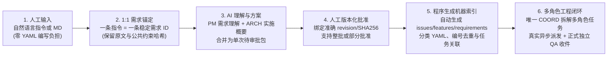

# 三类人工入口自动调度第一阶段：PM 需求理解、范围边界与验收场景底稿

> **文档定位**：本底稿为 `PREP-INTAKE-P1-PM`（`PM / run_01`）在用户 2026-11-03 授权下产出的准备阶段交付物，供唯一 `COORD`（`8d4e8b77-42a9-4bd3-bd5a-1b881e8d4bd5`）与 `ARCH` 实施概要、`INTEGRATOR` 真实接口核实结论汇总为一页确认单交用户批量审批。本文不创建正式 `docs/work_intake/` 队列目录、不修改既有看板状态、不代表未批准实现已启动。

---

## 1. 原文到需求的精确映射（Raw Submission → Demand Mapping）

### 1.1 核心产品工作流契约（用户已确认原则）

依据原始指令归档 `SUB-20261103-001` rev 1 与第一阶段设计 rev 2，确立端到端输入、审批与拆单铁律：

1. **人工零 YAML 负担与原文防篡改**：人工仅提交自然语言指令或 Markdown（归档至 `submissions/`），不填写分类、机器编号或 YAML，不逐票手工转发技术提示词；程序逐字保留用户原话、来源通道、版本与 SHA256，严禁以 AI 摘要替代原文。
2. **“一条指令对应一条稳定需求，单需求可拆多角色任务”**：
   - 每条指令映射唯一稳定的 `demand_id`，不擅自合并多条独立指令，也不因涉及多端协作而把一条指令拆碎成多个产品需求；最终按同一需求的用户结果验收。
   - 单条需求在获准后，可由 `ARCH`/`COORD` 拆解关联多个有明确仓库与路径边界的角色工程任务（如 `PM`、`ARCH`、`ENG-*`、`INTEGRATOR`、独立 `QA`）。
   - 原文列表重排、重扫或局部修改时，程序对既有需求做增量核对，不重复新建需求。
3. **AI 先出理解与实施概要，人工按准确版本批准后实施**：
   - 默认将 **PM 需求理解**（目标、范围/排除项、正负恢复验收场景、待决产品问题）与 **ARCH 实施概要**（模块/接口边界、依赖与拆分）合并为一次待审批包，减少用户审批往返。
   - 支持**整批批准**、**部分批准**（仅释放获准项，其余待审且不阻塞已就绪项）及**“仅确认需求、方案继续讨论”**（不释放未获批的实现开工）。
   - 审批前允许在当次提交授权内执行只读调查、需求澄清与方案编制；**严禁在未绑定真实人工准确版本批准前启动新增实现**，严禁凭 `enabled: true`、模型自填 `approved: true` 或自然语言模糊匹配“批准”二字放行；需求目标或范围发生实质变更时，新 revision 必须重新确认，旧批准不自动套用新范围。
4. **程序自动生成分类 YAML、编号去重与双向关联**：
   - `issues/`、`features/`、`requirements/` 三类 YAML 仅作为机器索引，每条需求按主类别生成**唯一一份**主分类 YAML（不在三目录重复复制），自动维护唯一 ID、正整数 `revision`、`source_refs`（原文及公共约束哈希锚点）、`demand_ref`、`approval_refs` 与正式任务卡（`.agents/kanban/`）关联。

### 1.2 本次原始提交（`SUB-20261103-001` rev 1）逐段精确映射表

| 原文锚点与原话摘录 | 映射类别 | 稳定需求/约束标识（底稿锚点） | 产品语义与执行转化要求 | 当前授权状态 |
| --- | --- | --- | --- | --- |
| L16-L17：“你现在的角色是coord。推进‘三类人工入口自动调度’第一阶段。读取 `...handoff_20261103.md` 及其关联设计，按 revision 2 执行。” | 主体需求 + 基线绑定 | `DEM-INTAKE-P1-001`（正式 ID 待程序/COORD 查重分配） | 保持当前主会话为唯一开发 `COORD`，严格绑定交接单 rev 2（`400e6131...`）与设计 rev 2（`8a2984c6...`）推进三类入口自动调度第一阶段。 | 准备阶段已授权；新增实现待确认单批量审批 |
| L19：“已确认原则：人工提交一批指令或 MD；一条指令对应一条需求，可拆成多个角色的工程任务；AI 先形成需求理解和实施概要，人工批准准确版本后实施。分类 YAML、编号和关联由程序生成。” | 核心业务规则与机器协议需求 | `DEM-INTAKE-P1-001` §收件与审批子域 | 落地 `submissions → confirmations → approvals → issues/features/requirements YAML → kanban tasks` 协议链，废除旧版“人工手填每条 YAML”假设。 | 原则已由用户确认；代码实现待确认单批准 |
| L21：“先安排 PM、ARCH 提交一页确认单，说明目标、范围、验收场景、实施概要及待决问题；安排 INTEGRATOR 核实真实 COORD 和角色调用、查询接口。已有有效批准直接引用，保护现有任务及成果。” | 准备阶段即时行动指令 + 存量保护约束 | `PREP-INTAKE-P1-{PM,ARCH,INT}` + `CONSTR-LEGACY-PROTECT` | 立即开展只读调查与一页确认单编制；核实宿主真实调用/异步查询能力（拒绝用默认 HEAD 读取器冒充）；直接引用既有有效授权，完整保护存量任务、已闭环 Issue 及未提交改动。 | **已获明确授权（正在执行）** |
| L23（前半）：“将确认单交我批量审批。批准后，按‘手动单步 → 持续推进与恢复 → 定时调度’分段实现并独立验收。” | 分段交付与验收门禁约束 | `DEM-INTAKE-P1-001` §M1/M2/M3 三步里程碑 | 汇总一页确认单交用户一次性批量审批；获批后严格按三阶段递进实施，每阶段均须通过服务器候选 + 独立 Docker + 独立 Codex + 非作者复核后方可进入下一阶段。 | 实施待批量审批放行 |
| L23（后半）：“第一阶段不接入 QA 自动生成 Issue，也不修改 MCU 或 Bootloader。普通技术问题由团队闭环” | 强排除边界 + 决策分流约束 | `CONSTR-P1-EXCLUSIONS` + `CONSTR-TECH-TRIAGE` | 冻结第一阶段六大排除项（见 §2.3）；严格执行问题分流，一般技术/Schema/脚本实现由团队内部闭环，仅外部权限或产品取舍提请用户决策。 | **已获明确确认（全局生效）** |

---

## 2. 第一阶段目标、三步分段范围与明确排除项

### 2.1 第一阶段总体产品目标

在不触碰业务固件/应用代码、不改变既有正式独立 QA 验收红线的前提下，于 `project-control` 构建并实证**“人工自然语言/MD 批量输入 → 1:1 稳定需求与合并确认包 → 准确版本人工审批防伪绑定 → 程序自动生成三类机器 YAML 与编号关联 → 唯一 COORD 多角色真实异步派单、恢复对账与受控定时巡检”**的第一阶段闭环能力。

### 2.2 三步分段里程碑范围（依次独立实现、独立验收）

| 里程碑 | 阶段名称 | 核心交付范围（In-Scope） | 阶段准出与独立验收门槛（Exit Criteria） |
| --- | --- | --- | --- |
| **里程碑 1（M1）** | **手动触发单步** （Manual Single-Step） | 1. 建立 MD 原文收件归档（`submissions/`）、公共约束继承与逐指令稳定 `demand_id` 映射。 2. 建立确认单（`confirmations/`）与真实人工版本化批准绑定（`approvals/`），支持整批/部分批准、既有批准引用及旧版/伪造批准拦截。 3. 程序自动生成 `issues/`、`features/`、`requirements/` 唯一主分类 YAML、唯一编号与 `(id, revision, content_sha256)` 校验。 4. 适配真实宿主 `COORD` 与角色派发接口，手动单次触发完成“单需求拆多角色正式任务 → 真实角色执行 → 按既有门禁收件”。 | - 人工全程零手写 YAML、零逐票手工转贴提示词。 - 单条需求可关联多个有边界角色任务，真实角色会话/运行证据可核验（严禁用默认 HEAD 核验器冒充）。 - 未获准确版本实现批准的条目 100% 不启动实现。 - 通过 `P1-01~04, P1-06, P1-11~12, P1-15~19` 独立沙箱与独立 Codex QA 验收。 |
| **里程碑 2（M2）** | **持续推进与崩溃/重启恢复** （Continuous & Recovery） | 1. 引入本机可写目录 SQLite 运行态存储（管理收件去重、`dispatch_key` 派单意图、活跃 `job/session`、写前内容哈希 CAS 意图），与既有生命周期分离并保持**唯一权威恢复源**。 2. 长耗时角色/QA 作业异步化外置查询，不阻塞其他就绪需求/任务在资源与并发上限（最多 2 张实现卡并行）内推进。 3. 实现重复扫描幂等、原文重排/局部修订增量对账、派单超时向宿主先查重对账、崩溃重启恢复、单实例锁、租约过期活跃作业保护及人工改卡写冲突拦截。 | - 一个任务长时执行或阻塞等待时，另一独立就绪任务真实推进并产出会话记录。 - 重复扫描、派单超时、控制器崩溃重启均**零盲目重发、零双 COORD 并发写、零覆盖人工修改、零无证据写 Done**。 - 通过 `P1-05, P1-07~10, P1-13, P1-20` 独立沙箱与独立 Codex QA 验收。 |
| **里程碑 3（M3）** | **定时调度服务** （Scheduled Service） | 1. 仅在 M1、M2 均取得正式独立 QA 接受，且宿主运行账户、数据目录、单实例锁与停止/回退规程登记完备后启动。 2. 由 `INTEGRATOR` 在受控 Linux 宿主部署**单个**后台服务（如单个 `systemd` service，严禁同时挂 cron/timer 造成双实例），直接复用 M1/M2 同一执行入口与 `poll_interval_seconds` 检查周期。 3. 实现输入/回执/到期动作脏检查，无变化时跳过模型调用。 | - 无需人工敲命令即可自动发现并处理新提交与角色回执。 - 服务停止/重启后在途作业与检查点完整恢复。 - **无输入变化、无回执、无到期动作时模型调用次数为 0**；不能仅凭 `systemctl is-active` 判定通过。 - 通过 `P1-14` 及服务态回归独立 QA 验收。 |

### 2.3 第一阶段明确排除项（Explicit Exclusions / Out-of-Scope）

1. **不接入 QA 自动生成 Issue**：第一阶段原始指令 100% 来自人工（HUMAN）提交，独立 QA 边测边自动提单属《QA 自动化方案 v2》第二阶段范围。
2. **不接入 QA 固定轮次换版与 `buildno` 发布体系**：定时唤醒仅驱动开发 `COORD` 侧收件与任务推进，严禁因定时触发重启正在运行的 QA 或篡改 QA 锁定的服务器候选提交。
3. **不修改 `soc-ap/` 与 `mcu-p3/` 业务代码**：严禁在本阶段任务中修改 SoC 应用微服务、Web HMI 前端或 MC/TH 应用固件源码。
4. **不修改 MC/TH Bootloader（`boot/bootloadermc/`、`boot/bootloaderth/`）**：严格遵守 `bootloader_role_boundaries.md` 与“首版升级避免修改 Bootloader”既定产品约束，不派发任何 Bootloader 代码变更。
5. **不执行真实 MCU 烧录或物理硬件动作**：不占用或操作 `/dev/ttyUSB*`、SWD 探针（`probe-rs`）、物理 U 盘或加热/运动外设，不为验证调度器而触发任何物理台架操作。
6. **不批量重写/迁移历史任务卡，亦不降级既有正式 QA 门禁**：既有看板历史卡片与签署保留原样；**排除“QA 自动提单”绝不等于豁免正式 QA 门禁**——第一阶段所有代码交付与演练任务仍必须满足“服务器锁定 commit + 独立 Docker 容器构建测试 + 宿主机独立 Codex（`gpt-6-luna`）只读审阅 + 非作者报告复核 + 必要 Owner 接受”，缺任一条件严禁写 `Done` 或 `fixed`。

---

## 3. 正负成对验收场景矩阵（`P1-01` ～ `P1-20` 全覆盖里程碑映射）

依据 `delivery_and_coord_gate.md` §4.1“先冻结正常预期，再执行验收；正负用例必须配对；覆盖完整性是收件条件”，将设计 rev 2 §9 全部 20 项条款（`P1-01` ～ `P1-20`）按三大里程碑及功能对偶关系完整映射如下。真实调度验收必须基于实际宿主、真实 `COORD`/角色会话与服务器锁定候选，纯 Mock 单元测试仅作模块内辅助验证，不能替代宿主级验收结论。

### 3.1 里程碑 1（手动触发单步）：收件映射、版本化审批防伪、多角色拆单与正式门禁（12 项）

| 功能配对组 | 场景编号 | 用例性质 | 验收场景描述 | 正常流程预期 / 负向拒绝预期 | 阻塞隔离与恢复判据 |
| --- | --- | --- | --- | --- | --- |
| **FG-M1-01** 三类原文收件与格式防错 | `P1-01` | **正例** | 单份 MD 同时包含 `issue`、`feature`、`requirement` 多条指令及公共约束 | 程序保存原文与哈希，逐条稳定映射为独立需求并自动生成对应目录主分类 YAML，完整继承公共约束；绑定准确人工批准后关联正式任务，全程无需人工手写 YAML。 | 同一文件重复读取不裂变新 ID；关联关系可双向追溯（原文锚点 ↔ 需求 ↔ YAML ↔ 正式任务）。 |
| **FG-M1-01** 三类原文收件与格式防错 | `P1-06` | **负例** | 同一 `(id, revision)` 内容篡改、未知/错误 `schema_version`、或 `kind` 与所在目录类型冲突 | 确定性拒绝收件或显式标记输入冲突；严禁静默再次执行，严禁循环调用模型猜测修复语法。 | **故障隔离**：单条坏记录、半写临时文件或冲突项不影响同批次及队列中其他有效入口的正常收件与推进；升新 `revision` 后可恢复处理。 |
| **FG-M1-01** 三类原文收件与格式防错 | `P1-16` | **负例（安全）** | 直接删除入口文件/改 `disabled`、无执行授权请求、越界路径访问或原文夹带可执行 shell 命令 | 删除文件或改 `disabled` 不自动取消已派发在途工程；无授权请求不自动扩权；越界路径与原文内 shell 字符串严禁被控制器直接执行，仅记录审计错误并受控分流。 | 在途动作须经显式撤回授权并由唯一 `COORD` 核对已发生变更后安全处置。 |
| **FG-M1-02** 版本化人工审批与防伪控制 | `P1-03` | **正例 + 边界负例** | `feature` 具备已接受并获批准的范围（同时存在未批准扩展项） | 依据必要 `ARCH` 输入拆分并向真实角色派发已批准范围任务；**未获批准的范围部分保持拦截，严禁顺手扩大实现**。 | 未批子范围后续补充准确版本人工批准后，可按增量关联释放，不破坏已完成部分。 |
| **FG-M1-02** 版本化人工审批与防伪控制 | `P1-18` | **正负配对（部分批准）** | 一批需求仅部分获批，或用户选择“仅确认需求理解，暂不批准实施概要” | 仅精确释放已同时取得需求与方案实现批准的条目；未批准项及“仅确认需求”项严禁启动实现代码编写，停留在待审/方案讨论态。 | **非阻塞推进**：未获批条目挂起等待期间，同批次已获准条目及其他就绪工作正常推进。 |
| **FG-M1-02** 版本化人工审批与防伪控制 | `P1-19` | **负例（防伪拦截）** | 缺失实际人工批准来源、拿旧版批准套新版变更、模型自填 `approved: true`、仅 `enabled: true` 或自然语言含“批准”字样但指代不明 | 程序硬性拦截，**100% 拒绝作为实现开工依据**；自然语言指代不明时转澄清，绝不靠字符串扫描放行。 | 记录缺失/不匹配的具体版本号与哈希差异；补齐真实人工对准确版本的批准记录后方可解除。 |
| **FG-M1-03** 分类分流与单需求多角色拆解 | `P1-17` | **正例** | 单条指令需多个工程岗位协作完成（如跨多个模块/角色） | 保持**唯一稳定 `demand_id` 与统一用户验收目标**，由 `COORD` 关联拆解为多张有明确仓库/路径白名单的角色任务卡，严禁擅自拆成多条独立产品需求。 | 任一子角色任务阻塞时仅阻塞依赖该产物的下游环节，需求整体按最终组合结果闭环。 |
| **FG-M1-03** 分类分流与单需求多角色拆解 | `P1-02` | **正例 + 等待隔离** | `requirement` 目标或边界不清晰 | 真实拉起 `PM`（及必要 `ARCH`）执行澄清并关联确认单产物；对应实现任务保持等待批准态，不盲目猜需求写代码。 | **等待隔离**：澄清等待期间，队列中其他无依赖就绪任务继续正常派发推进。 |
| **FG-M1-03** 分类分流与单需求多角色拆解 | `P1-04` | **正例（双路径）** | `issue` 根因未知 vs 根因明确 | 根因未知时先派发有界只读调查任务定位事实；根因与证据明确时直接派发对应模块 `Owner` 修复，全链路保留“原始现象 → 根因证据 → 修复候选”可追溯映射。 | 调查结果推翻初步假设时，由 `COORD` 按实证重新分流角色，不强压错误模块改代码。 |
| **FG-M1-04** 真实工程执行与正式 QA 门禁收件 | `P1-15` | **正例 + 门禁截停** | 已获准确批准的小范围真实软件实现任务端到端演练 | 真实工程师会话执行修改并提交候选，经服务器锁定 commit、独立 Docker 容器测试、宿主机独立 Codex QA 审阅及非作者复核全部 `APPROVED` 后，唯一 `COORD` 收件推进 `Done`；若处于待审或阻塞则如实停在该状态。 | 严禁用默认 HEAD 读取器或计划别名冒充真实执行；演练严格限定在获准的非硬件软件白名单内。 |
| **FG-M1-04** 真实工程执行与正式 QA 门禁收件 | `P1-11` | **负例（拒写虚假 Done）** | 角色作业进程退出码为 `0` 但无有效候选/无证据，或独立 QA 出具 `REJECTED` / `BLOCKED` | **严禁推进 `Done`**；准确区分代码退修（`REJECTED`，计入同票最多 2 次有证据返工预算）与环境/来源阻塞（`BLOCKED/INCONCLUSIVE`，不计代码返工轮次），记录错误码、下一动作或解除条件。 | **故障隔离**：单票被拒或阻塞不影响其他无依赖任务继续推进；达到 2 次返工上限或同因复发时立即暂停普通循环并升级。 |
| **FG-M1-04** 真实工程执行与正式 QA 门禁收件 | `P1-12` | **负例（防绕过正式 QA）** | 候选未推送服务器、报告/非作者复核缺失、磁盘字节 SHA256 不匹配，或以普通 `invoke_subagent` QA 回执冒充独立 Codex | 按 `delivery_and_coord_gate.md` 与 `codex_qa_review.md` 硬性拒绝收件，阻断 `Review/Verify → Done` 流转。 | 保留失败审计记录；直至候选推送远端核实、独立容器与独立 Codex 报告及非作者复核字节哈希全匹配后方可另建 `run` 复核。 |

### 3.2 里程碑 2（持续推进与恢复）：异步并发、幂等对账、崩溃恢复与写冲突保护（7 项）

| 功能配对组 | 场景编号 | 用例性质 | 验收场景描述 | 正常流程预期 / 负向拒绝预期 | 阻塞隔离与恢复判据 |
| --- | --- | --- | --- | --- | --- |
| **FG-M2-01** 异步长作业与非阻塞调度 | `P1-08` | **正例** | 一个角色作业或独立 QA 沙箱长时间执行中，同时存在另一条无依赖且资源可用的就绪任务 | 长作业外置异步查询，控制器不被同步挂死；第二条就绪任务在并发与资源预算内**实际启动并产出真实会话/运行记录**（严禁仅把两张卡表面改写为 `InProgress` 而无真实后台作业）。 | 任一长作业超时或阻塞时，另一活跃任务正常收件推进。 |
| **FG-M2-02** 重复扫描与版本演进对账 | `P1-05` | **负例（幂等防重）** | 同一输入记录 `(id, revision, content_sha256)` 被重复扫描或收到重复完成通知 | 直接返回原接收回执与既有正式任务关联，**零新增任务卡、零重复拉起角色会话**。 | 控制器重启后再扫同一目录仍保持 100% 幂等。 |
| **FG-M2-02** 重复扫描与版本演进对账 | `P1-20` | **正负配对（增量修订）** | 用户重排原文指令顺序、局部修订需求/方案或再次触发提取 | **正例**：顺序重排或未发生实质变更的需求不重复建单，直接继承复用原有效人工批准。 **负例**：需求目标、验收标准或实施范围发生实质变化时，自动升新 `revision` 并拦截旧批准套用，仅提交变更部分待重新审批。 | 原已批准且未受变更波及的条目继续正常执行，不因全局列表编辑迫使用户重批全部历史项。 |
| **FG-M2-02** 重复扫描与版本演进对账 | `P1-07` | **恢复/边界例** | 入口或需求发布较高新 `revision` 时，旧 `revision` 关联任务仍在途运行 | 在途任务保持原绑定候选与输入上下文不变，**严禁静默热替换运行中任务的输入文件或重复派发**；由唯一 `COORD` 显式裁决继续收尾、修订或受控暂停。 | 新旧版本绑定关系、处置决定及受影响任务列表持久化留痕可查。 |
| **FG-M2-03** 崩溃恢复、单实例与写冲突保护 | `P1-09` | **异常恢复例** | 向宿主发起派单请求超时结果未知，或派发前后控制器进程崩溃/强制终止重启 | 重启恢复后必须先凭预写 `dispatch_key` 向真实宿主查询对账；**无法确认“从未启动”时严禁盲目重发**，将未知作业显式标为“派单待核实”。 | 其他无资源交叠的独立任务在恢复后继续推进；待对账作业确认真实状态后无缝接续或安全补发。 |
| **FG-M2-03** 崩溃恢复、单实例与写冲突保护 | `P1-10` | **负例 + 恢复保护** | 控制器双重启动，以及任务租约时间戳已过期但宿主侧旧角色作业实际仍活跃 | **双启动拦截**：第二个控制器实例被宿主锁拒绝（合并待办或立即退出），绝不产生双 `COORD`。 **活跃保护**：租约过期仅触发核查，查实旧作业仍活跃或状态不明时**严禁伪造空闲抢占排他资源或重复派单**。 | 主实例崩溃释放进程锁后，新启动唯一实例经会话与活跃作业核对后安全接管。 |
| **FG-M2-03** 崩溃恢复、单实例与写冲突保护 | `P1-13` | **负例 + 对账恢复** | 控制器回写任务卡或队列文件时，磁盘文件已被人工或其他授权角色并发修改 | 写前比对目标文件前置内容 SHA256；发现不一致**立即中止该次覆盖写入**，完整保留人工改动与本地待写操作意图（含唯一操作 ID）。 | 恢复时对账已完成文件、Git 状态与操作日志，交唯一 `COORD` 基于最新原件增量合入，零静默丢改动。 |

### 3.3 里程碑 3（定时调度服务）：无人值守巡检、重启恢复与空闲静默（1 项综合验收 + M1/M2 不变量回归）

| 功能配对组 | 场景编号 | 用例性质 | 验收场景描述 | 正常流程预期 / 负向拒绝预期 | 阻塞隔离与恢复判据 |
| --- | --- | --- | --- | --- | --- |
| **FG-M3-01** 单实例定时服务与零空耗 | `P1-14` | **正例 + 负例 + 重启恢复** | 在 M1/M2 通过后启用单个后台服务自动轮询，并演练无变化静默观察及服务停止/重启 | **正例**：无人工命令触发下自动接收新提交/新批准/新回执并按 M1/M2 同一逻辑推进。 **负例 1（防空耗）**：无新输入、无版本变化、无作业回执、无到期检查点时，**模型调用次数严格为 0**（不因 5s 轮询周期反复唤醒大模型）。 **负例 2（防虚假验收）**：严禁仅凭服务进程存在（如 `systemd active`）签发验收通过，且严禁定时触发干扰/换版正在运行的正式 QA。 | 服务执行 `stop → start / restart` 后，在途作业绑定、SQLite/checkpoint 恢复源与单实例锁完整续接，无丢失回执、无重复派单。 |

> **完整性核对索引**：
> - M1（12 项）：`P1-01`, `P1-02`, `P1-03`, `P1-04`, `P1-06`, `P1-11`, `P1-12`, `P1-15`, `P1-16`, `P1-17`, `P1-18`, `P1-19`
> - M2（7 项）：`P1-05`, `P1-07`, `P1-08`, `P1-09`, `P1-10`, `P1-13`, `P1-20`
> - M3（1 项）：`P1-14`
> - **合计**：**20 / 20 项（`P1-01` ～ `P1-20` 100% 覆盖，无删减、无遗漏）**。

---

## 4. 已有有效批准引用与存量成果保护（Reuse of Valid Approvals & Legacy Protection）

遵循“已有有效批准直接引用，不重复向用户索要；保护现有任务及成果”指令，梳理可直接复用的授权与必须物理保护的存量基线：

### 4.1 可直接引用的既有有效授权（无需重复向用户索要）

| 授权编号 / 来源原件 | 生效日期 / 版本 | 已具备的有效授权范围 | 本阶段直接复用方式 |
| --- | --- | --- | --- |
| `SUB-20261103-001` rev 1 （`raw_submission_20261103_01.md`） | 2026-11-03 SHA256: `f740af04...` | 1. 确认“人工交指令/MD → 1:1 需求可拆多角色任务 → AI 出理解与概要后按准确版本批复 → 程序生成 YAML/编号/关联”总原则。 2. 授权立即开展 PM/ARCH 确认单编制与 INTEGRATOR 真实接口核实。 3. 确认三步分段实施顺序与第一阶段排除边界、普通技术问题由团队闭环。 | 准备阶段调查与方案编制直接执行，不再追问原则；确认单仅提交本阶段细化范围与准确版本供一次性批量审批。 |
| `RULE-COORD-DELIVERY-GATE-20261029` rev 5 （`delivery_and_coord_gate.md`） | 2026-11-03 更新 SHA256: `c48f91e6...` | 1. 唯一 `COORD` 逐卡拉起真实 Agent 自闭环，业务仓物理只读封锁。 2. 服务器锁定候选 + 独立 Docker + 宿主机独立 Codex + 非作者复核门禁。 3. 既有 Git 提交/推送发布授权在常规受控任务内直接复用（§2.1、§5），无需每张普通任务重复索要推送许可。 | 获批任务完成后由 `INTEGRATOR` 在白名单与差异审阅通过后直接提交推送服务器候选并触发正式 QA，不逐票打扰用户审核普通代码或推送。 |
| `codex_qa_review.md` & `PLAN-COORD-AUTORUN-20261029` rev 1 | 2026-11-02 / 10-29 SHA256: `b7dfa803...` / `f42dec02...` | 1. 正式独立 QA 统一采用宿主机独立 Codex（默认模型 `gpt-6-luna`）只读审计容器沙箱物证与服务器锁定快照。 2. 最多两张实现卡并行、同票最多两次有证据返工上限。 | 第一阶段 M1/M2/M3 的任务卡、QA 派单与收件直接沿用该标准配置与预算。 |
| `bootloader_role_boundaries.md` rev 1 | 2026-11-03 | 已批准登记 `ENG_BOOT_MC`（`boot/bootloadermc/`，`soc_debug`）与 `ENG_BOOT_TH`（`boot/bootloaderth/`，`soc_debug`）角色及仓库边界；确认本机规则软链接暂仅本机使用，首版升级不改 Bootloader。 | 角色名录与仓库隔离规则直接引用；第一阶段不向两 Boot 仓派发任何修改任务。 |

### 4.2 已完成软件与业务闭环成果（严格保护，严禁重开、覆盖或夸大）

1. **`AUTO-01` 与 `AUTO-02` 已验收软件基线复用与边界声明**：
   - **`AUTO-01`（rev 1, `status: Done`）**：候选 `project-control=38064f1f74abad9a602f5f2c9b590afdb02585ec` 已通过独立 Codex QA（`ed0ecf3e-...`）与非作者 ARCH（`51a06c93-...`）复核，交付了服务器候选锁、独立容器沙箱运行器（`tools/qa_runner/`、`tools/delivery_checks.py`、`test_harness/runner/`）。**本阶段直接复用其正式 QA 沙箱与交付检查链路**。
   - **`AUTO-02`（rev 1, `status: Done`）**：`run_13` 锁定候选 `project-control=0a3b1a4c9879308edfb3532822a05bd386e6ee0b`、`test_harness=210ddd1c3f6f59594836c91b68aae55fb7a35181`，已通过独立容器 5 组测试套件（共 123 个 Python 测试用例 + `qa_entrypoint.sh` 全通，305 个函数 AST 规模检查 0 违规）及独立 Codex QA（`01a18780-...`）、非作者 ARCH（`01a18782-...`）签署 `APPROVED`。**可复用资产**：`scheduler.py`、`state_machine.py`、`lease_manager.py`、`checkpoint.py`、`coord_queue.py` 及 `report_review` 磁盘字节 SHA256 fail-closed 校验逻辑。**严格边界**：保留 `AUTO-01`/`AUTO-02` 原卡 `Done` 与历史报告不重开；同时明确 `AUTO-02` 已验收范围不涵盖三类人工入口协议、真实宿主角色异步派发（现有默认执行器仅核验 HEAD）及常驻服务部署，新增能力一律通过本阶段新任务卡增量建设与独立验收。
2. **`ISSUE-20261102-01` ～ `06` 六项端到端闭环成果保护**：
   - `ISSUE-20261102-01`（`fixed`）：OOBE 冷启动 3s 内真实探测呈现 MC/TH 固件版本 + 完成向导跳转工作台与 Toast 持久化闭环（`soc-ap=409f1985...`）。
   - `ISSUE-20261102-02`（`closed/fixed`，HUMAN Owner 硬件见证批准）：MC/TH 双板固件版本号统一对齐 `2.0.1` 并接入 `version_autogen.h` 消除硬编码（`mcu-p3=31a7c689...`, `soc-ap=92a6d407...`）。
   - `ISSUE-20261102-03`（`verified/fixed`）：OOBE Step 3 转发状态与 Step 4 传感器实时刷新修复，补齐 Step 4 E2E 断言盲区（`soc-ap=b4f3584d...`, `test_harness=a11dd80c...`）。
   - `ISSUE-20261102-04`（`closed/fixed`）：Web HMI 多语言切换、亮暗主题切换、4 通道耗材槽、手动运控 Jog 的无头 Chrome CDP E2E 测试套件闭环（`test_harness=c574fb22...`）。
   - `ISSUE-20261102-05`（`closed/fixed`，HUMAN Owner 确认通过）：MiniMCProto Rev 2.0.3 总规范、级联 ICD 与 AP/MC/TH 三端 `CMD_NACK (0x06, 3B)` 操作码及载荷一致性全面对齐（`soc-ap=427dd6d8...`, `mcu-p3=e051111e...`, `test_harness=dccf2de1...`）。
   - `ISSUE-20261102-06`（`closed/fixed`）：Web HMI 打印作业流（开始/暂停/继续/取消）、5×5 自动调平热力图与 E-STOP 急停熔断恢复 E2E 自动化验收闭环（`test_harness=ccf1476a...`）。
   - **保护要求**：`project-control/docs/issues/ISSUE-20261102-01~06.md` 及其证据目录、关联业务提交原封保留；后续新建 `docs/work_intake/issues/` 机器索引只支持引用既有 Issue ID 进行查重关联，绝不迁移、改写或覆盖既有 Issue 文档。

### 4.3 七仓当前观察基线与 `project-control` 本地未提交增量保护

| 仓库路径 | 当前分支 | 本地观察 HEAD Commit | 第一阶段保护与写入策略 |
| --- | --- | --- | --- |
| 总仓 (`workspace`) | `main` | `1e88c17a62bdcb63b4c0b78321eba3c44c3edc11` | 只读保护；不擅改 `workspace.json` 或根工具。 |
| `project-control` | `main` | `b4af2d32601a07d448ac8d67a07c57f5b9ab36ac` | **本阶段默认唯一实施仓**（仅限每票精确路径白名单）；**严禁覆盖或丢失本地未提交规则/规划/设计增量**。 |
| `soc-ap` | `main` | `427dd6d82caceebb7b4642e78f1dbfa96ff5fc84` | **物理只读封锁**（本阶段零修改）。 |
| `mcu-p3` | `feat/soc-debug` | `e051111e68dd61896ed42c0961153b167b8bca41` | **物理只读封锁**（本阶段零修改、零烧录）。 |
| `test_harness` | `main` | `ccf1476a0b98cb55ca9ee7bd49d73ca5d4704414` | 默认只读保护；若后续独立 QA 确需新增测试夹具，须另立明确任务与独立白名单。 |
| `boot/bootloadermc` | `soc_debug` | `01bfda29b82f0576cb255d0b4196aeda1edb8d2e` | **物理只读封锁**（本阶段零修改、保留本机软链接）。 |
| `boot/bootloaderth` | `soc_debug` | `1e4f592feaf400e5d4a1932db5aa86e75e60832b` | **物理只读封锁**（本阶段零修改、保留本机软链接）。 |

- **`project-control` 本地未提交增量显式保护清单**（开工与集成时严禁 `git checkout --` / `git reset` 抹除，亦不得未经审阅混入无关代码提交）：
  - 已修改未提交（7 项）：`.agents/rules/02_模块与Agent职责.md`、`.agents/rules/delivery_and_coord_gate.md`、`.agents/rules/templates/任务卡模板.md`、`.agents/rules/templates/角色任务提示词.md`、`docs/guides/workspace_restore.md`、`docs/planning/qa_automation_real_environment_acceptance_proposal_20261102_v2.md`、`manifest.yaml`。
  - 新增未跟踪（5 项）：`.agents/rules/bootloader_role_boundaries.md`、`docs/planning/bootloader_role_onboarding_20261103.md`、`docs/architecture/coord_intake_dispatch_phase1_design_20261103.md`、`docs/planning/coord_intake_dispatch_phase1_handoff_20261103.md`、`docs/evidence/coord_automation/phase1_prep_20261103/**`。

---

## 5. 待决问题分流（Open Questions Triage）

严格执行用户指令“将确认单交我批量审批……普通技术问题由团队闭环”，将当前全部待决事项做二分法隔离：

### 5.1 【A 类：需用户在一页确认单中批量审批确认的产品/授权边界事项】

> 仅保留必须由项目负责人（HUMAN）行使产品范围批准权或外部宿主机特权授予的事项，合并至一页确认单一次性呈报：

1. **【必批】第一阶段需求范围、分段验收场景（`P1-01`～`P1-20`）与实施概要的准确版本批量批准**：
   - 请用户审阅汇总后的一页确认单（绑定本需求理解底稿与 `ARCH` 实施概要的准确 `revision` 及 `SHA256`），确认是否批准按 **“阶段 1（手动单步）→ 阶段 2（持续推进与恢复）→ 阶段 3（定时调度服务）”** 启动正式工程任务拆解与实施。
2. **【必批】真实调度验收（`P1-15` 等）所使用的“小范围有界软件演练任务”业务授权确认**：
   - 为在不使用模拟审批冒充真实授权的前提下验证 `P1-01`、`P1-15`、`P1-17` 等真实角色派发与正式 QA 闭环，建议随一页确认单同步批准 **1～2 个仅限 `project-control/` 非生产控制面（如三类入口受控使用指南/模板校验小工具或受控示例演练项，严禁触碰 `soc-ap`、`mcu-p3`、`boot/*` 及硬件）** 的真实有界软件微任务作为实景验收载体。
3. **【条件触发，视 INTEGRATOR 接口核实结果而定】宿主机后台自动调用或常驻服务特权边界**：
   - 若 `INTEGRATOR` 本轮接口核实发现：① 现有宿主在脱离人工交互主会话后，外部守护进程无法直接无交互调用 `invoke_subagent`，需采用特定受控桥接/CLI 通道或调整执行边界；或 ② 阶段 3 部署 `systemd` 服务需启用用户态常驻（`loginctl enable-linger`）或系统级 `sudo` 权限——将在一页确认单中列出具体实查事实与唯一建议选项供用户拍板。**若实查确认当前用户态权限与现有接口即可闭环，则本项自动降级免批，不打扰用户**。

### 5.2 【B 类：由工程团队内部闭环的普通技术问题（严禁上交用户逐项决策）】

以下事项均属明确边界内的工程架构、协议格式与实现细节，由 `COORD` 组织 `ARCH`、`INTEGRATOR` 及独立 `QA` 按既有规范自行闭环：

1. **宿主与角色作业适配层接口定义与对账机制**（`INTEGRATOR` 实查 + `ARCH` 审查）：`coordinate()`、`submit_role_task()`、`query_role_job()`、`collect_role_result()` 的具体进程通信封装、`dispatch_key` 生成算法及派单超时未知态对账逻辑。
2. **三类入口 Markdown 解析器、分类 YAML Schema 与编号编码规范**（`ARCH` + `INTEGRATOR`）：`SUB-*` / `DEM-*` / `ISS-*` / `FEAT-*` / `REQ-*` 编号序列生成、原文段落哈希锚点提取规则、`schema_version` 校验器及汇总视图投影格式。
3. **控制器运行态 SQLite 表结构与单一权威恢复源衔接**（`ARCH` + `INTEGRATOR`）：本机可写运行目录路径配置（避开 Git 跟踪源码树）、SQLite 事务表与既有 `checkpoint.py` / `state_machine.py` 的职责切分、写卡前内容 SHA256 比对（CAS）与冲突日志格式。
4. **共享文件单 Owner 协调、编码门禁与离线故障注入测试夹具**（`COORD` + `INTEGRATOR` + `QA`）：`tools/coord_runner/` 共享模块串并行排期、新增 Python 自研函数严格满足 $\le 50$ 行且 $\le 4$ 个入参门禁、用于容器沙箱验证双实例/崩溃/超时/篡改的确定性测试夹具。
5. **阶段 3 定时轮询脏检查与单服务守护配置细节**（`INTEGRATOR` + 独立 `QA`）：复用 `poll_interval_seconds` 的文件指纹/事件增量检测（确保空闲零模型调用）、单实例文件锁（`flock` + 数据库会话登记）及 `systemd` 服务重启退避参数。
6. **`project-control` 未提交规则与设计基线的受控同步编排**（`INTEGRATOR` 按既有发布授权执行）：在正式进入阶段 1 代码任务独立 QA 前，先审阅并将已确认生效的规则/设计原件独立提交推送远端 `origin/main`，确保容器沙箱与独立 Codex 可从服务器锁定准确基线，且不夹带未审阅草稿。
