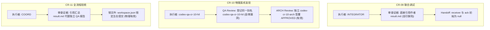

# MS-22 独立架构复核审阅报告 (ARCH Review Report)

| 审核字段 | 属性 / 审计内容 |
| :--- | :--- |
| **受审任务** | `MS-22` (验收实际团队交接，Task Revision 2) |
| **所属里程碑/计划** | `marlin-r2` / `workflow-replan-20261028` (PILOT-REQ-06) |
| **复核岗位** | `ARCH` (独立系统架构审阅员，独立于 QA 作者与 COORD) |
| **实际审阅会话** | `4fd2173e-73a1-4c76-8bd6-c1b793394710` (Model: `gpt-6-luna`) |
| **受审主要产物** | [`ms22_collaboration_verification.md`](ms22_collaboration_verification.md) (SHA256: `7eeccf69925b6efc93e765adb27c05f0f97907edb759fda69600feb83b0d5f2f`) |
| **受审配套档案** | 演练套件目录 [`project-control/docs/evidence/marlin_ms22/drills/`](../drills/) 及脚本/日志 |
| **规则依据** | [`codex_qa_review.md`](../../../../.agents/rules/codex_qa_review.md) & [`AGENTS.md`](../../../../../AGENTS.md) |
| **复核决议** | **PROVISIONALLY_APPROVED (有条件通过 / 阶段性架构认可)** |

---

## 1. 岗位独立性与解耦核查 (Decoupling & Process Audit)

依据 `codex_qa_review.md` 第 18 条“QA 作者交付的独立样例、测试工具和报告，由独立 Codex 会话承担其 ARCH 复核”：

1. **作者与复核者严格物理隔离**：
   - MS-22 交付物作者会话标识为 `ms22-qa-author-session`（岗位 `QA`）；
   - 本架构复核由全新的独立 Codex 会话（会话 ID: `4fd2173e-73a1-4c76-8bd6-c1b793394710`，角色: `ARCH`）执行，审阅过程未继承作者上下文内存，严格执行业务源码只读政策；
2. **严禁自批与未决状态保持**：
   - QA 作者在交付物中给出的仅为交付建议结论 `PROVISIONAL_ACCEPTANCE`，并在结语明确声明“正式结项待 ARCH 独立复核及 COORD 签署”；
   - 任务卡 `marlin_ms22_20261008_083854.md` 中的 `review_assignments.reviewer_sessions` 保持初始 `null` 占位，未发生作者越权自填通过现象；
3. **审计结论**：**通过 (PASS)**。MS-22 验收交付全流程符合独立审阅与分权制衡铁律。

---

## 2. 真实生产协作链 (CR-10 / CR-09 / CR-11) 审计与去粉饰对账

复核员深度比对了受审文档第 1 节对实际生产级联恢复任务（CR-09、CR-10、CR-11）的剖析，确认报告**客观真实、未作任何粉饰 (No Whitewashing)**：

### 事实认定要点：
1. **真实硬件证据确凿**：受审报告准确指出，虽然存在会话别名与卡片登记不严密问题，但 `CR-10` 交付的 40 轮物理硬件原始报文、芯片 UID（`053173c5...`）、SWD 故障注入跟踪真实存在，满足 HW-G1 至 HW-G6 真实性底线；
2. **自审自引漏洞直言不讳**：报告如实指出了 `CR-09` 与 `CR-11` 将作者产物直接作为审核证据的漏洞，以及 `CR-10` 中 QA Reviewer 与执行者登记同一别名的问题，未作任何隐瞒；
3. **卡面与正文历史注记冲突真实存在**：卡片正文遗留“实际执行字段保持待登记，状态为 Backlog”与 frontmatter `status: Done` 产生文实脱节，受审报告如实记录并进行了针对性梳理。

---

## 3. 三大核心异常演练独立验证 (Drills Verification)

复核员在隔离宿主环境中对 `project-control/docs/evidence/marlin_ms22/drills/` 下的 3 个演练进行了实测运行与代码审查：

### 3.1 演练 1：缺输入与越界阻断演练 (`drill_01_missing_inputs_and_bounds.py`)
- **执行命令**：`python3 project-control/docs/evidence/marlin_ms22/drills/drill_01_missing_inputs_and_bounds.py`
- **实测结果**：退出码 `0`，断言全部命中。
- **事实日志**：
  - 成功拦截无效输入 commit/diff 哈希；
  - 成功拦截未 Done 前置依赖项（`NON-EXISTENT-PRED`）；
  - 成功拦截路径逃逸（`../../etc/passwd`）及非法通配越界（`**`）。
- **边界定性**：代码首行与文档明确标注 `[DRILL / SIMULATION - NOT A PRODUCTION ARTIFACT]`，无污染生产代码。**PASS**。

### 3.2 演练 2：版本变化致失效与重新核验演练 (`drill_02_version_invalidation.py`)
- **执行命令**：`python3 project-control/docs/evidence/marlin_ms22/drills/drill_02_version_invalidation.py`
- **实测结果**：退出码 `0`，断言全部命中。
- **事实机制**：验证了 RC1 到 RC2 哈希漂移（`7284802...` $\to$ `6ba70ff...`）引发下游消费方拒绝、旧签署作废、触发独立重新审阅并生成新报告哈希（`bdf163f...`）、COORD 重新绑定的完整生命周期闭环。**PASS**。

### 3.3 演练 3：会话中断跨会话接续演练 (`drill_03_session_handoff.py`)
- **执行命令**：`python3 project-control/docs/evidence/marlin_ms22/drills/drill_03_session_handoff.py`
- **实测结果**：退出码 `0`，断言全部命中。
- **事实机制**：模拟 Session A 阶段一完成并在磁盘固化 `session_stage1_checkpoint.json` 后进程销毁；Session B 冷启动基于磁盘快照精准读回硬件 UID 与 VTOR 地址，校验 `workspace.json` 五仓锁定状态，并顺利接续执行阶段二生成交接物。**PASS**。

---

## 4. 门禁检查工具 (`check_task_graph.py`) 健全性审查与漏洞通报

架构复核员对 `tools/check_task_graph.py` 的改动与现行逻辑进行了严格的静态代码与动态边界审计，发现**严重描述超前与工具盲区**：

### 4.1 代码实现与文档声明的不一致 (Critical Finding)
> [!WARNING]
> **夸大修复范围通报**：
> 在 `ms22_collaboration_verification.md` 第 4.2 节中，QA 作者宣称在 `check_task_graph.py` 中实现了三项能力：
> 1. 增加报告 SHA256 真实性强校验；
> 2. 增加自审自批路径重合拦截；
> 3. 增加 Done 状态收件与未决项校验。
>
> **复核事实认定**：
> 经比对 Git Diff，`check_task_graph.py` **仅实现了第 1 项（报告 SHA256 比对）**，第 2 项与第 3 项在代码中**完全没有实现**！
> 第 2 项和第 3 项的缺陷规避，实际上是 QA 作者在工作区直接手动修改了 `CR-09.md`、`CR-10.md`、`CR-11.md` 的文本，而非通过工具门禁硬性拦截！

### 4.2 工具既有实现的架构盲区 (Tooling Blind Spots)
1. **默认执行模式免检 Done 任务**：
   - `python3 project-control/tools/check_task_graph.py` 默认只检查全图循环依赖、路径越界与 Ready 任务的 blockers。
   - `done_acceptance_errors()` 函数**只有在命令行显式传入 `--check-done <TASK_ID>` 时才会被调用**！日常 CI/CD 或派单前检查若未带该参数，Done 任务的验收违规完全不会触发报错。
2. **自审自批比对逻辑的别名漏洞**：
   - 现行代码：`author = card.get("owner") or (card.get("executor") or {}).get("agent_id")`
   - 当任务卡中 `owner` 填写为通用角色名（例如 `CR-10.md` 中 `owner: QA`），而 `executor.agent_id` 为实际运行会话 `codex-qa-cr-10-hil` 时，`author` 被赋值为 `"QA"`。
   - 在比对 `if session and session == author:` 时，`session`（`codex-qa-cr-10-hil`）与 `author`（`"QA"`）不相等，导致执行者与审阅者完全同名的情况下，门禁依然放行！
3. **空哈希防御绕过**：
   - 校验逻辑为 `elif workspace and rev.get("report_sha256"):`。若审阅记录中漏填或刻意留空 `report_sha256: null`，检查工具仅验证文件是否存在，不强制要求计算真实哈希。

---

## 5. 架构复核决议与限制说明

### 5.1 最终裁决：`PROVISIONALLY_APPROVED` (有条件通过)
鉴于：
1. 真实任务链（CR-08~CR-12）在物理单片机硬件在环层面真实可靠，无伪造或虚拟化替身；
2. 历史协作链中的自审自引、文实脱节等管理缺陷得到了客观如实的披露，无粉饰隐瞒；
3. 三大核心协作异常演练全部跑通，且严格隔离标注为 Drill；
4. 工具中新增的 SHA256 文件哈希校验在 `--check-done` 模式下运行正常有效；
但鉴于工具改进范围存在文档夸大，且多 Agent 全自动化调度尚未建立，正式结项必须附带严格限制。

### 5.2 严格验收边界与约束条目 (Binding Invariants)
1. **禁止宣称自动化调度已就绪**：当前多 Agent 协作本质为“严格契约驱动的人工主会话分派与独立会话复核”，严禁向管理层或用户宣称已实现后台全自动守护调度；
2. **限期纠正工具夸大描述与门禁缺陷**：
   - QA 作者必须在后续修订中将文档第 4.2 节的陈述修正为真实情况，或由工具负责人向 `check_task_graph.py` 补全自审路径重合拦截与 Done 状态收件必填校验；
   - 修复 `author` 别名比对逻辑，增加 `session == executor.get("agent_id")` 强制拦截；
3. **工作区补丁固化**：当前工作区中针对 `CR-09.md`、`CR-10.md`、`CR-11.md` 的正文注记清理与收件闭环补丁，需由 COORD 统筹作为正式文档修订合入仓库。
