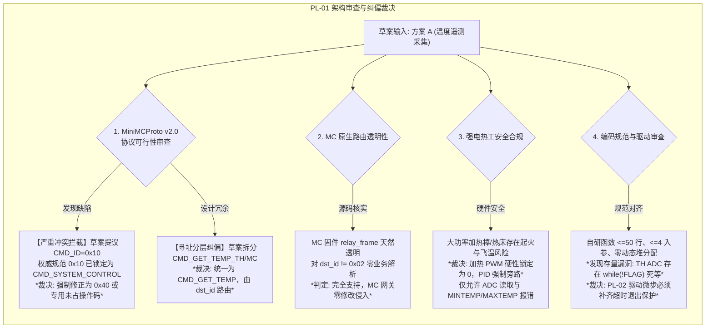

# PL-01 独立系统架构复核审阅报告 (ARCH Review Report)

| 审核字段 | 属性 / 审计内容 |
| :--- | :--- |
| **受审任务** | [`PL-01`](../../../../docs/planning/product/product_pl01_20261008_083854.md) (确认下一产品增量范围，Revision 3) |
| **受审核心产物** | [`next_increment_scope_pl01.md`](../../../../docs/planning/product/next_increment_scope_pl01.md) (SHA256: `cebc4150605e05a9dfcdbe46280c5d20d092da1e8ac62c7860451de29d76cd10`) |
| **所属计划** | `TASK-001` (收敛 FDM 产品需求和验收) / `workflow-replan-20261028` |
| **复核岗位** | `ARCH` (独立系统架构审阅员，独立于 PM 作者与 COORD) |
| **实际审阅会话** | `212d83ba-56f8-4c1b-9b5a-46e87a340671` (Model: `gpt-6-luna`) |
| **复核决议** | **APPROVED (带架构约束准入 PL-02 微任务拆分)** |

---

## 1. 架构复核背景与执行边界

在完成 AP-MC-TH 三节点基础只读通信通道（`RC2`，GET_VERSION / PING 验收，RTT $\le 10\text{ ms}$）后，PM 编制了下一业务增量范围草案 [`next_increment_scope_pl01.md`](../../../../docs/planning/product/next_increment_scope_pl01.md)。用户（HUMAN）已于 2026-10-28 19:09:51 在会话 `c67a0b6c-113d-4711-bdbc-5ba7e689319c` 中正式裁决选择**选项 1：方案 A（双端温度遥测与传感器采集闭环）**。

依据 `PL-01` 任务卡规定，本任务必须由 `ARCH` 与 `HUMAN` 双重核准方可闭环。本报告由独立架构审阅员（ARCH）针对该草案进行深度架构可行性、协议规范符合性、热工安全边界及编码门禁审计。

---

## 2. 核心架构要素逐项审查结论



### 2.1 维度 1：MiniMCProto v2.0 协议架构可行性与操作码冲突纠偏 (Critical Finding)

1. **统一二进制帧格式兼容性**：
   - MiniMCProto v2.0 固定 12 字节帧头，CRC-16/CCITT-FALSE（2 字节），载荷小端紧凑排列。
   - 温度查询请求（可为 0 字节或 1 字节通道号）总帧长 14~15 字节；温度遥测响应载荷（当前温、目标温、ADC 原始码、故障位图，8~16 字节）总帧长 22~30 字节，远低于当前 MCU 静态分配的 64 字节 MTU 限制。物理层传输完全可行。

2. **【严重冲突通报与拦截】`CMD_ID = 0x10` 指令码冲突**：
   - **草案问题**：草案 §2.2 表格第 40 行声称：“协议载荷扩展：在 MiniMCProto 统一 ICD 中分配专用 `CMD_ID = 0x10`”。
   - **规范事实**：查验权威协议主基线 [`SPEC-PROTO-20261015-153000`](../../../../docs/specs/ap_mc_formal_protocol_v2_0_multidevice_routing_draft_20261015.md) §5.1（第 312 行）：
     $$\text{CMD\_ID} = \text{0x10} \implies \text{CMD\_SYSTEM\_CONTROL (系统控制: Reboot / Bootloader 跳转)}$$
   - **危害分析**：若上位机下发 `0x10` 查询温度，严格遵守 v2.0 规范的 MCU 将把该报文误识别为系统复位或固件烧录跳转指令，导致单片机非预期重启或进入 Bootloader 瘫痪！
   - **架构裁决**：**严禁将 `0x10` 分配给温度相关业务**。在下一步 PL-02 编制契约（ICD）时，必须按以下两者之一规范分配：
     - **方案 1 (推荐)**：采用权威规范 §5.2.6 已定义的 `CMD_TELEMETRY_REPORT = 0x40`（包含热端 `tool0_temp_c10`、热床 `bed_temp_c10`、`validity_bitmap` 等，36 字节自然对齐结构体）；
     - **方案 2 (轻量请求-响应对)**：在未分配的操作码空间中分配独立的只读查询对，如 `CMD_GET_TEMP = 0x14`（请求），`CMD_TEMP_REPORT = 0x15`（响应）。

3. **【网络分层纠偏】消除操作码冗余，恪守网络层寻址**：
   - **草案问题**：草案 §2.2 提出了 `CMD_GET_TEMP_TH` 与 `CMD_GET_TEMP_MC` 两个独立指令。
   - **架构事实**：MiniMCProto v2.0 是具备路由寻址能力的分布式拓扑协议，帧头原生具备 `src_id` 与 `dst_id`。查询 MC 目标为 `dst_id = 0x02`，查询 TH 目标为 `dst_id = 0x03`。
   - **架构裁决**：指令码属于应用层服务定义，不得将目标节点类型硬编码进操作码名称。统一收敛为单一指令 `CMD_GET_TEMP`，由 `dst_id` 承担寻址责任。

---

### 2.2 维度 2：MC 原生双向透明路由模型核查

审查当前已合入的 MC 固件通信源码 [`mcu-p3/motion-controller-mcu/project/src/minimc_proto.c`](../../../../../mcu-p3/motion-controller-mcu/project/src/minimc_proto.c)：

1. **MC 网关中继转发原生性**：
   - MC 的 `handle_ap_frame()` 针对发往 TH 的报文（`dst_id == MINIMC_NODE_TH`），直接调用 `relay_frame()` 执行：
     - 递减 `hop_limit`（$\le 1$ 丢弃防环）；
     - 标位置位 `route_ctrl |= MINIMC_ROUTE_IS_ROUTED (0x04)`；
     - 依据原载荷与新头全量重算 CRC-16；
     - 通过 `forward_uart_send_raw()` 透传发往 USART6 $\to$ TH。
   - 反向链路 `handle_th_frame()` 对 TH 发往 AP（`dst_id == MINIMC_NODE_AP`）的报文执行对称的透明转发。
2. **零业务解析侵入**：
   - MC 中继引擎完全不触碰、不解析 `cmd_id`，也不解包 Payload。因此，AP 与 TH 之间新增任何温度遥测指令，**MC 的路由层代码完全无需改动，天然原生支持**！
3. **MC 本地查询解耦**：
   - 针对发往 MC 本机的查询（`dst_id == MINIMC_NODE_MC`），由 `handle_mc_query()` 负责。PL-02 只需在 `handle_mc_query()` 中增加 `case CMD_GET_TEMP:` 读取本地热床 ADC 并返回即可，与中继转发逻辑严格解耦。

---

### 2.3 维度 3：热工与强电安全红线合规性（ADC 纯遥测 vs 加热 PWM 强制锁死）

1. **硬件危险性定性**：
   - 3D 打印机喷头加热棒（24V / 40~50W）与热床（24V / 150~250W）属于强电大功率发热元器件。若在没有完善的硬件级防飞温看门狗、断偶保护及急停联锁的前提下贸然开启 PWM，极易造成喷头融化、铁氟龙管烧焦起火或热床过热损坏。
2. **PL-01 范围合规性裁决**：
   - 草案明确将“目标温度设置与 PID 闭环使能 (`M104`/`M140`)”列入 `LATER`，将“生产固件破坏性 OTA”列入 `OUT`，坚决排除了大功率加热输出，方向完全合规。
3. **【架构硬性安全门禁】PL-02 必载安全约束**：
   - **PWM 强制锁定**：在固件初始化及运行过程中，双端加热棒 PWM 输出引脚**必须硬性配置为 Low / 0% 占空比**，严禁使能定时器输出比较通道驱动加热 MOSFET。
   - **PID 旁路**：双端固件暂不挂载或调用 PID 计算更新循环（`manage_heater()` / `manage_inverting()`）。
   - **传感器断线/短路安全报错**：当 NTC ADC 读数达到饱和极值（开路 ADC=4095/0 或短路 ADC=0/4095）时，固件严禁输出虚假室温，必须严格置位错误标志，上报 `ERR_MINTEMP` 或 `0x7FFF`（传感器失效标记），上位机 AP 必须准确捕获并告警。

---

### 2.4 维度 4：C/C++ 编码规范契约对齐与存量驱动缺陷排查

1. **自研函数两大硬性红线**：
   - 全面遵守 [`c_cpp_coding_standard.md`](../../../../.agents/rules/c_cpp_coding_standard.md)：
     - 函数长度 $\le 50$ 行（单一职责原则）；
     - 入参个数 $\le 4$ 个（超额必须结构体指针化）；
     - 防御性入口空指针检查（Guard Clause）。
2. **底层内存安全**：
   - 零动态堆内存分配（严禁 `malloc`/`free`/`new`/`delete`），使用定长有界静态缓冲；
   - 禁用异常与 RTTI；
   - 禁止指针运算黑魔法与二级以上多重指针。
3. **【存量驱动死等漏洞排查】**：
   - 架构审阅员审查了现有 TH 端 ADC 驱动源码 [`mcu-p3/color-engine-mcu/io_toggle/src/app/thermistor_adc.c`](../../../../../mcu-p3/color-engine-mcu/io_toggle/src/app/thermistor_adc.c)：
     ```c
     // thermistor_adc.c 第 35, 38, 40, 58 行存在严重的无超时死等：
     while(!adc_flag_get(ADC1, ADC_RDY_FLAG));
     while(adc_calibration_init_status_get(ADC1));
     while(adc_calibration_status_get(ADC1));
     while(!adc_flag_get(adc_x, ADC_OCCE_FLAG));
     ```
   - **违规定性**：这严重违背了规范 §4.2“严禁编写无防护硬件轮询死循环，强制展开并加入超时计数器退出分支”。若 ADC 外设时钟异常或硬件损毁，单片机将彻底死锁在中断或主循环中！
   - **架构裁决**：PL-02 在拆分 TH 固件微任务卡时，**必须将 ADC 驱动重构作为独立微步（如 THQ-TEMP-01）**，展开所有 `while` 循环并加入递减计数器超时退出保护。

---

## 3. 正负验收用例对账与 HIL 真实性判据

架构复核员对草案 §3 规划的用例进行审计并确认其可操作性：

| 用例编号 | 验收场景 | 真实物理判定准则 | 对应门禁 |
| :--- | :--- | :--- | :--- |
| `TEMP-POS-001` | AP 经 MC 级联查询 TH 喷头温度 | 物理台架回传真实室温（20~28℃，随环境微变，严禁 Mock 假数据）；单调 RTT $\le 10\text{ ms}$ | `HW-G5` (物理真实)<br>`HW-G6` (端到端原生) |
| `TEMP-POS-002` | AP 查询 MC 热床当前温度 | 物理台架回传真实热床室温，Raw ADC 计数值在合理阻值转换区间内 | `HW-G5` |
| `TEMP-NEG-001` | NTC 拔除 / 传感器断路 | 拔掉端子后，ADC 采样饱和，固件准确返回 `0x7FFF` 或 `ERR_MINTEMP`，AP 告警 | 故障注入安全用例 |
| `TEMP-NEG-002` | TH 断电 / 级联失联 | MC 或 AP 触发超时判定，回显通信超时或 NACK 路由不可达（`0x0C`） | 异常自愈 |

---

## 4. 架构复核决议与准入裁定

### 4.1 综合评审结论

**决议：APPROVED (核准通过，允许推进至 PL-02 阶段)**

本架构审阅员确认：
1. PM 编制的 `DOC-PL01-SCOPE-20261028` 增量选择精准聚焦核心实体量，切断了大功率加热与机械碰撞风险，完全符合当前硬件在环递进演进原则；
2. 用户（HUMAN）已正式签署确认方案 A；
3. 系统底层（MC 透明路由）已具备充分的原生支撑能力；
4. 草案中存在的协议操作码冲突、网络寻址分层及存量驱动死等问题，定位明确且具备清晰的纠偏解决方案。

### 4.2 推进至 PL-02 的绑定约束条件 (Binding Invariants for PL-02)

在 COORD 组织 ARCH 开展 [`PL-02`](../../../../docs/planning/product/product_pl02_20261008_083854.md) 任务拆解时，必须将以下 5 项要求硬性注入拆解契约与微任务定义中：

1. **【契约卡 (ICD)】**：立即冻结《AP-MC-TH 双端温度与遥测采集 ICD》，废除草案中的 `CMD_ID = 0x10`，统一使用标准遥测码（`0x40`）或未冲突请求码（`0x14`/`0x15`），统一使用 `dst_id` 寻址。
2. **【安全硬锁】**：MC 与 TH 的固件实现中，必须显式断言并锁定加热 PWM 输出寄存器为 0，PID 线程完全不激活。
3. **【驱动重构微卡】**：TH 端与 MC 端的 ADC 采样驱动必须重构消除 `while(!FLAG)` 裸死等，强制增加超时计数器保护。
4. **【代码规模门禁】**：所有自研新增函数严格落实 $\le 50$ 行、$\le 4$ 参数及零堆分配，禁止任何侥幸越界。
5. **【真机验收】**：验收继续严守 `HW-G5`（真实硬件台架 `/dev/ttyUSB0`，拒绝任何 Socket/PTY 伪造）与 `HW-G6`（端到端原生协议报文对账）。

---

## 5. 交接与归档说明

本报告完成签名归档后，交接给唯一调度员（COORD）：
- 证据路径：`project-control/docs/evidence/product_planning/PL-01/arch_review_report.md`
- 建议动作：COORD 确认本报告 SHA256 与结论，将 `PL-01` 任务卡 review_assignments 正式登记并推进闭环，随即调度 ARCH 进入 `PL-02` 编制微任务。
