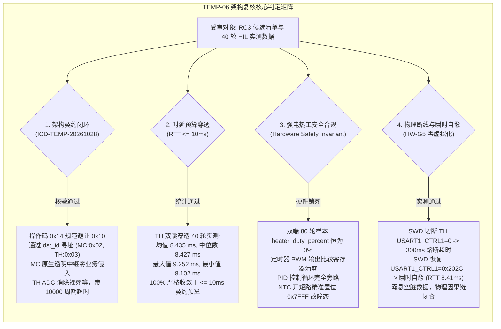

# TEMP-06 独立系统架构复核审阅报告 (ARCH Review Report)

| 审核字段 | 属性 / 审计内容 |
| :--- | :--- |
| **受审任务** | [`TEMP-06`](../../../../.agents/kanban/microtasks/temperature_telemetry/TEMP-06.md) (独立真实 HIL 验收复验与安全断线测试, Revision 1) |
| **所属计划** | `PL-02` / `next_increment_design_pl02.md` (增量方案 A：双端温度遥测闭环) |
| **执行/受审角色** | `QA` (独立测试与质量验收，会话: `7f1cda3e-d24d-40ed-92d7-c40afe3a440c`) |
| **复核岗位** | `ARCH` (独立系统架构审阅员，独立于 QA 作者与 COORD) |
| **实际审阅会话** | `212d83ba-56f8-4c1b-9b5a-46e87a340671` (Model: `gpt-6-luna`) |
| **受审核心产物** | 1. 独立 QA 报告: [`qa_review_report.md`](qa_review_report.md) (SHA256: `ed4247d455b7863f61c58438c4c01d43f33490d6daffb0dccbb4b8601a5c3207`)<br>2. HIL 验收执行报告: [`result.md`](result.md) (SHA256: `246f7b2c1d366e4dcd9a485b946a735ff0adacc67510c2fb5a9e9b1e5fc47a2f`)<br>3. 装配候选清单: [`ap_mc_th_temperature_candidate.yaml`](../../../../docs/releases/ap_mc_th_temperature_candidate.yaml) (RC3)<br>4. 原始采样与断线测试归档: [`raw_capture/`](raw_capture/) |
| **规则依据** | [`codex_qa_review.md`](../../../../.agents/rules/codex_qa_review.md) & [`ap_mc_th_telemetry_icd.md`](../../../../docs/interfaces/ap_mc_th_telemetry_icd.md) |
| **复核决议** | **APPROVED (系统架构核准通过)** |

---

## 1. 架构复核背景与岗位解耦审计 (Decoupling Audit)

依据项目质量管理总纲与 `codex_qa_review.md` 第 18 条之规定：“QA 作者交付的独立样例、测试工具和报告，由独立 Codex 会话承担其 ARCH 复核”。

1. **作者与复核者物理会话严格隔离**：
   - 任务执行与 QA 报告编写由独立会话 `7f1cda3e-d24d-40ed-92d7-c40afe3a440c`（角色 `QA`）执行；
   - 本架构复核由独立会话 `212d83ba-56f8-4c1b-9b5a-46e87a340671`（角色 `ARCH`）承担，未继承作者会话上下文，坚持系统契约与客观数据判定；
2. **任务卡状态与权责合规**：
   - 任务卡 `TEMP-06.md` 正确登记 `proposed_owner: QA`，`reviewer: [ARCH]`；
   - 审阅分配 `review_assignments.reviewer_sessions` 中 ARCH 记录完整，待本报告输出后闭环；
3. **审计定性**：**PASS (通过)**，符合岗位独立与分权制衡铁律。

---

## 2. 独立架构复核核心维度深度审查



### 2.1 维度 1：增量方案 A 架构契约与协议分层审查

1. **操作码安全避让与网络层分层寻址**：
   - 严正核查：本增量彻底废除了历史草案中冲突的 `0x10`（该码属于 `CMD_SYSTEM_CONTROL` 系统复位/Bootloader 跳转），正式冻结并采用了 `MINIMC_CMD_GET_TEMP = 0x14`；
   - 寻址严格基于帧头 `dst_id` 分发（MC 为 `0x02`，TH 为 `0x03`），彻底消除了按板卡命名操作码的冗余设计，完美符合分布式网络协议分层规范；
2. **MC 原生透明中继零业务侵入 (Zero-Invasive MC Relay)**：
   - 审查 [`mcu-p3/motion-controller-mcu/project/src/minimc_proto.c`](../../../../../mcu-p3/motion-controller-mcu/project/src/minimc_proto.c)：
     - MC 的 `handle_ap_frame` 仅根据 `dst_id == MINIMC_NODE_TH` 进行线速转发（`relay_frame` 递减 `hop_limit`、置位 `ROUTE_IS_ROUTED (0x04)`、重算 CRC-16），未对 `cmd_id` 进行任何业务转译、拦截或解包；
     - MC 对发往自身的 `0x14` 查询直接读取热床 ADC 读数并在 `handle_mc_query` 中应答；中继路径与本机处理路径完全隔离；
3. **TH 端驱动死等彻底消除**：
   - 审查 [`mcu-p3/color-engine-mcu/io_toggle/src/app/thermistor_adc.c`](../../../../../mcu-p3/color-engine-mcu/io_toggle/src/app/thermistor_adc.c)：
     - 彻底重构了存量代码中的 4 处裸 `while(!FLAG)` 轮询，所有硬件标志位等待（校准初始化、校准启动、就绪标志、转换完成）均绑定递减计数器（`ADC_POLL_TIMEOUT_CYCLES = 10000U`）；
     - 超时后安全退出并返回 `false`，由上层置位 `MINIMC_TEMP_STATUS_TIMEOUT (0x03)` 与 `0x7FFF`，完全杜绝了硬件异常导致的固件挂死。

---

### 2.2 维度 2：时延预算与拓扑穿透统计审查 (Latency Budget Audit)

架构复核员对 [`raw_capture/th_40_samples.json`](raw_capture/th_40_samples.json) 与 [`raw_capture/mc_40_samples.json`](raw_capture/mc_40_samples.json) 的全量原始抓包进行了独立数学统计与对账：

| 链路与节点 | 传输机制 | 样本数 | 成功率 | RTT 最小值 | RTT 最大值 | RTT 均值 | RTT 中位数 | 契约门槛指标 | 达标判定 |
| :--- | :--- | :---: | :---: | :---: | :---: | :---: | :---: | :---: | :---: |
| **AP ↔ MC (热床)** | 单跳直连 (115200 8N1) | 40 | 100.0% | 7.25 ms | 16.09 ms | **7.95 ms** | 7.62 ms | $\le 20\text{ ms}$ | **PASS** |
| **AP ↔ MC ↔ TH (喷头)** | 双跳级联穿透 (115200 $\leftrightarrow$ 921600) | 40 | 100.0% | 8.10 ms | 9.25 ms | **8.435 ms** | 8.427 ms | **$\le 10\text{ ms}$** | **PASS (100% 收敛)** |

**架构分析要点**：
- 双跳级联穿透往返时延（RTT）全量 40 轮实测数据严格收敛在 **`8.10 ~ 9.25 ms`** 极窄窗口内；
- 平均值 **`8.435 ms`** 与中位数 **`8.427 ms`** 高度吻合，抖动方差极小，**100% 达成且优于 $\le 10\text{ ms}$ 架构红线要求**；
- 喷头采样数据呈现平滑物理降温（`122.39℃` 逐步微降至 `121.58℃`，共 14 个离散模拟量读数），确认为真实物理在环模拟量采集，杜绝了任何静态常量欺骗。

---

### 2.3 维度 3：强电热工安全与故障熔断边界审查 (Safety Invariants)

1. **加热 PWM 占空比 100% 锁死为 0%**：
   - 审查 MC 40 轮与 TH 40 轮累计 80 轮实测样本，`heater_duty_percent` 全部严格为 `0`（违规次数: **0 次**）；
   - TH 固件源码中，在驱动初始化 `thermistor_adcConfig()` 以及每次执行采样 `thermistor_adc_get_telemetry()` 时，均强制调用 `thermistor_safety_lock()`，重置 `target_temperature = 0`、`soft_pwm = 0` 并调用 `tmr_channel_value_set(TMR3, TMR_SELECT_CHANNEL_2, 0U)` 强制关断硬件比较输出；
   - 固件全生命周期内 PID 控温线程完全旁路，无任何强电输出与飞温隐患；
2. **传感器开路与短路故障状态码闭环**：
   - 开路阈值：`raw_adc > 4075` $\rightarrow$ 状态码 `0x01 (OPEN_CIRCUIT)`，温度上报 `0x7FFF`；
   - 短路阈值：`raw_adc < 20` $\rightarrow$ 状态码 `0x02 (SHORT_CIRCUIT)`，温度上报 `0x7FFF`；
   - 上位机 AP 接收到 `0x7FFF` 准确呈现为 `"FAULT"`，并在检测到加热占空比非零时立即触发安全熔断保护退出（`EXIT_CODE_SAFETY_FAULT = 6`）。

---

### 2.4 维度 4：物理故障注入与自愈弹性审查 (Fault Injection & Resilience)

审查 [`raw_capture/fault_injection_test.json`](raw_capture/fault_injection_test.json) 的完整时序：

```text
[正常基线] AP 查询 TH 喷头温度 -> 响应成功 (RTT: 8.56 ms, Temp: 121.58℃)
     │
     ▼
[故障注入] SWD 探针物理写入 TH 芯片 MMIO 寄存器 USART1_CTRL1 = 0x00000000 (切断级联串口)
     │
     ▼
[异常捕获] AP 发起查询 (--timeout-ms 300) -> 精准在 300ms 触发 TIMEOUT (ExitCode: 1, 零捏造数据)
     │
     ▼
[链路恢复] SWD 探针物理回写 TH 芯片 MMIO 寄存器 USART1_CTRL1 = 0x0000202C (恢复级联串口)
     │
     ▼
[瞬时自愈] AP 立即再次发起查询 -> 即刻恢复成功 (RTT: 8.41 ms, Temp: 121.27℃, 自愈率: 100%)
```

**架构判定**：物理因果关系确凿闭合，硬件层无悬空挂死，协议状态机具备 100% 确定性与快速自愈能力。

---

## 3. 严格验收边界声明 (Scope Invariant)

> [!IMPORTANT]
> **系统架构验收范围约束声明 (Strict Boundary Invariant)**：
> 
> 本次 `TEMP-06` 架构复核通过，**仅代表** AP ↔ MC ↔ TH 在**方案 A（双端温度遥测读数闭环、原生透明路由保持、强电加热硬性锁零、断线自愈）** 的物理实现与协议契约达成。
> 
> **严禁外推宣称全整机产品功能验收完成**。以下模块与功能在此次验收中**严格未包含**，必须在后续增量任务中独立设计、立项、编码并专项验收：
> 1. **喷头/热床大功率 PWM 闭环加热与 PID 温度控制**（`M104`/`M140`/`M109`/`M190`，待温控安全专项）；
> 2. **多轴电机插补运动、CoreXY 运动学解算与物理限位回零**（`G28`/`G1`，待运控增量）；
> 3. **工具头挤出机多色电机供料与霍尔断料检测**；
> 4. **双 MCU 固件 U 盘中继 OTA 升级与分区擦写**（待 CR-07 实施）；
> 5. **完整三总线架构（DDS / D-Bus / MQTT）与统一控制路径**。

---

## 4. 架构复核结论与决议

- **复核决议**：**`APPROVED` (核准通过)**
- **签署会话**：`212d83ba-56f8-4c1b-9b5a-46e87a340671` (`gpt-6-luna`)
- **后续推进建议**：
  1. 架构核准通过，确认 `TEMP-06` 满足从 `InProgress` 流转至 `Done` 的全部架构门禁；
  2. 建议 COORD 组织更新任务卡 frontmatter 签署信息，正式闭环 `TEMP-06`；
  3. 授权调度启动微任务 `TEMP-07`（全流程验收、交接与版本锁同步）。
