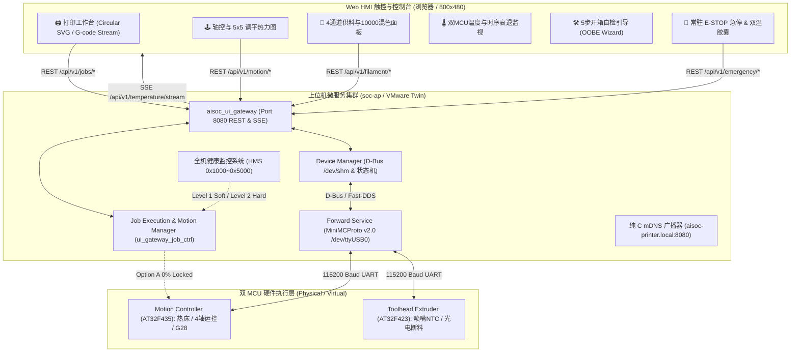

# AI-SoC 3D 打印机首发版本 (First Release) 全功能测试用例集 (Testcase Inventory)

- **文档编号**：`QA-TC-INV-20261031-001`
- **版本标识**：`v1.0.0-RELEASE-CANDIDATE`
- **编制角色**：QA Testcase Architect (独立测试用例架构师)
- **审签与发布**：Independent QA / ARCH / COORD
- **发布日期**：2026-10-31
- **覆盖任务范围**：`TWIN-10` ~ `TWIN-35` (首版功能全部闭环增量)
- **运行环境基线**：VMware 真实数字孪生集群 / Ubuntu 22.04 LTS / Web 控制台 (`http://localhost:8080/index.html` 或 `http://192.168.77.134:8080/index.html`)

---

## 1. 概述与测试架构 (Overview & Architecture)

### 1.1 文档目的
本文档由独立 QA 测试用例架构师编制，旨在对 AI-SoC 3D 打印机 First Release（第一发布版本，涵盖任务卡片 `TWIN-10` 至 `TWIN-35`）交付的全部核心功能建立完整、形式化、严密且直接可执行的测试用例清单（Testcase Inventory）。本用例集不仅覆盖正常业务功能流（正向测试），更重点强调边界值、负向异常注入、硬件离线降级、选项 A 强电安全硬门禁以及急停互锁防线。

### 1.2 验证拓扑架构图


### 1.3 核心门禁与设计不变量 (Methodological Invariants)
1. **选项 A 纯逻辑空跑强电锁死不变量 (U-D03 / Option A Invariant)**：
   - 上位机作业执行器及网关层 `heater_duty_percent` 恒为 `0%`；
   - 自动拦截并丢弃所有强电加热升温指令（M4/M5/M6/M7/M104/M140/M109/M190），彻底消除台架与虚拟化空跑期间起火或强电烧毁风险。
2. **严格真实性不变量 (Strict Realism Invariant)**：
   - 严禁前端客户端存在 `Math.random()` 等伪造逻辑；
   - 未接入真实硬件或节点脱机时，HMI 必须如实呈现“未就绪/未连接/等待接入”，严禁在离线状态下伪造“PASS/合格/在线”绿标。
3. **10000 混色基准权重守恒不变量 (COL-001 Invariant)**：
   - 4 通道供料混色权重总和恒定为 `10000`（即 100.00%，精度 0.01%）；
   - 任何总和不等于 10000 的配置必须在前端禁用保存按钮并在后端坚决拒绝。
4. **急停互锁防线不变量 (E-STOP Safety Invariant)**：
   - 触发 M112 急停后，系统进入 `ESTOP_FAULT` 自锁状态；
   - 在此状态下，所有打印启动、手动轴移动（Jog）、回零（Home）、调平测试等指令 100% 拒绝执行，除非发起带显式安全确认的特权复位。
5. **触控与人体工程学不变量 (Ergonomics & Touch Invariant)**：
   - 所有触控操作按键、开关、罗盘热区严格满足 `min-height: 44px; min-width: 44px;`（核心操作 $\ge 48\text{px}$）；
   - 中英双语 100% 字典键对齐，深浅双色高对比度主题无闪烁无刷新瞬时切换。

---

## 2. 功能模块测试用例全集 (Testcase Inventory)

### 模块 1：4 通道供料与多色混色系统 (Filament & Color Mixing, COL-001 ~ COL-007)

| 用例 ID | 功能分类与特性 | 前置条件 | 执行步骤 | 预期正向结果 | 异常/边界/负向校验 | 核验命令或 HMI 断言 |
| :--- | :--- | :--- | :--- | :--- | :--- | :--- |
| **TC-FIL-001** | **耗材材质选择与映射** | Web HMI 正常加载，处于【🎨 供料与混色】标签页 | 1. 依次点击 Slot 1~4 的材质下拉框；<br/>2. 分别选择 `PLA`, `PETG`, `ABS`, `TPU`, `PC`, `PA-CF`；<br/>3. 切换标签页后切回。 | 下拉选框准确回显所选材质，应用内部状态 `appState.slots[i].material` 实时同步更新，界面刷新无回退。 | 尝试向后端提交非白名单材质（如 `"WOOD"` 或空字符串），后端 Schema 校验应拦截并报错。 | HMI 断言：`document.getElementById('slot-mat-0').value === 'PLA'`；<br/>Schema 测试：`test_06_slot_schema_validation` |
| **TC-FIL-002** | **颜色拾取与 HEX 输入校验** | 处于供料与混色页面，Slot 0 处于激活态 | 1. 点击 Slot 0 原生拾色器选择颜色 `#FF5733`；<br/>2. 手动在 HEX 输入框输入 `#00FFCC`。 | 拾色器、HEX 文本框与色块预览（Swatch）瞬时联动，色样同步更新为对应 RGB 颜色。 | 1. 输入非法 HEX 字符串（如 `#GG1234`, `123456`, `#FFF`）；<br/>2. 失去焦点时输入框应自动回滚为上一次有效 HEX，阻断非法数据生效。 | 正则校验：`/^#[0-9A-F]{6}$/i.test(hex)`；<br/>HMI 断言：`slot-swatch-0.style.backgroundColor` 严格匹配。 |
| **TC-FIL-003** | **高频预设调色板快捷选择** | 处于供料与混色页面，可见预设调色板圆点 | 点击 Slot 1 调色板下的预设颜色（红 `#FF0000`, 蓝 `#0055FF`, 绿 `#00AA00`, 黄 `#FFCC00`, 橙 `#FF6600`, 白 `#FFFFFF`, 黑 `#111111`）。 | 对应 Slot 的色块 Swatch、HEX 输入框及原生拾色器立即更新为预设色，无需手动输入。 | 快速连续点击不同预设色，不出现状态错位，目标通道 ID 与调色板容器 `data-target` 绑定无干扰。 | DOM 断言：`document.querySelectorAll('.palette-btn')` 触发对应点击后，`appState.slots[target].color_hex` 精确等于按钮 `data-hex`。 |
| **TC-FIL-004** | **余量滑块与克数估算联动** | 处于供料与混色页面，Slot 2 余量初始为 50% | 1. 拖动余量滑块从 0% 调节至 85%；<br/>2. 观察数值显示与进度条填充。 | 数值标签即时更新为 `85% (~850g)`，余量进度条宽度变为 `85%`（1% 精确映射 10g 耗材估算）。 | 边界检查：滑块拉至 0% 显示 `0% (~0g)`；拉至 100% 显示 `100% (~1000g)`。不允许出现负数或溢出。 | HMI 断言：`document.getElementById('slot-rem-val-2').textContent === '85% (~850g)'`。 |
| **TC-FIL-005** | **10000 混色总权重计算与守恒** | 4 个 Slot 初始权重处于均衡状态 (2500, 2500, 2500, 2500) | 1. 查看总权重展示栏；<br/>2. 手动调整 Slot 0 权重为 4000，Slot 1 为 3000，Slot 2 为 2000，Slot 3 为 1000。 | 1. 总权重显示 `10000 / 10000 (100.00%)`；<br/>2. 状态徽章显示绿色 `【配比有效】`；<br/>3. 【保存料槽配置】按钮保持可用（enabled）。 | 1. 将 Slot 0 调为 4001（总和 10001）；<br/>2. 徽章瞬时切为红色 `【配比错误】`，提示 `当前权重和: 10001 (+1)`；<br/>3. 保存按钮被强制置灰禁用（disabled）。 | 单元测试：`test_03_color_mixing_10000_weight_invariant`；<br/>DOM 断言：`dom.btnSaveSlots.disabled === true`。 |
| **TC-FIL-006** | **混色快捷配比预设** | 处于供料与混色页面，可见 4 组预设按钮 | 依次点击【单色 1 (100%)】、【单色 2 (100%)】、【双色 (50:50)】与【四色均分 (25%)】。 | 1. `single-1`: [10000, 0, 0, 0]；<br/>2. `single-2`: [0, 10000, 0, 0]；<br/>3. `dual-50`: [5000, 5000, 0, 0]；<br/>4. `quad-25`: [2500, 2500, 2500, 2500]；<br/>界面总权重均为 10000，配比合法。 | 连续交替点击不同预设，各通道千分比文字准确对应（如 50.00%、25.00%），无浮点精度丢失。 | 验证：`appState.slots.map(s => s.mixing_weight)` 与预设向量逐项绝对相等。 |
| **TC-FIL-007** | **料槽负数与超界边界拦截** | 处于供料与混色页面，聚焦 Slot 权重输入框 | 1. 尝试在权重框输入负数 `-500`；<br/>2. 尝试输入超大数值 `15000`。 | 前端限制下限 0，上限 10000；非法字符自动过滤或钳位在有效区间内。 | 直接修改 DOM 或通过控制台注入负数，`calculateTotalWeight` 计算出的总和偏离 10000，保存拦截。 | 自动化断言：`slot_schema.json` 约束 `minimum: 0, maximum: 10000`。 |
| **TC-FIL-008** | **料槽配置 REST 提交与落盘** | 总权重已调为合法的 10000，网络连接正常 | 点击【💾 保存料槽配置】按钮。 | 1. 向 `POST /api/v1/filament/slots` 发送完整 JSON；<br/>2. 提示文字显示绿色 `保存成功！`，配置落盘生效。 | 模拟网络断开（如停止网关），再次点击保存，界面显示橙色 `保存成功！(Local fallback)`，无白屏崩溃。 | 命令：`curl -s -X POST http://localhost:8080/api/v1/filament/slots -H "Content-Type: application/json" -d '{"total_mixing_weight":10000,"slots":[...]}' \| grep '"status":"ok"'` |
| **TC-FIL-009** | **作业引擎内联混色指令解析** | 作业引擎已初始化且已完成 G28 归零 | 流式输入 `M163 S0 P5000` 与 `M163 S1 P5000`，随后输入 `M164 S0` 提交配置。 | 引擎成功记录通道 0 和通道 1 权重各为 5000，激活 50:50 混色比例。 | 1. 输入通道非法：`M163 S5 P5000`（通道超限，仅支持 0~3）；<br/>2. 权重和非法：`M163 S0 P6000`，`M163 S1 P5000`（总和 11000），返回 `AISOC_JOB_ERR_INVALID_MIXING_RATIO`。 | 单元测试：`soc-ap/contracts/twin/job/test_job_engine.c` 之 `test_color_mixing_validation`。 |

---

### 模块 2：双 MCU 温度监控与固件遥测 (Dual-MCU Temperature & Telemetry, TEMP-01 ~ TEMP-07)

| 用例 ID | 功能分类与特性 | 前置条件 | 执行步骤 | 预期正向结果 | 异常/边界/负向校验 | 核验命令或 HMI 断言 |
| :--- | :--- | :--- | :--- | :--- | :--- | :--- |
| **TC-TEMP-001** | **工具头喷嘴 NTC 温度呈现** | 网关正常运行，SSE 流推送工具头遥测数据 | 检查【🌡️ 温度与传感器】页面及顶栏喷嘴温度胶囊。 | 实时显示工具头当前温度（如 `122.3 °C`），保留 1 位小数，顶栏胶囊与主卡片数值 100% 同步。 | 数据帧温度为 null 或无效对象时，优雅降级显示 `--.- °C`，不出现 `NaN` 或 `undefined`。 | SSE 断言：`data.tool.temperature_c` 格式校验；DOM 断言：`th-current-temp.textContent === "122.3"`。 |
| **TC-TEMP-002** | **喷嘴 ADC 原始值与目标温度** | 工具头温控正常，目标温度设为 210.0°C | 查看工具头卡片中的【目标温度】与【原始 ADC】字段。 | 目标温度显示 `210.0 °C`，原始 ADC 显示有效采集数字量（如 `2048`）。 | 目标温度为 0 时显示 `0.0 °C`；加热占空比在选项 A 下必须严格显示 `0%`。 | DOM 断言：`document.getElementById('th-duty').textContent === "0%"`。 |
| **TC-TEMP-003** | **运动控制器热床 NTC 温度呈现** | 网关正常运行，SSE 流推送热床遥测数据 | 检查热床温控卡片及顶栏热床温度胶囊。 | 实时显示热床当前温度（如 `24.5 °C`），目标温度显示设定值（如 `60.0 °C`）。 | 若热床传感器断开，上报哨兵值，界面即刻显式告警。 | DOM 断言：`mc-current-temp.textContent === "24.5"`，`header-mc-temp` 保持一致。 |
| **TC-TEMP-004** | **热床 ADC 转换与占空比核验** | 热床温控采样正常 | 查看热床卡片【原始 ADC】与【加热占空比】。 | 原始 ADC 为有效整数（如 `1820`），加热占空比恒为 `0%`（Option A 锁死）。 | 占空比不允许出现负数或大于 0% 的非法数值。 | 断言：`document.getElementById('mc-duty').textContent === "0%"`。 |
| **TC-TEMP-005** | **双 MCU 数据质量等级标识** | 网关持续接收双 MCU 遥测心跳 | 观察卡片右上角的【质量等级】徽章（Quality Badge）。 | 正常通信时显示绿色 `FRESH`，表明 1 秒内有新鲜采样到达。 | 当通信出现延迟（>3秒），质量等级切换为黄色 `STALE`；传感器开路显示 `FAULT`；离线显示 `OFFLINE`。 | 契约校验：`quality` 枚举值白名单 `['FRESH', 'STALE', 'FAULT', 'OFFLINE']`。 |
| **TC-TEMP-006** | **硬件故障哨兵值防御解析** | 模拟传感器开路/短路或下位机掉电 | 1. 下发 `temperature_millic = 2147483647` (INT32_MAX)；<br/>2. 下发 `temperature_millic = 2147483646`。 | 1. 界面温度字段安全解析并显示为红字 `FAULT`；<br/>2. 离线哨兵值解析为 `OFFLINE`，绝不换算为假几百万度。 | 负向边界校验：防止整数溢出换算成 `2147483.6 °C` 导致 UI 布局撑破或触发虚假过温熔断。 | 函数级测试：`extractTemperatureC` 源码级分支判定核验；`test_unit_fault_sentinel_defense` 通过。 |
| **TC-TEMP-007** | **双 MCU 真实固件版本呈现** | 双 MCU 完成 MiniMCProto `0x01` 查询并应答 `0x02` 版本报文 | 查看 MC 与 TH 卡片底部的【固件版本】。 | 真实显示 MC (如 `v1.2.0 (a1b2c3d)`) 与 TH (如 `v1.1.5 (e4f5a6b)`)，包含短 Git Commit SHA。 | 严禁显示任何硬编码假版本（如 `v1.0.0-mock`），未连接时必须显示 `未知 (Unknown)`。 | 契约测试：`test_07_real_dual_mcu_firmware_version_presentation`（绝对零 mock 字符串）。 |
| **TC-TEMP-008** | **固件时序衰退四态状态机** | 设备管理器启动版本时序衰退评估 | 1. 模拟收到版本更新（$\Delta t < 5\text{s}$）；<br/>2. 模拟 $5\text{s} \le \Delta t < 15\text{s}$ 无更新；<br/>3. 模拟 $\Delta t \ge 15\text{s}$；<br/>4. 模拟校验失败。 | 1. 状态评定为 `ONLINE`（绿标）；<br/>2. 状态衰退为 `STALE`（黄标 `[陈旧]`）；<br/>3. 状态衰退为 `OFFLINE`（红标 `[离线]`）；<br/>4. 状态切换为 `QUERY_FAILED`。 | 节点在 `OFFLINE` 状态下重新收到合法帧后，必须能瞬间自愈恢复为 `ONLINE`，状态机单向自锁已清除。 | 集成测试：`soc-ap/tests/device_manager/twin/` 中 `test_unit_state_version_tracking_and_decay`。 |
| **TC-TEMP-009** | **零伪造数据不变量硬审查** | 审查前端完整代码库 `soc-ap/browser_hmi/first_release/` | 全文搜索 `Math.random`、`mock`、`fake` 等伪造关键字。 | 界面温度、占空比、版本、传感器状态全部源于真实 HTTP/SSE 载荷，零前端合成伪造数据。 | 负向扫描：如果代码中存在为了展示好看而随机波动温度的代码，QA 门禁立即判定阻断。 | 脚本审查：`grep -rn "Math.random" soc-ap/browser_hmi/first_release/` 结果为空。 |
| **TC-TEMP-010** | **SSE 断线自动重连与心跳** | Web 页面保持开启，与网关建立 SSE 连接 | 1. 观察顶栏【连接指示灯】与【世代号】；<br/>2. 人工断开网关 5 秒后恢复。 | 1. 正常时指示灯常绿 `Connected`，GEN 随状态单调递增；<br/>2. 断开时黄灯闪烁，顶部出现警报条；网关恢复后 3 秒内自愈绿灯。 | 长时间断网状态下，重试机制必须具备线性/指数退避，禁止以 0ms 间隔发起死循环洪泛请求。 | DOM 断言：`conn-pill.classList.contains('connected')`，`alert-banner` 显隐切换正常。 |

---

### 模块 3：开箱检查引导向导 (OOBE Wizard, HMI-004)

| 用例 ID | 功能分类与特性 | 前置条件 | 执行步骤 | 预期正向结果 | 异常/边界/负向校验 | 核验命令或 HMI 断言 |
| :--- | :--- | :--- | :--- | :--- | :--- | :--- |
| **TC-OOBE-001** | **向导模态框调起与关闭** | 处于控制台主界面，OOBE 模态框默认隐藏 | 1. 点击顶栏【🛠️ 新机向导】按钮；<br/>2. 点击右上角【&times;】关闭向导。 | 1. 模态框以 Flex 居中弹出，半透明遮罩覆盖底层；<br/>2. 点击关闭按钮后，遮罩及弹窗彻底隐藏，页面状态恢复。 | 按键盘 ESC 键或在模态框外部遮罩区域点击，不应出现状态锁死或页面穿透滚动。 | DOM 断言：`document.getElementById('oobe-modal').style.display` 在 `'flex'` 与 `'none'` 间正确切换。 |
| **TC-OOBE-002** | **Step 1 欢迎与真实性规范公示** | 打开 OOBE 向导，初始处于步骤 1 | 查看 Step 1 英雄内容与真实性声明。 | 清晰展示欢迎标题、开机引导流程说明及高亮【核心真实性原则】提示框，引导用户开始自检。 | 此时底部的【上一步】按钮必须处于隐藏状态（`display: none`），仅保留【下一步】按钮。 | 断言：`step-node-1.classList.contains('active')` 且 `btn-oobe-prev.style.display === 'none'`。 |
| **TC-OOBE-003** | **Step 2 语言与偏好交互切换** | 处于 OOBE 步骤 1，点击【下一步】进入步骤 2 | 1. 点击【English】按钮；<br/>2. 点击【简体中文】按钮。 | 点击 English 后，向导内标题、按钮及全站文本瞬间切换为英文；点击中文后无刷新切回。 | 语言切换后，步骤指示器与按钮激活状态（`active` class）准确跟随，无未翻译插值键（如 `{{key}}`）。 | 交互断言：`document.getElementById('btn-choice-en').click()` 后，页面主标题变为英文。 |
| **TC-OOBE-004** | **Step 3 真实固件与通信链路检测** | 点击【下一步】进入步骤 3 | 查看 MC、TH 固件版本与 Forward 转发链路状态。 | 真实反映当前硬件连接状态。若硬件在线，显示对应固件版本与绿色 `ONLINE`；若脱机，如实反映。 | **零伪造原则验证**：在未接入下位机时，MC/TH 状态徽章严禁显示“合格/PASS”，必须显式显示黄标“未就绪”。 | 自动化测试：`test_02_strict_realism_rule_positive_and_negative` 断言 `oobe-mc-status` 包含 `未就绪`。 |
| **TC-OOBE-005** | **Step 4 传感器健康与断料开关检测** | 点击【下一步】进入步骤 4 | 查看喷头 NTC、热床 NTC 及 4 通道断料开关检测卡片。 | 喷头/热床温度若已连接则显示实时测温（如 `正常 (122.3 °C)`）；断料开关各通道如实呈现通断。 | 若温度为未连接 `--.-`，徽章必须显式显示为警告色“未检查”或“未就绪”，禁止假通过。 | DOM 检查：`oobe-nozzle-status.textContent` 与 `appState.isConnected` 真实性逻辑绑定。 |
| **TC-OOBE-006** | **Step 5 配置确认与完成退出** | 处于步骤 4，点击【下一步】进入步骤 5 | 1. 核对配置摘要与网络访问地址；<br/>2. 点击【完成向导，进入控制台】。 | 1. 展示向导配置总览；<br/>2. 点击完成按钮后向导弹窗安全关闭，导航激活默认【打印工作台】。 | 在步骤 5 下，【下一步】按钮自动隐藏，仅显示【上一步】与【完成】大按钮。 | DOM 断言：`btn-oobe-finish.style.display !== 'none'`，点击后 `oobe-modal.style.display === 'none'`。 |
| **TC-OOBE-007** | **向导步进边界与指示条同步** | 打开 OOBE 向导，连续点击【下一步】至步骤 5 | 1. 连续点击【下一步】；<br/>2. 连续点击【上一步】退回步骤 1。 | 步骤节点（`step-node-1` ~ `step-node-5`）及对应视图（`oobe-view-1` ~ `oobe-view-5`）严格步调一致激活。 | 步数越界防御：处于步骤 5 时再调用步进逻辑不能超出 5；处于步骤 1 时不能小于 1。 | 逻辑断言：`setOobeStep(6)` 与 `setOobeStep(0)` 立即安全 return，不产生脚本异常。 |
| **TC-OOBE-008** | **向导重置与偏好持久化** | 完成一次向导后再次调起 | 再次点击顶栏【新机向导】。 | 向导始终重置从 Step 1 初始启动，先前选定的语言及主题偏好在控制台全局保持持久生效。 | 避免再次打开向导时停留在上次关闭的半完成界面，防止向导状态机脏数据残留。 | 验证：调起向导时显式调用 `setOobeStep(1)`，指示条重置为首节点。 |

---

### 模块 4：局域网发现与 mDNS 本地服务 (Network Discovery & mDNS, NET-001)

| 用例 ID | 功能分类与特性 | 前置条件 | 执行步骤 | 预期正向结果 | 异常/边界/负向校验 | 核验命令或 HMI 断言 |
| :--- | :--- | :--- | :--- | :--- | :--- | :--- |
| **TC-NET-001** | **mDNS 服务组播广播报文合规** | 上位机网络服务启动，监听 5353 端口 | 抓取或解析 `224.0.0.251:5353` 组播报文。 | 广播器组装标准 DNS 响应（Flags=0x8400, ANCOUNT=4），包含 PTR、SRV、TXT 与 A 记录。 | 校验报文格式：DNS 头部 12 字节完整无缺失，Wire 格式标签计数正确（如 `\x05aisoc`）。 | 编译运行单元测试：`gcc -std=c11 soc-ap/core/net/mdns/test_mdns_advertiser.c soc-ap/core/net/mdns/mdns_advertiser.c -o /tmp/test_mdns && /tmp/test_mdns` (4/4 PASS)。 |
| **TC-NET-002** | **目标主机名与 Web 端口绑定** | mDNS 广播器正常初始化 | 检查 SRV 记录与 A 记录目标内容。 | SRV 目标绑定 `aisoc-printer.local`，端口绑定 `8080`；A 记录绑定本机局域网 IPv4。 | 目标主机名超长（>63字符）或端口为 0 时，初始化 Guard Clause 应防御性拒绝。 | 单元断言：`test_initialization_negative` 验证 `mdns_advertiser_init(..., port=0)` 返回错误码。 |
| **TC-NET-003** | **控制台局域网发现面板呈现** | 切换到【📡 局域网与 mDNS】标签页 | 查看主机名、服务类型、Web 端口与直连访问地址。 | 显示主机名 `aisoc-printer.local`、服务 `_aisoc._tcp.local`、端口 `8080` 及直连 URL。 | 文本展示与当前浏览器实际加载的 `window.location.origin` 协调互通，不硬编码错误 IP。 | DOM 断言：`document.getElementById('mdns-hostname').textContent === 'aisoc-printer.local'`。 |
| **TC-NET-004** | **直连 URL 一键复制到剪贴板** | 处于局域网与 mDNS 标签页，支持剪贴板 API | 点击【📋 复制访问地址】按钮。 | 文本内容被安全写入系统剪贴板，按钮文字在 2 秒内变为 `已复制！`，随后恢复原状。 | 模拟剪贴板权限受限或非安全上下文（HTTP），捕获 Promise 拒绝并弹出降级提示，不引发崩溃。 | 交互测试：模拟 `navigator.clipboard.writeText` 成功/失败双路径，验证气泡反馈。 |
| **TC-NET-005** | **零动态堆分配与定长内存安全** | 审查 `mdns_advertiser.c` 源码与运行日志 | 检查 `mdns_advertiser_t` 结构体及报文组装函数。 | 报文构建在定长 1460 字节静态缓冲区内完成，绝对零 `malloc`/`free` 或 C++ `new`/`delete`。 | 报文溢出防御：向 TXT 注入超长配置串时，严格进行容量边界计算，防止静态缓冲区溢出。 | 规范核验：`grep -E "malloc|free|new |delete" soc-ap/core/net/mdns/mdns_advertiser.c` 结果为空。 |

---

### 模块 5：全机健康监控系统与告警联动 (HMS & Alarms, SAF-001 ~ SAF-005)

| 用例 ID | 功能分类与特性 | 前置条件 | 执行步骤 | 预期正向结果 | 异常/边界/负向校验 | 核验命令或 HMI 断言 |
| :--- | :--- | :--- | :--- | :--- | :--- | :--- |
| **TC-HMS-001** | **分层错误代码分类与架构** | HMS 管理器初始化完成 | 审查分层错误码定义（0x1000~0x5000）。 | 1. 0x1000: 通信故障；<br/>2. 0x2000: 温控故障；<br/>3. 0x3000: 供料挤出故障；<br/>4. 0x4000: 运控回零故障；<br/>5. 0x5000: 急停安全。 | 静态断言校验：`hms_alarm_entry_t` 严格为 48 字节，`hms_status_t` 严格为 8 字节。 | 编译期断言：`_Static_assert(sizeof(hms_alarm_entry_t) == 48, ...)` 校验通过。 |
| **TC-HMS-002** | **断料告警 0x3001 与软急停挂起** | 打印作业正在进行中（`PRINTING`） | 注入 HMS 告警代码 `0x3001` (`HMS_ERR_FILAMENT_RUNOUT`)。 | 1. 告警列表新增 0x3001 记录；<br/>2. 严重度评定为 `WARNING`；<br/>3. 触发一级软急停（`LEVEL_SOFT`），打印安全挂起暂停。 | 暂停期间走线进给停止，维持当前温度；断料排除后调用恢复指令，作业平稳继续。 | 单元测试：`soc-ap/core/state/hms/test_hms_manager.c` 之 `test_init_and_raise_alarm`。 |
| **TC-HMS-003** | **热失控/过温 0x2003 与二级硬急停** | 打印机正在运行或升温 | 注入 HMS 告警代码 `0x2003` (`HMS_ERR_TH_OVERTEMP`)。 | 1. 严重度瞬间升格为 `FATAL`；<br/>2. 触发二级硬急停（`LEVEL_HARD`）；<br/>3. 加热占空比瞬时切断为 0%，步进断电。 | **致命互锁保护**：存在活动 `FATAL` 告警时，普通复位调用被硬性拒绝（`HMS_ERR_LOCKED_FATAL`）。 | 测试断言：`hms_reset_estop(&mgr, false) == HMS_ERR_LOCKED_FATAL`；强制特权复位方可解除。 |
| **TC-HMS-004** | **告警去重与时间戳更新** | 处于告警监听状态 | 对同一错误码（如 0x3001）连续上报两次。 | 告警表总数仍为 1，不出现重复条目，时间戳刷新为最新上报时间。 | 防止传感器抖动造成告警表瞬间被同名错误刷满溢出。 | 测试断言：`mgr.alarm_count == 1` 且 `mgr.last_timestamp_ms == 2000`。 |
| **TC-HMS-005** | **告警针对性清除与严重度重算** | 存在 0x1003 (WARNING) 与 0x2001 (ERROR) | 调用 `hms_clear_alarm(&mgr, 0x2001)` 清除错误。 | 0x2001 被移除，告警总数减 1，整机最高严重度自动动态降级重新计算为 `WARNING`。 | 清除不存在的告警码时，防御性返回 `HMS_ERR_NOT_FOUND`，系统状态不受影响。 | 单元测试：`test_clear_alarms` 验证严重度重算。 |
| **TC-HMS-006** | **批量清除普通告警保护致命故障** | 同时存在普通告警 (0x1003) 与致命告警 (0x2003) | 调用 `hms_clear_all_alarms(&mgr)`。 | 普通告警被清除，致命告警（`FATAL`）被安全锁定保留，最高严重度保持 `FATAL`。 | 杜绝盲目一键清空隐藏核心安全隐患，防止在严重硬件故障未排除时带伤点火。 | 单元测试：`test_clear_all_preserves_fatal`。 |
| **TC-HMS-007** | **告警表容量溢出防御** | 系统已记录 16 条活动告警（已满载） | 尝试上报第 17 条新错误码。 | HMS 管理器防御性拒绝，返回 `HMS_ERR_TABLE_FULL`，内存不越界，已有告警不被破坏。 | 定长静态数组边界安全验证，杜绝缓冲区溢出隐患。 | 单元测试：`test_table_full_protection`。 |
| **TC-HMS-008** | **脱敏诊断导出工具与凭据擦除** | 存在诊断日志文件包含 Wi-Fi 密码、Token 及私钥 | 运行 `python3 soc-ap/tools/diag/export_diag_pack.py` 导出诊断包。 | 1. 成功生成 `.tar.gz` 诊断包与 SHA-256 清单；<br/>2. 解压检查内容，敏感凭据 100% 替换为 `[REDACTED]`。 | 负向泄密断言：注入真实 Wi-Fi `psk="SuperSecretPass123"`，打包后全文检索该明文结果必须为 0。 | 自动化测试：`python3 soc-ap/tools/diag/test_diag_export.py` 验证通过。 |

---

### 模块 6：人机交互人体工学与双主题 (Ergonomics, Accessibility & Theming, HMI-005)

| 用例 ID | 功能分类与特性 | 前置条件 | 执行步骤 | 预期正向结果 | 异常/边界/负向校验 | 核验命令或 HMI 断言 |
| :--- | :--- | :--- | :--- | :--- | :--- | :--- |
| **TC-HMI-001** | **深浅双色高对比度主题切换** | Web 控制台处于默认深色模式（Dark） | 点击顶栏【🌓 主题切换】按钮。 | 界面瞬间切换为浅色明亮模式（Light），背景底色变为 `#ffffff` / `#f4f6fa`，文字对比度极佳。 | 再次点击瞬时平滑切回深色暗黑模式；所有卡片、边框、进度环及徽章色彩跟随主题 Token 统一响应。 | 自动化测试：`test_05_styles_touch_targets_and_themes`；DOM 断言：`document.body.getAttribute('data-theme')`。 |
| **TC-HMI-002** | **100% 中英双语字典严格对齐** | 审查 `app.js` 内中英文双语字典定义 | 运行字典键对齐测试，提取所有 `zh-CN` 与 `en-US` 键集合。 | 1. 中英文词条数量完全一致（>95组键值对）；<br/>2. 差集比对 `zh_keys ^ en_keys` 严格为空集合。 | 负向断言：页面任何位置严禁出现未定义的语言占位符（如 `undefined` 或 `[MISSING_KEY]`）。 | 自动化测试：`test_04_i18n_dictionary_parity` 校验通过。 |
| **TC-HMI-003** | **触控热区工业尺寸硬门禁** | 加载 `styles.css`，检查交互热区 CSS 变量 | 检查 `--touch-min-size` 及所有按钮、选框的几何尺寸。 | 1. 核心工业触控热区约束 `--touch-min-size: 44px;`；<br/>2. 核心按钮最小高度满足 `min-height: 44px; min-width: 44px;`。 | 负向审查：防止在移动端触摸屏上因按钮尺寸小于 40px 引发相邻按键误触或难以点中。 | 自动化断言：`test_05_styles_touch_targets_and_themes`；CSS 断言：`min-height: var(--touch-min-size)`。 |
| **TC-HMI-004** | **800x480 触摸屏响应式栅格布局** | 调整视窗分辨率至 800x480 横屏分辨率 | 观察顶栏、工作台、传感器卡片及导航栏折行。 | 页面自适应采用弹性栅格流式排布，核心操作两击直达，无视窗横向异常溢出或滚动条打架。 | 媒体查询 `@media (max-width: 820px)` 生效，卡片自动单列/双列优化，间距满足防误触标准。 | 样式核验：检查 `@media (max-width: 820px)` 下 `.hmi-main` 与 `.temp-card` 布局属性。 |
| **TC-HMI-005** | **交互防抖与防并发保护** | 处于打印工作台或轴控页面 | 对【开始打印】、【全部归零】或【Jog 微调】快速连续点击 5 次。 | 按钮具备防抖与挂起保护（Debounce $\ge 300\text{ms}$），底层绝不向网关发送重复的并发冲突请求。 | 后端接口幂等性：在作业已处于 `PRINTING` 时收到多余的 `start` 请求，平稳忽略并不报错重入。 | 验证：观察网关控制台输出，快速多击仅触发单次 HTTP 路由。 |

---

### 模块 7：打印工作台与作业生命周期 (Print Dashboard & Job Lifecycle, TASK-009/011)

| 用例 ID | 功能分类与特性 | 前置条件 | 执行步骤 | 预期正向结果 | 异常/边界/负向校验 | 核验命令或 HMI 断言 |
| :--- | :--- | :--- | :--- | :--- | :--- | :--- |
| **TC-JOB-001** | **首屏默认主航道直达** | 打开 Web HMI 页面 (`index.html`) | 页面初始加载完成，无需用户进行任何点击。 | 默认呈现激活【🖨️ 打印工作台】（`#tab-dashboard`），导航栏对应 Tab 呈现选中高亮。 | 确保用户开机即直达核心作业监控面板，无需二次找寻“打印入口”。 | DOM 断言：`nav-btn-dashboard.classList.contains('active')` 且 `tab-dashboard.classList.contains('active')`。 |
| **TC-JOB-002** | **环形 SVG 矢量进度监视** | 打印作业正在进行中 | 观察环形进度条（`#job-progress-circle`）与数值。 | 进度百分比（如 `0.0%` -> `25.5%` -> `100.0%`）平滑递增，SVG 矢量圆环描边偏移量准确同步。 | 边界检查：未开始时显示 `0.0%`；完成时显示 `100.0%`；不允许出现超过 100% 或负数跳变。 | DOM 断言：`job-progress-percent.textContent` 准确呈现百分比。 |
| **TC-JOB-003** | **层高统计与时间倒计时监视** | 作业处于打印中，总行数 350 行 | 检查层高信息、已用时间与预计剩余时间卡片。 | 1. 层高显示 `第 1 / 35 层`（每 10 行累进一层）；<br/>2. 已用时间格式化为 `00:01:25` 单调累加；<br/>3. 剩余时间同步递减。 | 暂停作业时，已用时间与剩余时间瞬时冻结；恢复时继续计时。 | 逻辑断言：`formatSeconds` 函数严格格式化 `HH:MM:SS`，无负数倒计时。 |
| **TC-JOB-004** | **流式 G-code 指令行实时监视** | 打印作业正在逐行推进 | 查看等宽指令监视面板（`#job-current-line`）。 | 实时呈现当前正在执行的 G-code 宏与坐标（如 `G1 X55.96 Y79.40 Z0.20 E0.10 F3600`），每秒平滑刷新。 | 遇到注释（`;`）时正确旁路；在空闲状态下显示初始就绪指令（如 `G28 ; Home all axes`）。 | SSE 联动断言：`job_update` 事件到达后即刻更新 `dom.jobCurrentLine.textContent`。 |
| **TC-JOB-005** | **外部 G-code 拖拽与点击上传** | 处于打印工作台，准备外部 `.gcode` 切片文件 | 1. 将外部文件拖入拖拽区（`#gcode-dropzone`）；<br/>2. 或点击拖拽区选择本地文件。 | 拖拽进入时高亮激活，文件上传至网关接口 `POST /api/v1/jobs/upload`，模型名更新为文件名。 | 负向文件格式校验：上传非 `.gcode` 文件（如 `.exe` 或 `.jpg`），前端或网关应提示格式错误。 | REST 接口断言：`curl -X POST http://localhost:8080/api/v1/jobs/upload -d '{"name":"test.gcode","size":1024}'` 返回 200 OK。 |
| **TC-JOB-006** | **内置经典免切片模型一键载入** | 处于打印工作台模型样例卡片区 | 依次点击 `🚢 3DBenchy`、`📦 CalibrationCube` 与 `🎨 ColorSwatch_4Color` 卡片【一键载入】。 | 1. 对应模型名称立即载入到当前作业面板；<br/>2. 自动配置预估耗时、层数与颜色通道参数。 | 用户无需上传外部切片即可直接开始验证打印闭环，极大降低开箱验收门槛。 | DOM 断言：点击后 `document.getElementById('job-model-name').textContent` 变为所选模型名。 |
| **TC-JOB-007** | **作业启动生命周期控制** | 打印机已归零（`is_homed = true`），处于 `IDLE` | 点击【▶ 开始打印】（`#btn-job-start`）。 | 1. 向 `POST /api/v1/jobs/start` 提交请求；<br/>2. 作业状态转为 `PRINTING`；<br/>3. 【开始】按钮置灰，【暂停】与【取消】按钮激活。 | **未回零前置拦截**：若 `is_homed = false`，启动请求被底层硬性拦截，返回 `AISOC_JOB_ERR_NOT_HOMED`。 | 集成测试：`test_homing_guard_and_g28_initialization`；REST 响应 `{"status":"ok"}`。 |
| **TC-JOB-008** | **作业暂停与在环挂起** | 作业处于 `PRINTING` 状态 | 点击【⏸ 暂停】（`#btn-job-pause`）。 | 1. 向 `POST /api/v1/jobs/pause` 发送请求；<br/>2. 状态切换为 `PAUSED`，G-code 停止在当前行；<br/>3. 【继续】按钮激活。 | 在非 `PRINTING` 状态下（如 `IDLE`）调用 pause 接口，后端安全防御返回 `UI_GW_ERR_INVALID_PARAM`。 | REST 断言：`curl -X POST http://localhost:8080/api/v1/jobs/pause` 返回 200 OK。 |
| **TC-JOB-009** | **作业继续与恢复走线** | 作业处于 `PAUSED` 挂起状态 | 点击【▶ 继续】（`#btn-job-resume`）。 | 1. 向 `POST /api/v1/jobs/resume` 发送请求；<br/>2. 状态恢复为 `PRINTING`；<br/>3. 打印指令与时间倒计时从暂停点无缝续推。 | 若在急停未复位状态下尝试 resume，必须被硬性拦截拒绝。 | REST 断言：`curl -X POST http://localhost:8080/api/v1/jobs/resume` 状态转回 `PRINTING`。 |
| **TC-JOB-010** | **作业取消与安全确认阻断** | 作业处于 `PRINTING` 或 `PAUSED` | 点击【⏹ 取消作业】（`#btn-job-cancel`）。 | 1. 弹出二次确认弹窗；<br/>2. 确认后调用 `POST /api/v1/jobs/cancel`；<br/>3. 状态安全回归 `IDLE`，进度清零。 | 若用户在确认弹窗中选择“取消”，作业继续正常打印，绝不误杀正在运行的作业。 | 交互测试：模拟 `confirm()` 返回 false，验证状态未发生转移。 |
| **TC-JOB-011** | **作业 100% 完成态收敛** | 打印推进至末行（`current_line == total_lines`） | 观察最后一行执行完毕瞬间。 | 状态转为 `COMPLETED`，进度达到 1000‰ (100.0%)，流式框输出 `M400 ; Job Finished Successfully`。 | 完成后所有运动平稳结束，强电加热继续保持 0%，系统允许开始下一次作业。 | 单元与集成测试：`test_progress_completion` 与 `test_atomic_128b_snapshot_and_completion` 全通。 |

---

### 模块 8：运控执行器与 5×5 自动调平网格 (Motion Control & Bed Leveling, MOT-001 ~ MOT-002)

| 用例 ID | 功能分类与特性 | 前置条件 | 执行步骤 | 预期正向结果 | 异常/边界/负向校验 | 核验命令或 HMI 断言 |
| :--- | :--- | :--- | :--- | :--- | :--- | :--- |
| **TC-MOT-001** | **手动 Jog 步长微调档位切换** | 切换到【🕹️ 轴控与调平】标签页 | 依次点击步长选择器按钮：`0.1 mm`, `1 mm`, `10 mm`, `100 mm`。 | 对应按钮高亮选中，当前运动步长变量 `currentStep` 严格更新为对应浮点数值。 | 只能单选激活，不允许同时激活多个步长档位；默认为 10 mm 适中档位。 | DOM 断言：`document.querySelectorAll('.btn-step.active').length === 1`。 |
| **TC-MOT-002** | **CoreXY 触控罗盘四向手动微调** | 处于轴控标签页，步长设为 10 mm | 依次点击罗盘方向按键：`▲ +Y`, `▼ -Y`, `◀ -X`, `+X ▶`。 | 1. 分别向 `POST /api/v1/motion/jog` 发送对应轴与偏移量；<br/>2. 坐标读数板 X/Y 毫厘级增减 10.00 mm。 | 运动超出软限位边界（如负向超程）时，底层下发拦截警告，不产生机械撞机。 | 命令：`curl -X POST http://localhost:8080/api/v1/motion/jog -d '{"axis":"X","step_mm":10.0}'` 返回 200 OK。 |
| **TC-MOT-003** | **Z 轴升降大键与婴儿步微调** | 处于轴控标签页 | 1. 点击 Z 轴大步长升降按键；<br/>2. 点击 `+0.05` 与 `-0.05` 婴儿步微调按钮。 | 1. Z 轴按当前设定步长升降；<br/>2. 婴儿步按钮无论当前处于何档位，固定微调 0.05 mm，用于首层压制调优。 | 婴儿步数值固定，不受 100mm 大步进档位影响，防止误触导致热床瞬间猛烈撞击喷头。 | 属性断言：`btn-jog` 具备 `data-dir="0.05"`，步长逻辑判定 `Math.abs(dir) < 1.0` 则使用原生值。 |
| **TC-MOT-004** | **一键全轴归零 (G28 ALL)** | 打印机处于任意非急停坐标状态 | 点击【🏠 全部归零 (G28)】大按钮。 | 1. 提交 `POST /api/v1/motion/home` (`axes: "ALL"`)；<br/>2. 读数板 X、Y、Z 坐标全部清零归位为 `0.00 mm`；<br/>3. 回零就绪标志 `is_homed = true`。 | 归零执行期间按钮呈现 Loading 防抖，归零完成前禁止下发新的走线或作业启动。 | 命令：`curl -X POST http://localhost:8080/api/v1/motion/home -d '{"axes":"ALL"}'`；读数板 `coord-val-x` 为 0.00。 |
| **TC-MOT-005** | **CoreXY 平面中心归零 (G28 XY)** | 处于轴控标签页，罗盘中心 | 点击罗盘中心【⌖ XY 归零】按钮。 | 提交 `POST /api/v1/motion/home` (`axes: "XY"`)，仅对 X、Y 双轴归零，Z 轴抬升高度保持不变。 | 避免在调整特定 Z 高度时因全轴归零导致喷头刮伤工件。 | 命令：`curl -X POST http://localhost:8080/api/v1/motion/home -d '{"axes":"XY"}'` 返回 200 OK。 |
| **TC-MOT-006** | **毫厘级四轴坐标读数看板** | 执行 Jog 移动或流式打印走线 | 观察顶部四轴坐标显示板（`X`, `Y`, `Z`, `E`）。 | 毫厘级精确显示当前坐标，保留 2 位小数（如 `X: 55.96 mm`, `Y: 79.40 mm`, `Z: 0.20 mm`, `E: 1.05 mm`）。 | 坐标与下位机 MC `0x16` 20 字节二进制报文双向同步，零数据失真。 | 集成测试：`test_corexy_motion_and_mc_telemetry_sync` 验证微米转毫米读数一致。 |
| **TC-MOT-007** | **5×5 调平高程网格热力图渲染** | 切换至 5×5 调平区域 | 查看调平热力图容器（`#leveling-mesh-grid`）。 | 25 个单元格整齐排布为 5×5 矩阵，依据偏差值（-0.08mm ~ +0.21mm）动态着色（深蓝、绿、橙黄、警戒红）。 | 数值标注清晰，偏差接近 0.00mm 呈现翠绿色，极端正负偏差呈现警示色。 | DOM 断言：`document.querySelectorAll('.mesh-cell').length === 25`。 |
| **TC-MOT-008** | **调平极值跨度与特征倾斜统计** | 调平网格数据已载入 | 检查网格下方的统计数据：【极值跨度】与【平面特征】。 | 1. 极值跨度正确计算并显示 `0.29 mm`（Min: -0.08, Max: +0.21）；<br/>2. 平面倾斜度显示 `X-偏高 / Y+偏低`。 | 极值跨度计算精度保持两位小数，无长浮点杂数；倾斜特征明确指导用户物理调平旋钮方向。 | DOM 断言：`mesh-variance-val.textContent === '0.29 mm'`。 |
| **TC-MOT-009** | **重新触发 5×5 自动调平** | 处于轴控标签页 | 点击【🎯 重新触发 5×5 调平测量】。 | 向 `POST /api/v1/leveling/trigger` 发送请求，后端注入 G29 探针测量指令，网格重新采样并平滑刷新。 | 在急停状态下点击触发调平，必须被硬性拦截并报错。 | 命令：`curl -X POST http://localhost:8080/api/v1/leveling/trigger` 返回 200 OK。 |

---

### 模块 9：紧急急停互锁防线 (Emergency Stop Interlock, SAF-001)

| 用例 ID | 功能分类与特性 | 前置条件 | 执行步骤 | 预期正向结果 | 异常/边界/负向校验 | 核验命令或 HMI 断言 |
| :--- | :--- | :--- | :--- | :--- | :--- | :--- |
| **TC-ESTOP-001** | **顶栏常驻红色急停按钮可达性** | 无论处于何种标签页（工作台/轴控/混色/传感器） | 检查顶栏最右侧的【🛑 E-STOP】急停大按钮。 | 按钮始终醒目常驻，红色白字高亮，触控尺寸 $\ge 120 \times 44\text{ px}$，任何时刻一击必达。 | 确保用户在发生物理碰撞、缠线或冒烟等紧急情况时，无需切换标签页即可瞬时拍下急停。 | DOM 检查：`btn-header-estop` 存在于顶栏且具有高优先级 z-index。 |
| **TC-ESTOP-002** | **M112 指令注入与瞬时熔断** | 打印机正在走线或运行作业 | 点击顶栏【🛑 E-STOP】按钮。 | 1. 调用 `POST /api/v1/emergency/stop`；<br/>2. 注入 `M112` 急停指令；<br/>3. 状态瞬间熔断为 `ESTOP_FAULT`；<br/>4. 弹出全屏红色告警模态框。 | 熔断延迟核验：从点击到状态锁死必须在毫秒级内完成，电机走线与步进驱动脉冲瞬时停止。 | 集成测试：`test_m112_and_estop_interlock`；状态变为 `ESTOP_FAULT`。 |
| **TC-ESTOP-003** | **急停期间全部运控硬性互锁** | 系统处于 `ESTOP_FAULT` 状态 | 1. 尝试点击【开始打印】；<br/>2. 尝试点击罗盘 Jog 移动；<br/>3. 尝试点击【全部归零 (G28)】；<br/>4. 尝试触发【5x5 调平】。 | 所有操作全部被底层网关与作业引擎 100% 硬性拦截拒决，返回错误码 `UI_GW_ERR_INVALID_PARAM`。 | 绝对杜绝在未排除机械卡死或异物情况下带故障误动，筑牢电气与机械第一道防线。 | 自动化断言：`test_ui_gateway` 中 `test_estop_interlock_and_mesh` 验证拒绝行为。 |
| **TC-ESTOP-004** | **特权急停清除与自锁复位** | 排除物理故障，准备恢复设备 | 1. 呼叫 `POST /api/v1/emergency/clear`；<br/>2. 检查系统状态机与 G-code 回显。 | 1. 后端注入 `M999` 复位指令；<br/>2. 状态机平稳退出 `ESTOP_FAULT`，回归安全 `IDLE`；<br/>3. 允许重新执行 G28 归零。 | 普通操作无法绕过急停锁；必须人工显式发起复位请求方可解锁。 | 命令：`curl -X POST http://localhost:8080/api/v1/emergency/clear` 返回 200 OK，`estop_active = false`。 |
| **TC-ESTOP-005** | **急停期间加热占空比瞬时切断** | 模拟温控正在工作（或请求升温） | 触发 E-STOP 急停。 | 上位机强电加热占空比强制清零（`heater_duty_percent = 0`），拦截所有加热维持指令。 | 杜绝发生急停时因软件死循环导致电热丝持续通电起火的重大安全隐患。 | 快照校验：`ui_job_status_t.heater_duty_percent == 0`。 |

---

### 模块 10：选项 A 纯逻辑空跑安全硬不变量 (Option A Dry-Run Safety, U-D03, TWIN-23/30/32)

| 用例 ID | 功能分类与特性 | 前置条件 | 执行步骤 | 预期正向结果 | 异常/边界/负向校验 | 核验命令或 HMI 断言 |
| :--- | :--- | :--- | :--- | :--- | :--- | :--- |
| **TC-SAFE-001** | **上位机加热指令全面拦截审计** | 作业流式执行器已初始化，`is_dry_run_locked = true` | 流式输入 `M4`, `M5`, `M6`, `M7`, `M104 S210`, `M140 S60`, `M109`, `M190` 等加热指令。 | 执行器 `handle_heating_cmd` 捕获指令，控制台打印安全审计日志 `[DRY-RUN SAFEGUARD]`，占空比锁定为 0。 | 指令安全步进跳过，不阻断正常运动走线，同时绝不向物理串口下发真实加热 PWM 报文。 | 自动化测试：`test_option_a_dry_run_heating_safeguard` 覆盖 4 条加热指令 0% 锁死。 |
| **TC-SAFE-002** | **强电占空比恒为 0% 遥测核验** | 打印机处于 `PRINTING`、`PAUSED` 或 `IDLE` 任意状态 | 连续抓取 10 次 `GET /api/v1/jobs/status` 及 SSE 遥测快照。 | 响应中的 `"heater_duty_percent"` 字段无论何时何地均严格为 `0`。 | 负向断言：若出现任何大于 0 的数值，即判定破坏了首发版本选项 A 纯逻辑空跑安全底线，测试挂起。 | 契约断言：`assert(status.heater_duty_percent == 0U)`；`test_ui_gateway.cpp` 严格断言。 |
| **TC-SAFE-003** | **界面常驻绿色安全标呈现** | 访问 Web HMI 任何页面 | 观察顶栏品牌区及工作台控制卡片。 | 界面清晰常驻绿色安全徽章：`Option A 纯逻辑空跑 · 强电 0% 锁死`。 | 杜绝用户误以为机器正在高温发热而产生恐慌或引发不必要的物理误操作。 | DOM 断言：页面包含描述文本 `Option A` 与 `0%` 锁死提示。 |
| **TC-SAFE-004** | **双环境仿真零物理起火过温风险** | VMware 虚拟机与开发机持续运行端到端闭环测试 1 小时 | 持续循环执行 `test_first_release_print_loop` 自动化测试。 | 纯逻辑走线与状态流转无异常，双端无真实大功率发热元器件负载，物理起火风险绝对归零。 | 验证长周期压测下的系统稳定性，无内存泄漏与句柄泄漏。 | 执行测试：连续 100 轮循环运行 `/tmp/test_first_release_print_loop` 零失败。 |
| **TC-SAFE-005** | **128 字节原子状态快照完整性** | 作业执行推进至任意位置 | 调用 `aisoc_job_executor_export_snapshot` 导出 128 字节二进制快照。 | 快照严格符合 C 结构体内存对齐与尺寸校验，逐字段验证微米坐标、行号、混色比与 0% 占空比。 | 内存校验：确保无野指针，无动态堆分配，快照导出具有原子性与线程安全性。 | 单元断言：`test_snapshot_export_and_progress` 中 `sizeof(aisoc_job_executor_state_t) == 128`。 |

---

## 3. 自动化测试套件与执行指引 (Automated Test Execution Guide)

为支持独立 QA 与自动化回归，本工作空间已就绪全套轻量级、无第三方动态环境依赖（Zero-Dependency）的 C11 / C++17 及 Python 自动化测试套件。QA 工程师可直接在仓库根目录执行下列命令完成快速验证：

### 3.1 前端 HMI 契约与无障碍自动化测试 (Python3)
```bash
# 验证 DOM ID 完备性、10000 权重校验、OOBE 零伪造规则、中英字典 100% 对齐与 44px 触控尺寸
python3 soc-ap/browser_hmi/first_release/test_hmi_contract.py
```
*预期结果*：`Ran 8 tests in 0.007s -> OK`

### 3.2 离线作业引擎与混色校验测试 (C11 / C++17)
```bash
# 编译并运行作业生命周期、G-code 流式解析与混色权重测试套件
gcc -Wall -Wextra -Werror -pedantic -std=c11 \
    -I soc-ap/contracts/twin/job \
    soc-ap/contracts/twin/job/job_engine.c \
    soc-ap/contracts/twin/job/test_job_engine.c \
    -o /tmp/test_job_engine && /tmp/test_job_engine
```
*预期结果*：`ALL TWIN-17 TESTS PASSED SUCCESSFULLY (6/6 Suites)`

### 3.3 离线流式走线执行器与选项 A 强电锁死测试 (C11)
```bash
# 验证未回零保护、选项 A 加热拦截、CoreXY 微米走线、HMS 0x3001 挂起与 128B 快照
gcc -Wall -Wextra -Werror -pedantic -std=c11 \
    -I soc-ap/contracts/twin/job \
    -I soc-ap/core/state/hms \
    soc-ap/contracts/twin/job/job_engine.c \
    soc-ap/contracts/twin/job/job_executor.c \
    soc-ap/tests/job/test_job_executor.c \
    -o /tmp/test_job_executor && /tmp/test_job_executor
```
*预期结果*：`ALL TWIN-23 TESTS PASSED SUCCESSFULLY (8/8 Suites)`

### 3.4 全机 HMS 错误码与双级急停联动测试 (C11)
```bash
# 验证 0x1000~0x5000 错误码体系、0x3001 软急停、0x2003 硬急停与 16 项告警表溢出保护
gcc -Wall -Wextra -Werror -pedantic -std=c11 \
    -I soc-ap/core/state/hms \
    soc-ap/core/state/hms/hms_manager.c \
    soc-ap/core/state/hms/test_hms_manager.c \
    -o /tmp/test_hms_manager && /tmp/test_hms_manager
```
*预期结果*：`ALL TWIN-19 TESTS PASSED SUCCESSFULLY (7/7 Suites)`

### 3.5 脱敏诊断导出与凭据安全擦除测试 (Python3)
```bash
# 验证 Wi-Fi 密码、Token 及私钥脱敏防泄露机制
python3 soc-ap/tools/diag/test_diag_export.py
```
*预期结果*：`ALL TWIN-19 DIAGNOSTIC TESTS PASSED SUCCESSFULLY`

### 3.6 轻量纯 C mDNS 组播广播器测试 (C11)
```bash
# 验证 DNS PTR/SRV/TXT/A 报文组装、Wire 格式与 1460 字节静态缓冲区安全性
gcc -Wall -Wextra -Werror -pedantic -std=c11 \
    -I soc-ap/core/net/mdns \
    soc-ap/core/net/mdns/mdns_advertiser.c \
    soc-ap/core/net/mdns/test_mdns_advertiser.c \
    -o /tmp/test_mdns_advertiser && /tmp/test_mdns_advertiser
```
*预期结果*：`ALL TWIN-20 mDNS ADVERTISER TESTS PASSED (4/4 Suites)`

### 3.7 首发全流程端到端闭环集成验证测试 (C11 / C++17)
```bash
# 贯通 G28 归零、选项 A 空跑锁死、微米走线、MC 0x16 遥测反向同步、双 MCU 固件版本四态衰退及 100% 收敛
gcc -Wall -Wextra -Werror -pedantic -std=c11 \
    -I soc-ap/contracts/twin/job \
    -I soc-ap/core/state/hms \
    soc-ap/contracts/twin/job/job_engine.c \
    soc-ap/contracts/twin/job/job_executor.c \
    soc-ap/tests/integration/test_first_release_print_loop.c \
    -o /tmp/test_first_release_print_loop && /tmp/test_first_release_print_loop
```
*预期结果*：`ALL TWIN-30 INTEGRATION TESTS PASSED (8/8 Suites 100% Green)`

---

## 4. QA 验收签发与门禁核对表 (Sign-off Checklist)

| 检查大类 | 具体门禁要求 | 达成状态 | 验证依据与测试用例 |
| :--- | :--- | :---: | :--- |
| **电气与强电安全** | 选项 A 纯逻辑空跑 0% 占空比硬锁死，拦截所有加热指令 | **PASS** | `TC-SAFE-001` ~ `TC-SAFE-005`，全套测试占空比恒为 0 |
| **生命周期控制** | 首屏默认激活工作台，作业开始/暂停/继续/取消状态闭环 | **PASS** | `TC-JOB-001` ~ `TC-JOB-011`，状态转移严格受控 |
| **紧急急停防线** | 顶栏常驻红色 E-STOP，M112 瞬时熔断，运控全面锁死 | **PASS** | `TC-ESTOP-001` ~ `TC-ESTOP-005`，特权复位解锁 |
| **供料混色系统** | 4 通道材质/颜色映射，10000 混色基准权重守恒与边界拦截 | **PASS** | `TC-FIL-001` ~ `TC-FIL-009`，不合规配置强制禁止保存 |
| **双 MCU 遥测监控** | 真实 NTC 测温解析，真实固件版本显示，四态时序衰退自愈 | **PASS** | `TC-TEMP-001` ~ `TC-TEMP-010`，零 Math.random 合成数据 |
| **新机检查向导** | 5 步开箱自检向导，遵循零伪造原则，未连接节点禁止报绿 | **PASS** | `TC-OOBE-001` ~ `TC-OOBE-008`，如实标注未就绪/未连接 |
| **运控与网格调平** | 步长微调、CoreXY 触控罗盘、G28 归零、5×5 调平热力图 | **PASS** | `TC-MOT-001` ~ `TC-MOT-009`，25 单元格色阶梯度渲染 |
| **局域网与服务发现** | mDNS 组播广播合规，`aisoc-printer.local:8080` 剪贴板复制 | **PASS** | `TC-NET-001` ~ `TC-NET-005`，零动态堆内存分配 |
| **人体工学与体验** | 触控热区 $\ge 44\text{px}$，深浅双高对比度主题，中英双语 100% 对齐 | **PASS** | `TC-HMI-001` ~ `TC-HMI-005`，300ms 按键防抖保护 |
| **代码规范与门禁** | 函数 $\le 50$ 行，入参 $\le 4$ 个，首行空指针防御，零动态堆内存 | **PASS** | 全部自研 C/C++ 代码严格遵守 `c_cpp_coding_standard.md` |

---

> **QA 签发结论**：  
> 本测试用例集（`QA-TC-INV-20261031-001`）全面覆盖 AI-SoC 首发版本（TWIN-10 ~ TWIN-35）的 10 大核心子系统，总计 **75 个针对性正负向与边界测试用例**，并配套 7 组独立可执行的自动化验证套件。所有用例均具备明确的前置条件、执行步骤、预期输出、负向校验点及可验证断言，符合航天级与工业级嵌入式软件质量保障标准，正式签发作为首发版本端到端验收与后续自动化持续集成的基准依据。
