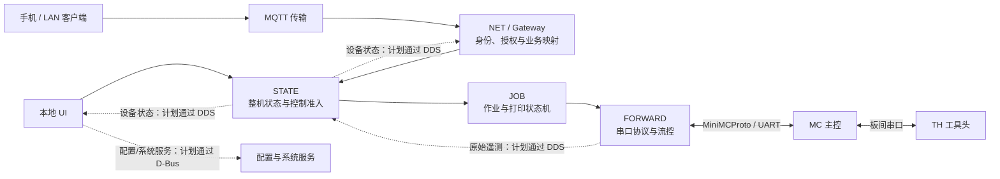

# SoC 内部通信与多模块软件架构说明

目前项目对 SoC 软件架构**已有模块职责和通信分工规划，但完整的多模块通信契约、进程部署和三种总线实现还没有形成可验收的完整系统**。当前 `soc-ap` 的主要代码集中在主机查询、串口传输和 MiniMCProto 编解码；后续的 STATE、JOB、DDS、D-Bus 等仍需按增量建设。

你说的 **FFD**，我暂时理解为 **Fast DDS**；项目资料中使用的是 DDS / Fast DDS 名称。如果你指的是其他组件，需要另行确认。

现有设计大致是这样：

图中的 DDS、D-Bus 和业务服务表示**规划中的职责关系**，不表示这些进程和接口已经全部实现。依据是[通信工程师职责与接口边界](project-control/.agents/rules/06_通信工程师职责与接口边界.md)。

| 通信方式 | 规划用途 | 例子 |
|---|---|---|
| **Fast DDS** | SoC 内部状态、遥测和事件的发布订阅 | FORWARD 发布原始温度；STATE 聚合后发布设备状态；UI 订阅显示 |
| **D-Bus** | SoC 内部方法调用、属性和系统服务接口 | 读取或修改配置、查询服务状态、请求系统管理动作 |
| **MQTT** | 设备与局域网或云端的消息通信 | App 接收状态、通过网关提交远程请求 |
| **MiniMCProto / UART** | SoC 与 MC、TH 的实际设备通信 | 查询版本、心跳、后续经契约批准的设备状态 |
| **HTTP / 文件通道** | 较大文件的上传和管理 | 上传切片文件；消息中传文件 ID、哈希和状态 |

这里的划分是**项目的设计约定**。特别是控制指令最终走 D-Bus 还是其他接口，还要由架构契约明确；不能让 UI、MQTT、DDS 分别绕开检查，直接控制 MCU。

多模块方面，现有规划的核心职责如下：

| 模块 | 主要责任 |
|---|---|
| **FORWARD** | 独占 SoC 侧串口，负责帧编解码、请求响应、流控及设备通信 |
| **STATE / device_manager** | 聚合整机状态，检查设备是否允许执行请求，负责统一准入和仲裁 |
| **JOB / job_engine** | 管理作业、打印/暂停/恢复/取消及作业状态 |
| **UI** | 展示状态、接收用户操作，通过公开接口提交请求 |
| **NET / gateway / storage** | 外部访问、业务身份与授权、消息映射、文件接收和校验 |
| **MEDIA** | 后续的视频采集、预览和视觉事件 |
| **BSP / INTEGRATOR** | 板级驱动、设备能力、系统装配、启动和交付 |

模块是**逻辑边界**，当前方案允许它们先以同进程库形式存在，之后再根据隔离、资源和部署需求决定是否拆成独立进程；目前没有冻结每个模块必须独立运行。详细职责见[模块与 Agent 职责](project-control/.agents/rules/02_模块与Agent职责.md)。

我的判断是：**方向合理，但现在更像架构蓝图，还缺可直接实施的接口设计。** 下一步应由 ARCH 牵头，结合一个实际业务增量补齐：

1. **进程和部署图**：哪些模块同进程、哪些跨进程，服务由谁启动，异常后如何恢复。
2. **通信契约 ICD**：逐项定义 DDS Topic/IDL、D-Bus 服务/对象/方法/错误，以及发布者、消费者、单位、时间戳、有效性、超时和版本。
3. **唯一控制路径**：明确 UI、网络入口如何经过 STATE/JOB，再由 FORWARD 操作设备；区分“收到请求”“业务接受”“设备实际完成”。
4. **资源和故障边界**：明确队列上限、慢消费者、服务重启、重复消息、过期状态，以及目标 SoC 的 CPU、内存和延迟预算。
5. **分阶段验收**：先用一条真实业务链验证模块接口，再按需接 DDS/D-Bus；分别验证软件通信和真实 MCU 链路。

项目已有 [TASK-013：通信契约](project-control/docs/planning/work_packages/TASK-013_冻结%20DDS%20D-Bus%20MQTT%20通信契约.md)、[TASK-014：DDS 底座](project-control/docs/planning/work_packages/TASK-014_实现%20DDS%20底座和统一%20SDK.md)和 [TASK-015：D-Bus 底座](project-control/docs/planning/work_packages/TASK-015_实现%20D-Bus%20底座和统一%20SDK.md)工作包，可以沿用，不必重新发明一套任务体系。

另一个需要先澄清的地方：当前[温度增量草案](project-control/docs/planning/product/next_increment_scope_pl01.md)一处要求避开操作码 `0x10`，另一处又建议使用 `0x10`。在冻结温度接口前，应由 ARCH 对照正式协议解决这个冲突。
