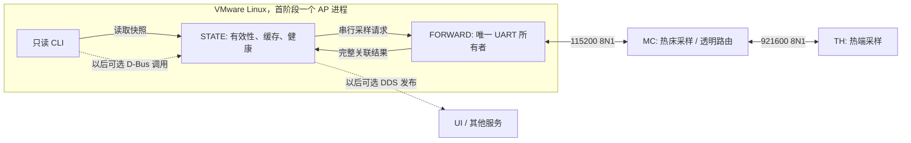

# SoC 温度遥测多模块架构与通信契约提案

## 1. 目的、证据与使用条件

本提案为 FORWARD → STATE → 展示客户端设计首个可评审的 SoC 多模块接口，并明确部署、唯一控制路径、资源、故障和分阶段验收。`draft` 表示供相关 Owner 与独立 QA 评审，不替代已登记的 TEMP-01 签署，也不自行冻结协议或改变任务状态。

输入及本次观察的 SHA256（输入含未提交文件，实际消费时重新核对）：

| 输入 | SHA256 / 状态 |
| --- | --- |
| [正式 MiniMCProto Rev 2.0.3](../specs/ap_mc_formal_protocol_v2_0_multidevice_routing_draft_20261015.md) | `9f8d4f9607cb3e76cc30b9ee2f971b23c3e0d936611188466a71f4aa15f3ce54` |
| [PL-01 温度范围](../planning/product/next_increment_scope_pl01.md) | `fc95bd769829d629ebdb12ef1a2df3b3d420bfb8006a18975a20b50741c7ec89`；文档记录用户选择方案 A；签署证据由 COORD 对账 |
| [PL-02 温度设计](../planning/product/next_increment_design_pl02.md) | `75f3512b80a72266aa1bd0f53ee7fe1b523ac4179396f3261a307e85a18bd30a` |
| [TEMP-01 板端遥测 ICD](ap_mc_th_telemetry_icd.md) | `74361f23ee27f513c0df195c796c42961a1d3c5fb352a72a91c7f70f23033a8d`；已记录 Done/审签，但存在下文冲突 |
| [通信角色边界](../../.agents/rules/06_通信工程师职责与接口边界.md)、[角色定义](../../.agents/rules/02_模块与Agent职责.md)、[重排](../planning/workflow_replan_20261028.md) | 以仓内准确文件为输入，不将岗位视作运行中的会话 |

目前 TEMP-02、TEMP-04 卡记录 InProgress、MC/AP/TH 仓有未提交工作；本提案不编辑这些工作或假定实施者已收到本发现。温度实际硬件和 CR-09～11 的组合证据仍须按准确候选对账。现有代码可见主机查询、MiniMCProto 与串口，不声称 STATE、DDS、D-Bus 已实现。

## 2. 需要立即协调的协议冲突

以下是源码/文档对照发现，须交 COORD、TEMP-01 作者及 ENG-FWD/MC/TH 和独立 QA 处理；涉及冲突字段的实现与验收不应继续依赖未经澄清的值。保留历史签署，由 COORD 按规则登记影响、消费限制及新候选，不由本文改写 Done。

| 编号 | 已观察到的冲突 | 处理方向与必要接受 |
| --- | --- | --- |
| C1 | 正式协议 §5.1 规定所有 v2 帧必须叠加 `0x04`；TEMP-01 ICD 的请求/响应 flags 分别只写 `0x01`/`0x02`，PL-02 又写 flags=0 | 帧层以正式协议为依据，候选请求 `0x05`、响应 `0x06`；由协议 Owner 和三端复核其他位/路由，重做双向黄金帧及 CRC；未接受前不宣称已修复 |
| C2 | PL-02 使用无符号 `current_temp_c_x10`；TEMP-01 ICD/共享头使用有符号 `current_temp_centi_c` | 不自动选赢家；决定表示法、最小/最大值、非法值、量化和兼容策略，统一头文件、三端、独立向量和文档 |
| C3 | TEMP-01 使用 int16 的 0.01°C 并声称可到 +350°C（35000），超出 int16 最大 32767；`0x7FFF` 又用作故障值 | 选择有足够范围的编码或单位，验证负温、边界、故障哨兵不会碰撞；仅结构尺寸断言不能证明范围正确 |
| C4 | PL-01 一处禁止温度占用 `0x10`，另一处建议使用它；正式协议 `0x10` 为系统控制、`0x40` 为 36 字节单向综合遥测 | `0x10` 不可复用，`0x40` 不可直接当新的查询命令。TEMP-01 提议 `0x14` 作为扩展，须确认命令空间和请求/响应语义、修订与兼容性，由 ARCH/各端及 QA 接受；不把本文写成新分配 |
| C5 | TEMP-01 的 ADC 12 位、开短路阈值、采样时钟和加热关断写作确定事实 | 对照原理图、传感器和两端实现，核量程、阈值、失效极性、启动/复位及失电行为；故障注入与强电输出由硬件负责人确认。不能用上报 duty=0 证明物理输出为零 |
| C6 | PL-01 写 TH RTT ≤10 ms；现有运行资料与 VMware 调度波动不足以证明硬实时边界 | 将其视为待批准目标，先明确测试样本、负载、分位数、测量起止/环境及失败动作，再由相关 Owner 和 QA 决议；不得靠平均值或单次成功作保证 |

板端 MCU 消息语义仅以受影响各方接受后的准确 ICD 为准。本文的 SoC 内部模型独立表达“值/单位/状态”，不能把本文当成 MCU 字节布局。

## 3. 目标范围与部署选择

**本切片建议采用同一 AP 进程内的逻辑模块**：单一进程拥有 UART；FORWARD 与 STATE 用有界异步交接和快照接口连接；展示先用 CLI。首次不要求引入 DDS、D-Bus、MQTT 或图形 UI。此选择是本次架构提案，须 ARCH/ENG-FWD/STATE/INTEGRATOR/QA 接受，非现有运行事实。



| 单元 | 职责和数据所有权 | 边界 |
| --- | --- | --- |
| FORWARD / ENG-FWD | UART 打开/关闭、帧校验、一次一个在途事务、请求关联、超时及重连；发布每端原始测量结果 | 不生成设备温度、不修改 TH 业务帧；错误独立返回 |
| STATE / ENG-STATE | 两个端点各自状态、最新成功值、新鲜度、故障/链路状态、健康快照 | 不访问 UART；不能将旧值标为新值，也不通过遥测判定硬件安全 |
| CLI / UI Owner | 查询并展示快照及质量；明确 UNKNOWN/STALE/FAULT | 不能读取旧缓存后标为成功，温度不用于控制准入直到契约批准 |
| INTEGRATOR | 负责打包、配置、系统服务启动、重启策略与日志目录 | 服务配置/资源由具体候选确认；当前无 systemd 部署实现 |

启动：候选服务管理器按配置启动 AP；AP 初始化 STATE（两端均 UNKNOWN），再打开串口；失败进入 DISCONNECTED 并有限退避重连，CLI 可读故障状态。关闭：停止接受新请求，停止调度并在有界期限内终止在途事务、关闭 UART。进程崩溃后管理器重启；内存缓存丢弃并恢复 UNKNOWN，必须重新取得有效关联响应才恢复 FRESH。不能将重启前缓存视为新采样。

未来若测得故障隔离或资源需要再拆进程：FORWARD 独占 UART 并提供单一接口，STATE 独占整机状态，按接口版本独立部署；连接断开立即对消费者显示 UNKNOWN/STALE。迁移前另有 ADR、容量与端到端兼容测试；不因本提案自动切换 IPC。

## 4. SoC 内部语义契约（候选 v1）

实际 API 名称、编程语言 ABI、生命周期与并发策略进入实现票时由 Owner 明确。下表是可评审的逻辑数据模型，不是新 MCU 协议或已冻结代码接口。

| 字段 | 类型和单位 | 生产者 / 约束 |
| --- | --- | --- |
| `schema_version` | 无符号整数，初始提案 1 | STATE；不兼容变更使用新版本 |
| `source` / `sensor` | `MC/BED` 或 `TH/TOOL` | FORWARD 从匹配的端点和已接受载荷映射；不根据猜测推导 |
| `temperature_millic` | 有符号整数，0.001°C；另有 `has_temperature` | 仅采样有效时存在；转换需溢出检查，非法/故障不能用 0 代替 |
| `sensor_status` | OK、OPEN、SHORT、ADC_TIMEOUT、UNKNOWN | 只有正式硬件契约可证明时映射 OPEN/SHORT；否则 UNKNOWN；不得从断链推断传感器开路 |
| `quality` | UNKNOWN、FRESH、STALE、FAULT | STATE 按后述规则维护，值与来源分开 |
| `raw_adc` | 可选无符号整数；无效时 `has_raw_adc=false` | 原始计数及 ADC 位宽/标定版本仅在端侧证据支持时发布 |
| `source_sample_tick_ms` | 可选端侧 uint32 单调 tick | 来源设备自己的时钟，允许回绕；无 boot epoch 和时钟关联时不能推算绝对采样年龄 |
| `host_received_monotonic_ns` | AP 单调时钟，表示有效帧收齐时刻 | 仅进程本次生命周期内可比较；跨主机/重启不比较 |
| `request_seq` / `generation` | 请求关联号 / AP 进程代次 | seq 仅用于本次在途事务；进程重启、seq回绕须重置关联环境 |
| `last_error` | NONE、LINK_DOWN、TIMEOUT、BAD_FRAME、BAD_RESPONSE、SENSOR_FAULT、INTERNAL | 可区分通信与传感器故障；字段与日志不得制造硬件事实 |

提议接口：`RequestSample(source, request_id) → accepted/busy/not_ready` 仅接受调度；异步 `SampleResult(request_id, source, outcome, payload?)` 才报告关联结果；`GetSnapshot() → Snapshot(MC, TH, generation)` 返回两个端点的当前状态，`Subscribe(callback)` 仅在进程内提供状态变化。只读 CLI 调用快照，采样由唯一调度器控制；不允许运行中为多个消费者重复打开串口或无限排队。

状态转换：初始 UNKNOWN；收到来源/flags/cmd/seq/长度/CRC 均符合已接受协议的有效样本后 FRESH；采样故障 FAULT；通信断开或采样失败显示对应错误并保留最后值及其旧时间（标记 STALE 或 UNKNOWN），超过 `max_age` 为 STALE；只读输出必须同时显示质量，不把旧值当实时值。是否允许显示最后有效值由 UI 标记“上次值”。`max_age` 以 host 单调接收时间计算，仅约束接收后经过时间；未经设备时钟关联，不证明传感器采样本身足够新。周期、响应超时和 max_age 由正式部署配置给定，现阶段未冻结。

TEMP-01 当前编码到内部状态的候选映射如下，仅供修订双方契约时使用：`0x00→OK`、`0x01→OPEN`、`0x02→SHORT`、`0x03→ADC_TIMEOUT`；其他值→`UNKNOWN` 和 `BAD_RESPONSE`，不得显示为有效温度。端侧超时是传感器采样失败，链路 TIMEOUT 是未取得符合事务关联的响应，二者不能互换。传感器故障时温度无效；异常状态与有效值矛盾的帧按 `BAD_RESPONSE` 处理。三端 Owner/QA 须在新 ICD 用精确数值、单位和反例确认该映射。

## 5. DDS 与 D-Bus：后续适配器候选

当前切片无强制跨进程通信需求；以下仅是任务 TASK-013/014/015 可评审的命名及数据草案，不能当作现有服务或已批准的 ABI。接入前必须冻结所选中间件版本、IDL/XML、QoS、安全权限和目标环境预算。

| 方向 | 候选接口 | 权威发布者 / 消费者 | 语义与待决 |
| --- | --- | --- | --- |
| DDS 状态 | `soc.device.temperature.v1`，IDL 类型 `TemperatureSampleV1`；字段对应第4节 | STATE 单一发布者；UI/NET 等订阅 | `source`+`sensor` 标识实例；状态最新值、质量和 host 单调时间；跨主机不得比较单调时间。可靠性、deadline、history/depth、资源上限和晚加入策略均须按目标系统测量及批准 |
| DDS 原始采样 | `soc.raw.temperature.v1`，类型 `RawTemperatureV1` | FORWARD 发布；STATE 消费 | 可选跨进程布局才需要；消息不可冒充 DeviceState，QoS 和有界资源同上 |
| D-Bus 只读 | 候选 bus `org.project.DeviceState`，object `/org/project/DeviceState`，interface `org.project.DeviceState1`；`GetTemperatureSnapshot()` | STATE 服务；CLI/UI 读取 | 返回版本化、按端点分组的第4节语义；XML签名、错误名、超时和权限待 ARCH/DBUS/STATE 接受；服务消失返回明确不可用，不回填旧值为新值 |
| D-Bus 配置 | 暂无本切片方法 | 不适用 | 配置写入、OTA、启停和加热控制不在当前切片；需要时独立契约及授权 |

DDS 状态不得绕过 STATE 产生第二权威；传输成功不表示设备动作完成。XML 和 IDL 未冻结前不生成生产绑定；下一步按上表形成正式机器可读文件并测试兼容/错误路径。

候选 D-Bus 方法签名草图（未经各方接受，命名及稳定 ABI 待定）：

```xml
<interface name="org.project.DeviceState1">
  <method name="GetTemperatureSnapshot">
    <arg name="schema_version" type="u" direction="out"/>
    <arg name="generation" type="t" direction="out"/>
    <arg name="samples" type="a(yybiyybubutbq)" direction="out"/>
  </method>
</interface>
```

每条 tuple 依次为 `source:u8, sensor:u8, has_temperature:bool, temperature_millic:i32, sensor_status:u8, quality:u8, has_raw_adc:bool, raw_adc:u32, has_source_tick:bool, source_tick_ms:u32, host_received_monotonic_ns:u64, has_request_seq:bool, request_seq:u16`。建议 source `1=MC,2=TH`，sensor `1=BED,2=TOOL`，状态枚举的数值及 `last_error` 扩展、未知枚举行为须在冻结 XML/IDL 前确定。调用超时、权限拒绝、服务消失及格式不兼容分别形成标准错误；具体错误名称、期限、访问策略待接受。`host_received_monotonic_ns` 只在同一主机和 generation 下可比较，不具备跨主机绝对时间含义。

候选 DDS IDL 字段骨架：

```idl
module soc { module device {
  struct TemperatureSampleV1 {
    unsigned long schema_version;
    unsigned long long generation;
    octet source; octet sensor;
    boolean has_temperature; long temperature_millic;
    octet sensor_status; octet quality;
    boolean has_raw_adc; unsigned long raw_adc;
    boolean has_source_tick; unsigned long source_tick_ms;
    unsigned long long host_received_monotonic_ns;
    boolean has_request_seq; unsigned short request_seq;
    unsigned long last_error;
  };
}; };
```

此草图的 `last_error` 尚未并入 D-Bus tuple，两个协议在发布前必须补齐相同语义及固定枚举；不能把草图直接作为生成绑定。DDS 实例键、QoS、兼容和终端编码由 TASK-013 接受。实际 serial wire payload 仍以新板端 ICD 为准。

## 6. 唯一控制路径（未来动作，非当前授权）

```text
UI / LAN / MQTT → NET（认证、授权、格式转换）→ STATE（准入与仲裁）
→ JOB（作业语义与执行状态）→ FORWARD（有界事务）→ MC/TH
```

本地 UI 可直连同一 STATE 业务接口；网络入口须先经 NET。动作请求必须带唯一 `command_id`、来源、授权上下文、期限和幂等规则；所有通道进入同一裁决点。进程内部传输和 DDS/D-Bus 适配层都不得直接调用串口或绕过 STATE。安全停机/急停路径需单独设计和硬件职责确认，不推定一般队列延迟可满足安全要求。

结果分开：`RECEIVED`（入口收到）、`ACCEPTED`（业务准入）、`SENT`（实际发送）、`DEVICE_ACK`（设备协议确认）、`COMPLETED`（依业务和设备证据确认物理动作）、`FAILED/UNKNOWN`。超时或进程重启后若物理结果未知，记录 UNKNOWN 并查询/人工处理，不自动重试非幂等动作。该状态机是待接受的后续控制契约，当前温度只读不实现动作或宣称完成。

## 7. 资源、故障和配置边界

| 项目 | 可实施的初始策略（提案，非实测承诺） | 验证/待确定 |
| --- | --- | --- |
| 在途请求 | 整个 UART 同时最多 1 个；MC、TH 轮询由同一调度器串行 | 确认正式协议/固件接受及超时后旧响应不匹配新请求 |
| 状态缓存 | 两端各 1 份最新状态；变化通知有界，可合并中间状态但不可静默丢故障状态 | 明确锁/队列所有权及慢消费者统计；无无限积压 |
| 排队与背压 | 每端最多 1 个待处理采样意图；重复请求合并或返回 BUSY，不能跨端饿死 | 验证公平、超时和取消；具体周期待配置 |
| 链路故障 | 超时、坏帧、错源/序号与掉线分别记录；坏帧和无关帧不作为本事务成功；重连限速 | 校验同次 read 中多个帧、断开/恢复、重启与序号回绕 |
| 状态与告警 | 超龄标 STALE，故障为 FAULT，重启 UNKNOWN；停止发送不改变已记录的物理事实 | 故障恢复须新成功样本；不以报警代替独立保护 |
| DDS 慢消费者 | 可丢弃过时状态并计数，但故障通知与当前故障状态须可观察 | 单独选 QoS/深度；验证重连/晚加入、资源上限 |
| 内存/CPU/延迟 | 目标硬件、负载、分位数、RSS、队列容量及统计窗口暂未确认 | 先测 VMware 基线，再在目标 SoC 测量；由 Owner/QA 共同确定可执行预算；不能用主机 RTT 推导硬实时 |

暂定工程参数必须集中配置且与 run 记录绑定；上线和 HIL 前经 Owner/QA 接受。定时器采用单调时钟，避免墙钟调整影响超时。模拟异常、软件用例、实际 HIL 分别标记与保存。

## 8. 分阶段任务与验收

不重拆已有 TEMP-01～07；由 COORD 对照影响并安排必要的契约修订或补票。通信工作包 TASK-013 为范围入口、不直接派单。

| 阶段 | Owner / 交付 | 前置和验收 |
| --- | --- | --- |
| A 冲突对账 | ARCH + ENG-FWD/MC/TH；独立 QA；给 COORD 影响清单 | 对 C1～C6 形成准确新版本、黄金帧、传感器依据和消费关系；先复核既有签署可用范围 |
| B SoC 最小契约 | ARCH + FWD/STATE/INTEGRATOR；独立 QA | 确认第3～4节候选 API、进程部署、错误及配置；不要求未来 DDS/D-Bus 完工 |
| C 软件切片 | FWD、STATE、CLI 各自实现并有独立 QA | 基于已接受端点预期验证双源成功、传感器故障、错源/seq、连续多帧、超时、旧值/STALE、重启、慢消费者和限流；不冒充物理验收 |
| D 组合装配与工程联调 | INTEGRATOR 和各端 Owner | 绑定 AP 和双固件、工具/配置哈希、实际部署身份、授权及候选；按真实硬件分段追踪；故障及加热输出由适当硬件人员核验 |
| E 独立 HIL 与收件 | 独立 Codex QA；QA 产物由非作者 ARCH 复核；COORD 收件 | 真实 UART 正反例、时间戳及 TX/RX 原始 Hex、真实传感器测量与独立基准对照，设备断链/恢复、开路/短路按已接受硬件方法；禁止以 Mock/PTY 替代物理回包，缺证据不通过 |
| F DDS/D-Bus | ENG-DDS / ENG-DBUS + 业务 Owner | 只有确定跨进程业务需求、IDL/XML/权限/QoS及目标资源预算后进行；跨进程重启、慢消费者、超时/权限拒绝等分别独立验收 |

温度范围必须包含真实传感器连接方式、测量参考及误差限、异常物理注入授权、PWM全生命周期物理隔离/检测方案；上报零值和单次读数不能证明硬件始终关闭。未确定部分先标待确认，不能编造硬件或精度指标。候选发生修改后绑定新哈希、定向重验；结果与源码恢复锁分别记录。

**阶段门和消费规则：** A 的修订 ICD/头文件、帧向量、各端 Owner 接受及独立 QA 绑定准确 revision 和 SHA256，经 COORD 收件后，B/C 才能消费冲突字段；B 的 SoC 契约及相关 Owner/QA 签署绑定准确版本后 C 才能据此实现。C 的三端代码/构建和独立检查各绑定准确 commit/diff、制品及报告 SHA256，D 前由 INTEGRATOR 和 COORD 核实并放行；D 稳定候选与原始记录收件后才进入 E；E 实际通过及报告复核后 COORD 才可按范围接受。F 独立依赖实际需求及其 ICD/XML/IDL、权限和资源预算的接受，不等待 E 的无关内容。缺前置、冲突或版本漂移时停止对应消费，保存原状态和历史记录，按差异确定修订、重新评审和恢复条件；不把历史 Done 自动等同新版本放行。

**断热与代码硬门：** 按 PL-01 要求，温度增量运行的 MC/TH 固件全生命周期包含启动、复位和异常恢复时，加热 PWM 必须保持 0 且 PID 禁用或旁路。D 前由真实 MC/TH Owner 与硬件负责人共同确认隔离、输出极性、接线和物理监测方案及适用授权；D/E 分别记录部署配置、启动/复位/运行/异常恢复期间实际输出或独立物理隔离证据及其观测范围。无法证明完整生命周期时不签该项通过，不以 duty 字段或单点 0 替代。TH ADC 等适用轮询须有界超时退出并验证超时/恢复；新增自研代码和本次修改按项目 ≤50 行、≤4 参数、裸机零动态堆、指针及寄存器规范审查，遗留/第三方遵守最小修改预算；有问题交作者修复后重审。

## 9. 审阅与待决

1. COORD 通知当前 TEMP-02/04 的真实作者及 TEMP-01 Owner C1～C6，协调停止消费冲突字段并核准确在途改动；未收到回执不宣称已通知或已暂停。
2. ARCH、FWD、STATE、MC、TH、INTEGRATOR 评审接口/职责；QA 独立审查本准确文档，登记会话、模型、候选哈希、结论和报告；HUMAN/真实 MCU Owner 的必要确认不能由 QA 替代。
3. 待确认：传感器硬件/标定、精度与故障阈值；板端字段/版本；采样与陈旧期限；目标部署资源；真正需要的跨进程调用/权限；放行和故障应对方法。
4. 所有现有历史签署及本次工作区未提交内容原样保留。本提案不改变 TEMP 任务状态、源码、固件、设备或服务器。
