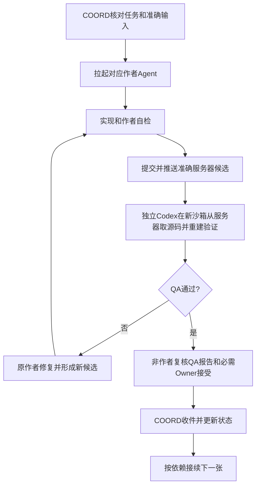

# 项目负责人怎样推进、看进展和接收交付

**你负责要做什么、先做什么、提供必要资料和实际确认；COORD负责组织团队把它做完。** 不需要你拆每张开发卡、判断协议字段、逐个找工程师，或每次把技术汇报交给本助手再审。

启动和日常复制指令见[07指南](07_第一次启动与日常使用.md)。本页解释由谁处理、你应看到什么、何时确实需要你参与。执行依赖[COORD总控清单](../planning/coord_autorun_tasklist_20261029.md)和实际任务卡；手册不复制实时状态。旧09原件见[本次更新记录](../evidence/guides_07_09_update_20261029/README.md)。

## 1. 分清三个入口

| 入口 | 作用 | 你的动作 |
| --- | --- | --- |
| 现有COORD会话 | 分任务、拉起Agent、核输入/资源、安排独立验收、退修和收件 | 发执行目标，平时看检查点汇报 |
| 本项目助手 | 解释概念、整理文档、帮助理解选择和汇报 | 需要解释、复盘或改规则时使用，不自动接管工作Agent |
| 看板和任务卡 | 保存范围、状态、实际负责人、准确候选和证据 | 需要时查看；技术字段由团队维护 |

已有COORD继续使用。其他Agent在开发时，先让COORD核对真实分工和占用，避免重复启动。用户明确的暂停、停止和交接要求必须保留，不因读新手册自动恢复。

只有没有COORD时才指定一个实际会话，更换前先交接。岗位、模型和计划别名不证明Agent已经运行。

## 2. 团队按什么步骤推进

准备推进时，使用07第3节指令即可。COORD按以下顺序核对和执行，不要求你重新提供已有资料：

| 步骤 | 团队处理 | 你应收到的结果 |
| --- | --- | --- |
| 1. 核对现状 | 读取README/AGENTS、B0、队列、实际卡/最新run、交接/暂停、在途Agent和资源 | 已有成果、真实执行者、缺项及接续范围，避免重复工作 |
| 2. 落实运行基础 | 核AUTO-01服务器候选和独立QA沙箱、AUTO-02连续执行/恢复的实际接受范围；只补缺项 | 可定位服务器提交、沙箱/Codex会话、运行器反馈和恢复记录；未部署就说明未部署 |
| 3. 接受设计与契约 | ARCH/Owner处理架构、输入冲突和兼容；有疑点的旧候选新run复核 | 准确设计/契约和限制；未解除的字段不交下游冻结/实现 |
| 4. 实现VMware应用 | 通信/业务/界面工程师按依赖实现，INTEGRATOR装配，独立服务器沙箱QA验证 | 可操作界面、真实模块/进程/IPC、真实MC/TH数据和故障恢复演示 |
| 5. 接受阶段一 | QA、非作者报告复核、必需Owner接受、COORD收件并锁候选 | 通过/失败/未覆盖范围、版本、运行方法、证据和下一步 |
| 6. 迁移并接受SoC | 对应板/BSP/sysroot/屏幕资料具备后适配并实板复验 | 实屏/触控/外设、目标资源/延迟、故障及平台差异记录 |

这是执行检查点，不要求重做所有MS/CR/V2/TEMP历史任务。旧成果只按原候选和适用范围复用；卡面Done不能单独批准新接口、新版本或整机能力。

## 3. 两阶段开发，你应该怎样理解

### 第一阶段：在VMware把真实应用系统跑起来

模拟的是SoC应用运行环境。已选业务使用准备迁移的真实源码、接受的进程边界、进程管理和通信接口，提供可见、可操作的浏览器界面。当前MC主控、TH工具头仍是真实单片机，数据应可追溯到真实链路。

应演示打开界面、真实数据及来源/有效性、交互怎样经过后台、服务启动/停止/重启，以及设备或服务故障后的提示和恢复。布局、截图、CLI、一次发包和软件替身测试只证明各自范围。

### 第二阶段：迁移到SoC并在实板验证

目标是尽量复用同一业务源码、契约和UI资源，把差异集中在工具链、平台配置、启动/部署和硬件适配。驱动、触控、ABI、依赖和性能依据实际板/BSP核实，不能提前保证“仅改编译器就100%能跑”。

目标SoC、BSP或屏幕资料缺失只阻断对应迁移/最终验收，不要求全部目标资料齐全才做VMware无关开发。团队从[架构输入表](../planning/soc_system_architecture_input_register_20261029.md)提出实际缺项。

## 4. 技术工作交给谁

| 事情 | 岗位 | 你需要做什么 |
| --- | --- | --- |
| 服务/进程/契约、兼容与故障边界 | ARCH及受影响Owner | 只确认真正影响产品行为的取舍，无需判断技术字段 |
| Fast DDS项目通信模块 | ENG-DDS，TWIN-05 | 看模块交付和实际验收，不负责SDK实现或库安装 |
| D-Bus项目通信模块 | ENG-DBUS，TWIN-06 | 同上 |
| 串口、MC、TH、状态、网关和界面 | 各对应工程师 | 提供使用反馈；修复交原Owner |
| 构建、版本装配、候选推送、沙箱运行器 | INTEGRATOR | 只补真正缺失的访问资料或授权 |
| 独立验收及QA产物复核 | 独立Codex及另一非作者 | 看清楚的阶段结论，不逐字段技术审核 |
| 实际派单、资源、任务状态和收件 | 唯一现有COORD | 看简明汇报，处理必要外部事项 |

D-Bus/Fast DDS在当前soc-ap仓独立维护，包含SDK源码/API、构建、配置、生成、测试和依赖源码/版本/补丁；共享构建由INTEGRATOR单点维护。业务调用项目SDK，不各建一套通信底座。模块是否另起进程由ARCH接受，不从目录名推断。这是维护和交付要求，模块是否已实现/验收按实际任务证据判断，不从源码包或README存在推断。详见[模块维护规范](../planning/communication_modules_ownership_20261029.md)。

## 5. 每张任务怎样自闭环



“自闭环”是流程完整，不是作者换角色名自批。作者自检不能替代独立QA，QA报告/工具/预期按规则独立复核；行政收件不无限递归增加审查层。

失败保留原报告，回原作者定向修复；连续两次有证据纠正仍失败或缺必需外部条件时，保存检查点并升级。未通过不释放对应下游；无关且具备条件的任务可继续，用户明确暂停的范围除外。

## 6. 什么是符合要求的独立QA

正式QA必须同时满足独立Codex会话、独立沙箱和服务器固定提交三个条件：

| 条件 | 必需证据 |
| --- | --- |
| 独立会话 | 与作者分离的真实Codex会话，启动/运行来源及任务/报告映射；请求模型与可核实实际模型分开记录 |
| 独立环境 | Codex实际在独立VM/容器或等效沙箱内运行；记录隔离机制、ID、镜像/快照、挂载、账户和输出。新对话/目录/worktree不足以证明 |
| 同一服务器候选 | 从服务器取锁定完整提交，源码/契约/配置/测试工具可追溯，在沙箱重建；不复制作者未提交内容或可写安装缓存 |

真实硬件任务另须真实设备/固件身份、实际运行与双向原始报文，软件沙箱不能替代物理单片机应答。QA报告由另一非作者复核并绑定原报告哈希。详见[调度验收门禁](../../.agents/rules/delivery_and_coord_gate.md)和[Codex QA规则](../../.agents/rules/codex_qa_review.md)。

这些由COORD核对可信服务端作业和实际证据，并写清接受范围/缺项；检查脚本exit0或一份手写通过文件不能替代。你不必逐个字段检查。

## 7. 每天只看这一份汇报

可以发给COORD：

```text
请按实际任务和证据简明汇报：
1. 已交付什么，文件/候选/证据在哪里。
2. 验证到哪层：设计、构建、VM真实应用、真实MCU或SoC实板。
3. 还有什么未完成，会影响什么。
4. 哪些真实Agent/任务正在运行，未启动和等待项分别说明。
5. 你下一步会自动安排谁做什么。
6. 是否需要我处理；需要时一次给一个具体问题和必要选项。
已有授权范围按依赖接续，保留我明确的暂停要求，不用每票等我做技术审核。
```

当前会话可在实际工具/回执支持下连续推进；会话关闭后的常驻运行和重启恢复须有AUTO-02实际部署验收。没有这项能力时保存交接，之后发“按最新交接继续”即可，不必重发全部任务。

## 8. 怎样看完成程度

| 汇报 | 应明确到什么程度 |
| --- | --- |
| 设计完成 | 准确设计/契约、必需接受、未解决及消费限制；不说代码/硬件已修复 |
| 代码完成 | 准确服务器候选、源码/配置/测试和实际构建/模块检查，随后仍按本卡要求验收 |
| VMware阶段完成 | 同一候选的真实应用、进程管理、IPC、交互、真实MC/TH链路验证，独立报告和收件齐全 |
| SoC阶段完成 | 目标板启动、实屏/触控/外设、资源/延迟和故障复验，平台差异清楚 |

每次交付应能找到准确版本、适用运行方法、约定结果、实际证据和接收记录。你可以要求演示和解释，技术真实性审查由团队负责，不从局部“100%完成”推断整机或SoC通过。

正式状态保持`Backlog → Ready → InProgress → Review → Verify → Done`，阻塞另记原因和恢复条件。COORD写状态，其他角色交产物和原始证据。旧正确Done按原版本保留；原误判通过追加撤回/复核裁决，不覆盖旧报告。

## 9. 什么情况确实需要你参与

| 情况 | 团队先做什么 | 你怎样处理 |
| --- | --- | --- |
| 产品范围/优先级取舍 | PM/ARCH说明用户影响、选项和代价 | 选择需要的功能或优先级 |
| 确实缺板/BSP/SDK/屏幕资料 | 先查已有文件，列准确资料名称、提供方和阻断范围 | 有资料就转交，没有就说明由谁提供，无需自己判断ABI等参数 |
| 新权限或超出已有授权 | 说明具体动作/对象、既有授权为何不足，先准备可审阅结果 | 通过安全方式补必要权限或作决定 |
| 物理插拔、首次烧录确认、硬件异常 | 工程师给准确对象、步骤、预期、停止点和恢复方法 | 按一步一步说明操作/确认，不凭旧资料猜当前板卡身份 |
| 用户明确暂停后的恢复 | 保存候选、检查点、执行者和设备状态，等待恢复范围 | 明确恢复哪些任务，再由COORD核条件接续 |

服务器不可达、编译失败、协议冲突、任务图错误、环境缺依赖等先由工程师/INTEGRATOR/ARCH处理。只有实际权限或外部条件需要你时才问；不把本机代码当服务器QA，也不把普通技术问题推给你裁决。

已有两阶段方向、真实MC/TH链路、串口和工程位置从[B0](../baseline/B0_方案基线.md)、[串口登记](../baseline/serial_links.md)、[工作区说明](../../../WORKSPACE.md)接续，不重填旧表，不把全部未知绑成所有开发的前置。

## 10. 加功能、失败、暂停和更换会话

| 目的 | 发给COORD的话 |
| --- | --- |
| 新增功能 | 请登记需求、非目标和验收，评估接口/任务/候选影响，给必要产品选项后按批准范围执行。 |
| 了解失败 | 请说明哪个任务/候选失败、实际错误、影响、修复者、已做的有证据纠正及下一步。 |
| 暂停 | 请暂停【任务ID或范围】，保存候选/日志/设备状态，记录等待恢复的范围，不覆盖其他改动。 |
| 恢复 | 请核对【任务ID或范围】的旧执行者、输入和资源；条件满足后恢复并按本卡闭环。 |
| 更换COORD或AI | 请整理实际任务/会话、候选/服务器提交、接受结果、未解除问题、资源/暂停和下一动作，完成单一COORD交接。 |
| 换机/恢复工程 | 请按恢复说明在独立目录恢复锁定版本，保护已有改动并核当前候选；恢复成功不等于功能验收。 |

同一启动指令不要同时发给多个Agent争当COORD。项目知识保存在文件、候选和实际记录中，聊天和助手解释只是补充。

## 11. guides目录各文件怎样使用

| 文件 | 主要用途 | 边界 |
| --- | --- | --- |
| [07_第一次启动与日常使用.md](07_第一次启动与日常使用.md) | 找到COORD、复制启动/日常指令、看阶段结果 | 日常入口，不是实时状态 |
| 本09手册 | 看分工、证据层级、交付和必要决策 | 不替代COORD/QA，不要求负责人审核技术字段 |
| [workspace_restore.md](workspace_restore.md) | 服务器恢复、版本锁和同步入口 | 历史结果仅证明当次范围；具体Git操作交团队核现状执行 |
| [standalone_workspace.md](standalone_workspace.md) | 独立工作区与AP技术运行说明 | AP构建/CLI和日期化试验不等于整套服务已运行 |
| [templates/task_run_record.md](templates/task_run_record.md) | 团队逐票记录命令、版本、证据和收件 | 空模板/计划不是结果，不是让负责人填写的表 |
| [minimc_v2_task_execution.md](minimc_v2_task_execution.md) | 首批V2离线任务的历史执行/证据方法 | 旧范围/原子拆分不作为当前主线重新派单顺序 |
| [new_project_setup_howto.md](new_project_setup_howto.md) | 新项目通用搭建经验 | 经验草稿，新项目需裁剪，本项目以当前规则/任务为准 |

软硬件交付填写和实物确认见[交接规范](../operations/ap_mc_th_software_hardware_handover.md)。本手册只更新管理方法，不实际恢复/暂停/关闭任务，不启动Agent或部署运行器，不提交/推送或操作硬件。
