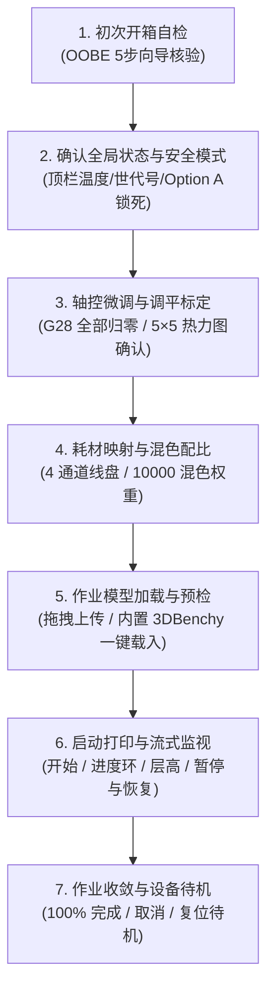

# AI-SoC 智能 3D 打印 Web HMI 用户使用手册与功能全景实操指南

> **文档版本**：v1.0 (2026-11-02)  
> **适用终端**：Web 控制台 (PC 宽屏 / 移动平板 / 触控屏)  
> **服务访问地址**：[http://192.168.77.134:8080/](http://192.168.77.134:8080/) 或 [http://aisoc-printer.local:8080/](http://aisoc-printer.local:8080/)  
> **系统运行模式**：**Option A 强电 0% 锁死纯逻辑空跑 (Safe Dry-Run)**，全流程零烧丝零起火风险。

---

## 目录
- [第一部分：标准推荐业务流程 (Canonical Workflow)](#第一部分标准推荐业务流程-canonical-workflow)
- [第二部分：全功能点逐项实操执行指南 (Feature Tutorials)](#第二部分全功能点逐项实操执行指南-feature-tutorials)
  - [功能 1：新机检查引导向导 (OOBE Wizard)](#功能-1新机检查引导向导-oobe-wizard)
  - [功能 2：全局常驻顶栏与安全中心 (Global Header & E-STOP)](#功能-2全局常驻顶栏与安全中心-global-header--e-stop)
  - [功能 3：打印工作台与全流程作业控制 (Dashboard & Jobs)](#功能-3打印工作台与全流程作业控制-dashboard--jobs)
  - [功能 4：轴控微调与 5×5 自动调平热力图 (Motion & Leveling)](#功能-4轴控微调与-55-自动调平热力图-motion--leveling)
  - [功能 5：4 通道供料系统与混色调色板 (Filament Slots & Mixing)](#功能-54-通道供料系统与混色调色板-filament-slots--mixing)
  - [功能 6：双端温控与物理传感器监控 (Thermals & Telemetry)](#功能-6双端温控与物理传感器监控-thermals--telemetry)
  - [功能 7：局域网自发现与 mDNS 广播服务 (Network & mDNS)](#功能-7局域网自发现与-mdns-广播服务-network--mdns)
  - [功能 8：全机健康监控系统与故障排查 (HMS)](#功能-8全机健康监控系统与故障排查-hms)
  - [功能 9：物理异常与断线防御机制 (Fail-Closed Protection)](#功能-9物理异常与断线防御机制-fail-closed-protection)
- [第三部分：日常使用进阶技巧与常见问题排查 (FAQ)](#第三部分日常使用进阶技巧与常见问题排查-faq)

---

## 第一部分：标准推荐业务流程 (Canonical Workflow)

为了确保 3D 打印任务的安全性、几何成型精度以及多色混色配比的准确性，系统定义了标准的 **7 阶段端到端生命周期操作主航道**。建议用户日常操作严格遵循此顺序：

### 标准操作时序清单：
1. **开机连接**：浏览器输入网址直达，若为首次访问自动进入 OOBE 开箱向导，完成语言选择与双 MCU 硬件链路真实握手；
2. **状态巡检**：查看顶栏网络通信绿灯、硬件在线绿灯、喷嘴与热床当前温度，确认 `🛡️ 强电 0% 锁死 · 纯逻辑空跑` 处于激活状态；
3. **机械标定**：切换至【🕹️ 轴控与调平】，点击 `🏠 全部归零 (G28)` 建立三轴物理原点坐标，核验 5×5 调平热力图平整度；
4. **供料配置**：切换至【🎨 料槽与调色板】，核查 4 通道材料类型（PLA/PETG 等），配置或选择混色预设（如双色 50:50 或四色均分）；
5. **模型载入**：返回【🖨️ 打印工作台】，选择内置经典样例（如 `🚢 3DBenchy.gcode`）或拖拽已切片的外部 G 代码文件，确认层数与模型名称正确解析；
6. **打印流式监视**：点击绿色大按钮 `▶ 开始打印`，系统启动流式逐行解析与 CoreXY 走线模拟，用户观察大环形进度条、当前执行代码与剩余时间；可按需使用 `⏸ 暂停` 或 `▶ 继续`；
7. **异常处理与完成**：遇突发危险随时拍击顶栏常驻的 `🛑 E-STOP 急停`；正常完成或手动 `⏹ 取消作业` 后，系统安全平稳收敛至 `IDLE` 待机。

---

## 第二部分：全功能点逐项实操执行指南 (Feature Tutorials)

---

### 功能 1：新机检查引导向导 (OOBE Wizard)

> **功能定位**：帮助新机初次上电用户快速完成系统偏好设定，并对底层硬件链路进行严格的真实性自检（绝不伪造通过）。

#### 1. 如何唤起向导
- **初次自动唤起**：新浏览器无痕模式或清除缓存后访问控制台，向导模态弹窗（`#oobe-modal`）自动在屏幕中央弹出。
- **随时重新呼出**：在日常操作中，随时点击页面右上角的 **`🚀 新机引导`** 按钮，即可无损重新呼出向导并从第 1 步开始。

#### 2. 分步实操流程
* **Step 1 (欢迎与真实性声明)**：
  - **界面呈现**：展示欢迎标语与系统设计准则（“系统严格遵循真实硬件接入检测规范，任何未连接或脱机组件均如实显示，绝不伪造通过结果”）。
  - **用户操作**：确认阅读后，点击底部右下角 **【下一步 ➔】**。
* **Step 2 (语言偏好与视觉主题)**：
  - **界面呈现**：提供语言选择按钮卡片：`🇨🇳 简体中文 (zh-CN)` 与 `🇺🇸 English (en-US)`。
  - **用户操作**：点击对应语言按钮，界面文字毫秒级免刷新动态切换；选择满意后点击 **【下一步 ➔】**。
* **Step 3 (双 MCU 固件与通信链路自检 - 核心真实性)**：
  - **界面呈现**：三张自检卡片：
    1. `MC (AT32F435) 运动主控通信链路`：正常时亮起绿色徽章 `ONLINE`，清晰展示权威固件 Hash（如 `v1.0 (0xA6791332)`）；
    2. `TH (AT32F423) 工具头通信链路`：正常时亮起绿色徽章 `ONLINE`，展示权威固件 Hash（如 `v1.0 (0x6356C05A)`）；
    3. `AP 转发核心与协议同步状态`：展示 MiniMCProto v2.0 帧同步状态。
  - **用户操作**：核对两颗芯片版本号。若硬件未连接，徽章呈现黄色 `未就绪/等待接入`，此时请检查物理线缆；确认正常后点击 **【下一步 ➔】**。
* **Step 4 (传感器与环境检测)**：
  - **界面呈现**：展示工具头喷嘴温度传感器、热床加热板传感器及 4 通道断料传感器有效性。
  - **用户操作**：观察温度显示为有效数值且标记为 `FRESH`，断料开关无报警；点击 **【下一步 ➔】**。
* **Step 5 (就绪完成)**：
  - **界面呈现**：展示本次向导的配置汇总摘要卡片（语言、主题、料槽权重）。
  - **用户操作**：点击 **【🎉 完成设置，进入控制台】**。向导自动在本地持久化 `aisoc_oobe_completed=true`，弹窗优雅关闭并平滑导航至主工作台。

---

### 功能 2：全局常驻顶栏与安全中心 (Global Header & E-STOP)

> **功能定位**：全站最高层级视窗常驻，提供 1 击直达的安全急停熔断、高频遥测快照与主题环境切换。

#### 1. 元素解读与操作方法
1. **网关通信与硬件在线状态灯**：
   - 绿色圆点 `已连接`：表示网页与本地 Web 网关 WebSocket / SSE 链路通畅；
   - 绿色圆点 `硬件在线`：表示 AP 转发服务与物理双单片机通信正常；若断开则呈现红灯 `硬件离线`。
2. **权威状态机世代计数器 (`GEN: xxxx`)**：
   - 显示当前底层状态机的世代号，随物理串口或内部状态变化单调递增，证明当前数据为动态活水。
3. **全局温度胶囊 (`🔥 喷嘴` / `🛏️ 热床`)**：
   - 实时显示喷嘴（约 `120.7°C`）与热床（约 `24.5°C`）读数。
   - **快捷交互**：鼠标单击任一温度胶囊，页面将自动平滑滚动并切换至【🌡️ 温度与传感器】面板。
4. **全局红色 E-STOP 紧急急停大按钮 (`🛑 E-STOP 急停`) —— 最高视觉权重**：
   - **触发急停**：遇突发危险时，单击该按钮：
     - 系统瞬时下发 `M112` 硬件级急停指令，瞬间中断全部运控脉冲；
     - 屏幕弹出红色告警通知，工作台状态变更为赤红 `ESTOP_FAULT`；
     - 顶栏按钮文字动态变更为 `🔓 解除急停`。
   - **解除急停**：排查故障后，再次点击 `🔓 解除急停`：
     - 系统下发 `M999` 特权复位指令；
     - 状态平稳清除，按钮恢复为 `🛑 E-STOP 急停`，机器恢复就绪。
5. **主题与语言快捷开关**：
   - 点击 **`☀️ 浅色模式` / `🌙 深色模式`**：瞬间在明亮工控主题与暗黑夜间主题间无缝切换；
   - 点击 **`🌐 English / 中文`**：全站静态标签与动态徽章即刻免刷新双语翻译。

---

### 功能 3：打印工作台与全流程作业控制 (Dashboard & Jobs)

> **功能定位**：核心默认主页面，集“模型载入”、“模拟空跑控制”、“走线监视”与“强电安全确认”于一体。

#### 1. 界面分区介绍
- **左侧：实时打印状态仪表盘**（大徽标、环形进度圈、层高指示、计时器、流式 G-code 指令回显、控制按钮栏）；
- **右侧：G-code 作业文件中心**（外部文件拖拽上传区、经典测试模型库）。

#### 2. 详细功能实操
1. **模型载入操作**：
   - **方式 A (推荐免切片测试)**：在右侧“推荐测试模型”列表中，选择所需样例：
     - 🚢 **`3DBenchy.gcode`**：经典综合测试小船，350 层，支持 4 色混色走线；
     - 🧊 **`CalibrationCube.gcode`**：20mm 标定样块，100 层，快速尺寸核验；
     - 🎨 **`ColorSwatch_4Color.gcode`**：180 层，CMYK 四色阶梯渐变样块；
     - 点击目标模型右侧的 **`一键载入`** 按钮，左侧模型名称即刻更新。
   - **方式 B (外部文件上传)**：直接从电脑桌面将本地 `.gcode` 文件拖拽入虚线框 `📥 拖拽 .gcode 文件到此处`，或点击虚线框浏览上传。
2. **确认安全基线**：
   - 仪表盘右上角醒目常驻绿色徽标 **`🛡️ 强电 0% 锁死 · 纯逻辑空跑`**，表明底层加热棒已被硬件级切断，绝对无起火或烧丝隐患，请安心空跑。
3. **启动流式打印 (`▶ 开始打印`)**：
   - 单击绿色 **`▶ 开始打印`** 按钮；
   - **界面动态变化**：
     - 状态大徽标由 `IDLE 就绪` 转变为绿色呼吸态 **`PRINTING 正在打印`**；
     - 中间大环形绿色进度条开始由 0.0% 向 100.0% 匀速旋转推进；
     - 层数指示动态刷新（例如 `Layer 12 / 350`）；
     - “已用时间”从 `00:00:01` 开始平稳计时，“剩余时间”根据当前走线速率动态倒数；
     - “当前流式 G-code 指令”框以每秒数行的高频实时回显当前正在下发的 G-code（如 `G1 X120.5 Y45.2 E1.8 F3000`）；
     - 按钮栏自动变换为 **`⏸ 暂停`** 与 **`⏹ 取消作业`**。
4. **作业在途暂停与恢复**：
   - 打印过程中，单击黄色 **`⏸ 暂停`** 按钮：
     - 状态变为 **`PAUSED 已暂停`**，环形进度圈与走线计时器瞬间冻结，运控电机停留在当前微米坐标；
     - 按钮栏变换为蓝色 **`▶ 继续`** 与红色 **`⏹ 取消作业`**；
   - 点击 **`▶ 继续`** 按钮：系统从暂停断点无缝恢复流式走线，继续推进进度。
5. **终止作业 (`⏹ 取消作业`)**：
   - 点击红色 **`⏹ 取消作业`** 按钮；
   - 系统安全终止当前任务，复位流式执行器，进度条归零，状态优雅回归 `IDLE 就绪`。

---

### 功能 4：轴控微调与 5×5 自动调平热力图 (Motion & Leveling)

> **功能定位**：用于打印前对焦点微调、物理机械回零以及热床 25 点高程平整度测量。

#### 1. 详细功能实操
1. **选择步进跨度 (Step Length)**：
   - 在卡片顶部的步长选择器中，点击切换：**`0.1`**、**`1`**、**`10`**、**`100`** mm；
   - 选中的步长按钮高亮激活。
2. **三轴手动步进对焦 (CoreXY Jogger)**：
   - **X/Y 罗盘操作**：
     - 点击 **`▲ +Y`** / **`▼ -Y`**：Y 轴电机按设定步长前后移动；
     - 点击 **`◀ -X`** / **`+X ▶`**：X 轴工具头按设定步长左右移动；
   - **Z 轴升降操作**：
     - 点击 **`⬆ Z 抬起`**：热床/工具头按设定步长垂直升高；
     - 点击 **`⬇ Z 下降`**：垂直降低；
   - **婴儿步微米微调 (Baby-stepping)**：
     - 点击 **`+0.05`** 或 **`-0.05`** 按钮：以 $50\mu m$ 超细微小步长微调 Z 轴，专用于打印首层挤出时微调喷嘴高度。
3. **坐标仪表盘观察**：
   - 下方卡片实时显示微米级绝对坐标：`X: xx.xx mm` | `Y: xx.xx mm` | `Z: xx.xx mm` | `E: xx.xx mm`。
4. **一键全部归零 (G28 ALL)**：
   - 点击右上角或罗盘中心的 **`🏠 全部归零 (G28)`**；
   - 系统向 MC 固件下发 `G28 ALL` 指令，三轴回到物理传感器零点，坐标平滑更新为 `0.00 mm`。
5. **5×5 自动调平高程网格与热力图 (Leveling Mesh)**：
   - 右侧卡片直观呈现 $5 \times 5 = 25$ 个高程偏差矩阵单元格；
   - **色彩渲染解读**：
     - 绿色色块：高程接近 $0.00\text{ mm}$（平整标准区域）；
     - 橙红色块：高程 $> +0.10\text{ mm}$（局部凸起）；
     - 深蓝色块：高程 $< -0.10\text{ mm}$（局部凹陷）；
   - **指标读数**：底部自动计算 `极值跨度: 0.29 mm` 与 `平面倾斜度: X-偏高 / Y+偏低`；
   - **重新标定**：点击右上角 **`📐 重新测量`** 按钮，向 MC 触发 `0x18` 探针物理采样，采样完毕后网格热力图自动平滑重绘。

---

### 功能 5：4 通道供料系统与混色调色板 (Filament Slots & Mixing)

> **功能定位**：管理 4 色挤出系统的线盘属性，并依据底层严格的 $10000$ 基准权重规范规划混色比例。

#### 1. 详细功能实操
1. **料槽属性配置 (CH-1 ~ CH-4)**：
   - **材料选择**：在“材料类型”下拉菜单中选择对应通道装载的耗材（`PLA`、`PETG`、`ABS`、`TPU`、`PC`、`PA-CF`）；
   - **颜色选取**：
     - 点击卡片下方的快捷色块（红、蓝、绿、黄、橙、白、黑）；
     - 或直接在十六进制文本框输入颜色代码（如 `#E53935`），或使用原生拾色器微调；
   - **余量估算**：拖动“余量估算”滑动条（0% ~ 100%），余量进度条与估算克重同步变化。
2. **混色权重规则与防呆机制 (Base 10000 Invariant)**：
   - 4 个通道的混色权重基准总和必须**严格恒等于 10000**（即 100.00%）；
   - 在各通道“混色基准权重”数字框中直接输入数值（例如 Slot 1 输入 `6000`，Slot 2 输入 `4000`）；
   - 若用户输入的权重和不等于 10000（如输入超标为 12000），界面将即刻弹出红字警示，并禁用保存按钮，防止非法参数写入固件。
3. **快捷混色预设一键调用**：
   - 顶部提供 4 个一键预设按钮：
     - 点击 **`Slot 1 (100%)`**：Slot 1 自动分配 `10000` (100%)，其余自动填 `0`；
     - 点击 **`Slot 2 (100%)`**：Slot 2 自动分配 `10000` (100%)；
     - 点击 **`双色 (50:50)`**：Slot 1 与 Slot 2 各平分 `5000` (50.00%)；
     - 点击 **`四色均分 (25%×4)`**：4 个通道自动均分 `2500` (25.00%)。
4. **配置保存**：
   - 点击 **`💾 保存料槽配置`**，前端通过 `POST /api/v1/filament/slots` 将配置持久化写入后端。

---

### 功能 6：双端温控与物理传感器监控 (Thermals & Telemetry)

> **功能定位**：监视物理工具头（TH）与运动控制板（MC）的传感器健康度、双温曲线与光电开关。

#### 1. 详细功能实操
1. **双端温控卡片解读**：
   - **工具头喷嘴 (TH 卡片)**：显示当前采集温度（约 `120.7°C`），传感器质量标签显示绿色 `FRESH`，固件版本显示 `v1.0 (0x6356C05A)`；
   - **热床加热板 (MC 卡片)**：显示当前采集温度（约 `24.5°C`），传感器质量标签显示绿色 `FRESH`，固件版本显示 `v1.0 (0xA6791332)`；
   - **安全锁死提示**：温控卡片中常驻 `0% 加热输出锁定` 提示，表明温度调节指令仅用于协议状态机同步，不会开启真实加热管。
2. **4 通道断料检测传感器组 (COL-007)**：
   - 下方卡片展示 Slot 1 ~ Slot 4 四路光电对射开关；
   - 耗材正常在位时呈现绿色 `🟢 正常在位`；当发生耗料或拔料时，传感器即刻翻转为红色 `🔴 断料告警`。

---

### 功能 7：局域网自发现与 mDNS 广播服务 (Network & mDNS)

> **功能定位**：向局域网广播设备自发现服务，实现无需记忆或查找 IP 即可快速直连。

#### 1. 详细功能实操
1. **广播属性查看**：
   - 主机名：`aisoc-printer.local`；
   - 服务标识：`_aisoc._tcp.local`；
   - 组播地址：`224.0.0.251:5353`；
   - HTTP 端口：`8080`。
2. **快速直连与链接复制**：
   - 同一局域网内的任何手机、iPad 或电脑，直接在浏览器地址栏输入：  
     `http://aisoc-printer.local:8080`
   - 点击右侧 **`📋 复制链接`** 按钮，链接自动复制到系统剪贴板，可快速分享给团队其他成员。

---

### 功能 8：全机健康监控系统与故障排查 (HMS)

> **功能定位**：统一度量全机 24 类 HMS 统一错误代码体系，提供结构化排查引导。

#### 1. 详细功能实操
1. **活动告警表格**：
   - 正常运行时显示 `当前无活动告警 (系统健康运行)`，急停状态徽章显示绿色 `急停状态: 正常`；
   - 当底层发生故障（如 `0x3001` 断料或 `0x2001` 通信中断）时，表格自动新增一行，列出：`错误代码`、`子系统`、`严重度`、`描述与排查指引` 以及 `发生时间戳`；
   - 用户可根据排查指引处理现场（如重新装料或检查串口连接），现场恢复后告警条目自动消退。

---

### 功能 9：物理异常与断线防御机制 (Fail-Closed Protection)

> **功能定位**：模拟或应对真实的串口线缆松脱、USB 拔除等物理异常，提供工业级“故障安全阻断”。

#### 1. 现场行为表现与应对
1. **线缆松脱或断开瞬间 (3 秒内)**：
   - 浏览器最顶端滑出黄色警示横幅：  
     `⚠️ 硬件连接已断开，运控与加热已锁定，请检查物理连线后重试`；
   - 顶栏硬件状态胶囊由绿灯变为红灯 `硬件离线`；
   - 运控罗盘与开始打印按键全部被物理禁用；若用户尝试强制点击，底层 HTTP 返回 503 拒绝执行，杜绝失控误操作；
   - 底层 CPU 占用率严格保持在 $\le 1.0\%$，彻底消除忙轮询死循环。
2. **线缆重新接回 (1.5 秒内)**：
   - 重新插好 USB 串口后，前端自动侦测重连；
   - 1.5 秒之内黄色警示横幅自动隐去；
   - 顶栏硬件灯恢复为绿色 `硬件在线`，全部按钮解锁，恢复完全受控状态。

---

## 第三部分：日常使用进阶技巧与常见问题排查 (FAQ)

### Q1: 打开网页没有弹出 OOBE 向导，直接进到了主界面，怎么重新体验？
* **解答**：这说明您的浏览器保存了此前已完成向导的标记。有两种极简方式重新体验：
  1. 直接使用浏览器的**无痕窗口 (Ctrl+Shift+N)** 打开网页，即可百分之百从零体验向导；
  2. 在当前网页右上角，直接点击 **`🚀 新机引导`** 按钮，随时无损呼出。

### Q2: 打印过程中加热棒真的不会发热吗？
* **解答**：绝对不会发热。当前系统架构严格处于 **Option A (0% Heater Duty Lockout)** 工业级空跑模式，加热输出强电比已在底层驱动层被硬件级封锁为 0。G-code 中的任何升温指令仅在系统内部做逻辑状态机流转，绝不会接通强电，全流程零火险零烧丝。

### Q3: 为什么输入混色权重时无法点击“保存料槽配置”？
* **解答**：请检查 CH-1 ~ CH-4 的 4 个数字权重输入框。系统的混色算法基准严格遵循 10000 规范，4 个数字相加必须**刚好等于 10000**。如果总和不等于 10000，输入框下方会显示红字提示并锁定保存按钮。您可以直接点击顶部的快捷预设按钮（如 `双色 (50:50)` 或 `四色均分`）一键自动配平。

### Q4: 紧急急停 (E-STOP) 触发后，如何让机器重新动起来？
* **解答**：触发 E-STOP 后，顶栏红色的 `🛑 E-STOP 急停` 会变更为 `🔓 解除急停`。只需再次单击该按钮，系统便会下发特权复位指令清除硬件熔断锁，机器即可恢复为可点动状态。
