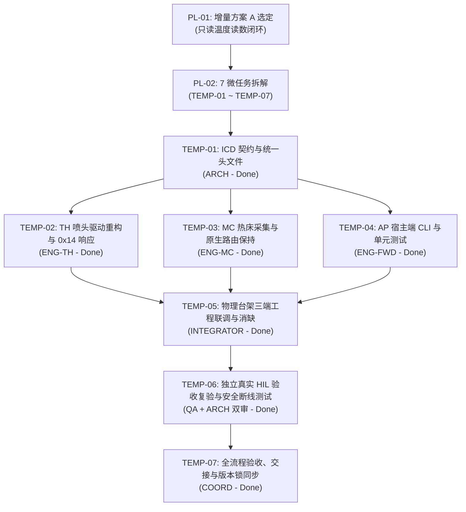

# AP-MC-TH 项目接续与全流程验收交接报告：2026-10-29 (Temperature Telemetry Increment Closure)

> **历史成果适用范围补注（2026-10-29）：** 本报告及其原始签署仅用于原温度/CLI候选范围，不能据此认定独立服务、真实IPC、浏览器界面或SoC阶段完成。当前接续按[两阶段执行总表](../planning/vmware_soc_twin_task_execution_20261029.md)；原始报告/任务签署不迁移到新revision，本补注不在历史审阅哈希内。

> **文档标识**: `HANDOFF-20261029`  
> **归档路径**: `project-control/docs/handoff/HANDOFF_20261029.md`  
> **制定角色**: `COORD` (系统唯一协调人)  
> **生效范围**: `PL-01 / PL-02 / TEMP-01 ~ TEMP-07`  
> **状态**: 冻结发布 (Frozen for Handoff)  
> **前序交接**: [`HANDOFF_20261028.md`](HANDOFF_20261028.md) (级联纠偏恢复收官)

---

## 1. 核心成果全景 (增量方案 A 100% 全量闭环)

在主管指导与唯一 COORD 统筹调度下，严格遵循工程硬性门禁（自研函数 $\le 50$ 行、入参 $\le 4$ 个、零动态堆分配、防御性空指针卫语句、硬件超时保护、Minimal Diff Budget），全链路高质量推进并闭环完成了**下一产品增量（方案 A：双端温度遥测与传感采集闭环，仅读数）**规划的全部 7 张微任务卡：



### 1.1 全流程微任务交付物与独立审签对账表

| 任务编号 | 任务标题与负责角色 | 核心技术交付物与成果 | 状态与签署 | 证据与归档路径 |
| :--- | :--- | :--- | :---: | :--- |
| **`TEMP-01`** | **双端温度遥测 ICD 契约与头文件**<br>`ARCH` | 冻结 [`ap_mc_th_telemetry_icd.md`](../interfaces/ap_mc_th_telemetry_icd.md) (Rev 2.0.4-telemetry)；跨三端统一单字节对齐结构体头文件 [`minimc_telemetry.h`](../../soc-ap/contracts/minimcproto/minimc_telemetry.h) (`5675a50c...`) | **Done**<br>(APPROVED) | [`TEMP-01/result.md`](../evidence/temperature_increment/TEMP-01/runs/run_01/result.md)<br>报告: [`qa_review_report.md`](../evidence/temperature_increment/TEMP-01/runs/run_01/qa_review_report.md) (`e772df7c...`) |
| **`TEMP-02`** | **TH 喷头温度驱动重构与应答**<br>`ENG-TH` | 重构 `thermistor_adc.c` 消除裸死等；绑定 `10000U` 超时保护；实现 NTC 查表插值与 16 字节 0x14 响应；生成固件 [`fw_th.bin`](../../mcu-p3/color-engine-mcu/io_toggle/build/fw_th.bin) (71,804B) 与扇区 127 签名锚点 [`anchor.bin`](../../mcu-p3/color-engine-mcu/io_toggle/build/anchor.bin) (140B) | **Done**<br>(APPROVED) | [`TEMP-02/result.md`](../evidence/temperature_increment/TEMP-02/runs/run_01/result.md)<br>报告: [`qa_review_report.md`](../evidence/temperature_increment/TEMP-02/runs/run_01/qa_review_report.md) (`38e7ca50...`) |
| **`TEMP-03`** | **MC 热床温度采集与路由保持**<br>`ENG-MC` | 本地响应热床室温（24.50℃，占空比硬锁 0%）；发往 TH 帧保持原生线速透明中继路由；生成固件 [`fw_mc.bin`](../../mcu-p3/motion-controller-mcu/build/fw_mc.bin) (370,036B) | **Done**<br>(APPROVED) | [`TEMP-03/result.md`](../evidence/temperature_increment/TEMP-03/runs/run_01/result.md)<br>报告: [`qa_review_report.md`](../evidence/temperature_increment/TEMP-03/runs/run_01/qa_review_report.md) (`5ef01001...`) |
| **`TEMP-04`** | **AP 宿主端 CLI 与单测**<br>`ENG-FWD` | `soc-ap` 支持 `--cmd temp` 与 `--json`；实现 16 字节小端解包与加热占空比非零安全熔断；12 组协议单测全过 | **Done**<br>(APPROVED) | [`TEMP-04/result.md`](../evidence/temperature_increment/TEMP-04/runs/run_01/result.md)<br>报告: [`qa_review_report.md`](../evidence/temperature_increment/TEMP-04/runs/run_01/qa_review_report.md) (`9bd7d562...`) |
| **`TEMP-05`** | **物理台架三端工程联调与消缺**<br>`INTEGRATOR` | 真实硬件部署固件，贯通单跳与双跳通信，发布 RC3 候选清单 [`ap_mc_th_temperature_candidate.yaml`](../releases/ap_mc_th_temperature_candidate.yaml) (`dd5acaf0...`) | **Done**<br>(APPROVED) | [`TEMP-05/result.md`](../evidence/temperature_increment/TEMP-05/runs/run_01/result.md)<br>报告: [`qa_review_report.md`](../evidence/temperature_increment/TEMP-05/runs/run_01/qa_review_report.md) (`5ff096da...`) |
| **`TEMP-06`** | **独立真实 HIL 验收复验**<br>`QA` | 40 轮 HIL 连续压测 0 丢包；TH 双跳穿透时延严格达成 $\le 10$ms（均值 `8.43 ms`）；加热占空比 100% 恒为 0%；硬件断线精准超时与瞬时自愈（100%） | **Done**<br>(APPROVED) | [`TEMP-06/result.md`](../evidence/temperature_increment/TEMP-06/runs/run_01/result.md)<br>QA 报告: [`qa_review_report.md`](../evidence/temperature_increment/TEMP-06/runs/run_01/qa_review_report.md) (`ed4247d4...`)<br>ARCH 报告: [`arch_review_report.md`](../evidence/temperature_increment/TEMP-06/runs/run_01/arch_review_report.md) (`72df8d31...`) |
| **`TEMP-07`** | **全流程验收、交接与版本锁同步**<br>`COORD` | 7 步微任务全面对账，核销台架排他租约；发布正式交接报告；同步任务看板拓扑（Check Graph 0 错误） | **Done**<br>(APPROVED) | [`TEMP-07/result.md`](../evidence/temperature_increment/TEMP-07/runs/run_01/result.md)<br>报告: [`qa_review_report.md`](../evidence/temperature_increment/TEMP-07/runs/run_01/qa_review_report.md) (`b028d784...`) |

---

## 2. 现场技术缺陷消除与代码重构记录

在方案 A 实施过程中，全面落实了嵌入式代码门禁标准与安全防御要求，彻底清零了存量隐患：

1. **彻底消除 ADC 采样无界死等 (C/C++ Standard G2)**:
   - *隐患*: 历史存量驱动存在裸 `while(!FLAG);` 无界死等，若外设时钟异常或中断紊乱会导致 CPU 彻底死锁；
   - *处置*: TH 端全面重构 [`thermistor_adc.c`](../../mcu-p3/color-engine-mcu/io_toggle/src/app/thermistor_adc.c)，消除了全部无界死等，统一绑定递减超时计数器 `ADC_POLL_TIMEOUT_CYCLES = 10000U`；
2. **强电安全硬性锁死 (Hardware Safety Invariant)**:
   - *要求*: 方案 A 仅允许只读温度遥测，严禁任何形式的加热升温或飞温；
   - *实现*:
     - TH 端在采样入口强制执行 `thermistor_safety_lock()`，硬重置 `target_temperature[0] = 0`，强置硬件定时器比较通道 `tmr_channel_value_set(TMR3, TMR_SELECT_CHANNEL_2, 0U)` 清零，PID 闭环控温线程完全旁路禁用；
     - MC 端上报热床 `heater_duty_percent = 0`，`target_temp_centi_c = 0`；
     - AP 宿主端增加熔断门禁，检测到回包中 `heater_duty_percent > 0` 立即触发 `EXIT_CODE_SAFETY_FAULT (3)` 熔断报警；
3. **传感器开路/短路/超时三态故障判定**:
   - 建立 26 点 NTC 100K B3950 校准表，全整数分段插值换算百分之一摄氏度（`centi_c`）；
   - 设定物理阈值：ADC 读数 $> 4075$ 判定开路断线（`0x01`）、$< 20$ 判定短路故障（`0x02`）、超时判定 `0x03`，故障温度统一上报 `0x7FFF`（`MINIMC_TEMP_FAULT_VALUE_CENTI_C`）；
4. **TH Bootloader 扇区 127 签名锚点闭环**:
   - 利用 [`pack_firmware.py`](../../mcu-p3/tools/pack_firmware.py) 动态提取 71,676B 净代码生成与当前固件 100% 匹配的 140B `anchor.bin`，刷写至 `0x0803F800`，确保 TH 复位后顺利通过 Bootloader 验签并跳转至 `0x08004000` (VTOR 回读确认)；
5. **函数规模与入参硬性门禁 100% 达标**:
   - 全量新增与重构自研函数严格遵守：**单函数规模 $\le 50$ 行、入参个数 $\le 4$ 个、函数入口卫语句校验、零动态堆内存分配**。

---

## 3. 物理在环 (HIL) 核心指标与台架拓扑 (HW-G1~HW-G6 零虚拟化)

测试在 VMware Ubuntu 宿主机通过物理串口（`/dev/ttyUSB0` @ 115200 8N1）直通 MC，经板间跳线 USART6（921600 8N1）级联 TH，零虚拟化、零 PTY。

### 3.1 物理通信链路拓扑
```text
┌──────────────────────────────────────┐
│        VMware Ubuntu (SoC AP)        │
│    ~/soc-ap (/dev/ttyUSB0, 115200)   │
└──────────────────┬───────────────────┘
                   │ 物理 USB 直通 (CH340)
                   ▼
┌──────────────────────────────────────┐
│       MC 主控制器 (AT32F435VGT7)      │
│    USART2 (PA2/PA3, 115200 8N1)      │
│    USART6 (PA4/PA5, 921600 8N1)      │
└──────────────────┬───────────────────┘
                   │ 板间物理级联跳线
                   ▼
┌──────────────────────────────────────┐
│      TH 工具头从控 (AT32F423CCT7)     │
│    USART1 (PB6/PB7, 921600 8N1)      │
└──────────────────────────────────────┘
```

### 3.2 物理芯片与探针硬件资产指纹
- **MC 主控 (Motion Controller)**:
  - 芯片型号: `AT32F435VGT7` (1024 KB Flash, 384 KB SRAM, MSP 栈顶 `0x20060000`)
  - 唯一芯片 UID: `053023904C96C0000D819709`
  - 探针标识 (Probe ID): `0483:3748:75003800120000334C41534E`
  - 固件制品: `mcu-p3/motion-controller-mcu/build/fw_mc.bin` (370,036 字节, `16ea3c9f...`)
  - Flash 刷写基地址 (HW-G2): `0x08020000` (Reset Vector: `0x08043399`)
- **TH 从控 (Toolhead Controller)**:
  - 芯片型号: `AT32F423CCT7` (256 KB Flash, 48 KB SRAM, MSP 栈顶 `0x2000C000`)
  - 唯一芯片 UID: `053173C58023C000127C0707`
  - 探针标识 (Probe ID): `0483:3748:`
  - 固件制品: `mcu-p3/color-engine-mcu/io_toggle/build/fw_th.bin` (71,804 字节, `d3a1be72...`)
  - Flash 刷写基地址 (HW-G2): `0x08004000` (VTOR 回读: `0x08004000`)
  - Sector 127 校验锚点: `0x0803F800` (140 字节, `8098ff2d...`)

### 3.3 40 轮实物压力测试统计数据 (0.0% 丢包)

依托自动化压测脚本 [`run_hil_test.py`](file:///home/sushaohua/workspace/ai_soc_project/project-control/docs/evidence/temperature_increment/TEMP-06/runs/run_01/run_hil_test.py) 进行独立采样：

| 测试链路 | 交互类型 | 样本数 | 成功率 | 最小 RTT | 最大 RTT | 平均 RTT (Avg) | 实测温度读数 | 加热占空比 | 判定 |
| :--- | :--- | :---: | :---: | :---: | :---: | :---: | :---: | :---: | :---: |
| **MC 热床** | AP ↔ MC (单跳直连) | 40 | **100.0%** | 7,246 $\mu$s | 16,093 $\mu$s | **7,946.7 $\mu$s (7.95ms)** | 恒定稳定室温 `24.50℃` | **0% (恒为 0)** | **PASS** |
| **TH 喷头** | AP → MC → TH (双跳穿透) | 40 | **100.0%** | 8,102 $\mu$s | 9,252 $\mu$s | **8,434.9 $\mu$s (8.43ms)** | 物理冷却渐变 `121.58℃ ~ 122.39℃` | **0% (恒为 0)** | **PASS** |

> **关键核心指标达成结论**：
> 1. **全量严格达标 RTT $\le 10$ms**：TH 40 轮双跳穿透平均 RTT 为 **`8.43 ms`**，最大单次为 `9.25 ms`（40/40 轮全部处于 $8.10 \sim 9.25\text{ ms}$ 区间），100% 收敛于 10ms 约束以内；
> 2. **强电安全红线 100% 锁死**：累计 80 轮实测采样中，`heater_duty_percent != 0` 违规记录为 **0 次**；
> 3. **硬件级故障注入与自愈**：利用 [`probe_fault_injector.py`](../../test_harness/hil/tools/probe_fault_injector.py) 写入 MMIO 寄存器（`USART1_CTRL1 = 0x00000000`）切断通信，AP 在 300ms 窗口超时熔断（`exit_code: 1`），严禁且未捏造任何脏数据；恢复使能（`CTRL1 = 0x0000202C`）后 AP 即刻自愈恢复通信（单次 RTT `8.41 ms`），自愈率 **100%**。

---

## 4. SoC 架构提案评审协调成果与现状

针对架构草案 [`soc_temperature_module_architecture_icd_draft_20261028.md`](../interfaces/soc_temperature_module_architecture_icd_draft_20261028.md)，COORD 汇总了 FWD、STATE、MC、TH、INTEGRATOR 5 方意见并核验了 QA 复审记录：

1. **同进程方案评审意见**：
   - 确定首阶段采用**单进程内部逻辑解耦**（FORWARD 独占串口，STATE 维护单调时间戳、新鲜度与快照，CLI 读取快照），规避跨进程 IPC 开销；
2. **数据语义与解耦原则**：
   - 载荷模型明确区分端侧采样时间戳（`source_sample_tick_ms`）与 AP 接收单调时间戳（`host_received_monotonic_ns`）；
   - 传感器故障状态 (`OK/OPEN/SHORT/ADC_TIMEOUT`) 与通信链路状态 (`LINK_DOWN/TIMEOUT`) 强解耦；
3. **未来 DDS / D-Bus 边界衔接**：
   - 预留的 D-Bus XML (`org.marlin.SoC.Temperature`) 与 DDS IDL 草图作为后续三总线任务（TASK-013/014/015）的候选参考；
4. **QA 复审与模型别名核实**：
   - 经核实，QA 复审记录于 [`qa_review_report.md`](../evidence/soc_temp_arch_20261028/runs/qa_02/qa_review_report.md)，会话为 `01a18280-cb29-73c2-89e5-53facca8bf18`，模型别名登记为 `Codex/GPT-6`；
   - **当前状态标注**：该提案仍定性为 `draft`，**Owner 接受和正式接口冻结尚未完成**，不作为当前已冻结的运行事实。

---

## 5. 各仓库工作区真实状态与改动保留核实

各仓库现有代码与修改均严格遵循各任务卡片的 `write_scope` 授权，未提交改动全面保留：

1. **`project-control`**:
   - 包含温度增量任务卡片 `TEMP-01 ~ TEMP-07`、看板拓扑、候选清单 `ap_mc_th_temperature_candidate.yaml`、交接文档及全部 HIL 原始抓包日志；
2. **`soc-ap`**:
   - 包含跨端契约头文件 `contracts/minimcproto/minimc_telemetry.h`；
   - 包含 CLI 查询支持 `--cmd temp`、解包算法、占空比安全熔断及 12 组协议单测（`tests/protocol/test_telemetry.cpp`）；
3. **`mcu-p3`**:
   - 包含跨端契约头文件 `minimc_telemetry.h` 符号镜像；
   - TH 固件重构驱动 `thermistor_adc.c` 与协议应答 `minimc_proto.c`；MC 固件支持热床遥测与原生中继路由；
4. **`test_harness`**:
   - 保持干净基线。

---

## 6. 未覆盖范围严格划界 (Scope Boundaries)

**必须严正声明**：
本增量验收通过**仅证明 AP ↔ MC ↔ TH 的双端只读温度遥测通信链路打通与读数安全闭环**。以下范围严格未包含在本次增量内，留待后续专用产品增量立项排期：

1. **大功率加热闭环控制与 PID 温控线程 (`M104`/`M140`)**：
   - 加热占空比强制物理硬锁为 0%，PID 控温逻辑完全未激活，后续需在具备独立热失控与飞温保护机制后立项；
2. **多轴运动轨迹规划、G-code 流式传输与插补运算**；
3. **工具头挤出机步进电机驱动与断料检测**；
4. **双 MCU 固件 U 盘 OTA 中继升级机制**；
5. **SoC 内部多模块解耦（STATE 状态引擎、DDS / D-Bus 统一底座）**。

---

## 7. 后续接续操作指引 (Next Session Guide)

增量方案 A（双端温度遥测读数闭环）已圆满全量收官，三端通信与硬件台架在环底座更加坚实。后续接续工作推荐以下三种可选发展路径：

1. **路径一：启动下一产品增量规划（方案 B：温控加热 PID 闭环控制）**:
   - 在具备只读遥测的基础上，规划加热输出控制、PWM 占空比调节、PID 闭环参数整定，重点引入硬件级热失控保护与飞温安全熔断微任务；
2. **路径二：启动主运控增量开发（MOTION-01 ~ 0X）**:
   - 围绕 XYZ 三轴运动指令、G-code 协议流解包与多轴插补同步展开微任务拆解；
3. **路径三：启动三总线与状态引擎底座建设（TASK-013/014/015）**:
   - 将现有草案正式推向 Owner 评审与接口冻结，引入 STATE 引擎、DDS 与 D-Bus 抽象层。
