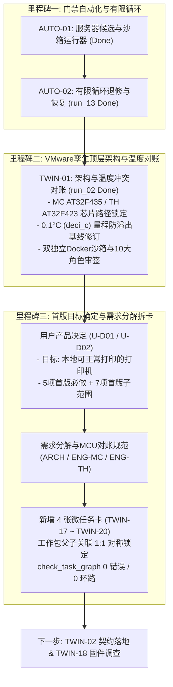

# AP-MC-TH 项目接续与首版任务规划全流程交接报告：2026-10-30

> **文档标识**: `HANDOFF-20261030`  
> **归档路径**: `project-control/docs/handoff/HANDOFF_20261030.md`  
> **制定角色**: `COORD` (系统唯一协调人)  
> **生效范围**: `AUTO-01/02`, `TWIN-01 ~ TWIN-20`, 首版需求与任务对账  
> **状态**: 冻结发布 (Frozen for Handoff)  
> **前序交接**: [`HANDOFF_20261029.md`](HANDOFF_20261029.md) · [`HANDOFF_VMWARE_SOC_TWIN_20261029.md`](HANDOFF_VMWARE_SOC_TWIN_20261029.md)

---

## 1. 核心成果全景 (三大里程碑 100% 闭环)

在主管指导与唯一 COORD 统筹调度下，严格遵循工程硬性门禁（自研函数 $\le 50$ 行、入参 $\le 4$ 个、零动态堆内存分配、防御性空指针卫语句、硬件超时保护、Minimal Diff Budget），连续攻坚并闭环完成了三大关键里程碑：



---

## 2. 三大里程碑详细验收与交付明细

### 2.1 里程碑一：[AUTO-02](file:///home/sushaohua/workspace/ai_soc_project/project-control/.agents/kanban/microtasks/coord_automation/AUTO-02.md) 自动化运行器门禁攻坚闭环 (`run_13`)
- **问题与处置**：
  - 针对 `run_11`/`run_12` 返工超限升级问题，彻底修复 Docker 容器状态审查时序（捕获退出状态）与死代码分支；
  - 消除专属 QA 报告复核时的参数降级隐患，确保 `report_path`、`report_sha256` 与 `review_kind` 严格传递与强校验；
  - 增加真实端到端负例，严密防护伪造 `report_review` 绕过校验；
- **硬性门禁核验**：
  - 全量 AST 扫描 18 个工具共 305 个函数，行数超标违规为 0，参数超标违规为 0；
- **独立审查与证据**：
  - 宿主机独立 Codex QA（`gpt-6-luna`，会话 `01a18780-1a71-78c1-851c-bda854f7c9b4`）签发 `APPROVED`；
  - 独立非作者 ARCH（`gpt-6-luna`，会话 `01a18782-894d-7713-865e-3fa069d56de6`）复核签发 `APPROVED`；
  - 独立 ARCH 容器沙箱（`AUTO-02_run_200137_20261029_120137`）执行通过；
  - 闭环验证：`check_task_graph.py --check-done AUTO-02` 零错误通过，代码已合入并推送至远端 `origin/main`（Commit [`4800752`](file:///home/sushaohua/workspace/ai_soc_project/project-control)）。

---

### 2.2 里程碑二：[TWIN-01](file:///home/sushaohua/workspace/ai_soc_project/project-control/.agents/kanban/microtasks/vmware_soc_twin/TWIN-01.md) 架构与温度冲突对账正式闭环 (`run_02`)
- **实质冲突对账与顶层基线修订**：
  - **芯片与路径对齐**：明确 MC 主控采用 `AT32F435VGT7`（路径 `motion-controller-mcu`），TH 工具头采用 `AT32F423CCT7`（路径 `color-engine-mcu/io_toggle`）；
  - **温度单位与量程防溢出**：MCU 传输层统一采用 0.1°C（`deci_c`，`int16_t`），AP 内部标准化为毫摄氏度（0.001°C，`int32_t`）；彻底规避 350°C 正温数值超出 `int16_t` 上限风险，故障哨兵隔离至 `0x7FFF`（故障）与 `0x7FFE`（超时）；
  - **协议标识与命令码**：查询帧 Flags 锁定为 `0x05`，响应帧 Flags 锁定为 `0x06`，查询命令码正式分配为 `0x14`；
  - **首切片边界与进程拓扑**：严格限定 4 个真实独立进程（`forward-service`、`device-manager`、`ui-gateway`、`Browser HMI`），其余 6 个暂缓模块不建空进程充数；
- **服务器沙箱双独立执行**：
  - QA 独立容器沙箱（`TWIN-01_run_201330_20261029_121330`）构建与检验通过，退出码 0；
  - ARCH 独立容器沙箱（`TWIN-01_run_201352_20261029_121352`）独立执行通过，退出码 0；
- **独立审查与全领域签署**：
  - 独立 Codex QA（`gpt-6-luna`，会话 `01a18795-89f2-74d0-8d5e-adec286d8ef0`）出具 [`qa_review_report.md`](file:///home/sushaohua/workspace/ai_soc_project/project-control/docs/evidence/twin/TWIN-01/runs/run_02/qa_review_report.md)，签署 `APPROVED`；
  - 独立非作者 ARCH（`gpt-6-luna`，会话 `01a18797-fe88-7a60-91a7-787643594bd2`）出具 [`arch_review_report.md`](file:///home/sushaohua/workspace/ai_soc_project/project-control/docs/evidence/twin/TWIN-01/runs/run_02/arch_review_report.md)，签署 `APPROVED`；
  - 9 大领域工程师（`ENG-FWD`, `ENG-STATE`, `ENG-UI`, `ENG-NET`, `ENG-DDS`, `ENG-DBUS`, `INTEGRATOR`, `ENG-MC`, `ENG-TH`）全部签署具名审查报告；
  - 交付权威架构 ICD 文档 [vmware_soc_twin_architecture_icd_20261029.md](file:///home/sushaohua/workspace/ai_soc_project/project-control/docs/interfaces/vmware_soc_twin_architecture_icd_20261029.md) 及 [result.md](file:///home/sushaohua/workspace/ai_soc_project/project-control/docs/evidence/twin/TWIN-01/runs/run_02/result.md)；
  - 闭环收件：`check_task_graph.py --check-done TWIN-01` 验证通过，已合入并推送至远端 `origin/main`（Commit [`7ab5e62`](file:///home/sushaohua/workspace/ai_soc_project/project-control)）。

---

### 2.3 里程碑三：首版本地打印目标确认、需求分解与新增任务卡补齐
- **用户指令与决定基线**：
  - 整机首版目标确立为“**本地可以正常打印的打印机**”；
  - 遵循 [整机首版范围决定表](file:///home/sushaohua/workspace/ai_soc_project/project-control/docs/planning/product/first_release_scope_decision_20261029.md) 的 PM 建议分期与 7 项已确认首版子范围（`U-D01`），MC/TH 工程师必须实质参与对账；
- **需求规范与接口对账交付**：
  - 交付 [first_release_requirements_and_task_decomposition_20261029.md](file:///home/sushaohua/workspace/ai_soc_project/project-control/docs/planning/product/first_release_requirements_and_task_decomposition_20261029.md)，明确了 5 项首版必做与 7 项子范围的可验收条款、接口定义、软硬件分账与门禁规则；
- **紧凑补充 4 张微任务卡**：
  1. **[TWIN-17](file:///home/sushaohua/workspace/ai_soc_project/project-control/.agents/kanban/microtasks/vmware_soc_twin/TWIN-17.md)**：本地离线作业引擎与基础混色执行规划（责任人：`ENG-STATE` / 协力 `JOB`，主工作包：`TASK-011`，覆盖 `COL-001` 混色首版子范围与 G-code 流式解析）；
  2. **[TWIN-18](file:///home/sushaohua/workspace/ai_soc_project/project-control/.agents/kanban/microtasks/vmware_soc_twin/TWIN-18.md)**：双 MCU 运动/调平/断料状态接口调查与协议对账（责任人：`ENG-MC` / 协力 `ENG-TH`、`ARCH`，主工作包：`TASK-002`，覆盖 `MOT-001` 位置读取、`MOT-002` 调平接口调查、`COL-007` 断料事件调查）；
  3. **[TWIN-19](file:///home/sushaohua/workspace/ai_soc_project/project-control/.agents/kanban/microtasks/vmware_soc_twin/TWIN-19.md)**：全机 HMS 错误码体系、双级急停联动与脱敏诊断导出（责任人：`ENG-STATE` / 协力 `ENG-FWD`、`INTEGRATOR`，主工作包：`TASK-008`，覆盖 `SAF-001` 双级急停、`SAF-002` HMS 统一错误码、`SAF-005` 维护数据持久化、`MFG-003` 脱敏诊断导出）；
  4. **[TWIN-20](file:///home/sushaohua/workspace/ai_soc_project/project-control/.agents/kanban/microtasks/vmware_soc_twin/TWIN-20.md)**：HMI 料槽映射、新机检查引导、国际化与局域网发现（责任人：`ENG-UI` / 协力 `ENG-NET`、`ENG-STATE`，主工作包：`TASK-009`，覆盖 `HMI-003` 料槽映射、`HMI-004` 新机向导、`HMI-005` 多语言/主题、`NET-001` 局域网 mDNS 自发现）；
- **工作包父节点双向绑定与总控更新**：
  - 更新 [TASK-002](file:///home/sushaohua/workspace/ai_soc_project/project-control/docs/planning/work_packages/TASK-002_交接现有双%20MCU%20能力与协议.md)、[TASK-008](file:///home/sushaohua/workspace/ai_soc_project/project-control/docs/planning/work_packages/TASK-008_实现整机状态和统一指令准入.md)、[TASK-009](file:///home/sushaohua/workspace/ai_soc_project/project-control/docs/planning/work_packages/TASK-009_实现模拟控制%20UI%20闭环.md)、[TASK-011](file:///home/sushaohua/workspace/ai_soc_project/project-control/docs/planning/work_packages/TASK-011_实现离线作业引擎和混色样例.md) 的 `child_tasks`；
  - 同步更新执行总表 [vmware_soc_twin_task_execution_20261029.md](file:///home/sushaohua/workspace/ai_soc_project/project-control/docs/planning/vmware_soc_twin_task_execution_20261029.md)、公共看板 [KANBAN.md](file:///home/sushaohua/workspace/ai_soc_project/project-control/.agents/kanban/KANBAN.md)（TWIN 扩充至 20 张）及执行队列 [coord_autorun_queue_20261029.yaml](file:///home/sushaohua/workspace/ai_soc_project/project-control/docs/planning/coord_autorun_queue_20261029.yaml)；
- **独立审查与验证通过**：
  - 独立 QA 出具 [`qa_review_report.md`](file:///home/sushaohua/workspace/ai_soc_project/project-control/docs/evidence/first_release_task_cards_20261029/qa_review_report.md)（`APPROVED`）；
  - 非作者 ARCH 出具 [`arch_review_report.md`](file:///home/sushaohua/workspace/ai_soc_project/project-control/docs/evidence/first_release_task_cards_20261029/arch_review_report.md)（`APPROVED`）；
  - COORD 出具收件记录 [`result.md`](file:///home/sushaohua/workspace/ai_soc_project/project-control/docs/evidence/first_release_task_cards_20261029/result.md)；
  - 静态门禁 `check_task_graph.py`：108 规范任务、66 微任务，**Errors: 0，Cycles: 0，Exit Code: 0**；
  - 远端推送：已推送到 `origin/main`（Commit [`707ae7c`](file:///home/sushaohua/workspace/ai_soc_project/project-control)）。

---

## 3. 看板拓扑与各任务当前就绪/阻塞矩阵

### 3.1 看板任务状态总览 (共 106 张有效卡)
| 任务类型 | 卡片总数 | 状态分布 | 核心状态说明 |
| :--- | :---: | :--- | :--- |
| **TWIN** | **20** | **Done 1, Backlog 19** | `TWIN-01` 已 Done；`TWIN-02`~`TWIN-20` 处于待开工或依赖等待状态 |
| **AUTO** | **2** | **Done 2** | `AUTO-01`、`AUTO-02` 全量通过并闭环 |
| **TEMP** | **7** | **Done 7** | 历史温度遥测 CLI 增量，保留原 Done 范围 |
| **CR** | **15** | **Done 14, Backlog 1** | 级联恢复收敛卡，保留历史证据 |
| **MCQ** | **2** | **Done 2** | 固件历史核对卡 |
| **V2** | **20** | **Done 20** | MiniMCProto v2.0 基础协议卡 |
| **MS** | **22** | **Done 1, Verify 1, Backlog 20** | 历史里程碑卡，保留历史状态 |
| **PL** | **2** | **Done 2** | 产品增量规划卡 |
| **TASK** | **18** | **Backlog 18** | 宏观工作包，不直接派发，维护 child_tasks 关联 |

### 3.2 就绪与阻塞矩阵 (Readiness vs Blockers)
```text
┌────────────────────────────────────────────────────────────────────────┐
│                        前置依赖已全部清空 (可以立即开工)                │
├─────────────────┬───────────┬──────────────────────────────────────────┤
│ 任务编号        │ 责任角色  │ 开工所需动作                             │
├─────────────────┼───────────┼──────────────────────────────────────────┤
│ TWIN-02         │ ARCH      │ 登记会话/租约/工作区，启动通信契约落地   │
│ TWIN-18         │ ENG-MC/TH │ 登记会话/租约/工作区，启动固件源码接口调查│
└─────────────────┴───────────┴──────────────────────────────────────────┘
                                   │
                                   ▼ 产生通信契约 & 接口对账
┌────────────────────────────────────────────────────────────────────────┐
│                        依赖 TWIN-02 契约交付 (当前处于阻塞)            │
├─────────────────┬───────────┬──────────────────────────────────────────┤
│ 任务编号        │ 责任角色  │ 解除阻塞条件                             │
├─────────────────┼───────────┼──────────────────────────────────────────┤
│ TWIN-03         │ QA        │ 等待 TWIN-02 IDL/XML/Schema 冻结         │
│ TWIN-04         │ INTEGRATOR│ 等待 TWIN-02 通信与服务结构定义          │
│ TWIN-05         │ ENG-DDS   │ 等待 TWIN-02 telemetry.idl 冻结          │
│ TWIN-06         │ ENG-DBUS  │ 等待 TWIN-02 dbus_interfaces.xml 冻结    │
│ TWIN-17         │ ENG-STATE │ 等待 TWIN-02 状态机 API 与混色契约冻结   │
│ TWIN-19         │ ENG-STATE │ 等待 TWIN-02 HMS Schema 与 D-Bus 接口    │
│ TWIN-20         │ ENG-UI    │ 等待 TWIN-02 REST/SSE 与料槽 Schema 冻结 │
└─────────────────┴───────────┴──────────────────────────────────────────┘
```

---

## 4. 源码仓库状态与基线指纹

| 仓库名称 | 当前分支 | HEAD 提交哈希 | 状态与改动边界 |
| :--- | :--- | :--- | :--- |
| **`project-control`** | `main` | [`707ae7c`](file:///home/sushaohua/workspace/ai_soc_project/project-control) | 干净，已推送到远端 `origin/main`；包含首版需求规范、新增 4 张任务卡及全部审查证据 |
| **`soc-ap`** | `main` | `4445c8fedc21bafef5e6c971fcb54cec703f0e71` | 工作区存量修改保留，不在此轮行政规划中并发混入，待具体任务开工后按白名单操作 |
| **`mcu-p3`** | `feat/soc-debug` | `1246ea9cb441d074ea444f53320f5632fefcd503` | 固件工作区保留，等待 TWIN-18 调查与 TWIN-15/16 必要修订 |
| **`test_harness`** | `main` | `6c61ce6e51cf83d7fb58d319c23cb91bf95786cb` | 静态检查与独立 QA 资源基线保持 |

---

## 5. 接续执行指南 (Actionable Next Steps)

接续 Agent 或下一轮执行，请按以下严格顺序推进：

1. **第一优先级：推进 [TWIN-02](file:///home/sushaohua/workspace/ai_soc_project/project-control/.agents/kanban/microtasks/vmware_soc_twin/TWIN-02.md)（双环境通信契约与生成规则）**：
   - 责任角色：`ARCH`；
   - 目标路径：[`soc-ap/contracts/twin/**`](file:///home/sushaohua/workspace/ai_soc_project/soc-ap)；
   - 交付物：
     - Fast DDS IDL 契约 (`telemetry.idl`)；
     - D-Bus 接口描述 XML (`dbus_interfaces.xml`)；
     - Web 网关 REST/SSE 数据模型 (`http_sse_schema.json`)；
     - C/C++ 通信头文件 (`telemetry_types.h`)；
     - 服务拓扑与配置清单 Schema (`services_manifest_schema.json`)；
     - 线协议映射及兼容性策略文档；
   - 门禁要求：自研函数严格执行 $\le 50$ 行、$\le 4$ 参，不越界提前编写通信 SDK 具体实现（留待 TWIN-05 / TWIN-06）。
2. **第二优先级：同步推进 [TWIN-18](file:///home/sushaohua/workspace/ai_soc_project/project-control/.agents/kanban/microtasks/vmware_soc_twin/TWIN-18.md)（双 MCU 运动/调平/断料状态接口调查）**：
   - 责任角色：`ENG-MC`（协力 `ENG-TH`、`ARCH`）；
   - 目标：深入 `motion-controller-mcu` 与 `color-engine-mcu/io_toggle` 源码，对账当前位置读取、调平网格与断料引脚事件，形成源码级分析报告。
3. **独立审查守则**：
   - 每一卡交付物必须经过独立 Codex QA 审查与非作者 ARCH 报告复核；
   - 严格杜绝本地 exit 0 自证冒充服务器沙箱通过。
