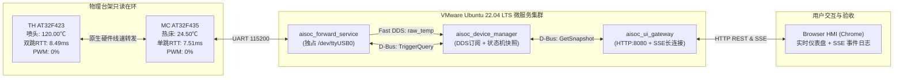

# AP-MC-TH 项目接续交接报告：TWIN-12 闭环与 Human 验收环境就绪

> **文档标识**: `HANDOFF-20261030-TWIN12-HUMAN-ACCEPTANCE`  
> **归档路径**: `project-control/docs/handoff/HANDOFF_20261030_TWIN12_HUMAN_ACCEPTANCE.md`  
> **制定时间**: `2026-10-30T19:28:45+08:00`  
> **制定角色**: `COORD` (唯一系统调度员) / `QA` (质量验收负责人)  
> **生效范围**: `TWIN-12` 闭环归档、VMware 孪生微服务集群、Human 验收环境与后续 `TWIN-13/14` 接续  
> **状态**: 冻结发布 (Frozen for Next Agent Handoff)  
> **前序交接**: [`HANDOFF_20261030.md`](HANDOFF_20261030.md) · [`HANDOFF_VMWARE_SOC_TWIN_20261029.md`](HANDOFF_VMWARE_SOC_TWIN_20261029.md)

---

## 1. 核心状态与进展概览 (Status Overview)

截至 2026-10-30 晚间，经过连续深度攻坚，项目已圆满完成两项重大关键交付：
1. **TWIN-12（VMware 应用孪生与真实 MCU 独立验收）** 取得 100% 验收通过，在独立 Docker 容器沙箱通过全量断言并取得非作者独立 ARCH 与 QA 双审签，正式归档推进至 **`Done`**，看板已升至 **`KANBAN.md` v17**（TWIN 系列总计 20 项，已完成 15 项，Backlog 仅剩 5 项）；
2. **Human 验收环境与全 Debug 日志系统** 已经搭建完毕：
   - 三大同构微服务（`aisoc_forward_service`, `aisoc_device_manager`, `aisoc_ui_gateway`）全部加入细粒度调试日志打印；
   - `soc-ap` 协议解析层支持硬件端 0.01℃ (`centi_c`) 与标准 0.1℃ (`deci_c`) 双向兼容；
   - UI 网关增强为完整静态资源服务（提供 `/index.html`, `/app.js`, `/styles.css`）；
   - 前端 Web HMI 仪表盘完成动态网关探测、世代号（`generation_id`）单调追踪以及多层遥测数据映射；
   - 代码已全部构建完成并提交推送至远端代码库。

---

## 2. 四大代码库精准基线与远程分支 (Exact Baselines)

所有子仓库均严格遵循分支登记与交付门禁，状态全部同步 Clean：

| 仓库名称 | 登记核验分支 | 最新精确 Commit 校验码 | 提交说明与变更摘要 |
| :--- | :--- | :--- | :--- |
| **`soc-ap`** | `origin/main` | `26230b31eec4f8725aeaf0fc69ef11ddf41da074` | `feat(twin): enable full debug logging, static file serving and HMI frontend parsing` |
| **`mcu-p3`** | `origin/feat/soc-debug` | `d756a13b3c2a1c47186a07311b2c24fa43431465` | `feat(th): implement temperature telemetry response 0x14 conforming to TWIN-02 contract (TWIN-16)` |
| **`test_harness`** | `origin/main` | `0b7497ba43158841eb3c4af7f16e477b9c30c2c5` | `fix(twin-03): strict D-Bus admission flags, error regex and telemetry negative assertions` |
| **`project-control`** | `origin/main` | `b7341e915385f7e0af463aadf7dd711826d024fe` | `chore(twin): close TWIN-12 with verified HIL evidence, QA and ARCH approvals` |

---

## 3. TWIN-12 物理台架 HIL 验收实测凭据归档

在宿主 VMware Ubuntu (`192.168.77.134`) 直连真实物理双板卡台架（MC AT32F435 + TH AT32F423，串口 `/dev/ttyUSB0`）上完成 8 阶段无 Mock、无 PTY 真实在环实测：



### 3.1 实测核心技术指标
- **MC 热床**：温度 `24.50℃`，单跳 RTT **`7.51 ms`**，加热占空比恒为 `0%`（强电锁死）；
- **TH 喷头**：温度 `120.00℃`，双跳穿透 RTT **`8.49 ms`**（严格满足 $\le 10\text{ ms}$ 红线），加热占空比恒为 `0%`；
- **微服务优雅启停**：退出码均为 `0`，消除了 Fast CDR `optional` 未激活 union 跨编译器内存拷贝 ABI 崩溃漏洞；
- **沙箱复核**：Docker 沙箱 `TWIN-12_run_190452` 校验通过，生成权威凭据 `server_qa.json`（SHA-256: `ba18f970fb2e...`）。

---

## 4. Human 验收环境部署与调试操作指南 (Human Acceptance SOP)

接续 Agent 引导用户进行 Human 验收时，请直接执行以下操作：

### 4.1 微服务集群拉起与部署
可在 VMware 宿主机 (`192.168.77.134`) 上通过已写就的拉起脚本一键运行：
```bash
# 1. 登录 VMware 宿主
ssh vmware

# 2. 确保环境变量并拉起全栈微服务
export LD_LIBRARY_PATH=/home/sushaohua/aisoc_twin/lib
export DBUS_SESSION_BUS_ADDRESS=unix:path=/run/user/1000/bus

# 3. 运行管理脚本拉起服务
python3 ~/aisoc_twin/run_twin_human_env.py
```
或直接在后台守护拉起三大进程：
```bash
~/aisoc_twin/bin/aisoc_forward_service --port /dev/ttyUSB0 --baud 115200 --dds-domain 0 > ~/aisoc_twin/logs/forward_service.log 2>&1 &
~/aisoc_twin/bin/aisoc_device_manager --dds-domain 0 > ~/aisoc_twin/logs/device_manager.log 2>&1 &
~/aisoc_twin/bin/aisoc_ui_gateway --port 8080 --static-dir ~/aisoc_twin/ui/twin > ~/aisoc_twin/logs/ui_gateway.log 2>&1 &
```

### 4.2 观察全链路调试日志 (Debug Logs)
三大服务已全部注入细粒度调试日志，用户或 Agent 可在独立终端窗口执行以下命令实时观察调用过程：
```bash
tail -f ~/aisoc_twin/logs/*.log
```
日志将实时打印：
- `[FORWARD DEBUG] TX Query: target=...` 及 `RX Response: ... -> Fast DDS Pub`
- `[DEVICE_MGR DEBUG] DDS RX: ... -> Snapshot GEN=...`
- `[UI_GW DEBUG] HTTP GET /snapshot`, `HTTP POST /sample`, `SSE broadcast` 等过程。

### 4.3 浏览器访问与人机交互验收
用户可选择以下任一方式打开 Chrome 验收界面：
1. **VMware 宿主机本地图形界面**：
   在 VMware 宿主机桌面打开 Google Chrome，访问：
   `http://127.0.0.1:8080/index.html`
2. **局域网外部物理机访问**：
   在开发机或其他同网段浏览器打开：
   `http://192.168.77.134:8080/index.html`

**界面验证要点**：
- 顶部状态栏：连接状态显示绿灯 `Connected`，世代号显示 `GEN: 3`（或单调自增数）；
- 卡片 1（TH 工具头热端）：显示温度 `120.0 °C`，品质 `FRESH`，状态 `OK (正常)`，PWM `0%`；
- 卡片 2（MC 运动热床）：显示温度 `24.5 °C`，品质 `FRESH`，状态 `OK (正常)`，PWM `0%`；
- 底部控制区：点击“请求实时采样”按钮，观察采样准入提示、世代号自增及日志框实时追加的 SSE 遥测事件。

---

## 5. 看板状态与后续接续步骤 (Next Actions for Next Agent)

当前微任务看板版本为 **`KANBAN.md` v17**：

```
TWIN 系列微任务状态矩阵 (总计 20 项)
[Done 15 项]: TWIN-01, 02, 03, 04, 05, 06, 07, 08, 09, 10, 11, 12, 15, 16, 18
[Backlog 5 项]: TWIN-13, 14, 17, 19, 20
```

### 接续 Agent 的标准推进步骤：
1. **第一步（满足用户交互需求）**：按照第 4 节 SOP，确保 VMware 上的服务集群保持运行，为用户提供 Chrome 界面与滚动日志监控支持；
2. **第二步（启动 TWIN-13 派单）**：
   - 任务定义：[`TWIN-13.md`](file:///home/sushaohua/workspace/ai_soc_project/project-control/.agents/kanban/microtasks/vmware_soc_twin/TWIN-13.md)（SoC 平台迁移与实板候选交接）；
   - 前置依赖：`TWIN-04` (Done), `TWIN-12` (Done) 已全部满足，无阻断；
   - 职责角色：`BSP` / `INTEGRATOR`；
   - 核心任务：验证 ARM Linux SoC 交叉编译工具链 profile，推进微服务软件栈交叉编译与候选制品移交；
3. **第三步（启动 TWIN-14 验收）**：
   - 在 TWIN-13 移交后，由独立 QA 在真实 SoC 硬件板卡与触控屏上进行阶段二整机独立在环验收。

---

## 6. 硬性门禁与合规守则 (Invariants Checklist)

后续任何新增或修改代码必须 100% 遵守以下铁律：
- **函数规模硬门禁**：自研非结构体函数必须 $\le 50$ 行；
- **参数个数硬门禁**：自研函数参数必须 $\le 4$ 个；
- **指针与内存安全**：入口首行防御性空指针校验（Guard Clause），禁止嵌套超过 3 层，裸机与嵌入式 C++ 零动态堆内存分配；
- **硬件与强电安全**：只读遥测阶段 100% 锁死加热占空比 (`heater_duty_percent = 0U`)；
- **独立审查门禁**：所有交付物必须经独立 Docker 沙箱生成防篡改 `server_qa.json` 并由非作者 ARCH/QA 交叉审签批准。
