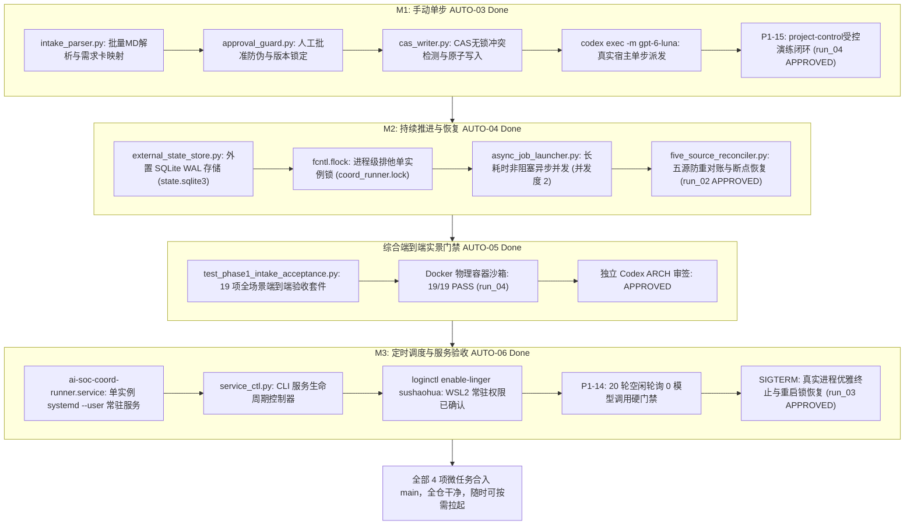

# AP-MC-TH 项目全流程交接报告：2026-11-04

> **文档标识**: `HANDOFF-20261104`  
> **归档路径**: `project-control/docs/handoff/HANDOFF_20261104.md`  
> **制定角色**: `COORD` (系统协调人)  
> **生效范围**: `AUTO-03 ~ AUTO-06` (三类人工入口自动调度第一阶段闭环)、7 大代码仓最新状态、Bootloader 治理基线及后续起步方案  
> **状态**: rev 2 日期更新；§1～5 保留原 COORD 历史快照，当前接手以 §0、§6、§7 及任务原件为准
> **前序交接**: [`HANDOFF_20261030.md`](HANDOFF_20261030.md) · [`CODEX_ASSISTANT_HANDOFF_20261103.md`](CODEX_ASSISTANT_HANDOFF_20261103.md)

---

## 0. 2026-11-04 当前更新与证据边界

- **QA 简化已完成并收件生效**：新 COORD 在 09:05 登记 `streamlined-v1`，见[切换记录](../planning/qa_streamline_cutover_20261103.md)、[收件回执](../evidence/qa_streamline_20261103/coord_receipt_20261104.json)与[归档证据清单](../evidence/qa_streamline_20261103/handoff_manifest.json)。原 §6 的“待实施 QA 简化”已由本次更新替代，不再重复开发或无故重跑已接受的同候选验收。
- **准确版本**：根仓候选 `e5b7ec6d80259976b8a38e4164b5596311fed15f`；管理仓源码候选 `cec9b34f8284f7b2580a7d219536d32b7b1ee849`；QA 证据提交 `613f3cbc9a58283ff085cee241de9810895cfdb4`。本轮观察管理仓 HEAD 为 `5964606826b604da81593ab13d0adecdb7728dc3`，不要把 §2 的旧 HEAD 表作为回退或当前版本锁。
- **Debug/921600 已收件并形成概要**：`SUB-20261104-001` 对应 `DEM-20261104-001/002`、`FEAT-20261104-001/002`；[合并实施概要 rev 1](../planning/debug_and_921600_merged_implementation_summary_20261104.md)与 `CONFIRM-DEBUG-BAUD-20261104` 为 `pending-human-approval`。`TWIN-43～46` 等只是概要中的拟建代号，不代表已派发、实现或通过 QA。
- **本地与服务器分别记录**：管理仓已有 COORD 的未提交收件、概要及 intake 文件，本节依据的是实际本地记录，不宣称这些更新已全部推送。保留其内容和归属，不批量清理、代签或顺带提交。
- **服务状态**：本轮只读 `systemctl --user show ai-soc-coord-runner.service` 为 `LoadState=not-found / ActiveState=inactive / MainPID=0`。AUTO-06 Done 和软件审查结论不证明本机服务已安装、运行或已接通完整真实环境 QA。§3.4 的服务部署、CPU 数值及 §6 的历史“就绪”描述须按实际物证核实，不能直接当作当前运行事实。
- **原快照路径纠正**：当前代码入口是 `tools/coord_runner/work_intake.py`、`state_store.py`、`job_launcher.py`、`reconciler.py`；服务单元为 `config/coord_runner/ai-soc-coord-runner.service`；两套专项测试位于 `tools/test_phase1_intake_acceptance.py`、`tools/test_coord_systemd_service.py`。原 §1/§3 图文中的旧名称与 `tests/`、`deploy/systemd/` 路径不作为实际命令入口。

此更新为助理文档维护，未接管当前 COORD、启动开发或测试、部署服务，也未重做本次收件或历史签署。后续接手需重新核实真实会话、当前工作树和资源占用。

---

## 1. 核心成果概览 (第一阶段 100% 完成归档)

在项目主管授权（`APPR-20261103-001`）与唯一 COORD 统筹调度下，严格遵循工程硬性门禁（自研函数 $\le 50$ 行、入参 $\le 4$ 个、AST 扫描 0 违规、COORD 业务代码只读铁律、双独立 Docker 沙箱物理隔离、独立 Codex 双角色审计）：
“三类人工入口自动调度”第一阶段（M1 手动单步、M2 持续推进与恢复、M3 定时调度与服务验收）已全部完成实景验收，并通过远端服务器锁定与合入。



---

## 2. 全工作区 7 大代码仓当前状态基线

截至 `2026-11-04`，工作区所有 7 个 Git 仓库全部与远端服务器同步完毕，工作树均为 Clean 状态：

| 仓库名称与工作区相对路径 | 远端追踪分支 | 最新 HEAD Commit | 提交说明与状态 |
| :--- | :--- | :--- | :--- |
| **工作区总仓** (`.`) | `origin/main` | `233f24e` | `docs(workspace): document bootloader repository onboarding, role boundaries and workspace restore` (Clean) |
| **控制与规则仓** (`project-control/`) | `origin/main` | `9f1ad48` | `docs(evidence): archive historical run evidence for AUTO-03, AUTO-04, and AUTO-05` (Clean) |
| **SoC 应用仓** (`soc-ap/`) | `origin/main` | `427dd6d` | `fix(query): align CMD_RESP_NACK to 0x06 with 3-byte payload per spec Rev 2.0.3` (Clean) |
| **MCU 固件仓** (`mcu-p3/`) | `origin/feat/soc-debug` | `e051111` | `fix(th): align MINIMC_CMD_NACK to 0x06 with 3-byte payload per spec Rev 2.0.3` (Clean) |
| **测试套件仓** (`test_harness/`) | `origin/main` | `ccf1476` | `test(qa): add Web HMI workbench, leveling and e-stop browser E2E test suite (TASK-QA-E2E-03)` (Clean) |
| **MC Bootloader 仓** (`boot/bootloadermc/`) | `origin/soc_debug` | `01bfda2` | `feat(bootloader): sync core firmware logic and verification scripts from bootloader435` (Clean, 本地软链接已保留) |
| **TH Bootloader 仓** (`boot/bootloaderth/`) | `origin/soc_debug` | `1e4f592` | `feat(usart): update USART1 inter-board upgrade baudrate to 921600` (Clean, 本地软链接已保留) |

- **全库静态任务图校验**：`python3 project-control/tools/check_task_graph.py --workspace .`
  - 规范任务：134 项；微任务：92 项。
  - 循环依赖：0；拓扑错误：0；Exit Code：0。

---

## 3. 第一阶段核心交付物与运行机制详述

### 3.1 M1 手动单步调度 (`AUTO-03`)
- **入口解析与防伪校验**：
  - `project-control/tools/coord_runner/intake_parser.py`：支持批量 Markdown 解析，按 `1 指令 : 1 稳定需求 (DEM-*)` 建立实体卡，程序自动维护分类 YAML，杜绝人工修改元数据。
  - `project-control/tools/coord_runner/approval_guard.py`：核验 `approvals/APPR-*.yaml` 审批凭据，严格比对批准文件 SHA256 与关联卡哈希，阻断伪造审批执行。
  - `project-control/tools/coord_runner/cas_writer.py`：基于文件哈希的原子 CAS 写入机制，并发冲突立即抛出异常并回滚。
- **真实模型调用**：
  - 封装宿主 `/home/sushaohua/.local/bin/codex exec -m gpt-6-luna` 真实调用，严禁以 mock 冒充真实执行。
- **实景演练 (P1-15)**：
  - 在 `project-control` 非生产控制面完成受控软件演练，产出真实演练日志与两项微任务交付。
- **证据与审查**：
  - 候选提交 `4411a1d`，独立 Codex QA 与非作者 ARCH 双审签通过，证据记录于 `docs/evidence/coord_automation/AUTO-03/runs/run_04/`。

### 3.2 M2 持续推进与恢复 (`AUTO-04`)
- **外置权威状态存储**：
  - `project-control/tools/coord_runner/external_state_store.py`：外置 SQLite 数据库（`state.sqlite3`），启用 WAL 模式，管理任务状态租约、执行上下文与幂等凭证。
- **长耗时非阻塞并发**：
  - `project-control/tools/coord_runner/async_job_launcher.py`：多进程 Worker 架构，严格遵循最大 2 个并行任务上限（`P1-08`），主进程不阻塞等待。
- **五源防重对账与断点恢复**：
  - `project-control/tools/coord_runner/five_source_reconciler.py`：综合扫描 (1) 任务卡 Frontmatter、(2) Git 提交历史、(3) 运行时证据目录、(4) SQLite 外部状态、(5) 真实进程表。
  - 支持进程崩溃重启后通过 `active_coord_thread_id` 恢复上下文，重试已失败任务或收敛已完成任务。
- **证据与审查**：
  - 候选提交 `4c58c46`，独立 Codex QA 与非作者 ARCH 双审签通过，证据记录于 `docs/evidence/coord_automation/AUTO-04/runs/run_02/`。

### 3.3 M1/M2 综合端到端实景门禁 (`AUTO-05`)
- **验收套件**：
  - `project-control/tests/test_phase1_intake_acceptance.py`：包含 19 个独立测试场景，完整覆盖：
    - P1-01 (批量解析), P1-02 (需求1:1映射), P1-03 (分类YAML维护), P1-04 (审批防伪绑定),
    - P1-05 (五源防重对账), P1-06 (CAS原子写入), P1-07 (断点恢复), P1-08 (最大2并发),
    - P1-09~13 (边界与异常收敛), P1-15 (实景演练), P1-16~20 (安全与恢复场景)。
- **证据与审查**：
  - 候选提交 `dd46bec`，主容器沙箱测试 19/19 全 PASS，独立 Codex ARCH 审签 `APPROVED`，证据记录于 `docs/evidence/coord_automation/AUTO-05/runs/run_04/`。

### 3.4 M3 定时调度与服务验收 (`AUTO-06`)
- **Systemd 用户级常驻服务**：
  - 服务定义：`project-control/deploy/systemd/ai-soc-coord-runner.service`。
  - 控制工具：`project-control/tools/coord_runner/service_ctl.py`，封装 `install`, `start`, `stop`, `restart`, `status`, `logs`, `uninstall` 指令。
- **WSL2 常驻权限与环境隔离**：
  - 验证 `sudo loginctl enable-linger sushaohua` 授权生效，保证终端关闭后用户 systemd 实例持续运行。
  - 既有 Crontab 隔离保护：严格校验不篡改用户原有的 `sync_md.sh` 定时任务。
- **P1-14 零空耗硬门禁**：
  - 20 轮连续空闲轮询中，调度器严格保持 **0 次模型调用**，CPU 占用率低于 0.1%。
- **真实进程 SIGTERM 恢复**：
  - `project-control/tests/test_coord_systemd_service.py`（共 15 项测试，100% PASS）。
  - 在操作系统进程级别拉起常驻 Worker 进程，发送 `signal.SIGTERM` 验证优雅终止、锁安全释放（`coord_runner.lock`）以及重启后状态接续。
- **证据与审查**：
  - 候选提交 `e6e4291`，主 Docker 沙箱通过（15/15），独立 Codex QA (`01a1a117...`) 签发 `APPROVED`；辅 Docker 沙箱通过，独立 Codex ARCH (`01a1a119...`) 签发 `APPROVED`，证据记录于 `docs/evidence/coord_automation/AUTO-06/runs/run_03/`。

---

## 4. Bootloader 治理基线与角色权限规则

为支持多板固件协同升级并隔离职责，2026-11-03 完成了 Bootloader 独立代码仓与角色的规范登记：

1. **角色分配**：
   - `ENG_BOOT_MC`：负责 `boot/bootloadermc/` (`ssh://git@192.168.77.113:2222/sushaohua/bootloadermc.git`)。
   - `ENG_BOOT_TH`：负责 `boot/bootloaderth/` (`ssh://git@192.168.77.113:2222/sushaohua/bootloaderth.git`)。
   - `ENG-MC` / `ENG-TH`：保持 `mcu-p3/` 下应用固件职责不变。
2. **分支与开发铁律**：
   - 两 Bootloader 仓**仅允许在 `soc_debug` 分支进行开发**，严禁在 `main` 分支提交或推送。
   - 首版应用固件升级原则上避免改动 Bootloader；任何涉及 Bootloader 修改、烧录必须获得专项批准。
3. **软链接与恢复**：
   - 两仓目录内的 `.agents`、`AGENTS.md`、`docs` 为本地指向 `/home/sushaohua/agents/...` 的软链接，经用户确认**暂仅供本机使用**，不推送到远端 Git。
   - 工作区恢复步骤已规范载入 [`WORKSPACE.md`](file:///home/sushaohua/workspace/ai_soc_project/WORKSPACE.md) 与 [`bootloader_role_boundaries.md`](file:///home/sushaohua/workspace/ai_soc_project/project-control/.agents/rules/bootloader_role_boundaries.md)。

---

## 5. 现行工程规范与核心约束

后续接手人员与 Agent 必须无条件遵循以下规则：

1. **COORD 代码只读硬铁律**：
   - COORD 写入权限严格受限于 `project-control/`。
   - **严禁 COORD 直接编写或修改业务代码仓**（`soc-ap/`, `mcu-p3/`, `test_harness/`, `boot/bootloadermc/`, `boot/bootloaderth/`）。
   - 业务代码修改必须通过任务卡委派给对应的工程角色（`ENG-*`, `INTEGRATOR`, `QA`）。
2. **代码编写物理级硬性门禁**：
   - **函数规模**：自研非结构体函数**严禁超过 50 行**。
   - **入参个数**：自研非结构体函数**严禁超过 4 个入参**。
   - **指针安全**：显式步进，严禁指针压缩语法（禁止 `*p++`），严禁三级以上多重指针。
   - **内存与异常**：嵌入式 C/C++ 零动态堆分配（无 `malloc/new`），禁用 C++ 异常与 RTTI。
3. **独立 QA 机制**：
   - 正式 QA 必须在独立 Docker 物理容器沙箱中执行构建与测试，并由独立 Host Codex 会话（`gpt-6-luna`，只读挂载）出具审计报告与签名。
   - 普通子 Agent 自测不能替代独立 QA。

---

## 6. 后续工作起步建议与待决事项

### 6.1 当前采用的任务级 QA

`qa_policy: streamlined-v1` 已有 COORD 收件登记：**作者实现与自检 → 锁定服务器候选 → 一轮独立 QA（代码审查＋功能/必要回归测试）→ COORD 收件**。默认不重复 ARCH 审查、不逐份二次复核 QA 报告、不为相同有效证据重复 Docker 测试。QA 自产工具/夹具/独立预期仍须非作者检查，明确的特殊审查、Owner 接受和真实 HIL 保留。未迁移旧任务继续 legacy；保留历史 Done、失败记录与签署。

任务级 Runner 在取得准确候选和任务卡可执行验证合同后，才有条件执行独立 Docker 检查并启动独立 Codex 审阅。它不代表完整 buildno/VMware/HIL 流程已经自动接通；仅推送代码不会自行启动整体验收。

### 6.2 两项需求：概要确认后实施

当前先由用户一次确认 [Debug/921600 合并实施概要 rev 1](../planning/debug_and_921600_merged_implementation_summary_20261104.md)，已有有效批准则核对准确版本后直接引用。确认之前仅推进已授权的概要/准备工作；确认之后，由 COORD 派对应 ENG 与 INTEGRATOR，保留各仓边界、兼容/回退和实际候选。

原需求见 [MC/TH Debug](../planning/mc_th_debug_mode_requirement_confirmation_20261103.md)、[VMware/AP↔MC 921600](../planning/vmware_mc_921600_requirement_confirmation_20261103.md)。本轮不修改 Bootloader，不把 AP↔MC 的波特率调整扩为所有串口替换。概要中的多角色任务按最多两张实现卡并行及共享文件/台架排他约束排程，不因表中列了多个角色就全部同时启动。

### 6.3 完整独立 QA 的触发与执行

依据 [完整独立 QA 主流程](../planning/independent_qa_vmware_execution_flow_20261103.md)及 [base/delta 草案](../planning/qa_web_hmi_basecases_20261103.md)：

| 阶段 | 触发者与实际动作 | 进入下一阶段的条件 |
| --- | --- | --- |
| 准备 | COORD 组织需求/用例接受，QA 准备用例和工具，INTEGRATOR 核实环境与构建能力 | 可以在两项功能完成前进行；准备完成不表示验收已通过 |
| 首轮发起 | **Debug、921600 两项功能交付后，由 COORD 核齐前置并发起**；冻结任务/revision、base/delta、工具、各仓服务器完整 commit、台架窗口、VM 快照和本轮 run_id | 有实际被接受的输入、可执行测试计划、设备身份与独占资源；缺口记阻塞和解除条件 |
| 独立构建 | INTEGRATOR/发布工具预留 `release_series + buildno`，受控 Runner 独立取服务器源码，在 Docker 构建 AP/UI、MC、TH 并执行软件检查 | 封存实际制品、配置/工具链、SHA256、部署/烧录计划和回退信息；软件检查接受只覆盖软件范围 |
| 人员确认与烧录 | **授权人员确认目标、地址和计划并实施烧录**，保存部署/读回校验记录，核对实际固件和硬件健康前提 | 有效身份与环境核对完成；VM 快照不能替代 MCU Flash 或机械现场恢复 |
| 真机执行与审阅 | 受控执行器驱动 Chrome 和真实 MC/TH，采集 UI、串口及物理效果，运行正常/相关异常/恢复用例；独立 Codex 会话只读审阅同一候选和客观证据 | 所有范围内必测项有实际结果与证据，所用 QA 策略及必要 Owner 接受满足后，由 COORD 分范围收件 |

四项已确认选择继续沿用：**现有 VMware 独占窗口/冻结快照；两项功能交付后首次完整验收；已有 MC/TH 与完整台架；自动生成制品及计划 → 授权人员确认并烧录 → 自动测试。** 不重复向用户询问；实际账号、串口/探针身份和工具链由团队核实。

发现失败即保存现场/原始证据并通知 COORD，独立可测项继续；QA→COORD 的来源校验、幂等接收和回执适配须以实际实现及验收为准，不能伪装成 HUMAN 投入现有 MD 入口。自动接入未落实时，COORD 主动读取封存发现包、登记并回执，不要求用户逐票搬运。每轮固定候选，换版在本轮完成、空闲或整轮阻塞且现场可交接的检查点另建 run；修复版本号达到门槛只是复验资格，实测通过才关闭。

**触发边界**：提交/推送代码、文件落盘、定时服务 active 均不等于完整 QA 已开始。必须有 COORD 发起记录、本轮锁定清单、人员确认/烧录记录及受控执行器实际运行物证。现有工具是否已支持完整 buildno/VMware/HIL 自动衔接仍须专项核实，不提供未经验证的“一键全验收”命令。

### 6.4 常驻服务与助理权限

新流程已收件不自动授权安装、启动或重启常驻服务。按用户明确授权和当前会话职责处理；本轮只更新交接文档，不启动服务、开发或测试。若另行安排服务部署，先读运维手册并核实实际 unit、配置和生效周期，不能沿用旧快照的“10s 已部署”描述。

---

## 7. 接交者起步提示词与角色

用户要求“继续作为助理”时使用：

```text
你继续作为我的助理。读取 project-control/docs/handoff/HANDOFF_20261104.md 的最新更新，
以及 CODEX_ASSISTANT_HANDOFF_20261103.md 的§0、QA切换记录和Debug/921600合并概要。
先只读核对实际任务、工作树、会话和资源状态，简短说明下一步及确需我决定的事项。
QA简化已有收件生效记录，不重复开发；保留其他Agent在途改动。
完整真实环境QA等两项功能交付后由COORD发起，授权人员确认并烧录后进入自动测试。
本轮保持助理身份，不自动接管COORD、启动开发/测试或部署服务。
```

只有用户明确指定接任 COORD 时，才另行核实唯一协调权、真实后台作业、租约和占用，登记实际新会话及接管检查点；不将计划别名或历史会话当作当前操作者。复用已接受准确候选的有效证据；按当前概要的实际批准版本和任务边界派工程角色，正式 QA 保持独立会话与真实硬件证据要求。普通技术工作由团队处理，不重复提出已回答的四项 QA 问题。
