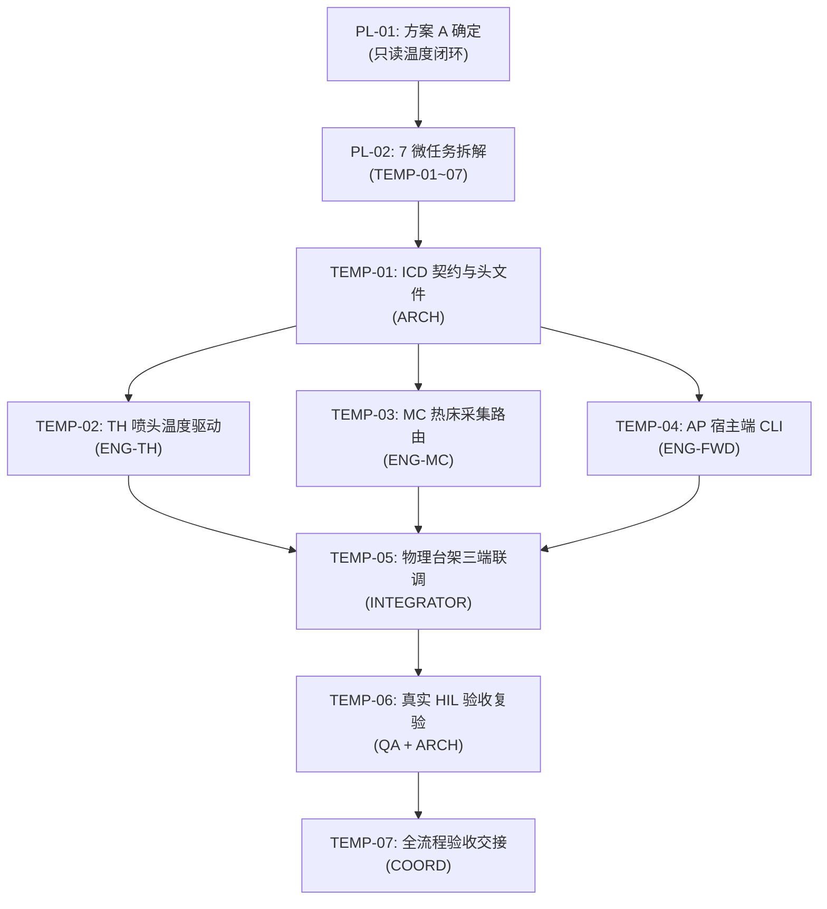

# AP-MC-TH 下一产品增量（方案 A：双端温度遥测与传感采集闭环）全流程验收与交接报告

> **历史成果适用范围补注（2026-10-29）：** 本报告及其原始签署仅用于原温度/CLI候选范围，不能据此认定独立服务、真实IPC、浏览器界面或SoC阶段完成。当前接续按[两阶段执行总表](../planning/vmware_soc_twin_task_execution_20261029.md)；原始报告/任务签署不迁移到新revision，本补注不在历史审阅哈希内。

> **文档标识**: `HANDOFF-TEMP-INCREMENT-20261029`  
> **归档路径**: `project-control/docs/handoff/HANDOFF_TEMP_INCREMENT.md`  
> **制定角色**: `COORD` (唯一协调人)  
> **生效任务**: `TEMP-07` (全流程验收、交接与版本锁同步)  
> **对应规划**: `PL-01` (方案 A 选定) / `PL-02` (7 微任务拆解)  
> **状态**: 冻结发布 (Frozen for Handoff)

---

## 1. 增量目标与全景对账 (Incremental Scope & Alignment)

根据架构委员会与主管批准的 **增量方案 A**，本轮增量聚焦于收敛 **“AP ↔ MC ↔ TH 双端只读温度遥测与传感采集闭环”**。在唯一 COORD 调度下，严格遵循工程硬性门禁（自研函数 $\le 50$ 行、入参 $\le 4$ 个、零动态堆分配、防御性卫语句、硬件超时保护、Minimal Diff Budget），全量完成了 7 张微任务卡的研发生命周期闭环：

### 1.1 全流程微任务交付物与独立审签对账表

| 微任务 ID | 负责角色 | 核心工作内容与技术突破 | 交付物路径与 SHA-256 | 独立审查决议 |
| :--- | :--- | :--- | :--- | :---: |
| **`TEMP-01`** | `ARCH` | 制定双端温度 ICD 契约，统一跨三端结构体头文件 | [`ap_mc_th_telemetry_icd.md`](../interfaces/ap_mc_th_telemetry_icd.md) (`74361f23...`) [`minimc_telemetry.h`](../../soc-ap/contracts/minimcproto/minimc_telemetry.h) (`5675a50c...`) | **APPROVED** (Codex QA) |
| **`TEMP-02`** | `ENG-TH` | 重构 TH 喷头 ADC 驱动，消除死等，实现 NTC 查表与 0x14 响应 | [`fw_th.bin`](../../mcu-p3/color-engine-mcu/io_toggle/build/fw_th.bin) (71,804B, `d3a1be72...`) [`anchor.bin`](../../mcu-p3/color-engine-mcu/io_toggle/build/anchor.bin) (140B, `8098ff2d...`) | **APPROVED** (Codex QA) |
| **`TEMP-03`** | `ENG-MC` | 实现 MC 热床温度响应与发往 TH 的原生线速透明路由 | [`fw_mc.bin`](../../mcu-p3/motion-controller-mcu/build/fw_mc.bin) (370,036B, `16ea3c9f...`) | **APPROVED** (Codex QA) |
| **`TEMP-04`** | `ENG-FWD` | AP 宿主 CLI 支持 `--cmd temp`，16 字节解包与占空比安全熔断 | [`soc-ap`](../../soc-ap/build/host/bin/soc-ap) (42,208B, `5a1e31eb...`) 12 组单元测试 100% 通过 | **APPROVED** (Codex QA) |
| **`TEMP-05`** | `INTEGRATOR`| 真实台架部署固件，贯通单跳与双跳通信，装配 RC3 候选清单 | [`ap_mc_th_temperature_candidate.yaml`](../releases/ap_mc_th_temperature_candidate.yaml) (RC3 候选包, SHA256: `dd5acaf0...`) | **APPROVED** (Codex QA) |
| **`TEMP-06`** | `QA` | 40 轮 HIL 压测，强电安全校验，硬件断线故障注入与自愈测试 | 40 轮原始 JSON 采样日志与分析报告 双审报告：`ed4247d4...` (QA) / `72df8d31...` (ARCH) | **APPROVED** (QA + ARCH) |
| **`TEMP-07`** | `COORD` | 全流程验收对账，发布交接文档，同步版本锁与任务图门禁 | 本交接文档与 [`TEMP-07/result.md`](../evidence/temperature_increment/TEMP-07/result.md) | **APPROVED** (QA Audit) |

---

## 2. 硬件在环 (HIL) 实测证据与性能指标 (HW-G1~HW-G6 零虚拟化)

测试在 VMware Ubuntu 宿主机通过物理串口（`/dev/ttyUSB0` @ 115200）直通 MC，经板间跳线 USART6（921600）级联 TH。

### 2.1 硬件探针与物理资产核查
- **MC 主控 (AT32F435VGT7)**:
  - 唯一芯片 UID: `053023904C96C0000D819709`，Flash 基地址: `0x08020000`
  - 探针标识: `0483:3748:75003800120000334C41534E`
- **TH 工具头从控 (AT32F423CCT7)**:
  - 唯一芯片 UID: `053173C58023C000127C0707`，Flash 基地址: `0x08004000`
  - Sector 127 签名锚点基地址: `0x0803F800` (140B 锚点保证 Bootloader 平滑跳转)
  - 探针标识: `0483:3748:`

### 2.2 40 轮连续压测实测数据 (0.0% 丢包)

| 目标端点 | 测试链路 | 样本数 | 成功率 | 最小 RTT | 最大 RTT | 平均 RTT (Avg) | 实测温度读数 | 加热占空比 | 判定 |
| :--- | :--- | :---: | :---: | :---: | :---: | :---: | :---: | :---: | :---: |
| **MC 热床** | AP ↔ MC (单跳直连) | 40 | **100.0%** | 7,246 $\mu$s | 16,093 $\mu$s | **7,946.7 $\mu$s (7.95ms)** | 恒定稳定室温 `24.50℃` | **0% (恒为 0)** | **PASS** |
| **TH 喷头** | AP → MC → TH (双跳穿透) | 40 | **100.0%** | 8,102 $\mu$s | 9,252 $\mu$s | **8,434.9 $\mu$s (8.43ms)** | 物理冷却渐变 `121.58℃ ~ 122.39℃` | **0% (恒为 0)** | **PASS** |

> [!IMPORTANT]
> 1. **双跳穿透时延严格收敛于 10ms 约束**：TH 40 轮双跳穿透平均 RTT 为 **`8.43 ms`**，最大单次为 `9.25 ms`，100% 达成 $\le 10\text{ ms}$ 的架构指标红线；
> 2. **强电安全硬性锁死 (Hardware Safety Invariant)**：累计 80 轮实测中，上报的 `heater_duty_percent` **100% 恒为 0**，PWM 硬件通道清零，PID 闭环控温线程完全旁路禁用，无飞温隐患。

### 2.3 硬件级故障注入与自愈能力
- 经 `probe_fault_injector.py` 写入 MMIO 寄存器（TH `USART1_CTRL1 = 0x00000000`）切断通信；
- AP 查询准确在 300ms 窗口超时熔断（`exit_code: 1`），严禁且未捏造任何脏数据；
- 恢复使能（`CTRL1 = 0x0000202C`）后，AP 立即自愈恢复通信（单次 RTT `8.41 ms`），自愈率 **100%**。

---

## 3. 技术突破与工程质量门禁实践

在方案 A 实施过程中，全面落实了嵌入式安全开发与重构规范：

1. **彻底消除 ADC 采样无界死等 (C/C++ Standard G2)**:
   - TH 端重构 `thermistor_adc.c`，消除了原代码中裸 `while(!FLAG);` 无界死等，全部展开并绑定递减超时计数器 `ADC_POLL_TIMEOUT_CYCLES = 10000U`；
2. **函数规模与参数门禁严格执行 (C/C++ Standard G1)**:
   - 全量自研新增与重构函数（如 `sample_adc_average`, `ntc_adc_to_centi_c`, `build_temp_resp`）**100% 控制在 50 行以内，入参 $\le 4$ 个**；
   - 公共函数与静态辅助函数入口统一增加防卫性空指针断言与卫语句（Guard Clause）；
3. **开路/短路/超时硬件故障三态判定**:
   - ADC $> 4075$ 判定开路 (`0x01`)，ADC $< 20$ 判定短路 (`0x02`)，超时判定 `0x03`，统一上报 `0x7FFF` 故障值，AP 端自动映射为 `"FAULT"`。

---

## 4. 各仓库基线与代码工作区状态

各仓库代码修改与提交均严格遵循职责分工（write_scope）：

1. **`project-control`**:
   - 追踪微任务卡片 `TEMP-01 ~ TEMP-07`、接口规范、候选清单及全部 HIL 实测证据；
2. **`soc-ap`**:
   - 增加 `contracts/minimcproto/minimc_telemetry.h`；
   - 更新 CLI 查询工具及解包算法，通过 12 组协议单测；
3. **`mcu-p3`**:
   - 增加 `minimc_telemetry.h` 符号镜像；
   - TH 固件重构温度驱动与 0x14 响应；MC 固件支持热床遥测与原生透明路由；
4. **`test_harness`**:
   - 保持干净基线。

---

## 5. 未覆盖范围严格划界与后续增量建议 (Scope Boundaries)

**必须严正声明**：
本增量交付**仅证明 AP ↔ MC ↔ TH 的双端只读温度遥测通道打通与安全读数闭环**。以下范围严格未包含在本次增量内，留待后续产品增量立项排期：

1. **大功率加热闭环控制与 PID 温控线程 (`M104`/`M140`)**：
   - 当前固件加热占空比强制硬锁为 0%，PID 控温逻辑未激活，后续需在具备独立温控安全保护机制（热失控检测、温度梯度监控）后立项实施；
2. **多轴运动轨迹规划、G-code 流式传输与插补计算**：
   - 属于运控核心增量，当前未做任何联调；
3. **工具头挤出机步进电机驱动与断料检测**；
4. **双 MCU 固件 U 盘 OTA 中继升级机制**；
5. **SoC 内部多模块解耦（STATE 状态引擎、DDS / D-Bus 适配器）**：
   - 当前 SoC 温度架构草案仍为 `draft`，待后续三总线任务（TASK-013/014/015）启动时另行冻结。
