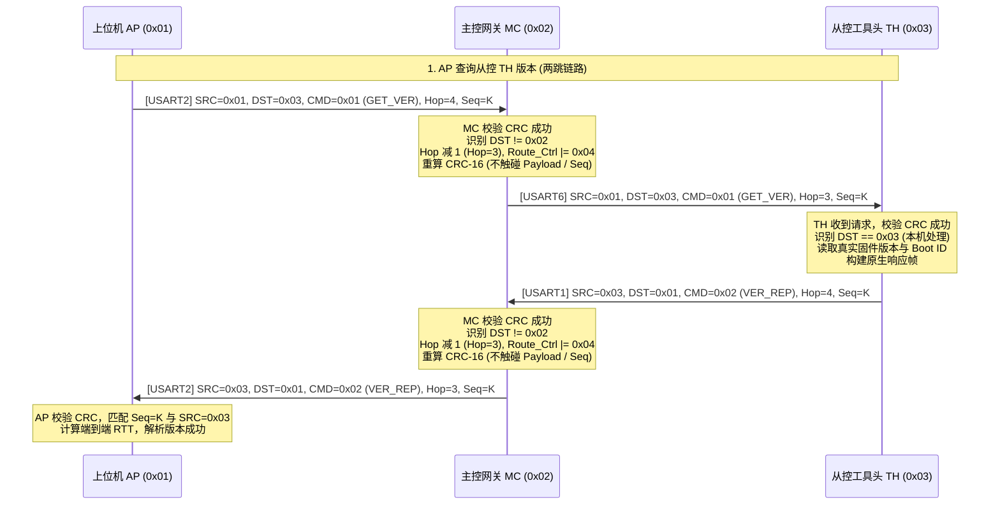

# AP-MC-TH 最小只读级联接口控制文档 (Read-only Cascade ICD)

| 字段 | 属性 / 内容 |
| :--- | :--- |
| **文档 ID** | `ICD-CASCADE-READONLY-20261027` |
| **版本** | `1.0.0` |
| **所属工作包** | `TASK-005`（冻结第一版控制和 AP-MCU 契约） / 治理票 `CR-02` |
| **主导角色** | ARCH |
| **适用范围** | 上位主机 AP (`0x01`)、运动主控 MC (`0x02`)、工具头从控 TH (`0x03`) |
| **权威协议基线** | `SPEC-PROTO-20261015-153000` Rev 2.0.3 (SHA256: `9f8d4f9607cb3e76cc30b9ee2f971b23c3e0d936611188466a71f4aa15f3ce54`) |
| **执行门禁** | `HW-G5`（零虚拟化物理闭环）、`HW-G6`（端到端原生协议一致性） |
| **状态** | **FROZEN (已冻结基线)** |

---

## 1. 物理拓扑与节点定义

系统由上位 Linux 宿主机（AP）、核心运动控制器（MC）以及工具头一体从控机（TH）组成级联拓扑：

```mermaid
flowchart LR
    AP["上位主机 (AP)<br/>Node ID: 0x01<br/>(Amlogic SoC / Linux)"] 
    <--> |"物理串口 USART2<br/>115200 8N1"| 
    MC["运动主控网关 (MC)<br/>Node ID: 0x02<br/>(AT32F435VGT7)"]
    <--> |"级联总线 USART6 <-> USART1<br/>921600 8N1"| 
    TH["工具头从控 (TH)<br/>Node ID: 0x03<br/>(AT32F423CCT7)"]
```

### 1.1 节点逻辑地址表

| 逻辑地址 | 节点标识常量 | 硬件载体 | 核心角色与职责 |
| :--- | :--- | :--- | :--- |
| `0x01` | `MINIMC_DEV_AP` | Amlogic SoC / Linux 宿主 | 发起只读查询请求（`GET_VERSION`、`PING`），校验应答与测量 RTT |
| `0x02` | `MINIMC_DEV_MC` | AT32F435VGT7 主控板 | 处理发往本机的请求；对发往其他节点（`dst != 0x02`）的数据包执行**原生存储转发** |
| `0x03` | `MINIMC_DEV_SCM_TH` | AT32F423CCT7 工具头板 | 终端从控节点，独立解析发往自身的数据包，生成真实的固件版本与心跳响应 |

---

## 2. 物理帧格式与校验规约

所有在总线上传输的数据包均严格采用 MiniMCProto v2.0 统一二进制帧格式，字段采用**小端序 (Little-Endian)** 紧凑排列：

```text
+--------+--------+--------+--------+--------+--------+--------+--------+--------+--------+--------+--------+================+--------+--------+
| sof_1  | sof_2  | src_id | dst_id | flags  | cmd_id | hop_lim| route_c| seq_lo | seq_hi | len_lo | len_hi | Payload [0..L] | crc_lo | crc_hi |
| (0x55) | (0xAA) | (1B)   | (1B)   | (1B)   | (1B)   | (1B)   | (1B)   | (1B)   | (1B)   | (1B)   | (1B)   | (L 字节)       | (1B)   | (1B)   |
+--------+--------+--------+--------+--------+--------+--------+--------+--------+--------+--------+--------+================+--------+--------+
| <------------------------------- 固定帧头 12 字节 ------------------------------> |                  | <-- CRC-16 2B ->|
```

* **物理帧总长恒等式**：$Total = 12 + L + 2 = L + 14$ 字节。
* **CRC-16 算法**：`CRC-16/CCITT-FALSE`（多项式 `0x1021`，初始值 `0xFFFF`，不反转，结果异或 `0x0000`）。
  * 覆盖范围：从 `sof_1`（偏移 `0x00`）至载荷末尾（偏移 $11+L$），共 $12+L$ 字节。
  * 物理端序：小端序，低字节在前（$L+12$），高字节在后（$L+13$）。
* **协议版本硬门禁**：`flags` 中的 `Bit 2..3` 必须为 `0b01`（`flags & 0x0C == 0x04`）。
* **保留位零断言**：`flags & 0xE0 == 0`；`route_ctrl & 0xF8 == 0`。

---

## 3. 最小只读命令集精确定义

本 ICD 仅冻结两组最基础、用于系统探活与身份对账的只读命令，杜绝使用任何非标魔数或未授权指令。

### 3.1 版本查询与回报命令

#### 请求：`CMD_GET_VERSION` (操作码 `0x01`)
* **传输方向**：AP (`0x01`) $\to$ MC (`0x02`) 或 AP (`0x01`) $\to$ TH (`0x03`)
* **帧头字段**：
  * `src_id` = `0x01`
  * `dst_id` = `0x02`（查 MC）或 `0x03`（查 TH）
  * `flags` = `0x05`（`WANTS_ACK=1`，`PROTO_VERSION=0b01`，二进制 `0000 0101`）
  * `cmd_id` = `0x01`
  * `hop_limit` = `0x04`（初始跳数）
  * `route_ctrl` = `0x00`
  * `seq` = 发送方单调递增流水号
  * `payload_len` = `0x0000` ($L = 0$)
* **载荷**：**无载荷 ($L = 0$)**。整帧固定长 **14 字节**。

#### 响应：`CMD_VERSION_REPORT` (操作码 `0x02`)
* **传输方向**：MC (`0x02`) $\to$ AP (`0x01`) 或 TH (`0x03`) $\to$ AP (`0x01`)
* **帧头字段**：
  * `src_id` = `0x02`（MC 响应）或 `0x03`（TH 响应，由 TH 原生生成）
  * `dst_id` = `0x01`
  * `flags` = `0x06`（`IS_RESPONSE=1`，`PROTO_VERSION=0b01`，二进制 `0000 0110`）
  * `cmd_id` = `0x02`
  * `hop_limit` = `0x04`（中继时递减）
  * `route_ctrl` = `0x00`（直连）或 `0x04`（若经中继，置位 `ROUTE_IS_ROUTED`）
  * `seq` = **严格回显原请求帧的 `seq`**
  * `payload_len` = `0x0010` ($L = 16$)
* **载荷布局 (固定 16 字节，天然 4 字节自然对齐)**：
  ```c
  struct __attribute__((packed)) minimc_payload_version_report {
      uint8_t  proto_ver_major;     // 偏移 0x00: 协议主版本 (固定 2)
      uint8_t  proto_ver_minor;     // 偏移 0x01: 协议次版本 (固定 0)
      uint8_t  firmware_major;      // 偏移 0x02: 固件主版本号 (例如 1)
      uint8_t  firmware_minor;      // 偏移 0x03: 固件次版本号 (例如 0)
      uint32_t boot_id;             // 偏移 0x04: 启动代次 (Session Epoch, Little-Endian)
      uint32_t git_commit_short;    // 偏移 0x08: Git 短哈希整数 (Little-Endian)
      uint32_t capability_flags;    // 偏移 0x0C: 节点能力集位图 (Little-Endian)
  };
  ```
* **整帧总长**：12B 帧头 + 16B 载荷 + 2B CRC = **30 字节**。

---

### 3.2 链路心跳探活与时延测量命令

#### 请求：`CMD_PING` (操作码 `0x03`)
* **传输方向**：双向探活（AP $\to$ MC 或 AP $\to$ TH）
* **帧头字段**：
  * `flags` = `0x05`（`WANTS_ACK=1`，`PROTO_VERSION=0b01`）
  * `cmd_id` = `0x03`
  * `payload_len` = `0x0004` ($L = 4$)
* **载荷布局 (4 字节)**：
  ```c
  struct __attribute__((packed)) minimc_payload_ping {
      uint32_t t_originate_ms;      // 偏移 0x00: 发起方时间戳 (毫秒, Little-Endian)
  };
  ```
* **整帧总长**：12B 帧头 + 4B 载荷 + 2B CRC = **18 字节**。

#### 响应：`CMD_PONG` (操作码 `0x04`)
* **传输方向**：应答节点 $\to$ 发起方
* **帧头字段**：
  * `flags` = `0x06`（`IS_RESPONSE=1`，`PROTO_VERSION=0b01`）
  * `cmd_id` = `0x04`
  * `seq` = **严格回显原请求帧的 `seq`**
  * `payload_len` = `0x000C` ($L = 12$)
* **载荷布局 (12 字节)**：
  ```c
  struct __attribute__((packed)) minimc_payload_pong {
      uint32_t t_originate_ms;      // 偏移 0x00: 原样回显发起方时间戳 (Little-Endian)
      uint32_t t_receive_ms;        // 偏移 0x04: 本地生成响应时间戳 (Little-Endian)
      uint8_t  planner_buf_free;    // 偏移 0x08: 规划器空闲块 (0~32)
      uint8_t  rx_fifo_free_units;  // 偏移 0x09: 接收缓冲空闲量 (单位: 64B)
      uint16_t reserved;            // 偏移 0x0A: 预留对齐填充 (发送置 0, 接收断言 0)
  };
  ```
* **整帧总长**：12B 帧头 + 12B 载荷 + 2B CRC = **26 字节**。

> [!CAUTION]
> **严禁命令空间污染**：`0x03` 唯一属于 `CMD_PING`，`0x04` 唯一属于 `CMD_PONG`。**严禁将 `0x03` 当作 0 字节版本查询**，严禁返回 4 字节版本伪造数据！

---

## 4. 原生双向透明路由契约 (MC 网关行为)

根据 `SPEC-PROTO-20261015-153000` §2.2，MC 承担 AP 与 TH 之间的透明路由中继。



### 4.1 路由转发硬性准则
1. **中继免拆包与零业务解析**：
   * 当 `dst_id != 0x02` 时，MC **严禁解包 Payload，严禁解析业务命令码，严禁篡改 `seq`，严禁伪造响应**。
2. **Hop 计数与防环**：
   * 检查 `hop_limit`：若 `hop_limit <= 1`，丢弃该帧并递增 `err_hop_exhausted` 计数器，绝不继续转发；
   * 若 `hop_limit > 1`，将 `hop_limit` 递减 1。
3. **标记路由状态并全量重算 CRC**：
   * 置位 `route_ctrl |= ROUTE_IS_ROUTED (0x04)`；
   * 对修改后的 12 字节帧头与原载荷**全量重新计算 CRC-16/CCITT-FALSE** 并更新帧尾。
4. **水平分割 (Split Horizon)**：
   * 转发报文严禁发回接收该报文的入口端口（从 USART2 接收的帧只能向 USART6 转发；从 USART6 接收的帧只能向 USART2 转发）。
5. **缓冲所有权与异步解耦**：
   * USART 接收中断（IRQ）仅负责入队或拷贝，严禁在中断服务函数中忙等对端串口；
   * 转发操作必须通过独立的发送缓冲区与 DMA 完成，未完成发送前严禁重用缓冲槽位。

---

## 5. 链路时序、超时与性能参数

| 参数项 | AP $\leftrightarrow$ MC 链路 | MC $\leftrightarrow$ TH 链路 | 端到端级联 (AP $\to$ MC $\to$ TH $\to$ AP) | 依据 / 约束 |
| :--- | :--- | :--- | :--- | :--- |
| **物理波特率** | `115200 8N1` | `921600 8N1` | 异构混合速率 | 硬件晶振与布线实测基线 |
| **单字节传输耗时**| ~86.8 $\mu\text{s}$ | ~10.8 $\mu\text{s}$ | 逐段累加 | $10 \text{ bits} / \text{Baud}$ |
| **空载帧 (14B) 传输时延** | ~1.21 ms | ~0.15 ms | ~2.72 ms (两跳往返) | 纯物理传输耗时 |
| **典型 RTT 实测值** | **5 ~ 10 ms** | **1 ~ 3 ms** | **15 ~ 30 ms** | 包含 MCU 调度与上下文切换 |
| **请求超时门限** | 100 ms | 100 ms | **500 ms (AP 发起超时窗口)** | 超出即判定 TIMEOUT 失败 |
| **字符间超时 (Inter-char)** | 20 ms | 10 ms | -- | 状态机复位与丢包保护 |
| **最大载荷 MTU** | 64 字节 (本轮只读) | 64 字节 (本轮只读) | 64 字节 (本轮只读) | 内存严格有界保护 |
| **在途事务数 (In-Flight)**| 1 (Stop-and-Wait) | 1 (Stop-and-Wait) | 1 (Stop-and-Wait) | 单一请求未决，禁发下一帧 |

---

## 6. 异常处置与 NACK 错误码

当命令业务层发生合法性校验失败且请求帧要求确认（`WANTS_ACK=1` 且 `IS_RESPONSE=0`）时，终端节点应回发标准 `CMD_NACK`（操作码 `0x00`，载荷长度 `0x0002`）：

| 错误码常量 | 数值 | 含义说明 | 触发场景 |
| :--- | :--- | :--- | :--- |
| `MINIMC_ERR_SUCCESS` | `0x00` | 成功处理 | 正常响应 |
| `MINIMC_ERR_TIMEOUT` | `0x03` | 处理超时 | 节点等待内部资源超时 |
| `MINIMC_ERR_UNKNOWN_CMD` | `0x04` | 未知操作码 | 收到未支持的指令 |
| `MINIMC_ERR_COMMAND_REJECTED` | `0x06` | 参数非法/长度冲突 | 载荷长度与操作码定义不符 |
| `MINIMC_ERR_HOP_EXCEEDED` | `0x0B` | 跳数耗尽 | 中继节点检测到 `hop_limit <= 1` |
| `MINIMC_ERR_ROUTING_FAILED` | `0x0C` | 路由不可达 | 目标节点离线或目标端口未开通 |

---

## 7. 多方会签与冻结记录

本契约由系统各端负责人共同参与评审并签字确认冻结，作为后续各端代码实现的唯一输入：

| 角色 | 涉及仓库 / 模块 | 签署责任 | 状态 |
| :--- | :--- | :--- | :--- |
| **ARCH** | `project-control` | 协议一致性、接口分层与路由规则冻结 | **APPROVED / FROZEN** |
| **ENG-FWD** | `soc-ap/core/host` | 确认 AP 宿主请求格式、500ms 超时与完整响应关联 | **ACCEPTED** |
| **ENG-MC** | `mcu-p3/motion-controller-mcu` | 确认 MC 原生透明路由与 USART6/2 转发契约 | **ACCEPTED** |
| **ENG-TH** | `mcu-p3/color-engine-mcu` | 确认 TH 原生响应生成与 16B/12B 字段布局 | **ACCEPTED** |
| **QA** | `test_harness` | 确认以此契约为黄金向量判据，构建独立预期 | **ACCEPTED** |
