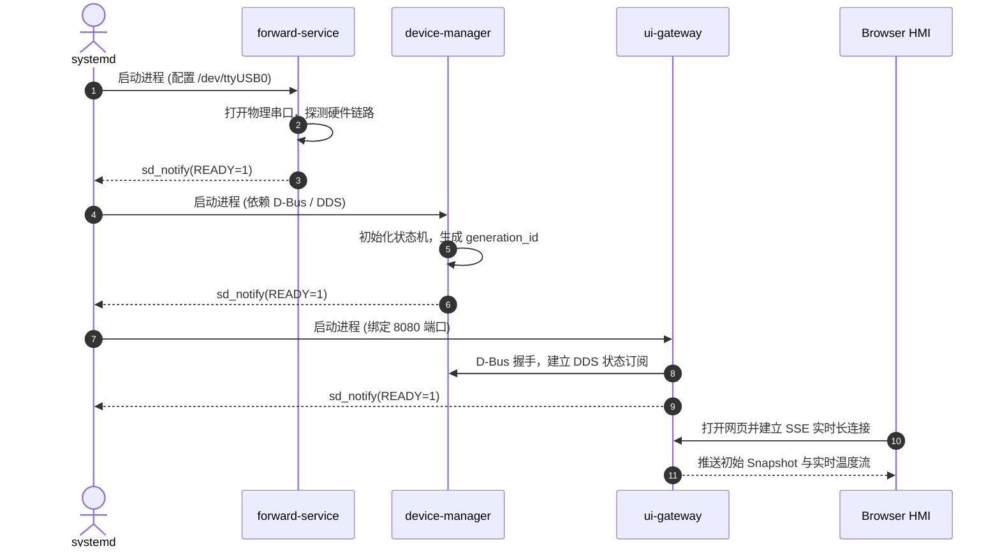

# VMware与SoC两阶段同构软件架构与通信接口控制文档 (ICD)

## 1. 架构目标与总体原则

本项目采用 **“VMware 原生孪生验证 → SoC 嵌入式平台平移复验”** 两阶段开发战略。架构核心原则如下：

1. **同构进程与真实模块**：
   在第一阶段（VMware Ubuntu 环境），系统必须按目标生产环境的微服务架构运行真实的业务服务独立进程，严禁采用单进程模拟替身、进程内内存回调或虚假测试桩冒充多进程闭环。
2. **三总线与标准 IPC 协议**：
   严格实施基于 Fast DDS（数据流/遥测发布订阅）、D-Bus（系统级方法调用与准入控制）及 HTTP/SSE（Web 网关与浏览器轻量交互）的清晰通信分层。
3. **真实单片机直连闭环**：
   VMware 宿主机通过真实物理串口（`/dev/ttyUSB0`）直连 MC 主控与 TH 工具头，运行原生 MiniMCProto v2.0（Rev 2.0.3）协议，零 Mock、零虚拟化（严格遵守 HW-G5 / HW-G6 规则）。
4. **业务源码最大化复用**：
   第二阶段（SoC 嵌入式平台）100% 复用业务核心源码、IDL 契约、D-Bus 接口、HTTP API 及前端界面资产；平台迁移仅限于交叉编译工具链、外设设备树/路径、守护进程服务单元配置及显示渲染管线适配。

---

## 2. 系统服务拓扑与进程职责划分

```mermaid
flowchart TD
    subgraph UI_Layer [交互展示层]
        BROWSER["独立浏览器界面 (Browser HMI)<br/>SPA (HTML5 / Vanilla JS / CSS)"]
    end

    subgraph Service_Layer [AP 核心服务层 (VMware / SoC 同构)]
        GATEWAY["ui-gateway (网关进程)<br/>端口: 8080 (REST + SSE)"]
        STATE["device-manager (STATE 状态机进程)<br/>系统状态聚合与唯一控制准入"]
        FWD["forward-service (FORWARD 路由进程)<br/>独占物理串口与帧事务管理"]
    end

    subgraph MCU_Layer [物理执行与传感层]
        MC["MC 主控 MCU<br/>热床温控 / 级联路由"]
        TH["TH 工具头 MCU<br/>喷头温控"]
    end

    BROWSER <-->|"HTTP / SSE (真实数据)"| GATEWAY
    GATEWAY <-->|"D-Bus (方法调用/快照)"| STATE
    GATEWAY -.->|"Fast DDS (订阅权威状态)"| STATE
    STATE <-->|"D-Bus (采样触发与控制)"| FWD
    FWD -.->|"Fast DDS (发布原始遥测)"| STATE
    FWD <-->|"USART 115200 8N1 (MiniMCProto v2.0)"| MC
    MC <-->|"USART 921600 8N1 (透明路由)"| TH
```

### 进程职责与故障隔离边界

| 进程名称 | 可执行文件名 | 核心职责 | 独占资源 / 边界隔离 | 故障安全行为 |
| :--- | :--- | :--- | :--- | :--- |
| **Browser HMI** | `index.html` (Web) | 本地屏幕可视化展现、用户交互、实时温度曲线与故障告警 | 运行于独立浏览器沙箱，无系统权限，严禁绕过网关直连内部 IPC | 浏览器崩溃/刷新不影响后台数据采集；网络断开时显示“失联”状态，拒绝假数据 |
| **ui-gateway** | `soc_ui_gateway` | 提供静态前端文件托管、RESTful 控制 API、SSE 遥测推流；双向转换 HTTP ↔ D-Bus/DDS | 独占 HTTP 端口（默认 8080）；无状态权威，只做协议适配与请求鉴权 | 崩溃后由 systemd 重启，客户端自动重连；不可修改状态快照内容 |
| **device-manager** | `soc_device_mgr` | 全局状态机权威（STATE）、遥测数据质量评估（FRESH/STALE/FAULT）、指令统一准入仲裁 | 维护全局设备状态权威快照；严禁直接打开或读写物理串口 | 异常退出重启后重新协商 Generation 代次，向 FWD 重新同步最新采样 |
| **forward-service** | `soc_forward_svc` | 独占物理串口通信，负责 MiniMCProto 帧收发、CRC 校验、超时重试、事务匹配及级联透明路由 | 独占 `/dev/ttyUSB0`（SoC 为指定 tty），一次仅处理一个物理事务 | 串口断开时进入自动退避重连；严禁伪造下游 MCU 应答，无响应判定 TIMEOUT |

---

## 3. 温度遥测协议冲突逐项对账与决议 (C1 ～ C6)

针对历史规范与实现中存在的 6 项关键分歧（C1～C6），经架构复核与三端约束对账，做出如下终局裁决：

| 编号 | 争议项 | 冲突原状 | 终局架构决议 (Mandatory Resolution) | 技术依据与约束 |
| :--- | :--- | :--- | :--- | :--- |
| **C1** | **协议 Flags 版本位与方向** | 正式协议 §5.1 要求 v2 必须叠加 `0x04`；TEMP-01 写 `0x01`/`0x02`；PL-02 误写 `0x00` | **请求帧 Flags 固定为 `0x05` (`V2_FLAG_VERSION_2 \| V2_FLAG_REQUEST`)；<br/>响应帧 Flags 固定为 `0x06` (`V2_FLAG_VERSION_2 \| V2_FLAG_RESPONSE`)** | 彻底遵循 MiniMCProto v2.0.3 规范，三端 CRC 校验以 `0x05`/`0x06` 为唯一基准，严禁接收 flags 缺失 `0x04` 的报文。 |
| **C2** | **温度数据表示与符号性** | PL-02 使用无符号 `uint16_t` (0.1°C)；TEMP-01 使用有符号 `int16_t` (0.01°C) | **MCU 传输层统一采用有符号 `int16_t`，分辨率为 0.1°C；<br/>AP 内部标准化为 `int32_t` 毫摄氏度 (0.001°C)** | 兼容热敏电阻在极低温/北方寒冷环境测量（例如 -20°C），并满足 0.1°C 物理传感极限与工程精度的统一。 |
| **C3** | **量程溢出与哨兵碰撞** | TEMP-01 采用 0.01°C 导致 +350°C (35000) 超过 `int16_t` 上限 (+32767)；`0x7FFF` 与正常温度冲突 | **采用 0.1°C 分辨率后，有效物理量程覆盖 -40.0°C 至 +500.0°C (数值 -400 至 +5000)；<br/>故障哨兵保留在高位：<br/>- `0x7FFF` (+32767)：传感器故障 (OPEN/SHORT/HARDWARE_ERR)<br/>- `0x7FFE` (+32766)：采集超时或离线 (TIMEOUT/OFFLINE)** | 彻底消除正温 350°C 溢出风险，哨兵与真实测量值物理隔离，断言与解码安全可控。 |
| **C4** | **指令码分配 (CMD ID)** | PL-01 既建议又排斥 `0x10`；正式协议 `0x10` 为系统控制 (SYS_CONTROL)，`0x40` 为通用广播遥测 | **系统控制保留 `0x10`；温度主动查询指令正式分配为 `0x14` (`CMD_TEMP_QUERY`)** | `0x14` 在 MiniMCProto 规范中处于应用扩展区间，避免与急停/复位控制冲突，符合分权原则。 |
| **C5** | **传感器硬件断言与故障映射** | TEMP-01 将 ADC 12位、开路/短路判定视作纯软件事实，缺乏硬件关联 | **明确区分软件状态与物理保护：<br/>MCU 硬件闭环执行超温关断（硬件第一防线）；<br/>状态映射：`0x00`=OK, `0x01`=OPEN, `0x02`=SHORT, `0x03`=ADC_TIMEOUT, `0xFF`=UNKNOWN。<br/>AP 仅根据哨兵呈现状态，不得自作主张推断物理安全** | 满足硬件在环安全规范，AP 严禁因收到 duty=0 就声称物理加热已停止，保持纵深防御。 |
| **C6** | **RTT 延迟与调度预算** | PL-01 宣称 TH 级联 RTT $\le 10\text{ ms}$；VMware 环境存在时钟与调度抖动 | **分列双环境指标：<br/>1. VMware 孪生阶段：单次事务超时设为 200 ms，重试上限 1 次；允许单次物理 RTT 在 15 ms 内。<br/>2. SoC 生产阶段：物理 UART 直连，目标 RTT $\le 8\text{ ms}$，超时保护设为 50 ms** | 杜绝将目标硬件硬实时指标强加于开发虚拟机，确保 VMware 调试稳定且准确定位通信异常。 |

---

## 4. 跨进程通信 (IPC) 详细接口规格

### 4.1 Fast DDS 契约（数据流传输）

Fast DDS 用于发布高频或实时状态数据，降低进程解耦开销。

#### IDL 定义 (`telemetry.idl`)

```idl
module aisoc {
    enum SensorStatus {
        STATUS_OK,
        STATUS_OPEN,
        STATUS_SHORT,
        STATUS_TIMEOUT,
        STATUS_UNKNOWN
    };

    enum DataQuality {
        QUALITY_UNKNOWN,
        QUALITY_FRESH,
        QUALITY_STALE,
        QUALITY_FAULT
    };

    struct RawTempTelemetry {
        uint32 source_node;        // 1 = MC (Bed), 2 = TH (Extruder)
        int32  temperature_millic; // 单位: 0.001 °C
        SensorStatus sensor_status;
        uint32 raw_adc;
        uint32 sample_tick_ms;     // MCU 单调时钟
        uint64 host_received_ns;   // AP 接收单调时钟
        uint32 sequence_id;
    };

    struct TemperatureSnapshot {
        uint32 schema_version;     // 固定为 1
        uint32 generation_id;      // AP 服务代次 ID
        uint64 timestamp_ns;       // 快照生成时间戳
        
        // Bed (MC)
        int32  bed_temp_millic;
        SensorStatus bed_sensor_status;
        DataQuality  bed_quality;
        
        // Tool / Extruder (TH)
        int32  tool_temp_millic;
        SensorStatus tool_sensor_status;
        DataQuality  tool_quality;
        
        string system_status_desc;
    };
};
```

#### DDS Topic 与 QoS 规格

| Topic 名称 | 消息类型 | 发布者 | 订阅者 | 传输模式 | QoS 策略 |
| :--- | :--- | :--- | :--- | :--- | :--- |
| `telemetry/raw_temp` | `aisoc::RawTempTelemetry` | `forward-service` | `device-manager` | 进程间共享内存 / UDP | Reliability: RELIABLE<br/>Durability: VOLATILE<br/>History: KEEP_LAST(5) |
| `state/temperature_snapshot` | `aisoc::TemperatureSnapshot` | `device-manager` | `ui-gateway` | 进程间共享内存 / UDP | Reliability: BEST_EFFORT<br/>Durability: TRANSIENT_LOCAL<br/>History: KEEP_LAST(1) |

---

### 4.2 D-Bus 契约（控制与状态查询）

D-Bus 采用标准系统总线（或会话总线），用于点对点方法调用与命令准入。

#### 1. `org.aisoc.ForwardService` (串口路由服务)
- **Object Path**: `/org/aisoc/forward`
- **Interface**: `org.aisoc.ForwardInterface`
- **Methods**:
  - `TriggerQuery(in uint8 target_node, in uint32 timeout_ms, out int32 error_code, out uint32 transaction_id)`
    - `target_node`: 1=MC, 2=TH
    - 触发底层向指定单片机发送 `0x14` 查询帧，异步返回事务跟踪号。
  - `GetPortStatus(out bool is_open, out string port_path, out uint64 tx_count, out uint64 rx_count)`

#### 2. `org.aisoc.DeviceManager` (状态机权威服务)
- **Object Path**: `/org/aisoc/device`
- **Interface**: `org.aisoc.DeviceInterface`
- **Methods**:
  - `GetSnapshot(out string snapshot_json)`
    - 返回当前聚合的整机温度快照（包含数值、状态、质量标识）。
  - `RequestImmediateSample(in string source_type, out bool accepted, out string reason)`
    - 请求立即刷新某通道温度，由状态机统一准入后向 FWD 下发请求。

---

### 4.3 HTTP & SSE 契约（前端与网关）

网关对外监听 `http://0.0.0.0:8080`。

#### RESTful API
- **GET `/api/v1/system/info`**
  - 返回系统运行代次、环境类型（`vmware-twin` 或 `soc-hardware`）、后端各服务运行状态。
- **GET `/api/v1/temperature/snapshot`**
  - 返回当前瞬时温度 JSON 快照：
  ```json
  {
    "schema_version": 1,
    "generation_id": 104,
    "timestamp_ms": 1729900800123,
    "bed": {
      "temperature_c": 60.5,
      "sensor_status": "STATUS_OK",
      "quality": "QUALITY_FRESH",
      "updated_ms_ago": 120
    },
    "tool": {
      "temperature_c": 210.0,
      "sensor_status": "STATUS_OK",
      "quality": "QUALITY_FRESH",
      "updated_ms_ago": 150
    }
  }
  ```
- **POST `/api/v1/temperature/refresh`**
  - 触发一次立即重新采样。

#### SSE (Server-Sent Events) API
- **GET `/api/v1/temperature/stream`**
  - **Headers**: `Content-Type: text/event-stream`, `Cache-Control: no-cache`
  - **Event 格式**:
    ```text
    event: temp_update
    data: {"timestamp_ms":1729900800500,"bed_c":60.5,"tool_c":210.0,"bed_q":"FRESH","tool_q":"FRESH"}

    event: status_change
    data: {"system_state":"OPERATIONAL","mc_link":true,"th_link":true}
    ```

---

## 5. 进程生命周期、就绪检测与恢复机制

所有服务均遵循标准化启停与故障自愈流程，由 `systemd` 托管：



### 故障恢复准则
1. **串口物理断开 / 恢复**：
   `forward-service` 周期性检测设备节点存在性。拔出时标记连接断开，向 STATE 发出 LINK_DOWN 告警；重新插上后自动重开串口并恢复采样队列。
2. **状态过期策略 (Freshness Degradation)**：
   若超过 3000 ms 未收到有效采样，STATE 自动将对应节点的 `quality` 降级为 `QUALITY_STALE`；超过 10000 ms 降级为 `QUALITY_FAULT`。
3. **进程崩溃自愈**：
   `Restart=always`，重启间隔 500ms。各服务重启后通过全新的 `generation_id` 作废历史残留事务，UI 检测到连接重置后清空曲线并重新同步全量快照。

---

## 6. 代码规范与安全工程门禁

所有基于本架构实现的代码库必须严格遵守：
1. **单一职责与函数规模**：自研函数严格控制在 $\le 50$ 行以内，入参严格控制在 $\le 4$ 个以内。
2. **零堆内存动态分配**：嵌入式通信解析器与单片机端禁止动态内存分配（`malloc`/`new`）。
3. **显式防御与指针安全**：公共函数入口必须使用 Guard Clause 校验入参指针；严禁出现多级指针（禁止 `***ptr`）。
4. **编译选项**：统一开启 `-Wall -Wextra -Werror -fno-exceptions -fno-rtti`。

---
*本架构控制文档经 ARCH 设计完成，作为 TWIN-01 核心交付物提交独立 QA 审阅与 COORD 收件。*
