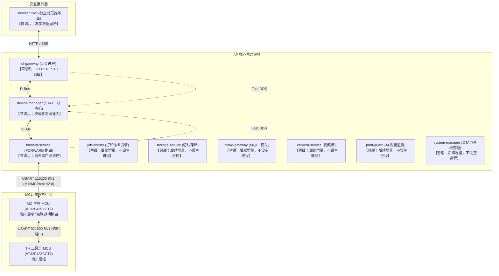
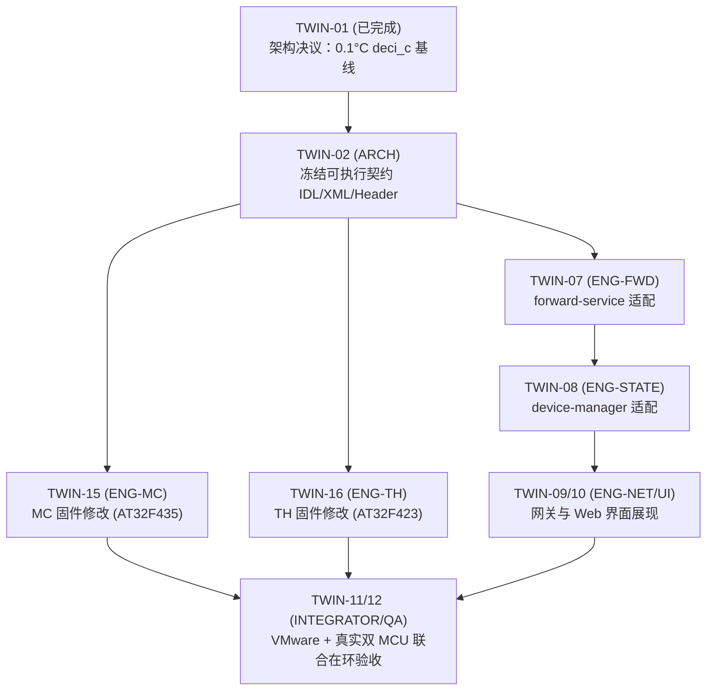
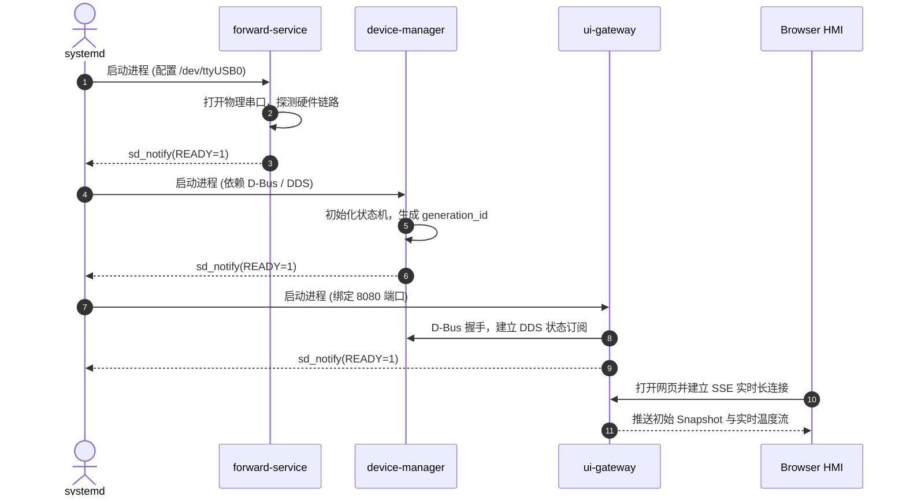

# VMware与SoC两阶段同构软件架构与通信接口控制文档 (ICD)

## 1. 架构目标与总体原则

本项目采用 **“VMware 原生孪生验证 → SoC 嵌入式平台平移复验”** 两阶段开发战略。架构核心原则如下：

1. **同构微服务与真实进程边界**：
   在第一阶段（VMware Ubuntu 环境），系统必须按生产环境的微服务拓扑运行真实的独立进程（`forward-service`、`device-manager`、`ui-gateway`、`Browser HMI`），严禁采用单进程模拟替身、进程内内存回调或虚假测试桩冒充多进程闭环。
2. **标准三总线与协议分层**：
   严格实施基于 Fast DDS（数据流/高频遥测发布订阅）、D-Bus（系统级方法调用与准入控制）及 HTTP/SSE（Web 网关与浏览器交互）的标准通信分层。
3. **真实单片机直连闭环（零 Mock）**：
   VMware 宿主机通过真实物理串口（`/dev/ttyUSB0`）直连 MC 主控（AT32F435VGT7）与 TH 工具头（AT32F423CCT7），运行原生 MiniMCProto v2.0（Rev 2.0.3）协议，零 Mock、零虚拟化（严格遵守 HW-G5 / HW-G6 规则）。
4. **有条件的设计目标（杜绝无依据的绝对保证）**：
   将两阶段资产平移明确定义为**“有条件的设计目标（Conditional Design Targets）”**：通过标准化 POSIX API、C++17 与解耦设计最大化复用核心代码与界面资源；同时清晰隔离目标 SoC 平台（芯片、ABI、BSP、sysroot、屏幕 GPU 驱动）未决项，不将未经实测验证的性能指标当成硬性保证。

---

## 2. 完整产品模块清单与首切片边界

依据系统需求基线与模块职责规划，整机软件架构包含以下 10 个功能模块。系统明确要求：**未实现的模块在当前阶段标记为暂缓，严禁启动空进程充数；第一阶段聚焦于已批准的温度只读切片。**



### 完整模块状态与首切片划分表

| 模块名称 | 规划服务进程 | 阶段一 (VMware 孪生) 交付范围 | 状态分类 | 独占资源 / 边界隔离 |
| :--- | :--- | :--- | :--- | :--- |
| **FORWARD** | `forward-service` | 独占物理串口 `/dev/ttyUSB0`，处理 MiniMCProto 事务与 DDS/D-Bus 转换 | **首切片实现** | 独占宿主机串口，严格限制单物理事务在途 |
| **STATE** | `device-manager` | 聚合 MC/TH 温度数据，维护权威快照，评估数据新鲜度与质量 | **首切片实现** | 状态机权威，禁止直接操作串口硬件 |
| **UI-GATEWAY**| `ui-gateway` | 提供静态资源托管，提供 REST API (`/snapshot`) 与 SSE 实时事件流 | **首切片实现** | 独占 HTTP 8080 端口，双向转换 Web ↔ 内部 IPC |
| **BROWSER-HMI**| 独立浏览器应用 | 运行于宿主机浏览器，通过 HTTP/SSE 展现真实 MC/TH 温度曲线与状态 | **首切片实现** | 纯 Web 前端沙箱，网络断线时明确提示失联 |
| **JOB** | `job-engine` | G-code 解析、插补缓冲与作业状态机（暂停/恢复/停止） | **暂缓实现** | 本切片不启动空进程，不伪造打印状态 |
| **STORAGE** | `storage-service` | 切片文件上传、存储、分片传输与 SHA256 校验 | **暂缓实现** | 后续作业系统增量时引入 |
| **NET-CLOUD** | `cloud-gateway` | 局域网发现、App 连接与 MQTT 远程遥控 | **暂缓实现** | 后续网络连接增量时引入 |
| **MEDIA** | `camera-service` | USB/MIPI 摄像头视频采集、缩略图与 WebRTC/RTSP 推流 | **暂缓实现** | 后续视觉增量时引入 |
| **AI** | `print-guard` | 首层打印检测、炒面/拉丝缺陷识别与安全急停建议 | **暂缓实现** | 依赖 MEDIA 视频输入，暂缓实现 |
| **SYS** | `system-manager` | 系统 OTA 升级、日志归档、系统级健康诊断 | **暂缓实现** | 基础运维增量时引入 |

---

## 3. 温度遥测协议冲突逐项对账 (C1 ～ C6) 与跨端演进方案

### 3.1 核心原则：明确区分“设计基线修订”与“代码修改测试通过”

> [!IMPORTANT]
> **设计修订 $\neq$ 代码已修改测试通过**：
> 本节所列决议代表**顶层架构与通信规范的设计基线修订（Design Revision）**。
> 当前代码仓库（`soc-ap` 与 `mcu-p3`）中存量代码依然是 0.01°C 结构体（`minimc_temp_report_payload_t` 内使用 `current_temp_centi_c`）。
> 严禁将设计决议冒充为已完成的代码与硬件测试通过！代码修改与跨端联调必须在后续专门任务（TWIN-02 契约、TWIN-07/08 业务服务、TWIN-15/16 固件修订、TWIN-11/12 联调验收）中按步骤推进。

### 3.2 冲突对账明细与终局设计决议

| 编号 | 争议项 | 冲突原状 | 终局设计决议 (Design Revision) | 技术依据与约束 |
| :--- | :--- | :--- | :--- | :--- |
| **C1** | **协议 Flags 版本位与方向** | 正式协议 §5.1 要求 v2 必须叠加 `0x04`；TEMP-01 写 `0x01`/`0x02`；PL-02 误写 `0x00` | **请求帧 Flags 固定为 `0x05` (`V2_FLAG_VERSION_2 \| V2_FLAG_REQUEST`)；<br/>响应帧 Flags 固定为 `0x06` (`V2_FLAG_VERSION_2 \| V2_FLAG_RESPONSE`)** | 彻底遵循 MiniMCProto v2.0.3 规范，CRC16-CCITT 校验以 `0x05`/`0x06` 为唯一基准，严禁接收 flags 缺失 `0x04` 的报文。 |
| **C2** | **温度数据表示与符号性** | PL-02 使用无符号 `uint16_t` (0.1°C)；TEMP-01 使用有符号 `int16_t` (0.01°C) | **MCU 传输层统一采用有符号 `int16_t`，分辨率为 0.1°C (`deci_c`)；<br/>AP 内部标准化为 `int32_t` 毫摄氏度 (0.001°C)** | 兼容热敏电阻在极低温/北方寒冷环境测量（如 -20°C），并满足 0.1°C 物理传感极限与工程精度的统一。 |
| **C3** | **量程溢出与哨兵碰撞** | TEMP-01 采用 0.01°C 导致 +350°C (35000) 超过 `int16_t` 上限 (+32767)；`0x7FFF` 与正常温度冲突 | **采用 0.1°C 分辨率后，有效物理量程覆盖 -40.0°C 至 +500.0°C (数值 -400 至 +5000)；<br/>故障哨兵保留在高位：<br/>- `0x7FFF` (+32767)：传感器故障 (OPEN/SHORT/HARDWARE_ERR)<br/>- `0x7FFE` (+32766)：采集超时或离线 (TIMEOUT/OFFLINE)** | 彻底消除正温 350°C 溢出风险，哨兵与真实测量值物理隔离，断言与解码安全可控。 |
| **C4** | **指令码分配 (CMD ID)** | PL-01 既建议又排斥 `0x10`；正式协议 `0x10` 为系统控制 (SYS_CONTROL)，`0x40` 为通用广播遥测 | **系统控制保留 `0x10`；温度主动查询指令正式分配为 `0x14` (`CMD_TEMP_QUERY`)** | `0x14` 在 MiniMCProto 规范中处于应用扩展区间，避免与急停/复位控制冲突，符合分权原则。 |
| **C5** | **传感器硬件断言与故障映射** | TEMP-01 将 ADC 12位、开路/短路判定视作纯软件事实，缺乏硬件关联 | **明确区分软件状态与物理保护：<br/>MCU 硬件闭环执行超温关断（硬件第一防线）；<br/>状态映射：`0x00`=OK, `0x01`=OPEN, `0x02`=SHORT, `0x03`=ADC_TIMEOUT, `0xFF`=UNKNOWN。<br/>AP 仅根据哨兵呈现状态，不得自作主张推断物理安全** | 满足硬件在环安全规范，AP 严禁因收到 duty=0 就声称物理加热已停止，保持纵深防御。 |
| **C6** | **RTT 延迟与调度预算** | PL-01 宣称 TH 级联 RTT $\le 10\text{ ms}$；VMware 环境存在时钟与调度抖动 | **分列双环境指标：<br/>1. VMware 孪生阶段：单次事务超时设为 200 ms，重试上限 1 次；允许单次物理 RTT 在 15 ms 内。<br/>2. SoC 生产阶段：物理 UART 直连，目标 RTT $\le 8\text{ ms}$，超时保护设为 50 ms** | 杜绝将目标硬件硬实时指标强加于开发虚拟机，确保 VMware 调试稳定且准确定位通信异常。 |

### 3.3 各端修改路线图与兼容性策略

为了平稳将温度单位由 0.01°C 升级为 0.1°C，必须按照既定任务白名单分步实施，杜绝并发越界修改：



1. **版本识别与兼容性策略**：
   - 通信契约引入 `schema_version = 2`；
   - 固件与 AP 采用**原子步级联升级**：在 TWIN-11 联合调试前，FORWARD 必须严格校验 Payload 长度（16 字节）与字段定义。若收到旧版 0.01°C 报文或异常长度，标记为 `BAD_FRAME`，拒绝解析为实时温度，避免温度数值放大 10 倍误判。
2. **各端代码修改明细与任务归属**：
   - **契约定义层 (`TWIN-02`, 责任人: ARCH)**：
     - 白名单：`soc-ap/contracts/twin/**`；
     - 定义 `telemetry_types.h`：将 `current_temp_centi_c` 替换为 `current_temp_deci_c` (0.1°C)，故障哨兵更新为 `0x7FFF` / `0x7FFE`。
   - **MC 固件层 (`TWIN-15`, 责任人: ENG-MC)**：
     - 白名单：`mcu-p3/motion-controller-mcu/**`；
     - 目标芯片：**AT32F435VGT7**；
     - 修改 `motion-controller-mcu/project/src/` 中的热敏电阻转换函数，将采样计算值输出量化为 0.1°C。
   - **TH 固件层 (`TWIN-16`, 责任人: ENG-TH)**：
     - 白名单：`mcu-p3/color-engine-mcu/io_toggle/**`；
     - 目标芯片：**AT32F423CCT7**；
     - 修改 `color-engine-mcu/io_toggle/src/app/` 中的热敏电阻采样逻辑，同步调整为 0.1°C 输出。
   - **AP 驱动与业务服务层 (`TWIN-07`/`TWIN-08`, 责任人: ENG-FWD / ENG-STATE)**：
     - `forward-service` 解析 0.1°C 帧并打包为 `RawTempTelemetry` DDS 报文；
     - `device-manager` 将 0.1°C 乘以 100 归一化为内部毫摄氏度 `int32_t` (0.001°C)，执行越界与超时校验。
   - **展示层 (`TWIN-09`/`TWIN-10`, 责任人: ENG-NET / ENG-UI)**：
     - `ui-gateway` 向前端输出浮点数摄氏度（如 `210.5`）；前端展示真实物理温度。

---

## 4. 资源边界与数值预算

系统必须具有明确的有界资源设计，杜绝内存泄漏、无界排队与串口竞争。指标严格区分为 **“VMware 软预算”** 与 **“SoC 目标待测预算”**：

| 资源维度 | VMware 孪生开发阶段 (软预算 / 边界保护) | 目标 SoC 嵌入式平台 (有条件设计目标 / 待实测) | 强制工程约束 |
| :--- | :--- | :--- | :--- |
| **单进程 RSS 内存** | `forward-service` $\le 32\text{ MB}$<br/>`device-manager` $\le 48\text{ MB}$<br/>`ui-gateway` $\le 48\text{ MB}$ | 全服务常驻内存总和 $\le 64\text{ MB}$ (不含独立浏览器) | 零动态堆内存分配（解析层禁止 `new`/`malloc`），禁止无界容器 |
| **CPU 占用率** | 宿主机 CPU 单核峰值 $\le 10\%$ (1Hz采样周期) | SoC 单核峰值 $\le 15\%$ (负载均衡下) | 无忙等待自旋锁，硬件轮询强制带超时保护 |
| **DDS 队列深度** | `telemetry/raw_temp`: `KEEP_LAST(5)`<br/>`state/snapshot`: `KEEP_LAST(1)` | 与 VMware 保持一致 | 严格有界队列，超出时丢弃最旧数据，禁止无界堆积 |
| **串口并发事务** | 严格限制为 1 个事务在途 (单线排他) | 严格限制为 1 个事务在途 | 严禁多线程并发写串口，新请求在事务占用期间返回 `BUSY` |
| **事务超时判定** | 超时保护设为 200 ms (允许重试 1 次) | 超时保护设为 50 ms (典型 RTT 目标 $\le 8\text{ ms}$) | 超时立即判定失败并释放事务锁，禁止无休止挂起 |
| **浏览器渲染开销**| 桌面 Chrome / Firefox，内存无严苛限制 | Kiosk 嵌入式浏览器 (Weston) 内存 $\le 128\text{ MB}$ | 前端曲线仅保留最近 300 个点，定时清理 DOM 节点 |

---

## 5. 跨进程通信 (IPC) 详细接口规格

### 5.1 Fast DDS 契约（数据流传输）

#### IDL 定义 (`telemetry.idl`)

```idl
module aisoc {
    enum SensorStatus {
        STATUS_OK,
        STATUS_OPEN,
        STATUS_SHORT,
        STATUS_TIMEOUT,
        STATUS_UNKNOWN
    };

    enum DataQuality {
        QUALITY_UNKNOWN,
        QUALITY_FRESH,
        QUALITY_STALE,
        QUALITY_FAULT
    };

    struct RawTempTelemetry {
        uint32 source_node;        // 1 = MC (Bed), 2 = TH (Extruder)
        int32  temperature_millic; // 内部标准化单位: 0.001 °C
        SensorStatus sensor_status;
        uint32 raw_adc;
        uint32 sample_tick_ms;     // MCU 单调时钟 (ms)
        uint64 host_received_ns;   // AP 接收单调时钟 (ns)
        uint32 sequence_id;
    };

    struct TemperatureSnapshot {
        uint32 schema_version;     // 固定为 2
        uint32 generation_id;      // AP 服务代次 ID
        uint64 timestamp_ns;       // 快照生成单调时间戳
        
        // Bed (MC)
        int32  bed_temp_millic;
        SensorStatus bed_sensor_status;
        DataQuality  bed_quality;
        
        // Tool / Extruder (TH)
        int32  tool_temp_millic;
        SensorStatus tool_sensor_status;
        DataQuality  tool_quality;
        
        string system_status_desc;
    };
};
```

#### DDS Topic 与 QoS 规格

| Topic 名称 | 消息类型 | 发布者 | 订阅者 | QoS 策略 | 传输模式 |
| :--- | :--- | :--- | :--- | :--- | :--- |
| `telemetry/raw_temp` | `aisoc::RawTempTelemetry` | `forward-service` | `device-manager` | Reliability: RELIABLE<br/>Durability: VOLATILE<br/>History: KEEP_LAST(5) | 共享内存 / UDP 本地回环 |
| `state/temperature_snapshot` | `aisoc::TemperatureSnapshot` | `device-manager` | `ui-gateway` | Reliability: BEST_EFFORT<br/>Durability: TRANSIENT_LOCAL<br/>History: KEEP_LAST(1) | 共享内存 / UDP 本地回环 |

---

### 5.2 D-Bus 契约（点对点命令与准入）

#### 1. `org.aisoc.ForwardService` (串口路由服务)
- **Object Path**: `/org/aisoc/forward`
- **Interface**: `org.aisoc.ForwardInterface`
- **Methods**:
  - `TriggerQuery(in uint8 target_node, in uint32 timeout_ms, out int32 error_code, out uint32 transaction_id)`
    - 触发底层向指定单片机发送 `0x14` 查询帧，异步返回事务跟踪号。
  - `GetPortStatus(out bool is_open, out string port_path, out uint64 tx_count, out uint64 rx_count)`

#### 2. `org.aisoc.DeviceManager` (状态机权威服务)
- **Object Path**: `/org/aisoc/device`
- **Interface**: `org.aisoc.DeviceInterface`
- **Methods**:
  - `GetSnapshot(out string snapshot_json)`
    - 返回当前聚合的整机温度快照（JSON 格式）。
  - `RequestImmediateSample(in string source_type, out bool accepted, out string reason)`
    - 触发立即重新采样。

---

### 5.3 HTTP & SSE 契约（前端交互）

- **GET `/api/v1/temperature/snapshot`**
  - 返回瞬时 JSON 快照：
  ```json
  {
    "schema_version": 2,
    "generation_id": 104,
    "timestamp_ms": 1729900800123,
    "bed": {
      "temperature_c": 60.5,
      "sensor_status": "STATUS_OK",
      "quality": "QUALITY_FRESH",
      "updated_ms_ago": 120
    },
    "tool": {
      "temperature_c": 210.0,
      "sensor_status": "STATUS_OK",
      "quality": "QUALITY_FRESH",
      "updated_ms_ago": 150
    }
  }
  ```
- **GET `/api/v1/temperature/stream` (SSE)**
  - 事件流推送：
    ```text
    event: temp_update
    data: {"timestamp_ms":1729900800500,"bed_c":60.5,"tool_c":210.0,"bed_q":"FRESH","tool_q":"FRESH"}

    event: status_change
    data: {"system_state":"OPERATIONAL","mc_link":true,"th_link":true}
    ```

---

## 6. 进程生命周期、就绪检测与故障恢复设计

所有服务均遵循标准化生命周期管理，由 `systemd` 托管：



### 详细故障场景与恢复处理矩阵

| 故障场景 | 检测机制 | 责任进程 | 自愈与降级行为 | 前端展示影响 |
| :--- | :--- | :--- | :--- | :--- |
| **物理串口断开 (拔出线缆)** | OS `errno=ENODEV` / 连续读取失败 | `forward-service` | 标记串口断开，关闭句柄；启动 1Hz 定时探测，等待串口设备节点重新出现；向 STATE 发送链路断开通知 | UI 提示“串口断开”，曲线停止推流，显示最后有效值但标记为 STALE |
| **传感器物理断路/短路** | 单片机 ADC 采样超限，返回 `0x01`/`0x02` | `device-manager` | 状态机立即标记对应通道为 `STATUS_OPEN` / `STATUS_SHORT`，数据质量置为 `QUALITY_FAULT`，温度字段置无效 | UI 相应测温点红框闪烁，数值显示 `FAULT`，弹出传感器故障报警 |
| **单片机无响应 (超时/死机)** | FWD 定时器超过 200ms 未收齐应答 | `forward-service` | 丢弃超时事务，向 STATE 报告 `TIMEOUT`；状态机连续 3 次超时后将节点标记为失联 | UI 测温点显示 `OFFLINE`，严禁伪造正常读数 |
| **核心服务崩溃 (`forward-svc`)** | systemd 进程退出事件 | systemd / `forward-service` | systemd 延迟 500ms 重启服务；重启后重置 `generation_id`，丢弃此前所有在途事务，重新建立串口通信与 DDS 通道 | UI 检测到 SSE 断开后自动重试；重连成功后先拉取全量快照，再恢复增量订阅 |
| **浏览器刷新 / 网络断开** | HTTP SSE 断开 | `ui-gateway` / `Browser HMI` | 浏览器重新发起连接；网关自动释放旧 SSE 缓冲区；建立新连接后先推送当前全量快照，无状态缝隙 | 界面重新加载并平滑渲染最新快照 |
| **数据陈旧降级 (Freshness)** | STATE 内部单调时钟检查 | `device-manager` | 超过 3000ms 未收到有效更新降级为 `QUALITY_STALE`；超过 10000ms 降级为 `QUALITY_FAULT` | 界面温度数值变灰色，标明“上次更新于 X 秒前” |

---

## 7. 架构工程门禁

所有基于本架构实现的代码库必须严格遵守：
1. **单一职责与函数规模**：自研函数严格控制在 $\le 50$ 行以内，入参严格控制在 $\le 4$ 个以内。
2. **零堆内存动态分配**：嵌入式通信解析器与单片机端禁止动态内存分配（`malloc`/`new`）。
3. **显式防御与指针安全**：公共函数入口必须使用 Guard Clause 校验入参指针；严禁出现多级指针（禁止 `***ptr`）。
4. **编译选项**：统一开启 `-Wall -Wextra -Werror -fno-exceptions -fno-rtti`。

---
*本架构控制文档经纠偏复核后修订为 revision 2，作为 TWIN-01 正式基线交付物。*
