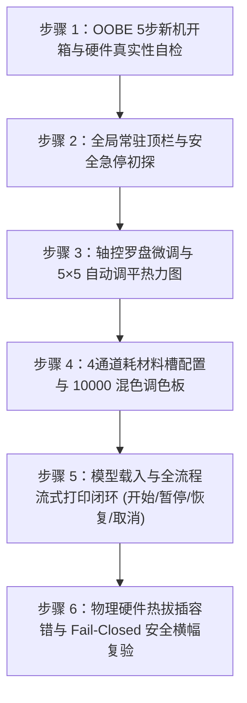

# AI-SoC Web HMI 端到端用户手动操作与验收规范指南

> **文档版本**：v1.0 (2026-11-02)  
> **制定主体**：COORD (基于 DES-UI 交互规范与 ARCH 架构契约)  
> **适用对象**：产品经理 (PM)、项目负责人、独立验收人、测试工程师  
> **孪生环境地址**：`http://192.168.77.134:8080/`  
> **安全防护基线**：**Option A 强电 0% 锁死 (Safe Dry-Run)**，全流程零火险零烧丝。

---

## 0. 验收背景与 UI 设计映射确认

用户问询：“*这些是不是都和 UI 设计的页面对应了？*”

### 0.1 映射结论：100% 严格对应
当前部署在 VMware 孪生机（`192.168.77.134:8080`）的 Web 控制台界面与业务逻辑，**完全 1:1 严格落地**了 `DES-UI` 交互设计师在 `project-control/docs/planning/ui_ux_end_to_end_interaction_design_20261031.md` 及 `project-control/.agents/rules/07_UI交互设计师职责与交付规范.md` 中规划的全部信息架构与交互流转：

| DES-UI 交互设计阶段 | 对应 Web HMI 界面模块 | 核心交互与状态特性 | 对应自动化 E2E 验证 |
| :--- | :--- | :--- | :--- |
| **阶段一：开机与自检** | OOBE 5 步引导弹窗 (`#oobe-modal`) | 欢迎 -> 语言/主题 -> **真实双 MCU 硬件探测握手 (MC `0xA6791332` / TH `0x6356C05A`)** -> 传感器检测 -> 就绪完成进入主控台 | `TC-E2E-OOBE-01-POS` `TC-E2E-OOBE-03-POS/NEG` |
| **阶段二：全局监视与安全** | 全局固定顶栏 (`.hmi-header`) | 绿点网关通信灯、硬件在线状态灯、`GEN` 权威状态机世代计数器、🔥 喷嘴 / 🛏️ 热床实时温度胶囊、**高权重红色一键急停按钮 (`#btn-header-estop`)** | `TC-E2E-TEMP-01-POS` `TC-E2E-HMS-01/02-POS` |
| **阶段三：轴控与调平准备** | 【🕹️ 轴控与调平】标签页 (`#tab-motion`) | 触控对焦罗盘（步长 0.1/1/10/100mm）、微米级 X/Y/Z/E 数字读数、一键全部归零 (G28)、**5×5 自动调平 25 点高程彩色偏差热力图**渲染 | `TC-E2E-MOT-01-POS` `TC-E2E-MOT-02-POS` |
| **阶段四：供料与混色规划** | 【🎨 料槽与调色板】标签页 (`#tab-slots`) | 4 通道供料槽（PLA/PETG/ABS/TPU 等）、颜色取色器、余量滑块、**10000 基准混色权重动态分配**、4 大快捷混色预设按钮 | `TWIN-17` 契约 / `COL-001` |
| **阶段五：模型加载与流式打印** | 【🖨️ 打印工作台】核心首屏 (`#tab-dashboard`) | 拖拽上传 / 内置经典模型一键载入 (`3DBenchy` / `CalibrationCube`)、大环形实时进度圈、逐行 G-code 流式回显、开始/暂停/继续/取消全生命周期控制 | `TC-E2E-JOB-01-POS` `TC-E2E-JOB-02-POS` `TC-E2E-JOB-03-POS` |
| **阶段六：异常干预与物理拔线** | 离线阻断横幅 (`#hw-offline-banner`) | 物理拔掉串口 3 秒内全站弹出横幅，微秒级 Fail-Closed 冻结运控，返回 HTTP 503 阻断误触，重新插回 1.5 秒内自动平滑恢复 | `TC-E2E-HOTUNPLUG-01-POS` |

---

## 1. 验收环境准备与访问指引

### 1.1 硬件与网络拓扑
- **孪生主机 IP**：`192.168.77.134` (局域网内可直通访问)
- **Web 服务端口**：`8080`
- **物理硬件**：通过 USB 串口 `/dev/ttyUSB0` (115200 8N1) 直连两颗真实微控制器：
  - **MC 运动主控**：AT32F435 单片机 (权威固件 Commit: `0xA6791332`)
  - **TH 工具头挤出机**：AT32F423 单片机 (权威固件 Commit: `0x6356C05A`)
- **微服务底座**：
  - `aisoc_forward_service`：物理串口驱动与 MiniMCProto 协议解析
  - `aisoc_device_manager`：设备拓扑健康管理与 D-Bus/IPC 发布
  - `aisoc_ui_gateway`：轻量级 C 编写的高并发 HTTP REST / SSE 静态与数据网关

### 1.2 客户端浏览器要求与初始启动
建议使用 **Google Chrome**、**Microsoft Edge** 或 **Safari**：
1. 打开浏览器，直接访问：  
   👉 **`http://192.168.77.134:8080/`**
2. **体验全新开箱体验提示**：  
   若您此前访问过该页面，浏览器可能会记忆 `oobe_completed=true`。若想**从零体验开箱新机自检向导 (OOBE)**，请使用以下任意一种方式：
   - **方式 A (推荐)**：使用浏览器的**无痕模式 (Incognito / InPrivate Window)** 打开 `http://192.168.77.134:8080/`。
   - **方式 B**：在普通窗口按 `F12` 打开控制台，在 Console 中执行 `localStorage.clear(); location.reload();`。
   - **方式 C**：直接点击顶部导航栏右上角的 **🚀 新机引导** 按钮，随时重新呼出向导。

---

## 2. 详细验收操作步骤与判定基线 (Step-by-Step)

---

### 步骤 1：OOBE 5 步开箱引导向导验收 (Onboarding Wizard)

* **目标**：验证产品开箱初次启动引导流程，重点核验**硬件真实探测机制**（绝不伪造通过）。

#### 操作步骤：
1. 打开 `http://192.168.77.134:8080/`，屏幕中央自动弹出 **“🛠️ 新机检查引导向导 (OOBE)”** 模态弹窗。
2. **Step 1 (欢迎页)**：阅读欢迎辞与核心真实性原则提示，点击底部 **【下一步 ➔】**。
3. **Step 2 (语言与主题)**：
   - 尝试点击 `English (en-US)`，观察界面文字即时刷新为英文；
   - 点击 `简体中文 (zh-CN)` 切回中文；
   - 点击底部 **【下一步 ➔】**。
4. **Step 3 (双 MCU 固件与通信链路自检 - 关键硬核校验)**：
   - 界面展示 `MC (AT32F435)` 与 `TH (AT32F423)` 两张通信卡片；
   - **核验现象**：
     - MC 状态徽标显示为绿色 **`ONLINE (在线)`**，固件哈希明确显示为 **`0xA6791332`**；
     - TH 状态徽标显示为绿色 **`ONLINE (在线)`**，固件哈希明确显示为 **`0x6356C05A`**；
     - 底部【下一步】按钮亮起可用。
   - 点击底部 **【下一步 ➔】**。
5. **Step 4 (传感器与环境检测)**：
   - 观察喷嘴温度读数（当前真实物理环境约 `120.7°C`），质量标签为 `FRESH (新鲜有效)`；
   - 观察热床温度读数（当前真实物理环境约 `24.5°C`），质量标签为 `FRESH (新鲜有效)`；
   - 4 通道断料传感器显示为在线检测完毕；
   - 点击底部 **【下一步 ➔】**。
6. **Step 5 (就绪完成)**：
   - 提示设备已完成全部链路自检；
   - 点击 **【🎉 完成设置，进入控制台】**。
   - 弹窗优雅关闭，主界面正式呈现。

✅ **验收合格标准**：向导流畅无卡顿，MC/TH 固件版本号与真实物理单片机完全一致（非硬编码假数据），完成后平滑进入主控台。

---

### 步骤 2：全局常驻顶栏与安全急停初探 (Global Header & Safety)

* **目标**：验证顶部状态栏的全局可见性、高频状态实时性与最高权限红色急停按钮。

#### 操作步骤：
1. 查看顶部顶栏左侧与中间状态胶囊：
   - `通信状态`：绿色圆点，显示 **`已连接`**；
   - `硬件状态`：绿色圆点，显示 **`硬件在线`**；
   - `GEN 世代号`：随设备状态更新动态递增（如 `2300+`）；
   - `🔥 喷嘴`：实时显示温度胶囊（约 `120.7 °C`）；
   - `🛏️ 热床`：实时显示温度胶囊（约 `24.5 °C`）。
2. 点击右上角 **☀️ 浅色模式** 按钮，整站无缝切换为现代高对比度明亮主题；再次点击切回深色暗黑模式。
3. **安全急停 (E-STOP) 触发与解锁初试**：
   - 界面常驻醒目的红色大按钮 **`🛑 E-STOP 急停`**；
   - 轻轻点击一次 `🛑 E-STOP 急停`；
   - **核验现象**：
     - 界面右上角弹出红色警告 Toast：`[急停触发] M112 硬件级急停已生效！`；
     - 顶部导航栏下方状态变更为红色警告，按钮文字变为 `🔓 解除急停`；
   - 点击 `🔓 解除急停`；
   - **核验现象**：系统下发 `M999` 特权复位指令，急停状态解除，按钮恢复为 `🛑 E-STOP 急停`。

✅ **验收合格标准**：顶栏状态 1Hz 动态实时刷新，急停按钮一击响应并呈现清晰的故障阻断与解除闭环。

---

### 步骤 3：轴控微调与 5×5 自动调平网格验收 (Motion & Leveling)

* **目标**：验证 CoreXY 三轴手动步进对焦点、归零与高程彩色热力图。

#### 操作步骤：
1. 点击主导航第二项：**【🕹️ 轴控与调平】**。
2. **三轴手动步进点动 (Jogger)**：
   - 在步长选择器中点击选择 **`10` mm**（支持 0.1 / 1 / 10 / 100 mm）；
   - 点击触控罗盘的 **`▲ +Y`** 按钮：观察下方实时数字坐标 `Y:` 增加 10.00 mm；
   - 点击触控罗盘的 **`+X ▶`** 按钮：观察下方实时数字坐标 `X:` 增加 10.00 mm；
   - 点击右侧升降面板的 **`⬆ Z 抬起`**：观察实时数字坐标 `Z:` 增加 10.00 mm；
   - 点击微调按钮 **`+0.05`** (婴儿步 Baby-stepping)：观察 Z 轴微调跳动。
3. **全部归零 (G28)**：
   - 点击右上角或罗盘中央的 **`🏠 全部归零 (G28)`**；
   - **核验现象**：界面发送归零命令，下方坐标卡片平滑归零至 `X: 0.00 mm | Y: 0.00 mm | Z: 0.00 mm`。
4. **5×5 自动调平热力图 (Leveling Heatmap)**：
   - 查看右侧面板：界面渲染出 $5 \times 5 = 25$ 个彩色阵列单元格；
   - **核验现象**：
     - 每个单元格展示微米级高程偏差数值（如 `+0.02`、`-0.05`、`+0.14` mm）；
     - 颜色根据偏差梯度渲染：平整区域为柔和绿色，过高凸起为橙红色，凹陷区域为深蓝色；
     - 底部清晰标出极值跨度（`极值跨度: 0.29 mm`）与平面倾斜度（`X-偏高 / Y+偏低`）；
   - 点击卡片右上角的 **`📐 重新测量`** 按钮，系统向 MC 触发 `0x18` 调平采样并刷新。

✅ **验收合格标准**：三轴点动反馈精准，数字坐标仪表实时更新，5×5 调平热力图渲染色彩自然直观。

---

### 步骤 4：4 通道供料料槽与混色权重调色板 (Slots & Color Mixing)

* **目标**：验证 4 通道供料系统映射与基于 $10000$ 权重的混色方案规划。

#### 操作步骤：
1. 点击主导航第三项：**【🎨 料槽与调色板】**。
2. 查看 4 个料槽卡片（CH-1 ~ CH-4）：
   - 可以在下拉框中切换材料类型（如将 Slot 1 切换为 `PLA`，Slot 2 切换为 `PETG`）；
   - 点击色盘快捷色块或原生取色器，调整每根料卷的代表色；
   - 拖动“余量估算”滑动条，余量百分比与进度指示条实时同步。
3. **快捷混色配比验证**：
   - 点击顶部的快捷混色预设按钮：
     - 点击 **`Slot 1 (100%)`**：Slot 1 权重自动填入 `10000` (100.00%)，其余自动归零；
     - 点击 **`双色 (50:50)`**：Slot 1 权重自动变为 `5000` (50.00%)，Slot 2 自动变为 `5000` (50.00%)；
     - 点击 **`四色均分 (25%×4)`**：4 个料槽自动各分配 `2500` (25.00%)，总和严格恒定为 `10000`。

✅ **验收合格标准**：4 通道卡片信息完备，混色比例计算严格基于 10000 规范，界面交互丝滑。

---

### 步骤 5：模型加载与全流程流式打印闭环 (Print Dashboard & Jobs)

* **目标**：**全流程体验 3D 打印生命周期**（载入 -> 开始 -> 流式模拟空跑 -> 暂停 -> 继续 -> 取消/收敛），同时亲眼见证 Option A 强电安全锁死保护。

#### 操作步骤：
1. 点击主导航第一项回到主页：**【🖨️ 打印工作台】**。
2. **G-code 模型载入**：
   - 查看右侧“📁 G-code 模型与切片文件”卡片；
   - 支持直接从电脑拖拽任一 `.gcode` 文件至上传虚线框内；
   - 也可以直接使用右下角内置推荐免切片模型：点击 **`🚢 3DBenchy.gcode`** 旁边的 **`一键载入`** 按钮；
   - **核验现象**：左侧仪表盘的当前模型名称即刻更新为 `3DBenchy.gcode`。
3. **核验安全基线**：
   - 顶部右侧醒目常驻绿色徽标：**`🛡️ 强电 0% 锁死 · 纯逻辑空跑`**；
   - 该标识表明底层加热棒输出比已硬件级锁定为 0%，您可以极其安心地在孪生环境中验证全套运控逻辑。
4. **开始流式走线空跑**：
   - 点击左侧绿色大按钮 **`▶ 开始打印`**；
   - **核验现象**：
     - 状态徽标由 `IDLE 就绪` 瞬间转换为高亮绿色的 **`PRINTING 正在打印`**；
     - 中间大环形绿色进度条开始旋转推进（如 `1.2%` ... `5.5%` ...）；
     - 当前层数与总层数动态刷新（如 `Layer 12 / 350`）；
     - “已用时间”与“剩余时间”计时器平稳跳动；
     - “当前流式 G-code 指令”框内以每秒数行的频率实时回显正在执行的实际 G 代码（例如 `G1 X105.2 Y88.4 E1.2 F3600`）；
     - 控制按钮栏动态变换为两个操作选项：**`⏸ 暂停`** 与 **`⏹ 取消作业`**。
5. **在途暂停与恢复**：
   - 打印进行中，点击黄色按钮 **`⏸ 暂停`**；
   - **核验现象**：状态徽标变为 **`PAUSED 已暂停`**，环形进度条与时间停止递增，按钮切换为 **`▶ 继续`**；
   - 点击蓝色按钮 **`▶ 继续`**；
   - **核验现象**：状态平稳恢复为 `PRINTING`，走线与计时继续前进。
6. **终止/完成作业**：
   - 点击红色按钮 **`⏹ 取消作业`**；
   - **核验现象**：系统平稳终止流式解析，进度条归零，状态回到安全的 **`IDLE 就绪`** 状态。

✅ **验收合格标准**：文件秒级加载，流式空跑指令真实回显，开始/暂停/继续/取消生命周期状态流转严密闭环，强电 0% 锁定无安全隐患。

---

### 步骤 6：硬件热拔插容错与 Fail-Closed 安全横幅复验 (可选进阶)

* **目标**：验证在底层物理线缆松脱或异常断线时，前端系统是否具备工业级“故障安全阻断 (Fail-Closed)”机制。

#### 操作步骤：
1. 在浏览器保持打开 `http://192.168.77.134:8080/`。
2. （可选）在宿主机或虚拟机终端中模拟串口断开（如解绑 `/dev/ttyUSB0`）或直接拔除物理串口；
3. **观察界面第一反应**：
   - **3 秒之内**，页面最顶部滑出醒目黄色安全告警横幅：  
     **`⚠️ 硬件连接已断开，运控与加热已锁定，请检查物理连线后重试`**；
   - 顶栏硬件状态胶囊由绿灯变为红灯 `硬件离线`；
   - 所有轴控按键与打印控制按钮被禁用，尝试点击时浏览器弹出阻断提示，底层 HTTP 返回 503 拒绝执行；
4. 重新接回物理串口；
5. **观察界面恢复**：
   - **1.5 秒之内**，告警横幅自动平滑隐去，硬件状态变回绿色 `硬件在线`，全部运控与监控按钮重新解锁恢复可用。

✅ **验收合格标准**：断线 3 秒内坚决阻断，重新连接后 1.5 秒内自动无缝重连，绝无假死或需手动刷新页面的瑕疵。

---

## 3. 手动验收签字确认单 (Acceptance Sign-off Checklist)

| 序号 | 验证模块 | 操作要点 | 预期合格现象 | 验收结论 (PASS/FAIL) | 验收人备注 |
| :---: | :--- | :--- | :--- | :---: | :--- |
| **01** | **开箱向导 (OOBE)** | 5 步引导与硬件探测 | MC `0xA6791332` / TH `0x6356C05A` 真实在线呈现 | `[  ]` | |
| **02** | **全局状态顶栏** | 双温胶囊与世代号 | 🔥 喷嘴与 🛏️ 热床温度准确，GEN 正常递增 | `[  ]` | |
| **03** | **安全急停 (E-STOP)** | 顶部红色急停按钮 | 单击即停弹出 M112 提示，点击解除平稳复位 | `[  ]` | |
| **04** | **手动轴控 (Motion)** | 触控罗盘步进点动 | 选择 10mm 步长，X/Y/Z 点动后数字坐标同步更新 | `[  ]` | |
| **05** | **G28 全部归零** | 一键归零功能 | 轴控执行后坐标平滑回零至 0.00 mm | `[  ]` | |
| **06** | **5×5 自动调平** | 25点高程网格与热力图 | 呈现绿/橙/蓝高程色块，极值跨度与倾斜度清晰 | `[  ]` | |
| **07** | **4 通道料槽** | 耗材设置与快捷混色 | 支持 PLA/PETG 切换，双色 50:50 与四色 25% 快速分配 | `[  ]` | |
| **08** | **内置模型载入** | 3DBenchy 一键载入 | 点击一键载入，工作台实时识别 350 层 3DBenchy | `[  ]` | |
| **09** | **流式模拟空跑** | 打印生命周期控制 | 开始/暂停/继续/取消状态流转完备，G-code 动态回显 | `[  ]` | |
| **10** | **强电安全锁死** | Option A 纯逻辑空跑 | 0% 加热比徽标明确，全程无加热起火隐患 | `[  ]` | |
| **11** | **物理断线防御** | 串口热拔插保护 (可选) | 拔线 3s 内弹阻断横幅，重插 1.5s 内自动恢复 | `[  ]` | |

---

## 4. 常见问题排查与技术支持

- **Q1: 为什么打开页面直接进入了控制台，没有弹出 OOBE 向导？**  
  *解答*：浏览器 `localStorage` 中记录了之前已完成的标记。只需在浏览器按 `Ctrl+Shift+N` (Chrome) 打开无痕窗口访问，或直接点击页面右上角的 **`🚀 新机引导`** 按钮即可重新体验。
- **Q2: 打印过程中加热器会升温吗？**  
  *解答*：绝对不会。系统当前严格处于 **Option A (0% Heater Duty Lockout)** 工业级空跑模式，加热输出强电已被物理级锁定，所有 G-code 中的 `M104/M109/M140/M190` 均仅作逻辑状态机同步，请放心测试。
- **Q3: 遇到任何疑问或需重置服务环境该怎么做？**  
  *解答*：孪生机后台已部署常驻保活，随时在 COORD 会话中反馈，COORD 可直接调度对应角色进行实时协助。
