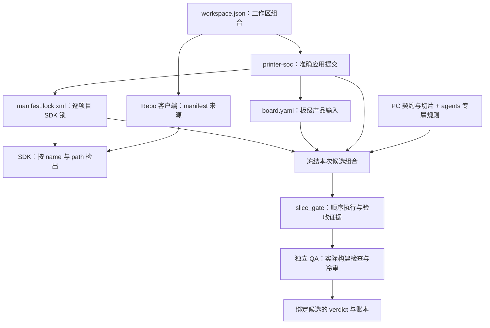

# C308L SDK、printer-soc 与跨仓治理迁移评估及实施方案

状态：用户已批准将当前改动作本地开发候选提交，操作边界见第 17 节。第 15 节方案 B 已按用户批准落实至 PM skill 与十席组织规则，采用“用户表达想法 → PM 整理需求 ↔ ARCH 核对可行性 → 合成一份方案 → 用户批准 → COORD 组织实施”。保持原流程阶段及一次方案审批，不新增独立文档或签字。三份 skill 格式、YAML/角色/引用一致性及差异空白核验通过，详见第 16 节；此前 QA 暂缓与代码/测试结果保持原样，Python 总行数调整仍未获批。本文是本任务唯一方案原件；历史比选不作为当前有效分工。

## 修订历史

| 版本 | 修订时间（UTC+8） | 修订人 Agent/Author | 变更摘要 | 审批状态 |
| --- | --- | --- | --- | --- |
| v1.0 | 2026-11-16 11:10:55 | AI (Codex) | 拉取新应用仓和完整 SDK，核实构建接缝，提出独立工作区、两层版本锁和九席角色方案 | 待用户批准 |
| v1.1 | 2026-11-16 11:17:04 | AI (Codex) | 补齐 19 项派生文件核验，明确 Helix 按项目归属，移除无须修改的测试入口，预算收敛到 42 文件 | 待用户批准 |
| v1.2 | 2026-11-16 11:30:26 | AI (Codex) | 按用户澄清，将 V2 方案定位为历史架构基础；记录新增第九席 ENG-PLATFORM 已获认可，明确架构梳理与工程执行的批准范围 | 九席架构方向已确认；整体实施待批准 |
| v1.3 | 2026-11-16 11:32:37 | AI (Codex) | 用户批准 v1.2 并启动有界实施，先落实根工作区治理维护范围与新增规则目录授权 | 已批准执行 |
| v1.4 | 2026-11-16 13:14:35 | AI (Codex) | 复审实际工作树与候选，登记 6 项阻断问题、2 项非阻断建议及未完成验收；保留失败原始日志，补齐有序修复与验证建议，纠正历史描述的时态 | 本轮文档更新已授权；修复建议待审阅，等待下一指示 |
| v1.5 | 2026-11-16 13:35:09 | AI (Codex) | 按用户批准执行根 SDK、QA 隔离与模板/manifest 修复；根测试 19 passed，现有 SDK 57/57 校验通过；QA 测试 27 passed、1 failed 后停机，提出具体 1500 行预算 | v1.4 修复已批准；测试失败停机；总行数调整未批准 |
| v1.6 | 2026-11-16 13:56:20 | AI (Codex) | 按用户“当前是架构设计讨论，先手动绕过这次QA，继续工作”记录局部暂缓，继续完善候选输入、门禁职责、SDK 权限与续跑设计；补核本地应用图谱 | 当前方案设计继续；本次 QA 暂缓已授权，未视为通过或批准总行数调整 |
| v1.7 | 2026-11-16 14:37:15 | AI (Codex) | 按用户补充，核对 ARCH 现有 skill/rules，提出需求澄清、目标翻译、边界及可行性前置流程，定义产物与三文件最小落地范围 | 当前组织设计补充；未修改活动 skill/rules，不新增固定审批轮次 |
| v1.8 | 2026-11-16 15:27:28 | AI (Codex) | 扫描用户指定 skillslab 的 79 份 skill 清单并重点审阅相关正文/引用，登记可借鉴方法与冲突适配；比较 ARCH 兼任与 PM 独立两案，提出按需 PM 的产品/技术交接设计 | 只完成扫描与设计建议；PM 席位及新增 skill 尚未批准启用 |
| v1.9 | 2026-11-16 15:37:20 | AI (Codex) | 按用户批准落实 PM skill、十席职责与单一方案交接，按最新要求避免新增流程阶段/签字；三份 skill 格式、YAML/角色/引用及差异空白核验通过 | 本轮组织与技能落地完成；无独立 QA/SW/HIL 准出，不含 Python 预算批准 |
| v1.10 | 2026-11-16 15:58:44 | AI (Codex) | 按用户“批准执行提交”登记本地开发候选提交范围，记录测试仓提交；子仓提交后同步根版本锁，保留此前失败与未完成验收 | 本地提交已批准；不含推送、正式准出或 Python 预算调整 |
| v1.11 | 2026-11-16 16:18:09 | AI (Codex) | 按用户“解决空格的问题，并提交”清理归档 XML 两行空格，更新归档摘要并记录原始摘要；继续既定本地提交与根版本锁同步 | 空白修正及继续提交已批准；正式 SDK 锁和既有 QA 结论保持原样 |

## 1. 用户目标与本轮边界

1. AP 主线改为 `ssh://git@192.168.77.113:2222/sushaohua/printer-soc.git`，停止将 VMware 作为开发、部署或验收环境前提。
2. C308L SDK 来源为 `ssh://git@192.168.77.113:2222/software/soc/amc308l/manifests.git`，由 Repo 管理；评估应用仓与 SDK 的组织方式。
3. 明确 SDK 进入当前工作区的方法，以及角色矩阵、公共 rules、分仓技能、切片编排和 QA 的调整。
4. 用户此前另行明确授权拉取所需源码。v1.0～v1.2 评估阶段仅写隔离评估副本、取证及本方案；v1.3 获批后已产生工程、规则及锁文件变更。v1.4 本轮只审阅现状、运行本地回归并更新方案，没有修改工程代码、连接硬件或发布远端；当前事实与限制见第 11 节。

本方案首批实施范围为源码组织、输入锁定、规则与门禁适配。完整系统制镜 hook、产品升级策略、摄像头功能、文件资产服务及 Helix 真实后台适配另列业务方案，不在本批顺带实现。

### 1.1 历史基础与本次已确认的架构方向

- 用户明确：根 `docs/v2_governance_and_orchestration_implementationplan_20261114_152634.md` 是历史基础，不是当前架构的完整描述；文档用于帮助梳理架构。保留其深模块、最小接缝、两阶段审批和自动门禁等有效设计依据，不将历史八席数量当作当前角色演进上限。
- 用户明确同意新增第九席 **ENG-PLATFORM**。本方案按九席展开，不再把是否增加该席位列为待确认事项；规则工作树已部分更新，机械执行链仍有缺口，见第 11 节。
- 九席分工围绕新事实展开：printer-soc 承担打印应用与产品集成，C308L SDK 提供平台构建及硬件能力；ENG-AP 与 ENG-PLATFORM 按业务语义和平台实现分工，通过明确接口完成同一功能切片。
- 本文先说明源码归属、依赖、职责和集成关系，再据此推导规则、技能及编排改动。42 文件清单为此前获批的实施边界；v1.4 不扩张工程文件白名单，也不将本轮审阅视为新增执行指令。历史方案保持原件，不追改历史结项记录。

## 2. 物理取证与输入基线

| 输入 | 实测值 |
| --- | --- |
| 新应用仓 | `printer-soc`，默认 `main`，`9db01b49b2ed6a7b16d423718dab2d746a1274ad` |
| SDK 清单仓 | 默认 `master`，`0f37f765bdb963d129891e25dda549d6debd4931` |
| SDK 同步 | `repo init ... -b master -m default.xml --depth=1 --no-clone-bundle --no-tags`；`repo sync -j4 --fail-fast --no-clone-bundle --no-tags`，退出 0 |
| 项目规模 | 57 个 project 路径，54 个不同 Git 仓名；有同仓多路径及嵌套项目 |
| 导出清单 | `sdk-resolved.xml`，SHA-256 `204623f77b6333d6ebd4a14c43a80f2e3d80232ecc70a23ab401b9e0285b1e2d`；57 个实际 HEAD 均与清单一致 |
| 关键平台输入 | `release-tool@21653a117c57f3d9a21baec7a86f5801a80146ec`；`common_drivers@6aef285d50e998cb39dd6a3d7e05f82bd4c0c31c` |
| Helix 输入 | `craftdance/helixscreen@910dba53c0ad2f833678bc226f6331242fb6bef0` |
| 工具链 | SDK GCC `--version` 退出 0，10.3.1，`arm-none-linux-gnueabihf` |
| 评估目录 | `artifacts/c308l-assessment/{printer-soc,manifests,sdk}`，SDK 约 6.1 GiB；当前是浅历史评估副本 |

归档证据位于 `project-control/docs/evidence/c308l_workspace_assessment_20261116/`：原始与解析后 XML、逐项目 HEAD/原始 Git 状态、同步日志、输入摘要；19 项 copyfile/linkfile 的内容或链接目标全部核验匹配。`platform/hardware/bluetooth` 的子仓目录及 `aml_commonlib`、`linux/mbp` 的 Makefile 链接出现在父仓未跟踪状态中，与 manifest 的嵌套及 linkfile 对应；不得删除它们来制造“干净”。

新仓已有 `documents/platform_integration_design.md`、`documents/dependency_build_release.md`、`boards/c308l-aw419/rootfs-overlay/` 和 `tools/package_c308l_product.py`。本文沿用这些产品边界，治理方案仅引用产品设计，不另建矛盾的应用架构真源。

### 2.1 端到端真实符号调用链与现状断点核实表

| 链路 | 已核实的文件与符号 | 证据与断点 |
| --- | --- | --- |
| 应用交叉构建 | `printer-soc:tools/build_c308l_services.py:main → unpack → build_all → build_dependency/run`；`cmake/toolchains/c308l.cmake` 消费 `C308L_SDK_ROOT` | 新拉取源码逐项检索确认；目标依赖取 SDK expat，Helix 构建取 SDK zlib；输出目录明确拒绝位于 SDK 内 |
| 产品应用安装 | `printer-soc:tools/package_c308l_product.py:main → verify_source`，消费后台运行目录和可选 Helix 目录，生成 rootfs 安装树 | 已有实际实现；尚未接入 SDK 最终制镜 |
| SDK 系统构建 | `SDK:release-tool/env/mk/Makefile.sdk:global → UPGRADE_IMAGE_BUILD → AML_ROOTFS_BUILD/AML_IMAGE_BUILD` | 读取 Makefile 宏，不执行 make；应用安装接缝位于 vendor/SWUpdate 依赖安装之后、strip/rootfs 之前 |
| 摄像头组件初始化 | `SDK:sdk_demo/modules/mod_init.c:AML_MOD_Init → AML_MOD_VI_Register/AML_MOD_VENC_Register/AML_MOD_RTSP_SERVER_Register/AML_MOD_RECORD_Register` | 从真实 C 调用核实；含 VI、编码、RTSP、录像示例，不能由源码存在推定摄像头实机已工作 |
| 串口所有权 | `printer-soc:services/forward/forward_service.cpp:forward_service_start → fwd_io_start/fwd_uart_open`；`forward_uart.cpp:fwd_uart_open → fwd_io_control/fwd_comm_serial_open` | 新仓源码核实；线程归属检查继续沿用，不因仓库迁移改变协议行为 |
| 原 AST 记录 | `soc-ap:services/forward/forward_service.cpp:forward_service_start() → init_dds_entities()`；`forward_uart.cpp:fwd_uart_open() → get_baud_constant()` | 旧 `graphify-out/graph.json` 有 `EXTRACTED` 调用边；`built_at_commit=3b6a214...`，落后于现有源码，不能替新仓签署调用链 |
| 评估时 AST 缺项与 v1.6 补证 | 早期评估未取得新仓图谱；v1.6 已读取本地 `printer-soc/graphify-out/graph.json`，其 `built_at_commit=d9278c5269af69d1a8b5159653ce68186e59cf1c` 与当前干净应用仓 HEAD 相同 | 2647 节点、8080 边；已核实 `main → unpack/build_all/package_runtime` 及 `forward_service_start → init_dds_entities` 的 `calls/EXTRACTED` 边。这份图谱支持应用链路，不代签 SDK Makefile、未提交平台检查或治理工具新设计 |
| 迁移前门禁断点与当前修复 | `project-control:tools/gates/slice_gate.py:_run_docker_qa/_qa_command` 对接 `tools/qa_runner/qa_runner.py:create_cli_parser/parse_command_spec` | 迁移前参数与命令规格不一致；v1.4 已核实工作树改用 `--task/--revision/--repo-commit` 及 `kind:subpath:command`，证据路径改为 Runner 实际输出位置。CLI 接缝的静态修正已存在，完整准出与证据核验仍有 R1～R6 缺口，未运行正式漏斗 |

## 3. 仓库组织比选与建议

Repo 是多个独立 Git 仓的组合管理工具。把 `printer-soc` 写为一个 project 不会合并 Git 历史；真正需要决定的是应用检出位置、同步权限和谁锁定组合版本。

| 方案 | 优点 | 代价与适用条件 |
| --- | --- | --- |
| A：应用作为 SDK manifest 的 project，例如 SDK 内 `applications/printer-soc` | 一次 Repo 同步取得应用及系统输入；适合已有统一产品 manifest、统一发布的团队 | 日常应用检出受 SDK 同步管理；本工作区工具必须理解嵌套 Repo 项目；若根 workspace 又管理同一应用，产生双重同步和版本归属。仍需安装/制镜接缝，加入 XML 不会自动参加 make |
| B：应用与 SDK 在工作区并列，分别由 Git/Repo 管理 | 直接沿用已存在的 `--sdk` 接口；应用迭代无需同步 BSP；跨 MCU 的工作区仍是完整产品协作入口 | 需要根工作区显式登记 Repo 客户端，并校验应用提交与 SDK 锁的匹配；完整系统发布需组合两者 |

**推荐 B 作为当前主开发结构。** 新应用仓已经按外部 SDK 输入设计，当前 SDK 原清单没有 printer-soc。采用 B 可以不改供应商原始 manifest 和 SDK 源码，完成本轮结构迁移；不把旧应用目录简单改远端后覆盖新仓差异。

将来如果要提供“一条 repo sync 取得整个产品”的发行工作区，可建立单独受控的产品组合 manifest，在独立发行检出中包含 SDK 锁与 printer-soc project；那是另一个明确的物理布局模式，不得与开发工作区对同一个目录重复管理。本批无需额外创建组合 manifest 仓。

## 4. 推荐物理布局与版本权威

```text
ai_soc_project/
  workspace.json                  # 普通 Git 仓 + 显式 Repo 客户端登记
  project-control/                # 跨仓治理与发布证据
  printer-soc/                    # 新应用主线，独立 Git
  sdk/c308l/                      # 独立 Repo 客户端，内部 57 个项目
  mcu-p3/
  boot/{bootloadermc,bootloaderth}/
  test_harness/
  agents/{printer-soc,c308l-sdk,...}/
  soc-ap/                         # 迁移期保留的历史只读副本，不再参与活动 AP 构建
  artifacts/c308l-assessment/      # 本轮评估副本，非正式构建基线
```

原 `soc-ap` 暂保留原位并从活动仓清单、派单和契约端点移出，不删除、不将新旧仓强行合并。历史任务卡、签署和证据继续保留原仓名与候选，不作全库字符串替换。宿主单测仍可在 Linux 容器执行，VMware 不再是必需环境或自动回退目标。

版本分两层，各有唯一源：

1. 根 `workspace.json` 锁普通仓准确提交，包括 printer-soc；SDK 登记 manifest URL/准确提交、客户端路径和锁文件引用。SDK 不是普通 Git 根，不塞进现有 `repositories[]` 假装单仓。
2. `printer-soc/boards/c308l-aw419/sdk/manifest.lock.xml` 作为该应用组合采用的 SDK resolved manifest，逐路径锁定完整提交，并保留 remote、copyfile、linkfile、嵌套及重复仓名语义。根只引用“printer-soc 准确提交内的锁文件路径及摘要”，不再手抄另一份 57 项清单。
3. `project-control/manifest.yaml` 记录组合身份、目标板与验证覆盖；不重复维护 SDK 项目提交表，也不把锁定提升为构建/HIL 通过。
4. 板型及 ABI、运行设备、产品 profile 的技术原件在 printer-soc 板级描述；PC 的平台契约引用其版本和摘要。MiniMCProto 机器真源仍在 `project-control/contracts/minimc_v2_contract.yaml`，本批只改 AP 仓路径，不改命令码/字节向量。

SDK 检查按 `(项目名, project path)` 标识项目，不能以仓名作为唯一键。分离受控源码差异、manifest 派生链接、嵌套项目和生成输出；允许的链接必须核验目标，不可忽略任意未跟踪文件。默认源客户端只同步不构建，完整 SDK 构建使用隔离工作副本；已核实 make 流程存在输入树内输出/链接行为。

### 4.1 根工具需要的真实改造

迁移前 `tools/workspace.py:load_manifest` 仅接受 schema 1，`state` 要求独立 Git 根且拒绝软链接根，`publish` 逐普通仓推送，路径校验拒绝父子重叠。v1.4 已核实当前工作树接受 schema 1/2 并调用 SDK 适配器；下面保留原设计要求，实际落地和验收状态见第 11 节，不能以字段或链接存在声称恢复闭环通过。

建议升级 schema 2，保持 schema 1 读取兼容，新增独立 `repo_clients` 配置和 `tools/sdk_workspace.py` 适配器：

- `restore/status/verify` 显式涵盖 SDK 初始化、锁清单同步、57 项版本与派生链接检查；普通 AP/MCU 仓和 SDK 客户端不得物理重叠。
- `lock` 不因 SDK 的移动 master 自动更新产品兼容锁；SDK 升版通过单独接受的输入更新流程。
- `publish` 仍只发布获授权的项目仓，不自动向 54 个 SDK 远端建仓或推送；SDK 修改先由其 Owner 发布准确候选，再更新产品锁。
- 根离线 bundle 的报告明确覆盖哪些普通仓；完整 SDK 离线恢复另行提供 Repo 镜像/对象包及锁，未包含时必须写明 SDK 需联网，不能把仅含 manifest 的包称作完整恢复包。

## 5. 角色矩阵：已确认新增第九席 ENG-PLATFORM

用户已确认九席架构方向。下表细化职责及写边界，供当前架构梳理与后续规则实施使用。

| 角色 | 建议的新职责与写边界 |
| --- | --- |
| COORD | PC 内审批、派单、证据与资源排期；业务和 SDK 源码只读。根壳维护只在任务显式授权的根文件白名单内执行；本次须先修订现有只允许 workspace.json 的边界 |
| ARCH | PC 内方案、调用链、契约与切片；每次识别 SDK 项目名、路径、提交和消费者，不向整个 SDK 批量派写权限 |
| ENG-AP | printer-soc 应用、服务、中间件、产品安装、板级产品描述和 SDK 兼容锁；Helix 后台适配按批准的具体消费者实施。需要修改 Helix 本体时，单独授权 SDK 内 craftdance/helixscreen 项目及产品分支，不扩张到其他 SDK 项目 |
| ENG-PLATFORM（新增） | SDK 中切片逐项指定的平台 Git 项目及路径，负责内核/设备树/驱动、工具链 ABI、媒体/相机底层、rootfs 和系统制镜接缝；不得以 SDK 根作为一个可任意写入的仓，不代写打印业务或 Helix UI |
| ENG-MCU | 继续负责 mcu-p3 的 MC/TH App，分支 feat/soc-debug |
| ENG_BOOT_MC / ENG_BOOT_TH | 继续各自负责独立 Bootloader，分支 soc_debug |
| INTEGRATOR | test_harness 验收资产和明确授权的部署集成；组合 AP、SDK、MCU 准确候选，记录 UART/屏幕/摄像头/存储资源租约 |
| QA | 独立候选软件审阅、目标软件/镜像检查与获授权 HIL；开发者 SDK 目录不能直接挂入正式 QA 冒充干净输入 |

ENG-AP 的板级产品配置与 ENG-PLATFORM 的厂商平台实现通过输入输出契约衔接：前者锁定接受的 SDK 提交，后者交付平台候选提交与验证结果。同一 Git 项目发生多任务改动时串行或独立检出；不得仅因“同属 SDK”就共用可变构建输出。

摄像头的驱动、传感器适配、ISP/编码资源由 ENG-PLATFORM 主责；预览入口、录像策略、UI/外部业务接口由 ENG-AP 主责。SDK 有 `sdk_demo/modules/record` 等实现，不代表已经具备打印作业的文件导入、内容识别、身份、配额、引用和删除策略；这些产品语义仍由 ENG-AP 的文件资产领域定义。两者可以复用底层能力，不能直接将厂商 Demo 当成产品文件服务。

## 6. rules、skill 与编排的具体调整

### 6.1 精确修改清单与预算

预算按首批“结构和治理可运行”估算，原工程文件硬上限为 42 个；用户批准 PM 方案 B 后增加一个项目专用 skill，当前上限为 **43 个**。当前方案及五份取证文件单列为六份文档制品。再次超出预算先在本文更新并重新审阅变更范围。

| 范围 | 精确目标 | 上限 |
| --- | --- | ---: |
| 根工作区 | `workspace.json`、`.gitignore`、`AGENTS.md`、`README.md`、`docs/WORKSPACE.md`、`tools/workspace.py`、新增 `tools/sdk_workspace.py`、`tools/test_workspace.py` | 8 |
| PC 活动输入 | `manifest.yaml`、`config/qa_runner/default_config.yaml`、`contracts/minimc_v2_contract.yaml`、新增 `contracts/c308l_platform_contract.yaml`、`slices/TEMPLATE_SLICE.yaml` | 5 |
| PC 权威规则 | `.agents/rules/02_模块与Agent职责.md`、`repository_rule_boundaries.md`、`repository_rule_sources.json`、`delivery_and_coord_gate.md`、`codex_qa_review.md` | 5 |
| PC 五技能 | `.agents/skills/{product-requirements,arch-deep-spec,slice-batch-orchestrator,two-axis-qa-audit,hil-and-issue-triage}/SKILL.md` | 5 |
| PC 工具与验证 | `tools/workflow/run_slice_batch.py`、`tools/gates/{fast_gate,slice_gate}.py`、`tools/qa_runner/qa_runner.py`、`tools/test_v2_gates.py`、`tools/test_qa_runner.py` | 6 |
| agents 新应用入口 | `printer-soc/AGENTS.md`、`printer-soc/.agents/rules/repository.md`、`printer-soc/.agents/skills/{contract-vertical-tdd,systematic-link-debugging,hmi-frontend-design}/SKILL.md` | 5 |
| agents SDK 入口 | `c308l-sdk/AGENTS.md`、`c308l-sdk/.agents/rules/repository.md`、`c308l-sdk/.agents/skills/sdk-platform-integration/SKILL.md` | 3 |
| 新应用产品输入 | `boards/c308l-aw419/sdk/manifest.lock.xml`、`boards/c308l-aw419/board.yaml`、`documents/external_inputs.md` | 3 |
| 测试资产 | `test_harness/runner/harness_runner.py`、新增 `static_checks/platform/check_platform_inputs.py`、新增 `static_checks/platform/test_platform_inputs.py` | 3 |

上表合计 43，包含已批准的 PM skill。厂商 SDK 源码、Marlin、双 Bootloader 本批源码修改预算为 **0**。新增和修改注释/文档字符串全部使用中文。v1.3 先更新根授权与规则边界后，`agents/printer-soc`、`agents/c308l-sdk` 已进入本项目白名单；v1.4 按该边界读取了相关入口，未探测 agents 内无关目录。工程文件预算不能替代既有 V2 工具总计 900 行的独立约束；后者的既有失败及处理要求见 R6。

### 6.2 规则与技能的语义修改

- 公共规则继续只有 PC 一份；新规则目录承载各自专属内容，旧 agents/soc-ap 历史保持，不向 57 个 SDK 项目复制公共规则。
- 仓身份使用逻辑 ID、真实 URL、checkout path、分支/接受 revision、allowed_paths、Owner 的映射；禁止脚本默认把所有项目拼为 `sushaohua/<repo>`。
- SDK 内项目按实际职责确定 Owner，不能根据父目录自动全部分给 ENG-PLATFORM。Helix 是应用项目，内核/驱动/制镜是平台项目；项目 Owner 映射随平台契约登记，所有写入仍需要该 project 的准确路径和分支白名单。
- SDK 供应商基线可以 detached HEAD，工程改动必须在批准的产品分支并记录 base/candidate SHA；不能把锁定基线的 detached HEAD 误判为普通开发分支，也不能放开所有 SDK 分支。
- ARCH 技能增加 SDK Makefile/配置/linkfile/预编译输入的依赖证据，AST 仅覆盖可解析源码；未生成或过期图谱不冒充当前取证。
- 编排技能增加 Repo 客户端预检、SDK 资源/输出目录隔离、输入组合匹配和实际 run_workflow 能力检查；SDK 无改动的应用切片无需触发全量 BSP 构建。
- QA 技能增加 ARM ABI、动态加载器、库版本、rootfs 安装清单及镜像输入来源检查。软件验证、目标板设备验证和物理动作验证分别报告；保留 SW-Verified/HIL-Verified 两态，具体覆盖写入结构化报告。
- HIL 技能去掉 `/dev/ttyUSB*` 与 Web HMI 必需的硬编码：当前 C308L UART 为受控 `/dev/ttyS1`；业务入口按真实 Helix/本机 IPC/外部 API 选定。身份查询的证据要求不强塞“运动日志”；摄像头/存储采用各自物理证据。
- HMI 技能改为 Helix 本地触屏优先，Gateway 是外部客户端入口；不得硬编码旧页面或与真实状态契约不符的 3s/10s 阈值。
- 新 SDK 专属技能约束“锁输入 → 精确项目改动 → 干净目标构建 → 安装/ABI 证据 → 经授权实机验证”，厂商原始大函数不全量重写；自研新增代码仍受规模与中文注释门禁。

### 6.3 流水线与验收接口

保留四阶门禁结构，但增加显式构建 profile：`host-software`、`c308l-app`、`c308l-system`；它们是构建/验证范围，不是额外准出状态。

1. 快检：活动仓映射、产品锁、SDK 清单/派生链接、板型与应用 ABI、权限及 diff budget。禁止在三秒快检中同步或遍历整个 SDK；使用已核验的输入摘要，摘要变化触发独立完整预检。
2. 集成：按切片运行真实进程或独立软件核；PTY 等明确标为软件验证。
3. 独立 QA：准确候选检出、固定构建镜像摘要；受控 SDK 输入由准确锁重建或由有完整来源的只读 SDK 制品提供；输出单独可写。跨编译产物不能直接在 x86 容器当成本机测试执行。
4. 独立代码审阅：绑定应用、SDK 锁/必要项目、PC、agents、测试资产和构建 profile 的组合身份；通过后追加账本。

不在活动工作流中将命令退出码或可读日志当作通过凭证：修正 slice_gate 的 CLI 与命令规格，对接后检查实际退出状态、锁、容器证据和 verdict。续跑跳过条件须包含 slice revision 与完整输入组合，不能仅凭同一个 slice_id 的旧 SW-Verified 行跳过新 SDK 候选。

原计划接口如下；v1.4 已核实这些函数有实现，存在不等于完成真实恢复或独立 QA 验收，实际状态见第 11 节。`load_sdk_spec` 当前另有可选第三参数 `repositories=None`，其余接口职责沿用下表：

| 文件 | 接口签名 | 契约 |
| --- | --- | --- |
| `tools/sdk_workspace.py` | `load_sdk_spec(root: Path, entry: dict) -> dict` | 解析并验证 Repo 客户端描述及 lock 引用，拒绝越界/重叠 |
| 同上 | `inspect_sdk(root: Path, spec: dict) -> dict` | 核对逐项目 HEAD、派生链接与有效状态，返回摘要与缺项 |
| 同上 | `restore_sdk(root: Path, spec: dict) -> None` | 仅创建缺失客户端；已有差异拒绝覆盖，按准确清单同步 |
| 同上 | `verify_sdk(root: Path, spec: dict) -> dict` | 不拉取、不改锁；不匹配返回明确错误 |
| `test_harness/static_checks/platform/check_platform_inputs.py` | `validate_platform_inputs(workspace: Path, contract: dict) -> list[str]` | 校验产品提交、SDK 锁、ABI、配置与来源绑定，正负例共同验证 |

旧 `QARunRequest`、`RepositoryTarget` 及证据接口优先扩展，避免另建并行 QA 框架。准确字段和兼容迁移由对应切片定义；所有函数保持不超过四个入参。

## 7. 有序实施切片与验收

本表为此前获批的实施顺序，当前尚未完成各项 Pass Criteria；v1.4 本轮不生成或执行切片，后续补齐顺序及验证要求见第 11.4 节，禁止将接口存在写成切片完成。

| ID | 目标文件/交付 | 前置依赖 | 验收命令与 Pass Criteria |
| --- | --- | --- | --- |
| MIG-C308L-01：新 AP 与 SDK 精确恢复闭环 | 根八文件；新应用 SDK 锁/板级描述；agents 新入口 | 用户批准；先更新根写边界和 agents 白名单；复核远端候选未漂移 | 修改后运行 `python3 -m unittest discover -s tools -p 'test_workspace.py' -v`；在工作区内新的隔离恢复目录执行实际 restore/verify。能从准确应用提交恢复 SDK，57 项匹配，篡改锁或已有用户修改时拒绝覆盖；旧 soc-ap 不参与活动 AP 路径 |
| MIG-C308L-02：治理映射到真实项目 | PC manifest、QA 配置、协议 AP 路径、平台契约、五项规则、四技能、切片模板 | 01；接受新入口映射 | `python3 project-control/tools/sync_contracts.py --workspace .`；使用实际受控候选执行 fast_gate。新 AP 与 MC/TH/Boot 常量对齐；命令码/黄金字节不变；SDK 变更越权与错误分支负例拒绝；没有改写历史签署 |
| MIG-C308L-03：准确候选进入独立 QA | PC 六个工具/测试文件、test_harness 三文件 | 01、02；SDK 构建输入与容器镜像已固定 | `python3 -m pytest -o cache_dir=artifacts/c308l-assessment/pytest-cache project-control/tools/test_v2_gates.py project-control/tools/test_qa_runner.py -q`，并执行一次实际 slice_gate → qa_runner 容器 → 独立审阅。证明 CLI、命令顺序、候选锁/SDK 摘要变化触发重验；缺 SDK/错 ARM ABI 的负例拒绝。模拟 Runner 不能替代本项实际演练 |
| MIG-C308L-04：C308L 应用构建闭环 | 复用新应用 `build_c308l_services.py --sdk <受控SDK> --work <全新输出> --jobs 4` 与 `package_c308l_product.py --runtime <运行目录> --output <全新安装目录>` | 03；明确依赖输入；不连接硬件 | 从已锁定源码真实交叉构建，检查 ARM ELF、动态依赖、逐文件/链接/权限清单，源 SDK 无非派生变更，软件 QA 与审阅绑定同一组合；只报告本项软件范围，不执行烧录或运动 |

01～03 同时调整治理入口且需跨仓提交，提交顺序先规则/工具候选，再新产品输入，最后锁定根组合。每个仓保持单一逻辑提交；正式推送前 rebase 对齐，冲突立即停机。未获得远端发布授权时仅交付本地候选与结果，不能把未推送提交传给要求服务端候选的正式 QA；相关步骤停在发布授权边界。

## 8. 软硬件、资源及契约推演

- 本批只迁移源码与治理，不改变 MiniMCProto、波特率、ACK、超时、ISR 优先级或 MC/TH 静态缓冲。AP 使用 `/dev/ttyS1`、921600/8N1/无流控的现有配置；不由此推定对端固件身份或动作闭环。
- MC App `0x08020000`、TH App `0x08004000` 和两 Bootloader 边界不变。SoC Linux 系统升级与 MCU OTA 是不同交付域，禁止在本批写分区或修改 VTOR/擦除逻辑。
- SDK 用户态工具链为 ARM32 hard-float；Bootloader/RTOS 配方存在 ARM64 工具链需求，不能把用户态 GCC 当作整套镜像工具链已齐备的证据。
- `Config.mk` 的 SPI_NAND、RTOS、sensor 等仅为源码默认值，不代表实板配置。正式系统镜像/摄像头切片前，需核实板卡存储、分区、传感器及总线；本轮标记 `[UNVERIFIED]`，不提前确定量产 profile。
- RAM、媒体预留内存、存储容量和摄像头吞吐需实机及具体分辨率/帧率目标输入，本批无相关参数改动。平台契约先表达“必需输入和来源”，禁止编造预算。
- 编排资源扩展为串口、屏幕/输入、相机 sensor/ISP/编码通道、数据卷和系统升级窗口。开发实例、常驻产品实例及 HIL 不得同时争用同一硬件；DDS domain 不提供硬件隔离。

## 9. 验证、回滚与待确认事项

此前评估阶段已完成：SSH 远端默认分支/HEAD 核实、应用克隆、完整 Repo 同步、57 项 HEAD 对账、原始 Git 状态采集、SDK GCC 版本查询、源代码与当前配置检索。上述评估没有执行应用/SDK 构建、测试、门禁、独立 QA、开发板连接或 HIL；新仓文档的既有实机记录不作为重新实测。v1.4 本轮另执行了一次本地回归，遇首个失败即停止，原始结果见第 11.3 节。

实施回滚：保留旧 soc-ap 原目录和新评估副本；根组合由旧 workspace.json 提交可恢复。有效规则/配置改动逐仓以可审阅的反向提交回退，不 reset 用户工作树。SDK 采用新客户端或隔离副本，版本不匹配时保留现场；不得用 force-sync、删除本地修改、清空 data 或刷机作为恢复手段。manifest 派生文件按清单核验，禁止一键 clean 删除。

新增第九席 ENG-PLATFORM 已获用户确认，无需重复询问。本轮保留应用与 SDK 并列布局、两层版本锁及 42 文件边界，针对已发现缺口给出修复建议，等待下一指示。板卡存储、摄像头型号与实际镜像 profile 在后续对应业务/制镜方案时再确认，不阻塞本次仓库组织评估。远端发布与物理部署仍按当次明确授权执行。

## 10. 外部依据

- Repo 官方 manifest 规范：<https://gerrit.googlesource.com/git-repo/+/HEAD/docs/manifest-format.md>，核对 project、revision、path、copyfile、linkfile 及默认 revision 继承语义。
- 产品设计与真实实现：本轮拉取的 `printer-soc@9db01b4` 及 SDK `manifest@0f37f76`，文件路径见本方案取证表与归档清单。
- 历史治理基础：根 `docs/v2_governance_and_orchestration_implementationplan_20261114_152634.md`，此前评估记录为已完整读取；v1.4 未重新通读，不将该记录当作本轮新取证。其历史范围与审批不替代本次用户决定或自动批准新实施范围。

## 11. v1.4 现状复审、修改建议与剩余验收

### 11.1 审查范围与客观状态

本轮按 `two-axis-qa-audit` 的 Spec/真实性及安全/预算口径进行源码审阅和本地回归，**不是正式独立 Codex QA**。没有启动巡航、Docker、SDK 同步、交叉构建、图谱生成、远端发布或硬件操作；不签发 SW-Verified/HIL-Verified，也不修改账本。本轮唯一主动修改的持久文件为本方案。复审依据是实际工作树，未提交差异也是被审对象，不能只用 HEAD 代表当前实现。

| 范围 | 已核实状态 | 验收限制 |
| --- | --- | --- |
| 根工作区 | `main`，本地领先缓存 origin/main 1 提交；6 个受跟踪文件有修改，`tools/sdk_workspace.py` 未跟踪；schema 2 与 SDK 调用已写入工作树 | 本地 schema 1 测试不能证明 SDK 恢复通过；未做新客户端完整 restore/verify |
| project-control | `main@82b5643cde7637864982afddbf86239fee7301b1`，领先缓存 origin/main 3 提交；规则、配置、slice_gate、qa_runner 等有未提交改动，平台契约未跟踪 | `fast_gate.py`、`run_slice_batch.py`、切片模板及 `test_v2_gates.py` 尚无本轮迁移差异；实际测试触发预算失败 |
| printer-soc | `main@d9278c5269af69d1a8b5159653ce68186e59cf1c`，工作树干净，领先缓存 origin/main 1 提交 | 该本地提交含板级描述、SDK 锁及 external_inputs；不是新应用构建、远端可用或 HIL 的证明 |
| test_harness | `main@c5f35334d4d165ef9d245539995d0d2b4bd1ff6c`，领先缓存 origin/main 1 提交；harness_runner 已修改，platform 检查目录未跟踪 | 新平台单测及 QA Runner 单测在本次 `-x` 首错后未执行，不能记为通过 |
| 规则与产品输入 | 已读取新应用/SDK 专属入口、PC 权威规则、平台契约、板级描述及产品构建/安装脚本 | 未逐项重验全部 SDK 项目、规则分发或实板参数；以上 ahead 仅来自本地缓存，未访问远端确认 |

保留并列 Git/Repo 布局和现有函数链；发现的问题集中在尚未闭环的消费端，无须重建 QA 框架或修改供应商源码。MiniMCProto 命令码、MCU/Bootloader 源码、Flash/VTOR 预算仍为零。本轮没有当前候选 AST 物证，调用链结论来自源码检索，未冒称图谱验证。

### 11.2 分级发现与最小修改建议

以下行号指 v1.4 审查时工作树，未来修改后以函数名定位。R1～R6 为本次迁移准出的 BLOCKER；M1～M2 为非阻断建议。这里的结论是本地复审意见，不替代正式工具 verdict。

| ID / 级别 / 审计轴 | 实证、触发与影响 | 建议的最小改动及 Pass Criteria |
| --- | --- | --- |
| R1 / BLOCKER / spec_realism | `project-control/tools/workflow/run_slice_batch.py:73-75` 的 `run_single_slice` 只要 `call_tool` 正常返回就宣告 SW-Verified，没有读取命令退出码、等待异步进程完成或核验 verdict。工具返回非零退出的日志而不抛异常时仍走成功分支；这是源码中的确定性分支，实际运行时返回结构本轮未验证 | 在原函数内对接实际运行时的进程完成/退出状态，核验本轮 `verdict.json` 及其输入身份，再报告成功；未知返回结构、待运行、非零退出、缺失/REJECTED verdict 一律不得放行。分别覆盖“正常返回但非零”“异步未完成”“拒绝 verdict”和真实成功；环境缺口不得消耗工程返修轮次。保留原有两轮上限，不增设平行调度器 |
| R2 / BLOCKER / spec_realism | 同文件 `run_batch_cruise:91-97` 仍由 `parse_verified_slices` 仅提取 ID，命中同 ID 历史绿行即跳过。`slice_gate.py:58-65,110-123` 虽已写入 fingerprint，巡航端没有消费它；revision、profile、应用或 SDK 锁更新后仍可能跳过新验收 | 在现有账本解析/续跑逻辑中比较 slice revision 与完整输入 fingerprint，并核验关联证据。旧记录没有 fingerprint 时不作为新候选跳过凭据；完全相同输入才可复用。`test_v2_gates.py` 增加同 ID 变更 revision/提交/SDK 锁/profile 必须重跑的负例，保持历史行原样 |
| R3 / BLOCKER / embedded_safety | `fast_gate.py:176-185` 只调用旧协议、分支/文件/预算检查；`check_subtask_boundary` 未消费 `c308l_platform_contract.yaml:project_owners`，也不识别 SDK project 身份和产品分支。`slices/TEMPLATE_SLICE.yaml` 仍派给 soc-ap，缺 revision/profile/只读输入候选。`slice_gate.py:52-55` 将完整输入仓设为可选，不能保证 PC/agents/测试资产都被绑定。规则文字中的 SDK 写边界尚无机械保障 | 在原模板、快检和输入收集函数内补齐字段及拒绝路径：逐 project 校验 name/path/base/candidate/role/产品分支/allowed_paths，拒绝 SDK 根写权、Owner 不符、READ_ONLY 项目和错误分支；模板转为 printer-soc，并显式锁定必需只读输入。完整 SDK 预检产出可核验摘要，快检只核对适用身份与摘要失效条件，禁止为满足三秒要求省略校验。正例接受准确项目，负例拒绝上述越权及缺项 |
| R4 / BLOCKER / embedded_safety | `qa_runner.py:614-618` 在宿主 Python 进程中动态导入受测 test_harness 候选并执行 `validate_platform_inputs`；`execute_run:727-731` 明确先执行它再启动 Docker。准确提交锁只确定代码版本，不能提供执行隔离。另 `:595-599` 从当前开发工作区复制根 SDK 工具，仅事后记录其哈希，没有核对独立接受的工具候选 | 保留 Runner 的拉取/准备职责，将受测检查脚本的执行移入隔离容器；宿主只使用预先接受且校验过身份的输入准备工具。根 SDK 工具须绑定接受的根仓候选或已接受的工具摘要，缺少来源即阻塞，不能把“刚复制后算出哈希”当成接受。通过测试证明候选模块顶层代码和检查函数不会在 Docker 启动前执行；来源不符在执行前拒绝，保留原始日志 |
| R5 / BLOCKER / spec_realism | `slice_gate.py:_run_docker_qa:84-96` 仅检查进程退出码、文件存在与 `passed=True`，未核对 proof 的 task/revision/profile、server_lock 候选、SDK 锁或证据哈希与容器事实。`_build_review_prompt:99-105` 只传容器 ID 摘要，没有明确本轮证据路径/哈希；不足以保证审阅对象与本轮候选一致。`qa_runner.py:556-571` 的 profile 准入只证明命令种类存在，不能证明 ARM ABI、镜像内容等目标验收已完成 | 在原证据消费端复用已有 server_lock/server_qa/server_verdict，核验全套身份和引用文件哈希、实际容器 image digest/只读挂载及 SDK 来源；将本轮证据路径、摘要和覆盖范围传入现有冷审入口。缺项、旧任务/旧 revision、错 profile、改锁、错误容器来源均拒绝且不写账本。目标 profile 的具体切片必须声明并真实执行 ELF/加载器/递归依赖/安装树或镜像检查，不以 kind 名称代替验收 |
| R6 / BLOCKER / embedded_safety | 本次真实回归在 `project-control/tools/test_v2_gates.py:54` 失败：受检查的 V2 工具与测试共 **930 行 > 900 行**。42 文件边界与旧 900 行预算是两个不同约束；前者未超不能豁免后者。测试在进入后续 QA/platform 用例前停止 | 保留失败断言。先核对增加行数与保留行为，只有存在合理去重/简化且不损失功能与测试覆盖时才收敛；不得压行、删负例、删除必需注释或静默放宽 900。若完整迁移确需增加行数，在本方案列明按文件的新增预算和理由，交用户审阅后再修改预算。当前尚未批准新的总行数，也未声称可在 900 行内完成全部修复 |
| M1 / MINOR / spec_realism | `project-control/manifest.yaml:hardware_environment` 已将运行平台改为 C308L，但仍同时保留顶层 `soc_serial_port=/dev/ttyS1` 与 `soc_serial_format=115200`、`serial_links.ap_mc.ap_device=/dev/ttyUSB0` 等旧配置；新 board.yaml 为 `/dev/ttyS1,921600`。旧字段部分标有历史来源，但当前顶层配置与历史记录混用 | 在已有 manifest 中明确历史观测适用时间与状态；活动串口从准确应用提交的 board.yaml 引用，避免两套当前参数。不得追改历史签署或顺带修改固件波特率。当前无证据证明运行代码消费旧字段，因此本项不单独阻断 |
| M2 / MINOR / embedded_safety | `tools/sdk_workspace.py:_run` 使用 `capture_output=True` 等待至多 900 秒；`restore_sdk` 只在 init/sync 前后打印。长同步期间没有持续进度输出，不符合超过一分钟任务需动态日志的要求 | 在现有命令执行入口保留超时、原始输出和退出码，增加持续输出或明确的周期进度日志；不扩展重试或覆盖策略。验收长任务期间持续可见进度，失败完整保留 stderr/stdout，禁止把日志文字当成功依据 |

### 11.3 本轮验证与首错原始记录

执行命令如下。设置工作区内 TMPDIR 限制测试临时检出位置，禁用 bytecode 与 pytest 缓存；没有修改生产候选或追加测试代码。

```bash
PYTHONDONTWRITEBYTECODE=1 TMPDIR=/home/sushaohua/workspace/ai_soc_project/artifacts/c308l-assessment python3 -m pytest -p no:cacheprovider -x tools/test_workspace.py project-control/tools/test_v2_gates.py project-control/tools/test_qa_runner.py test_harness/static_checks/platform/test_platform_inputs.py -q
```

退出码 **1**；**13 passed，1 failed**。首错后按 Fail-Fast 停止，没有继续执行其他测试、完整 fast_gate、Docker 或独立冷审，也没有改断言后重跑。13 个通过仅代表此前实际执行到的用例；根 `test_workspace.py` 现有测试未覆盖新 SDK 客户端真实恢复，不能据此宣称 MIG-C308L-01 通过。失败原始输出完整保留如下：

```text
.............F
=================================== FAILURES ===================================
___ V2ContractAndFastGateTest.test_v2_python_tools_pass_fast_gate_self_check ___

self = <test_v2_gates.V2ContractAndFastGateTest testMethod=test_v2_python_tools_pass_fast_gate_self_check>

    def test_v2_python_tools_pass_fast_gate_self_check(self) -> None:
        """硬性门禁自检：新增全部 V2 Python 模块满足总预算 <=900 行、单函数 <=50 行、<=4 参与中文注释。"""
        prod_files = [
            TOOLS_DIR / "sync_contracts.py", TOOLS_DIR / "gates/__init__.py",
            TOOLS_DIR / "gates/fast_gate.py", TOOLS_DIR / "gates/codex_review.py",
            TOOLS_DIR / "gates/slice_gate.py", TOOLS_DIR / "workflow/run_slice_batch.py",
        ]
        all_files = prod_files + [TOOLS_DIR / "test_v2_gates.py"]
        total_lines = sum(len(p.read_text(encoding="utf-8").splitlines()) for p in all_files)
>       self.assertLessEqual(total_lines, 900, f"新增 V2 工具含测试总行数 {total_lines} 超出 900 行预算")
E       AssertionError: 930 not less than or equal to 900 : 新增 V2 工具含测试总行数 930 超出 900 行预算

project-control/tools/test_v2_gates.py:54: AssertionError
=========================== short test summary info ============================
FAILED project-control/tools/test_v2_gates.py::V2ContractAndFastGateTest::test_v2_python_tools_pass_fast_gate_self_check
!!!!!!!!!!!!!!!!!!!!!!!!!! stopping after 1 failures !!!!!!!!!!!!!!!!!!!!!!!!!!!
1 failed, 13 passed in 0.78s
```

审查中一次根目录直接 `git diff` 返回“Not a git repository”（退出 129），随后使用规定的 `bash tools/workspace_git.sh diff -- tools/workspace.py` 完成只读差异检查；没有进行根 Git 写操作。该调用错误与上述真实回归失败分开记录。

### 11.4 建议的后续有序子任务与验收约束（尚未执行）

继续在既有 42 文件内修复，以下不是新增业务范围或执行授权。接口优先原地扩展，所有新改自研函数保持不超过四个入参及五十有效代码行。若预算无法满足，先更新本原件明确实际增量，再由用户裁定；不得临时新建框架、悬空适配钩子或伪协议状态。

| 顺序 / ID | 精确目标与沿用接口 | 前置条件与 Pass Criteria |
| --- | --- | --- |
| 1 / REV-C308L-01 | 根 `tools/test_workspace.py`；沿用 `tools/sdk_workspace.py:{load_sdk_spec,inspect_sdk,restore_sdk,verify_sdk}` 与 `tools/workspace.py:{restore,verify}` | 为既有 SDK 实现补真实临时 Git/manifest 的正负恢复用例；验证同名不同路径、嵌套项目、19 项派生规则、改锁/额外文件/现存用户修改拒绝、离线包缺 SDK 拒绝；实际隔离恢复 57 项并 verify。夹具只用于单测，不能替代真实 Repo 演练。失败保留现场，不 force-sync 或清理用户修改 |
| 2 / REV-C308L-02 | PC `slices/TEMPLATE_SLICE.yaml`、`tools/gates/fast_gate.py:check_subtask_boundary/run_fast_gate`、`tools/gates/slice_gate.py:load_slice_spec/input_repositories/input_fingerprint`、`tools/test_v2_gates.py` | 沿用现有平台契约及候选；解决 R3，覆盖准确项目接受及越权/缺只读输入/错分支拒绝。SDK 完整校验与三秒快检分开计时，摘要须绑定本次真实输入，不能写入无真实来源的“已通过”缓存 |
| 3 / REV-C308L-03 | PC `tools/qa_runner/qa_runner.py:{_stage_profile_workspace,prepare_profile_inputs,execute_run}`、`tools/test_qa_runner.py`、`config/qa_runner/default_config.yaml`；必要时沿用测试仓 `static_checks/platform/{check_platform_inputs,test_platform_inputs}.py` | 解决 R4；宿主不执行候选检查代码，SDK 工具有事先接受身份，镜像按接受摘要固定。应用输出单独可写，系统 profile 用独立 SDK 工作副本构建，受控源保持只读；真实软件 QA 按本任务发布边界执行，未推送候选不冒充服务端通过 |
| 4 / REV-C308L-04 | PC `tools/gates/slice_gate.py:{_run_docker_qa,_build_review_prompt}`、`tools/workflow/run_slice_batch.py:{parse_verified_slices,run_single_slice,run_batch_cruise}`、`tools/test_v2_gates.py` | 依赖 2、3；解决 R1、R2、R5。旧证据/错候选拒绝且不写账本；同 ID 新输入重验，只有完全匹配的已验证证据可以跳过。先物理核对运行时工具返回签名；运行时缺失则该项 BLOCKED，不伪造自动巡航成功 |
| 5 / REV-C308L-05 | PC `tools/test_v2_gates.py` 与第 6.1 节既有六个工具/测试文件；根 `tools/sdk_workspace.py:_run`、PC `manifest.yaml` | 处理 R6；总行数调整须有明确新增预算及批准，不能仅修改断言；M1/M2 按原路径最小收敛，不碰历史报告。最后一次工程编辑后重跑完整必要测试及门禁，之前部分通过不复用为最终结果 |

后续本地回归命令沿用第 11.3 节的一条命令，首错即停；其通过后才按第 7 节继续恢复演练、契约/快检、真实 Docker 与独立冷审，最后进入 MIG-C308L-04 的真实交叉构建与安装验收。QA/platform 单测中现有 patch 仅覆盖准入和失败传播，不能替代 SDK 重建、容器隔离或目标制品的物证。

MIG-C308L-04 必须分别报告 ARM ELF、hard-float ABI、加载器、目标 libc/符号版本、递归动态依赖、安装文件/链接/权限与来源；现有 `package_c308l_product.py` 的 ARM32/NEEDED 检查只是其中一部分，不能当成全部 ABI 验收完成。若缺独立验证命令，在已列测试资产内落实；需要额外文件或修改应用构建/打包器时先修订精确白名单，不越过本批三个应用产品输入文件的范围。

回滚继续采用第 9 节的保留现场与逐仓反向提交策略。本轮不修复工程、不提交、不推送、不恢复 SDK、不连接设备。**请审阅 v1.4 的发现、修复次序及预算处理建议；当前停在方案更新，等待下一指示。**

## 12. v1.5 执行记录与 R6 预算调整提案

用户最新指令“按照v1.4方案修复。”已授权第 11.4 节的有界工程修复。第 11 节描述的是复审时点，不再代表当前执行授权；本节持续记录实际修改、验证及余项，历史失败不删除。

### 12.1 V2 总行数的具体提案（待批准）

物理核对计数清单：HEAD 总计 895 行，复审及修复启动时工作树 930 行，唯一已有增量为 slice_gate.py 的 35 行；旧 900 行仅比原基线多 5 行，不能合理容纳 R1/R2/R3/R5 的新检查与负例。建议仍用相同七文件按物理行计数，调整总上限至 **1500 行**，逐文件预算如下，不迁移功能到计数外文件来绕过预算，也不删除原有检查或测试。

| 文件（相对 project-control） | HEAD 行数 | 修复启动行数 | 提议上限 | 增量用途 |
| --- | ---: | ---: | ---: | --- |
| tools/sync_contracts.py | 195 | 195 | 195 | 保持现有协议核验 |
| tools/gates/__init__.py | 1 | 1 | 1 | 保持模块入口 |
| tools/gates/fast_gate.py | 203 | 203 | 300 | SDK 项目身份、Owner、产品分支及路径拒绝逻辑 |
| tools/gates/codex_review.py | 119 | 119 | 119 | 沿用现有独立冷审 |
| tools/gates/slice_gate.py | 133 | 168 | 320 | 必需输入身份、证据引用哈希、容器事实及 SDK 来源核验 |
| tools/workflow/run_slice_batch.py | 108 | 108 | 200 | 进程真实完成判定、verdict 校验及完整输入续跑 |
| tools/test_v2_gates.py | 136 | 136 | 365 | 保留旧覆盖，补旧证据、错误退出、SDK 越权及输入变化负例 |
| **合计** | **895** | **930** | **1500** | 相对当前新增上限 570 行，相对旧预算增加 600 行 |

该上限是逐项需求估算，实际实现应尽量小于预算。**在用户明确批准前不修改 900 行断言，也不实施计数内新增代码**；根 SDK 工具、恢复测试、QA Runner 隔离及当前模板/manifest 修正可在原有文件白名单内先行完成。新总行数批准后，最后一次编辑后统一执行完整回归，预算失败仍按首错熔断，不删失败用例。

运行时核验结果：当前工具目录无 run_workflow/run_command 原语，也没有其真实返回格式证据。R1 实施优先沿用现有 Python 子进程机制取得真实返回码与本轮 verdict，避免臆造工具结果字段；工程 Agent 的 run_workflow 环境仍须后续实际演练，缺运行时不能签署自动巡航通过。

### 12.2 已落地修改与实际验证（2026-11-16 13:35）

本轮工程只写以下七个原白名单文件，并更新本方案；保留此前所有差异，没有提交、推送、连接硬件或改写账本：

- 根 `tools/sdk_workspace.py`：M2 增加 30 秒心跳，保留 900 秒超时，超时终止独立子进程组并保留双流原始日志。
- 根 `tools/test_workspace.py`：新增九个测试，用真实临时 Git 仓、同名不同路径项目、嵌套项目、十九项派生规则覆盖锁/链接篡改、额外/忽略输出、用户修改不覆盖、离线缺 SDK 与命令日志；没有删除旧十个用例。
- PC `tools/qa_runner/qa_runner.py`：R4 实现已改为候选平台检查仅在容器中通过真实 CLI 执行；SDK 工具在宿主复制/导入前比对事先接受的摘要；目标 profile 要求准确镜像摘要；来源只读 `/workspace`，输出独立可写 `/output`，仅系统 profile 复制 SDK 并把副本路径传入构建环境。该实现仍待完整测试验收，R4 不记为关闭。
- PC `tools/test_qa_runner.py`：补工具接受、候选不在宿主执行、容器失败阻止构建、输出隔离及系统副本用例；本次首错后没有修测试或重跑。
- PC `config/qa_runner/default_config.yaml`：新增 `sandbox.image_digest` 与 `security.accepted_sdk_tool_sha256`，当前均为空；缺少接受来源时明确阻塞目标 profile，不能自动把当前开发文件摘要填作接受记录。
- PC `slices/TEMPLATE_SLICE.yaml`：AP 切换为 printer-soc，补 revision/profile/input_repositories 及当前方案引用；R3 的 SDK 机械权限校验仍待预算调整，不因模板改完就结项。
- PC `manifest.yaml`：M1 活动串口改为引用准确 printer-soc 提交的 board.yaml；保留历史接线值并标注适用范围，历史 CH341 观测改用明确的历史键名。工具/测试/应用源码检索未发现旧顶层键的消费者。

| 验证 | 实际命令或调用 | 原始结果及边界 |
| --- | --- | --- |
| 根恢复回归 | `PYTHONDONTWRITEBYTECODE=1 TMPDIR=/home/sushaohua/workspace/ai_soc_project/artifacts/c308l-assessment python3 -m pytest -p no:cacheprovider -x tools/test_workspace.py -q` | 退出 0，`19 passed in 2.32s`。真实磁盘/Git 夹具，不代表全新 SDK 恢复；等待/超时分支是明确的受控单测 |
| 当前真实 SDK 只读全核验 | Python 实际调用根工具 `load_sdk_spec(root, entry)` → `verify_sdk(root, spec)`，entry 来自当前 workspace.json | 退出 0，`project_count=57`、`verified_projects=57`、`errors=[]`，锁摘要 `204623f77b6333d6ebd4a14c43a80f2e3d80232ecc70a23ab401b9e0285b1e2d`。只证明现有客户端与准确产品锁匹配，没有同步或新建客户端 |
| QA Runner 单次回归 | `PYTHONDONTWRITEBYTECODE=1 TMPDIR=/home/sushaohua/workspace/ai_soc_project/artifacts/c308l-assessment python3 -m pytest -p no:cacheprovider -x project-control/tools/test_qa_runner.py -q` | 退出 1，`27 passed, 1 failed in 0.15s`，首错停机；后续用例未执行，不能宣称 R4 已通过 |

QA 首错的完整原始输出如下：

```text
...........................F
=================================== FAILURES ===================================
______ PlatformProfileTest.test_container_platform_failure_prevents_build ______

self = <test_qa_runner.PlatformProfileTest testMethod=test_container_platform_failure_prevents_build>

    def test_container_platform_failure_prevents_build(self):
        """平台校验失败时即使业务命令存在，也不得执行下一条构建。"""
        with tempfile.TemporaryDirectory(prefix="qa_preflight_stop_") as directory:
            box = Path(directory)
>           runner = QARunner({"sandbox": {"base_dir": directory}})

project-control/tools/test_qa_runner.py:465:
_ _ _ _ _ _ _ _ _ _ _ _ _ _ _ _ _ _ _ _ _ _ _ _ _ _ _ _ _ _ _ _ _ _ _ _ _ _ _ _
project-control/tools/qa_runner/qa_runner.py:702: in __init__
    self.sandbox_base = validate_sandbox_path(base_dir, [self.workspace_root])
_ _ _ _ _ _ _ _ _ _ _ _ _ _ _ _ _ _ _ _ _ _ _ _ _ _ _ _ _ _ _ _ _ _ _ _ _ _ _ _

base_dir = PosixPath('/home/sushaohua/workspace/ai_soc_project/artifacts/c308l-assessment/qa_preflight_stop_iksvgnp5')
forbidden_roots = [PosixPath('/home/sushaohua/workspace/ai_soc_project')]

    def validate_sandbox_path(base_dir: Path, forbidden_roots: Optional[List[Path]] = None) -> Path:
        """校验沙箱根目录安全性，确保其不位于任何禁止挂载的开发者工作树内部。"""
        resolved_base = base_dir.resolve()
        if forbidden_roots:
            for root in forbidden_roots:
                resolved_root = root.resolve()
                if resolved_base == resolved_root or resolved_root in resolved_base.parents:
>                   raise QARunnerError(f"Sandbox cannot be placed inside developer worktree: {resolved_base}")
E                   qa_runner.qa_runner.QARunnerError: Sandbox cannot be placed inside developer worktree: /home/sushaohua/workspace/ai_soc_project/artifacts/c308l-assessment/qa_preflight_stop_iksvgnp5

project-control/tools/qa_runner/qa_runner.py:247: QARunnerError
=========================== short test summary info ============================
FAILED project-control/tools/test_qa_runner.py::PlatformProfileTest::test_container_platform_failure_prevents_build
!!!!!!!!!!!!!!!!!!!!!!!!!! stopping after 1 failures !!!!!!!!!!!!!!!!!!!!!!!!!!!
1 failed, 27 passed in 0.15s
```

源码与堆栈核对：为遵守工作区限制，TMPDIR 位于工作区；测试创建 QARunner 时没有传入独立的模拟开发树，生产 `validate_sandbox_path` 因而按既有策略拒绝，尚未运行到该测试预期的容器失败断言。同类构造位于 `test_platform_failure_prevents_container_start`、`test_container_platform_failure_prevents_build` 与 `test_system_build_environment_selects_separate_sdk` 三处。后续建议只在测试中显式传入 `workspace_root=Path(directory) / "developer-worktree"`，把模拟开发树与模拟沙箱分开，不放宽生产隔离检查；此修正当前未执行。

本轮停止依据为根 AGENTS.md 的 Fail-Fast：“构建、测试、门禁脚本或 Git 变基冲突报错时立即停机保留现场，直接呈现完整原始日志”。未自动修正夹具或继续测试。R1/R2/R5 及 R3 的机械校验未改；R6 仍待批准第 12.1 节具体预算，原 900 行断言保留。57 项全新恢复、目标应用构建、真实 Docker 和独立冷审均未执行；没有准出状态升级。

**待用户下一指示：允许修正上述三处测试夹具并继续验证；确认是否接受第 12.1 节 1500 行上限，再推进 R1/R2/R3/R5。**

## 13. v1.6 架构设计继续：输入、执行、证据与恢复接缝

### 13.1 本次 QA 暂缓的准确范围

用户最新明确指令为：“当前是架构设计讨论，先手动绕过这次QA，继续工作。”据此撤销第 12.2 节针对**本次架构讨论**的等待条件，继续源码取证和方案完善；本次 `test_qa_runner.py` 的失败不再作为讨论前置门槛。保留原始退出 1、27 passed/1 failed 的事实，不重写为通过、不追加 SW-Verified/HIL-Verified，也不新增全局跳过 QA 的开关。

本轮只更新本方案，没有修改工程代码或重跑 QA。第 12.1 节 1500 行是后续代码实施的预算提案，未将本次局部 QA 暂缓解释为其批准；它不阻塞当前设计讨论。测试夹具修正、代码回归和正式准出在实际工程验收阶段处理，当前不反复要求用户确认测试细节。

### 13.2 保留的产品结构与技术职责

继续采用第 3 节方案 B：printer-soc 与 SDK 并列。产品输入归应用仓，平台实现归准确 SDK project；PC 管理跨仓约束、切片和证据，agents 管理分仓专属规则。



上图是设计关系；“冻结”“完整证据校验”等仍有第 11 节所列实现缺口，不能由图示推定已经可运行。

| 技术对象 | 单一权威来源与责任 | 与其他模块的接缝 |
| --- | --- | --- |
| 打印应用、设备管理、Forward、Gateway、本地 UI 适配及应用安装 | printer-soc，ENG-AP | 用板级描述选择平台输入，通过已有构建工具的 SDK 参数消费；业务语义不下沉到 SDK Demo |
| 内核/设备树/驱动、用户态平台 ABI、媒体底层、rootfs、系统制镜 | SDK 中切片逐项授权的 project，ENG-PLATFORM | 交付准确平台候选及其输入/输出证据，供应用组合接受；SDK 根不作为任意写入仓 |
| SDK 内 Helix 项目 | `craftdance/helixscreen`，ENG-AP | 单独列项目路径、分支、base/candidate 与允许文件；应用仓授权不自动覆盖该项目 |
| 板型、设备映射、兼容 SDK 版本 | 准确应用提交内的 board.yaml 与 manifest.lock.xml | 平台契约引用并对账；PC 配置中的重复字段是运行输入，不另立版本权威 |
| 九席角色、公共规则、协议、任务与验收 | project-control；分仓专属规则由 agents 提供 | 派单与 QA 都绑定各自准确提交；历史 soc-ap 与旧签署保留原样 |

MCU/Bootloader 继续沿用既有角色、分支和 MiniMCProto 契约；本设计不改变命令码、帧布局、ACK/超时、中断、静态内存、分区或 VTOR。软件板级串口描述不等于实板已验收。存储、传感器及量产镜像 profile 等物理事实继续按第 8 节保留待核实状态。

本次图谱核验：printer-soc 的图谱版本与当前干净 HEAD 同为 `d9278c5`，已取得第 2.1 节所列真实 `calls/EXTRACTED` 边。test_harness 图谱的 `built_at_commit=c5f3533` 与其 HEAD 相同，但当前平台检查文件尚未提交且图中没有 `validate_platform_inputs` 节点，因此不能代表该工作树的新检查器。治理工具新接口在下面明确标为设计，不冒充图谱已提取的调用边。

### 13.3 候选输入：一次冻结，全链路对账

本轮从源码确认，`slice_gate.input_fingerprint` 和 `_collect_locked_commits` 目前会分别读取 HEAD；Runner 又从 config 取 repo_clients。若三者各自解析可变工作区，可能出现“摘要属于组合 A，实际 QA 用组合 B”的分离。因此未来在启动门禁前形成一个明确候选对象，后续各阶段消费同一份内容，入口与退出前检测输入漂移。

**冻结对象的设计内容：**

- 切片的 ID、revision、profile，以及切片内容和实际验收命令的摘要。
- 普通输入仓的逻辑 ID、实际 URL/path、base/candidate SHA 和所需 ref；PC、agents、test_harness 作为必需来源，应用或固件消费者按切片列全。
- SDK 客户端 ID、manifest 来源与准确提交，锁所属应用的准确提交、锁路径和 SHA256；逐项目提交从该锁读取，不在 PC 重抄 57 项表。
- 平台/协议契约和板级文件的准确内容摘要，事先接受的 QA 工具与镜像身份。

组合摘要采用确定字段、稳定顺序的 JSON 字节计算 SHA256；不加入临时时间戳或输出目录，保证同一输入可比较。运行 ID 另用于区分每一次真实执行，不能代替输入身份。

复用现有 `server_lock.json` 表达证据中的完整候选组合，复用现有 verdict/账本保存该组合的摘要。冻结对象先保存在执行上下文，再由输出证据逐项对账；不要求切片 YAML 写入“包含该 YAML 自身的 PC 提交 SHA”，避免自引用。PC/agents 准确提交在候选形成后确定，不能从修改前的旧配置自动补成当前版本。

SDK 升级的候选与接受基线须区分：ENG-PLATFORM 先交付项目候选，ENG-AP 在候选应用提交内更新兼容锁；QA 验证这一候选组合。只有接受后才更新根工作区的已接受组合。这样仍只有应用内的一份逐项目锁，也不会出现“必须先改正式基线才能验证候选”的循环。Runner 配置须与本次明确候选锁对账，不能一直使用硬编码旧摘要，也不能追随移动分支。

### 13.4 接缝比选与模块边界

| 方案 | 行为与优点 | 代价与选择 |
| --- | --- | --- |
| A：巡航、门禁、Runner 各自解析仓库并各自判断通过 | 改单个入口较快，每层可独立运行 | 已有源码表现出重复取 HEAD、仅凭工具返回成功、旧 ID 跳过及证据绑定缺失；继续叠加本地判断会扩散事实来源 |
| B：门禁固定输入和验收规则，Runner 交付实际执行证据，巡航只据已核验结果推进 | 保留现有四阶链路和各工具职责，输入可比较、证据可追溯 | 需要补齐窄接口及负例；**本方案选择 B**，不新建平行 QA 框架 |

| 模块 | 接收/输出与职责 | 不由该模块推定的事实 |
| --- | --- | --- |
| run_slice_batch | 按批准任务派发工程角色，调用门禁；处理已核验结果和续跑 | 工具返回日志不代表 SW-Verified；普通子 Agent 自检不替代独立 QA |
| fast_gate | 对明确候选检查角色、分支、改动路径/预算、契约和静态规则 | 不在三秒内同步/遍历 SDK，不用缺少物证的缓存宣告全 SDK 正确 |
| slice_gate | 固定输入，串联合龙/Runner/独立冷审，核验证据并决定账本写入 | 不是每个子进程都可自行签发完整切片通过 |
| qa_runner | 按准确候选取得隔离输入，在固定镜像中执行真实命令，产出锁、日志、结果和容器信息 | kind=build/image 只描述命令类别；退出 0 不自动证明目标 ABI、镜像内容或硬件运行 |
| 独立冷审 | 审阅指定候选、方案、契约及绑定的原始证据，给出既有三级发现和决定 | 缺失环境或证据不能写成没有 BLOCKER 的默认通过 |

R1 的进程接缝比选：当前运行时未提供 run_command 返回结构，继续猜测 ExitCode/ProcessId 等字段没有依据；优先使用现有 Python 子进程能力取得真实退出状态，保留超时和动态日志，并在结束后读取本轮 verdict。run_workflow 的工程派发环境继续保持独立集成验证要求；本地子进程单测不能替它签署端到端巡航通过。

### 13.5 SDK 项目权限与三秒快检

权限校验以 `(project name, project path)` 定位锁内项目，由平台契约的 project_owners 确认 Owner。实际工程子任务还必须携带批准的产品分支、base/candidate、allowed_paths 与 diff_budget。只读基线可以 detached；发生修改的候选必须位于任务指定产品分支，不能因为在 SDK 内就放开供应商默认分支。

| 检查对象 | 设计判据 |
| --- | --- |
| SDK 根或未登记路径 | 拒绝把整个 Repo 客户端当作可写 Git 仓；路径不得越界、借链接替换项目或落到未登记项目 |
| Owner 与项目身份 | name/path 同时匹配锁；角色必须匹配明确 Owner；READ_ONLY 项目拒绝工程写入 |
| 修改范围 | 检查完整 base→candidate 差异，而非仅最后一个提交；工作树差异、未跟踪与忽略输出分别处理，不用干净 HEAD 掩盖未提交实现 |
| 同名/嵌套项目 | 同名不同路径保持独立；父项目授权不能覆盖嵌套项目，子项目另列子任务与预算 |
| copyfile/linkfile | 按锁核验源内容或准确目标，不允许手改派生文件伪装成合法状态，也不把所有未跟踪文件一概放行 |

完整 SDK 核验置于独立输入准备/预检步骤，来源由准确锁恢复或取自可核验的受控制品。快检只消费与冻结候选匹配的预检结果并做本切片机械检查；可变开发者目录的旧缓存不证明当前 SDK 未变，不能通过“锁摘要相同”省掉真实状态核验。无法确认输入被冻结时，重新完整预检或报告缺项，而不是静默放行。正式 QA 自行重建/核验并只读消费来源，系统制镜使用独立可写副本。

### 13.6 证据判定与续跑

slice_gate 的准出判据设计为：进程实际结束且退出 0、完整证据与冻结输入相符、独立冷审明确 APPROVED，三者同时成立。每次执行采用新的运行目录，避免上次遗留 `passed=true` 文件混入本次结果。

证据核验至少包括：

1. task/revision/profile、普通候选及 SDK 锁与冻结对象一致，实际构建/测试命令覆盖声明范围。
2. server_qa 引用的 server_lock、server_verdict 和日志原始字节 SHA256 全部匹配；证据路径限制在本次运行目录内，拒绝越界及错误链接。
3. 容器 inspect 的真实镜像身份、来源只读挂载和独立输出挂载与接受配置相符；不能只相信自报 `fresh_checkout` 或容器 ID 字符串。
4. 目标 profile 的来源和平台检查确实完成，应用构建提供 ELF/ABI/加载器/依赖/安装证据，系统构建另提供镜像内容证据；主机检查、交叉编译和 HIL 分别报告。
5. 冷审引用本轮完整证据路径及摘要，verdict 绑定相同输入，写账本前再次检查候选未漂移。

巡航续跑必须同时匹配 slice ID、revision、profile 和完整输入摘要，并验证被引用的 verdict 及其证据。旧行缺完整输入/摘要或只存十六位 verdict 摘要时，不作为新逻辑的跳过凭据；历史行保留不改写。完全相同输入才复用，提交、SDK 锁、契约、规则、命令或工具/镜像接受值变化都要求重新核验。

工程 BLOCKER 按现有最多两轮定向返修处理；缺 SDK/镜像接受记录、运行时不可用、未发布候选等环境或授权缺口不消耗作者返修次数。它们是执行结果的分类，不新增第三种切片准出状态，账本仍只有 SW-Verified/HIL-Verified。当前这次 QA 暂缓属于第 13.1 节记录的用户决定，不生成假的成功证据。

### 13.7 拟议接口及后续实施映射

下表均为**设计接口，尚未实现**；沿用现有文件，没有借本节新增工程写入路径。函数参数不超过四个，具体实现继续遵守五十行及中文注释要求。

| 所在文件 | 拟议接口 | 契约与对应发现 |
| --- | --- | --- |
| tools/gates/slice_gate.py | `prepare_input_identity(workspace: Path, spec: dict) -> dict` | 一次取得明确候选、校验来源并输出完整输入及摘要；已有 input_fingerprint 改为消费相同对象，解决 R2/R3/R5 的多处取值分离 |
| tools/gates/fast_gate.py | `check_sdk_subtask(workspace: Path, subtask: dict) -> list[str]` | 按锁定位准确项目及 Owner，校验分支、全量差异和写预算，接入现有 check_subtask_boundary，解决 R3 |
| tools/gates/slice_gate.py | `validate_qa_proof(proof_path: Path, expected: dict) -> dict` | 核验本轮证据身份、引用哈希、容器和覆盖范围，失败携带实际错误；由 _run_docker_qa 真实调用，解决 R5 |
| tools/gates/slice_gate.py | `read_verified_result(run_dir: Path, expected: dict) -> dict` | 同时检查 verdict、输入身份和 QA 证据；门禁完成与续跑复用同一核验逻辑，解决 R1/R2，避免两个通过判断分叉 |
| tools/workflow/run_slice_batch.py | `async run_gate_process(workspace: Path, slice_path: Path, run_dir: Path) -> dict` | 执行实际门禁进程，处理完成/超时、原始日志及结果校验，供 run_single_slice 调用；未知或缺失结果不得放行，解决 R1 |
| tools/workflow/run_slice_batch.py | `parse_verified_slices(ledger_text: str) -> list[dict]` | 原解析函数拟从只返回 ID 改为返回可核验记录，缺字段的旧行不默认通过；接入 run_batch_cruise，解决 R2 |

工程顺序保持第 11.4 节：恢复输入 → 项目权限与身份 → 隔离执行 → 证据/巡航 → 最后回归。架构讨论可按本节继续评审产品接缝与职责；实际修复和验证按此前已列的路径、预算及验收执行。测试夹具缺陷保留在第 12.2 节作为后续工程修复项，不再要求先修完它才能讨论本方案。

本次收敛结果是：保留并列仓库、应用内 SDK 锁和九席分工；补齐“准确候选 → 权限检查 → 实际执行 → 完整证据 → 可验证续跑”的单一链路。SDK、业务、物理硬件与发布范围没有由本节获得额外授权。

## 14. v1.7 ARCH 前置职责：把用户意图变为准确、可达成的目标

### 14.1 用户要求与现状缺口

用户明确说明：“我描述的方案，可能不够清晰准确。需要他给我翻译成准确，边界清晰，可达成的方案目标。”据此，ARCH 的输入可以是自然语言、局部想法、用户提出的实现手段或尚有歧义的方案，不要求用户先写成技术规格。

已核实，PC 当前 ARCH 专属 skill 为 `.agents/skills/arch-deep-spec/SKILL.md`，主流程直接从 AST 取证开始，再进入接缝比选、契约/预算及切片。角色矩阵将 ARCH 定义为技术深拆席位；现有角色提示模板已有“目标/非目标”“验收”“成功标准”等字段，因此不是项目完全没有目标定义要求，而是 **ARCH 主 skill 尚未明确将用户意图澄清与目标形成设为前置职责**。PC 当前 skills 目录也未见独立的需求澄清 skill；旧文档出现的 PM 或 DES-UI 名称不能当作已启动的新席位。

本节选择在现有 ARCH 席位和 skill 上补齐前置流程，九席数量不变；不为目标翻译新增一套任务体系或规则副本。本轮只记录设计，活动 skill/rules 保持原样。

### 14.2 职责与决定权

- **用户**表达希望获得的效果、使用场景、优先级和实际约束，决定产品范围与取舍；不承担 API、协议、仓库和测试命令的预先设计。
- **ARCH**负责理解意图，识别歧义、遗漏与冲突，核查现状，把愿望整理为准确目标、明确边界和可观察的完成条件；对技术可行性负责给出证据与条件，而非无依据保证一定能做成。
- **COORD**负责接收、记录和流转目标，不自行补写未确认的产品含义，也不替 ARCH 完成技术论证。
- **工程席位/INTEGRATOR/QA**分别按目标实现、联调和验收；不在实现或验收时悄悄扩大目标、替换成功条件。

目标澄清纳入现有 Phase 1，与同一实施方案原地迭代。目标确认可以与现有实施方案审批合并，**不新增一个每次必经的独立审批闸门**。已有明确目标不反复确认；技术细节能从代码、契约和既有决定确定时由 ARCH 处理，产品取舍或会改变成功定义的歧义再交用户决定。

### 14.3 前置流程设计

| 步骤 | ARCH 的动作 | 必须形成的结果 |
| --- | --- | --- |
| 0A：理解问题 | 先查已有方案、状态、相关代码和已确认决定，判断用户在什么场景遇到什么问题、希望发生什么变化；区分用户要的结果与其提出的实现手段 | 用简明自然语言复述目标草案，保留原意，指出关键歧义；不能直接把模糊原话当施工指令 |
| 0B：界定范围 | 明确对象、触发条件、期望行为、覆盖节点/入口、异常行为、包含项与排除项 | 清楚说明本次做到哪里、什么情况算未完成；不默认附加新平台、新模块或整机重构 |
| 0C：核对可行性 | 对照现有能力、真实调用链、契约、硬件/工具输入及资源约束，区分已有能力、部分能力与缺口 | 给出“现阶段可实施”“需先验证关键前提”或“当前条件下不宜承诺”的判断及依据；必要时提出较小的第一阶段 |
| 0D：形成目标和完成条件 | 将“快、稳定、方便、完整”等模糊词改成可观察行为及合适的验证条件；对没有依据的数值列为待核定，不伪造性能阈值 | 目标、范围、约束、前提和成功条件在同一方案里对应；标明哪些来自用户确认、哪些是技术推导、哪些仍待确认 |
| 1～4：技术拆解 | 在目标足够明确后，继续原 skill 的 AST 取证、接缝比选、接口/软硬件契约推演、预算及有序切片 | 每个技术改动能够追溯到目标，切片和验收共同验证同一目标，避免做了很多局部代码却未交付用户效果 |

澄清方式以“先给可修正的目标草案，再问少量关键问题”为默认，而不是一次把完整调查表交给用户。优先查询工作区内已存在的答案；可以先推进不依赖答案的分析。仅在答案会改变产品范围、架构选择或验收含义时要求用户选择，不能把一般技术实现选择都转交用户。

例如用户说“在屏幕上看到真实温度”，ARCH 应先整理为：选择目标温度源，从真实设备取得读数，在本机界面展示读数及有效状态；数据失效时明确标记，不以演示值代替。随后明确本次覆盖的数据源到显示链路、是否涉及控制操作、失败恢复条件和验收方式。刷新周期等没有被用户要求且未经测量的数字不能直接写成承诺；该例仅说明目标表达方式，不自动加入本批业务范围。

### 14.4 目标产物与自检

ARCH 在实施方案开头提供简洁的“目标与范围”部分，复杂任务可用表格，简单任务用一段话即可，按任务规模展开，不强制填无关硬件或流程字段：

| 内容 | 必须回答的问题 |
| --- | --- |
| 用户问题与目标 | 谁在什么场景下，需要解决什么问题，最终得到什么效果？ |
| 本次包含与排除范围 | 做到哪里；哪些相邻需求留到后续？ |
| 当前基础与差距 | 已有什么真实能力；本次需要补什么？ |
| 约束与依赖 | 有哪些明确限制、必需输入和未核实前提？ |
| 完成与异常条件 | 如何观察成功；失败、数据失效或不可用时应表现为何？ |
| 可行性与分阶段安排 | 当前能否做；若有关键未知，先验证什么，第一阶段能交付什么？ |
| 待用户决定 | 仅列真正影响产品结果的少量分歧，附选择及影响，避免把全部技术细节列为待确认 |

进入工程拆解前，ARCH 自检：用户原始意图没有被替换；目标能被清楚复述；边界和责任可辨；完成条件可观察；关键依赖有来源；尚未验证的能力和假设已明示；方案没有凭空扩大需求。对做不到的部分给出原因与可行替代范围，不用更多术语掩盖不可行性。

对于后续切片和验收，优先复用同一方案中的目标条目建立对应关系，不新建平行需求台账。实现完成、软件检查、真实硬件验证分别说明；当前架构讨论不以运行固件或 QA 单测作为目标表述的前置条件。

### 14.5 后续落地的精确修改范围（设计提案）

| 文件（相对 project-control） | 拟议修改 | 本次增量上限 |
| --- | --- | ---: |
| `.agents/skills/arch-deep-spec/SKILL.md` | 在现有四步技术流程前增加意图澄清、目标/范围、可行性和完成条件；说明技术推导与用户决定边界，不要求用户先写技术规格 | 新增不超过 55 行 |
| `.agents/rules/02_模块与Agent职责.md` | 在 ARCH 职责中明确需求澄清与目标翻译，说明九席不变、产品取舍仍由用户决定 | 净增不超过 12 行 |
| `.agents/rules/delivery_and_coord_gate.md` | Phase 1 先形成目标与范围，再做技术拆解；目标确认复用同一方案及现有审批，不新增固定轮次 | 净增不超过 8 行 |

三个文件均已位于第 6.1 节的 42 文件白名单内；本提案不修改运行器、业务代码、协议命令或构建配置，不涉及第 12.1 节七个 V2 Python 文件的总行数调整。规则统一保存在 PC，不复制到业务仓。

后续文档落地的核对标准：三个入口对 ARCH 前置职责的描述一致；已有代码/AST 取证、契约、预算、两阶段审批要求保持有效；没有新增 PM 席位或隐藏产品假设；历史任务和签署不回写。当前仅完成本方案补充，未宣称活动 skill 已具备上述完整前置流程。

## 15. v1.8 skillslab 扫描与 PM/ARCH 分工比选

### 15.1 扫描范围与来源

本轮用户明确指定扫描目录中的 skillslab，实际路径为工作区内 `agents/skillslab/`；本轮只读取该资料库，不因它位于 agents 内就扩展至其他无关项目目录。检出 79 份 SKILL.md：skills 39、best-skills 16、superpowers 15、Understand-Anything 9；另外可见 graphify 工具源码/说明。扫描了清单和名称/描述，重点阅读其中 18 份 skill 正文及相关引用，没有逐行通读全部 79 份。

本轮这些文件作为参考资料，不执行其安装、发布 Issue、浏览器启动、额外审批、子 Agent 派发或代码生成指令。工程权威规则仍来自本工作区与 PC；仅将可借鉴的方法映射到本项目职责和既有方案原件。

### 15.2 最值得借鉴的内容

下表路径均相对 `agents/skillslab/`：

| 来源 | 实际内容与适用对象 | 本项目借鉴方式 |
| --- | --- | --- |
| `best-skills/skills/dev-workflow/reference/requirement.md` | 从用户输入提取目标、场景、输入输出、约束；整理 P0/P1/P2、非功能需求、范围及 Given-When-Then 验收条件 | **PM 的首选内容骨架**；优先级由用户确认，先查已有答案再提关键问题，不机械地每遇缺字段都追问 |
| `superpowers/skills/brainstorming/SKILL.md` | 先理解用户希望得到什么以及原因；先读项目，复述理解；只问会改变结果的问题，展示可比较的方案并区分用户决定与 Agent 提议 | **PM/ARCH 的对话方法**；按当前授权和项目规模使用，不照搬多轮强制选择及每阶段审批 |
| `skills/skills/productivity/grilling/SKILL.md`（`grill-me` 为调用壳） | 用决策树组织澄清，先问前置条件已确定的问题；事实由 Agent 调查，决定交用户，附推荐答案 | **按需深入质询**，适合关键歧义；日常只处理影响范围/成功条件的前沿问题，不以消灭全部远期疑问作为开工条件 |
| `skills/skills/engineering/domain-modeling/SKILL.md` | 统一术语，挑战歧义，用具体场景压实概念边界，核对代码，慎重记录重要决策 | **PM 与 ARCH 共用**；优先在当前方案维护相关术语及决定并引用既有契约，不强制新建平行文档体系 |
| `skills/skills/engineering/to-spec/SKILL.md` | 从已经讨论清楚的上下文形成问题、方案、用户故事、决策、测试及排除范围；明确不进行访谈 | **PM 整理交接产物的参考**，不是模糊输入的独立澄清工具；用户故事按必要规模列，不要求无限扩写，不自动发布外部 Issue |
| `skills/skills/engineering/codebase-design/SKILL.md` 及 `DESIGN-IT-TWICE.md` | 深模块、小接口、调用者需要知道的完整约束、测试接缝及替代接口比较 | **ARCH 的核心补充**；沿用当前实际模块和契约，按关键接缝需要比选，不引入没有真实变化点的抽象，也不强制三名以上 Agent |
| `superpowers/skills/writing-plans/SKILL.md` | 将已明确规格变成准确文件、接口签名、依赖、验证命令和可检查步骤；自检规格覆盖及类型一致性 | **ARCH 实施方案的参考**；继续采用本项目 SSoT 原地迭代和切片门禁，不复制其独立文档树、每小任务独立审查或频繁提交要求 |
| `skills/skills/engineering/to-tickets/SKILL.md` | 可独立验证的端到端纵向切片，显式阻塞依赖 | **ARCH 拆解/COORD 编排的参考**；输出至现有切片及账本，不另建 Issue 流程；本项目 ARCH 仍必须列精确路径和接口，不能照搬其不列路径的限制 |

补充判断：`grill-with-docs` 本身只是组合 grilling 与 domain-modeling 的入口；`improve-codebase-architecture` 适合对已有代码做有范围的改善，不负责翻译用户产品目标；`understand-domain` 从代码反推已有业务模型，可辅助现状理解，不能代表用户期望；`loop-me` 可借鉴触发/交付/人工检查点的工作流描述，但仍处于 in-progress。`writing-shape` 是文章写作，并非产品需求方法；`chief-of-staff` 更接近 COORD 的长期协调职责。

### 15.3 两种组织方案

| 方案 | 责任安排 | 优点 | 代价与适用条件 |
| --- | --- | --- | --- |
| A：保留九席，增强 ARCH | 采用第 14 节，由 ARCH 完成需求澄清、目标范围和技术设计；借鉴上表相关方法 | 席位少、交接短；适合单个目标较清楚的小功能和技术优化 | 产品诉求与实现手段由同一角色收敛，容易过早进入代码与技术细节；需求较多时 ARCH 同时承担两类长期职责 |
| B：新增 PM，形成十席职责，按需启用 | PM 主责产品目标/范围与需求表达，ARCH 主责技术可行性/架构/接口/切片，COORD 负责流转与执行组织 | 产品含义和实现约束各有清楚责任；适合当前 UI、文件、打印、平台和升级等多个领域持续讨论 | 增加交接成本，需要统一产物和变化回流；不能把每个小修都变成三角色串行审批 |

**本轮推荐 B 的职责分工，以按需启用控制流程成本。** 理由是用户已明确希望将自然语言想法翻译为需求，而项目涉及多个相互影响的业务领域，需求含义与技术实现值得各有主责。该建议不代表用户已经决定增加 PM；当前有效角色仍为九席。第 14 节方案 A 保留为较轻量的替代项。

这里 PM 指产品经理，负责“做什么、为什么、做到哪里”；COORD 继续是项目协调职责，负责“由谁做、何时具备条件、怎样交付”，二者不合并。

### 15.4 若采用 PM：责任与交接契约

| 角色 | 接收输入 | 主责交付 | 权限/责任边界 |
| --- | --- | --- | --- |
| 用户 | 目标草案、产品取舍与技术约束说明 | 表达业务意图，决定优先级、范围与必要取舍 | 不要求用户先给 API、协议码或工程拆分 |
| PM | 原始表达、使用场景、既有产品决定和现状资料 | 准确目标、用户流程、P0/P1/P2 草案、包含/排除项、可观察的验收场景、假设/待决项 | 只维护本任务产品定义；不自行承诺硬件可行性/工期，不写业务代码、协议契约或派发工程任务 |
| ARCH | PM 的产品定义、当前代码/图谱、契约及平台输入 | 能力差距与可行性、技术备选、模块边界、接口及异常语义、预算、切片和技术验收映射 | 对技术事实负责；不静默改变已确认的产品范围。发现做不到或代价不匹配时，反馈约束与可选缩减范围，由 PM 与用户收敛 |
| COORD | 可实施的获批方案、角色及依赖 | 调度、资源安排、版本与证据汇总 | 不替 PM 补产品含义，不替 ARCH 做技术拆解 |
| INTEGRATOR/QA | 同一版本的产品目标、技术契约与准确候选 | 对照明确目标进行联调和独立检查 | 能指出歧义/覆盖缺口，不通过改验收条件使实现过关 |

推荐工作路径：用户表达 → PM 形成需求草案，期间由 ARCH 提供必要技术事实 → 产品目标和技术方案共同收敛 → 复用现有一次实施方案审批 → COORD 按依赖派发工程席位 → 集成与独立验收。存在关键技术未知时可以先做有界的技术验证，再收敛交付目标；不能让 PM 先“保证可实现”而 ARCH 仅照单设计。

简单且目标已明确的缺陷修复或技术维护可沿现有授权直接进入相应角色；PM 按需要参与，不新增每次必须等 PM 签字的门禁。PM 和 ARCH 遇到同一产品歧义时由 PM 统一向用户沟通，避免并发重复提问。

同任务继续使用一份方案：其中“产品目标与范围”由 PM 主责，“技术设计与切片”由 ARCH 主责，执行记录由 COORD 主责；按章节交接、必要时串行编辑，避免各写一份目标真源。每个用户目标能对应技术切片及验收场景。PM/ARCH 是规划阶段职责，不塞进要求业务 candidate_commit 的工程 subtasks，从而错误赋予业务仓写权。

### 15.5 Skill 组合与落地边界（待选择）

若采用 A，按第 14.5 节三个原有文件的范围落实，保持九席。

若采用 B，建议项目化编写新的 `project-control/.agents/skills/product-requirements/SKILL.md`，以 requirement.md 的需求骨架、brainstorming 的对话、grilling 的关键质询和 domain-modeling 的术语校准为参考。ARCH 继续使用 arch-deep-spec，吸收 codebase-design、writing-plans 与纵向切片的方法；共享方法不改变二者主责，也不整库安装第三方 skills。

| 工程目标（仅为待选择后的实施范围） | 修改内容 |
| --- | --- |
| 新增 PC `.agents/skills/product-requirements/SKILL.md` | 定义 PM 的输入、澄清方法、需求产物、假设来源、与 ARCH 的可行性往返及写边界；保留参考来源链接，运行时不依赖 skillslab |
| 原有 PC `.agents/skills/arch-deep-spec/SKILL.md` | 对接产品定义及可行性反馈，保留 AST、契约、接缝比选及切片主责 |
| 原有 PC `.agents/rules/02_模块与Agent职责.md`、`repository_rule_boundaries.md`、`delivery_and_coord_gate.md` | 当前九席调整为十席并明确 PM/ARCH/COORD 的分工及既有审批复用；历史八席/九席记录不追改 |
| 原有根 `AGENTS.md`、PC `manifest.yaml`、PC `.agents/skills/slice-batch-orchestrator/SKILL.md` | 同步当前席位数量及规划交接，不授予 PM 业务/硬件写权，不改变工程和验收范围 |

B 新增一个此前 42 文件白名单之外的 skill，若选择实施，工程文件总上限相应拟由 42 调整到 **43**；其余上述目标都在原白名单内。该调整与第 12.1 节七个 Python 文件的 900/1500 行提案是两件事，不互相隐含批准。本轮仅扫描参考库并更新本方案，**没有新增 PM、安装 skill、改活动规则或发布任何外部消息**。

## 16. v1.9 已批准的 PM/ARCH 流程落地

用户已明确同意方案 B，采用“用户表达想法 → PM 整理需求 ↔ ARCH 核对可行性 → 合成一份方案 → 用户批准 → COORD 组织实施”，并补充“避免流程冗余，过度设计”。这两条共同约束本轮实现，取代第 14/15 节尚待选择的状态。

本轮仅新增一份自包含的 PM skill，修改七个既有组织入口，并继续更新本方案：

| 文件 | 已落实内容 |
| --- | --- |
| PC `.agents/skills/product-requirements/SKILL.md` | PM 将自然语言意图整理为目标、范围、优先级草案和可观察完成条件，区分用户确认/提议/待核实事实，并与 ARCH 往返交接 |
| PC `.agents/skills/arch-deep-spec/SKILL.md` | 增加产品目标输入、提前核对可行性和反馈取舍，保留原有 AST、契约、接缝比选、精确接口及切片职责 |
| PC `.agents/skills/slice-batch-orchestrator/SKILL.md` | COORD 从合成后的获批方案组织实施，PM/ARCH 不作为业务工程 subtasks；十席按需启用，并统一原有续跑说明的输入/证据条件 |
| PC `.agents/rules/02_模块与Agent职责.md` | 十席与 PM 写边界，RACI 增加 PM 列但保持原六个阶段，Phase 1 内共用一次审批 |
| PC `.agents/rules/repository_rule_boundaries.md` | 产品定义、技术设计和组织执行的边界及同一方案交接 |
| PC `.agents/rules/delivery_and_coord_gate.md` | 在原 Phase 1 明确新流程，不增加审批节点；保留工程、验收及硬件/发布边界 |
| 根 `AGENTS.md` | 根入口引用 PM/ARCH skill，明确同一方案和十席职责 |
| PC `manifest.yaml` | 当前 active_architecture.roles 改为 10，历史任务/硬件记录不回写 |

### 简化约束

- 席位按需启用；目标清楚的缺陷修复和技术维护沿既有授权处理，不强制经过 PM。
- 不新增 PRD、术语库、看板、Issue 系统或固定签字。PM 和 ARCH 在同一方案分段交接，不并行生成两份需求真源。
- 只问会改变产品结果的关键问题；已有答案不重问，技术事实由 ARCH 查证，不把一般技术选择转交用户。
- 目标、技术设计合成后复用现有一次方案审批；目标和范围未变时不重复审批。
- 不引入运行器新状态、工程 Agent 数量配额或全局跳过 QA 的开关；本轮未修改 Python、业务代码、协议或构建配置。

### 核验范围与保留事项

按 skill-creator 的格式校验核对 PM、ARCH、COORD 三份 skill，核对 manifest YAML、十席职责表/RACI 结构、skill 内相对引用及本轮差异空白。此为文档和技能结构核验，不启动此前用户暂缓的 QA Runner 单测，不签发独立 QA 或 SW/HIL 通过。没有提交或推送。

实际核验结果：PM、ARCH、COORD 三份 skill 的 `quick_validate.py` 均返回 `Skill is valid!`、退出 0；manifest YAML、职责表十个唯一角色、RACI 保持六个阶段且列数一致、三份 skill 的相对链接核对通过；根 AGENTS.md 与本轮 PC 受跟踪文件的 `git diff --check` 均退出 0。当前入口未检出仍宣称当前九席或 PM 已降级的旧表述。未添加测试文件或执行产品 QA。

本轮修改范围为第 15.5 节批准的八个组织/技能文件，整批工程文件上限为 43；没有借本轮批准扩大第 12.1 节 Python 总行数预算，也没有将原 R1～R6 修复记为全部完成。

## 17. v1.10 本地开发候选提交

用户在知悉当前候选可归档、尚未完成正式验证后明确指示“批准执行提交”。本次仅提交此前已审阅、在已批准方案范围内的现有改动，不新增工程修复，不推送远端，也不执行硬件操作。

| 仓库 | 本次提交范围与顺序 |
| --- | --- |
| `test_harness` | 由 INTEGRATOR 提交现有平台输入检查及入口三个文件；已生成 `3eef26a98a0e785a35516c910ab971ce208c58b2`，工作树干净，差异空白与三个 Python 文件 AST 语法核验通过 |
| `project-control` | 提交 C308L 契约、规则/技能、切片/QA 候选调整及本方案和既有取证文件；保持第 11/12 节原始失败记录及第 16 节组织落地记录 |
| 根工作区 | 提交已批准的八个根治理文件；待子仓提交完成后，以 `tools/workspace.py lock` 更新普通仓提交指针，再用 `verify` 核对七仓锁与 SDK 输入一致性 |

现有 `printer-soc`、`agents` 及其他干净子仓沿用各自已提交 HEAD，不制造空提交。本地提交不构成 `SW-Verified` 或 `HIL-Verified`：根工具此前 19 项测试通过，QA Runner 此前 27 passed、1 failed，原 Python 900 行预算门禁失败及 R1～R6 未闭环事项仍按第 11/12 节保留。本次不重跑用户暂缓的 QA，不放宽门禁，也不更改失败结论；版本锁核验仅证明源码组合一致性。

提交前审阅精确暂存清单并执行差异空白检查；遇提交或检查失败保留现场并报告原始日志。实际提交 SHA 与最终状态以本次执行回执和各仓 Git 历史为准。

## 18. v1.11 归档证据空白修正与继续提交

第 17 节提交前，`git diff --cached --check` 在归档 `sdk-resolved.xml` 第 4、6 行发现行尾空格并返回 2；当时保留暂存区停止，未执行治理仓提交。用户随后明确要求“解决空格的问题，并提交”，授权本次最小修正并继续原本地提交操作，不采用空白检查豁免。

修改范围仅为当前归档目录的 `sdk-resolved.xml`、`assessment-inputs.json` 及本方案原件：删除 XML 第 4、6 行各两个空格，共四个字节；更新输入摘要中该归档文件的 SHA-256 与字节数，并增加原始摘要及规范化说明。XML 项目属性、57 个提交、19 项派生声明和原有结构保持一致。

| 物证 | SHA-256 | 字节数 |
| --- | --- | --- |
| 原始 Repo 导出及正式产品锁 | `204623f77b6333d6ebd4a14c43a80f2e3d80232ecc70a23ab401b9e0285b1e2d` | 12526 |
| 清理空格后的归档副本 | `4a46ffd8ff32df1dc80495918df3018e306f4fc8b5bbf306473a03399b060ce5` | 12522 |

第 2 节的原始导出摘要、`sdk-inventory.json` 的 `resolved_sha256` 及 `formal-sdk-verify.json` 是原始输入和实测记录，保留其原值；归档副本的当前摘要以 `assessment-inputs.json` 为准。正式 `printer-soc/boards/c308l-aw419/sdk/manifest.lock.xml` 与根 `workspace.json` 的 SDK 锁摘要不变，不修改业务仓或 SDK 项目。

验证要求：核对归档 XML 相对正式锁只删除两处空格、解析结构完全一致、57 项提交逐项匹配；核对输入摘要中四个文件的摘要/长度；重新执行完整暂存差异空白检查。上述检查通过后，完成治理仓候选提交，再同步根普通仓版本锁、提交根八个治理文件并执行 `tools/workspace.py verify`。不重启暂缓的 QA，也不修改历史失败结论。

实际归档核验已执行并通过：相对正式产品锁仅删除两行共四个空格；XML 规范化解析结构、57 项提交和 19 项派生声明一致；输入摘要中的四个文件摘要及长度全部匹配；原始摘要仍与正式 SDK 锁一致。提交及工作区锁定的最终结果以本次 Git 历史和执行回执为准。
