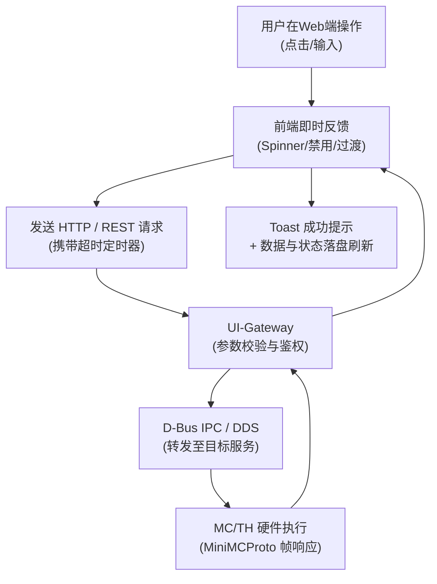

# AI-SoC 首发版本“当前功能正常流程优先”端到端 (E2E) 综合验收方案

- **方案编号**: `E2E-PLAN-20261102-001`
- **关联任务**: `TWIN-35` (Revision 2)
- **依据规则**: 
  - `project-control/.agents/rules/delivery_and_coord_gate.md` (§4.1～4.3 正常流程优先与正负成对验收)
  - `project-control/.agents/rules/e2e_issue_verification_flow.md` (`RULE-E2E-ISSUE-VERIFICATION-20261102`)
  - `project-control/.agents/rules/codex_qa_review.md`
- **编制角色**: Independent QA Testcase Architect
- **核对角色**: ARCH, DES-UI, ENG-FWD, ENG-STATE, INTEGRATOR, COORD
- **生效日期**: 2026-11-02

---

## 1. 验收基线与锁定候选 (Candidate Baseline)

| 仓库/资产 | 锁定 Commit / 版本 | 角色与身份 | 说明 |
| :--- | :--- | :--- | :--- |
| **`project-control`** | `4960ec3c77aafb2e6b9c00fc7f6fda1f0f4aad27` | origin/main | 权威项目计划、契约与门禁规则 |
| **`soc-ap`** | `8581872d76d52f939a6e0042a3ab1a138b5cd363` | origin/main | 上位机转发、设备管理、UI网关与Web HMI |
| **`mcu-p3`** | `04231388c842c1ce3e5b71675d0dc118a65edf2e` | origin/feat/soc-debug | 双 MCU 固件 (MC AT32F435, TH AT32F423) |
| **`test_harness`** | `3a10e16beae43e51fc9673925179471e43f66114` | origin/main | 独立测试用例库与自动化脚本 |
| **工作区指针** | `workspace.json` (Commit `85df943`) | entry workspace | 顶层锁定快照 |
| **物理 MC 固件** | AT32F435, Commit `0xA6791332` | 硬件实物 (Target ID 2) | 串口 `/dev/ttyUSB0` @ 115200bps |
| **物理 TH 固件** | AT32F423, Commit `0x6356C05A` | 硬件实物 (Target ID 3) | 级联总线 921600bps 级联应答 |
| **测试环境** | VMware Twin (`192.168.77.134:8080`) | 独占时段 | Option A 0% 加热锁死，无 PTY / 无 Mock |

---

## 2. 用户入口与功能盘点 (Feature Inventory)

依据首发产品范围 (`first_release_scope_decision_20261029.md`) 与交互设计规范 (`ui_ux_end_to_end_interaction_design_20261031.md`)，盘点全量功能：

### 2.1 可测试功能 (Testable Scope)

| 模块 ID | 模块名称 | 用户入口 | 覆盖特性 | 门禁要求 |
| :--- | :--- | :--- | :--- | :--- |
| **MOD-01** | **新机检查与引导向导 (OOBE)** | 首次访问弹窗 / 顶部导航“新机引导”按钮 | 语言切换、深浅主题、双板卡版本探测、传感器有效性核对、进入工作台持久化 | 软硬件双门禁 |
| **MOD-02** | **打印工作台与作业闭环** | 导航栏“打印工作台”标签页 | Gcode加载、开始打印、暂停、继续、取消、实时进度/层数/剩余时间统计 | 软硬件双门禁 (ACK闭环) |
| **MOD-03** | **轴控点动与 5×5 调平** | 导航栏“轴控与调平”标签页 | X/Y/Z/E 点动 (1/10/50mm)、归零 (Home All/XY)、5×5 调平网格触发与离散度计算 | 软硬件双门禁 |
| **MOD-04** | **双温区遥测与传感器** | 导航栏“传感器遥测”标签页 / 顶部状态胶囊 | 喷嘴与热床实时温度、ADC采样、质量标签 (FRESH/STALE)、手动强制采样 | 软硬件双门禁 (真实ADC) |
| **MOD-05** | **4-Slot 供料与混色** | 导航栏“供料与混色”标签页 | 耗材材质选择、颜色拾取、10000 混色权重守恒校验与配置保存 | 纯上位机软件门禁 |
| **MOD-06** | **mDNS 局域网服务发现** | 浏览器直接访问 / 局域网服务发现广播 | `_aisoc._tcp.local` 组播宣告、直接访问直连链接 | 网络与通信门禁 |
| **MOD-07** | **HMS 与 E-STOP 紧急急停** | 顶部红色“E-STOP”按钮 / 异常横幅 | M112 急停下发、界面全红报警、控制锁定、急停恢复清除 | 软硬件双门禁 (安全强互锁) |

### 2.2 暂未实现功能 (Unimplemented Scope)

- **云端打印作业同步与远程多租户队列**：首发版本仅支持局域网直接打印与单机作业。
- **板载摄像头实时 WebRTC/RTSP 流媒体**：未包含首发硬件清单。

### 2.3 冻结功能 (Frozen Scope)

- **物理发热体通电升温**：严格遵循安全选项 A（`heater_duty = 0%`，物理升温完全锁死，固件禁止开门极加热）。
- **物理耗材切刀与物理多色吐料塔**：无机械挤出机构，运控保持纯逻辑与步进电机运动闭环。

---

## 3. 触发契约与交互闭环规范 (Trigger & UX Contract)

每条可测试项必须具有明确的闭环生命周期：

- **契约完成信号**：操作成功必须具有确定的通信 ACK 或状态持久化落盘，并在界面呈现 Toast 或状态转变。
- **超时与兜底期限**：
  - 瞬时操作 (版本探测、单轴点动、状态查询)：$\le 3000\text{ ms}$。
  - 耗时批处理 (全轴归零、网格调平)：$\le 10000\text{ ms}$。
  - 超时处理：禁止静默卡死，必须弹出 Warning/Error Toast，恢复可交互状态并记录失败日志。

---

## 4. 正常流程优先与正负成对用例清单 (Testcase Matrix)

### 4.1 新机检查与引导向导 (MOD-01 OOBE)

| 用例编号 | 类别 | 前提条件 | 触发归属与操作 | 成功判定标准 | 超时与证据 |
| :--- | :--- | :--- | :--- | :--- | :--- |
| **TC-E2E-OOBE-01-POS** | 正常路径 (冷启动) | 板卡已物理连接 `/dev/ttyUSB0`，系统冷启动 | 打开 Web 页面或点击“新机引导”，进入 Step 3 | 自动触发探测，MC/TH 显示真实版本 (`v1.0 (0xA6791332)` / `v1.0 (0x6356C05A)`)，状态全绿 PASS | $\le 3000\text{ms}$；证据：D-Bus 响应日志、Web 页面截图 |
| **TC-E2E-OOBE-01-NEG** | 对应故障 (未连线) | 物理串口未连接或断开 | 打开 Web 页面或点击“新机引导”，进入 Step 3 | 严禁伪造全绿 PASS，必须显示“未就绪/离线”，提示检查物理连线 | $\le 3000\text{ms}$；证据：Web 页面告警截图 |
| **TC-E2E-OOBE-02-POS** | 正常路径 (热插拔探测) | 软件先启动（初始离线），后插入 USB | 插入 `/dev/ttyUSB0` 物理线缆，停留于 Step 3 或点击重试 | 触发热插拔探测，3s 内版本信息自动刷新为在线，状态由黄变绿 | $\le 3000\text{ms}$；证据：forward 日志、快照 GEN 更新 |
| **TC-E2E-OOBE-02-NEG** | 对应故障 (单板失联) | 仅 MC 在线，TH 级联断开 | 打开 Step 3 检查 | MC 绿灯在线，TH 明确标黄/红离线，不合并伪造正常 | $\le 3000\text{ms}$；证据：快照 JSON、分立状态 |
| **TC-E2E-OOBE-03-POS** | 正常路径 (向导完成) | Step 1~4 已就绪 | Step 5 点击“进入打印控制台” | 向导弹窗平滑关闭，页面平滑定位至“打印工作台”，Toast 提示“新机向导已完成”，`localStorage['aisoc_oobe_completed'] = 'true'` | $\le 1000\text{ms}$；证据：Tab 切换与 LocalStorage 快照 |
| **TC-E2E-OOBE-03-NEG** | 恢复路径 (刷新持久化) | 完成向导已落盘 | 浏览器按下 F5 强制刷新页面 | 向导不再自动弹出，工作台正常呈现，用户偏好（语言/主题）保持刷新前状态 | $\le 2000\text{ms}$；证据：刷新后 DOM 检查 |

### 4.2 打印工作台与作业闭环 (MOD-02 WORKBENCH)

| 用例编号 | 类别 | 前提条件 | 触发归属与操作 | 成功判定标准 | 超时与证据 |
| :--- | :--- | :--- | :--- | :--- | :--- |
| **TC-E2E-JOB-01-POS** | 正常路径 (作业闭环) | 硬件在线，空闲状态 | 拖入/加载 3DBenchy Gcode，点击“开始打印” | 状态变更为 `PRINTING`，进度条与百分比随真实运动递增，禁止假进度 | $\le 2000\text{ms}$；证据：`api/v1/jobs/status` 日志 |
| **TC-E2E-JOB-01-NEG** | 对应故障 (离线阻断) | 硬件离线 | 尝试点击“开始打印”按钮 | 按钮置灰禁用，若强行请求则返回 HTTP 503/504，Toast 告警“硬件已断开” | 瞬时；证据：HTTP 响应码 |
| **TC-E2E-JOB-02-POS** | 恢复路径 (暂停/继续) | 正在打印状态 | 点击“暂停打印”，等待 2s 后点击“继续打印” | 状态平滑变更为 `PAUSED` 停滞运动，恢复后切入 `PRINTING` 续打 | $\le 1500\text{ms}$；证据：状态机世代递增与运动日志 |
| **TC-E2E-JOB-03-POS** | 正常取消 | 正在打印状态 | 点击“取消打印” | 状态瞬时归入 `CANCELLED`，界面安全归位，按钮恢复“开始” | $\le 1000\text{ms}$；证据：JobStatus JSON |

### 4.3 轴控点动与 5×5 调平 (MOD-03 MOTION)

| 用例编号 | 类别 | 前提条件 | 触发归属与操作 | 成功判定标准 | 超时与证据 |
| :--- | :--- | :--- | :--- | :--- | :--- |
| **TC-E2E-MOT-01-POS** | 正常点动 | 硬件在线，非打印态 | 点击 X+10mm 罗盘点动按钮 | 下发 G0/G1，MC 回复 ACK，前端 X 坐标更新 (+10.0mm)，Toast/指示灯正常 | $\le 2000\text{ms}$；证据：串口 TX/RX 帧与坐标变动 |
| **TC-E2E-MOT-02-POS** | 正常归零 | 硬件在线 | 点击“全部归零 (Home All)” | 下发 G28，全轴回归原点，坐标置零 (0, 0, 0) | $\le 8000\text{ms}$；证据：归零完成 ACK |
| **TC-E2E-MOT-03-POS** | 调平网格 | 硬件在线 | 点击“重新执行 5×5 自动调平” | 触发调平序列，25 个点高度矩阵更新，计算离散度与倾斜度，热力图渲染 | $\le 10000\text{ms}$；证据：`/api/v1/leveling/mesh` 25点有效值 |

### 4.4 传感器遥测与手动采样 (MOD-04 SENSORS)

| 用例编号 | 类别 | 前提条件 | 触发归属与操作 | 成功判定标准 | 超时与证据 |
| :--- | :--- | :--- | :--- | :--- | :--- |
| **TC-E2E-TEMP-01-POS** | 实时遥测 | 硬件在线 | 停留在“传感器遥测”页面 | 喷嘴与热床温度每 1.5s 刷新一次，ADC 有效，Quality 标签为 `FRESH` | 持续；证据：SSE 遥测推流日志 |
| **TC-E2E-TEMP-02-POS** | 手动强制采样 | 硬件在线 | 点击“立即单次采样 (M105)”按钮 | 触发即时温度查询，RTT $\le 50\text{ms}$，按钮禁用恢复，更新单次采样时间戳 | $\le 1000\text{ms}$；证据：`/api/v1/temperature/sample` 响应 |

### 4.5 4-Slot 混色系统 (MOD-05 FILAMENT)

| 用例编号 | 类别 | 前提条件 | 触发归属与操作 | 成功判定标准 | 超时与证据 |
| :--- | :--- | :--- | :--- | :--- | :--- |
| **TC-E2E-SLOT-01-POS** | 权重守恒保存 | 打开供料标签页 | 调节权重使得 Sum = 10000 (如 4000:3000:2000:1000)，点击保存 | 保存按钮可用，Toast 提示“混色配置已保存”，本地持久化 | $\le 1000\text{ms}$；证据：LocalStorage 与界面显示 |
| **TC-E2E-SLOT-01-NEG** | 权重守恒拦截 | 打开供料标签页 | 调节权重使得 Sum = 9990 或 10050 | 保存按钮强制禁用，呈现警告红字提示“总和必须严格等于 10000” | 瞬时；证据：按钮 disabled 属性 |

### 4.6 局域网发现 (MOD-06 NETWORK)

| 用例编号 | 类别 | 前提条件 | 触发归属与操作 | 成功判定标准 | 超时与证据 |
| :--- | :--- | :--- | :--- | :--- | :--- |
| **TC-E2E-NET-01-POS** | 直连与发现 | 网卡就绪 | 访问 `http://192.168.77.134:8080/` | HTTP 200 返回，所有静态资源在 500ms 内加载完毕 | $\le 1000\text{ms}$；证据：HTTP 状态码与响应时间 |

### 4.7 HMS 与 E-STOP 急停 (MOD-07 ESTOP)

| 用例编号 | 类别 | 前提条件 | 触发归属与操作 | 成功判定标准 | 超时与证据 |
| :--- | :--- | :--- | :--- | :--- | :--- |
| **TC-E2E-HMS-01-POS** | 紧急急停熔断 | 打印或运动中 | 点击顶部红色“E-STOP 急停”按钮 | 即刻下发 M112，界面弹出全屏红色熔断告警，所有控制锁定，电机断电 | $\le 500\text{ms}$；证据：串口 M112 帧与界面锁定 |
| **TC-E2E-HMS-02-POS** | 急停恢复 | 处于 ESTOP 态 | 排除故障后点击“清除急停”按钮 | 状态机平滑恢复 `IDLE`，全屏红框解除，控制解锁 | $\le 1000\text{ms}$；证据：清除急停响应 |

---

## 5. 执行顺序与门禁准则

1. **第一阶段：基线核实与正常流程实测 (当前执行)**：
   - 优先执行 `TC-E2E-OOBE-01-POS` ~ `TC-E2E-OOBE-03-POS`。
   - 逐项执行 `TC-E2E-JOB-01-POS`、`TC-E2E-MOT-01-POS`、`TC-E2E-TEMP-01-POS`、`TC-E2E-SLOT-01-POS`。
   - 遇到超过契约期限仍显示 UNKNOWN、未就绪、无响应或状态不一致，**即时判定失败并登记 Issue，关联具体用例，排查调用链证据**。
2. **第二阶段：Issue 派单与有界差异修复**：
   - 由 COORD 查重后分派至 ENG-FWD、ENG-DEVICE、ENG-UI。
   - 严格执行函数规模 $\le 50$ 行、参数 $\le 4$ 个的硬性门禁。
3. **第三阶段：独立回归与故障注入/恢复测试**：
   - 独立 QA 在隔离沙箱重新构建部署新候选。
   - 对原失败用例进行真实 HIL 独立复测。
   - 回归成功后，再全面推进负例与拔线容错恢复测试。
