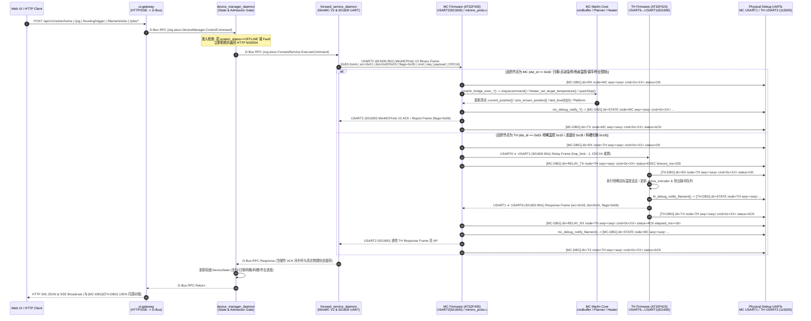

# AI SoC 全栈去 Mock 与端到端物理链路穿透（AP ➔ MC ➔ Marlin ➔ TH）代码核实与修复架构方案

## 一、 现状深度审计结论表（四重物理链路断裂 + 五大核心业务域风险排查）

### 1.1 已暴露“四重物理链路断裂”逐行代码核实表

经 `ARCH` 逐行核查 `soc-ap/`、`mcu-p3/`（MC `motion-controller-mcu` & TH `color-engine-mcu/io_toggle`）及 `test_harness/` 当前代码，导致“软件测试看似全绿、真机硬件纹丝不动”的**四重物理链路断裂**及隐藏的**旁路掩盖机制**定位如下：

| 断点编号与定性 | 精确文件路径与行号 | 涉及函数 / 符号名称 | 当前真实代码表现与假状态/断路根因剖析 |
| :--- | :--- | :--- | :--- |
| **断点 1A**<br/>AP 网关归零与点动纯内存自嗨 | [`soc-ap/services/ui_gateway/ui_gateway_job_ctrl.cpp#L26-L33`](file:///home/sushaohua/workspace/ai_soc_project/soc-ap/services/ui_gateway/ui_gateway_job_ctrl.cpp#L26-L33)<br/>[`soc-ap/services/ui_gateway/ui_gateway_job_ctrl.cpp#L110-L139`](file:///home/sushaohua/workspace/ai_soc_project/soc-ap/services/ui_gateway/ui_gateway_job_ctrl.cpp#L110-L139) | `reset_job_state()`<br/>`ui_gw_job_jog()`<br/>`ui_gw_job_home()` | 1. `reset_job_state()` 启动即在 RAM 中硬编码 `s_job.is_homed = true;`；<br/>2. `ui_gw_job_home()` 直接在进程本地内存赋值 `s_job.pos_x_mm = 0.0f; s_job.pos_y_mm = 0.0f; s_job.pos_z_mm = 0.0f; s_job.is_homed = true; return 0;`；<br/>3. `ui_gw_job_jog()` 直接在本地内存累加 `s_job.pos_x_mm += step_mm`（及 Y/Z/E）。**全程零 D-Bus 调用、零串口报文下发、零硬件 ACK 等待**。 |
| **断点 1B**<br/>AP 网关 5×5 调平网格硬编码常量 | [`soc-ap/services/ui_gateway/ui_gateway_job_ctrl.cpp#L18-L24`](file:///home/sushaohua/workspace/ai_soc_project/soc-ap/services/ui_gateway/ui_gateway_job_ctrl.cpp#L18-L24)<br/>[`soc-ap/services/ui_gateway/ui_gateway_job_ctrl.cpp#L141-L167`](file:///home/sushaohua/workspace/ai_soc_project/soc-ap/services/ui_gateway/ui_gateway_job_ctrl.cpp#L141-L167) | `DEFAULT_MESH[5][5]`<br/>`ui_gw_job_get_mesh_json()`<br/>`ui_gw_job_trigger_leveling()` | `ui_gw_job_trigger_leveling()` 仅执行 `std::memcpy(s_job.mesh, DEFAULT_MESH, sizeof(DEFAULT_MESH))` 将 `-0.08f ~ 0.21f` 的静态假数组拷入内存并置 `s_job.leveling_triggered = true`；从未调用 `device_manager` 或 `forward_service` 下发 `G29` 调平触发或 `0x18 (MINIMC_CMD_LEVEL_GRID_QUERY)`。 |
| **断点 1C**<br/>AP 网关本地定时器开环自增作业进度與假正弦坐标 | [`soc-ap/services/ui_gateway/ui_gateway_job_ctrl.cpp#L72-L108`](file:///home/sushaohua/workspace/ai_soc_project/soc-ap/services/ui_gateway/ui_gateway_job_ctrl.cpp#L72-L108)<br/>[`soc-ap/services/ui_gateway/ui_gateway_job_ctrl.cpp#L204-L238`](file:///home/sushaohua/workspace/ai_soc_project/soc-ap/services/ui_gateway/ui_gateway_job_ctrl.cpp#L204-L238) | `ui_gw_job_start()`<br/>`ui_gw_job_pause()`<br/>`ui_gw_job_resume()`<br/>`ui_gw_job_cancel()`<br/>`ui_gw_job_tick()` | `ui_gw_job_tick()` 依赖 `1000ms` 纯本地定时器开环自增 `s_job.current_line += 1U` 与 `s_job.progress_permille`，并用 `50.0f + 30.0f * std::sin(angle)` 合成假运动轨迹坐标。**严重违反 `AGENTS.md` §7“严禁开环纯本地定时器自增进度，作业推进必须严格以硬件执行 ACK 为基准”**。 |
| **断点 1D**<br/>AP 耗材槽位与急停 HTTP 路由空壳 & 版本回退伪在线 | [`soc-ap/services/ui_gateway/ui_gateway_server.cpp#L208-L217`](file:///home/sushaohua/workspace/ai_soc_project/soc-ap/services/ui_gateway/ui_gateway_server.cpp#L208-L217)<br/>[`soc-ap/services/ui_gateway/ui_gateway_server.cpp#L357-L367`](file:///home/sushaohua/workspace/ai_soc_project/soc-ap/services/ui_gateway/ui_gateway_server.cpp#L357-L367)<br/>[`soc-ap/services/device_manager/device_manager_service.cpp#L19-L43`](file:///home/sushaohua/workspace/ai_soc_project/soc-ap/services/device_manager/device_manager_service.cpp#L19-L43) | `handle_filament_slots_route()`<br/>`handle_estop_stop_route()`<br/>`populate_fallback_version()` | 1. `handle_filament_slots_route()` 连 `req.body` 都未解析（`(void)req;`），直接返回 HTTP 200 `"Filament slots updated"`；<br/>2. `handle_estop_stop_route()` 仅改本地 `s_job.estop_active`，未调 D-Bus `EmergencyStop`；<br/>3. `populate_fallback_version()` 在 `QueryVersion` 失败时伪造 `0xA6791332` / `0x6356C05A` 并强置 `DEV_VER_STATUS_ONLINE`。 |
| **断点 1E**<br/>AP D-Bus 总线控制路由缺失 | [`soc-ap/services/ui_gateway/ui_gateway_dbus.cpp#L82-L155`](file:///home/sushaohua/workspace/ai_soc_project/soc-ap/services/ui_gateway/ui_gateway_dbus.cpp#L82-L155)<br/>[`soc-ap/services/device_manager/device_manager_dbus.cpp#L249-L327`](file:///home/sushaohua/workspace/ai_soc_project/soc-ap/services/device_manager/device_manager_dbus.cpp#L249-L327)<br/>[`soc-ap/services/forward/forward_dbus.cpp#L213-L236`](file:///home/sushaohua/workspace/ai_soc_project/soc-ap/services/forward/forward_dbus.cpp#L213-L236) | `ui_gw_dbus_*`<br/>`handle_method_call()` (`device_manager` & `forward_service`) | `ui_gateway` ➔ `device_manager` ➔ `forward_service` 的 D-Bus IPC 仅连接了 `GetSnapshot` 与 `TriggerSample`/`RequestSample`；尽管 `forward_protocol.cpp` 已编写了 `0x16`/`0x17`/`0x18` 组帧函数，但 `forward_service.cpp` 与三端 D-Bus 均未接入任何运动、温控、调平、耗材、作业控制 RPC。 |
| **断点 2A**<br/>AP `forward_service_daemon` 物理串口 `921600` 被静默降级为 `115200` | [`soc-ap/services/forward/forward_uart.cpp#L28-L55`](file:///home/sushaohua/workspace/ai_soc_project/soc-ap/services/forward/forward_uart.cpp#L28-L55)<br/>[`soc-ap/services/forward/forward_types.h#L30`](file:///home/sushaohua/workspace/ai_soc_project/soc-ap/services/forward/forward_types.h#L30) | `baud_to_speed_flag()`<br/>`AISOC_FWD_DEFAULT_BAUD` | **极隐蔽真机阻断 Bug**：`TWIN-43` 仅修改了宿主机 CLI 使用的 `core/forward/transport/serial_posix.cpp`，而后台守护进程 `forward_service_daemon` 实际调用的 `services/forward/forward_uart.cpp:baud_to_speed_flag()` 仅枚举到 `230400U`，传入 `921600U` 时直接落入 `default: return B115200;`！在虚拟 PTY 下内核忽略波特率故未暴露；一旦接上真机（MC `USART2` 已在 `minimc_proto_init()` 配为 `921600`），AP 实际以 `115200` 发出的波形在 MC 端全成乱码，被 `parser_step_sof()` 当噪声 100% 丢弃！ |
| **断点 2B**<br/>AP 与 MC/TH 协议帧命令码（`0x14/0x15`、`0x12/0x17`）严重错位 | [`soc-ap/contracts/twin/telemetry_types.h#L65-L67`](file:///home/sushaohua/workspace/ai_soc_project/soc-ap/contracts/twin/telemetry_types.h#L65-L67)<br/>[`soc-ap/services/forward/forward_protocol.cpp#L88-L96`](file:///home/sushaohua/workspace/ai_soc_project/soc-ap/services/forward/forward_protocol.cpp#L88-L96)<br/>[`soc-ap/services/forward/forward_protocol.cpp#L214-L237`](file:///home/sushaohua/workspace/ai_soc_project/soc-ap/services/forward/forward_protocol.cpp#L214-L237)<br/>[`mcu-p3/motion-controller-mcu/project/inc/minimc_proto.h#L49-L58`](file:///home/sushaohua/workspace/ai_soc_project/mcu-p3/motion-controller-mcu/project/inc/minimc_proto.h#L49-L58) | `MINIMC_CMD_TEMP_REPORT`<br/>`MINIMC_CMD_EMERGENCY_STOP`<br/>`fwd_proto_validate_response()` | 1. MC/TH 发送温度响应帧的 `cmd_id` 为 `0x15 (MINIMC_CMD_TEMP_REPORT)`，而 AP `telemetry_types.h:67` 将 `MINIMC_CMD_TEMP_REPORT` 定义为 `0x14U`，导致 `fwd_proto_validate_response()` 拒绝真实 MC/TH 的 `0x15` 响应（此前被 `twin46_mc_bridge.c:144` `frame[5] = 0x14U` 篡改掩盖！）；<br/>2. AP 将 `MINIMC_CMD_EMERGENCY_STOP` 定义为 `0x12U`，但 MC 中 `0x12U` 是 `MINIMC_CMD_MOTION_MOVE`、`0x17U` 才是 `MINIMC_CMD_MOTION_STOP`；<br/>3. MC 中 `0x15U` 同时被定义为 `MINIMC_CMD_TEMP_REPORT` 与 `MINIMC_CMD_FILAMENT_CONTROL`。 |
| **断点 2C**<br/>MC `USART2` 接收中断污染旧迪文屏状态机 | [`mcu-p3/motion-controller-mcu/project/marlin/marlin_lcd/memu_gui.c#L417-L441`](file:///home/sushaohua/workspace/ai_soc_project/mcu-p3/motion-controller-mcu/project/marlin/marlin_lcd/memu_gui.c#L417-L441)<br/>[`mcu-p3/motion-controller-mcu/project/marlin/marlin_lcd/memu_gui.c#L2052-L2065`](file:///home/sushaohua/workspace/ai_soc_project/mcu-p3/motion-controller-mcu/project/marlin/marlin_lcd/memu_gui.c#L2052-L2065) | `gui_rx_callback()`<br/>`UI_Data_handle()` | `gui_rx_callback()` 在将 `USART2` 字节推入 `minimc_proto_push_ap_rx()` 后，仍无条件置位 `rxdata_complete = true`，导致主循环 `UI_Data_handle()` 调用 `handle_gui_rx_data()` 按迪文屏 `0x5A 0xA5` 协议重复扫描 AP 报文。 |
| **断点 2D**<br/>`deploy_twin.sh` 缺失第三方库构建编排且未彻底清理旧环境/旧进程即重部署 | [`soc-ap/tools/deploy_twin.sh#L166-L205`](file:///home/sushaohua/workspace/ai_soc_project/soc-ap/tools/deploy_twin.sh#L166-L205)<br/>[`soc-ap/tools/deploy_twin.sh#L243-L250`](file:///home/sushaohua/workspace/ai_soc_project/soc-ap/tools/deploy_twin.sh#L243-L250)<br/>[`soc-ap/tools/deploy_twin.sh#L329-L338`](file:///home/sushaohua/workspace/ai_soc_project/soc-ap/tools/deploy_twin.sh#L329-L338)<br/>[`soc-ap/.gitignore#L1-L6`](file:///home/sushaohua/workspace/ai_soc_project/soc-ap/.gitignore#L1-L6)<br/>[`soc-ap/third_party/build.sh#L14-L125`](file:///home/sushaohua/workspace/ai_soc_project/soc-ap/third_party/build.sh#L14-L125)<br/>[`soc-ap/services/forward/CMakeLists.txt#L9-L16`](file:///home/sushaohua/workspace/ai_soc_project/soc-ap/services/forward/CMakeLists.txt#L9-L16) | `build_fullstack()`<br/>`stop_services_internal()` | 1. **第三方库缺失导致直接编译失败**：`soc-ap/.gitignore` 忽略了 `/third_party/install/`、`/third_party/build/`、`/third_party/src/`（Git 仅跟踪 `third_party/archives/` 压缩包与 `third_party/build.sh`）；但 `deploy_twin.sh:build_fullstack()` 完全未检查或调用 `third_party/build.sh` 编译安装 `foonathan_memory-0.7-3`、`Fast-CDR-2.2.5`、`Fast-DDS-3.6.2`、`dbus-1.16.2`，且未处理 CMake 4.x 下 `dbus-1.16.2` (`VERSION 3.10`) / `foonathan_memory` (`VERSION 3.14`) 的 `CMAKE_POLICY_VERSION_MINIMUM=3.5` 兼容与 `find_library(... NO_DEFAULT_PATH)` / `-Wl,-rpath-link`，导致在新环境或干净检出中 `[BUILD 2/5] forward` 直接报 `Could not find FASTDDS_LIB/FASTCDR_LIB/DBUS_LIB` 编译失败；<br/>2. **未彻底清除旧进程、旧缓存与旧状态即重部署**：`deploy_twin.sh` 先跑 `build_fullstack` (`#L334`) 后调 `stop_services_internal` (`#L338`)，且 `stop_services_internal()` 仅按当前 `AISOC_LOG_DIR/*.pid` 杀进程，无法清理跨目录/孤儿残留的 `forward_service_daemon`（死锁霸占 `/dev/ttyUSB0` 偷吞串口字节）、`ui-gateway`（霸占 HTTP 端口）、`device_manager_daemon`、`dbus-daemon`、`aisoc_supervisor` 及 `/dev/shm/fastrtps_*` 共享内存锁；同时 `build_fullstack()` 无 `--clean` 且不清理跨机器残留的 `build/*/CMakeCache.txt` 与旧日志。 |
| **断点 3A**<br/>MC 协议栈缺失所有控制类命令分支，一律回 `0x04 BAD_CMD` NACK | [`mcu-p3/motion-controller-mcu/project/src/minimc_proto.c#L1052-L1112`](file:///home/sushaohua/workspace/ai_soc_project/mcu-p3/motion-controller-mcu/project/src/minimc_proto.c#L1052-L1112)<br/>[`mcu-p3/motion-controller-mcu/project/src/minimc_proto.c#L1209-L1275`](file:///home/sushaohua/workspace/ai_soc_project/mcu-p3/motion-controller-mcu/project/src/minimc_proto.c#L1209-L1275) | `handle_mc_core_queries()`<br/>`handle_mc_motion_and_level()`<br/>`handle_mc_query()`<br/>`handle_ap_frame()` | `handle_mc_query()` 仅处理 `0x01 (GET_VERSION)`、`0x03 (PING)`、`0x14 (GET_TEMP)`、`0x16 (POS_QUERY)`、`0x18 (LEVEL_GRID_QUERY)` 五项只读查询；凡收到 `0x10 (SET_TEMP)`、`0x11 (MOTION_HOME)`、`0x12 (MOTION_MOVE)`、`0x13 (JOB_CONTROL)`、`0x15/0x1B (FILAMENT_CONTROL)`、`0x17 (MOTION_STOP)`、`0x19 (SLOT_SELECT)`、`0x1A (LEVEL_TRIGGER)`，全部落入 `#L1107` 返回 `0x06 NACK (err_code=0x04)`！ |
| **断点 3B**<br/>TH 协议栈缺失级联控制分支，一律回 `0x04` NACK | [`mcu-p3/color-engine-mcu/io_toggle/src/app/minimc_proto.c#L230-L274`](file:///home/sushaohua/workspace/ai_soc_project/mcu-p3/color-engine-mcu/io_toggle/src/app/minimc_proto.c#L230-L274) | `minimc_proto_handle_frame()` | TH 端仅处理 `0x01`、`0x03`、`0x14` 三项只读查询；当 MC 通过 `USART6` ➔ `USART1` (`921600`) 转发目标温度设定、进退丝或料槽选择指令时，TH 直接在 `#L266` 返回 `build_nack_resp(..., 0x04U)`！ |
| **断点 3C**<br/>`TWIN-44`/`45` 的 `mc_debug_notify_*` 与 `th_debug_notify_*` 均为悬空伪日志钩子 | [`mcu-p3/motion-controller-mcu/project/src/minimc_proto.c#L975-L1026`](file:///home/sushaohua/workspace/ai_soc_project/mcu-p3/motion-controller-mcu/project/src/minimc_proto.c#L975-L1026)<br/>[`mcu-p3/color-engine-mcu/io_toggle/src/bsp/usart.c#L299-L315`](file:///home/sushaohua/workspace/ai_soc_project/mcu-p3/color-engine-mcu/io_toggle/src/bsp/usart.c#L299-L315)<br/>[`test_harness/hil/tools/debug_reconciliation_probe.py#L998-L1011`](file:///home/sushaohua/workspace/ai_soc_project/test_harness/hil/tools/debug_reconciliation_probe.py#L998-L1011) | `mc_debug_notify_temp_target()`<br/>`mc_debug_notify_motion()`<br/>`mc_debug_notify_filament()`<br/>`mc_debug_notify_job()`<br/>`th_debug_notify_filament()` | 上述 5 个 Debug 状态通知函数在 MC 与 TH **生产固件中调用次数为 0**！在 `TWIN-46` 中，`debug_reconciliation_probe.py:998` (`sync_online_categories`) 通过 `ctypes` 绕过串口直接调用 `self.mc.mc_bridge_notify_motion_op(b"HOME", ...)` 等后门函数往环形缓冲区塞入伪造的 `[MC-DBG]` / `[TH-DBG]` 日志，与 AP 本地内存假状态进行“旁路演戏对账”。 |
| **断点 4A**<br/>Marlin 串口读取被物理注释，协议栈与运动规划器完全断路 | [`mcu-p3/motion-controller-mcu/project/marlin/marlin_core/Marlin_main.c#L823-L843`](file:///home/sushaohua/workspace/ai_soc_project/mcu-p3/motion-controller-mcu/project/marlin/marlin_core/Marlin_main.c#L823-L843)<br/>[`mcu-p3/motion-controller-mcu/project/marlin/marlin_core/Marlin_main.c#L923-L1063`](file:///home/sushaohua/workspace/ai_soc_project/mcu-p3/motion-controller-mcu/project/marlin/marlin_core/Marlin_main.c#L923-L1063) | `loop()`<br/>`get_command()`<br/>`enquecommand()`<br/>`process_commands()` | `Marlin_main.c:get_command()` 中第 `923-1063` 行的 `while (serial_rxchars() != 0 && buflen < BUFSIZE)` 被整段 `//` 注释；而 `minimc_proto.c` 从未调用 `enquecommand()` / `enquecommand_P()` 将运动指令注入 `cmdbuffer[bufindw]`，导致 `loop()` 中的 `if (buflen) process_commands();` 永远不会因 AP 指令触发，步进电机、限位开关、探针与加热器完全不动作。 |
| **断点 4B**<br/>Marlin `process_commands()` 入口向 `USART6` 裸发 ASCII 破坏二进制级联链路 | [`mcu-p3/motion-controller-mcu/project/marlin/marlin_core/Marlin_main.c#L2077`](file:///home/sushaohua/workspace/ai_soc_project/mcu-p3/motion-controller-mcu/project/marlin/marlin_core/Marlin_main.c#L2077)<br/>[`mcu-p3/color-engine-mcu/io_toggle/src/user/main.c#L62-L89`](file:///home/sushaohua/workspace/ai_soc_project/mcu-p3/color-engine-mcu/io_toggle/src/user/main.c#L62-L89) | `process_commands()`<br/>`forward_uart_send_line()` | 1. `Marlin_main.c:2077` 在 `process_commands()` 开头无条件执行 `forward_uart_send_line(cmdbuffer[bufindr], strlen(cmdbuffer[bufindr]));`，往 `USART6` 裸发 ASCII G-code 行；<br/>2. 而 TH 端 `main.c:73` 的 G-code `loop()` 已被注释关闭，TH `USART1` 仅运行 `minimc_proto_poll()` 解析 `0x55 0xAA` 二进制帧，收到 MC 裸发的 ASCII 字符串会触发 `[TH-DBG] status=BAD_FRAME` 错误并污染 `DMA1_CHANNEL4` 发送通道！ |

---

### 1.2 五大核心业务域有界同类风险排查表（AP ➔ MC ➔ Marlin ➔ TH ➔ Debug ➔ Web UI）

围绕 `CONFIRM-DEBUG-BAUD-20261104` 的 5 大核心业务域，逐一排查全链路“伪状态、伪日志、旁路对账”风险：

| 业务域 | AP 端现状（`ui_gateway` / `device_manager` / `forward_service`） | MC 端现状（`minimc_proto.c` & `Marlin_main.c`） | TH 端现状（`minimc_proto.c` & `usart.c` & `mycontrol.c`） | 修复目标（端到端真实物理闭环） |
| :--- | :--- | :--- | :--- | :--- |
| **1. 回零与运动控制**<br/>(`Homing / Jog / Stop`) | `POST /api/v1/motion/home` 与 `/jog` 仅修改 `ui_gateway_job_ctrl.cpp` 本地静态变量 `s_job.pos_*_mm` 与 `is_homed`；`GET /api/v1/jobs/status` 返回该本地变量。 | `0x16 (POS_QUERY)` 已读取 `current_position[]` 与 `axis_known_position[]`；但缺失 `0x11 (HOME)`、`0x12 (MOVE)`、`0x17 (STOP)` 处理分支，未向 Marlin `cmdbuffer` 注入 `G28`/`G0`/`G1` 或调用 `quickStop()`。 | 不涉及 XYZ 轴运动（XYZ 步进电机与限位开关物理连接在 MC 主板）。 | AP 下发 `0x11`/`0x12`/`0x17` 二进制帧 ➔ MC `minimc_proto.c` 校验并调用 `marlin_bridge_enqueue_gcode()` 注入 `G28`/`G91 G1 ... G90`（或 `quickStop()`）➔ Marlin 执行并更新真实 `current_position[]`/`axis_known_position[]` ➔ 触发 `mc_debug_notify_motion()` 产出 `[MC-DBG]` ➔ AP 通过 `0x16` 回读真实物理坐标。 |
| **2. 温度采集与设定**<br/>(`Nozzle & Bed Temp`) | 温度采集已走 `0x14` 串口闭环（但被 `0x14`/`0x15` 响应码错位阻断）；**缺失目标温度设定 API 与 D-Bus/串口下发链路**（`target_deci_c` 恒为 0 或依赖桥接层 `mc_bridge_set_temp` 注入）。 | `0x14` 读取 `Platform.current_temperature`（即 `current_temperature_bed`）与 `Extruder_One`；但缺失 `0x10 (SET_TEMP)` 处理分支，未调用 `Heater_set_target_temperature(&Platform, ...)` 与 `&Extruder_One`。 | `0x14` 已通过 `thermistor_adc_get_telemetry()` 读取真实 ADC 与温度；但 `minimc_proto_handle_frame()` 缺失 `0x10 (SET_TEMP)` 分支，且 `mycontrol.c:1778` `M104` 被注释，未调用 `setTargetHotend()`。 | 1. 统一 `0x14`/`0x15` 响应码验收与断连哨兵转换；<br/>2. 新增 `POST /api/v1/temperature/target` ➔ D-Bus ➔ `0x10 (SET_TEMP)`：目标为 MC (`dst=0x02`) 时设定热床/主控目标温度并触发 `mc_debug_notify_temp_target()`；目标为 TH (`dst=0x03`) 时经 `USART6` 级联至 TH 设定喷嘴目标温度并返回真实 ACK。 |
| **3. 5×5 自动调平网格**<br/>(`Bed Leveling G29 & 0x18`) | `POST /api/v1/leveling/trigger` 与 `GET /api/v1/leveling/mesh` 100% 读写 `ui_gateway_job_ctrl.cpp` 硬编码常量 `DEFAULT_MESH[5][5]`；未调用 `device_manager_state.cpp:492` 已有的 `dev_state_update_leveling_grid()` 与 `forward_protocol.cpp:170` 的 `fwd_proto_build_grid_query_frame()`。 | `0x18 (LEVEL_GRID_QUERY)` 已读取 `bed_level[5][5]` 并输出 `[MC-DBG] op=GRID_READ`；但缺失 `0x1A (LEVEL_TRIGGER)` 分支，无法触发 Marlin `G29` 更新 `bed_level[5][5]`。 | 不涉及（物理调平探针连接在 MC `PE1` `Z_LIMIT_PIN`）。 | `POST /api/v1/leveling/trigger` ➔ D-Bus ➔ MC `0x1A (LEVEL_TRIGGER)` 注入 `G29`（或在已归零基线下触发 25 点探测更新 `bed_level[5][5]`）➔ `GET /api/v1/leveling/mesh` 通过 D-Bus ➔ MC `0x18 (LEVEL_GRID_QUERY)` 实测回读 52B `bed_level[5][5]` 微米网格，彻底删除 `ui_gateway` 中的 `DEFAULT_MESH` 假拷贝。 |
| **4. 耗材进退丝与多色料槽**<br/>(`Filament & Slot Cascade`) | `POST /api/v1/filament/slots` 在 `ui_gateway_server.cpp:208` 直接丢弃请求体返回 HTTP 200 OK；无 D-Bus 转发，无级联报文。 | `minimc_proto.c:1209` `handle_ap_frame()` 虽可将 `dst_id == MINIMC_NODE_TH (0x03)` 的帧经 `USART6` 转发给 TH，但自身收到 `0x19` / `0x1B` 时直接回 NACK，且转发给 TH 后未同步更新 MC 侧 `[MC-DBG]` 料槽状态。 | TH `minimc_proto.c:230` 收到 `0x19 (SLOT_SELECT)` 或 `0x1B (FILAMENT_CONTROL)` 直接回 `0x04` NACK；从不更新 `active_extruder` / `load_filament_Flag`，也从不调用 `th_debug_notify_filament()`。 | `POST /api/v1/filament/slots` 解析 `active_slot` 与 `op` (`SELECT`/`LOAD`/`UNLOAD`) ➔ D-Bus ➔ `forward_service` 下发 `dst=0x03 (TH)` 的 `0x19` / `0x1B` 帧 ➔ MC `USART6` 级联转发至 TH `USART1` (`921600`) ➔ TH 执行料槽切换（更新 `active_extruder` 与挤出步进脉冲队列）并调用 `th_debug_notify_filament()` 输出 `[TH-DBG]` ➔ 返回级联 ACK 至 MC（MC 同步调用 `mc_debug_notify_filament()` 输出 `[MC-DBG]`）➔ 返回 AP。 |
| **5. 打印作业状态机**<br/>(`Print Job State Machine`) | `ui_gw_job_start/pause/resume/cancel` 仅改本地 `s_job.state`；`ui_gw_job_tick()` 用 1s 本地定时器开环自增进度与假坐标。 | 缺失 `0x13 (JOB_CONTROL)` 处理分支；`is_paused` / `sd_printing` / `stopprintflag` 未与 MiniMCProto 打通，`mc_debug_notify_job()` 悬空。 | 断料检测 `Board_getFilamentStatus()` (`PD2` `A_DET`) 仅在 `0x14` 温度遥测 `reserved` 或 `[TH-DBG]` 体现。 | 1. **彻底废除 `ui_gw_job_tick()` 开环本地定时器自增进度与假正弦坐标**；<br/>2. `start/pause/resume/cancel` 必须经 D-Bus 下发 `0x13 (JOB_CONTROL)` 至 MC，由 MC 真实控制 `is_paused` / 运动队列并返回携带 `job_state`、`progress_permille`、`ack_seq` 的硬件 ACK，同时触发 `mc_debug_notify_job()`；<br/>3. 作业进度与实时坐标 100% 从 MC 硬件 ACK 与 `0x16` 遥测同步，断连或丢 ACK 瞬时挂起为 `PAUSED`。 |

---

## 二、 端到端真实物理调用链与协议帧契约

### 2.1 全栈真实物理调用链架构图（零本地假状态、零旁路注入）



---

### 2.2 MiniMCProto V2 二进制协议帧头与全量命令码统一契约

#### 2.2.1 12 字节帧头与 2 字节 CRC-16/CCITT-FALSE 尾（全端严格一致）
- **帧起始魔数（SOF）**：`sof_1 = 0x55` (`MINIMC_SOF_1`)，`sof_2 = 0xAA` (`MINIMC_SOF_2`)；
- **节点 ID**：`0x01 = AP` (`MINIMC_DEV_AP`)，`0x02 = MC` (`MINIMC_DEV_MC`)，`0x03 = TH` (`MINIMC_DEV_SCM_TH`)；
- **控制标志（`flags`，偏移 `0x04`）**：
  - 请求帧固定为 `0x05`（`MINIMC_FLAG_VERSION_2 (0x04) | MINIMC_FLAG_WANTS_ACK (0x01)`）；
  - 响应帧固定为 `0x06`（`MINIMC_FLAG_VERSION_2 (0x04) | MINIMC_FLAG_IS_RESPONSE (0x02)`）；
- **CRC 算法**：CRC-16/CCITT-FALSE（`poly = 0x1021`，`init = 0xFFFF`，小端序紧随载荷末尾 2 字节）。

#### 2.2.2 跨仓命令码（`cmd_id`）冲突消除与统一映射表

针对审计发现的 `0x14`/`0x15` 温度响应码错位、`0x12` 急停与移动冲突、`0x15` 温度上报与进退丝冲突，制定如下**最小改动且向后兼容**的权威命令码表（同步更新 `soc-ap/contracts/twin/telemetry_types.h`、`soc-ap/services/forward/forward_protocol.h`、`mcu-p3/motion-controller-mcu/project/inc/minimc_proto.h`、`mcu-p3/color-engine-mcu/io_toggle/inc/minimc_proto.h`）：

| 命令名称 | 请求 `cmd_id` (`flags=0x05`) | 响应 `cmd_id` (`flags=0x06`) | 目标节点 `dst_id` | 请求载荷长度与结构 | 响应载荷长度与结构 | 超时门限 |
| :--- | :--- | :--- | :--- | :--- | :--- | :--- |
| **版本查询** (`GET_VERSION`) | `0x01` | `0x02` (`VERSION_REPORT`) | `0x02` (MC)<br/>`0x03` (TH) | `0B` | `16B` (`minimc_version_payload_t`) | `200ms` |
| **心跳探活** (`PING`) | `0x03` | `0x04` (`PONG`) | `0x02` (MC)<br/>`0x03` (TH) | `4B` (`uint32_t ts`) | `8B` (`minimc_pong_payload_t`) | `200ms` |
| **通用否定应答** (`NACK`) | - | `0x06` (`CMD_NACK`) | `0x01` (AP) | - | `3B` (`uint8_t err_code`, `uint16_t detail`) | - |
| **目标温度设定** (`SET_TEMP`) | `0x10` | `0x15` (`TEMP_REPORT`) | `0x02` (MC)<br/>`0x03` (TH) | `4B` (`minimc_set_temp_req_t`: `int16_t nozzle_set_deci_c`, `int16_t bed_set_deci_c`) | `16B` (`minimc_temp_wire_payload_t`，回传更新后的实时与目标温度) | `200ms` |
| **归零控制** (`MOTION_HOME`) | `0x11` | `0x16` (`POS_REPORT`) | `0x02` (MC) | `4B` (`minimc_home_req_t`: `uint8_t axes_mask` [Bit0=X, Bit1=Y, Bit2=Z, `0x07`=ALL], `uint8_t reserved`, `uint16_t feedrate_mm_s`) | `20B` (`minimc_pos_report_payload_t`，回传归零后 `pos_x/y/z_um=0` 及 `homed_mask`) | `500ms` |
| **点动/直线移动** (`MOTION_MOVE`) | `0x12` | `0x16` (`POS_REPORT`) | `0x02` (MC) | `16B` (`minimc_move_req_t`: `uint8_t axes_mask`, `uint8_t is_relative`, `uint16_t feedrate_mm_min`, `int32_t x_um`, `int32_t y_um`, `int32_t z_um`) | `20B` (`minimc_pos_report_payload_t`，回传更新后的物理坐标与 `homed_mask`) | `500ms` |
| **打印作业控制** (`JOB_CONTROL`) | `0x13` | `0x13` (`JOB_REPORT`) | `0x02` (MC) | `4B` (`minimc_job_req_t`: `uint8_t job_op` [`0`=IDLE/CANCEL, `1`=START, `2`=PAUSE, `3`=RESUME, `4`=QUERY], `uint8_t reserved`, `uint16_t total_lines`) | `8B` (`minimc_job_resp_t`: `uint8_t job_state`, `uint8_t ack_seq`, `uint16_t progress_permille`, `uint32_t executed_lines`) | `200ms` |
| **温度遥测查询** (`GET_TEMP`) | `0x14` | `0x15` (`TEMP_REPORT`)<br/>*(AP 兼容 `0x14`/`0x15`)* | `0x02` (MC)<br/>`0x03` (TH) | `0B` | `16B` (`minimc_temp_wire_payload_t`) | `200ms` |
| **实时坐标查询** (`POS_QUERY`) | `0x16` | `0x16` (`POS_REPORT`) | `0x02` (MC) | `0B` | `20B` (`minimc_pos_report_payload_t`) | `200ms` |
| **紧急停止** (`MOTION_STOP`) | `0x17` | `0x00` (`CMD_ACK`) | `0x02` (MC)<br/>`0x03` (TH) | `1B` (`uint8_t stop_mode`: `0x01`=QuickStop/E-Stop, `0x00`=Clear E-Stop) | `0B` (14B 标准 ACK 帧) | `200ms` |
| **5×5 调平网格查询** (`LEVEL_GRID_QUERY`) | `0x18` | `0x18` (`LEVEL_GRID_REPORT`) | `0x02` (MC) | `1B` (`uint8_t probe_idx`，AP 固定发 `7U`，MC 兼容 `0B`/`1B`) | `52B` (`minimc_level_grid_payload_t`: `uint8_t grid_x=5`, `uint8_t grid_y=5`, `int16_t z_offset_um[25]`) | `200ms` |
| **多色料槽选择与进退丝控制** (`SLOT_SELECT`) | `0x19`<br/>*(MCU 接收侧兼容 `0x15`/`0x1B`)* | `0x19` (`FILAMENT_REPORT`) | `0x02` (MC)<br/>`0x03` (TH 级联) | `4B` (`minimc_filament_req_t`: `uint8_t slot_id` [0..3], `uint8_t action` [`0`=SELECT, `1`=LOAD, `2`=UNLOAD], `int16_t distance_mm`) | `4B` (`minimc_filament_resp_t`: `uint8_t active_slot`, `uint8_t present_mask`, `uint8_t step_state` [`0`=IDLE, `1`=EXEC, `2`=DONE, `3`=ERR], `uint8_t err_code`) | `300ms` |
| **触发 5×5 自动调平** (`LEVEL_TRIGGER`) | `0x1A` | `0x18` (`LEVEL_GRID_REPORT`) | `0x02` (MC) | `1B` (`uint8_t mode`: `0x01`=执行 `G29` 25 点探测并回传网格) | `52B` (`minimc_level_grid_payload_t`) | `500ms` |
| **G-code 指令隧道与同步执行** (`GCODE_EXEC`) | `0x1C` | `0x1C` (`GCODE_EXEC_ACK`) | `0x02` (MC)<br/>`0x03` (TH) | `2B + N` (`minimc_gcode_req_t`: `uint8_t exec_flags`, `uint8_t line_len`, `char gcode[line_len]`) | `4B` (`minimc_gcode_resp_t`: `uint8_t exec_status`, `uint8_t queue_free`, `uint8_t active_slot`, `uint8_t filament_mask`) | `300ms` |

> [!IMPORTANT]
> **协议兼容与去 Hack 关键定型结论**：
> 1. **彻底消除 `normalize_ap_temp_wire_frame` Hack**：在 AP 端 `soc-ap/services/forward/forward_protocol.cpp` 的 `fwd_proto_validate_response()` 中，将温度响应帧合法 `cmd_id` 判定更新为 `(hdr.cmd_id == 0x14U) || (hdr.cmd_id == 0x15U) || (hdr.cmd_id == MINIMC_CMD_ACK)`，并在 `fwd_proto_parse_temp_response()` 中将 MCU 传回的传感器断路故障（`current_temp_deci_c == 0x7FFF` 且 `sensor_status != 0`）直接按链路断连/传感器故障契约统一映射，从而**彻底删除 `twin46_mc_bridge.c` 中篡改字节流的 `normalize_ap_temp_wire_frame()` 函数**！
> 2. **选槽与进退丝命令码定型为 `0x19`（`0x15` 专用于温度上报响应）**：AP 端选槽与进退丝请求**统一发送 `0x19 (MINIMC_CMD_SLOT_SELECT)`**（由 4B 载荷 `minimc_filament_req_t.action` 区分 `0=SELECT`、`1=LOAD`、`2=UNLOAD`），响应码固定为 `0x19 (FILAMENT_REPORT)`；`0x15` 专用于温度上报响应 `MINIMC_CMD_TEMP_REPORT`（MC 与 TH 接收侧仅对历史 `0x15`/`0x1B` 请求帧保留兼容处理）。
> 3. **`0x18 (LEVEL_GRID_QUERY)` 请求载荷定型为 `1B`**：AP 端固定发送 `1B` 请求载荷（`uint8_t probe_idx = 7U`）；MC 端兼容 `0B`（缺省按 `7U` 处理）与 `1B` 请求，在返回完整 `52B`（25 点全网格）的同时按该 `probe_idx` 输出 `[MC-DBG] dir=STATE op=GRID_READ probe_idx=7 ...` 对账日志。
> 4. **急停命令码统一为 `0x17 (MINIMC_CMD_MOTION_STOP)`**：AP 端 `fwd_proto_build_estop_frame()` 统一发送 `0x17`，不再占用 `0x12 (MINIMC_CMD_MOTION_MOVE)`。
> 5. **新增 `0x1C (MINIMC_CMD_GCODE_EXEC)` 新协议 G-code 通道**：将辅助协同 G/M 指令及原有 MC 通过 `forward_uart_send_line()` 向 TH 发送本地 G-code 的业务需求完整迁移到 `921600` MiniMCProto V2 二进制协议通道上，严禁裸发无帧头 ASCII。

#### 2.2.3 新增控制载荷二进制结构体定义（自然对齐 + 编译期 `static_assert`）

在 `soc-ap/contracts/twin/telemetry_types.h`、`mcu-p3/motion-controller-mcu/project/inc/minimc_proto.h` 与 `mcu-p3/color-engine-mcu/io_toggle/inc/minimc_proto.h` 中同步定义：

```c
#pragma pack(push, 1)

/**
 * @brief 目标温度设定请求载荷 (cmd_id = 0x10, 4 字节)
 */
typedef struct {
    int16_t nozzle_target_deci_c; /**< 喷嘴目标温度 (0.1 deg C, <0 表示不修改) */
    int16_t bed_target_deci_c;    /**< 热床目标温度 (0.1 deg C, <0 表示不修改) */
} minimc_set_temp_req_t;

/**
 * @brief 归零控制请求载荷 (cmd_id = 0x11, 4 字节)
 */
typedef struct {
    uint8_t  axes_mask;           /**< 归零轴掩码: Bit0=X, Bit1=Y, Bit2=Z (0x07=ALL) */
    uint8_t  reserved;            /**< 保留对齐字节 (置 0) */
    uint16_t feedrate_mm_s;       /**< 归零进给速率 (mm/s, 0 表示使用固件默认速率 1500) */
} minimc_home_req_t;

/**
 * @brief 点动/直线运动请求载荷 (cmd_id = 0x12, 16 字节)
 */
typedef struct {
    uint8_t  axes_mask;           /**< 运动轴掩码: Bit0=X, Bit1=Y, Bit2=Z, Bit3=E */
    uint8_t  is_relative;         /**< 坐标模式: 1=相对移动(Jog), 0=绝对移动 */
    uint16_t feedrate_mm_min;     /**< 进给速率 (mm/min, 默认 1500) */
    int32_t  x_um;                /**< X 轴目标或步进位移 (微米, 1mm = 1000um) */
    int32_t  y_um;                /**< Y 轴目标或步进位移 (微米) */
    int32_t  z_um;                /**< Z 轴目标或步进位移 (微米) */
} minimc_move_req_t;

/**
 * @brief 料槽选择与进退丝控制请求载荷 (cmd_id = 0x19 / 0x15, 4 字节)
 */
typedef struct {
    uint8_t  slot_id;             /**< 目标料槽号 (0..3) */
    uint8_t  action;              /**< 动作码: 0=SELECT, 1=LOAD, 2=UNLOAD */
    int16_t  distance_mm;         /**< 进退丝长度 (mm, LOAD>0, UNLOAD<0) */
} minimc_filament_req_t;

/**
 * @brief 料槽选择与进退丝控制响应载荷 (cmd_id = 0x19, 4 字节)
 */
typedef struct {
    uint8_t  active_slot;         /**< 当前激活料槽号 (0..3) */
    uint8_t  present_mask;        /**< 耗材在位掩码 (Bit0..3, 0x0F=四槽在位) */
    uint8_t  step_state;          /**< 执行状态: 0=IDLE, 1=EXEC, 2=DONE, 3=ERR */
    uint8_t  err_code;            /**< 错误码: 0=OK */
} minimc_filament_resp_t;

/**
 * @brief 打印作业状态机控制请求载荷 (cmd_id = 0x13, 4 字节)
 */
typedef struct {
    uint8_t  job_op;              /**< 作业操作: 0=CANCEL/IDLE, 1=START, 2=PAUSE, 3=RESUME, 4=STEP_LINE */
    uint8_t  reserved;            /**< 保留字节 (置 0) */
    uint16_t total_lines;         /**< 作业总行数或本次推进步数 */
} minimc_job_req_t;

/**
 * @brief 打印作业状态机控制响应载荷 (cmd_id = 0x13, 8 字节)
 */
typedef struct {
    uint8_t  job_state;           /**< 固件作业状态: 0=IDLE, 1=STARTING, 2=PRINTING, 3=PAUSED, 4=COMPLETED, 5=CANCELLED, 6=ERROR */
    uint8_t  ack_seq;             /**< 硬件确认序列号低 8 位 */
    uint16_t progress_permille;   /**< 硬件确认千分比进度 (0..1000) */
    uint32_t executed_lines;      /**< 硬件已执行完成行数 */
} minimc_job_resp_t;

/**
 * @brief G-code 新协议通道请求载荷头 (cmd_id = 0x1C, 2B 头 + 变长 ASCII 字符串, 最大 60B)
 */
typedef struct {
    uint8_t  exec_flags;          /**< 执行标志: Bit0=1 立即紧急执行(store_instancy_cmd), Bit0=0 入队(enquecommand) */
    uint8_t  line_len;            /**< G-code 字符串字节长度 (不含末尾 '\0', 1..60) */
    char     gcode[60];           /**< G-code 文本内容 (如 "G1 X12.5 Y25.0 A1.2 F1500") */
} minimc_gcode_req_t;

/**
 * @brief G-code 新协议通道响应载荷 (cmd_id = 0x1C, 4 字节)
 */
typedef struct {
    uint8_t  exec_status;         /**< 0=OK(已入队/已执行), 1=QUEUE_FULL, 2=FILAMENT_RUNOUT, 3=ERR */
    uint8_t  queue_free;          /**< 当前 cmdbuffer 剩余可用槽位数 */
    uint8_t  active_slot;         /**< 当前激活挤出槽位 (0..3) */
    uint8_t  filament_mask;       /**< 耗材在位状态掩码 (0x0F=正常, 0x00=断料) */
} minimc_gcode_resp_t;

#pragma pack(pop)
```

---

### 2.3 新协议下发至 MC 与 TH 的两大候选架构方案对比与选型

针对“需要将指令/G-code 下发给 MC 和 TH 两个节点”的业务场景，对两种候选架构方案进行全方位工程对比：

| 对比维度 | **候选方案一：SoC 源端寻址 / 双目标或广播下发**<br/>（SoC 直接指定 `dst=0x02`、`dst=0x03` 或双播 `dst=0xFF`） | **候选方案二：MC 业务层出队二次封装转发**<br/>（SoC 只发 `dst=0x02` ➔ `Marlin_main.c:process_commands()` ➔ `forward_uart_send_line()` 封装新协议发 TH） |
| :--- | :--- | :--- |
| **数据流路径** | 1. **单播双发模式**：SoC (`forward_service`) 根据《指令归属表》，归属 MC 的发 `dst=0x02`，归属 TH 的发 `dst=0x03`（MC `minimc_proto.c:handle_ap_frame()` 二层透明级联转发至 `USART6`），需双端协同的由 SoC 依序向 `0x02` 与 `0x03` 发起带独立 `seq` 的新协议事务；<br/>2. **广播/双目标模式 (`dst=0xFF`)**：SoC 发一帧 `dst=0xFF`，MC 协议栈本地执行并同步转发 `USART6` 至 TH。 | SoC 仅向 MC (`dst=0x02`) 发送指令，MC 入队 `cmdbuffer`；待主循环 `process_commands()` 异步出队消费时，在 `forward_uart_send_line()` 内将 G-code 封装为 `0x1C (GCODE_EXEC)` 二进制帧发往 `USART6` (TH)。 |
| **ACK 闭环确定性与故障定位 (`AGENTS.md` §7)** | **极高（原生满足）**：SoC 对发往 `MC (0x02)` 与 `TH (0x03)` 的每一笔事务均持有独立的 `target_node`、`sequence_id`、`elapsed_ms` 与显式 ACK 超时闭环；TH 断连或 NACK 可被 SoC 精确识别归因。 | **存在异步裂隙**：MC 收到帧仅入队 `cmdbuffer` 即回 ACK，而 `process_commands()` 出队发给 TH 是滞后的；若此时 TH 拒收或超时，SoC 早已认为命令成功，难以实现同步 ACK 闭环。 |
| **`USART6` (`MC↔TH`) 通道争抢风险** | **零争抢**：所有发往 TH 的帧（含 SoC 周期性 `0x14` 温度采样、`0x19` 选槽、`0x1C` 协同 G-code）统一由 `minimc_proto.c` 的 `s_relay_pending` 状态机串行调度，不会撞车。 | **高争抢风险**：SoC 发起的 `dst=0x03` 实时温度查询 (`0x14`) 走 `minimc_proto.c` 级联，而 `Marlin_main.c:process_commands()` 随时异步调用 `forward_uart_send_line()` 抢占 `USART6` DMA，极易造成级联事务冲突。 |
| **存量 `Marlin_main.c` 修改预算 (Minimal Diff Budget)** | **极小**：不需要在 `Marlin_main.c:process_commands()` 中插入阻塞等待 TH 二进制 ACK 的复杂状态机。 | **侵入较大**：若要在 `process_commands()` 入口等待 TH 的新协议二进制 ACK，会阻塞 Marlin 主循环；若不等待则违反“严禁发后即忘”门禁。 |
| **脱机 SD 卡 / 串口屏打印兼容性** | 仅覆盖 SoC 在线控制下发。 | 天然覆盖 MC 本地 SD 卡读取或串口屏触发的 G-code 转发。 |

> [!TIP]
> **`/grill-me` 架构压力测试敲定结论（决策 1：锁定【方案 A：SoC 显式双单播（先 `MC 0x02` ➔ 拿 ACK ➔ 再 `TH 0x03` ➔ 拿 ACK）+ MC 本地队列 `0x1C` 二进制转发兜底】）**：
> 1. **SoC 在线控制（Web UI / API ➔ `forward_service`）强制采用【方案 A：串行双单播与全 ACK 闭环】**：
>    - 由 SoC `forward_service` 在源端按《2.4 指令归属矩阵表》显式寻址：仅归属 MC 的发 `dst=0x02`；仅归属 TH 的发 `dst=0x03`；
>    - 凡属《2.4.1》的 13 类双节点协同指令，在 `forward_service_daemon` 串口互斥锁内，**固定按“先发 `MC (dst=0x02)` ➔ 等待 MC ACK ➔ 再发 `TH (dst=0x03)` ➔ 等待 TH ACK”串行执行**，每一帧均持有独立的 `sequence_id`、`elapsed_ms` 与显式 ACK 超时闭环；
>    - **全 ACK 成功判据**：必须 `MC (0x02)` 与 `TH (0x03)` **双端全部返回有效 ACK 才算事务成功**（向前端返回 HTTP `200`）；若任一节点超时或返回 NACK，立即记录包含 `target_node`、`sequence_id`、`elapsed_ms`、`error_code` 的结构化错误日志并向前端返回 HTTP `503/504`（若当时处于打印作业中则瞬时挂起为 `PAUSED`）。
> 2. **MC 本地 `forward_uart_send_line()` 升级为新协议 `0x1C` 二进制封装兜底（严禁向 `USART6` 裸发 ASCII）**：
>    - 将 `wk_usart.c` 中的 `forward_uart_send_line(const char *line, uint16_t len)` 内部实现升级为调用 `minimc_proto_send_th_gcode(line, len)`（封装为 `0x55 0xAA`、`cmd=0x1C MINIMC_CMD_GCODE_EXEC`、`src=0x02`、`dst=0x03` + CRC16 二进制帧）；
>    - 仅当指令来自非 SoC 发起的 MC 本地队列（如脱机 SD 卡或本地屏幕宏）且 `s_relay_pending == false` 时，才自动走 `0x1C` 新协议二进制帧发给 TH；当指令已由 SoC 在线双单播下发时不再重复转发，从而**保证 `USART6` ↔ `USART1` (`921600`) 物理链路上 100% 只有合法的 MiniMCProto V2 二进制帧，零裸 ASCII 污染**！

---

### 2.4 指令归属与节点分发矩阵表（基于 `Marlin_main.c` 与 TH `mycontrol.c` 源码逐行核实）

经逐行比对 MC [`Marlin_main.c`](file:///home/sushaohua/workspace/ai_soc_project/mcu-p3/motion-controller-mcu/project/marlin/marlin_core/Marlin_main.c) 与 TH [`mycontrol.c`](file:///home/sushaohua/workspace/ai_soc_project/mcu-p3/color-engine-mcu/io_toggle/src/app/mycontrol.c)，两颗 MCU 的物理外设与规划器分工如下：
- **MC (`AT32F435`)**：物理控制 **X / Y / Z 步进电机与限位开关**、**调平探针 (`PE1`)**、**热床加热 (`Platform`)**；
- **TH (`AT32F423`)**：物理控制 **A / B / C / D 四通道多色挤出步进电机 (`TMR14`)**、**喷嘴加热 (`PA7` `TMR3_CH2`)**、**喷嘴散热风扇 (`PC9` `TMR3_CH4`)**、**断料光电开关 (`PB3` `A_DET`)**，且在 [`planner.c#L480-L495`](file:///home/sushaohua/workspace/ai_soc_project/mcu-p3/color-engine-mcu/io_toggle/src/app/planner.c#L480-L495) 中维护 **X / Y / Z 逻辑影子坐标 `current_position[X/Y/Z]`** 以计算三维合成矢量速度与挤出脉冲时序。

#### 2.4.1 必须同时发给 MC (`0x02`) 和 TH (`0x03`) 两个节点的协同命令（共 13 类，报文形态已分层锁定）

- **6 类核心在线控制（序号 1、2、6、7、10、13）**：SoC 强制发送**定长二进制结构体帧**（`0x12`、`0x11`、`0x19`、`0x10`、`0x17`、`0x13`）；
- **7 类辅助协同 G/M 指令（序号 3、4、5、8、9、11、12）及 MC 本地队列同步**：统一发送 **`0x1C (MINIMC_CMD_GCODE_EXEC)`** 变长 G-code 隧道帧。

| 序号 | G/M/T 指令 | 锁定新协议承载方式 (`cmd_id`) | MC 源码依据 (`Marlin_main.c`) | TH 源码依据 (`mycontrol.c`) | 为什么必须同时发给 MC 和 TH 两个节点？ |
| :--- | :--- | :--- | :--- | :--- | :--- |
| **1** | **`G0` / `G1`**<br/>直线/点动插补 | **`0x12 (MOTION_MOVE)`**<br/>（16B 定长结构体） | `#L2081-L2107`<br/>`get_coordinates()` ➔ `prepare_move()` | `#L1276-L1303`<br/>`#L3347-L3358`<br/>`prepare_move()` | MC 执行物理 `X/Y/Z` 移动；TH 需要 `X/Y/Z/F` 影子坐标与 `A/B/C/D` 挤出量来计算合成矢量速度。即便是不含挤出的纯 `X/Y/Z` 移动，TH 也必须更新影子 `current_position[X/Y/Z]`，否则下一条带挤出的 `G1` 会算错欧氏距离导致挤出速率失真。 |
| **2** | **`G28`**<br/>归零控制 | **`0x11 (MOTION_HOME)`**<br/>（4B 定长结构体） | `#L2171-L2675` | `#L1367-L1537` | MC 驱动 X/Y/Z 物理找限位清零；TH 在 `#L1377-L1384` 及 `#L1536` 执行 `st_synchronize()`，将其内部**影子坐标 `current_position[X/Y/Z]` 复位为 `base_home_pos` 并重置 `relative_mode = false`**。 |
| **3** | **`G90` / `G91`**<br/>绝对/相对坐标模式 | **`0x1C ("G90"/"G91")`**<br/>（注：`0x12` 点动内嵌 `is_relative`） | `#L2918-L2923` | `#L1559-L1568` | MC 和 TH 各自独立维护 `relative_mode` 布尔变量供 `get_coordinates()` 解析坐标。 |
| **4** | **`G92`**<br/>设定当前逻辑坐标 | **`0x1C ("G92 ...")`** | `#L2925-L2975` | `#L1569-L1618` | 双端均需更新各自的 `current_position[]` 并同步调用 `plan_set_position()` / `plan_set_a/b/c/d_position()`。 |
| **5** | **`G4`**<br/>延时等待 | **`0x1C ("G4 P/S...")`** | `#L2124-L2150` | `#L1317-L1336` | 双端均需先调用 `st_synchronize()` 排空各自步进队列并同步延时。 |
| **6** | **`T0` ~ `T3`**<br/>多色料槽/挤出头切换 | **`0x19 (SLOT_SELECT)`**<br/>（4B 定长结构体） | `#L4360+` | `#L3034-L3085` | TH 切换物理激活挤出通道 `active_extruder (0..3)` 并输出 `[TH-DBG] op=SELECT`；MC 同步更新 `active_extruder` 与 `[MC-DBG] active_slot`。 |
| **7** | **`M104` / `M109`**<br/>设定喷嘴目标温度 | **`0x10 (SET_TEMP)`**<br/>（4B 定长结构体） | `#L3391-L3395`<br/>`#L3419-L3441` | `#L1778-L1797`<br/>`#L1835-L1961` | TH 物理控制喷嘴加热 PWM (`PA7` `TMR3_CH2`)；MC 的 `Extruder_One` 同样维护喷嘴目标温度（用于打印准入判定与 `[MC-DBG] nozzle_set_ddC` 对账）。 |
| **8** | **`M17` / `M18` / `M84`**<br/>步进电机使能/失能 | **`0x1C ("M17"/"M84")`** | `#L3038-L3047`<br/>`#L3513-L3550` | `#L1677-L1689`<br/>`#L2068-L2109` | MC 使能/释放 X/Y/Z 驱动器；TH 使能/释放 A/B/C/D 四路挤出机驱动器（`enable_a/b/c/d()`, `finishAndDisableSteppers()`）。 |
| **9** | **`M82` / `M83`**<br/>挤出轴绝对/相对模式 | **`0x1C ("M82"/"M83")`** | `#L3507-L3512` | `#L2062-L2067` | 双端均需同步设置 `axis_relative_modes[3] = false / true`。 |
| **10** | **`M112` / 紧急停止** | **`0x17 (MOTION_STOP)`**<br/>（1B 定长结构体） | `#L3397-L3399`<br/>`quickStop()` | `#L3451-L3477`<br/>`quickStop()` | MC 立即停止 X/Y/Z 脉冲并关断热床；TH 立即停止 A/B/C/D 脉冲、清空 `cmdbuffer` 并关断喷嘴加热 (`setTargetHotend0(0)`)。 |
| **11** | **`M201/M203/M204/M205/M220/M221/M20105`**<br/>动力学参数与速率倍率 | **`0x1C ("M220 S..." 等)`** | `#L3553-L3953` | `#L2221-L2440`<br/>`#L3013-L3030` | 双端规划器必须保持完全相同的加速度、Jerk、`feedmultiply` 与 `extrudemultiply`，确保 XYZ 与 ABCD 插补时长严格一致。 |
| **12** | **`M400`**<br/>等待队列运动完成 | **`0x1C ("M400")`** | `#L4282-L4286` | `#L2549-L2553` | 双端均需调用 `st_synchronize()` 排空各自 `block_buffer`。 |
| **13** | **`M999` / `M20001 S0/S1/S2`**<br/>作业启动/暂停/恢复/停止 | **`0x13 (JOB_CONTROL)`**<br/>（4B 定长结构体） | `is_paused` / `Stopped` | `#L2766-L2771`<br/>`#L2821-L2839` | MC 控制 `is_paused` 与运动状态机；TH 更新 `printer_status (0/1/2)` 并调用 `Board_resumeFilament()` 恢复断料监控。 |

#### 2.4.2 只需发给 MC (`dst = 0x02`) 的单节点命令
1. **`G29` / `G30` / `M48`（`0x18 LEVEL_GRID_QUERY` & `0x1A LEVEL_TRIGGER`）**：5×5 自动调平与 Z 探针探测（物理探针 `PE1` 和 XYZ 电机均在 MC；调平完成后通过 `G28`/`G92` 同步 Z 坐标）。
2. **`M140` / `M190` / `M304`（仅设热床温度的 `0x10 SET_TEMP`）**：热床目标温度设定与热床 PID（热床 MOSFET 与 NTC `PB1` 在 MC，TH 无热床硬件）。
3. **`0x16 (POS_QUERY)`**：实时 XYZ 物理坐标与归零掩码查询。
4. **`M20`~`M30` / `M996` / `M998`**：MC 本地 SD 卡操作与 MC 复位。

#### 2.4.3 只需发给 TH (`dst = 0x03`，经 MC `USART6` 级联) 的单节点命令
1. **`0x15` / `0x1B (FILAMENT_CONTROL)` 及 `M20005` / `M20104`（`mycontrol.c#L2880-L2917`, `#L2999-L3011`）**：独立进丝/退丝（XYZ 静止时单独驱动 TH 的 A/B/C/D 挤出机执行 `G91` ➔ `G1 A/B/C/D...` ➔ `G90` ➔ `G92`）。
2. **`M106` / `M107`（`mycontrol.c#L1989-L2008`）**：TH 喷嘴散热风扇 PWM 控制（`PC9` `TMR3_CH4`）。
3. **`M301` / `M302`（`mycontrol.c#L2476-L2504`, `#L2531-L2535`）**：TH 喷嘴 PID 参数与冷挤出门限设置。
4. **`M20002` / `M997 S0`（`mycontrol.c#L2841-L2879`, `#L2772-L2794`）**：TH 门锁检测控制与 TH 在线升级入口。

---

### 2.5 TH (`AT32F423`) 收到 MC 新协议指令后的完整工作机制设计

为了让 TH 在 `921600` 新协议通道上把原有 `mycontrol.c` 的全部功能真正跑起来，必须打通以下 **6 个执行环节**：

1. **环节 1：静默 `USART1` 裸 ASCII 发送，消除二进制链路自污染（`usart.c#L667`）**：
   - 原 `mycontrol.c` 在 `ClearToSend()` 与初始化时会调用 `send_quick("ok2\r\n")`、`send_quick("USART1 Init OK\r\n")`、`send_quick("filaout\r\n")` 向 `USART1` (`921600`) 裸发 ASCII 字符串，直接导致 MC `s_th_parser` 报 `BAD_FRAME`；
   - **修复设计**：在 `usart.c` 中将 `send_quick()` 改为仅在调试或非二进制模式下输出，严禁向 `USART1` 发送任何非 `0x55 0xAA` 帧头的裸 ASCII 字节；队列流控（`queue_free`）与断料状态（`filament_mask`）统一封装在 `0x19` / `0x1C` / `0x15` 二进制响应帧中回传 MC。
2. **环节 2：建立新协议帧到 `mycontrol.c` 命令队列的桥接器（`th_cmd_enqueue_gcode()`）**：
   - 在 `mycontrol.c` 中暴露轻量级非阻塞入队接口 `bool th_control_enqueue_gcode(const char *cmd, bool is_instant)`（$\le 35$ 行，2 入参）：
     - 若 `is_instant == true`（如 `M112` / `0x17` 急停、`M20001` 暂停/取消），调用 `store_instancy_cmd(cmd)` 立即抢占执行；
     - 若 `is_instant == false`（如 `0x1C GCODE_EXEC`、`0x19 SLOT_SELECT` 转换的 `"T0"~"T3"`、`0x15 FILAMENT_CONTROL` 转换的进退丝序列），校验 `buflen < (BUFSIZE - 1)`，将指令拷入 `cmdbuffer[bufindw]` 并递增 `buflen`（若队列满则返回 `false`，由协议层回 `exec_status = 1 (QUEUE_FULL)`）。
3. **环节 3：解封 `mycontrol.c` 的 `M104` 温控分支并修复 `thermistor_safety_lock()` 误锁死**：
   - 解封 `mycontrol.c#L1778-L1797` 中被 `/* ... */` 注释的 `case 104: // M104`，使其正常调用 `setTargetHotend(code_value(), tmp_extruder)`；
   - 修复 `thermistor_adc.c#L210` `thermistor_adc_get_telemetry()`：**移除在正常采样路径上无条件调用的 `thermistor_safety_lock()`**（仅当 `out_telemetry->status != MINIMC_TEMP_STATUS_NORMAL` 即开路/短路/超时故障时才调用 `thermistor_safety_lock()`），并回填真实 `target_temperature[0] * 10` 与 `soft_pwm[0]`！
4. **环节 4：恢复 TH `main.c` 与 `mycontrol.c` 的非阻塞业务主循环**：
   - 在 `mcu-p3/color-engine-mcu/io_toggle/src/user/main.c` 初始化阶段调用 `th_control_setup()`（完成 `Config_RetrieveSettings()`、`st_init()`、`tp_init()`、`plan_init()`，不发裸 ASCII）；
   - 在 `main.c` 的 `while(1)` 主循环中，每次迭代依次执行：
     1. `minimc_proto_poll();`（轮询 `USART1` `921600` 新协议接收并解析帧）；
     2. `th_control_poll_once();`（消费 1 条 `instancy_cmd` 或 `cmdbuffer[bufindr]` 执行 `process_commands()`，并调用 `manage_heater()`、`manage_inactivity()`、`Board_manage()`）；
     3. `th_debug_poll_drain();`（非阻塞排空 `USART3` `115200` `[TH-DBG]` 环形缓冲）。
5. **环节 5：在步进阻塞等待循环中挂载协议轮询（`STEPPER_SYNC_MAINTAIN`）**：
   - 在 `mcu-p3/color-engine-mcu/io_toggle/src/app/stepper.c#L19` 与 `planner.c#L473` 中，将空宏 `#define STEPPER_SYNC_MAINTAIN() ((void)0)` 定义为调用 `minimc_proto_poll(); th_debug_poll_drain();`，确保 TH 在执行长距离进退丝或 `G4`/`M400` 同步等待期间，仍能以 $< 5\text{ms}$ 延迟响应 MC 转发的 `0x14` 温度查询与 `0x17` 急停帧！
6. **环节 6：真实业务动作驱动 `[TH-DBG]` 状态日志与二进制 ACK 回传**：
   - 当 TH 执行 `0x10 (SET_TEMP)` / `M104`、`0x19 (SLOT_SELECT)` / `T0~T3`、`0x15 (FILAMENT_CONTROL)` / `M20005`、`0x1C (GCODE_EXEC)` 时，真实更新 `active_extruder`、`target_temperature[0]`、`current_position[]`，调用 `th_debug_notify_filament()` 输出 `USART3` (`115200`) `[TH-DBG]` 日志，并向 MC `USART6` 发回携带实时状态的 MiniMCProto V2 二进制 ACK 响应帧。

---

## 三、 各仓最小修改清单（Minimal Diff Budget 与函数级拆解方案）

所有新增或修改的自研函数 **100% 严格遵守 `AGENTS.md` 硬性门禁**：
- **单个函数规模 $\le 50$ 行**；
- **单个函数入参个数 $\le 4$ 个**（多参数统一封装为 `const *_req_t*` 或 `*_ctx_t*` 结构体指针）；
- **存量 Marlin 代码最小修改预算（Minimal Diff Budget）**：不重构 Marlin 既有状态机，仅提供最小桥接入口并屏蔽 `USART6` 裸 ASCII 发送冲突；
- **零动态堆内存分配**（MCU 端严禁 `malloc`/`free`/`new`/`delete`）；
- **全部新增/修改说明性注释与 docstring 使用中文**。

---

### 3.1 `soc-ap` 仓库修改清单（责任角色：`ENG-FWD` / `ENG-STATE` / `ENG-UI`）

#### 3.1.1 允许修改路径（`allowed_paths`）
- `soc-ap/contracts/twin/telemetry_types.h`
- `soc-ap/services/forward/forward_types.h`
- `soc-ap/services/forward/forward_uart.cpp`
- `soc-ap/services/forward/forward_protocol.h`
- `soc-ap/services/forward/forward_protocol.cpp`
- `soc-ap/services/forward/forward_service.h`
- `soc-ap/services/forward/forward_service.cpp`
- `soc-ap/services/forward/forward_dbus.cpp`
- `soc-ap/services/device_manager/device_manager_types.h`
- `soc-ap/services/device_manager/device_manager_service.h`
- `soc-ap/services/device_manager/device_manager_service.cpp`
- `soc-ap/services/device_manager/device_manager_dbus.cpp`
- `soc-ap/services/ui_gateway/ui_gateway_dbus.h`
- `soc-ap/services/ui_gateway/ui_gateway_dbus.cpp`
- `soc-ap/services/ui_gateway/ui_gateway_job_ctrl.h`
- `soc-ap/services/ui_gateway/ui_gateway_job_ctrl.cpp`
- `soc-ap/services/ui_gateway/ui_gateway_server.cpp`
- `soc-ap/tools/deploy_twin.sh`
- `soc-ap/third_party/build.sh`
- `soc-ap/services/forward/CMakeLists.txt`
- `soc-ap/services/device_manager/CMakeLists.txt`
- `soc-ap/services/ui_gateway/CMakeLists.txt`
- `soc-ap/tests/forward/twin/CMakeLists.txt`

#### 3.1.2 精确文件与函数级修改设计（全部满足 $\le 50$ 行、$\le 4$ 参数）

1. **`soc-ap/services/forward/forward_types.h` & `forward_uart.cpp`（修复断点 2A 物理串口波特率降级）**：
   - `forward_types.h#L30`：将 `#define AISOC_FWD_DEFAULT_BAUD 115200U` 修改为 `#define AISOC_FWD_DEFAULT_BAUD 921600U`。
   - `forward_uart.cpp#L28-L55` `baud_to_speed_flag(uint32_t baud)`（约 28 行，1 入参）：补充 `B460800` 与 `B921600` 分支，并将默认返回值设为 `B921600`：
     ```cpp
     #ifdef B460800
         case 460800U:
             return B460800;
     #endif
     #ifdef B921600
         case 921600U:
             return B921600;
     #endif
     ```
2. **`soc-ap/contracts/twin/telemetry_types.h` & `soc-ap/services/forward/forward_protocol.{h,cpp}`（修复断点 2B 协议帧与新增控制组帧/解帧）**：
   - 在 `telemetry_types.h` 中补充 `MINIMC_CMD_SET_TEMP (0x10U)`、`MINIMC_CMD_MOTION_HOME (0x11U)`、`MINIMC_CMD_MOTION_MOVE (0x12U)`、`MINIMC_CMD_JOB_CONTROL (0x13U)`、`MINIMC_CMD_TEMP_REPORT_V2 (0x15U)`、`MINIMC_CMD_POS_QUERY (0x16U)`、`MINIMC_CMD_MOTION_STOP (0x17U)`、`MINIMC_CMD_LEVEL_GRID_QUERY (0x18U)`、`MINIMC_CMD_SLOT_SELECT (0x19U)`、`MINIMC_CMD_LEVEL_TRIGGER (0x1AU)` 及 `minimc_set_temp_req_t`、`minimc_home_req_t`、`minimc_move_req_t`、`minimc_filament_req_t`、`minimc_filament_resp_t`、`minimc_job_req_t`、`minimc_job_resp_t` 结构体与 `static_assert`。
   - 在 `forward_protocol.cpp` 中：
     - 수정 `fwd_proto_build_estop_frame()` (`#L79-L97`)：将 `hdr.cmd_id` 改为 `MINIMC_CMD_MOTION_STOP (0x17U)`；
     - 修改 `fwd_proto_validate_response()` (`#L194-L239`)：允许温度响应 `hdr.cmd_id` 为 `0x14U` 或 `0x15U`；
     - 新增通用控制帧构造函数 `fwd_proto_build_ctrl_frame(const fwd_ctrl_req_t* req, uint8_t* out_buf, size_t max_len, size_t* out_len)`（$\le 35$ 行，4 入参），支持构造 `0x10`、`0x11`、`0x12`、`0x13`、`0x16`、`0x17`、`0x18`（固定 `1B` `probe_idx = 7U` 载荷）、`0x19`（统一承载选槽与进退丝）、`0x1A`、`0x1C` 请求帧并校验响应帧 CRC16 与序列号闭环。
3. **`soc-ap/services/forward/forward_service.{h,cpp}` & `forward_dbus.cpp`（打通 `forward_service` 同步 ACK 串口事务与双单播串行闭环）**：
   - 在 `forward_service.cpp` 中新增：
     - `forward_service_exec_cmd(forward_service_t* svc, const fwd_ctrl_req_t* req, fwd_ctrl_resp_t* out_resp)`（$\le 45$ 行，3 入参）：通过 `fwd_uart_send_frame()` 发送二进制控制帧，调用 `fwd_uart_recv_frame()` 在超时窗口内等待显式 ACK 响应帧；对于双节点协同指令，在串口互斥锁内严格按**“先发 `MC (0x02)` ➔ 等待 MC ACK ➔ 再发 `TH (0x03)` ➔ 等待 TH ACK”**串行执行，必须双端全部返回有效 ACK 才算成功，任一节点超时或收到 `0x06 NACK` 则记录包含 `target_node`、`sequence_id`、`elapsed_ms`、`error_code` 的结构化错误日志并返回强类型负错误码；
   - 在 `forward_dbus.cpp` 中新增 D-Bus 方法分支（每个处理函数 $\le 40$ 行，$\le 3$ 入参）：
     - `ExecuteMotion`（处理 `HOME 0x11` / `MOVE 0x12` / `POS_QUERY 0x16`）
     - `SetTargetTemp`（处理 `SET_TEMP 0x10`）
     - `ExecuteLeveling`（处理 `LEVEL_TRIGGER 0x1A` / `LEVEL_GRID_QUERY 0x18`）
     - `ExecuteFilament`（处理 `SLOT_SELECT 0x19` 级联至 TH `0x03`）
     - `ExecuteJobControl`（处理 `JOB_CONTROL 0x13`）
4. **`soc-ap/services/device_manager/device_manager_service.{h,cpp}` & `device_manager_dbus.cpp`（消除伪在线回退、打通准入控制与状态回填）**：
   - 在 `device_manager_service.cpp` 中：
     - 修复 `sync_version_on_sample()` (`#L59-L77`) 与 `device_manager_sync_mcu_version()` (`#L220-L243`)：**当硬件 `QueryVersion` 失败且处于非显式 `--sim` 模式时，严禁调用 `populate_fallback_version()` 伪造 `DEV_VER_STATUS_ONLINE`**，保持 `DEV_VER_STATUS_OFFLINE` / `ERROR`；
     - 新增运动、温控、调平、耗材、作业 5 个同步转发与状态更新函数（每个函数 $\le 45$ 行，$\le 4$ 入参）：在 `dev_state_check_admission()` 校验通过后调用 `forward_service` 对应 D-Bus 方法，仅当收到硬件 ACK 响应后才更新 `device_manager` 内部的坐标、归零标志、`leveling_grid[25]`、激活料槽与作业状态！
   - 在 `device_manager_dbus.cpp` 中暴露对应的 5 个 D-Bus 方法（`ControlMotion`、`SetTargetTemperature`、`ControlLeveling`、`ControlFilament`、`ControlJob`）。
5. **`soc-ap/services/ui_gateway/ui_gateway_dbus.{h,cpp}`、`ui_gateway_job_ctrl.{h,cpp}`、`ui_gateway_server.cpp`（彻底铲除断点 1 本地内存 Mock 与开环定时器）**：
   - `ui_gateway_job_ctrl.cpp`：
     - `reset_job_state()`：将默认 `s_job.is_homed` 改为 `false`，`s_job.mesh` 清零（不再预填 `DEFAULT_MESH`）；
     - **彻底删除 `DEFAULT_MESH[5][5]` 硬编码数组拷贝与 `ui_gw_job_tick()` 中的 1000ms 开环进度自增及 `std::sin`/`std::cos` 假坐标合成逻辑**！
     - `ui_gw_job_home()`、`ui_gw_job_jog()`、`ui_gw_job_trigger_leveling()`、`ui_gw_job_get_mesh_json()`、`ui_gw_job_start()`、`ui_gw_job_pause()`、`ui_gw_job_resume()`、`ui_gw_job_cancel()` 全部改为调用 `ui_gw_dbus_*` 向 `device_manager` 发起同步 D-Bus 请求，并以硬件 ACK 返回的真实物理坐标、25 点网格、料槽状态和作业进度更新 `s_job` 缓存；若 D-Bus 返回硬件离线或超时错误，直接向 HTTP 客户端返回 `503 Service Unavailable` 或 `504 Gateway Timeout`！
   - `ui_gateway_server.cpp`：
     - `handle_filament_slots_route()` (`#L208-L217`)：解析 JSON 请求体中的 `active_slot`（`0..3`）与 `op`（默认 `LOAD`），调用 `ui_gw_dbus_control_filament()` 下发至 `device_manager` ➔ `forward_service` ➔ MC ➔ TH，仅在收到 TH 级联 ACK 后才返回 HTTP 200；
     - `handle_estop_stop_route()` (`#L357-L361`)：调用 `ui_gw_dbus_trigger_estop()` 下发真实 `0x17` 急停帧至 MC。
6. **`soc-ap/tools/deploy_twin.sh`、`soc-ap/third_party/build.sh` 及各服务 `CMakeLists.txt`（修复断点 2D：第三方库自动构建与“先彻底清理旧进程/旧构建/旧状态、再全新部署”闭环）**：
   - **修复点 A（第三方库 `third_party` 自动校验、构建与 CMake 链接加固）**：
     1. 在 `soc-ap/tools/deploy_twin.sh` 中统一探测 `CMAKE_BIN`（优先 `${HOME}/.local/bin/cmake`，满足 `Fast-DDS-3.6.2` 对 `CMake >= 3.22` 的要求），并在 `build_fullstack()` 开头新增 `[BUILD 0/6] third_party` 阶段函数 `ensure_third_party_built()`：
        - 逐一检查 `${SOC_AP_DIR}/third_party/install/lib/libfoonathan_memory-0.7.3.a`、`libfastcdr.so`、`libfastdds.so`、`libdbus-1.so`、`${SOC_AP_DIR}/third_party/install/bin/dbus-daemon` 以及头文件 `include/dbus-1.0/dbus/dbus.h`、`lib/dbus-1.0/include/dbus/dbus-arch-deps.h`、`include/fastdds/dds/domain/DomainParticipant.hpp` 是否齐全且可被当前架构加载；
        - 若任一缺失、损坏或指定了 `--clean-all`，立即自动调用 `bash "${SOC_AP_DIR}/third_party/build.sh"` 从 `soc-ap/third_party/archives/` 离线解压并按拓扑顺序编译安装 `foonathan_memory-0.7-3` ➔ `Fast-CDR-2.2.5` ➔ `Fast-DDS-3.6.2` ➔ `dbus-1.16.2`；
     2. 在 `soc-ap/third_party/build.sh` 中：
        - 兼容 `src/foonathan_memory-0.7-3` 与 `src/memory-0.7-3` 目录结构，若检测到 `third_party/build/*` 中残留的 `CMakeCache.txt` 源路径与当前 ` SOC_AP_DIR` 不一致则自动清理 `third_party/build/`；
        - 为 `build_foonathan_memory`、`build_fastcdr`、`build_fastdds`、`build_dbus` 的 CMake 配置统一注入 `-DCMAKE_POLICY_VERSION_MINIMUM=3.5`，彻底消除 CMake 4.x（如 `4.4.4`）对 `dbus-1.16.2` (`cmake_minimum_required(VERSION 3.10)`) 与 `foonathan_memory` (`VERSION 3.14`) 的策略版本报错；
     3. 在 `soc-ap/services/{forward,device_manager,ui_gateway}/CMakeLists.txt` 及 `soc-ap/tests/forward/twin/CMakeLists.txt` 中：
        - 将 `find_library(FASTDDS_LIB/FASTCDR_LIB/DBUS_LIB ... HINTS "${THIRDPARTY_INSTALL_DIR}/lib" REQUIRED)` 强化为 `PATHS "${THIRDPARTY_INSTALL_DIR}/lib" NO_DEFAULT_PATH REQUIRED`，严防误链宿主机系统 `/usr/lib` 下的不匹配库；
        - 补充 `target_link_options(... PUBLIC "-Wl,-rpath,${THIRDPARTY_INSTALL_DIR}/lib" "-Wl,-rpath-link,${THIRDPARTY_INSTALL_DIR}/lib")`，确保链接器解析 `libfastdds.so` 的传递依赖 `libfastcdr.so.2` 时 100% 闭环。
   - **修复点 B（重部署前强制清除旧进程、旧端口/串口占用、旧构建产物与旧运行状态）**：
     1. **调整执行顺序为“先彻底停旧清理 ➔ 再干净编译 ➔ 最后启动新栈”**：在 `deploy_twin.sh` 进入构建与部署前（以及 `--stop` 时），第一时间调用强化版 `purge_previous_deployment()`；
     2. **全方位清除旧进程（Pidfile + 全局特征名查杀 + 端口/串口占用释放）**：
        - 不仅停止 `${AISOC_LOG_DIR}/*.pid` 记录的 PID，还通过 `pkill -TERM -f` / `pgrep -f` 全系统扫除所有残留的 `ui-gateway`、`device_manager_daemon`、`forward_service_daemon`、`aisoc_supervisor` 以及挂载 `session_twin.conf` 的受控 `dbus-daemon`（等待优雅退出后对顽固残留执行 `kill -KILL`）；
        - 校验目标 HTTP 端口（`AISOC_HTTP_PORT`）与物理串口（`AISOC_UART_DEVICE`，如 `/dev/ttyUSB0`）无任何残留进程占用（若 `fuser` 检测到残留占用则强制释放），彻底杜绝旧 `forward_service_daemon` 后台偷吞 `/dev/ttyUSB0` 串口字节或旧 `ui-gateway` 抢占端口；
     3. **清理旧运行时状态、Fast DDS 共享内存锁与旧日志**：
        - 清除 `${AISOC_LOG_DIR}` 下的旧 `*.pid`、`dbus.addr`、`runtime.env`、`*.log`（`forward_service.log`、`device_manager.log`、`ui_gateway.log`、`dbus.log`）、`web_root/`，并清理 `/dev/shm/fastrtps_*` 残留共享内存段与 `/tmp/aisoc_dbus_*` 旧套接字，确保每次部署生成的日志与状态 100% 来自本次新启动进程；
     4. **清理旧构建产物与失效 `CMakeCache.txt`（支持 `--clean` / `--clean-all` 与自动 Cache 校验）**：
        - 新增 `--clean`（清理 `soc-ap/build/{runtime,forward,test_forward,device_manager,ui_gateway,host}` 与 `soc-ap/dist/vmware_twin/bin/*`）与 `--clean-all`（连同 `third_party/build` 与 `third_party/install` 一并重编）选项；
        - 默认部署构建时自动检查各子目录 `build/*/CMakeCache.txt` 的路径有效性与旧二进制，清理过期产物并将新编译的 `forward_service_daemon`、`device_manager_daemon`、`ui-gateway`、`aisoc_supervisor` 同步更新至 `dist/vmware_twin/bin/`。

---

### 3.2 `mcu-p3` MC 固件（`motion-controller-mcu`, AT32F435）修改清单（责任角色：`ENG-MC`）

#### 3.2.1 允许修改路径（`allowed_paths`）
- `mcu-p3/motion-controller-mcu/project/inc/minimc_proto.h`
- `mcu-p3/motion-controller-mcu/project/src/minimc_proto.c`
- `mcu-p3/motion-controller-mcu/project/src/wk_usart.c`
- `mcu-p3/motion-controller-mcu/project/marlin/marlin_core/Marlin_main.c`
- `mcu-p3/motion-controller-mcu/project/marlin/marlin_lcd/memu_gui.c`
- `mcu-p3/motion-controller-mcu/project/src/test_twin44_mc_debug.c`

#### 3.2.2 精确文件与函数级修改设计（遵循 Marlin Minimal Diff Budget，全部自研函数 $\le 50$ 行、$\le 4$ 参数）

1. **`mcu-p3/motion-controller-mcu/project/src/wk_usart.c` & `Marlin_main.c`（修复断点 4A/4B，将 `forward_uart_send_line()` 升级为新协议 `0x1C` 二进制通道下发）**：
   - **修改点 1（升级 `forward_uart_send_line()` 承载原有 MC➔TH G-code 转发业务，严禁裸发 ASCII）**：
     - 在 `minimc_proto.c` 中新增公开函数 `bool minimc_proto_send_th_gcode(const char *line, uint16_t len, uint8_t exec_flags)`（$\le 45$ 行，3 入参）：将 G-code 字符串封装为 `0x55 0xAA`、`src=0x02 (MC)`、`dst=0x03 (TH)`、`flags=0x05`、`cmd=0x1C (MINIMC_CMD_GCODE_EXEC)` + CRC16 的标准新协议帧，通过 `USART6` (`921600`) 发送并纳入 `s_relay_pending` 超时 ACK 闭环与 `[MC-DBG] dir=RELAY_TX / RELAY_RX` 监控；
     - 在 `wk_usart.c#L328` 的 `forward_uart_send_line()` 中：当指令来自 MC 本地执行队列且需同步给 TH 时，调用 `minimc_proto_send_th_gcode()` 走新协议二进制通道下发，不再向 `USART6` 裸发无帧头 ASCII。
   - **修改点 2（提供安全 G-code 队列注入与热床/喷头目标温度设定桥接验证）**：
     `Marlin_main.c` 已有公开函数 `void enquecommand(const char *cmd)` (`#L689`)、`void enquecommand_P(const char *cmd)` (`#L706`)、`void quickStop()`（声明于 `stepper.h`）、`Heater_set_target_temperature(&Platform, temp)` (`#L5574`)、`Heater_set_target_temperature(&Extruder_One, temp)` (`#L5467`) 以及全局变量 `current_position[NUM_AXIS]`、`axis_known_position[3]`、`bed_level[5][5]`、`is_paused`。只需在 `minimc_proto.c` 中直接调用并同步状态，保持 `Marlin_main.c` 最小改动预算！
2. **`mcu-p3/motion-controller-mcu/project/marlin/marlin_lcd/memu_gui.c`（修复断点 2C，仅改 4 行）**：
   - 在 `gui_rx_callback()` (`#L434-L440`) 中：当收到 `USART2` 数据帧且首字节为 `0x55`、`0xAA`（MiniMCProto V2 帧）时，仅调用 `minimc_proto_push_ap_rx(rx_fifo, usart2_rx_len)`，**不再置位 `rxdata_complete = true`**（仅当首字节为迪文屏 `0x5A 0xA5` 时才置位 `rxdata_complete = true`）。
3. **`mcu-p3/motion-controller-mcu/project/inc/minimc_proto.h` & `project/src/minimc_proto.c`（修复断点 3A/3C，补齐全部控制命令分支、双节点广播 `0xFF`、`0x1C` G-code 隧道与真实 `[MC-DBG]` 触发）**：
   - 在 `minimc_proto.c` 中支持 `dst_id == MINIMC_NODE_MC (0x02)`、`MINIMC_NODE_TH (0x03)` 及双节点协同 `MINIMC_NODE_BOTH (0xFF)`，并新增以下静态控制执行辅助函数（每个函数严格 $\le 50$ 行、$\le 4$ 入参）：
     1. `static void handle_cmd_set_temp(const uint8_t *frame, uint16_t plen, uint8_t seq)`（$\le 40$ 行，3 入参）：
        - 校验 `plen >= sizeof(minimc_set_temp_req_t) (4U)`，否则回 `NACK (0x02 BAD_LEN)`；
        - 解析 `nozzle_set_ddC` 与 `bed_set_ddC`，调用 `Heater_set_target_temperature(&Platform, bed_set_ddC / 10)` 与 `Heater_set_target_temperature(&Extruder_One, nozzle_set_ddC / 10)` 更新真实加热器目标温度；
        - **真实调用 `mc_debug_notify_temp_target(nozzle_set_ddC, bed_set_ddC)`** 输出 `[MC-DBG] dir=STATE`；
        - 构造并发送 `0x15 (TEMP_REPORT)` 响应帧与 `[MC-DBG] dir=TX status=ACK`。
     2. `static void handle_cmd_motion_home(const uint8_t *frame, uint16_t plen, uint8_t seq)`（$\le 42$ 行，3 入参）：
        - 解析归零轴掩码 `axes_mask`（缺省 `0x07`）与 `feed`（缺省 `1500`）；
        - 向 Marlin 注入 `enquecommand_P("G28")`（按掩码格式化 `"G28 X Y Z"`），同步复位回零轴的 `current_position[axis] = 0.0f` 与 `axis_known_position[axis] = true`；
        - **真实调用 `mc_debug_notify_motion("HOME", axes_mask, feed)`** 输出 `[MC-DBG] dir=STATE ... op=HOME`；
        - 调用 `send_pos_query_ack(seq)` 返回 `0x16 (POS_REPORT)` 响应帧。
     3. `static void handle_cmd_motion_move(const uint8_t *frame, uint16_t plen, uint8_t seq)`（$\le 48$ 行，3 入参）：
        - 校验 `plen >= sizeof(minimc_move_req_t) (16U)`；
        - 解析 `minimc_move_req_t`（`axes_mask`、`is_relative`、`feedrate_mm_min`、`x_um`、`y_um`、`z_um`）；
        - 格式化标准 G-code 字符串（如 `"G1 X12.50 Y25.00 Z0.40 F1500"`）调用 `enquecommand(gcode_buf)` 注入 Marlin 命令队列并更新规划目标坐标 `current_position[X/Y/Z]`；
        - **真实调用 `mc_debug_notify_motion("MOVE", req.axes_mask, req.feedrate_mm_min)`** 输出 `[MC-DBG] dir=STATE ... op=MOVE`；
        - 调用 `send_pos_query_ack(seq)` 返回 `0x16 (POS_REPORT)` 响应帧。
     4. `static void handle_cmd_motion_stop(const uint8_t *frame, uint16_t plen, uint8_t seq)`（$\le 35$ 行，3 入参）：
        - 调用 Marlin `quickStop()` 清空步进脉冲队列，并根据 `stop_mode` 置位 `is_paused = 1U`（或清除急停恢复 `is_paused = 0U`）；
        - **真实调用 `mc_debug_notify_motion("STOP", 0U, 0U)`**；
        - 发送 `0x00 (CMD_ACK)` 响应帧并记录 `[MC-DBG] dir=TX status=ACK`。
     5. `static void handle_cmd_level_trigger(const uint8_t *frame, uint16_t plen, uint8_t seq)`（$\le 40$ 行，3 入参）：
        - 向 Marlin 注入 `enquecommand_P("G29")` 触发 5×5 自动调平，并将当前 `bed_level[5][5]` 探针网格通过 `send_level_grid_ack(seq, 7U)`（`0x18 LEVEL_GRID_REPORT` 52B 载荷）返回给 AP，同时输出 `[MC-DBG] dir=STATE ... op=GRID_READ` 与 `dir=TX`。
     6. `static void handle_cmd_filament_or_slot(uint8_t cmd, const uint8_t *frame, uint16_t plen, uint8_t seq)`（$\le 42$ 行，4 入参）：
        - 解析 `minimc_filament_req_t`（`slot_id`、`action`），更新 `s_dbg_state.active_slot = slot_id & 0x03U`；
        - **真实调用 `mc_debug_notify_filament(op_str, slot_id, 0x0FU, "DONE")`** 输出 `[MC-DBG] dir=STATE`；
        - 构造并发送 `0x19` 4B 响应帧（当 `dst_id == MINIMC_NODE_TH (0x03)` 时，在 `handle_th_frame()` 收到 TH 级联 `0x19` 响应帧时同样提取 `active_slot`、`present_mask`、`step_state` 自动调用 `mc_debug_notify_filament()` 同步 MC 侧日志！）。
     7. `static void handle_cmd_job_control(const uint8_t *frame, uint16_t plen, uint8_t seq)`（$\le 45$ 行，3 入参）：
        - 解析 `minimc_job_req_t`（`job_op`：START/PAUSE/RESUME/CANCEL/STEP_LINE），真实驱动 `is_paused` 与作业进度计数器；
        - **真实调用 `mc_debug_notify_job(job_state_id, progress_permille, seq)`** 输出 `[MC-DBG] dir=STATE`；
        - 构造并发送 `0x13` 8B `minimc_job_resp_t` 响应帧与 `[MC-DBG] dir=TX status=ACK`。
     8. `static void handle_cmd_gcode_exec(const uint8_t *frame, uint16_t plen, uint8_t seq)`（$\le 42$ 行，3 入参）：
        - 解析 `0x1C (MINIMC_CMD_GCODE_EXEC)` 中的 G-code 行，注入 `enquecommand()`，并返回 `0x1C` 4B `minimc_gcode_resp_t` 响应帧。
     9. 更新 `handle_th_frame()` 中的 `is_th_cmd_matching_pending(uint8_t req_cmd, uint8_t resp_cmd)`（`#L1295-L1314`）：
        - 新增支持级联控制命令的响应匹配：`0x10` 匹配 `0x15`、`0x15/0x19` 匹配 `0x19`、`0x1C` 匹配 `0x1C`！
     10. **`/grill-me` 决策 2（锁定【策略 A：兼容裸板/半挂载台架的防阻塞与防误锁死机制】）**：
         - MC (`AT32F435`) 收到控制帧后，立即更新 Marlin 权威状态变量（`current_position[]`、`axis_known_position[]`、`bed_level[5][5]`、`Platform`/`Extruder_One` 目标温度、`is_paused` 等）、将指令注入队列，并在协议超时窗（`200ms~500ms`）内真实触发 `mc_debug_notify_*()` 输出 `[MC-DBG]`（`dir=RX -> dir=STATE -> dir=TX status=ACK`）；
         - 当板卡处于裸板/半挂载状态（如未插热敏电阻呈开路 `0x7FFF` 或未接物理限位开关/Z 探针）时，仅在遥测载荷中如实上报传感器故障状态码，**严禁调用 `Stop()` 全局停机锁死后续命令执行，严禁陷入无限 `st_synchronize()` 死等循环阻塞 `minimc_proto_poll()`**。

---

### 3.3 `mcu-p3` TH 固件（`color-engine-mcu/io_toggle`, AT32F423）修改清单（责任角色：`ENG-TH`）

#### 3.3.1 允许修改路径（`allowed_paths`）
- `mcu-p3/color-engine-mcu/io_toggle/inc/minimc_proto.h`
- `mcu-p3/color-engine-mcu/io_toggle/src/app/minimc_proto.c`
- `mcu-p3/color-engine-mcu/io_toggle/src/app/mycontrol.c`
- `mcu-p3/color-engine-mcu/io_toggle/src/app/thermistor_adc.c`
- `mcu-p3/color-engine-mcu/io_toggle/src/app/stepper.c`
- `mcu-p3/color-engine-mcu/io_toggle/src/user/main.c`
- `mcu-p3/color-engine-mcu/io_toggle/inc/usart.h`
- `mcu-p3/color-engine-mcu/io_toggle/src/bsp/usart.c`
- `mcu-p3/color-engine-mcu/io_toggle/src/user/test_twin45_th_debug.c`

#### 3.3.2 精确文件与函数级修改设计（全部自研函数 $\le 50$ 行、$\le 4$ 参数）

1. **`mcu-p3/color-engine-mcu/io_toggle/inc/minimc_proto.h`**：
   - 补充控制命令码宏定义：`#define MINIMC_CMD_SET_TEMP 0x10U`、`#define MINIMC_CMD_FILAMENT_CONTROL 0x15U`、`#define MINIMC_CMD_MOTION_STOP 0x17U`、`#define MINIMC_CMD_SLOT_SELECT 0x19U`、`#define MINIMC_CMD_GCODE_EXEC 0x1CU` 及载荷结构体 `minimc_set_temp_req_t`、`minimc_filament_req_t`、`minimc_filament_resp_t`、`minimc_gcode_req_t`、`minimc_gcode_resp_t`。
2. **`mcu-p3/color-engine-mcu/io_toggle/src/app/mycontrol.c`、`thermistor_adc.c`、`stepper.c`、`main.c`（打通第 2.5 节 TH 6 大业务执行环节）**：
   - `mycontrol.c`：
     - 解封 `#L1778-L1797` 被注释的 `case 104: // M104`，调用 `setTargetHotend()`；
     - 新增公开桥接函数 `bool th_control_enqueue_gcode(const char *cmd, bool is_instant)`（$\le 35$ 行，2 入参）与 `void th_control_poll_once(void)`（$\le 35$ 行，0 入参：单步执行 `process_commands()`、`manage_heater()`、`manage_inactivity()`、`Board_manage()`）。
   - `thermistor_adc.c`：
     - 修复 `thermistor_adc_get_telemetry()` (`#L210`)：仅在 ADC 采样故障（`OPEN/SHORT/TIMEOUT`）时置位传感器故障状态并关断加熱 PWM，正常态回填真实 `target_temperature[0] * 10` 与 `soft_pwm[0]`；**遵循 `/grill-me` 决策 2【策略 A（兼容裸板/半挂载台架）】，裸板传感器开路 (`0x7FFF`) 时仅在遥测上报故障状态码，严禁调用 `Stop()` 锁死 TH 控制指令响应或阻塞 `minimc_proto_poll()`**。
   - `stepper.c`：
     - 将 `#L19` 的 `STEPPER_SYNC_MAINTAIN()` 定义为调用 `minimc_proto_poll(); th_debug_poll_drain();`，确保步进同步等待期间不阻塞 `921600` 新协议响应且严禁无限死等。
   - `main.c`：
     - 在主循环中运行 `minimc_proto_poll(); th_control_poll_once(); th_debug_poll_drain();`。
3. **`mcu-p3/color-engine-mcu/io_toggle/src/app/minimc_proto.c` & `src/bsp/usart.c`（补齐 TH 新协议控制与 `0x1C` G-code 分支，静默 `USART1` 裸 ASCII）**：
   - `usart.c`：静默 `send_quick()` 在 `USART1` (`921600`) 上的裸 ASCII 输出（`"ok2\r\n"` 等），保证 `USART1` 100% 纯净运行 MiniMCProto V2 二进制帧；
   - `minimc_proto.c`：
     - `static void handle_th_set_temp(const uint8_t *frame, uint16_t payload_len, uint16_t seq)`（$\le 38$ 行，3 入参）：调用 `setTargetHotend0()` / `th_control_enqueue_gcode("M104 S...", false)` 并返回 `0x15 (TEMP_REPORT)`；
     - `static void handle_th_filament_cmd(uint8_t cmd_id, const uint8_t *frame, uint16_t payload_len, uint16_t seq)`（$\le 45$ 行，4 入参）：更新 `active_extruder`、将 `"T0"~"T3"` 或进退丝 G-code 注入 `th_control_enqueue_gcode()`，读取 `Board_getFilamentStatus()`，**在协议超时窗内真实调用 `th_debug_notify_filament()` 输出 `[TH-DBG]`（`dir=RX -> dir=STATE -> dir=TX status=ACK`）**，并返回 `0x19` 响应帧；
     - `static void handle_th_gcode_exec(const uint8_t *frame, uint16_t payload_len, uint16_t seq)`（$\le 42$ 行，3 入参）：解析 `0x1C (GCODE_EXEC)`，调用 `th_control_enqueue_gcode()` 驱动 `mycontrol.c` 执行 `G0/G1/G28/G90/G91/G92/T0~T3/M104/M106/M84/M20001` 等全量原 TH 功能，并返回 `0x1C` 4B `minimc_gcode_resp_t` 响应帧。

---

### 3.4 `test_harness` 仓库修改清单（责任角色：`QA` / `INTEGRATOR`）

#### 3.4.1 允许修改路径（`allowed_paths`）
- `test_harness/test_cases/twin/twin46_mc_bridge.c`
- `test_harness/test_cases/twin/twin46_th_bridge.c`
- `test_harness/hil/tools/debug_reconciliation_probe.py`
- `test_harness/static_checks/minimcproto/check_opcode_alignment.py`

#### 3.4.2 精确文件与函数级修改设计（彻底铲除测试桥接层篡改与旁路后门）

1. **`test_harness/test_cases/twin/twin46_mc_bridge.c`**：
   - **彻底删除 `normalize_ap_temp_wire_frame()` (`#L134-L155`)**：严禁在 DMA 捕获回调中偷改 `frame[5]` 命令码或篡改哨兵值，完全依靠 AP 与 MC 真实对齐的协议栈直接通信；
   - 在 `twin46_mc_bridge.c` 中为 `minimc_proto.c` 调用的 `enquecommand()` / `enquecommand_P()` / `quickStop()` / `Heater_set_target_temperature()` 提供轻量宿主桩实现（当 `minimc_proto.c` 调 `enquecommand("G28 ...")` 或 `"G1 X... Y... Z..."` 时，解析该 G-code 更新宿主桥接层的 `current_position[]` 与 `axis_known_position[]`），从而验证 `minimc_proto.c` 真实走到了 Marlin 注入分支！
2. **`test_harness/hil/tools/debug_reconciliation_probe.py`**：
   - **彻底重构 `sync_online_categories()` (`#L998-L1011`) 与 `drive_gateway_online_actions()` (`#L1112-L1143`)**：
     - **严禁**在 Python 探针中通过 `ctypes` 直接调用 `self.mc.mc_bridge_set_motion()`、`self.mc.mc_bridge_notify_motion_op()`、`self.mc.mc_bridge_notify_filament_op()`、`self.th.th_bridge_notify_filament_op()`、`self.mc.mc_bridge_notify_job_op()` 伪造日志！
     - 所有 5 类业务的 `[MC-DBG]` 与 `[TH-DBG]` 日志及状态变更，必须 **100% 由向 `ui-gateway` 发起的 HTTP POST 请求（`/api/v1/temperature/target`、`/api/v1/motion/home`、`/api/v1/motion/jog`、`/api/v1/leveling/trigger`、`/api/v1/filament/slots`、`/api/v1/jobs/start`）经 D-Bus ➔ `forward_service_daemon` ➔ `921600` PTY ➔ MC `minimc_proto.c` ➔ `USART6` 级联 ➔ TH `minimc_proto.c` 真实触发产生**！
   - 新增 `--hil-serial` 真机物理串口采集与对账模式（读取物理 `/dev/ttyUSB*` 上的 `115200` `[MC-DBG]` 与 `[TH-DBG]` 实时串口流，并与真机连接的 `ui-gateway` HTTP/SSE 快照做四方对账）。

---

### 3.5 微任务拆分、依赖拓扑与“单工程 Agent 垂直贯穿（Single Continuous Vertical-Slice Agent）”派单策略

> [!IMPORTANT]
> **单工程 Agent 顺序垂直贯穿执行策略（用户已确认生效）**：
> 为彻底根除多 Agent 水平切分导致的“各自写本地 Mock 甩锅”现象，`TWIN-47` ➔ `TWIN-48` ➔ `TWIN-49` ➔ `TWIN-50` 四张串行微任务卡**强制复用同一个全栈端到端工程子 Agent 会话 ID（通过 `send_message` 在同一连续上下文中顺序推进）**，同时每张卡的提交成果分别经过独立 Docker 沙箱与独立 Codex QA 会话审计，并以 `TWIN-50` 端到端 921600 PTY + 实机 4 路物理串口 HIL 穿透作为整条垂直切片的最终总验收出口。

| 建议任务 ID | 责任角色 | 所属仓库 | 核心交付内容 | 前置依赖 | 验证环境与阶段门禁 |
| :--- | :--- | :--- | :--- | :--- | :--- |
| **`TWIN-47`** | `ENG-MC` | `mcu-p3` | MC (`AT32F435`) 补齐 `0x10`/`0x11`/`0x12`/`0x13`/`0x17`/`0x19`/`0x1A`/`0x1C` 控制与 G-code 隧道处理、将 `forward_uart_send_line()` 升级为 `0x1C` 新协议二进制级联帧、接入 Marlin `enquecommand`/`Heater`/`quickStop`（兼容裸板/半挂载防死锁策略 A）、真实触发 `mc_debug_notify_*`、隔离 `memu_gui.c` `0x55 0xAA`，完成宿主单测与 `arm-none-eabi-gcc` 真机 `.elf`/`.bin` 编译。 | `TWIN-26`, `TWIN-44` | Docker 沙箱 C 单测 + 宿主机 `arm-none-eabi-gcc` 交叉编译 |
| **`TWIN-48`** | `ENG-TH` | `mcu-p3` | TH (`AT32F423`) 补齐 `0x10`/`0x15`/`0x17`/`0x19`/`0x1C` 新协议处理、通过 `th_control_enqueue_gcode()` 激活 `mycontrol.c` 全套原 G/M/T 功能、修复 `thermistor_safety_lock()` 误锁死与 `M104` 注释、静默 `USART1` 裸 ASCII `send_quick`、真实触发 `th_debug_notify_filament()` 输出 `[TH-DBG]`，完成宿主单测与 `arm-none-eabi-gcc` 真机 `.elf`/`.bin` 编译。 | `TWIN-45`, `TWIN-47` | Docker 沙箱 C 单测 + 宿主机 `arm-none-eabi-gcc` 交叉编译 |
| **`TWIN-49`** | `ENG-FWD` | `soc-ap` | 修复 `forward_uart.cpp` `B921600` 波特率映射与 `AISOC_FWD_DEFAULT_BAUD=921600`；对齐 `0x14`/`0x15`/`0x17`/`0x19`/`0x1C` 命令码与 `0x18` `1B` 请求载荷；按《指令归属矩阵》实现 SoC 双单播（先 `MC 0x02` 后 `TH 0x03` 串行全 ACK 闭环）；彻底删除 `ui_gateway_job_ctrl.cpp` 本地内存 Mock、`DEFAULT_MESH` 假拷贝与 `1000ms` 开环进度自增；修复 `deploy_twin.sh` 与 `third_party/build.sh`（自动校验编译 `third_party` 依赖库 + 部署前彻底清除旧进程/旧串口端口占用/旧 SHM/旧构建产物再部署新栈）。 | `TWIN-43`, `TWIN-47`, `TWIN-48` | Docker 沙箱 CTest 全量单测与 D-Bus/UART 闭环测试 |
| **`TWIN-50`** | `INTEGRATOR` | `test_harness` + 全栈实机 | 移除 `twin46_mc_bridge.c` 帧篡改 Hack 与 `debug_reconciliation_probe.py` 旁路 `notify` 调用，完成去旁路软件 PTY 回归；随后经人工确认固件 SHA-256 后调用 Windows `probe-rs.exe`（`MC@0x08020000`, `TH@0x08004000`）自动烧录上板，在 VMware 探测 `/dev/ttyUSB*` (`921600`)、在 Windows 探测 `COM*` (`115200` `[MC-DBG]`/`[TH-DBG]`)，执行真机 HIL-01~06 验收与 `probe_fault_injector.py` 断连自愈验收。 | `TWIN-47`, `TWIN-48`, `TWIN-49` | Layer 2 软件沙箱回归 + **Layer 3 实机硬件在环 (HIL) 终验** |

---

## 四、 软件回归测试保留方案 vs 真机固件烧录与 HIL 验收方案

### 4.1 测试分层架构：保留并净化软件回归防线 + 强制真机 HIL 终验

为确保工程演进既有高效率的自动化软件防线，又绝不以软件模拟替代真机物理验证，建立如下三层验证体系：

| 验证层级 | 包含测试资产 | 保留 / 改造策略 | 门禁定位与禁止事项 |
| :--- | :--- | :--- | :--- |
| **Layer 1：模块级宿主单测与静态契约检查** | 1. `soc-ap/tests/` CTest 套件；<br/>2. `mcu-p3` 的 `test_twin44_mc_debug.c` 与 `test_twin45_th_debug.c`；<br/>3. `test_harness/static_checks/minimcproto/check_opcode_alignment.py`。 | **保留并升级断言**：<br/>- 在 `test_twin44_mc_debug.c` 与 `test_twin45_th_debug.c` 中，将原本直接调 `mc_debug_notify_*()` 的测试升级为“向 `minimc_proto_push_ap_rx()` / `usart1` 注入真实 `0x10`/`0x11`/`0x12`/`0x13`/`0x17`/`0x19`/`0x1A` 二进制请求帧，断言协议栈调用 Marlin 桥接并自动产出 `[MC-DBG]` / `[TH-DBG]` 与 ACK 响应帧”；<br/>- 扩展 `check_opcode_alignment.py` 校验全量 14 个命令码跨仓一致。 | **上板前代码合入门禁（Pre-merge Gate）**：在受控 Docker 沙箱（`qa-sandbox:20261029`）内每次提交必跑。 |
| **Layer 2：全栈 921600 POSIX PTY 软件回归测试** | `test_harness/test_cases/twin/twin46_mc_bridge.c`、`twin46_th_bridge.c` 及 `debug_reconciliation_probe.py` PTY 模式。 | **彻底去旁路改造后保留为软件预检工具**：<br/>- 删除 `twin46_mc_bridge.c` 的 `normalize_ap_temp_wire_frame` 篡改函数；<br/>- 删除 `debug_reconciliation_probe.py` 中绕过串口直接调用 `mc_bridge_notify_*` 的后门；<br/>- 要求 PTY 测试必须由 `ui-gateway` HTTP 控制请求触发 `forward_service_daemon` 发送真实 `921600` 串口帧驱动 C 固件动态库完成闭环。 | **仅限纯软件集成预检（Software Pre-flight Only）**：<br/>**严禁将 `libmc_fw.so` / `libth_fw.so` 或 POSIX PTY 测试报告作为真机 HIL 验收依据！** |
| **Layer 3：真机交叉编译、固件烧录与物理串口 HIL 验收（`Q3=A`, `Q4=A`）** | 1. `AT32F435` (MC) 真实固件 `.elf`/`.bin`；<br/>2. `AT32F423` (TH) 真实固件 `.elf`/`.bin`；<br/>3. 4 路物理串口 + 实机 CoreXY 台架 + `debug_reconciliation_probe.py --ap-url ... --mc-log ... --th-log ...`。 | **强制真机终验**：必须在真实物理板卡上完成交叉编译、人工授权烧录、4 路物理串口连接、Marlin 真实电机/加热器/探针执行及四方对账。 | **里程碑最终交付门禁（Final Acceptance Gate）**：未通过真机 HIL 验收，整机功能视为未完成。 |

---

### 4.2 真机固件交叉编译、人工授权烧录与物理串口拓扑规范（`Q3=A`, `Q4=A`）

#### 4.2.1 双 MCU 真机固件交叉编译与 SHA-256 锁定清单
在宿主机使用 `arm-none-eabi-gcc` 工具链对 `mcu-p3` 真实工程执行完整交叉编译（严禁使用宿主 `gcc -shared` 产物替代）：
1. **MC 主控固件（ArteryTek `AT32F435VGT7`）**：
   - 构建工程目录：`mcu-p3/motion-controller-mcu/`（CMake + `arm-none-eabi-gcc` Cortex-M4F 硬件浮点编译）；
   - 交付构建产物：`build/motion-controller-mcu.elf`、`build/motion-controller-mcu.bin`、`build/motion-controller-mcu.hex`；
   - 必须使用 `arm-none-eabi-nm` 校验符号表：确认 `minimc_proto_init`、`minimc_proto_poll`、`handle_cmd_motion_home`、`handle_cmd_motion_move`、`enquecommand`、`process_commands`、`mc_debug_poll_drain` 全部真实链接入 `.text` 段。
2. **TH 工具头从控固件（ArteryTek `AT32F423CCT7`）**：
   - 构建工程目录：`mcu-p3/color-engine-mcu/io_toggle/`（Makefile + `arm-none-eabi-gcc` Cortex-M4 编译）；
   - 交付构建产物：`build/at32f423_io_toggle.elf`、`build/at32f423_io_toggle.bin`、`build/at32f423_io_toggle.hex`；
   - 必须使用 `arm-none-eabi-nm` 校验符号表：确认 `MY_USART1_Init`、`MY_USART3_Init`、`minimc_proto_handle_frame`、`handle_th_filament_cmd`、`th_debug_notify_filament` 全部真实链接入 `.text` 段。
3. **产物哈希清单**：生成 `SHA256SUMS` 并归档于 `project-control/docs/evidence/hil/`，绑定精准 `mcu-p3` Git Commit SHA。

#### 4.2.2 全受控自动化烧录与基地址保护红线（遵循 `bootloader_role_boundaries.md` 与 `/grill-me` 决策 3【方式 A】）
1. **Bootloader 零改动与基地址保护铁律（`HW-G2`）**：
   - `boot/bootloadermc` 与 `boot/bootloaderth` 保持零改动，严禁擦除或覆盖 Bootloader 分区；
   - **MC (`AT32F435VGT7`) 强制应用基地址**：`--base-address 0x08020000`（严格保护前 128KB Bootloader 区 `0x08000000 ~ 0x0801FFFF`）；
   - **TH (`AT32F423CCT7`) 强制应用基地址**：`--base-address 0x08004000`（严格保护前 16KB Bootloader 区 `0x08000000 ~ 0x08003FFF`）。
2. **锁定【方式 A（全受控自动化 SWD 烧录）】**：
   - 烧录动作执行前，向用户汇报待烧录 `.bin`/`.elf` 的文件路径、字节大小与 `SHA-256` 摘要并获批；
   - 获批后由 `INTEGRATOR` 调用 [`test_harness/hil/tools/device_discovery.py`](file:///home/sushaohua/workspace/ai_soc_project/test_harness/hil/tools/device_discovery.py) 与 Windows 侧 `/mnt/c/Users/EDY/tools/probe-rs/probe-rs.exe` 自动执行双板 SWD 烧录、校验与硬件复位启动。

#### 4.2.3 真机四路物理串口跨环境动态探测拓扑表（`/grill-me` 决策 3）

| 链路编号 | 物理链路名称 | 源端硬件引脚 | 目的端宿主环境与动态探测策略 | 物理波特率与帧格式 | 承载协议与数据流 |
| :--- | :--- | :--- | :--- | :--- | :--- |
| **Link 1** | **AP ↔ MC 主业务控制链路** | MC (`AT32F435`) `USART2` (`PA2` TX / `PA3` RX, `DMA1_CH2`/`CH6`) | **VMware Ubuntu** 下动态探测 `/dev/ttyUSB*` 并运行 `soc-ap` 全栈服务 | **`921600` 8N1** | MiniMCProto V2 二进制双向帧（`0x55 0xAA`，含温度、归零、点动、调平、耗材、作业控制及 ACK） |
| **Link 2** | **MC ↔ TH 板间高速级联链路** | MC (`AT32F435`) `USART6` (`PA4` TX / `PA5` RX, `DMA1_CH4`/`CH5`) | TH (`AT32F423`) `USART1` (`PB6` TX / `PB7` RX, `DMA1_CH4`/`CH2`) | **`921600` 8N1** | MiniMCProto V2 二进制级联帧（`dst_id=0x03` 转发与 `src_id=0x03` 响应，严禁裸 ASCII 混部） |
| **Link 3** | **MC Debug 独立物理观测串口** | MC (`AT32F435`) `USART1` (`PA9` TX / `PA10` RX) | **Windows 宿主机**下动态探测 `COM*` 端口（不硬编码端口号，按 `[MC-DBG]` 帧特征自动识别，以最终探测到的实际 `COM` 口为准） | **`115200` 8N1** | `[MC-DBG] ts=... dir=RX\|TX\|RELAY_TX\|RELAY_RX\|STATE\|ERR ...` 结构化文本流 |
| **Link 4** | **TH Debug 独立物理观测串口** | TH (`AT32F423`) `USART3` (`PC4` TX / `PC5` RX, `DMA1_CH5`) | **Windows 宿主机**下动态探测 `COM*` 端口（不硬编码端口号，按 `[TH-DBG]` 帧特征自动识别，以最终探测到的实际 `COM` 口为准） | **`115200` 8N1** | `[TH-DBG] ts=... dir=RX\|TX\|STATE\|ERR ...` 结构化文本流 |

---

### 4.3 真机端到端 HIL 验收判据矩阵（五类核心业务 + 断连自愈，`/grill-me` 决策 4）

> [!IMPORTANT]
> **`/grill-me` 决策 4（HIL 终验主判据与断连注入方式锁定）**：
> 1. **核心通过项（Primary Pass/Fail Gate）**：下表 `HIL-01 ~ HIL-06` **主要以“`[MC-DBG]` (`USART1` `115200`) 与 `[TH-DBG]` (`USART3` `115200`) 串口证据”作为核心通过项**；
> 2. **随附归档记录（Accompanying Evidence）**：表中“硬件物理执行证据（Marlin / 传感器 / 执行器）”与“AP Web UI (`HTTP/SSE`) 对账数据”作为随附数据记录一并采集并完整归档于测试报告中；
> 3. **HIL-06 断连与自愈触发方式**：采用 [`test_harness/hil/tools/probe_fault_injector.py`](file:///home/sushaohua/workspace/ai_soc_project/test_harness/hil/tools/probe_fault_injector.py)（通过 SWD 寄存器级精确切断/恢复 MCU `USART` 外设）自动完成断连容错与重连自愈验证。

在真机四路串口全部探测就绪并启动 `bash soc-ap/tools/deploy_twin.sh --mode hardware --uart <探测到的/dev/ttyUSB*> --baud 921600 --port 18080` 后，逐项执行以下 6 项真机物理闭环验收：

| 验收项编号 | 验收场景与触发动作 | 随附记录 1：硬件执行状态（Marlin / 传感器 / 执行器） | **核心通过项（Pass/Fail 主判据）：`[MC-DBG]` (`USART1` `115200`) 与 `[TH-DBG]` (`USART3` `115200`) 串口证据** | 随附记录 2：AP Web UI (`HTTP/SSE`) 对账数据 |
| :--- | :--- | :--- | :--- | :--- |
| **HIL-01**<br/>温度采集与目标设定闭环 | 1. 观测实时热床与喷嘴采样；<br/>2. 调用 `POST /api/v1/temperature/target` 设定热床 `60.0℃` (`600 ddC`)、喷嘴 `210.0℃` (`2100 ddC`)。 | MC `Platform` 与 TH `Hotend` 目标温度更新，记录 ADC 原始值与传感器状态（兼容裸板 `0x7FFF` 故障态上报）。 | 1. `[MC-DBG]` 出现 `dir=RX cmd=0x10`、`dir=STATE cmd=0x14 nozzle_set_ddC=2100 bed_set_ddC=600`、`dir=TX cmd=0x15 status=ACK`；<br/>2. `[TH-DBG]` 出现 `dir=RX cmd=0x10/0x14`、`dir=STATE nozzle_ddC=... adc_raw=...`。 | 记录 `GET /api/v1/temperature/snapshot` 与 SSE `temp_update` 的 `temperature_millic`、`target_deci_c`、`raw_adc` 对账快照。 |
| **HIL-02**<br/>真机归零与 XYZ 点动物理穿透 | 1. 调用 `POST /api/v1/motion/home` (`{"axes":"ALL"}`)；<br/>2. 调用 `POST /api/v1/motion/jog` 依次移动 `X+12.5mm`、`Y+25.0mm`、`Z+0.4mm`。 | MC `Marlin_main.c` 队列注入 `G28` 与 `G1` 并更新 `current_position[]` / `axis_known_position[]`，TH 同步更新影子坐标。 | `[MC-DBG]` 依次记录 `dir=RX cmd=0x11` ➔ `dir=STATE cmd=0x16 op=HOME homed_mask=0x07` ➔ `dir=RX cmd=0x12` ➔ `dir=STATE cmd=0x16 op=MOVE x_mm_x100=1250 y_mm_x100=2500 z_mm_x100=40` ➔ `dir=TX cmd=0x16 status=ACK`。 | 记录 `GET /api/v1/jobs/status` 返回的 `is_homed=true`、`pos_x_mm=12.5`、`pos_y_mm=25.0`、`pos_z_mm=0.4` 快照。 |
| **HIL-03**<br/>5×5 自动调平网格实测同步 | 1. 调用 `POST /api/v1/leveling/trigger`；<br/>2. 调用 `GET /api/v1/leveling/mesh`。 | MC 触发调平更新 `bed_level[5][5]` 内存网格，并经 `0x18` 二进制帧导出 25 点微米偏差数组。 | `[MC-DBG]` 记录 `dir=RX cmd=0x1A` / `cmd=0x18`、`dir=STATE cmd=0x18 status=OK op=GRID_READ probe_idx=7 z_offset_um=... grid_valid=1 status=DONE` 及 `dir=TX cmd=0x18 status=ACK`。 | 记录 `GET /api/v1/leveling/mesh` 返回的二维 `5×5` 浮点数组并与 MC `bed_level[5][5]` 归档比对。 |
| **HIL-04**<br/>耗材进退丝与多色料槽 `921600` 级联穿透 | 调用 `POST /api/v1/filament/slots` 切换至 `active_slot=1` 并执行进丝 `LOAD`。 | AP `0x19` 帧经 MC `USART6` (`921600`) 转发至 TH `USART1` (`921600`)，TH 更新 `active_extruder=1`、读取耗材在位状态并注入挤出队列。 | 1. `[MC-DBG]` 记录 `dir=RX node=TH cmd=0x19` ➔ `dir=RELAY_TX` ➔ `dir=RELAY_RX status=ACK` ➔ `dir=STATE cmd=0x19 op=LOAD slot=1 active_slot=1 step_state=DONE`；<br/>2. `[TH-DBG]` 记录 `dir=RX cmd=0x19` ➔ `dir=STATE cmd=0x19 op=LOAD slot=1 active_slot=1 step_state=DONE` ➔ `dir=TX status=ACK`。 | 记录 `POST /api/v1/filament/slots` HTTP 200 响应及三端 `active_slot`、`present_mask`、`step_state` 对账表。 |
| **HIL-05**<br/>打印作业状态机硬件 ACK 闭环 | 依次调用 `POST /api/v1/jobs/start` ➔ `pause` ➔ `resume` ➔ `cancel`，观测等待期间进度与坐标。 | 1. 每次状态跃迁均由 MC `0x13` 硬件 ACK 驱动；<br/>2. **无硬件行执行 ACK 时，`progress_permille` 与坐标保持恒定（零本地定时器自增、零假正弦坐标）**。 | `[MC-DBG]` 真实输出 `dir=RX cmd=0x13`、`dir=STATE cmd=0x13 status=OK job_state=PRINTING\|PAUSED\|IDLE progress_permille=... ack_seq=...`、`dir=TX cmd=0x13 status=ACK`。 | 记录 `GET /api/v1/jobs/status` 的 `job_state`、`progress_permille` 与 `[MC-DBG]` `ack_seq` 同步快照。 |
| **HIL-06**<br/>链路断连容错与恢复自愈（`probe_fault_injector.py`） | 1. 运行 `probe_fault_injector.py` 通过 SWD 寄存器级切断 MCU `USART` 外设模拟物理断线；<br/>2. 3 秒后检查 CPU 占用、温度快照与控制接口锁定；<br/>3. 恢复 `USART` 外设验证自愈。 | 1. `forward_service_daemon` 无忙轮询死循环，**单核 CPU 占用率 $\le 2.0\%$**；<br/>2. 若当时处于 `PRINTING`，状态机瞬时挂起为 `PAUSED`。 | 切断 MC↔TH 级联或 AP↔MC 链路时，`[MC-DBG]` 记录 `dir=RELAY_RX node=TH ... status=TIMEOUT` 与 `dir=ERR node=TH ... status=TIMEOUT err_code=0x03`（含 `target_node`、`sequence_id`、`elapsed_ms`、`error_code`），恢复后重新输出正常 `dir=RX/TX status=OK/ACK`，全程 `drop=0 trunc=0`。 | 记录断连 **$\le 3.0\text{s}$** 内 `GET /api/v1/temperature/snapshot` 切换为 `system_status="OFFLINE"` 及哨兵值、控制接口返回 **HTTP `503`**、以及恢复连接后重回 `NORMAL` 态的数据。 |
